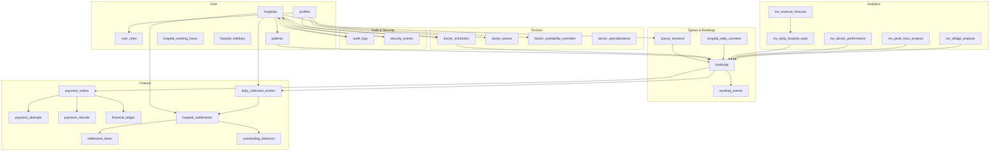
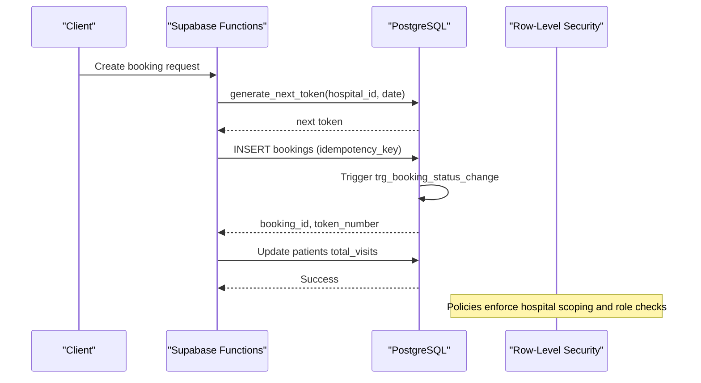
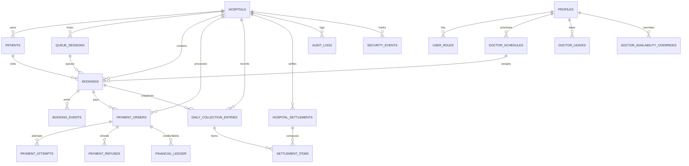

# Database Schema

<cite>
**Referenced Files in This Document**
- [01_foundation.sql](file://supabase/migrations/01_foundation.sql)
- [02_atomic_token_engine_&_bookings.sql](file://supabase/migrations/02_atomic_token_engine_&_bookings.sql)
- [03_doctorscheduling&slotengine.sql](file://supabase/migrations/03_doctorscheduling&slotengine.sql)
- [07_settlement_engine.sql](file://supabase/migrations/07_settlement_engine.sql)
- [08_analytics_engine.sql](file://supabase/migrations/08_analytics_engine.sql)
- [10_audit_&_security_engine.sql](file://supabase/migrations/10_audit_&_security_engine.sql)
- [13_payment_engine.sql](file://supabase/migrations/13_payment_engine.sql)
- [15_partitioning_strategy.sql](file://supabase/migrations/15_partitioning_strategy.sql)
- [23_retention_&_cleanup_engine.sql](file://supabase/migrations/23_retention_&_cleanup_engine.sql)
</cite>

## Table of Contents

1. Introduction
2. Project Structure
3. Core Components
4. Architecture Overview
5. Detailed Component Analysis
6. Dependency Analysis
7. Performance Considerations
8. Troubleshooting Guide
9. Conclusion

## Introduction

This document describes the Setura Hospital OS database schema with a focus on
entities for hospitals, patients, doctors, bookings, queue sessions, payments,
and audit logs. It explains table structures, constraints, indexes, primary and
foreign key relationships, data validation rules enforced at the database level,
and business logic implemented via triggers and stored procedures. It also
covers data access patterns, query optimization strategies, performance
considerations for large datasets, lifecycle management (retention and cleanup),
and security measures including row-level security policies and immutability
protections.

## Project Structure

The schema is defined across multiple migration files that build incrementally:

- Foundation and core entities: hospitals, profiles, roles, patients, working
  hours, holidays
- Queue and booking engine: daily counters, queue sessions, bookings, booking
  events, status change triggers
- Doctor scheduling and availability: specializations, schedules, blocks,
  leaves, overrides, availability functions
- Settlement engine: collection entries, settlements, items, outstanding
  balances
- Analytics engine: materialized views and refresh utilities
- Audit and security: audit logs, security events, immutability triggers, helper
  functions
- Payment engine: orders, attempts, refunds, ledger, capture/refund flows
- Partitioning strategy: planning helpers and DDL generators for future
  partition migrations
- Retention and cleanup: retention policies, operational cleanup, archival
  routines

**Diagram sources**

- [01_foundation.sql:100-522](file://supabase/migrations/01_foundation.sql#L100-L522)
- [02_atomic_token_engine_&_bookings.sql:12-373](file://supabase/migrations/02_atomic_token_engine_&_bookings.sql#L12-L373)
- [03_doctorscheduling&slotengine.sql:18-371](file://supabase/migrations/03_doctorscheduling&slotengine.sql#L18-L371)
- [07_settlement_engine.sql:30-256](file://supabase/migrations/07_settlement_engine.sql#L30-L256)
- [08_analytics_engine.sql:48-353](file://supabase/migrations/08_analytics_engine.sql#L48-L353)
- [10_audit_&_security_engine.sql:43-225](file://supabase/migrations/10_audit_&_security_engine.sql#L43-L225)
- [13_payment_engine.sql:65-373](file://supabase/migrations/13_payment_engine.sql#L65-L373)

**Section sources**

- [01_foundation.sql:100-522](file://supabase/migrations/01_foundation.sql#L100-L522)
- [02_atomic_token_engine_&_bookings.sql:12-373](file://supabase/migrations/02_atomic_token_engine_&_bookings.sql#L12-L373)
- [03_doctorscheduling&slotengine.sql:18-371](file://supabase/migrations/03_doctorscheduling&slotengine.sql#L18-L371)
- [07_settlement_engine.sql:30-256](file://supabase/migrations/07_settlement_engine.sql#L30-L256)
- [08_analytics_engine.sql:48-353](file://supabase/migrations/08_analytics_engine.sql#L48-L353)
- [10_audit_&_security_engine.sql:43-225](file://supabase/migrations/10_audit_&_security_engine.sql#L43-L225)
- [13_payment_engine.sql:65-373](file://supabase/migrations/13_payment_engine.sql#L65-L373)

## Core Components

- Hospitals: Central tenant entity with metadata, timezone, and configuration
  flags. Includes soft delete and updated_at triggers.
- Profiles and Roles: User identities linked to auth.users; roles scoped per
  hospital or global admin.
- Patients: Per-hospital patient master with deduplication index and visit
  tracking.
- Queue Sessions: Doctor-specific session windows with token capacity and live
  token tracking.
- Bookings: Core transactional record linking patients, sessions, doctors, fees,
  timestamps, and idempotency keys.
- Booking Events: Append-only history of status changes.
- Doctor Scheduling: Availability, blocks, leaves, and overrides with exclusion
  constraints to prevent overlaps.
- Settlement Engine: Daily collection snapshots, settlement aggregation, and
  outstanding balance tracking.
- Payments: Orders, attempts, refunds, and immutable financial ledger with
  capture and refund workflows.
- Audit & Security: Immutable audit logs and security event tracking with
  severity and risk scoring.
- Analytics: Materialized views for daily stats, doctor performance, peak hours,
  village analysis, and revenue forecasting.

Key constraints and validations include:

- CHECK constraints for numeric ranges and time ordering
- UNIQUE constraints for idempotency and uniqueness
- EXCLUDE constraints using GIST to prevent overlapping schedules/blocks/leaves
- Foreign keys enforcing referential integrity with ON DELETE behaviors
- Triggers for updated_at, immutability of hospital_id, and append-only
  guarantees

**Section sources**

- [01_foundation.sql:100-522](file://supabase/migrations/01_foundation.sql#L100-L522)
- [02_atomic_token_engine_&_bookings.sql:81-373](file://supabase/migrations/02_atomic_token_engine_&_bookings.sql#L81-L373)
- [03_doctorscheduling&slotengine.sql:79-371](file://supabase/migrations/03_doctorscheduling&slotengine.sql#L79-L371)
- [07_settlement_engine.sql:30-256](file://supabase/migrations/07_settlement_engine.sql#L30-L256)
- [10_audit_&_security_engine.sql:43-225](file://supabase/migrations/10_audit_&_security_engine.sql#L43-L225)
- [13_payment_engine.sql:65-373](file://supabase/migrations/13_payment_engine.sql#L65-L373)

## Architecture Overview

The system enforces multi-tenancy by hospital, with Row Level Security (RLS)
policies controlling read/write access based on user roles and hospital
membership. Business logic is centralized in stored functions and triggers to
ensure consistency and auditability.

**Diagram sources**

- [02_atomic_token_engine_&_bookings.sql:31-64](file://supabase/migrations/02_atomic_token_engine_&_bookings.sql#L31-L64)
- [02_atomic_token_engine_&_bookings.sql:446-562](file://supabase/migrations/02_atomic_token_engine_&_bookings.sql#L446-L562)
- [02_atomic_token_engine_&_bookings.sql:385-440](file://supabase/migrations/02_atomic_token_engine_&_bookings.sql#L385-L440)
- [01_foundation.sql:562-792](file://supabase/migrations/01_foundation.sql#L562-L792)

**Section sources**

- [02_atomic_token_engine_&_bookings.sql:31-64](file://supabase/migrations/02_atomic_token_engine_&_bookings.sql#L31-L64)
- [02_atomic_token_engine_&_bookings.sql:385-440](file://supabase/migrations/02_atomic_token_engine_&_bookings.sql#L385-L440)
- [02_atomic_token_engine_&_bookings.sql:446-562](file://supabase/migrations/02_atomic_token_engine_&_bookings.sql#L446-L562)
- [01_foundation.sql:562-792](file://supabase/migrations/01_foundation.sql#L562-L792)

## Detailed Component Analysis

### Hospitals, Profiles, Roles, Patients

- hospitals: Primary tenant entity with unique slug, timezone, and feature
  flags. Updated_at trigger ensures last-modified tracking. Soft delete via
  deleted_at.
- profiles: Linked to auth.users with normalized phone validation and active
  flag.
- user_roles: Enforces role scoping per hospital; global_admin has no
  hospital_id; other roles require hospital_id. Unique constraint prevents
  duplicate role assignments.
- patients: Deduplication index on hospital_id + normalized_phone +
  lower(full_name) for non-deleted rows; indices for hospital, phone,
  last_visit_date, and trigram search on name.

Data validation:

- CHECK constraints on age ranges, phone format, and working hours ordering
- UNIQUE constraints for slugs and role combinations
- Foreign keys to hospitals and profiles with appropriate ON DELETE behavior

Access control:

- RLS policies restrict reads/writes by hospital membership and role
  (global_admin vs hospital_admin vs others)

**Section sources**

- [01_foundation.sql:100-255](file://supabase/migrations/01_foundation.sql#L100-L255)
- [01_foundation.sql:382-463](file://supabase/migrations/01_foundation.sql#L382-L463)
- [01_foundation.sql:562-792](file://supabase/migrations/01_foundation.sql#L562-L792)

### Queue Sessions and Token Engine

- hospital_daily_counters: Atomic counter per hospital per day to generate
  sequential tokens.
- queue_sessions: Doctor-scoped sessions with max_tokens, current_live_token,
  and active state. Unique constraint on hospital_id + doctor_id + session_date.
- generate_next_token: Upserts counter and returns next token atomically.
- advance_queue: Locks and advances the next eligible booking to called, updates
  current_live_token.

Business rules:

- Token numbers are strictly increasing per day per hospital
- Only eligible statuses can be advanced
- Priority-based selection using priority_score and token_number

**Section sources**

- [02_atomic_token_engine_&_bookings.sql:12-64](file://supabase/migrations/02_atomic_token_engine_&_bookings.sql#L12-L64)
- [02_atomic_token_engine_&_bookings.sql:81-145](file://supabase/migrations/02_atomic_token_engine_&_bookings.sql#L81-L145)
- [02_atomic_token_engine_&_bookings.sql:576-625](file://supabase/migrations/02_atomic_token_engine_&_bookings.sql#L576-L625)

### Bookings and Status Lifecycle

- bookings: Comprehensive record linking hospital, queue session, patient,
  doctor, fees, timestamps, idempotency_key, and metadata. Unique constraint on
  queue_session_id + token_number.
- booking_events: Append-only log capturing old/new status and performed_by.
- handle_booking_status_change: Sets timestamp fields when transitioning into
  specific statuses and records an event.

Validation and integrity:

- CHECK constraints on ages, amounts, and estimated wait minutes
- UNIQUE idempotency_key to prevent duplicate bookings
- Foreign keys to hospitals, queue_sessions, patients, profiles

Access control:

- RLS policies allow admins/receptionists to manage bookings; doctors can update
  their assigned bookings

**Section sources**

- [02_atomic_token_engine_&_bookings.sql:150-373](file://supabase/migrations/02_atomic_token_engine_&_bookings.sql#L150-L373)
- [02_atomic_token_engine_&_bookings.sql:385-440](file://supabase/migrations/02_atomic_token_engine_&_bookings.sql#L385-L440)
- [02_atomic_token_engine_&_bookings.sql:734-800](file://supabase/migrations/02_atomic_token_engine_&_bookings.sql#L734-L800)

### Doctor Scheduling, Leaves, and Overrides

- doctor_schedules: Weekly availability with start/end times, buffer_minutes,
  and max_tokens. Exclusion constraint prevents overlapping intervals per
  doctor/hospital/weekday.
- doctor_schedule_blocks: Sub-blocks within schedules with overlap prevention.
- doctor_leaves: Date ranges with exclusion constraint preventing overlapping
  leave periods.
- doctor_availability_overrides: Temporary availability changes with type enum
  and optional time ranges.
- is_doctor_available: Checks leaves, overrides, holidays, and schedule
  existence.
- get_remaining_token_capacity: Computes available slots based on schedule
  max_tokens minus booked count.
- estimate_wait_minutes: Estimates wait based on ahead-of-token count and
  average consultation minutes.

Validation:

- CHECK constraints ensuring valid time ranges and minute bounds
- EXCLUDE constraints using GIST to prevent overlaps
- Indices for lookup by doctor, hospital, weekday

**Section sources**

- [03_doctorscheduling&slotengine.sql:79-371](file://supabase/migrations/03_doctorscheduling&slotengine.sql#L79-L371)
- [03_doctorscheduling&slotengine.sql:377-558](file://supabase/migrations/03_doctorscheduling&slotengine.sql#L377-L558)

### Settlement Engine

- daily_collection_entries: Immutable snapshots per booking capturing platform,
  receptionist, and hospital fees plus totals. Constraint ensures total equals
  sum of components.
- hospital_settlements: Aggregates collections over date ranges with unique
  period per hospital. Tracks paid amounts and remaining due.
- settlement_items: Line items linking settlements to collection entries.
- outstanding_balances: Running totals per hospital for
  pending/partially_paid/overdue settlements.
- create_hospital_settlement: Serializes creation using advisory lock, locks
  rows, aggregates, inserts items, marks collections settled, and refreshes
  outstanding balance.
- record_settlement_payment: Validates payment amount, updates settlement
  status, and refreshes outstanding balance.

Validation and integrity:

- CHECK constraints on positive amounts and date ranges
- UNIQUE constraints on booking_id in collections and settlement periods
- Foreign keys with RESTRICT to protect item references

**Section sources**

- [07_settlement_engine.sql:30-256](file://supabase/migrations/07_settlement_engine.sql#L30-L256)
- [07_settlement_engine.sql:316-572](file://supabase/migrations/07_settlement_engine.sql#L316-L572)

### Payment Engine

- payment_orders: Captures gateway order/payment IDs, amounts, currency, status
  transitions, and responses. Generated column for amount_paise from amount_inr.
- payment_attempts: Records each attempt with method details, errors, and
  responses.
- payment_refunds: Tracks refund initiation, processing, and outcomes with
  gateway references.
- financial_ledger: Immutable ledger entries for credits/debits with entry types
  for booking fees, platform fees, receptionist incentives, refunds,
  settlements, and adjustments.
- write_booking_ledger_entries: Inserts ledger entries for platform and
  receptionist fees upon booking insert if amounts > 0.
- capture_payment: Safely captures payment, updates booking payment_completed,
  and records ledger entry.
- initiate_refund / confirm_refund_processed: Validates captured payments,
  creates refund records, updates statuses, and records ledger entries.

Validation and integrity:

- CHECK constraints on positive amounts and JSONB structure
- UNIQUE constraints on gateway_order_id, gateway_payment_id, idempotency_key
- Triggers prevent updates/deletes to financial_ledger

**Section sources**

- [13_payment_engine.sql:65-373](file://supabase/migrations/13_payment_engine.sql#L65-L373)
- [13_payment_engine.sql:410-487](file://supabase/migrations/13_payment_engine.sql#L410-L487)
- [13_payment_engine.sql:593-800](file://supabase/migrations/13_payment_engine.sql#L593-L800)

### Audit and Security

- audit_logs: Append-only log of actions with entity context, severity, old/new
  data, and metadata. Prevents updates/deletes via trigger.
- security_events: Tracks failed logins, unauthorized access, role escalation
  attempts, suspicious activity, and more with risk scores and resolution
  workflow.
- write_audit_log / log_security_event: Centralized writers to ensure consistent
  logging.
- resolve_security_event: Marks events resolved with actor and notes.

Validation and integrity:

- CHECK constraints on JSONB structure and risk score range
- Triggers enforce immutability of audit_logs
- RLS policies restrict access to hospital admins and global admins

**Section sources**

- [10_audit_&_security_engine.sql:43-225](file://supabase/migrations/10_audit_&_security_engine.sql#L43-L225)
- [10_audit_&_security_engine.sql:255-420](file://supabase/migrations/10_audit_&_security_engine.sql#L255-L420)
- [10_audit_&_security_engine.sql:442-472](file://supabase/migrations/10_audit_&_security_engine.sql#L442-L472)

### Analytics Engine

- mv_daily_hospital_stats: Daily metrics per hospital including patient counts,
  revenue, wait times, and consultation durations.
- mv_doctor_performance: Doctor-level metrics per day including completed
  patients, average consultation minutes, wait times, and revenue.
- mv_peak_hour_analysis: Consultation counts by hour per hospital per day.
- mv_village_analysis: Patient counts by village per hospital per day.
- mv_revenue_forecast: Rolling averages of revenue and patients over 7 days.
- refresh_analytics_views: Concurrent refresh with advisory lock and logging.

Optimization:

- Materialized views reduce heavy aggregations
- Indexes on core columns support efficient refresh and queries

**Section sources**

- [08_analytics_engine.sql:48-353](file://supabase/migrations/08_analytics_engine.sql#L48-L353)
- [08_analytics_engine.sql:377-446](file://supabase/migrations/08_analytics_engine.sql#L377-L446)

### Partitioning Strategy

- partition_management: Configuration for tables to partition, strategy
  (monthly/quarterly/yearly), partition column, thresholds, and retention
  months.
- generate_*_partition_ddl: Functions to produce DDL for creating partitioned
  tables and monthly partitions for bookings, audit logs, and WhatsApp messages.
- check_partition_readiness / get_partition_maintenance_advice: Utilities to
  assess readiness and provide recommendations.

Operational guidance:

- Partitioning is not applied immediately; it provides planning and generation
  tools to execute during maintenance windows after verification and testing.

**Section sources**

- [15_partitioning_strategy.sql:35-166](file://supabase/migrations/15_partitioning_strategy.sql#L35-L166)
- [15_partitioning_strategy.sql:172-406](file://supabase/migrations/15_partitioning_strategy.sql#L172-L406)
- [15_partitioning_strategy.sql:412-503](file://supabase/migrations/15_partitioning_strategy.sql#L412-L503)

### Retention and Cleanup

- retention_policies: Defines retention_days and hard_delete_after_days per
  table with legal_basis and notes.
- cleanup_run_log: Logs cleanup runs with success/failure and duration.
- cleanup_operational_data / soft_delete_aged_messages / run_retention_cleanup:
  Functions to clean operational data and archive aged messages.
- Default policies set long retention for medical and financial records and
  shorter retention for operational logs.

Lifecycle management:

- Soft deletion/archival for older messages
- Hard deletes for short-lived operational data
- Centralized reporting via get_retention_report

**Section sources**

- [23_retention_&_cleanup_engine.sql:55-184](file://supabase/migrations/23_retention_&_cleanup_engine.sql#L55-L184)
- [23_retention_&_cleanup_engine.sql:190-321](file://supabase/migrations/23_retention_&_cleanup_engine.sql#L190-L321)
- [23_retention_&_cleanup_engine.sql:327-367](file://supabase/migrations/23_retention_&_cleanup_engine.sql#L327-L367)

## Dependency Analysis

Entity relationships maintain data integrity through explicit foreign keys and
constraints:

- bookings depend on hospitals, queue_sessions, patients, and profiles
- payment_orders link to bookings and hospitals; attempts and refunds depend on
  orders
- daily_collection_entries snapshot booking fee data and feed settlements
- audit_logs and security_events reference hospitals and users for traceability
- doctor_schedules, leaves, and overrides reference doctors (profiles) and
  hospitals

**Diagram sources**

- [01_foundation.sql:100-522](file://supabase/migrations/01_foundation.sql#L100-L522)
- [02_atomic_token_engine_&_bookings.sql:81-373](file://supabase/migrations/02_atomic_token_engine_&_bookings.sql#L81-L373)
- [03_doctorscheduling&slotengine.sql:79-371](file://supabase/migrations/03_doctorscheduling&slotengine.sql#L79-L371)
- [07_settlement_engine.sql:30-256](file://supabase/migrations/07_settlement_engine.sql#L30-L256)
- [13_payment_engine.sql:65-373](file://supabase/migrations/13_payment_engine.sql#L65-L373)
- [10_audit_&_security_engine.sql:43-225](file://supabase/migrations/10_audit_&_security_engine.sql#L43-L225)

**Section sources**

- [01_foundation.sql:100-522](file://supabase/migrations/01_foundation.sql#L100-L522)
- [02_atomic_token_engine_&_bookings.sql:81-373](file://supabase/migrations/02_atomic_token_engine_&_bookings.sql#L81-L373)
- [03_doctorscheduling&slotengine.sql:79-371](file://supabase/migrations/03_doctorscheduling&slotengine.sql#L79-L371)
- [07_settlement_engine.sql:30-256](file://supabase/migrations/07_settlement_engine.sql#L30-L256)
- [13_payment_engine.sql:65-373](file://supabase/migrations/13_payment_engine.sql#L65-L373)
- [10_audit_&_security_engine.sql:43-225](file://supabase/migrations/10_audit_&_security_engine.sql#L43-L225)

## Performance Considerations

- Indexing strategy:
  - Partial indexes filter out deleted rows for high-cardinality tables like
    bookings and audit logs
  - Composite indexes optimize common filters (hospital_id + appointment_date,
    status, doctor assignments)
  - Trigram GIN index supports fuzzy name searches for patients
- Concurrency controls:
  - FOR UPDATE SKIP LOCKED in advance_queue prevents contention
  - Advisory locks serialize settlement creation and analytics refresh
- Materialized views:
  - Precompute expensive aggregations for daily stats, doctor performance, peak
    hours, village analysis, and revenue forecasts
  - Concurrent refresh minimizes downtime
- Partitioning readiness:
  - Planning helpers and DDL generators prepare for monthly partitions on
    high-growth tables (bookings, audit logs, whatsapp messages, financial
    ledger)
- Query optimization:
  - Use indexed columns for filtering (hospital_id, appointment_date, status)
  - Leverage materialized views for reporting dashboards
  - Avoid scanning deleted rows by using partial indexes

[No sources needed since this section provides general guidance]

## Troubleshooting Guide

Common issues and resolutions:

- Duplicate booking attempts:
  - Idempotency_key prevents duplicates; verify uniqueness and retry handling
  - Check create_booking function path for idempotency checks
- Token conflicts:
  - Ensure generate_next_token is used consistently; verify
    hospital_daily_counters updates
- Overlapping schedules:
  - Exclusion constraints will reject overlapping doctor_schedules, blocks, and
    leaves; adjust times or use overrides
- Payment capture failures:
  - Verify gateway_order_id exists and is not already captured; inspect
    payment_attempts error fields
- Refund validation:
  - Ensure payment is captured before initiating refund; validate refund_amount
    does not exceed original amount
- Audit immutability errors:
  - Updates/deletes to audit_logs are blocked; use new writes instead
- Security events resolution:
  - Use resolve_security_event to mark events resolved; ensure proper
    permissions

**Section sources**

- [02_atomic_token_engine_&_bookings.sql:446-562](file://supabase/migrations/02_atomic_token_engine_&_bookings.sql#L446-L562)
- [03_doctorscheduling&slotengine.sql:126-149](file://supabase/migrations/03_doctorscheduling&slotengine.sql#L126-L149)
- [13_payment_engine.sql:593-800](file://supabase/migrations/13_payment_engine.sql#L593-L800)
- [10_audit_&_security_engine.sql:232-249](file://supabase/migrations/10_audit_&_security_engine.sql#L232-L249)
- [10_audit_&_security_engine.sql:393-420](file://supabase/migrations/10_audit_&_security_engine.sql#L393-L420)

## Conclusion

The Setura Hospital OS database schema provides a robust, secure, and scalable
foundation for hospital operations. It enforces strong data integrity through
constraints, triggers, and RLS policies, while centralizing business logic in
stored functions for consistency and auditability. The design supports
high-volume operations with indexing, concurrency controls, and prepared
partitioning strategies. Lifecycle management via retention policies and cleanup
routines ensures compliance and operational efficiency. Analytics materialized
views enable fast reporting and insights. Overall, the schema balances
correctness, performance, and maintainability for production environments.

[No sources needed since this section summarizes without analyzing specific
files]
