# Foundation Data

<cite>
**Referenced Files in This Document**
- [01_foundation.sql](file://supabase/migrations/01_foundation.sql)
- [02_atomic_token_engine_&_bookings.sql](file://supabase/migrations/02_atomic_token_engine_&_bookings.sql)
- [03_doctorscheduling&slotengine.sql](file://supabase/migrations/03_doctorscheduling&slotengine.sql)
- [09_abuse_protection_&_rate_limiting.sql](file://supabase/migrations/09_abuse_protection_&_rate_limiting.sql)
- [seed.sql](file://supabase/seed.sql)
- [validation.ts](file://supabase/functions/_shared/validation.ts)
</cite>

## Table of Contents

1. [Introduction](#introduction)
2. [Project Structure](#project-structure)
3. [Core Components](#core-components)
4. [Architecture Overview](#architecture-overview)
5. [Detailed Component Analysis](#detailed-component-analysis)
6. [Dependency Analysis](#dependency-analysis)
7. [Performance Considerations](#performance-considerations)
8. [Troubleshooting Guide](#troubleshooting-guide)
9. [Conclusion](#conclusion)

## Introduction

This document describes the foundation data layer of Setura Hospital OS,
focusing on core entities that establish multi-tenant isolation and role-based
access control: hospitals, profiles, user roles, and patients. It explains table
structures, constraints, indexes, validation rules, row-level security policies,
seed patterns, and immutable hospital_id enforcement mechanisms that ensure
tenant isolation and data integrity.

## Project Structure

The foundation layer is defined primarily in the first few migrations and
supported by seed data and shared validation utilities:

- Migrations define schemas, enums, triggers, functions, and Row-Level Security
  (RLS) policies.
- Seed data provides deterministic baseline tenants and users for consistent
  environments.
- Validation utilities normalize inputs such as phone numbers to maintain
  consistency across layers.

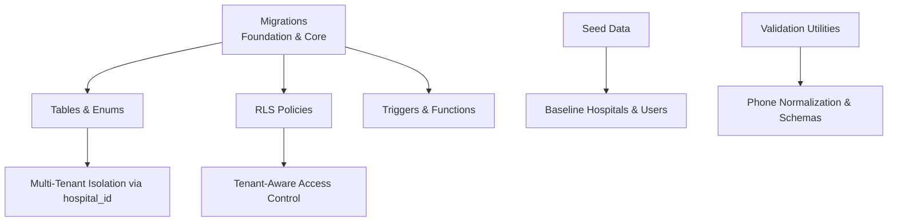

**Section sources**

- [01_foundation.sql:100-137](file://supabase/migrations/01_foundation.sql#L100-L137)
- [01_foundation.sql:155-185](file://supabase/migrations/01_foundation.sql#L155-L185)
- [01_foundation.sql:202-235](file://supabase/migrations/01_foundation.sql#L202-L235)
- [01_foundation.sql:382-419](file://supabase/migrations/01_foundation.sql#L382-L419)
- [seed.sql:55-155](file://supabase/seed.sql#L55-L155)
- [validation.ts:23-43](file://supabase/functions/_shared/validation.ts#L23-L43)

## Core Components

- Hospitals: Tenant root entity with configuration flags and location metadata.
- Profiles: User identity linked to authentication system with normalized phone
  and language preferences.
- User Roles: Role assignments scoped per hospital or globally; enforces
  global_admin vs hospital-scoped roles.
- Patients: Per-hospital patient records with deduplication and health
  attributes.
- Supporting tables: Working hours and holidays for scheduling context.

Key design principles:

- Multi-tenancy enforced through foreign keys to hospitals and RLS policies.
- Immutable hospital_id via triggers to prevent cross-tenant migration of
  records.
- Database-level constraints enforce valid ranges and formats (age, phone).
- Enumerations constrain status and source values at the database level.

**Section sources**

- [01_foundation.sql:100-137](file://supabase/migrations/01_foundation.sql#L100-L137)
- [01_foundation.sql:155-185](file://supabase/migrations/01_foundation.sql#L155-L185)
- [01_foundation.sql:202-235](file://supabase/migrations/01_foundation.sql#L202-L235)
- [01_foundation.sql:382-419](file://supabase/migrations/01_foundation.sql#L382-L419)
- [01_foundation.sql:468-493](file://supabase/migrations/01_foundation.sql#L468-L493)
- [01_foundation.sql:507-522](file://supabase/migrations/01_foundation.sql#L507-L522)

## Architecture Overview

The foundation establishes a multi-tenant architecture where each hospital
isolates its operational data. All tenant-scoped tables include a hospital_id
foreign key, and RLS policies restrict access based on user roles and hospital
membership. Global administrators can bypass tenant isolation for platform-wide
operations.

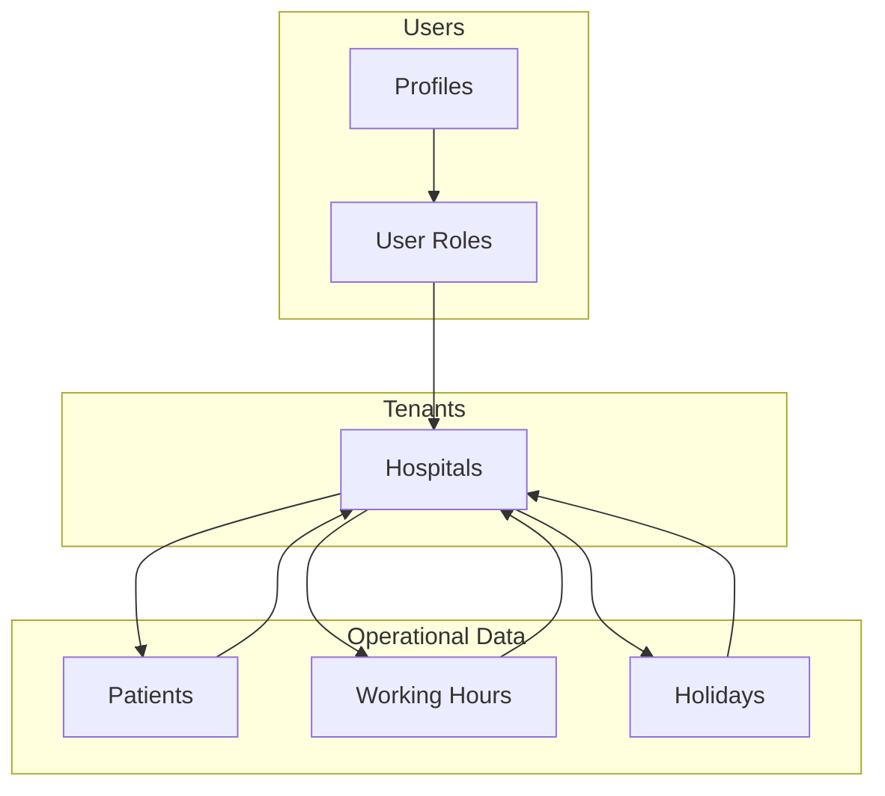

**Diagram sources**

- [01_foundation.sql:100-137](file://supabase/migrations/01_foundation.sql#L100-L137)
- [01_foundation.sql:155-185](file://supabase/migrations/01_foundation.sql#L155-L185)
- [01_foundation.sql:202-235](file://supabase/migrations/01_foundation.sql#L202-L235)
- [01_foundation.sql:382-419](file://supabase/migrations/01_foundation.sql#L382-L419)
- [01_foundation.sql:468-493](file://supabase/migrations/01_foundation.sql#L468-L493)
- [01_foundation.sql:507-522](file://supabase/migrations/01_foundation.sql#L507-L522)

## Detailed Component Analysis

### Hospitals

- Purpose: Represents a tenant organization with configuration and contact
  details.
- Key fields: id (UUID), name, slug (unique), phone/email,
  country/state/district/town, timezone, flags for activity and subscription,
  max_advance_booking_days, timestamps.
- Constraints: Slug uniqueness, default values for location/timezone, boolean
  flags, numeric range checks for booking window.
- Indexes: Partial index on active hospitals for efficient listing.
- RLS: Read accessible to global admins or users with hospital access;
  management restricted to global admins.

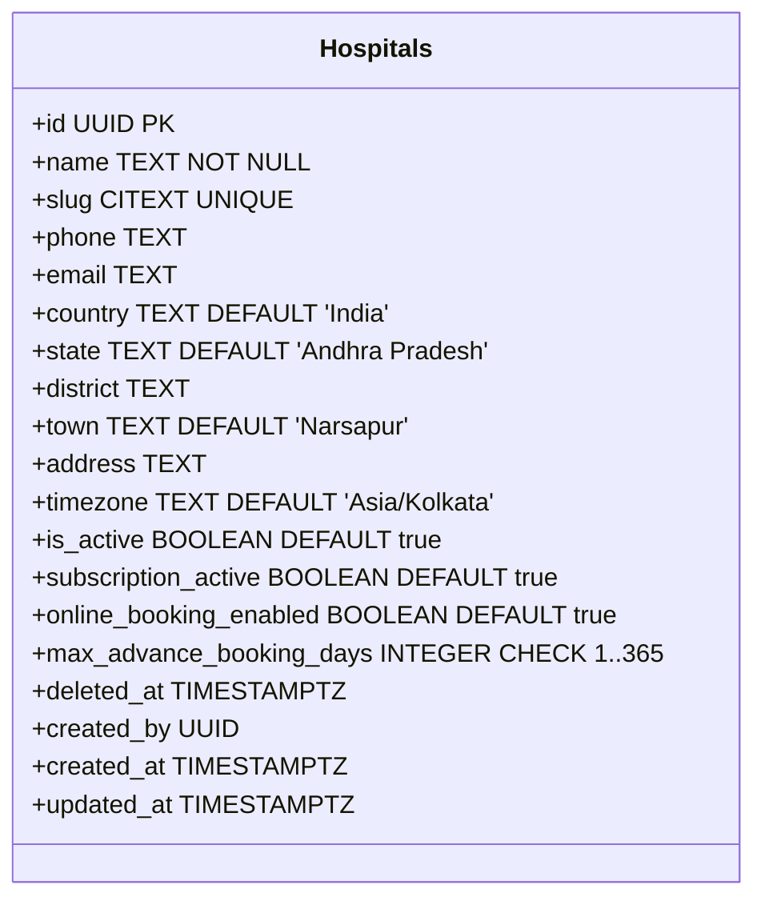

**Diagram sources**

- [01_foundation.sql:100-137](file://supabase/migrations/01_foundation.sql#L100-L137)

**Section sources**

- [01_foundation.sql:100-137](file://supabase/migrations/01_foundation.sql#L100-L137)
- [01_foundation.sql:139-149](file://supabase/migrations/01_foundation.sql#L139-L149)
- [01_foundation.sql:580-602](file://supabase/migrations/01_foundation.sql#L580-L602)

### Profiles

- Purpose: User profile extending authentication identities with display and
  contact info.
- Key fields: id (PK referencing auth.users), full_name, normalized_phone,
  avatar_url, preferred_language, is_active, last_login_at, timestamps.
- Constraints: Phone normalization validated via regex pattern; defaults for
  language and active flag.
- Indexes: On normalized_phone for lookup performance.
- RLS: Self-access policy allows users to manage their own profile; hospital
  admins can read profiles within their hospital scope.

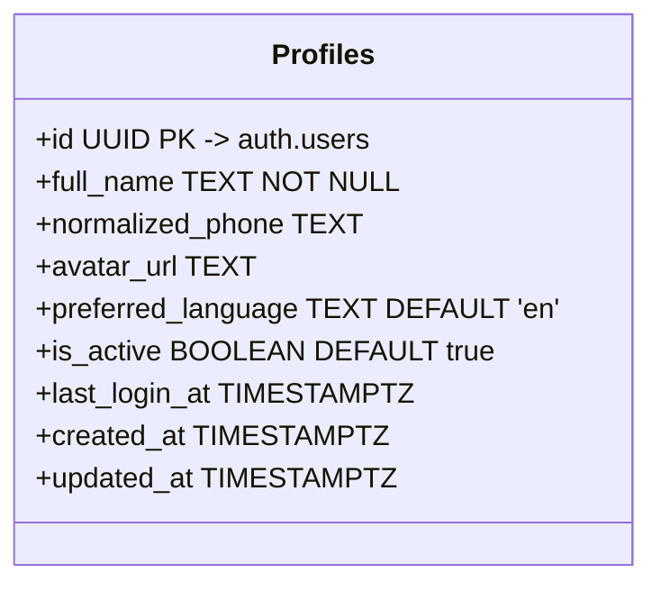

**Diagram sources**

- [01_foundation.sql:155-185](file://supabase/migrations/01_foundation.sql#L155-L185)

**Section sources**

- [01_foundation.sql:155-185](file://supabase/migrations/01_foundation.sql#L155-L185)
- [01_foundation.sql:608-638](file://supabase/migrations/01_foundation.sql#L608-L638)

### User Roles

- Purpose: Assigns roles to users within a hospital context or globally.
- Key fields: id (UUID), user_id (FK to profiles), hospital_id (nullable), role
  enum, is_primary flag, timestamps.
- Constraints: Unique constraint on (user_id, hospital_id, role); ensures
  global_admin has no hospital_id while non-global roles require a hospital_id.
- Indexes: Primary role uniqueness optimization; indexes on user_id,
  hospital_id, role for fast lookups.
- RLS: Readable by self or global admins; management restricted to global
  admins.

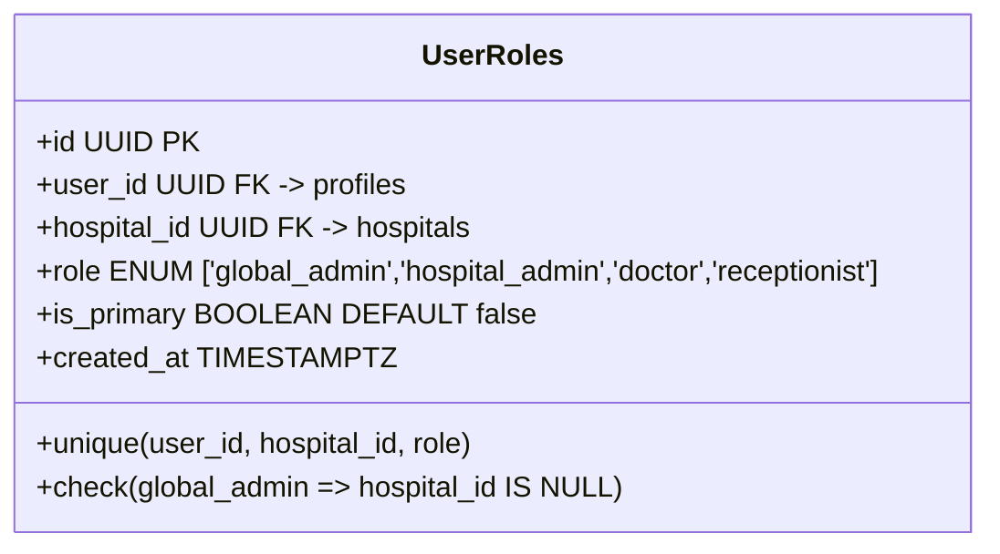

**Diagram sources**

- [01_foundation.sql:202-235](file://supabase/migrations/01_foundation.sql#L202-L235)

**Section sources**

- [01_foundation.sql:202-235](file://supabase/migrations/01_foundation.sql#L202-L235)
- [01_foundation.sql:644-666](file://supabase/migrations/01_foundation.sql#L644-L666)

### Patients

- Purpose: Stores per-hospital patient information with health attributes and
  visit history.
- Key fields: id (UUID), hospital_id (FK), full_name, normalized_phone (NOT
  NULL), age (validated range), gender, village, blood_group, chronic conditions
  flags, total_visits, last_visit_date, soft delete flag, timestamps.
- Constraints: Age between 0 and 150; total_visits non-negative; unique partial
  index for deduplication on (hospital_id, normalized_phone, lower(full_name))
  excluding deleted rows.
- Indexes: Optimized for hospital-scoped queries, phone lookups, recent visits,
  and fuzzy name search using trigram GIN index.
- RLS: Readable by global admins or users with hospital access; insert/update
  allowed for hospital_admin, doctor, receptionist within the same hospital.

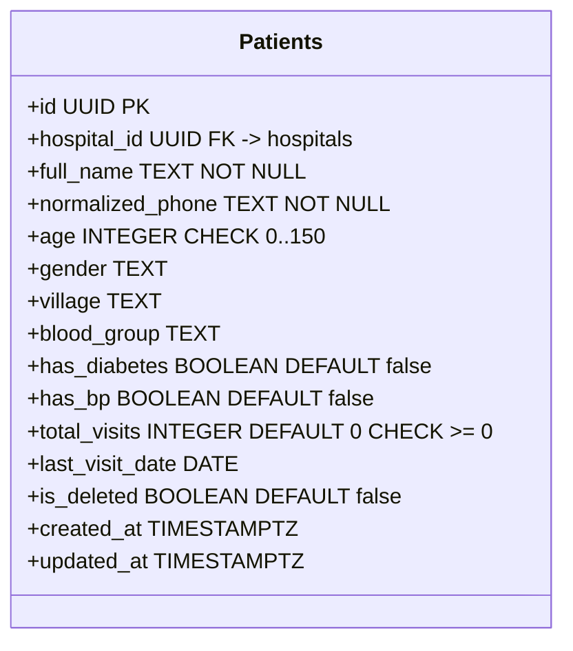

**Diagram sources**

- [01_foundation.sql:382-419](file://supabase/migrations/01_foundation.sql#L382-L419)

**Section sources**

- [01_foundation.sql:382-419](file://supabase/migrations/01_foundation.sql#L382-L419)
- [01_foundation.sql:421-454](file://supabase/migrations/01_foundation.sql#L421-L454)
- [01_foundation.sql:672-728](file://supabase/migrations/01_foundation.sql#L672-L728)

### Working Hours and Holidays

- Purpose: Define operational availability per hospital.
- Working hours: weekday (0–6), open/close times, is_open flag; unique per
  (hospital_id, weekday); time validity check ensures close_time > open_time.
- Holidays: holiday_date with optional description; unique per (hospital_id,
  holiday_date).
- RLS: Readable by global admins or users with hospital access; management
  restricted to hospital_admin or global_admin.

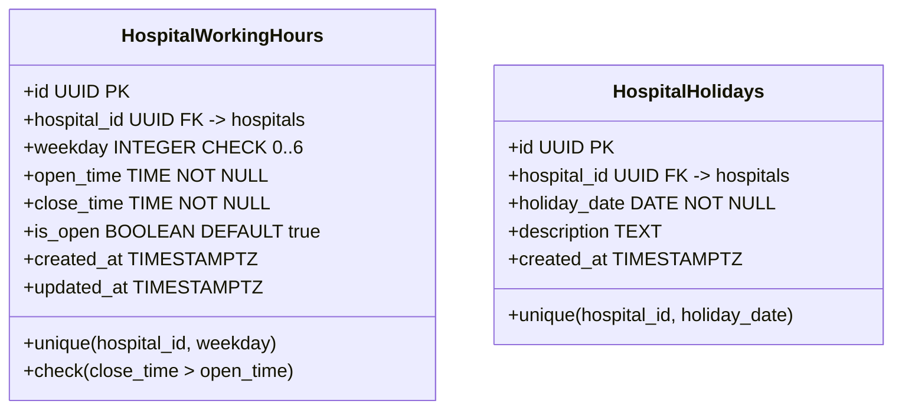

**Diagram sources**

- [01_foundation.sql:468-493](file://supabase/migrations/01_foundation.sql#L468-L493)
- [01_foundation.sql:507-522](file://supabase/migrations/01_foundation.sql#L507-L522)

**Section sources**

- [01_foundation.sql:468-493](file://supabase/migrations/01_foundation.sql#L468-L493)
- [01_foundation.sql:507-522](file://supabase/migrations/01_foundation.sql#L507-L522)
- [01_foundation.sql:734-792](file://supabase/migrations/01_foundation.sql#L734-L792)

### Booking Status and Source Enums

- Purpose: Constrain booking lifecycle states and origins at the database level.
- Booking status: booked, checked_in, waiting, called, in_consultation,
  completed, cancelled, no_show, rescheduled, skipped.
- Booking source: online, manual_free, manual_whatsapp, walkin.

These enums are referenced by bookings and related operational tables to ensure
consistent state transitions and origin tracking.

**Section sources**

- [01_foundation.sql:20-60](file://supabase/migrations/01_foundation.sql#L20-L60)
- [02_atomic_token_engine_&_bookings.sql:150-200](file://supabase/migrations/02_atomic_token_engine_&_bookings.sql#L150-L200)

### Multi-Tenant Isolation and Row-Level Security

- Mechanism: Every tenant-scoped table includes hospital_id; RLS policies
  enforce access based on current user’s roles and hospital membership.
- Helper functions: current_user_role, is_global_admin,
  user_has_hospital_access, user_has_hospital_role provide reusable checks for
  policies.
- Enforcement: Policies enable selective read/write access per role and tenant;
  global_admin bypasses tenant boundaries.

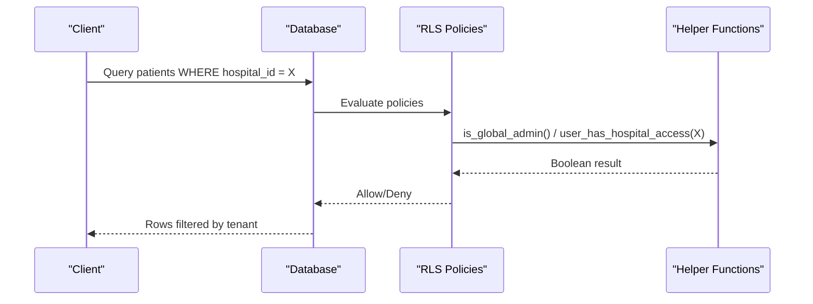

**Diagram sources**

- [01_foundation.sql:261-376](file://supabase/migrations/01_foundation.sql#L261-L376)
- [01_foundation.sql:562-574](file://supabase/migrations/01_foundation.sql#L562-L574)
- [01_foundation.sql:580-792](file://supabase/migrations/01_foundation.sql#L580-L792)

**Section sources**

- [01_foundation.sql:261-376](file://supabase/migrations/01_foundation.sql#L261-L376)
- [01_foundation.sql:562-574](file://supabase/migrations/01_foundation.sql#L562-L574)
- [01_foundation.sql:580-792](file://supabase/migrations/01_foundation.sql#L580-L792)

### Immutable hospital_id Enforcement

- Mechanism: Trigger function prevents updates to hospital_id across
  tenant-scoped tables.
- Applied to: hospitals (guard function exists), patients, queue_sessions,
  doctor_schedules, etc.
- Effect: Ensures records cannot be migrated across hospitals post-creation,
  preserving tenant isolation.

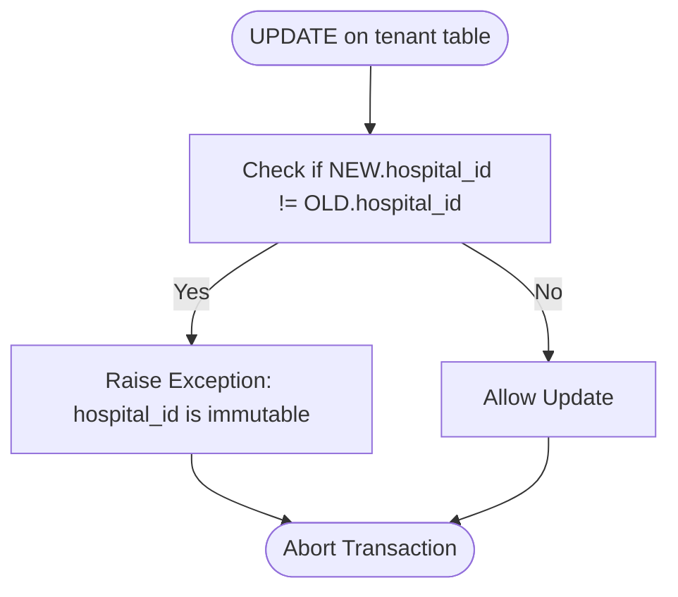

**Diagram sources**

- [01_foundation.sql:77-94](file://supabase/migrations/01_foundation.sql#L77-L94)
- [01_foundation.sql:456-462](file://supabase/migrations/01_foundation.sql#L456-L462)

**Section sources**

- [01_foundation.sql:77-94](file://supabase/migrations/01_foundation.sql#L77-L94)
- [01_foundation.sql:456-462](file://supabase/migrations/01_foundation.sql#L456-L462)

### Data Validation Rules

- Phone normalization: Enforced at application layer via Zod schema and at
  database layer via CHECK constraints and helper functions.
  - Application: normalizePhone strips formatting and country code for Indian
    numbers; validates 10-digit mobile format.
  - Database: CHECK on normalized_phone pattern; additional normalization
    function available for SQL-side usage.
- Age constraints: Enforced via CHECK constraints ensuring ages between 0 and
  150 for both patients and booking-related fields.
- Booking status/source: Enforced via ENUM types to limit values to predefined
  sets.

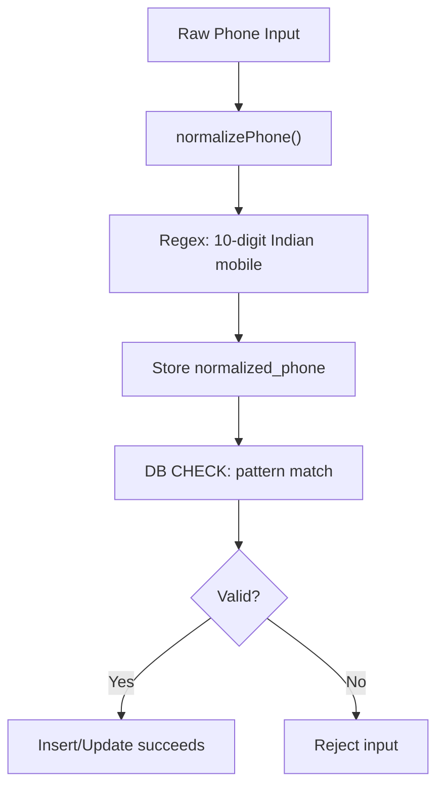

**Diagram sources**

- [validation.ts:23-43](file://supabase/functions/_shared/validation.ts#L23-L43)
- [01_foundation.sql:180-185](file://supabase/migrations/01_foundation.sql#L180-L185)
- [09_abuse_protection_&_rate_limiting.sql:41-70](file://supabase/migrations/09_abuse_protection_&_rate_limiting.sql#L41-L70)

**Section sources**

- [validation.ts:23-43](file://supabase/functions/_shared/validation.ts#L23-L43)
- [01_foundation.sql:180-185](file://supabase/migrations/01_foundation.sql#L180-L185)
- [09_abuse_protection_&_rate_limiting.sql:41-70](file://supabase/migrations/09_abuse_protection_&_rate_limiting.sql#L41-L70)

### Seed Data Patterns

- Deterministic IDs: Fixed UUIDs for hospitals and users ensure identical
  environments across runs.
- Idempotent inserts: ON CONFLICT DO NOTHING or DO UPDATE guarantees safe
  re-runs.
- Baseline setup: Creates pilot hospital (Surya Hospital), roles (global_admin,
  hospital_admin, doctor, receptionist), working hours, settings, and feature
  flags.
- Password hashing: Uses fixed bcrypt hash for reproducibility.

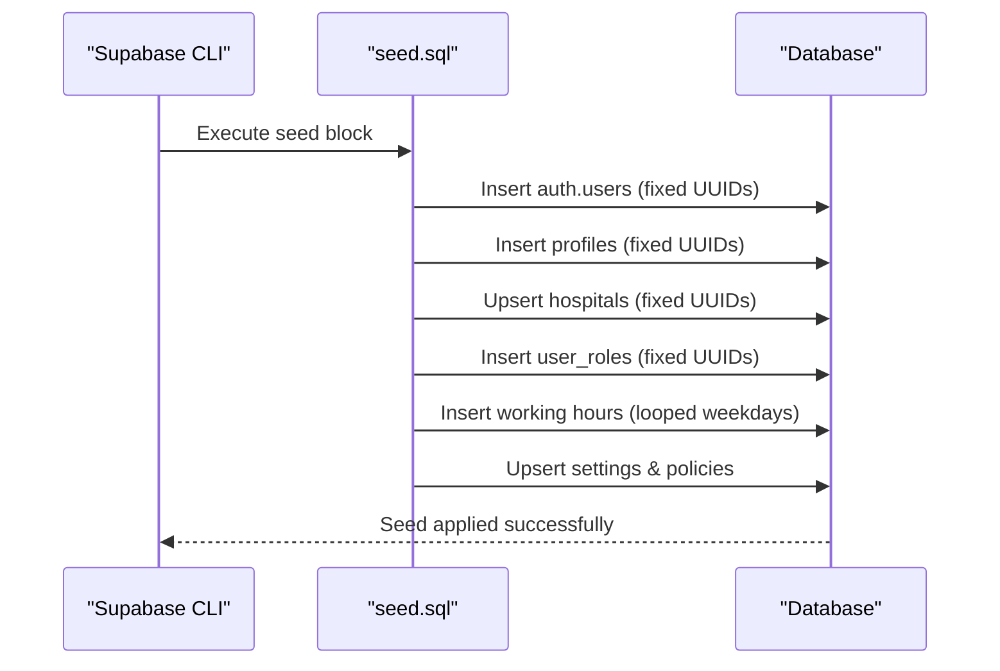

**Diagram sources**

- [seed.sql:37-155](file://supabase/seed.sql#L37-L155)
- [seed.sql:170-188](file://supabase/seed.sql#L170-L188)
- [seed.sql:219-269](file://supabase/seed.sql#L219-L269)

**Section sources**

- [seed.sql:37-155](file://supabase/seed.sql#L37-L155)
- [seed.sql:170-188](file://supabase/seed.sql#L170-L188)
- [seed.sql:219-269](file://supabase/seed.sql#L219-L269)

## Dependency Analysis

- Foreign Keys:
  - profiles.id references auth.users.id (CASCADE).
  - user_roles.user_id references profiles.id (CASCADE).
  - user_roles.hospital_id references hospitals.id (CASCADE).
  - patients.hospital_id references hospitals.id (CASCADE).
  - Working hours/holidays reference hospitals.id (CASCADE).
- Indexes:
  - Partial and composite indexes optimize tenant-scoped queries and
    deduplication.
  - Trigram GIN index supports fuzzy name searches.
- RLS Dependencies:
  - Policies depend on helper functions that query user_roles and auth context.
  - Policies enforce tenant isolation and role-based permissions.

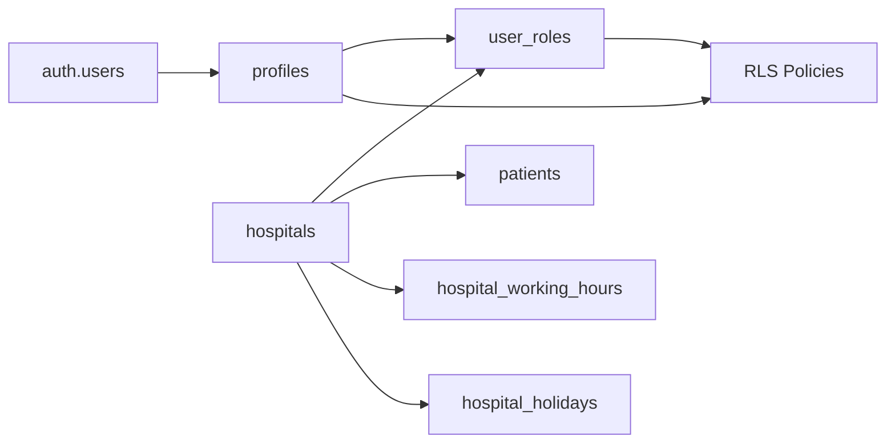

**Diagram sources**

- [01_foundation.sql:155-185](file://supabase/migrations/01_foundation.sql#L155-L185)
- [01_foundation.sql:202-235](file://supabase/migrations/01_foundation.sql#L202-L235)
- [01_foundation.sql:382-419](file://supabase/migrations/01_foundation.sql#L382-L419)
- [01_foundation.sql:468-493](file://supabase/migrations/01_foundation.sql#L468-L493)
- [01_foundation.sql:507-522](file://supabase/migrations/01_foundation.sql#L507-L522)
- [01_foundation.sql:261-376](file://supabase/migrations/01_foundation.sql#L261-L376)

**Section sources**

- [01_foundation.sql:155-185](file://supabase/migrations/01_foundation.sql#L155-L185)
- [01_foundation.sql:202-235](file://supabase/migrations/01_foundation.sql#L202-L235)
- [01_foundation.sql:382-419](file://supabase/migrations/01_foundation.sql#L382-L419)
- [01_foundation.sql:468-493](file://supabase/migrations/01_foundation.sql#L468-L493)
- [01_foundation.sql:507-522](file://supabase/migrations/01_foundation.sql#L507-L522)
- [01_foundation.sql:261-376](file://supabase/migrations/01_foundation.sql#L261-L376)

## Performance Considerations

- Use partial indexes to reduce index size and improve scan performance for
  active or non-deleted rows.
- Composite indexes on hospital_id and frequently queried fields (e.g.,
  normalized_phone, last_visit_date) accelerate tenant-scoped lookups.
- Trigram GIN index enables efficient fuzzy name matching without full-table
  scans.
- Avoid updating hospital_id to prevent expensive data migrations and maintain
  referential integrity.

[No sources needed since this section provides general guidance]

## Troubleshooting Guide

- RLS Denials:
  - Ensure the current user has a role assigned for the target hospital or is a
    global_admin.
  - Verify helper functions return expected results for the authenticated user.
- Constraint Violations:
  - Phone normalization failures indicate invalid format; validate input before
    submission.
  - Age out-of-range errors require correcting input values.
- Immutable hospital_id Errors:
  - Attempts to change hospital_id will raise exceptions; update other fields
    instead.
- Seed Conflicts:
  - Re-running seeds is safe due to idempotent upserts; conflicts are ignored or
    updated deterministically.

**Section sources**

- [01_foundation.sql:261-376](file://supabase/migrations/01_foundation.sql#L261-L376)
- [01_foundation.sql:180-185](file://supabase/migrations/01_foundation.sql#L180-L185)
- [01_foundation.sql:77-94](file://supabase/migrations/01_foundation.sql#L77-L94)
- [seed.sql:37-155](file://supabase/seed.sql#L37-L155)

## Conclusion

The foundation data layer of Setura Hospital OS establishes robust multi-tenant
isolation through hospital-scoped entities, strict constraints, and
comprehensive Row-Level Security policies. The combination of database-level
validations, immutable hospital_id enforcement, and deterministic seed data
ensures data integrity, predictable environments, and secure access control
across global and hospital-specific roles.

[No sources needed since this section summarizes without analyzing specific
files]
