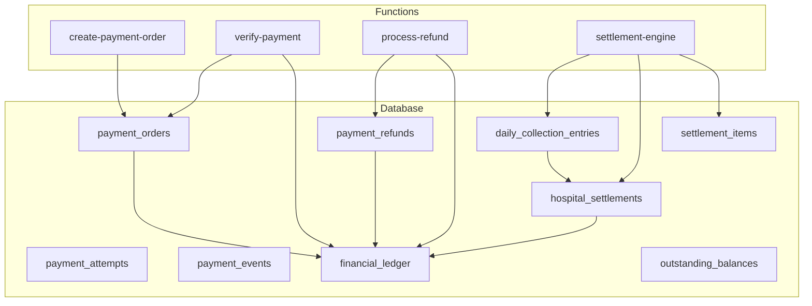
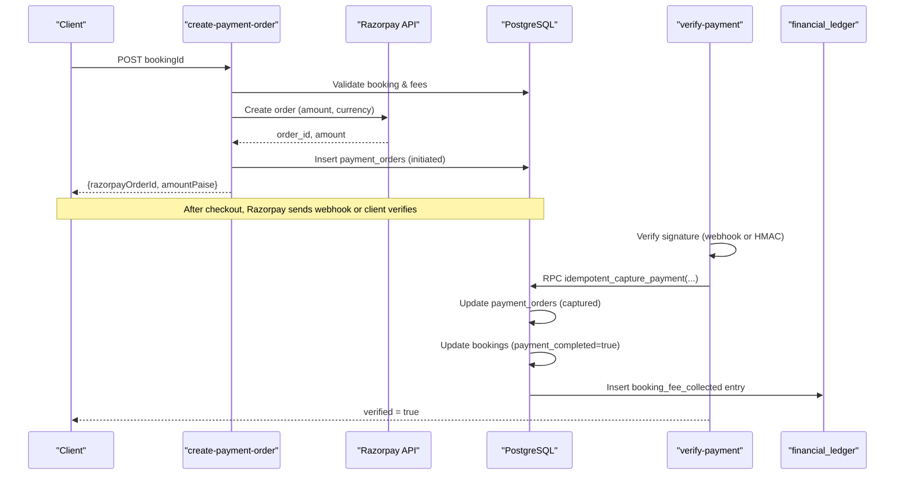
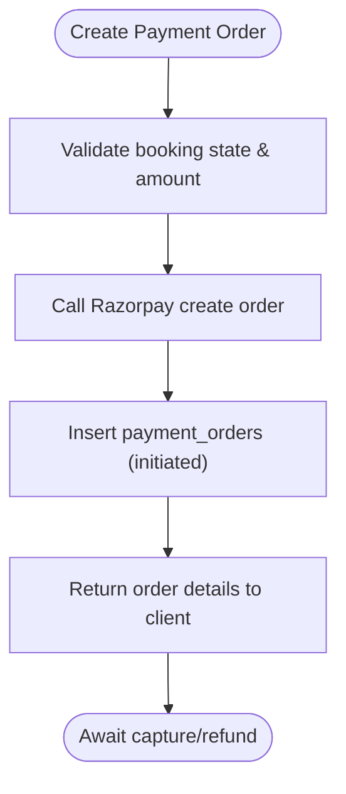
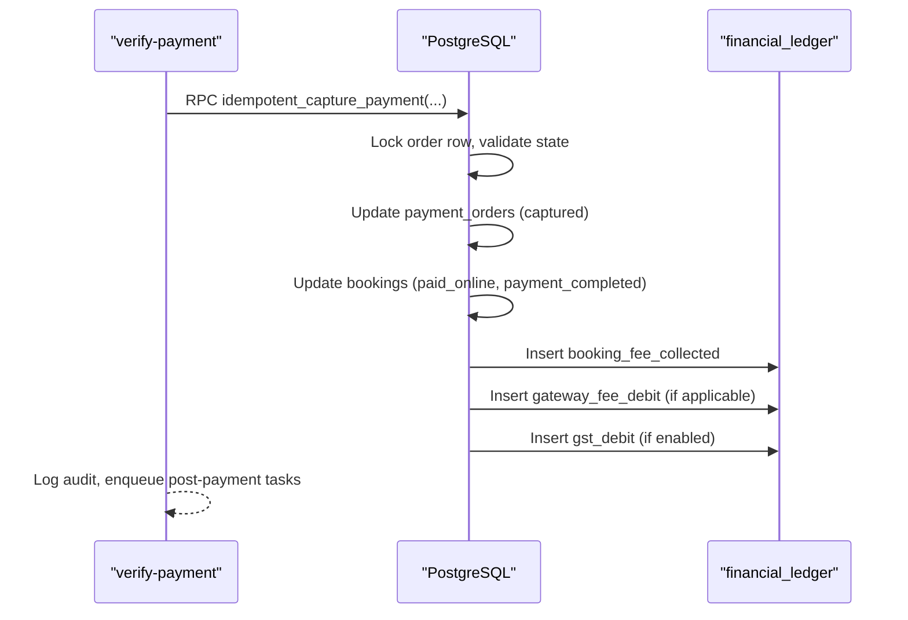
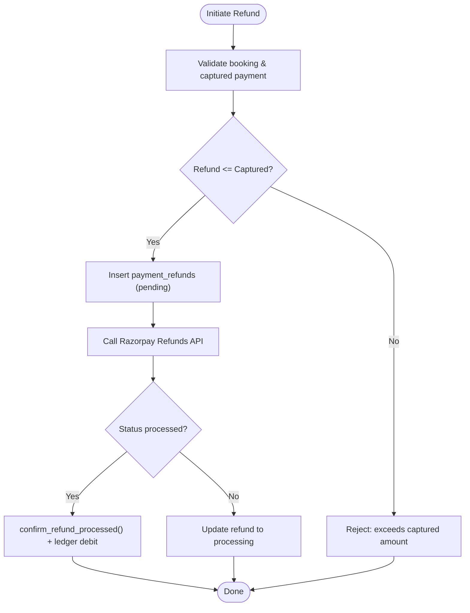
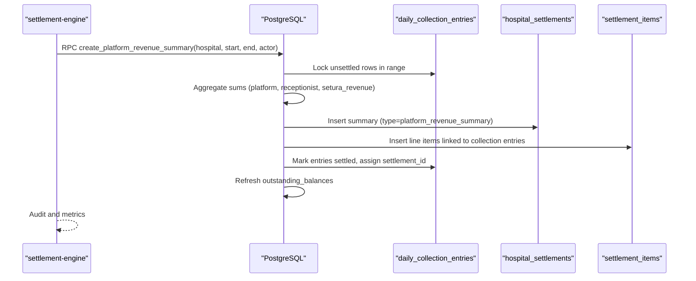
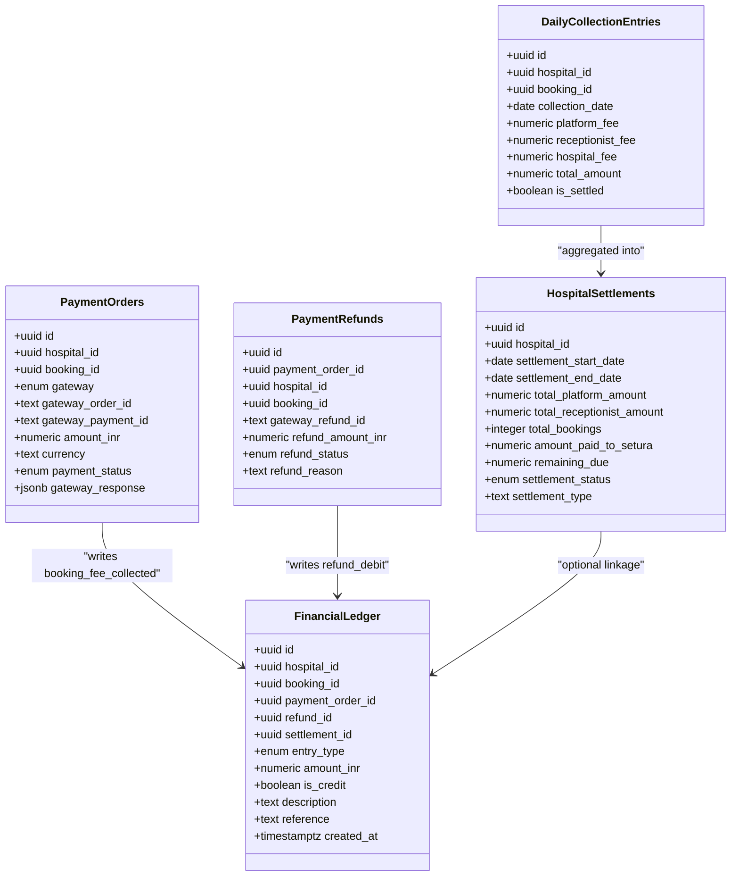
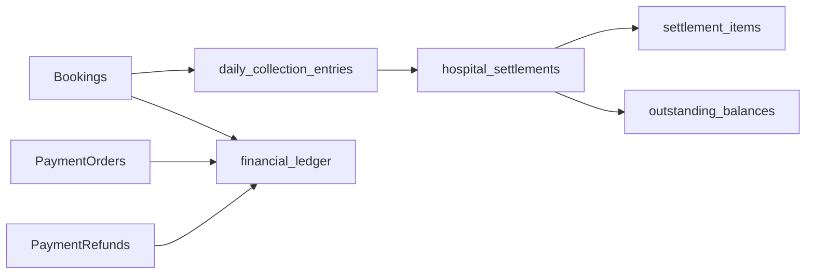
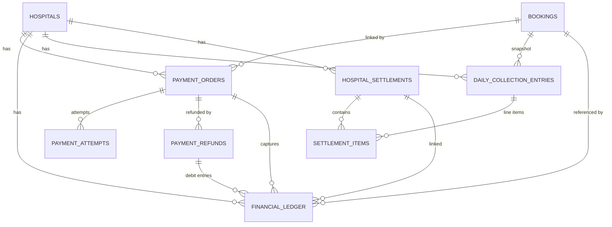

# Payment & Settlement

<cite>
**Referenced Files in This Document**
- [13_payment_engine.sql](file://supabase/migrations/13_payment_engine.sql)
- [07_settlement_engine.sql](file://supabase/migrations/07_settlement_engine.sql)
- [33_settlement_engine_refactor.sql](file://supabase/migrations/33_settlement_engine_refactor.sql)
- [34_payment_ledger_cleanup.sql](file://supabase/migrations/34_payment_ledger_cleanup.sql)
- [23_retention_&_cleanup_engine.sql](file://supabase/migrations/23_retention_&_cleanup_engine.sql)
- [create-payment-order/index.ts](file://supabase/functions/create-payment-order/index.ts)
- [verify-payment/index.ts](file://supabase/functions/verify-payment/index.ts)
- [process-refund/index.ts](file://supabase/functions/process-refund/index.ts)
- [settlement-engine/index.ts](file://supabase/functions/settlement-engine/index.ts)
</cite>

## Table of Contents

1. Introduction
2. Project Structure
3. Core Components
4. Architecture Overview
5. Detailed Component Analysis
6. Dependency Analysis
7. Performance Considerations
8. Troubleshooting Guide
9. Conclusion
10. Appendices

## Introduction

This document describes the data model and processing logic for payments,
refunds, settlements, and financial auditing in Setura Hospital OS. It focuses
on:

- Payment transaction tables capturing amount, currency, payment method, and
  status
- The settlement engine that aggregates daily collections into immutable
  settlement summaries
- The financial ledger that provides an immutable audit trail for all financial
  operations
- Entity relationships between payments, bookings, settlements, and refunds
- Database constraints and validations ensuring financial integrity
- Indexing strategies for high-volume queries and reporting
- Data retention and cleanup policies for archived records

## Project Structure

The payment and settlement system spans database migrations and serverless
functions:

- Migrations define schemas, constraints, indexes, triggers, and SQL functions
  for capture, refund, and settlement workflows
- Functions implement idempotent orchestration, external gateway integration
  (Razorpay), webhook handling, and settlement creation

**Diagram sources**

- [13_payment_engine.sql:65-129](file://supabase/migrations/13_payment_engine.sql#L65-L129)
- [13_payment_engine.sql:162-216](file://supabase/migrations/13_payment_engine.sql#L162-L216)
- [13_payment_engine.sql:221-275](file://supabase/migrations/13_payment_engine.sql#L221-L275)
- [13_payment_engine.sql:295-317](file://supabase/migrations/13_payment_engine.sql#L295-L317)
- [13_payment_engine.sql:327-372](file://supabase/migrations/13_payment_engine.sql#L327-L372)
- [07_settlement_engine.sql:30-107](file://supabase/migrations/07_settlement_engine.sql#L30-L107)
- [07_settlement_engine.sql:113-186](file://supabase/migrations/07_settlement_engine.sql#L113-L186)
- [07_settlement_engine.sql:209-238](file://supabase/migrations/07_settlement_engine.sql#L209-L238)
- [07_settlement_engine.sql:244-256](file://supabase/migrations/07_settlement_engine.sql#L244-L256)
- [create-payment-order/index.ts:104-407](file://supabase/functions/create-payment-order/index.ts#L104-L407)
- [verify-payment/index.ts:188-480](file://supabase/functions/verify-payment/index.ts#L188-L480)
- [process-refund/index.ts:109-360](file://supabase/functions/process-refund/index.ts#L109-L360)
- [settlement-engine/index.ts:55-521](file://supabase/functions/settlement-engine/index.ts#L55-L521)

**Section sources**

- [13_payment_engine.sql:1-962](file://supabase/migrations/13_payment_engine.sql#L1-L962)
- [07_settlement_engine.sql:1-670](file://supabase/migrations/07_settlement_engine.sql#L1-L670)
- [33_settlement_engine_refactor.sql:1-308](file://supabase/migrations/33_settlement_engine_refactor.sql#L1-L308)
- [34_payment_ledger_cleanup.sql:1-354](file://supabase/migrations/34_payment_ledger_cleanup.sql#L1-L354)
- [23_retention_&_cleanup_engine.sql:1-369](file://supabase/migrations/23_retention_&_cleanup_engine.sql#L1-L369)
- [create-payment-order/index.ts:1-407](file://supabase/functions/create-payment-order/index.ts#L1-L407)
- [verify-payment/index.ts:1-480](file://supabase/functions/verify-payment/index.ts#L1-L480)
- [process-refund/index.ts:1-360](file://supabase/functions/process-refund/index.ts#L1-L360)
- [settlement-engine/index.ts:1-521](file://supabase/functions/settlement-engine/index.ts#L1-L521)

## Core Components

- Payment Orders: Capture booking fees with amount, currency, gateway
  identifiers, and lifecycle status timestamps
- Payment Attempts: Record each attempt including method, amounts, errors, and
  responses
- Payment Refunds: Track partial/full refunds with reasons, statuses, and
  gateway references
- Payment Events: Store raw provider events for idempotency and replayability
- Financial Ledger: Immutable audit entries for credits/debits across booking
  fees, platform revenue, incentives, refunds, gateway fees, GST, and
  adjustments
- Daily Collection Entries: Immutable snapshots per booking used to aggregate
  platform revenue
- Hospital Settlements: Period summaries of SETURA’s platform revenue; now
  semanticized as “platform revenue summaries”
- Settlement Items: Line items linking collection entries to a settlement
- Outstanding Balances: Aggregated view of unsettled periods per hospital

Key attributes include:

- Amounts stored in INR with checks for non-negative values
- Currency defaults to INR
- Payment methods captured at attempt level
- Status tracking via typed enums for orders, attempts, refunds, and settlements
- JSONB fields for gateway payloads and metadata with type checks

**Section sources**

- [13_payment_engine.sql:65-129](file://supabase/migrations/13_payment_engine.sql#L65-L129)
- [13_payment_engine.sql:162-216](file://supabase/migrations/13_payment_engine.sql#L162-L216)
- [13_payment_engine.sql:221-275](file://supabase/migrations/13_payment_engine.sql#L221-L275)
- [13_payment_engine.sql:295-317](file://supabase/migrations/13_payment_engine.sql#L295-L317)
- [13_payment_engine.sql:327-372](file://supabase/migrations/13_payment_engine.sql#L327-L372)
- [07_settlement_engine.sql:30-107](file://supabase/migrations/07_settlement_engine.sql#L30-L107)
- [07_settlement_engine.sql:113-186](file://supabase/migrations/07_settlement_engine.sql#L113-L186)
- [07_settlement_engine.sql:209-238](file://supabase/migrations/07_settlement_engine.sql#L209-L238)
- [07_settlement_engine.sql:244-256](file://supabase/migrations/07_settlement_engine.sql#L244-L256)
- [33_settlement_engine_refactor.sql:31-107](file://supabase/migrations/33_settlement_engine_refactor.sql#L31-L107)
- [34_payment_ledger_cleanup.sql:64-107](file://supabase/migrations/34_payment_ledger_cleanup.sql#L64-L107)

## Architecture Overview

End-to-end flows:

- Create Payment Order: Validates booking, creates Razorpay order, persists
  payment_order
- Verify Payment: Handles webhooks and frontend verification, calls idempotent
  capture, writes ledger, updates booking
- Process Refund: Initiates refund against captured payment, updates statuses,
  writes ledger on confirmation
- Settlement Engine: Creates period summaries from daily collection entries,
  links line items, marks entries settled

**Diagram sources**

- [create-payment-order/index.ts:104-407](file://supabase/functions/create-payment-order/index.ts#L104-L407)
- [verify-payment/index.ts:188-480](file://supabase/functions/verify-payment/index.ts#L188-L480)
- [13_payment_engine.sql:593-666](file://supabase/migrations/13_payment_engine.sql#L593-L666)
- [34_payment_ledger_cleanup.sql:117-247](file://supabase/migrations/34_payment_ledger_cleanup.sql#L117-L247)

**Section sources**

- [create-payment-order/index.ts:1-407](file://supabase/functions/create-payment-order/index.ts#L1-L407)
- [verify-payment/index.ts:1-480](file://supabase/functions/verify-payment/index.ts#L1-L480)

## Detailed Component Analysis

### Payment Orders and Attempts

- payment_orders stores the authoritative record of a payment intent with:
  - Amount in INR, derived paise, currency, gateway identifiers, and status
    transitions with timestamps
  - Idempotency key to prevent duplicate orders
  - Constraints ensure non-negative amounts and valid JSONB payloads
- payment_attempts logs each attempt with method, error details, and gateway
  response
- Indexes optimize queries by booking, gateway order, status, and hospital date
  ranges

**Diagram sources**

- [create-payment-order/index.ts:104-407](file://supabase/functions/create-payment-order/index.ts#L104-L407)
- [13_payment_engine.sql:65-129](file://supabase/migrations/13_payment_engine.sql#L65-L129)
- [13_payment_engine.sql:162-216](file://supabase/migrations/13_payment_engine.sql#L162-L216)

**Section sources**

- [13_payment_engine.sql:65-129](file://supabase/migrations/13_payment_engine.sql#L65-L129)
- [13_payment_engine.sql:162-216](file://supabase/migrations/13_payment_engine.sql#L162-L216)
- [create-payment-order/index.ts:1-407](file://supabase/functions/create-payment-order/index.ts#L1-L407)

### Payment Capture and Verification

- verify-payment supports both Razorpay webhooks and frontend verification
- Uses idempotent capture to avoid double-processing
- Updates payment order status, booking payment flags, and writes financial
  ledger entries
- Enhanced capture function also records gateway fees and GST liabilities when
  configured

**Diagram sources**

- [verify-payment/index.ts:188-480](file://supabase/functions/verify-payment/index.ts#L188-L480)
- [34_payment_ledger_cleanup.sql:117-247](file://supabase/migrations/34_payment_ledger_cleanup.sql#L117-L247)
- [13_payment_engine.sql:593-666](file://supabase/migrations/13_payment_engine.sql#L593-L666)

**Section sources**

- [verify-payment/index.ts:1-480](file://supabase/functions/verify-payment/index.ts#L1-L480)
- [34_payment_ledger_cleanup.sql:1-354](file://supabase/migrations/34_payment_ledger_cleanup.sql#L1-L354)
- [13_payment_engine.sql:593-666](file://supabase/migrations/13_payment_engine.sql#L593-L666)

### Refunds

- process-refund validates booking and captured payment, enforces refund limits,
  and initiates refund via Razorpay
- Records refund in payment_refunds and updates statuses; confirms processed
  refunds via webhook
- Updates booking cancellation reason and sets payment order status to refunded
  or partially_refunded

**Diagram sources**

- [process-refund/index.ts:109-360](file://supabase/functions/process-refund/index.ts#L109-L360)
- [13_payment_engine.sql:672-734](file://supabase/migrations/13_payment_engine.sql#L672-L734)
- [13_payment_engine.sql:743-800](file://supabase/migrations/13_payment_engine.sql#L743-L800)

**Section sources**

- [process-refund/index.ts:1-360](file://supabase/functions/process-refund/index.ts#L1-L360)
- [13_payment_engine.sql:672-734](file://supabase/migrations/13_payment_engine.sql#L672-L734)
- [13_payment_engine.sql:743-800](file://supabase/migrations/13_payment_engine.sql#L743-L800)

### Settlement Engine

- daily_collection_entries are created automatically on booking insert,
  capturing platform fee, receptionist incentive, and total amount
- create_platform_revenue_summary aggregates unsettled entries for a period into
  hospital_settlements, links settlement_items, and marks entries settled
- Outstanding balances reflect unsettled periods per hospital
- Legacy functions are deprecated but retained for compatibility; new code uses
  platform revenue summaries

**Diagram sources**

- [settlement-engine/index.ts:55-521](file://supabase/functions/settlement-engine/index.ts#L55-L521)
- [07_settlement_engine.sql:262-310](file://supabase/migrations/07_settlement_engine.sql#L262-L310)
- [33_settlement_engine_refactor.sql:171-308](file://supabase/migrations/33_settlement_engine_refactor.sql#L171-L308)
- [07_settlement_engine.sql:316-437](file://supabase/migrations/07_settlement_engine.sql#L316-L437)

**Section sources**

- [07_settlement_engine.sql:1-670](file://supabase/migrations/07_settlement_engine.sql#L1-L670)
- [33_settlement_engine_refactor.sql:1-308](file://supabase/migrations/33_settlement_engine_refactor.sql#L1-L308)
- [settlement-engine/index.ts:1-521](file://supabase/functions/settlement-engine/index.ts#L1-L521)

### Financial Ledger and Audit Trail

- financial_ledger is immutable (no updates or deletes allowed) to preserve
  audit integrity
- Entry types include booking fee collected, platform fee credit, receptionist
  incentive credit, refund debit, gateway fee debit, GST debit, and adjustment
- Triggers write platform and receptionist credits on booking creation; capture
  writes booking fee collected and optional gateway/GST debits
- Reconciliation and breakdown functions provide reporting views

**Diagram sources**

- [13_payment_engine.sql:327-372](file://supabase/migrations/13_payment_engine.sql#L327-L372)
- [13_payment_engine.sql:378-404](file://supabase/migrations/13_payment_engine.sql#L378-L404)
- [13_payment_engine.sql:410-486](file://supabase/migrations/13_payment_engine.sql#L410-L486)
- [34_payment_ledger_cleanup.sql:117-247](file://supabase/migrations/34_payment_ledger_cleanup.sql#L117-L247)
- [07_settlement_engine.sql:30-107](file://supabase/migrations/07_settlement_engine.sql#L30-L107)
- [07_settlement_engine.sql:113-186](file://supabase/migrations/07_settlement_engine.sql#L113-L186)
- [33_settlement_engine_refactor.sql:31-107](file://supabase/migrations/33_settlement_engine_refactor.sql#L31-L107)

**Section sources**

- [13_payment_engine.sql:327-486](file://supabase/migrations/13_payment_engine.sql#L327-L486)
- [34_payment_ledger_cleanup.sql:1-354](file://supabase/migrations/34_payment_ledger_cleanup.sql#L1-L354)
- [07_settlement_engine.sql:30-186](file://supabase/migrations/07_settlement_engine.sql#L30-L186)
- [33_settlement_engine_refactor.sql:31-107](file://supabase/migrations/33_settlement_engine_refactor.sql#L31-L107)

## Dependency Analysis

- External dependency: Razorpay for order creation, payment capture, and refunds
- Internal dependencies:
  - Bookings drive collection entries and trigger ledger credits
  - Payment orders link to bookings and feed ledger entries on capture
  - Refunds link to payment orders and update booking/payment order states
  - Settlements aggregate daily collection entries and produce immutable
    summaries
- Row-level security policies restrict access to settlement and collection data
  based on roles

**Diagram sources**

- [07_settlement_engine.sql:262-310](file://supabase/migrations/07_settlement_engine.sql#L262-L310)
- [13_payment_engine.sql:410-486](file://supabase/migrations/13_payment_engine.sql#L410-L486)
- [07_settlement_engine.sql:316-437](file://supabase/migrations/07_settlement_engine.sql#L316-L437)

**Section sources**

- [07_settlement_engine.sql:262-437](file://supabase/migrations/07_settlement_engine.sql#L262-L437)
- [13_payment_engine.sql:410-486](file://supabase/migrations/13_payment_engine.sql#L410-L486)

## Performance Considerations

- Indexing strategy:
  - payment_orders: indexed by booking_id, gateway_order_id,
    payment_status+hospital_id, hospital_id+created_at
  - payment_attempts: indexed by payment_order_id+created_at,
    hospital_id+created_at
  - payment_refunds: indexed by payment_order_id, refund_status+hospital_id
    (partial index for pending/processing)
  - payment_events: partial index on unprocessed events for efficient polling
  - financial_ledger: indexed by hospital_id+created_at, booking_id,
    settlement_id
  - daily_collection_entries: indexed by hospital_id+collection_date, partial
    index for unsettled, settlement_id, booking_id
  - hospital_settlements: indexed by hospital_id+settlement_status,
    hospital_id+start/end dates
- Concurrency controls:
  - Advisory locks prevent duplicate settlement creation per period
  - FOR UPDATE locks protect concurrent modifications during capture and
    settlement
- High-volume considerations:
  - Partial indexes reduce scan size for active work queues
  - Generated columns (e.g., setura_revenue) simplify aggregation without
    denormalization

[No sources needed since this section provides general guidance]

## Troubleshooting Guide

Common issues and diagnostics:

- Duplicate payment orders: Unique constraint on gateway_order_id and
  idempotency_key prevents duplicates; check existing orders before creating
- Failed captures: verify-payment returns failure if order not found or already
  captured; inspect payment_events and gateway_response
- Refund failures: Ensure captured payment exists and refund amount does not
  exceed captured amount; confirm webhook updates refund status
- Settlement conflicts: Advisory lock and unique constraints enforce single
  settlement per period; handle duplicate errors gracefully
- Ledger immutability: Any attempt to update/delete financial_ledger will raise
  an exception; use approved functions only

Operational checks:

- Use get_reconciliation_summary and get_platform_revenue_breakdown to validate
  totals and identify discrepancies
- Monitor outstanding_balances for unsettled periods
- Review cleanup_run_log for retention job outcomes

**Section sources**

- [13_payment_engine.sql:295-317](file://supabase/migrations/13_payment_engine.sql#L295-L317)
- [13_payment_engine.sql:378-404](file://supabase/migrations/13_payment_engine.sql#L378-L404)
- [33_settlement_engine_refactor.sql:171-308](file://supabase/migrations/33_settlement_engine_refactor.sql#L171-L308)
- [23_retention_&_cleanup_engine.sql:268-321](file://supabase/migrations/23_retention_&_cleanup_engine.sql#L268-L321)

## Conclusion

The Setura payment and settlement system provides a robust, auditable financial
backbone:

- Payments are captured idempotently with comprehensive event logging and ledger
  entries
- Refunds are validated and reconciled with clear status transitions
- Settlements summarize platform revenue per period using immutable collection
  entries
- The financial ledger ensures compliance through immutability and detailed
  entry types
- Indexing and concurrency controls support high-volume operations
- Retention policies govern long-term archival and cleanup of operational and
  financial data

[No sources needed since this section summarizes without analyzing specific
files]

## Appendices

### Entity Relationships

**Diagram sources**

- [13_payment_engine.sql:65-129](file://supabase/migrations/13_payment_engine.sql#L65-L129)
- [13_payment_engine.sql:162-216](file://supabase/migrations/13_payment_engine.sql#L162-L216)
- [13_payment_engine.sql:221-275](file://supabase/migrations/13_payment_engine.sql#L221-L275)
- [13_payment_engine.sql:327-372](file://supabase/migrations/13_payment_engine.sql#L327-L372)
- [07_settlement_engine.sql:30-107](file://supabase/migrations/07_settlement_engine.sql#L30-L107)
- [07_settlement_engine.sql:113-186](file://supabase/migrations/07_settlement_engine.sql#L113-L186)
- [07_settlement_engine.sql:209-238](file://supabase/migrations/07_settlement_engine.sql#L209-L238)

### Data Retention and Cleanup Policies

- Default retention periods:
  - Financial ledger, settlements, collections, payment orders, attempts,
    refunds: 7 years
  - Audit logs and security events: 3 years
  - Operational queues and messages: shorter lifespans with hard delete after
    defined days
- Cleanup functions archive or soft-delete aged records and log outcomes
- Policies are enforced via row-level security and admin-only access

**Section sources**

- [23_retention_&_cleanup_engine.sql:55-184](file://supabase/migrations/23_retention_&_cleanup_engine.sql#L55-L184)
- [23_retention_&_cleanup_engine.sql:190-321](file://supabase/migrations/23_retention_&_cleanup_engine.sql#L190-L321)
