# Queue Management

<cite>
**Referenced Files in This Document**
- [02_atomic_token_engine_&_bookings.sql](file://supabase/migrations/02_atomic_token_engine_&_bookings.sql)
- [03_doctorscheduling&slotengine.sql](file://supabase/migrations/03_doctorscheduling&slotengine.sql)
- [17_queue_monitoring_engine.sql](file://supabase/migrations/17_queue_monitoring_engine.sql)
- [20_presence_engine.sql](file://supabase/migrations/20_presence_engine.sql)
- [23_retention_&_cleanup_engine.sql](file://supabase/migrations/23_retention_&_cleanup_engine.sql)
- [38_missing_rpc_functions.sql](file://supabase/migrations/38_missing_rpc_functions.sql)
- [create-booking/index.ts](file://supabase/functions/create-booking/index.ts)
- [queue-next-patient/index.ts](file://supabase/functions/queue-next-patient/index.ts)
- [update-booking-status/index.ts](file://supabase/functions/update-booking-status/index.ts)
</cite>

## Table of Contents

1. [Introduction](#introduction)
2. [Project Structure](#project-structure)
3. [Core Components](#core-components)
4. [Architecture Overview](#architecture-overview)
5. [Detailed Component Analysis](#detailed-component-analysis)
6. [Dependency Analysis](#dependency-analysis)
7. [Performance Considerations](#performance-considerations)
8. [Troubleshooting Guide](#troubleshooting-guide)
9. [Conclusion](#conclusion)
10. [Appendices](#appendices)

## Introduction

This document describes the queue management system in Setura Hospital OS with a
focus on:

- Queue session tables that track patient flow from check-in to consultation
  completion
- Real-time presence tracking for doctors and patients within the queue system
- Token allocation algorithm and priority queuing mechanisms
- Entity relationships between queue sessions, bookings, and doctor schedules
- Database functions and triggers that manage queue state transitions and
  real-time updates
- Performance considerations for large queue volumes and concurrent updates
- Data retention policies for completed queue sessions and historical analytics

## Project Structure

The queue system spans database migrations and serverless functions:

- Migrations define core entities (queue sessions, bookings, events), token
  counters, and monitoring/cleanup engines
- Functions implement booking creation, queue advancement, status transitions,
  and presence heartbeat
- Realtime subscriptions are enabled for key tables to support live dashboards

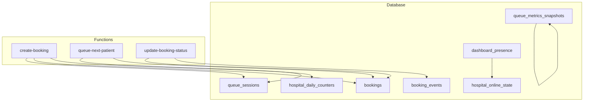

**Diagram sources**

- [02_atomic_token_engine_&_bookings.sql:81-323](file://supabase/migrations/02_atomic_token_engine_&_bookings.sql#L81-L323)
- [20_presence_engine.sql:31-156](file://supabase/migrations/20_presence_engine.sql#L31-L156)
- [17_queue_monitoring_engine.sql:14-74](file://supabase/migrations/17_queue_monitoring_engine.sql#L14-L74)
- [create-booking/index.ts:285-447](file://supabase/functions/create-booking/index.ts#L285-L447)
- [queue-next-patient/index.ts:104-167](file://supabase/functions/queue-next-patient/index.ts#L104-L167)
- [update-booking-status/index.ts:210-234](file://supabase/functions/update-booking-status/index.ts#L210-L234)

**Section sources**

- [02_atomic_token_engine_&_bookings.sql:81-323](file://supabase/migrations/02_atomic_token_engine_&_bookings.sql#L81-L323)
- [20_presence_engine.sql:31-156](file://supabase/migrations/20_presence_engine.sql#L31-L156)
- [17_queue_monitoring_engine.sql:14-74](file://supabase/migrations/17_queue_monitoring_engine.sql#L14-L74)
- [create-booking/index.ts:285-447](file://supabase/functions/create-booking/index.ts#L285-L447)
- [queue-next-patient/index.ts:104-167](file://supabase/functions/queue-next-patient/index.ts#L104-L167)
- [update-booking-status/index.ts:210-234](file://supabase/functions/update-booking-status/index.ts#L210-L234)

## Core Components

- Queue Sessions: Represent a per-doctor daily session with capacity and current
  live token
- Bookings: Patient appointments linked to a queue session, with token numbers
  and status lifecycle
- Booking Events: Audit trail for status changes
- Daily Token Counters: Atomic token generator per hospital per day
- Presence Engine: Tracks active users across channels (receptionist, doctor,
  queue display)
- Monitoring Engine: Metrics snapshots and refresh utilities for analytics
- Retention & Cleanup: Policies and jobs to archive or delete operational data

Key responsibilities:

- Token allocation is atomic and unique per hospital/day
- Priority queuing uses priority_score and token_number ordering
- Status transitions are enforced by function logic and triggers
- Realtime updates are published via Supabase realtime for bookings, events, and
  presence

**Section sources**

- [02_atomic_token_engine_&_bookings.sql:31-64](file://supabase/migrations/02_atomic_token_engine_&_bookings.sql#L31-L64)
- [02_atomic_token_engine_&_bookings.sql:81-145](file://supabase/migrations/02_atomic_token_engine_&_bookings.sql#L81-L145)
- [02_atomic_token_engine_&_bookings.sql:150-323](file://supabase/migrations/02_atomic_token_engine_&_bookings.sql#L150-L323)
- [20_presence_engine.sql:31-156](file://supabase/migrations/20_presence_engine.sql#L31-L156)
- [17_queue_monitoring_engine.sql:14-74](file://supabase/migrations/17_queue_monitoring_engine.sql#L14-L74)

## Architecture Overview

End-to-end flows for booking and queue progression:

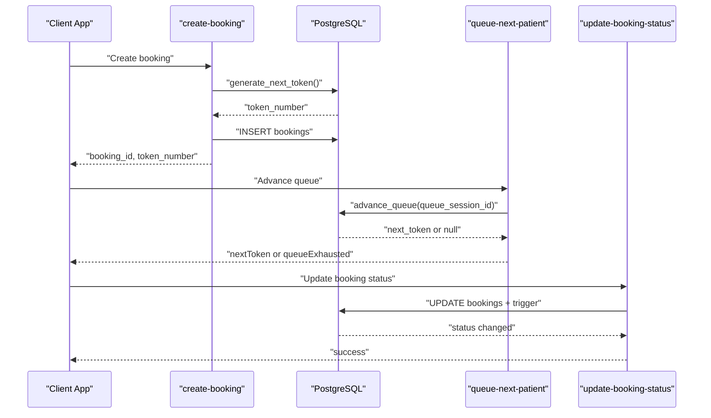

**Diagram sources**

- [create-booking/index.ts:421-447](file://supabase/functions/create-booking/index.ts#L421-L447)
- [02_atomic_token_engine_&_bookings.sql:31-64](file://supabase/migrations/02_atomic_token_engine_&_bookings.sql#L31-L64)
- [02_atomic_token_engine_&_bookings.sql:576-622](file://supabase/migrations/02_atomic_token_engine_&_bookings.sql#L576-L622)
- [queue-next-patient/index.ts:159-167](file://supabase/functions/queue-next-patient/index.ts#L159-L167)
- [update-booking-status/index.ts:210-234](file://supabase/functions/update-booking-status/index.ts#L210-L234)

## Detailed Component Analysis

### Queue Sessions and Bookings Data Model

- queue_sessions: One row per doctor per date; tracks max_tokens,
  current_live_token, active state, timestamps
- bookings: Links to queue_sessions; includes token_number, priority fields,
  timestamps for each stage (checked_in, called,
  consultation_started/completed), and idempotency_key
- booking_events: Immutable audit log for status transitions
- hospital_daily_counters: Atomic counter used to generate unique tokens per
  hospital/day

Indexes optimize:

- Session lookup by hospital/date and doctor/date
- Booking queries by status, doctor/date, priority, and queue session
- Idempotency and patient lookups

```mermaid
erDiagram
QUEUE_SESSIONS {
uuid id PK
uuid hospital_id FK
uuid doctor_id FK
date session_date
text session_name
int max_tokens
int current_live_token
boolean is_active
timestamptz started_at
timestamptz ended_at
timestamptz created_at
timestamptz updated_at
}
BOOKINGS {
uuid id PK
uuid hospital_id FK
uuid queue_session_id FK
uuid patient_id FK
text patient_name
text patient_phone
int token_number
int priority_score
boolean priority_flag
enum status
uuid assigned_doctor_id FK
uuid booked_by FK
date appointment_date
timestamptz checked_in_at
timestamptz called_at
timestamptz consultation_started_at
timestamptz consultation_completed_at
timestamptz cancelled_at
timestamptz no_show_marked_at
uuid carry_forwarded_from FK
boolean is_carry_forward
text cancellation_reason
numeric platform_fee_snapshot
numeric receptionist_fee_snapshot
numeric hospital_fee_snapshot
numeric total_amount_snapshot
boolean payment_completed
text payment_reference
boolean whatsapp_confirmation_sent
boolean whatsapp_reminder_sent
boolean feedback_sent
int estimated_wait_minutes
text idempotency_key UK
text booking_reference UK
jsonb metadata
boolean is_deleted
timestamptz deleted_at
timestamptz created_at
timestamptz updated_at
}
BOOKING_EVENTS {
uuid id PK
uuid booking_id FK
uuid hospital_id FK
enum old_status
enum new_status
text event_type
uuid performed_by FK
text notes
jsonb metadata
timestamptz created_at
}
QUEUE_SESSIONS ||--o{ BOOKINGS : "has many"
BOOKINGS ||--o{ BOOKING_EVENTS : "produces"
```

**Diagram sources**

- [02_atomic_token_engine_&_bookings.sql:81-145](file://supabase/migrations/02_atomic_token_engine_&_bookings.sql#L81-L145)
- [02_atomic_token_engine_&_bookings.sql:150-323](file://supabase/migrations/02_atomic_token_engine_&_bookings.sql#L150-L323)
- [02_atomic_token_engine_&_bookings.sql:345-379](file://supabase/migrations/02_atomic_token_engine_&_bookings.sql#L345-L379)

**Section sources**

- [02_atomic_token_engine_&_bookings.sql:81-145](file://supabase/migrations/02_atomic_token_engine_&_bookings.sql#L81-L145)
- [02_atomic_token_engine_&_bookings.sql:150-323](file://supabase/migrations/02_atomic_token_engine_&_bookings.sql#L150-L323)
- [02_atomic_token_engine_&_bookings.sql:345-379](file://supabase/migrations/02_atomic_token_engine_&_bookings.sql#L345-L379)

### Token Allocation Algorithm

- Atomic token generation uses an upsert on hospital_daily_counters to increment
  last_token per hospital/day
- create_booking calls generate_next_token to assign a unique token_number per
  visit date
- For carry-forward operations, pending tokens are moved to a new date using the
  same atomic generator to avoid duplicates

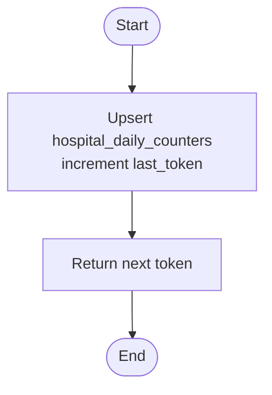

**Diagram sources**

- [02_atomic_token_engine_&_bookings.sql:31-64](file://supabase/migrations/02_atomic_token_engine_&_bookings.sql#L31-L64)
- [38_missing_rpc_functions.sql:39-103](file://supabase/migrations/38_missing_rpc_functions.sql#L39-L103)

**Section sources**

- [02_atomic_token_engine_&_bookings.sql:31-64](file://supabase/migrations/02_atomic_token_engine_&_bookings.sql#L31-L64)
- [38_missing_rpc_functions.sql:39-103](file://supabase/migrations/38_missing_rpc_functions.sql#L39-L103)

### Priority Queuing Mechanism

- The advance_queue function selects the next booking by:
  - Filtering eligible statuses (booked, checked_in, waiting)
  - Ordering by priority_score DESC then token_number ASC
  - Using FOR UPDATE SKIP LOCKED for concurrency safety
- Updated booking status set to called with timestamp;
  queue_sessions.current_live_token advanced

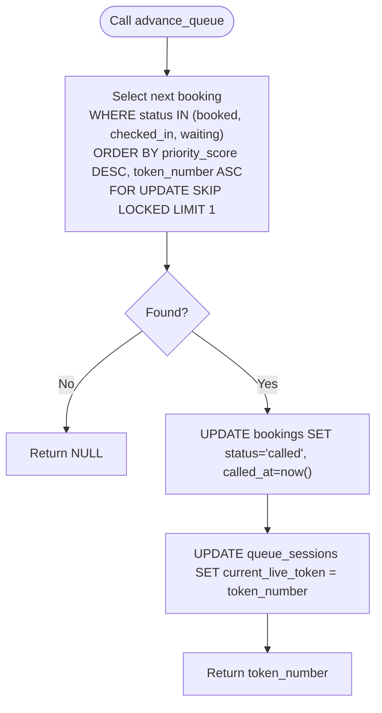

**Diagram sources**

- [02_atomic_token_engine_&_bookings.sql:576-622](file://supabase/migrations/02_atomic_token_engine_&_bookings.sql#L576-L622)

**Section sources**

- [02_atomic_token_engine_&_bookings.sql:576-622](file://supabase/migrations/02_atomic_token_engine_&_bookings.sql#L576-L622)

### Queue State Transitions and Triggers

- update-booking-status enforces a strict state machine with allowed transitions
- A database trigger records status changes and sets timestamps for key
  milestones
- Realtime publication ensures live updates for clients

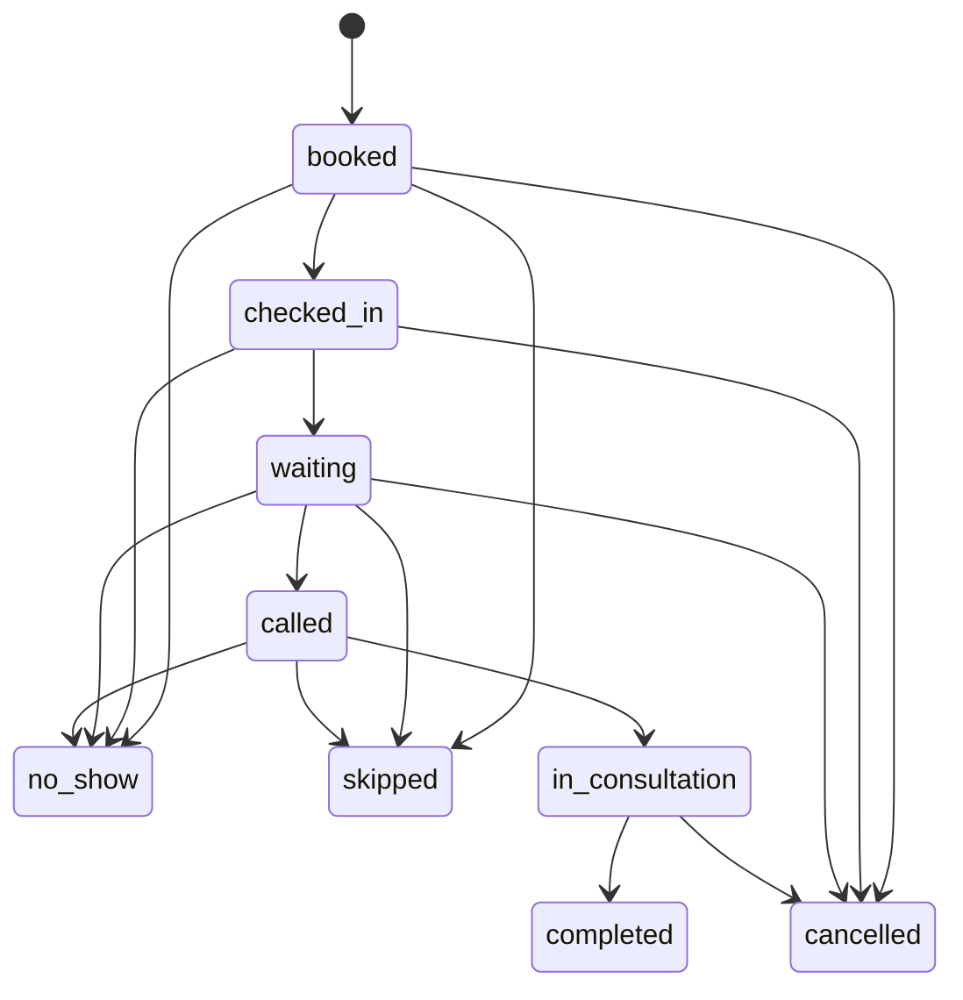

**Diagram sources**

- [update-booking-status/index.ts:28-75](file://supabase/functions/update-booking-status/index.ts#L28-L75)
- [02_atomic_token_engine_&_bookings.sql:385-440](file://supabase/migrations/02_atomic_token_engine_&_bookings.sql#L385-L440)

**Section sources**

- [update-booking-status/index.ts:28-75](file://supabase/functions/update-booking-status/index.ts#L28-L75)
- [02_atomic_token_engine_&_bookings.sql:385-440](file://supabase/migrations/02_atomic_token_engine_&_bookings.sql#L385-L440)

### Real-Time Presence Tracking

- dashboard_presence tracks user presence per hospital, role, channel, and tab
  with last_seen_at
- hospital_online_state aggregates online status and counts per hospital
- presence_heartbeat updates presence and recomputes online state
- cleanup_stale_presence removes entries older than a threshold and recomputes

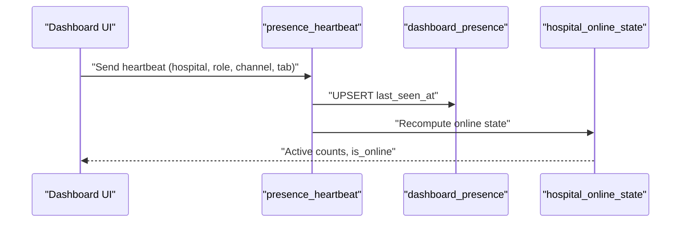

**Diagram sources**

- [20_presence_engine.sql:311-404](file://supabase/migrations/20_presence_engine.sql#L311-L404)
- [20_presence_engine.sql:192-302](file://supabase/migrations/20_presence_engine.sql#L192-L302)

**Section sources**

- [20_presence_engine.sql:31-156](file://supabase/migrations/20_presence_engine.sql#L31-L156)
- [20_presence_engine.sql:192-302](file://supabase/migrations/20_presence_engine.sql#L192-L302)
- [20_presence_engine.sql:311-404](file://supabase/migrations/20_presence_engine.sql#L311-L404)
- [20_presence_engine.sql:460-487](file://supabase/migrations/20_presence_engine.sql#L460-L487)

### Wait Time Estimation

- estimate_wait_minutes computes expected wait based on average consultation
  minutes from doctor_schedules and position ahead in queue
- Used during booking creation to inform patients of estimated wait

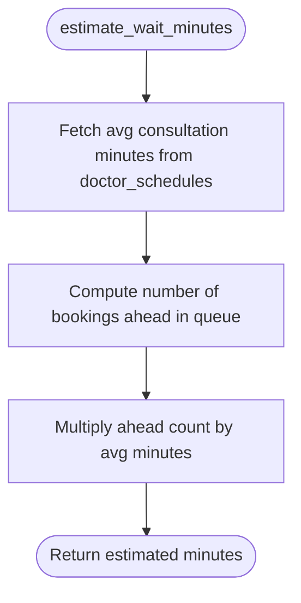

**Diagram sources**

- [03_doctorscheduling&slotengine.sql:506-527](file://supabase/migrations/03_doctorscheduling&slotengine.sql#L506-L527)
- [create-booking/index.ts:507-519](file://supabase/functions/create-booking/index.ts#L507-L519)

**Section sources**

- [03_doctorscheduling&slotengine.sql:506-527](file://supabase/migrations/03_doctorscheduling&slotengine.sql#L506-L527)
- [create-booking/index.ts:507-519](file://supabase/functions/create-booking/index.ts#L507-L519)

### Queue Monitoring and Analytics

- queue_metrics_snapshots stores periodic metrics (pending, processing, failed,
  dead, throughput)
- write_queue_metrics_snapshot captures health metrics and cleans old snapshots
- run_scheduled_tasks orchestrates maintenance including metrics snapshotting

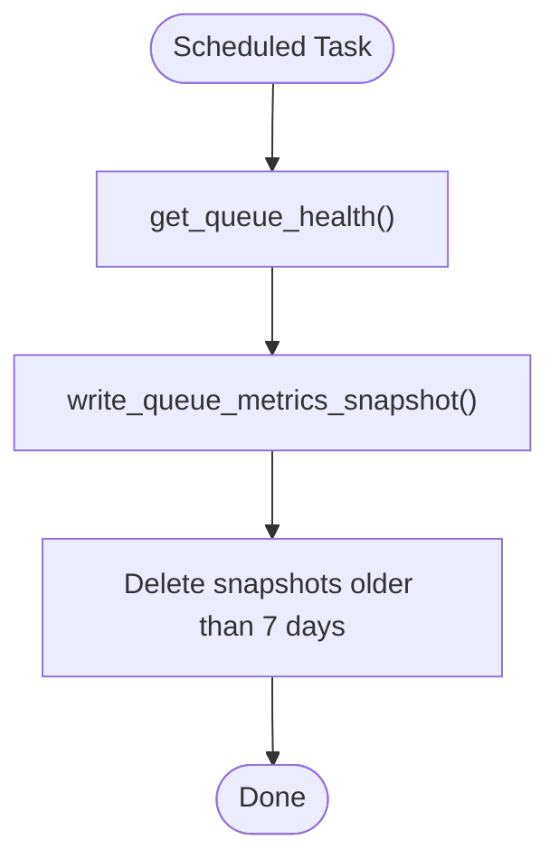

**Diagram sources**

- [17_queue_monitoring_engine.sql:124-277](file://supabase/migrations/17_queue_monitoring_engine.sql#L124-L277)
- [17_queue_monitoring_engine.sql:407-487](file://supabase/migrations/17_queue_monitoring_engine.sql#L407-L487)
- [17_queue_monitoring_engine.sql:702-774](file://supabase/migrations/17_queue_monitoring_engine.sql#L702-L774)

**Section sources**

- [17_queue_monitoring_engine.sql:124-277](file://supabase/migrations/17_queue_monitoring_engine.sql#L124-L277)
- [17_queue_monitoring_engine.sql:407-487](file://supabase/migrations/17_queue_monitoring_engine.sql#L407-L487)
- [17_queue_monitoring_engine.sql:702-774](file://supabase/migrations/17_queue_monitoring_engine.sql#L702-L774)

### Data Retention Policies

- retention_policies defines table-level retention and hard-delete rules
- Default policies include long retention for medical records and shorter for
  operational logs
- run_retention_cleanup coordinates cleanup tasks

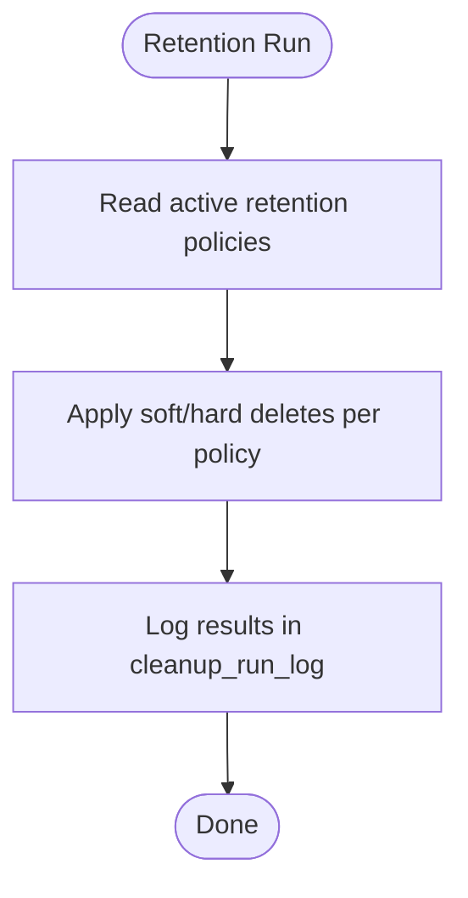

**Diagram sources**

- [23_retention_&_cleanup_engine.sql:55-184](file://supabase/migrations/23_retention_&_cleanup_engine.sql#L55-L184)
- [23_retention_&_cleanup_engine.sql:294-321](file://supabase/migrations/23_retention_&_cleanup_engine.sql#L294-L321)

**Section sources**

- [23_retention_&_cleanup_engine.sql:55-184](file://supabase/migrations/23_retention_&_cleanup_engine.sql#L55-L184)
- [23_retention_&_cleanup_engine.sql:294-321](file://supabase/migrations/23_retention_&_cleanup_engine.sql#L294-L321)

## Dependency Analysis

- create-booking depends on:
  - generate_next_token for token assignment
  - queue_sessions resolution or creation
  - estimate_wait_minutes for wait time estimation
- queue-next-patient depends on:
  - advance_queue for concurrency-safe selection and update
  - Realtime broadcast and job enqueue for notifications
- update-booking-status depends on:
  - Strict transition validation
  - Trigger-based event logging and timestamp setting
- Presence engine depends on:
  - presence_heartbeat to maintain last_seen_at
  - recompute_hospital_online_state to aggregate online counts

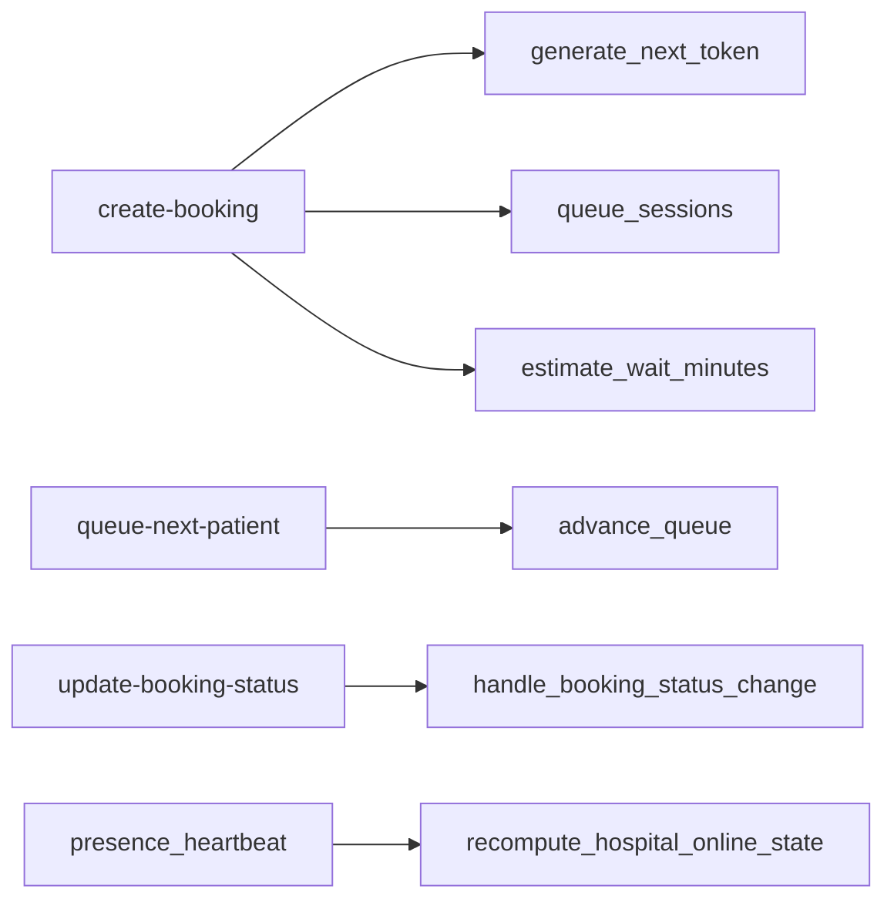

**Diagram sources**

- [create-booking/index.ts:285-447](file://supabase/functions/create-booking/index.ts#L285-L447)
- [02_atomic_token_engine_&_bookings.sql:31-64](file://supabase/migrations/02_atomic_token_engine_&_bookings.sql#L31-L64)
- [03_doctorscheduling&slotengine.sql:506-527](file://supabase/migrations/03_doctorscheduling&slotengine.sql#L506-L527)
- [queue-next-patient/index.ts:159-167](file://supabase/functions/queue-next-patient/index.ts#L159-L167)
- [02_atomic_token_engine_&_bookings.sql:576-622](file://supabase/migrations/02_atomic_token_engine_&_bookings.sql#L576-L622)
- [update-booking-status/index.ts:210-234](file://supabase/functions/update-booking-status/index.ts#L210-L234)
- [20_presence_engine.sql:311-404](file://supabase/migrations/20_presence_engine.sql#L311-L404)

**Section sources**

- [create-booking/index.ts:285-447](file://supabase/functions/create-booking/index.ts#L285-L447)
- [queue-next-patient/index.ts:159-167](file://supabase/functions/queue-next-patient/index.ts#L159-L167)
- [update-booking-status/index.ts:210-234](file://supabase/functions/update-booking-status/index.ts#L210-L234)
- [20_presence_engine.sql:311-404](file://supabase/migrations/20_presence_engine.sql#L311-L404)

## Performance Considerations

- Concurrency safety:
  - advance_queue uses FOR UPDATE SKIP LOCKED to prevent double-processing under
    high contention
  - Advisory locks protect carry-forward operations per hospital
- Indexing:
  - Optimized indexes on queue_sessions (hospital/date, doctor/date)
  - Booking indexes on status, doctor/date, priority, and queue session for fast
    selection
- Realtime overhead:
  - Realtime broadcasts are decoupled from critical path to avoid blocking queue
    progression
- Metrics and retention:
  - Periodic snapshots capture queue health; retention policies keep operational
    data bounded
- Capacity checks:
  - get_remaining_token_capacity prevents overbooking relative to doctor
    schedule limits

[No sources needed since this section provides general guidance]

## Troubleshooting Guide

Common issues and diagnostics:

- Queue exhaustion:
  - When advance_queue returns null, the queue is empty; monitor queue.exhausted
    metric
- Concurrent status changes:
  - update-booking-status detects conflicts and raises concurrency errors; retry
    with backoff
- Stale presence:
  - cleanup_stale_presence removes entries older than threshold; ensure
    heartbeats are sent regularly
- Backlog alerts:
  - check_queue_backlog_alerts identifies high pending counts or stuck oldest
    jobs; act accordingly
- Retention failures:
  - Review cleanup_run_log for errors; adjust policies if necessary

**Section sources**

- [queue-next-patient/index.ts:189-213](file://supabase/functions/queue-next-patient/index.ts#L189-L213)
- [update-booking-status/index.ts:404-429](file://supabase/functions/update-booking-status/index.ts#L404-L429)
- [20_presence_engine.sql:460-487](file://supabase/migrations/20_presence_engine.sql#L460-L487)
- [17_queue_monitoring_engine.sql:348-401](file://supabase/migrations/17_queue_monitoring_engine.sql#L348-L401)
- [23_retention_&_cleanup_engine.sql:104-123](file://supabase/migrations/23_retention_&_cleanup_engine.sql#L104-L123)

## Conclusion

The queue management system in Setura Hospital OS provides a robust,
production-ready foundation for managing patient flow:

- Atomic token allocation ensures uniqueness and fairness
- Priority queuing supports clinical needs while maintaining order
- Strong state machine enforcement and audit trails guarantee consistency
- Realtime presence and updates enable responsive dashboards
- Monitoring and retention strategies sustain performance and compliance at
  scale

[No sources needed since this section summarizes without analyzing specific
files]

## Appendices

### Entity Relationships Summary

- queue_sessions -> bookings: one-to-many
- bookings -> booking_events: one-to-many
- bookings -> patients: optional link
- bookings -> profiles (assigned_doctor_id, booked_by): optional links
- dashboard_presence -> hospitals, profiles: for presence tracking
- hospital_online_state -> hospitals: aggregated online metrics

**Section sources**

- [02_atomic_token_engine_&_bookings.sql:81-323](file://supabase/migrations/02_atomic_token_engine_&_bookings.sql#L81-L323)
- [20_presence_engine.sql:31-156](file://supabase/migrations/20_presence_engine.sql#L31-L156)
