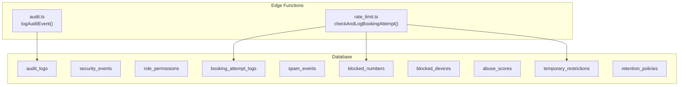
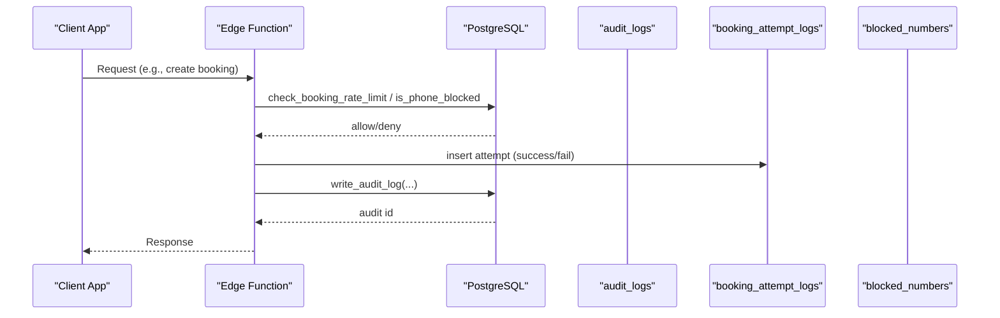
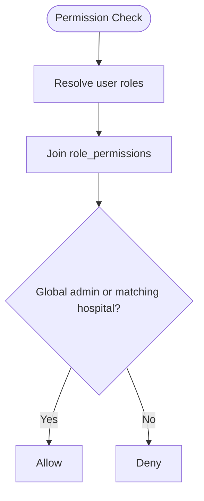
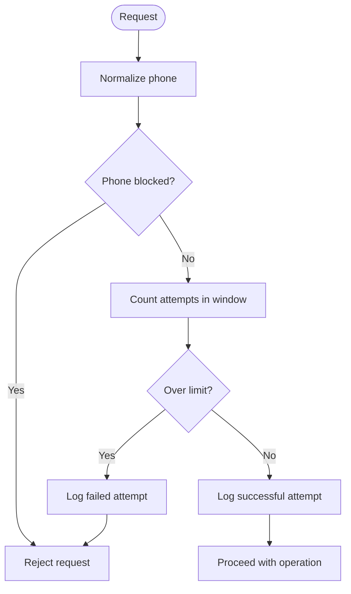
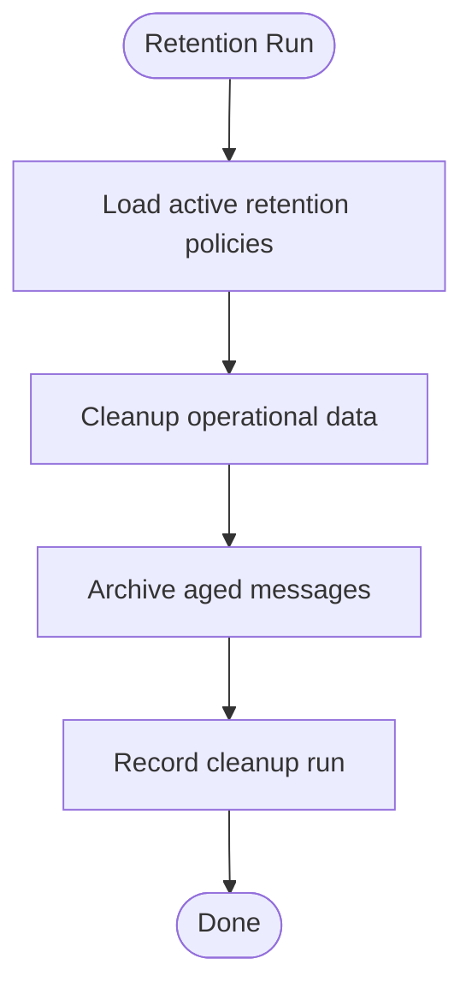
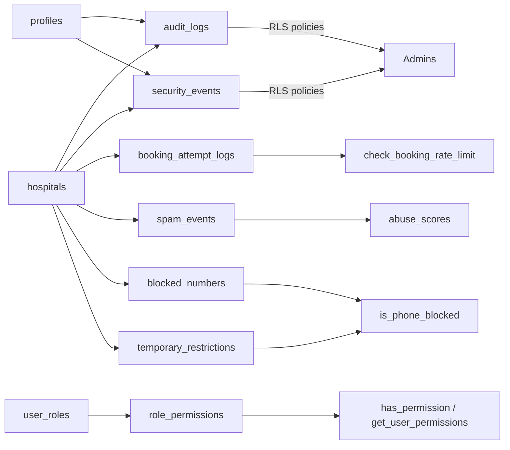

# Security & Audit

<cite>
**Referenced Files in This Document**
- [10_audit_&_security_engine.sql](file://supabase/migrations/10_audit_&_security_engine.sql)
- [27_role_permissions.sql](file://supabase/migrations/27_role_permissions.sql)
- [09_abuse_protection_&_rate_limiting.sql](file://supabase/migrations/09_abuse_protection_&_rate_limiting.sql)
- [23_retention_&_cleanup_engine.sql](file://supabase/migrations/23_retention_&_cleanup_engine.sql)
- [01_foundation.sql](file://supabase/migrations/01_foundation.sql)
- [audit.ts](file://supabase/functions/_shared/audit.ts)
- [rate_limit.ts](file://supabase/functions/_shared/rate_limit.ts)
</cite>

## Table of Contents

1. Introduction
2. Project Structure
3. Core Components
4. Architecture Overview
5. Detailed Component Analysis
6. Dependency Analysis
7. Performance Considerations
8. Troubleshooting Guide
9. Conclusion
10. Appendices

## Introduction

This document describes the security and audit system in Setura Hospital OS. It
covers:

- Audit logging for user actions, data changes, and system events with
  timestamps and user context
- Role-based permissions that define granular access controls across hospital
  contexts
- Abuse protection mechanisms including rate limiting, suspicious activity
  tracking, and temporary restrictions
- Entity relationships between audit logs, security events, role permissions,
  and abuse protection tables
- Database functions that enforce security policies and generate audit trails
  automatically
- Indexing strategies for efficient queries and compliance reporting
- Data retention and archival policies for audit and security-related data

## Project Structure

The security and audit capabilities are implemented through a combination of
database migrations (PostgreSQL), Row Level Security (RLS) policies, and Edge
Function helpers. The key files are:

- Audit and security engine: defines audit_logs, security_events, immutability
  triggers, central writer functions, and RLS policies
- Role permissions engine: defines role_permissions table, permission matrix,
  and helper functions for authorization checks
- Abuse protection and rate limiting: defines rate limit rules, attempt logs,
  spam events, blocked entities, abuse scores, temporary restrictions, and
  helper functions
- Retention and cleanup engine: defines retention policies and cleanup routines
  for operational and audit data
- Foundation: defines core roles, profiles, and helper functions used by
  security and audit features
- Edge function helpers: implement fire-and-forget audit logging and distributed
  rate limiting using the database-backed tables



**Diagram sources**

- [10_audit_&_security_engine.sql:43-128](file://supabase/migrations/10_audit_&_security_engine.sql#L43-L128)
- [27_role_permissions.sql:42-55](file://supabase/migrations/27_role_permissions.sql#L42-L55)
- [09_abuse_protection_&_rate_limiting.sql:81-167](file://supabase/migrations/09_abuse_protection_&_rate_limiting.sql#L81-L167)
- [23_retention_&_cleanup_engine.sql:55-98](file://supabase/migrations/23_retention_&_cleanup_engine.sql#L55-L98)
- [audit.ts:51-74](file://supabase/functions/_shared/audit.ts#L51-L74)
- [rate_limit.ts:27-111](file://supabase/functions/_shared/rate_limit.ts#L27-L111)

**Section sources**

- [10_audit_&_security_engine.sql:1-488](file://supabase/migrations/10_audit_&_security_engine.sql#L1-L488)
- [27_role_permissions.sql:1-273](file://supabase/migrations/27_role_permissions.sql#L1-L273)
- [09_abuse_protection_&_rate_limiting.sql:1-729](file://supabase/migrations/09_abuse_protection_&_rate_limiting.sql#L1-L729)
- [23_retention_&_cleanup_engine.sql:1-369](file://supabase/migrations/23_retention_&_cleanup_engine.sql#L1-L369)
- [01_foundation.sql:203-315](file://supabase/migrations/01_foundation.sql#L203-L315)
- [audit.ts:1-75](file://supabase/functions/_shared/audit.ts#L1-L75)
- [rate_limit.ts:1-124](file://supabase/functions/_shared/rate_limit.ts#L1-L124)

## Core Components

- Audit logging: append-only audit_logs table with severity levels, entity
  context, old/new data snapshots, IP/user agent/session metadata, and strict
  immutability via triggers. Centralized write function ensures consistent
  schema usage.
- Security events: structured event log for failed logins, unauthorized access,
  role escalation attempts, suspicious activity, token abuse, and manual flags.
  Includes risk scoring, resolution workflow, and indexes for high-priority
  queries.
- Role permissions: explicit mapping of roles to permissions with helper
  functions to check permissions at runtime. Supports global and hospital-scoped
  roles and provides arrays of current user permissions.
- Abuse protection: sliding window rate limiting backed by booking_attempt_logs;
  phone/device/IP normalization; spam event tracking; blocked lists; dynamic
  abuse scores; temporary restrictions with expiration; cleanup utilities.
- Retention and cleanup: configurable retention policies per table with legal
  basis notes; scheduled cleanup and archival routines; run logs for
  auditability.

**Section sources**

- [10_audit_&_security_engine.sql:43-128](file://supabase/migrations/10_audit_&_security_engine.sql#L43-L128)
- [10_audit_&_security_engine.sql:134-225](file://supabase/migrations/10_audit_&_security_engine.sql#L134-L225)
- [27_role_permissions.sql:42-55](file://supabase/migrations/27_role_permissions.sql#L42-L55)
- [09_abuse_protection_&_rate_limiting.sql:81-167](file://supabase/migrations/09_abuse_protection_&_rate_limiting.sql#L81-L167)
- [23_retention_&_cleanup_engine.sql:55-98](file://supabase/migrations/23_retention_&_cleanup_engine.sql#L55-L98)

## Architecture Overview

The system enforces security and auditability through layered controls:

- Application layer (Edge Functions) calls centralized database functions to
  record audits and enforce rate limits
- Database layer uses immutable audit logs, structured security events, and
  explicit permission matrices
- Row Level Security restricts access to sensitive tables based on roles and
  hospital context
- Retention engine manages lifecycle of operational and audit data according to
  policy



**Diagram sources**

- [audit.ts:51-74](file://supabase/functions/_shared/audit.ts#L51-L74)
- [rate_limit.ts:27-111](file://supabase/functions/_shared/rate_limit.ts#L27-L111)
- [10_audit_&_security_engine.sql:255-305](file://supabase/migrations/10_audit_&_security_engine.sql#L255-L305)
- [09_abuse_protection_&_rate_limiting.sql:385-422](file://supabase/migrations/09_abuse_protection_&_rate_limiting.sql#L385-L422)

## Detailed Component Analysis

### Audit Logs and Security Events

- audit_logs: append-only, captures actor, entity type/id, action type,
  severity, old/new JSONB snapshots, IP/user agent/session, notes, timestamp.
  Enforced immutability via trigger preventing updates/deletes.
- security_events: records security incidents with type, details, risk score,
  IP/user agent, fingerprint, resolution state, and timestamps. Includes indexes
  for unresolved events, risk scoring, and user/event type queries.
- Central functions:
  - write_audit_log: standardized insertion into audit_logs with defaults and
    validation
  - log_security_event: standardized insertion into security_events with risk
    score clamping
  - resolve_security_event: marks events resolved with auditor and notes
- RLS policies: restrict read/update to global admins or hospital admins per
  hospital context

```mermaid
classDiagram
class audit_logs {
+uuid id
+uuid hospital_id
+uuid actor_user_id
+text entity_type
+uuid entity_id
+text action_type
+enum action_severity
+jsonb old_data
+jsonb new_data
+jsonb metadata
+inet ip_address
+text user_agent
+text session_id
+text notes
+timestamptz created_at
}
class security_events {
+uuid id
+uuid hospital_id
+uuid user_id
+enum event_type
+jsonb event_details
+int risk_score
+inet ip_address
+text user_agent
+text event_fingerprint
+boolean resolved
+uuid resolved_by
+timestamptz resolved_at
+text resolution_notes
+jsonb metadata
+timestamptz created_at
}
audit_logs --> "hospital" : references
security_events --> "hospital" : references
```

**Diagram sources**

- [10_audit_&_security_engine.sql:43-89](file://supabase/migrations/10_audit_&_security_engine.sql#L43-L89)
- [10_audit_&_security_engine.sql:134-191](file://supabase/migrations/10_audit_&_security_engine.sql#L134-L191)

**Section sources**

- [10_audit_&_security_engine.sql:43-128](file://supabase/migrations/10_audit_&_security_engine.sql#L43-L128)
- [10_audit_&_security_engine.sql:134-225](file://supabase/migrations/10_audit_&_security_engine.sql#L134-L225)
- [10_audit_&_security_engine.sql:232-249](file://supabase/migrations/10_audit_&_security_engine.sql#L232-L249)
- [10_audit_&_security_engine.sql:255-305](file://supabase/migrations/10_audit_&_security_engine.sql#L255-L305)
- [10_audit_&_security_engine.sql:325-375](file://supabase/migrations/10_audit_&_security_engine.sql#L325-L375)
- [10_audit_&_security_engine.sql:393-417](file://supabase/migrations/10_audit_&_security_engine.sql#L393-L417)
- [10_audit_&_security_engine.sql:442-472](file://supabase/migrations/10_audit_&_security_engine.sql#L442-L472)

### Role Permissions Engine

- role_permissions: maps roles to permissions with canonical uppercase
  enforcement and updated_at tracking
- Permission matrix: predefined grants for global_admin, hospital_admin, doctor,
  receptionist covering booking, analytics, scheduling, queue, WhatsApp, feature
  flags, etc.
- Authorization helpers:
  - has_permission(user_id, hospital_id, permission): checks if a user has a
    specific permission within a hospital scope or globally
  - current_user_has_permission(hospital_id, permission): convenience wrapper
    using auth context
  - get_user_permissions(hospital_id): returns array of permissions for current
    user at hospital
- RLS: read access open; management restricted to global admins



**Diagram sources**

- [27_role_permissions.sql:133-155](file://supabase/migrations/27_role_permissions.sql#L133-L155)

**Section sources**

- [27_role_permissions.sql:42-55](file://supabase/migrations/27_role_permissions.sql#L42-L55)
- [27_role_permissions.sql:70-126](file://supabase/migrations/27_role_permissions.sql#L70-L126)
- [27_role_permissions.sql:133-179](file://supabase/migrations/27_role_permissions.sql#L133-L179)
- [27_role_permissions.sql:189-212](file://supabase/migrations/27_role_permissions.sql#L189-L212)
- [27_role_permissions.sql:258-270](file://supabase/migrations/27_role_permissions.sql#L258-L270)

### Abuse Protection and Rate Limiting

- Rate limit rules: configurable per hospital with window and max attempts
- Booking attempt logs: track normalized phone, IP, device, success flag,
  metadata, timestamp
- Spam events: capture rapid booking, phone/device rotation, payment failure
  floods, IP flood, manual flags with risk scoring
- Blocked lists: persistent blocks for phones/devices with status and expiry
- Temporary restrictions: time-bound restrictions for phones/IPs/devices with
  status and expiry
- Abuse scores: cumulative scoring per phone with last event timestamp and
  device/IP association
- Helper functions:
  - normalize_phone_number: standardizes phone numbers for consistent matching
  - check_booking_rate_limit: sliding window check against attempt logs
  - is_phone_blocked: checks active blocks and temporary restrictions
  - log_booking_attempt: inserts attempt records
  - increment_abuse_score: upserts and increments scores
  - cleanup_expired_restrictions: transitions expired restrictions to expired
    status



**Diagram sources**

- [09_abuse_protection_&_rate_limiting.sql:41-75](file://supabase/migrations/09_abuse_protection_&_rate_limiting.sql#L41-L75)
- [09_abuse_protection_&_rate_limiting.sql:385-422](file://supabase/migrations/09_abuse_protection_&_rate_limiting.sql#L385-L422)
- [09_abuse_protection_&_rate_limiting.sql:431-476](file://supabase/migrations/09_abuse_protection_&_rate_limiting.sql#L431-L476)
- [09_abuse_protection_&_rate_limiting.sql:482-520](file://supabase/migrations/09_abuse_protection_&_rate_limiting.sql#L482-L520)
- [09_abuse_protection_&_rate_limiting.sql:526-587](file://supabase/migrations/09_abuse_protection_&_rate_limiting.sql#L526-L587)
- [09_abuse_protection_&_rate_limiting.sql:596-624](file://supabase/migrations/09_abuse_protection_&_rate_limiting.sql#L596-L624)
- [rate_limit.ts:27-111](file://supabase/functions/_shared/rate_limit.ts#L27-L111)

**Section sources**

- [09_abuse_protection_&_rate_limiting.sql:81-167](file://supabase/migrations/09_abuse_protection_&_rate_limiting.sql#L81-L167)
- [09_abuse_protection_&_rate_limiting.sql:173-213](file://supabase/migrations/09_abuse_protection_&_rate_limiting.sql#L173-L213)
- [09_abuse_protection_&_rate_limiting.sql:219-253](file://supabase/migrations/09_abuse_protection_&_rate_limiting.sql#L219-L253)
- [09_abuse_protection_&_rate_limiting.sql:259-277](file://supabase/migrations/09_abuse_protection_&_rate_limiting.sql#L259-L277)
- [09_abuse_protection_&_rate_limiting.sql:283-323](file://supabase/migrations/09_abuse_protection_&_rate_limiting.sql#L283-L323)
- [09_abuse_protection_&_rate_limiting.sql:329-379](file://supabase/migrations/09_abuse_protection_&_rate_limiting.sql#L329-L379)
- [09_abuse_protection_&_rate_limiting.sql:385-624](file://supabase/migrations/09_abuse_protection_&_rate_limiting.sql#L385-L624)
- [09_abuse_protection_&_rate_limiting.sql:676-729](file://supabase/migrations/09_abuse_protection_&_rate_limiting.sql#L676-L729)
- [rate_limit.ts:27-111](file://supabase/functions/_shared/rate_limit.ts#L27-L111)

### Retention and Cleanup Policies

- retention_policies: defines per-table retention days, optional hard delete
  threshold, legal basis, and activation status
- Default policies include long-term retention for medical records and
  financials, medium-term for audit/security logs, shorter for operational
  queues and messages
- Cleanup routines:
  - cleanup_operational_data: orchestrates cleanup tasks
  - soft_delete_aged_messages: archives older messages by marking metadata
  - run_retention_cleanup: combines operational cleanup and archival steps
- Run logs: cleanup_run_log tracks execution results and errors



**Diagram sources**

- [23_retention_&_cleanup_engine.sql:55-98](file://supabase/migrations/23_retention_&_cleanup_engine.sql#L55-L98)
- [23_retention_&_cleanup_engine.sql:104-123](file://supabase/migrations/23_retention_&_cleanup_engine.sql#L104-L123)
- [23_retention_&_cleanup_engine.sql:129-184](file://supabase/migrations/23_retention_&_cleanup_engine.sql#L129-L184)
- [23_retention_&_cleanup_engine.sql:190-216](file://supabase/migrations/23_retention_&_cleanup_engine.sql#L190-L216)
- [23_retention_&_cleanup_engine.sql:222-261](file://supabase/migrations/23_retention_&_cleanup_engine.sql#L222-L261)
- [23_retention_&_cleanup_engine.sql:294-321](file://supabase/migrations/23_retention_&_cleanup_engine.sql#L294-L321)

**Section sources**

- [23_retention_&_cleanup_engine.sql:55-98](file://supabase/migrations/23_retention_&_cleanup_engine.sql#L55-L98)
- [23_retention_&_cleanup_engine.sql:104-123](file://supabase/migrations/23_retention_&_cleanup_engine.sql#L104-L123)
- [23_retention_&_cleanup_engine.sql:129-184](file://supabase/migrations/23_retention_&_cleanup_engine.sql#L129-L184)
- [23_retention_&_cleanup_engine.sql:190-216](file://supabase/migrations/23_retention_&_cleanup_engine.sql#L190-L216)
- [23_retention_&_cleanup_engine.sql:222-261](file://supabase/migrations/23_retention_&_cleanup_engine.sql#L222-L261)
- [23_retention_&_cleanup_engine.sql:268-288](file://supabase/migrations/23_retention_&_cleanup_engine.sql#L268-L288)
- [23_retention_&_cleanup_engine.sql:294-321](file://supabase/migrations/23_retention_&_cleanup_engine.sql#L294-L321)
- [23_retention_&_cleanup_engine.sql:327-367](file://supabase/migrations/23_retention_&_cleanup_engine.sql#L327-L367)

## Dependency Analysis

- Audit logs depend on hospitals and profiles for context; immutability enforced
  by triggers; RLS policies restrict access to admins
- Security events depend on hospitals and profiles; resolution workflow requires
  admin privileges; real-time publication enabled for live monitoring
- Role permissions depend on user_roles and profiles; helper functions rely on
  auth context and hospital scoping
- Abuse protection depends on hospitals; attempt logs feed rate limit checks;
  blocked lists and temporary restrictions gate access; abuse scores aggregate
  signals
- Retention policies govern lifecycle of audit, security, and operational
  tables; cleanup routines orchestrate archival and deletion



**Diagram sources**

- [10_audit_&_security_engine.sql:43-89](file://supabase/migrations/10_audit_&_security_engine.sql#L43-L89)
- [10_audit_&_security_engine.sql:134-191](file://supabase/migrations/10_audit_&_security_engine.sql#L134-L191)
- [27_role_permissions.sql:42-55](file://supabase/migrations/27_role_permissions.sql#L42-L55)
- [09_abuse_protection_&_rate_limiting.sql:81-167](file://supabase/migrations/09_abuse_protection_&_rate_limiting.sql#L81-L167)
- [09_abuse_protection_&_rate_limiting.sql:173-213](file://supabase/migrations/09_abuse_protection_&_rate_limiting.sql#L173-L213)
- [09_abuse_protection_&_rate_limiting.sql:219-253](file://supabase/migrations/09_abuse_protection_&_rate_limiting.sql#L219-L253)
- [09_abuse_protection_&_rate_limiting.sql:283-323](file://supabase/migrations/09_abuse_protection_&_rate_limiting.sql#L283-L323)
- [09_abuse_protection_&_rate_limiting.sql:329-379](file://supabase/migrations/09_abuse_protection_&_rate_limiting.sql#L329-L379)

**Section sources**

- [10_audit_&_security_engine.sql:442-472](file://supabase/migrations/10_audit_&_security_engine.sql#L442-L472)
- [27_role_permissions.sql:133-179](file://supabase/migrations/27_role_permissions.sql#L133-L179)
- [09_abuse_protection_&_rate_limiting.sql:385-476](file://supabase/migrations/09_abuse_protection_&_rate_limiting.sql#L385-L476)
- [09_abuse_protection_&_rate_limiting.sql:676-729](file://supabase/migrations/09_abuse_protection_&_rate_limiting.sql#L676-L729)

## Performance Considerations

- Indexing strategy:
  - audit_logs: composite indexes on (entity_type, entity_id, created_at DESC),
    (hospital_id, created_at DESC), (actor_user_id, created_at DESC), partial
    index on high/critical severities, and (action_type, created_at DESC) for
    fast filtering
  - security_events: indexes on (hospital_id, created_at DESC) filtered by
    unresolved, (risk_score DESC, created_at DESC), (event_type, created_at
    DESC), (user_id, created_at DESC), and (event_fingerprint) for deduplication
    and prioritization
  - abuse protection: indexes on (hospital_id, normalized_phone, created_at
    DESC), (hospital_id, ip_address, created_at DESC), (hospital_id,
    device_identifier, created_at DESC), and active restriction filters for
    quick blocking checks
- Query patterns:
  - Compliance reporting: filter by hospital_id and created_at ranges; use
    severity and action_type indexes for audit summaries
  - Security triage: query unresolved events ordered by risk_score and
    created_at
  - Rate limiting: sliding window counts over created_at with normalized_phone
    and hospital_id
- Concurrency and safety:
  - Audit logs are immutable; writes go through centralized functions to ensure
    consistency
  - Rate limit checks are distributed-safe via database reads; fail-open
    behavior prevents false positives from transient DB issues
  - Abuse score increments use upsert semantics to avoid race conditions

[No sources needed since this section provides general guidance]

## Troubleshooting Guide

- Audit log immutability:
  - Any attempt to update/delete audit_logs will raise an exception due to the
    trigger enforcing immutability
  - Use the provided write_audit_log function to insert new entries only
- Security event resolution:
  - Only admins can mark events as resolved; verify role context before calling
    resolve_security_event
  - Resolution requires valid event_id and auditor identity; check returned
    boolean to confirm success
- Rate limiting failures:
  - If requests are unexpectedly blocked, check blocked_numbers and
    temporary_restrictions for active entries
  - Validate phone normalization and ensure correct hospital_id context when
    checking limits
  - On DB errors during rate checks, the system fails open; monitor logs for
    warnings
- Retention and cleanup:
  - Review retention_policies to ensure appropriate retention_days and
    legal_basis
  - Inspect cleanup_run_log for errors and durations; adjust schedules as needed

**Section sources**

- [10_audit_&_security_engine.sql:232-249](file://supabase/migrations/10_audit_&_security_engine.sql#L232-L249)
- [10_audit_&_security_engine.sql:393-417](file://supabase/migrations/10_audit_&_security_engine.sql#L393-L417)
- [09_abuse_protection_&_rate_limiting.sql:431-476](file://supabase/migrations/09_abuse_protection_&_rate_limiting.sql#L431-L476)
- [23_retention_&_cleanup_engine.sql:104-123](file://supabase/migrations/23_retention_&_cleanup_engine.sql#L104-L123)

## Conclusion

Setura Hospital OS implements a robust security and audit system with:

- Immutable, comprehensive audit logs capturing user actions and data changes
- Structured security events with risk scoring and resolution workflows
- Explicit role-based permissions with helper functions for fine-grained
  authorization
- Distributed rate limiting and abuse protection with normalization, scoring,
  and temporary restrictions
- Configurable retention policies and automated cleanup routines for compliance
  and performance These components together provide strong governance,
  traceability, and protection for multi-tenant hospital operations.

[No sources needed since this section summarizes without analyzing specific
files]

## Appendices

### Entity Relationships

```mermaid
erDiagram
HOSPITALS {
uuid id PK
text name
text slug UK
boolean is_active
timestamptz created_at
}
PROFILES {
uuid id PK
text full_name
text normalized_phone
boolean is_active
timestamptz created_at
}
USER_ROLES {
uuid id PK
uuid user_id FK
uuid hospital_id FK
enum role
boolean is_primary
timestamptz created_at
}
ROLE_PERMISSIONS {
uuid id PK
enum role
text permission
timestamptz granted_at
timestamptz updated_at
}
AUDIT_LOGS {
uuid id PK
uuid hospital_id FK
uuid actor_user_id FK
text entity_type
uuid entity_id
text action_type
enum action_severity
jsonb old_data
jsonb new_data
jsonb metadata
inet ip_address
text user_agent
text session_id
text notes
timestamptz created_at
}
SECURITY_EVENTS {
uuid id PK
uuid hospital_id FK
uuid user_id FK
enum event_type
jsonb event_details
int risk_score
inet ip_address
text user_agent
text event_fingerprint
boolean resolved
uuid resolved_by
timestamptz resolved_at
text resolution_notes
jsonb metadata
timestamptz created_at
}
BOOKING_ATTEMPT_LOGS {
uuid id PK
uuid hospital_id FK
text normalized_phone
inet ip_address
text device_identifier
boolean success
jsonb metadata
timestamptz created_at
}
SPAM_EVENTS {
uuid id PK
uuid hospital_id FK
enum event_type
text phone_number
text device_identifier
inet ip_address
int risk_score
jsonb metadata
timestamptz created_at
}
BLOCKED_NUMBERS {
uuid id PK
uuid hospital_id FK
text normalized_phone
text block_reason
enum restriction_status
timestamptz blocked_until
jsonb metadata
timestamptz created_at
}
BLOCKED_DEVICES {
uuid id PK
text device_identifier UK
text block_reason
enum restriction_status
timestamptz blocked_until
jsonb metadata
timestamptz created_at
}
ABUSE_SCORES {
uuid id PK
uuid hospital_id FK
text normalized_phone
text device_identifier
inet ip_address
int total_score
timestamptz last_event_at
timestamptz updated_at
}
TEMPORARY_RESTRICTIONS {
uuid id PK
uuid hospital_id FK
text restriction_type
text phone_number
text device_identifier
inet ip_address
text restriction_reason
enum restriction_status
timestamptz restricted_until
jsonb metadata
timestamptz created_at
}
RETENTION_POLICIES {
uuid id PK
text table_name
uuid hospital_id FK
int retention_days
int hard_delete_after_days
boolean is_active
text legal_basis
text notes
timestamptz created_at
timestamptz updated_at
}
HOSPITALS ||--o{ AUDIT_LOGS : "records"
PROFILES ||--o{ AUDIT_LOGS : "actors"
HOSPITALS ||--o{ SECURITY_EVENTS : "records"
PROFILES ||--o{ SECURITY_EVENTS : "users"
USER_ROLES ||--o{ ROLE_PERMISSIONS : "grants"
HOSPITALS ||--o{ BOOKING_ATTEMPT_LOGS : "attempts"
HOSPITALS ||--o{ SPAM_EVENTS : "events"
HOSPITALS ||--o{ BLOCKED_NUMBERS : "blocks"
HOSPITALS ||--o{ TEMPORARY_RESTRICTIONS : "restrictions"
HOSPITALS ||--o{ ABUSE_SCORES : "scores"
HOSPITALS ||--o{ RETENTION_POLICIES : "governed by"
```



**Diagram sources**

- [01_foundation.sql:100-188](file://supabase/migrations/01_foundation.sql#L100-L188)
- [01_foundation.sql:203-254](file://supabase/migrations/01_foundation.sql#L203-L254)
- [10_audit_&_security_engine.sql:43-89](file://supabase/migrations/10_audit_&_security_engine.sql#L43-L89)
- [10_audit_&_security_engine.sql:134-191](file://supabase/migrations/10_audit_&_security_engine.sql#L134-L191)
- [27_role_permissions.sql:42-55](file://supabase/migrations/27_role_permissions.sql#L42-L55)
- [09_abuse_protection_&_rate_limiting.sql:81-167](file://supabase/migrations/09_abuse_protection_&_rate_limiting.sql#L81-L167)
- [09_abuse_protection_&_rate_limiting.sql:173-213](file://supabase/migrations/09_abuse_protection_&_rate_limiting.sql#L173-L213)
- [09_abuse_protection_&_rate_limiting.sql:219-253](file://supabase/migrations/09_abuse_protection_&_rate_limiting.sql#L219-L253)
- [09_abuse_protection_&_rate_limiting.sql:259-277](file://supabase/migrations/09_abuse_protection_&_rate_limiting.sql#L259-L277)
- [09_abuse_protection_&_rate_limiting.sql:283-323](file://supabase/migrations/09_abuse_protection_&_rate_limiting.sql#L283-L323)
- [09_abuse_protection_&_rate_limiting.sql:329-379](file://supabase/migrations/09_abuse_protection_&_rate_limiting.sql#L329-L379)
- [23_retention_&_cleanup_engine.sql:55-98](file://supabase/migrations/23_retention_&_cleanup_engine.sql#L55-L98)
