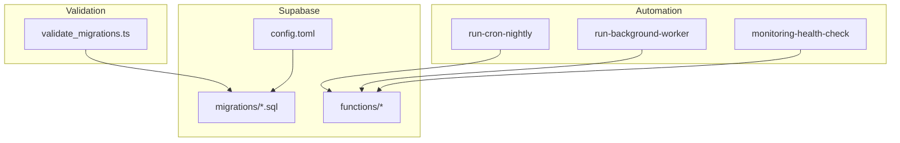
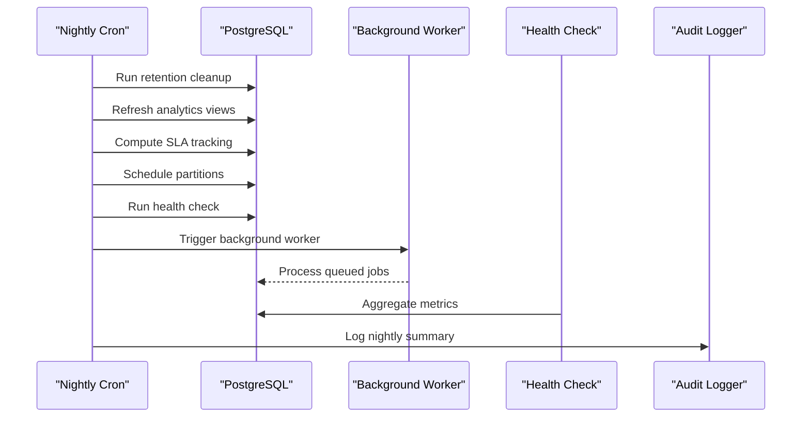
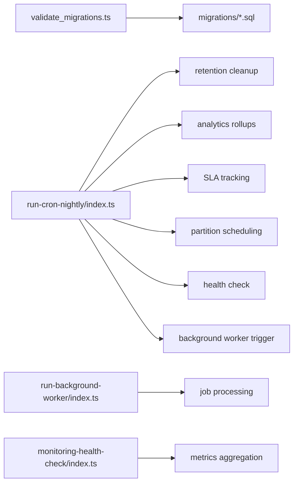

# Backup & Recovery

<cite>
**Referenced Files in This Document**
- [supabase/config.toml](file://supabase/config.toml)
- [deno.json](file://deno.json)
- [scripts/validate_migrations.ts](file://scripts/validate_migrations.ts)
- [supabase/migrations/23_retention_&_cleanup_engine.sql](file://supabase/migrations/23_retention_&_cleanup_engine.sql)
- [supabase/migrations/18_config_versioning_&_rollback.sql](file://supabase/migrations/18_config_versioning_&_rollback.sql)
- [supabase/migrations/26_migration_metadata_&_registry.sql](file://supabase/migrations/26_migration_metadata_&_registry.sql)
- [supabase/migrations/19_background_worker_engine.sql](file://supabase/migrations/19_background_worker_engine.sql)
- [supabase/functions/run-cron-nightly/index.ts](file://supabase/functions/run-cron-nightly/index.ts)
- [supabase/functions/run-background-worker/index.ts](file://supabase/functions/run-background-worker/index.ts)
- [supabase/functions/monitoring-health-check/index.ts](file://supabase/functions/monitoring-health-check/index.ts)
- [supabase/functions/_shared/audit.ts](file://supabase/functions/_shared/audit.ts)
</cite>

## Table of Contents

1. Introduction
2. Project Structure
3. Core Components
4. Architecture Overview
5. Detailed Component Analysis
6. Dependency Analysis
7. Performance Considerations
8. Troubleshooting Guide
9. Conclusion
10. Appendices

## Introduction

This document provides comprehensive backup and recovery guidance for the Setura
Hospital OS. It covers database backup strategies, automated scheduling,
retention policies, point-in-time recovery (PITR), disaster recovery procedures,
configuration rollback, migration safety, data integrity verification,
compliance considerations, and step-by-step recovery playbooks for scenarios
ranging from table corruption to full system outage.

The codebase includes:

- A robust retention and cleanup engine with configurable policies and audit
  logging
- Migration metadata registry and deployment snapshots for safe rollbacks
- Config versioning and rollback functions for system and hospital settings
- Background workers and cron orchestration that automate nightly maintenance
  tasks
- Health monitoring endpoints and audit logging for observability and compliance

## Project Structure

Key areas relevant to backup and recovery:

- Supabase configuration defines database versioning, migrations, and storage
  options
- Migrations include retention/cleanup, config versioning/rollback, migration
  registry/snapshots, background worker crash recovery
- Cron and background worker functions orchestrate scheduled tasks including
  retention cleanup and health checks
- Validation scripts enforce migration safety and rerun resilience

**Diagram sources**

- [supabase/config.toml:27-65](file://supabase/config.toml#L27-L65)
- [supabase/migrations/23_retention_&_cleanup_engine.sql:51-184](file://supabase/migrations/23_retention_&_cleanup_engine.sql#L51-L184)
- [supabase/migrations/26_migration_metadata_&_registry.sql:371-508](file://supabase/migrations/26_migration_metadata_&_registry.sql#L371-L508)
- [supabase/functions/run-cron-nightly/index.ts:110-276](file://supabase/functions/run-cron-nightly/index.ts#L110-L276)
- [supabase/functions/run-background-worker/index.ts:247-454](file://supabase/functions/run-background-worker/index.ts#L247-L454)
- [supabase/functions/monitoring-health-check/index.ts:1-230](file://supabase/functions/monitoring-health-check/index.ts#L1-L230)
- [scripts/validate_migrations.ts:1-503](file://scripts/validate_migrations.ts#L1-L503)

**Section sources**

- [supabase/config.toml:27-65](file://supabase/config.toml#L27-L65)
- [deno.json:11-20](file://deno.json#L11-L20)

## Core Components

- Retention and Cleanup Engine: Defines retention policies per table and runs
  cleanup/archival routines, with run logs and RLS protections
- Migration Registry and Snapshots: Tracks applied migrations, execution logs,
  and captures deployment snapshots for post-deployment state
- Config Versioning and Rollback: Maintains append-only history of configuration
  changes and provides rollback functions for system settings and feature flags
- Background Worker Crash Recovery: Detects crashed workers, reclaims jobs, and
  cleans stale heartbeats/leases
- Nightly Cron Orchestration: Executes ordered steps including retention
  cleanup, analytics rollups, SLA tracking, partition scheduling, health
  snapshot, and worker triggers
- Health Monitoring Endpoint: Aggregates queue depth, worker status, DLQ counts,
  MV freshness, partitions, and revenue backlog for operational visibility
- Audit Logging: Fire-and-forget audit event writer used by cron and other
  components for compliance and traceability

**Section sources**

- [supabase/migrations/23_retention_&_cleanup_engine.sql:51-184](file://supabase/migrations/23_retention_&_cleanup_engine.sql#L51-L184)
- [supabase/migrations/26_migration_metadata_&_registry.sql:371-508](file://supabase/migrations/26_migration_metadata_&_registry.sql#L371-L508)
- [supabase/migrations/18_config_versioning_&_rollback.sql:35-149](file://supabase/migrations/18_config_versioning_&_rollback.sql#L35-L149)
- [supabase/migrations/19_background_worker_engine.sql:813-853](file://supabase/migrations/19_background_worker_engine.sql#L813-L853)
- [supabase/functions/run-cron-nightly/index.ts:110-276](file://supabase/functions/run-cron-nightly/index.ts#L110-L276)
- [supabase/functions/monitoring-health-check/index.ts:1-230](file://supabase/functions/monitoring-health-check/index.ts#L1-L230)
- [supabase/functions/_shared/audit.ts:47-74](file://supabase/functions/_shared/audit.ts#L47-L74)

## Architecture Overview

Backup and recovery rely on a combination of platform-level backups (PostgreSQL
PITR via Supabase), application-level snapshots and retention, and orchestrated
automation for consistency and compliance.

**Diagram sources**

- [supabase/functions/run-cron-nightly/index.ts:110-276](file://supabase/functions/run-cron-nightly/index.ts#L110-L276)
- [supabase/functions/run-background-worker/index.ts:247-454](file://supabase/functions/run-background-worker/index.ts#L247-L454)
- [supabase/functions/monitoring-health-check/index.ts:1-230](file://supabase/functions/monitoring-health-check/index.ts#L1-L230)
- [supabase/functions/_shared/audit.ts:47-74](file://supabase/functions/_shared/audit.ts#L47-L74)

## Detailed Component Analysis

### Database Backup Strategy and Scheduling

- Use PostgreSQL PITR provided by the managed Supabase service to enable
  continuous WAL archiving and restore to any point within the retention window.
  Configure PITR at the platform level according to your RPO/RTO requirements.
- Supplement PITR with application-level snapshots:
  - Capture deployment snapshots after successful migrations or critical
    operations using the provided function to record database size, object
    counts, and migration status.
  - Store these snapshots externally (e.g., secure object storage) for long-term
    retention and auditability.
- Automated scheduling:
  - The nightly cron orchestrator executes retention cleanup, analytics rollups,
    SLA tracking, partition scheduling, and health checks. Integrate a platform
    scheduler to call this endpoint on a reliable cadence.
  - Ensure the cron secret is securely managed and validated by the endpoint
    before execution.

Operational notes:

- Validate migrations pre-deploy using the static analysis script to prevent
  unsafe destructive changes and ensure rerun safety.
- Maintain a clean separation between PITR (data restoration) and application
  snapshots (state and schema context).

**Section sources**

- [supabase/migrations/26_migration_metadata_&_registry.sql:371-508](file://supabase/migrations/26_migration_metadata_&_registry.sql#L371-L508)
- [supabase/functions/run-cron-nightly/index.ts:110-276](file://supabase/functions/run-cron-nightly/index.ts#L110-L276)
- [scripts/validate_migrations.ts:1-503](file://scripts/validate_migrations.ts#L1-L503)

### Point-in-Time Recovery (PITR) Procedures

- Enable PITR on the managed Postgres instance through the platform’s backup
  settings.
- Define retention windows aligned with regulatory requirements (e.g., 7–30 days
  for operational data, longer for financial records).
- To recover to a specific timestamp:
  - Provision a temporary environment using the same schema and migrations.
  - Restore the database to the target timestamp using the platform’s PITR
    capability.
  - Verify data integrity by running health checks and comparing key metrics
    against expected baselines.
  - If needed, apply only necessary migrations to align the restored environment
    with current code.

Risk controls:

- Always test PITR restores in a non-production environment first.
- Record the exact restore point and validate checksums where applicable.

[No sources needed since this section provides general guidance]

### Data Retention Policies and Archival

- The retention engine defines per-table retention and hard-delete thresholds,
  with legal basis annotations for compliance.
- Default policies cover patient records, financial ledgers, audit logs,
  messaging queues, and operational telemetry.
- Master cleanup routine performs operational cleanup and archival of aged
  messages; results are logged for auditing.

Implementation highlights:

- Policies are enforced via RLS and audited through run logs.
- Soft deletion is used for certain message tables to preserve referential
  integrity while reducing storage.

**Section sources**

- [supabase/migrations/23_retention_&_cleanup_engine.sql:51-184](file://supabase/migrations/23_retention_&_cleanup_engine.sql#L51-L184)
- [supabase/migrations/23_retention_&_cleanup_engine.sql:186-321](file://supabase/migrations/23_retention_&_cleanup_engine.sql#L186-L321)

### Disaster Recovery Playbook

- Complete System Outage
  - Provision new infrastructure and deploy edge functions.
  - Restore the database using PITR to the latest known good point.
  - Apply pending migrations if required; verify with deployment snapshots and
    health checks.
  - Re-run nightly cron once to stabilize analytics and retention states.
- Edge Functions Redeployment
  - Ensure environment variables (including secrets) are configured
    consistently.
  - Deploy updated functions and validate via health endpoints and audit logs.
- Configuration Recovery
  - Use config versioning to revert system settings or feature flags to a
    previous stable version.
  - Mark rollbacks in the version history for auditability.

Verification:

- Execute the health check endpoint to confirm subsystems are healthy.
- Review audit logs for recent actions and errors.

**Section sources**

- [supabase/migrations/18_config_versioning_&_rollback.sql:449-680](file://supabase/migrations/18_config_versioning_&_rollback.sql#L449-L680)
- [supabase/functions/monitoring-health-check/index.ts:1-230](file://supabase/functions/monitoring-health-check/index.ts#L1-L230)
- [supabase/functions/_shared/audit.ts:47-74](file://supabase/functions/_shared/audit.ts#L47-L74)

### Migration Safety and Rollback

- Migration registry tracks applied migrations, execution logs, and supports
  failure recording.
- Deployment snapshots capture database state and migration status for quick
  reference and rollback decisions.
- Static validation enforces safe migration practices: ordering, rerun guards,
  duplicate detection, enum hazards, and missing constraints.

Rollback approach:

- For schema issues, use targeted migration rollbacks when available and
  supported.
- For configuration issues, use built-in rollback functions to revert to prior
  versions.

**Section sources**

- [supabase/migrations/26_migration_metadata_&_registry.sql:51-125](file://supabase/migrations/26_migration_metadata_&_registry.sql#L51-L125)
- [supabase/migrations/26_migration_metadata_&_registry.sql:371-508](file://supabase/migrations/26_migration_metadata_&_registry.sql#L371-L508)
- [scripts/validate_migrations.ts:1-503](file://scripts/validate_migrations.ts#L1-L503)

### Background Worker Crash Recovery

- Detects crashed workers and reclaims their jobs to prevent stalls.
- Cleans stale heartbeats and expired leases to maintain worker registry
  integrity.
- Ensures job processing continues reliably after transient failures.

**Section sources**

- [supabase/migrations/19_background_worker_engine.sql:813-853](file://supabase/migrations/19_background_worker_engine.sql#L813-L853)

### Compliance and Audit

- Audit events are written via a fire-and-forget mechanism to avoid impacting
  performance; failures are logged but do not break flows.
- Nightly cron summarizes success/failure rates and logs them for compliance
  review.
- Retention policies include legal basis fields to support regulatory reporting.

**Section sources**

- [supabase/functions/_shared/audit.ts:47-74](file://supabase/functions/_shared/audit.ts#L47-L74)
- [supabase/functions/run-cron-nightly/index.ts:278-306](file://supabase/functions/run-cron-nightly/index.ts#L278-L306)
- [supabase/migrations/23_retention_&_cleanup_engine.sql:129-184](file://supabase/migrations/23_retention_&_cleanup_engine.sql#L129-L184)

## Dependency Analysis

Backup and recovery depend on coordinated interactions among migrations,
scheduled tasks, and monitoring:

**Diagram sources**

- [scripts/validate_migrations.ts:1-503](file://scripts/validate_migrations.ts#L1-L503)
- [supabase/functions/run-cron-nightly/index.ts:110-276](file://supabase/functions/run-cron-nightly/index.ts#L110-L276)
- [supabase/functions/run-background-worker/index.ts:247-454](file://supabase/functions/run-background-worker/index.ts#L247-L454)
- [supabase/functions/monitoring-health-check/index.ts:1-230](file://supabase/functions/monitoring-health-check/index.ts#L1-L230)

**Section sources**

- [supabase/functions/run-cron-nightly/index.ts:110-276](file://supabase/functions/run-cron-nightly/index.ts#L110-L276)
- [supabase/functions/run-background-worker/index.ts:247-454](file://supabase/functions/run-background-worker/index.ts#L247-L454)
- [supabase/functions/monitoring-health-check/index.ts:1-230](file://supabase/functions/monitoring-health-check/index.ts#L1-L230)

## Performance Considerations

- Schedule heavy operations (retention cleanup, analytics rollups) during
  off-peak hours via the nightly cron to minimize impact on user-facing
  services.
- Use batched job processing in background workers with bounded runtime to avoid
  timeouts.
- Monitor health metrics regularly to detect bottlenecks and adjust retention
  intervals or batch sizes accordingly.
- Keep migrations idempotent and guarded to allow safe retries without
  performance penalties.

[No sources needed since this section provides general guidance]

## Troubleshooting Guide

Common issues and resolutions:

- Failed nightly cron steps
  - Inspect the cron response for error details and duration metrics.
  - Check audit logs for severity levels and failed step labels.
  - Re-run affected steps individually if safe and necessary.
- Background worker crashes
  - Use the crash recovery function to reclaim stuck jobs and clean stale
    entries.
  - Verify worker heartbeat and lease expiration to ensure stability.
- Migration failures
  - Review migration execution logs and last_error fields.
  - Validate migrations locally using the static analysis script before
    redeploying.
- Data retention anomalies
  - Confirm active policies and legal basis entries.
  - Inspect cleanup run logs for errors and row counts.

**Section sources**

- [supabase/functions/run-cron-nightly/index.ts:278-306](file://supabase/functions/run-cron-nightly/index.ts#L278-L306)
- [supabase/migrations/19_background_worker_engine.sql:813-853](file://supabase/migrations/19_background_worker_engine.sql#L813-L853)
- [supabase/migrations/26_migration_metadata_&_registry.sql:126-202](file://supabase/migrations/26_migration_metadata_&_registry.sql#L126-L202)
- [supabase/migrations/23_retention_&_cleanup_engine.sql:104-124](file://supabase/migrations/23_retention_&_cleanup_engine.sql#L104-L124)

## Conclusion

Setura Hospital OS implements a layered backup and recovery strategy combining
platform-level PITR, application-level snapshots, robust retention policies, and
orchestrated automation. Migration safety, configuration rollback, and
comprehensive audit logging support compliance and operational reliability. By
following the procedures outlined here—scheduled backups, verified restores,
controlled rollbacks, and continuous monitoring—you can maintain data integrity
and meet healthcare regulatory requirements.

[No sources needed since this section summarizes without analyzing specific
files]

## Appendices

### Step-by-Step Recovery Procedures

- Individual Table Corruption
  - Identify the corrupted table and scope of damage.
  - Restore the database to the nearest safe point using PITR.
  - Validate table integrity and reapply any necessary migrations.
  - Re-run retention cleanup to normalize data volumes.

- Partial System Failure (e.g., Analytics Stale)
  - Trigger the nightly cron to refresh analytics and compute SLA tracking.
  - Validate via health check endpoint and review audit logs.

- Complete System Outage
  - Provision new environment and deploy edge functions.
  - Restore database using PITR to the latest known good point.
  - Apply pending migrations and capture a deployment snapshot.
  - Run nightly cron to stabilize systems and verify health.

- Failed Migration Rollback
  - Use migration registry to identify the failing migration and last_error.
  - If supported, apply a targeted rollback migration.
  - Otherwise, restore to a prior snapshot and reapply migrations incrementally.

- Configuration Rollback
  - Use rollback functions to revert system settings or feature flags to a
    previous version.
  - Mark rollbacks in version history for auditability.

[No sources needed since this section provides procedural guidance]

### Backup Testing and Verification

- Regularly test PITR restores in a staging environment to validate RPO/RTO.
- Compare key metrics (table counts, database size, migration status) between
  source and restored environments.
- Use deployment snapshots to track state changes and ensure consistency across
  environments.

[No sources needed since this section provides general guidance]

### Monitoring Backup Health

- Use the health check endpoint to monitor queue depths, worker statuses, DLQ
  counts, MV freshness, and partition health.
- Track nightly cron success rates and audit log severity levels.
- Alert on anomalies such as increased DLQ sizes or stalled workers.

**Section sources**

- [supabase/functions/monitoring-health-check/index.ts:1-230](file://supabase/functions/monitoring-health-check/index.ts#L1-L230)
- [supabase/functions/run-cron-nightly/index.ts:278-306](file://supabase/functions/run-cron-nightly/index.ts#L278-L306)
