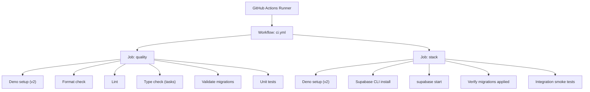
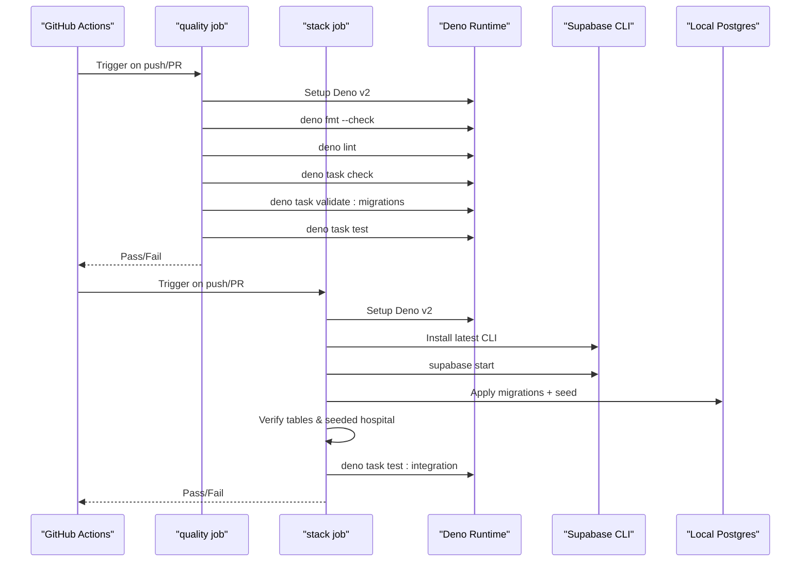
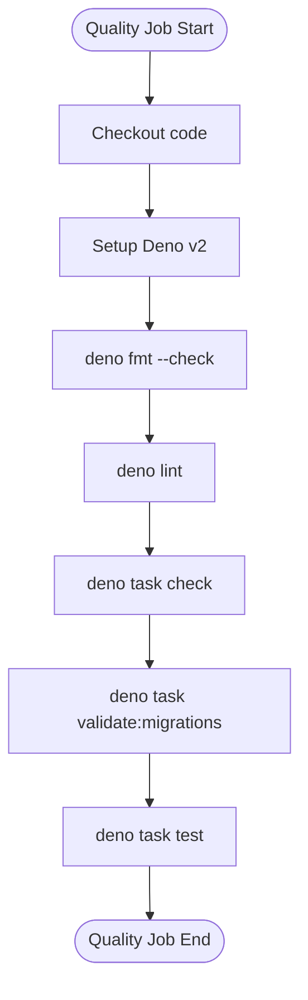
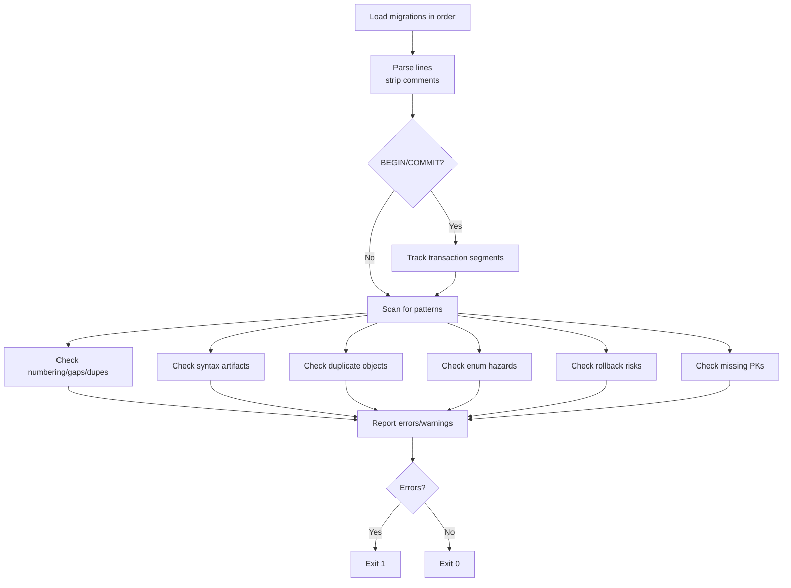
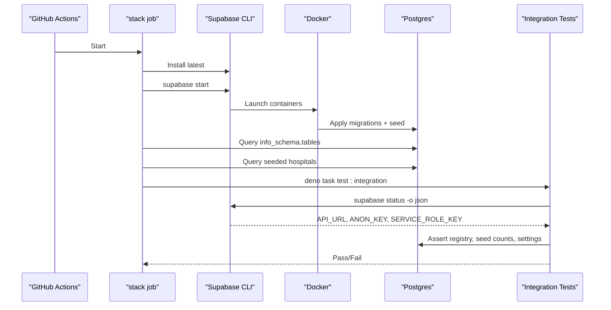
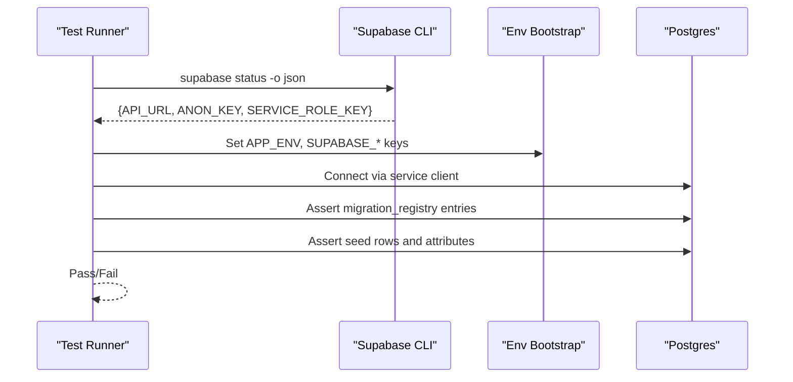
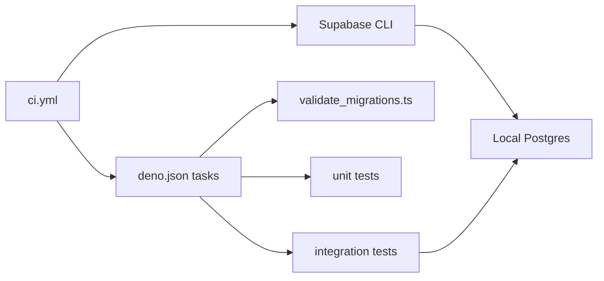

# CI/CD Pipeline

<cite>
**Referenced Files in This Document**
- [ci.yml](file://.github/workflows/ci.yml)
- [deno.json](file://deno.json)
- [validate_migrations.ts](file://scripts/validate_migrations.ts)
- [local_stack.test.ts](file://tests/integration/local_stack.test.ts)
- [setup_env.ts](file://tests/utils/setup_env.ts)
- [config.toml](file://supabase/config.toml)
</cite>

## Table of Contents

1. [Introduction](#introduction)
2. [Project Structure](#project-structure)
3. [Core Components](#core-components)
4. [Architecture Overview](#architecture-overview)
5. [Detailed Component Analysis](#detailed-component-analysis)
6. [Dependency Analysis](#dependency-analysis)
7. [Performance Considerations](#performance-considerations)
8. [Troubleshooting Guide](#troubleshooting-guide)
9. [Conclusion](#conclusion)
10. [Appendices](#appendices)

## Introduction

This document explains the Setura Hospital OS CI/CD pipeline powered by GitHub
Actions. The workflow enforces code quality and validates database migrations
without external services, then boots a local Supabase stack to run integration
smoke tests against the real database schema and seed data. It is designed to be
deterministic, fast for static checks, and robust for integration testing with
minimal flakiness.

## Project Structure

The CI/CD pipeline is defined in a single GitHub Actions workflow file and
orchestrates Deno-based tasks and the Supabase CLI. Key artifacts:

- Workflow definition: .github/workflows/ci.yml
- Task definitions and tooling configuration: deno.json
- Migration validation script: scripts/validate_migrations.ts
- Integration smoke tests: tests/integration/local_stack.test.ts
- Test environment bootstrap: tests/utils/setup_env.ts
- Local Supabase project configuration: supabase/config.toml

**Diagram sources**

- [ci.yml:1-85](file://.github/workflows/ci.yml#L1-L85)

**Section sources**

- [ci.yml:1-85](file://.github/workflows/ci.yml#L1-L85)
- [deno.json:1-40](file://deno.json#L1-L40)

## Core Components

- Quality job: Ensures formatting, linting, type checking, migration validation,
  and unit tests pass before any runtime dependencies are required.
- Stack job: Boots the full local Supabase stack (Postgres, API, Studio,
  Realtime), applies all migrations and seed, verifies application, and runs
  integration smoke tests that assert seed idempotency and schema state.

Key responsibilities:

- Deno version pinning via environment variable for reproducibility.
- Concurrency control per branch to avoid redundant runs.
- Explicit task execution through Deno tasks for consistency across
  environments.

**Section sources**

- [ci.yml:15-85](file://.github/workflows/ci.yml#L15-L85)
- [deno.json:11-21](file://deno.json#L11-L21)

## Architecture Overview

The pipeline uses a two-job architecture:

- quality: Static gates only; no network or services required.
- stack: Requires Docker and Supabase CLI to run a local stack; executes
  integration tests against it.

**Diagram sources**

- [ci.yml:28-85](file://.github/workflows/ci.yml#L28-L85)
- [deno.json:11-21](file://deno.json#L11-L21)

## Detailed Component Analysis

### Quality Job

Responsibilities:

- Format check: Enforces consistent code style using Deno formatter.
- Lint: Runs Deno linter rules configured in deno.json.
- Type check: Validates types across scripts, functions, and tests.
- Migration validation: Runs a custom script to analyze SQL migrations for
  ordering, duplicates, rollback risks, enum hazards, and missing constraints.
- Unit tests: Executes pure unit tests under tests/unit/.

Execution flow:

1. Checkout repository.
2. Setup Deno with pinned version.
3. Run format, lint, type check, migration validation, and unit tests
   sequentially. Any failure fails the pipeline.

**Diagram sources**

- [ci.yml:28-54](file://.github/workflows/ci.yml#L28-L54)
- [deno.json:11-21](file://deno.json#L11-L21)

**Section sources**

- [ci.yml:28-54](file://.github/workflows/ci.yml#L28-L54)
- [deno.json:11-21](file://deno.json#L11-L21)

### Migration Validation Script

Purpose:

- Analyze supabase/migrations/*.sql without a running database.
- Checks include:
  - Ordering and numbering (sequential, no gaps/dupes).
  - Syntax artifacts (e.g., markdown fences).
  - Duplicate object definitions across migrations without proper guards.
  - Enum hazards where LANGUAGE sql functions reference newly added enum values
    within the same transaction.
  - Rollback risks (DROP/ALTER DROP/TRUNCATE without safe guards).
  - Missing primary keys on CREATE TABLE blocks.

Behavior:

- Reads files in numeric order, parses lines, tracks transactions, and reports
  errors/warnings.
- Exits non-zero if any errors are found; warnings do not fail the run.

**Diagram sources**

- [validate_migrations.ts:1-503](file://scripts/validate_migrations.ts#L1-L503)

**Section sources**

- [validate_migrations.ts:1-503](file://scripts/validate_migrations.ts#L1-L503)

### Stack Job

Responsibilities:

- Install Supabase CLI and start the local stack (applies all migrations and
  seed).
- Verify migrations were applied by querying the database directly.
- Run integration smoke tests that assert seed idempotency and expected state.

Execution flow:

1. Checkout repository.
2. Setup Deno v2.
3. Install Supabase CLI.
4. Run supabase start to boot services and apply migrations/seed.
5. Use psql to verify table count and seeded hospital record.
6. Execute integration tests which dynamically fetch local endpoints and keys
   from the Supabase CLI status output.

**Diagram sources**

- [ci.yml:55-85](file://.github/workflows/ci.yml#L55-L85)
- [local_stack.test.ts:1-269](file://tests/integration/local_stack.test.ts#L1-L269)

**Section sources**

- [ci.yml:55-85](file://.github/workflows/ci.yml#L55-L85)
- [local_stack.test.ts:1-269](file://tests/integration/local_stack.test.ts#L1-L269)

### Integration Smoke Tests

Focus:

- Ensure the local stack is reachable via Supabase CLI status.
- Confirm migration_registry contains applied migrations including the latest.
- Validate seed idempotency by asserting exact row counts and specific attribute
  values for hospital, users/profiles, roles, working hours, settings, fee
  policy, queue configs, and feature flags.

Environment strategy:

- Dynamically reads local endpoints and keys from the Supabase CLI status JSON.
- Sets environment variables before importing modules that eagerly validate
  required env vars.

**Diagram sources**

- [local_stack.test.ts:1-269](file://tests/integration/local_stack.test.ts#L1-L269)
- [setup_env.ts:1-40](file://tests/utils/setup_env.ts#L1-L40)

**Section sources**

- [local_stack.test.ts:1-269](file://tests/integration/local_stack.test.ts#L1-L269)
- [setup_env.ts:1-40](file://tests/utils/setup_env.ts#L1-L40)

## Dependency Analysis

- GitHub Actions runner provides Ubuntu environment with Docker support for
  Supabase stack.
- Deno runtime is pinned to a specific version for reproducibility.
- Supabase CLI is installed at runtime to manage local services and read status.
- Deno tasks encapsulate commands for formatting, linting, type checking,
  testing, and migration validation.
- Integration tests depend on the local Supabase stack being up and accessible.

**Diagram sources**

- [ci.yml:1-85](file://.github/workflows/ci.yml#L1-L85)
- [deno.json:11-21](file://deno.json#L1-L21)

**Section sources**

- [ci.yml:1-85](file://.github/workflows/ci.yml#L1-L85)
- [deno.json:11-21](file://deno.json#L1-L21)

## Performance Considerations

- Keep the quality job lightweight and fast: it avoids network calls and
  services, enabling quick feedback.
- Pin Deno version to reduce cache misses and ensure consistent behavior across
  runs.
- Use concurrency grouping to cancel in-progress runs on the same branch when
  new commits are pushed.
- For the stack job:
  - Ensure Docker is available and performant on the runner.
  - Reuse cached Deno dependencies by leveraging Deno’s caching mechanisms.
  - Avoid unnecessary retries; failures should be explicit and actionable.

[No sources needed since this section provides general guidance]

## Troubleshooting Guide

Common issues and resolutions:

- Deno setup failures:
  - Symptom: Deno installation or command not found.
  - Resolution: Verify the Deno setup action and pinned version; ensure network
    access to Deno distribution.
- Formatting/linting/type check failures:
  - Symptom: Steps fail due to code style or type errors.
  - Resolution: Fix formatting with deno fmt, address lint warnings/errors, and
    resolve type errors reported by deno task check.
- Migration validation errors:
  - Symptom: Errors related to ordering, duplicates, enum hazards, or rollback
    risks.
  - Resolution: Adjust migration numbering, add IF NOT EXISTS or appropriate
    guards, split transactions to avoid enum hazards, and ensure destructive
    statements are safe.
- Supabase CLI not found:
  - Symptom: supabase command not recognized during stack job.
  - Resolution: Ensure the Supabase CLI setup step succeeds and the CLI is on
    PATH.
- Local stack startup failures:
  - Symptom: supabase start fails or services do not become healthy.
  - Resolution: Check Docker availability, ports conflicts, and logs; adjust
    config.toml if necessary.
- Integration tests failing:
  - Symptom: Cannot connect to local stack or assertions fail.
  - Resolution: Verify supabase status returns valid JSON, ensure migrations and
    seed applied, and confirm expected seed constants match actual data.

**Section sources**

- [ci.yml:28-85](file://.github/workflows/ci.yml#L28-L85)
- [validate_migrations.ts:1-503](file://scripts/validate_migrations.ts#L1-L503)
- [local_stack.test.ts:1-269](file://tests/integration/local_stack.test.ts#L1-L269)

## Conclusion

The Setura Hospital OS CI/CD pipeline combines strict static analysis with
robust integration testing against a local Supabase stack. The quality job
ensures code and migrations meet standards quickly, while the stack job
validates end-to-end behavior with real database interactions. By pinning
versions, using Deno tasks, and leveraging Supabase CLI capabilities, the
pipeline remains reproducible, maintainable, and extensible for future
deployment stages and environment-specific behaviors.

[No sources needed since this section summarizes without analyzing specific
files]

## Appendices

### Configuration Options and Customization

- Deno version: Controlled via an environment variable in the workflow; update
  to change the runtime version used across jobs.
- Tasks: All commands are centralized in deno.json tasks; extend or modify tasks
  to add new steps (e.g., additional linters or analyzers).
- Supabase CLI: Installed at runtime; configure version or use latest as defined
  in the workflow.
- Local stack configuration: Managed in supabase/config.toml; adjust ports,
  features, and services as needed for your environment.

**Section sources**

- [ci.yml:24-26](file://.github/workflows/ci.yml#L24-L26)
- [deno.json:11-21](file://deno.json#L11-L21)
- [config.toml:1-409](file://supabase/config.toml#L1-L409)

### Secrets Management

- External secrets (e.g., WhatsApp, payments, observability) are not required
  for the current CI jobs because they run locally or are pure/static checks.
- If adding deployment stages or remote integrations later, store secrets in
  GitHub Actions secrets and reference them via environment variables in
  workflow steps.

[No sources needed since this section provides general guidance]

### Extending the Pipeline

- Add new jobs:
  - Create additional jobs in ci.yml for staging deployments, performance tests,
    or security scans.
  - Use separate runners or environments for isolation.
- Add deployment stages:
  - Introduce jobs that deploy to staging/production after passing quality and
    stack jobs.
  - Gate deployments with approvals and environment-specific secrets.
- Configure environment-specific behaviors:
  - Use conditional steps based on branches or tags.
  - Switch configurations via environment variables or different config files.

[No sources needed since this section provides general guidance]
