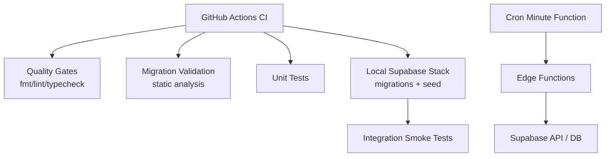
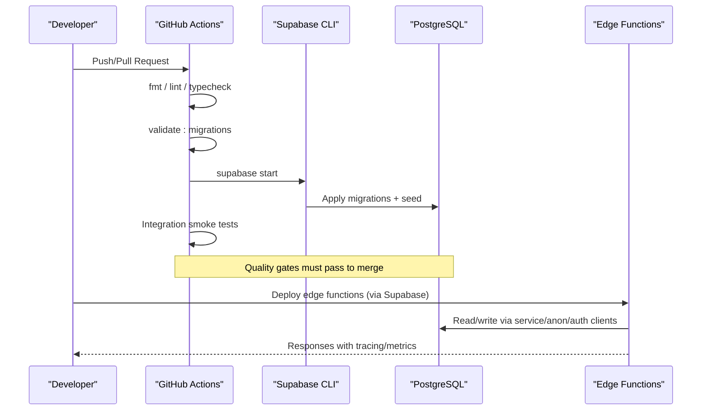
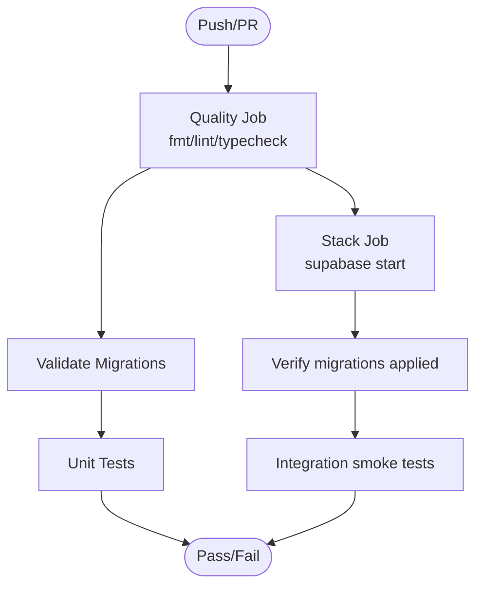
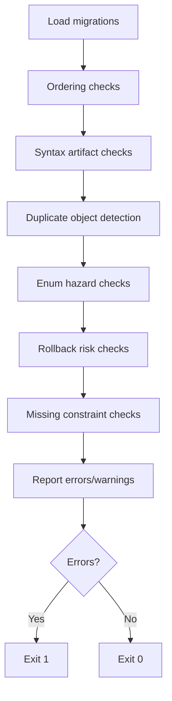
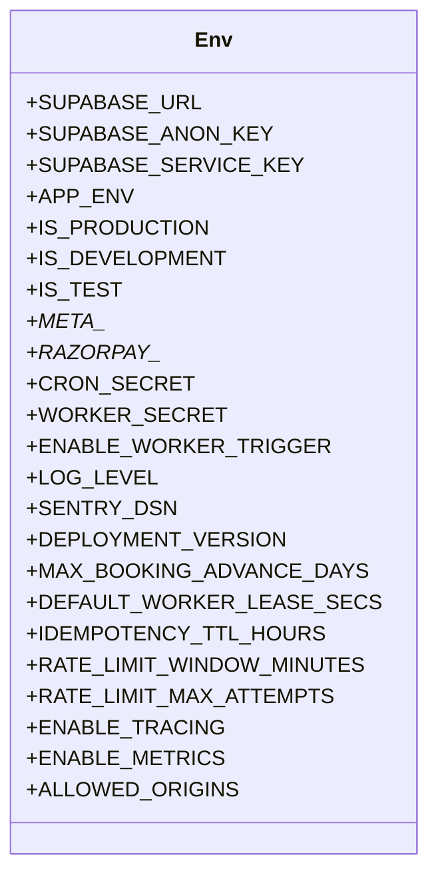
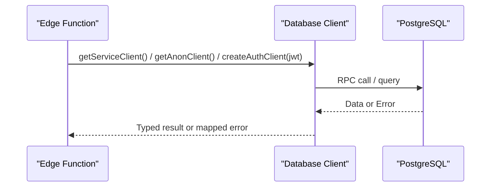
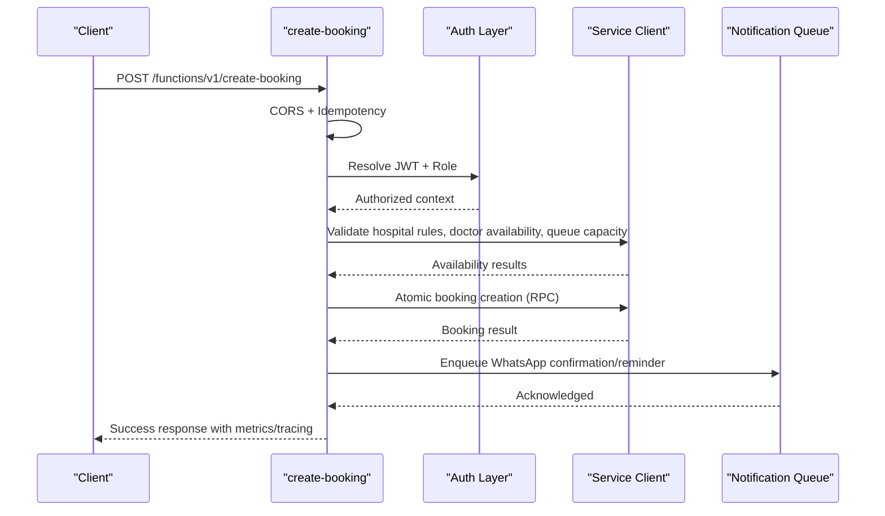
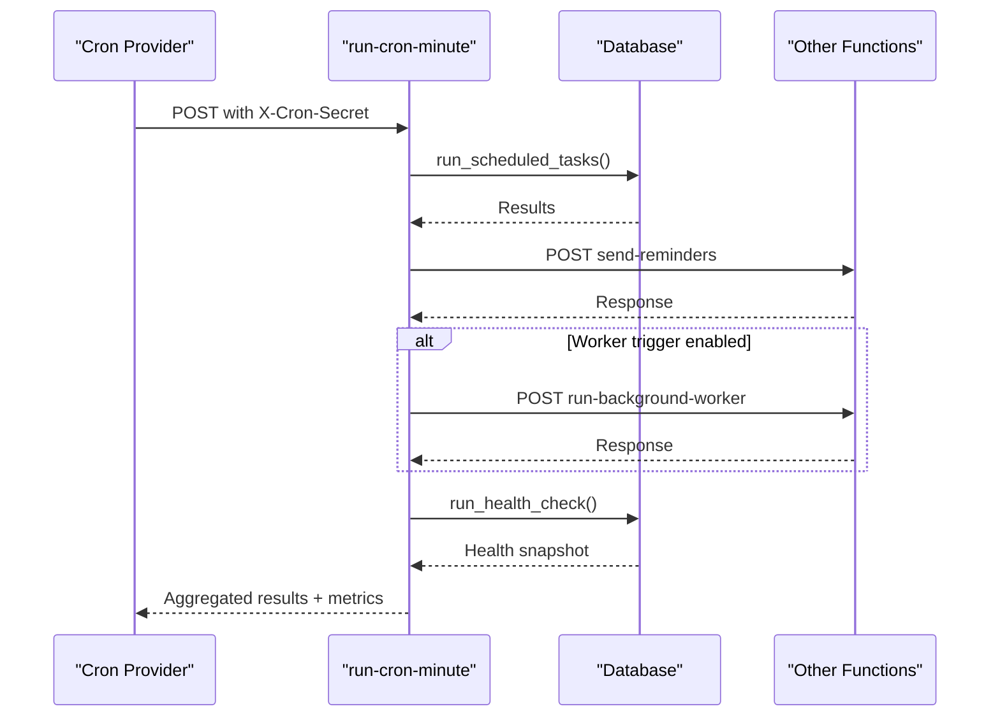
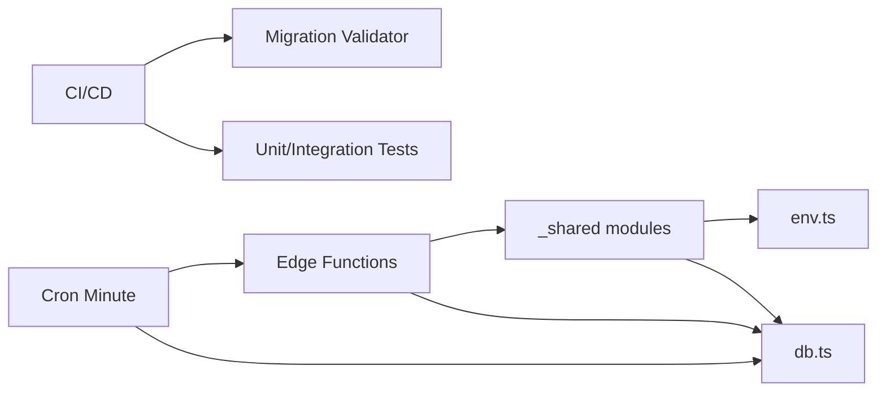

# Deployment & DevOps

<cite>
**Referenced Files in This Document**
- [ci.yml](file://.github/workflows/ci.yml)
- [validate_migrations.ts](file://scripts/validate_migrations.ts)
- [config.toml](file://supabase/config.toml)
- [env.ts](file://supabase/functions/_shared/env.ts)
- [db.ts](file://supabase/functions/_shared/db.ts)
- [create-booking/index.ts](file://supabase/functions/create-booking/index.ts)
- [run-cron-minute/index.ts](file://supabase/functions/run-cron-minute/index.ts)
- [deno.json](file://deno.json)
- [setup_env.ts](file://tests/utils/setup_env.ts)
</cite>

## Table of Contents

1. Introduction
2. Project Structure
3. Core Components
4. Architecture Overview
5. Detailed Component Analysis
6. Dependency Analysis
7. Performance Considerations
8. Troubleshooting Guide
9. Conclusion
10. Appendices

## Introduction

This document provides comprehensive deployment and DevOps guidance for the
Setura Hospital OS. It covers the CI/CD pipeline using GitHub Actions, automated
migration validation, edge function deployment patterns, database migrations,
environment-specific configuration strategies, scaling considerations, backup
and recovery procedures, monitoring and alerting, security practices,
performance optimization, cost management, and operational excellence.

## Project Structure

The repository is organized around a Supabase-based backend with Deno Edge
Functions, SQL migrations, and a robust CI/CD pipeline:

- CI/CD: GitHub Actions workflow orchestrates quality gates, migration
  validation, unit tests, and integration smoke tests against a local Supabase
  stack.
- Database: Declarative SQL migrations under supabase/migrations; seed data via
  supabase/seed.sql; project configuration in supabase/config.toml.
- Edge Functions: Business logic implemented as Deno functions under
  supabase/functions, with shared utilities in _shared (auth, db clients, env,
  logging, metrics, tracing).
- Testing: Unit tests under tests/unit and integration tests under
  tests/integration that run against the local Supabase stack.
- Tooling: deno.json defines tasks for formatting, linting, type checking,
  testing, migration validation, and DB reset.

**Diagram sources**

- [ci.yml:1-85](file://.github/workflows/ci.yml#L1-L85)
- [config.toml:1-409](file://supabase/config.toml#L1-L409)

**Section sources**

- [ci.yml:1-85](file://.github/workflows/ci.yml#L1-L85)
- [deno.json:1-40](file://deno.json#L1-L40)
- [config.toml:1-409](file://supabase/config.toml#L1-L409)

## Core Components

- CI/CD Pipeline: Two jobs — quality (format, lint, type check, migration
  validation, unit tests) and stack (local Supabase stack with migrations and
  seed, then integration tests).
- Migration Validation: Static analyzer enforces ordering, encoding, duplicate
  objects, enum hazards, rollback risks, and missing constraints.
- Environment Configuration: Centralized typed environment validation with
  fail-fast cold start; supports development, production, test environments and
  feature flags.
- Database Clients: Service-role, anon, and per-request auth clients with
  consistent headers and typed RPC helpers.
- Edge Functions: Production-grade handlers with CORS, idempotency, rate
  limiting, audit logging, tracing, metrics, and error handling.
- Cron Orchestration: Minute-level cron function coordinates scheduled tasks,
  reminders, worker wake-ups, and health snapshots.

**Section sources**

- [ci.yml:28-84](file://.github/workflows/ci.yml#L28-L84)
- [validate_migrations.ts:1-503](file://scripts/validate_migrations.ts#L1-L503)
- [env.ts:1-279](file://supabase/functions/_shared/env.ts#L1-L279)
- [db.ts:1-169](file://supabase/functions/_shared/db.ts#L1-L169)
- [create-booking/index.ts:1-666](file://supabase/functions/create-booking/index.ts#L1-L666)
- [run-cron-minute/index.ts:1-347](file://supabase/functions/run-cron-minute/index.ts#L1-L347)

## Architecture Overview

The system uses Supabase as the platform:

- Edge Functions expose HTTP endpoints and background workers.
- Migrations define schema and business logic in Postgres.
- CI ensures code quality and migration safety before deployment.
- Cron functions orchestrate periodic tasks and integrate with other functions.

**Diagram sources**

- [ci.yml:28-84](file://.github/workflows/ci.yml#L28-L84)
- [config.toml:1-409](file://supabase/config.toml#L1-L409)
- [db.ts:1-169](file://supabase/functions/_shared/db.ts#L1-L169)

## Detailed Component Analysis

### CI/CD Pipeline (GitHub Actions)

- Jobs:
  - quality: format check, lint, type check across scripts/tests/functions,
    migration validation, unit tests.
  - stack: starts local Supabase stack, applies all migrations and seed,
    verifies tables and seeded data, runs integration tests.
- Concurrency: Cancels in-progress runs per branch to avoid redundant work.
- Environment: Uses Deno v2.8.3 and latest Supabase CLI.

**Diagram sources**

- [ci.yml:1-85](file://.github/workflows/ci.yml#L1-L85)

**Section sources**

- [ci.yml:1-85](file://.github/workflows/ci.yml#L1-L85)

### Migration Validation

- Checks performed without a database:
  - Ordering: sequential numbering with no gaps/duplicates.
  - Syntax artifacts: rejects markdown fences or non-SQL wrappers.
  - Duplicate objects: detects repeated definitions without re-run guards.
  - Enum hazards: prevents unsafe use of new enum values within same
    transaction.
  - Rollback risks: flags destructive statements without IF EXISTS, TRUNCATE
    usage.
  - Missing constraints: warns on CREATE TABLE without PRIMARY KEY.
- Exit codes: errors fail the pipeline; warnings are informational.

**Diagram sources**

- [validate_migrations.ts:1-503](file://scripts/validate_migrations.ts#L1-L503)

**Section sources**

- [validate_migrations.ts:1-503](file://scripts/validate_migrations.ts#L1-L503)

### Environment Configuration Strategy

- Centralized typed environment validation with fail-fast behavior at module
  load.
- Environments:
  - development: debug logs, local origins allowed.
  - production: info logs, restricted origins, stricter defaults.
  - test: deterministic setup with fake credentials for unit tests.
- Key variables include Supabase URL and keys, WhatsApp/Meta tokens, Razorpay
  keys, cron secrets, worker secrets, observability settings (log level, Sentry
  DSN), runtime limits, feature flags, and CORS origins.
- Test bootstrap sets required environment variables before importing modules
  that depend on them.

**Diagram sources**

- [env.ts:1-279](file://supabase/functions/_shared/env.ts#L1-L279)

**Section sources**

- [env.ts:1-279](file://supabase/functions/_shared/env.ts#L1-L279)
- [setup_env.ts:1-40](file://tests/utils/setup_env.ts#L1-L40)

### Database Client Management

- Three client types:
  - Service-role client: bypasses RLS for internal operations; used by
    background workers and webhooks.
  - Anon client: subject to RLS for public read-only queries.
  - Auth client: per-request, impersonates caller with JWT; RLS enforced.
- Consistent headers include client identity and deployment version for
  traceability.
- Typed RPC helper wraps calls to Postgres functions with error mapping.

**Diagram sources**

- [db.ts:1-169](file://supabase/functions/_shared/db.ts#L1-L169)

**Section sources**

- [db.ts:1-169](file://supabase/functions/_shared/db.ts#L1-L169)

### Edge Function: Create Booking

- Handles CORS preflight, idempotency key extraction, JWT and role validation,
  request parsing and Zod validation, rate limiting, hospital rules, doctor
  availability, queue capacity, patient deduplication, atomic booking creation,
  notification queuing, audit logging, and response serialization.
- Uses service-role client for mutations; RLS enforced at auth layer prior to DB
  access.
- Integrates with metrics, tracing, and structured logging.

**Diagram sources**

- [create-booking/index.ts:1-666](file://supabase/functions/create-booking/index.ts#L1-L666)
- [db.ts:1-169](file://supabase/functions/_shared/db.ts#L1-L169)

**Section sources**

- [create-booking/index.ts:1-666](file://supabase/functions/create-booking/index.ts#L1-L666)

### Cron Orchestration: Minute Tasks

- Authenticates via X-Cron-Secret header using constant-time comparison.
- Orchestrates:
  - Master SQL scheduler via RPC.
  - Reminder queue generation by invoking send-reminders function.
  - Optional background worker wake-up via run-background-worker.
  - Health snapshot via run_health_check RPC.
- Tracks success/failure counts and durations; flushes metrics and logs.

**Diagram sources**

- [run-cron-minute/index.ts:1-347](file://supabase/functions/run-cron-minute/index.ts#L1-L347)

**Section sources**

- [run-cron-minute/index.ts:1-347](file://supabase/functions/run-cron-minute/index.ts#L1-L347)

## Dependency Analysis

- CI depends on Deno and Supabase CLI; runs static checks and validates
  migrations without a live database.
- Edge functions depend on shared modules for environment, database clients,
  logging, metrics, tracing, validation, and error handling.
- Database clients rely on Supabase JS SDK and typed database schema generated
  from migrations.
- Cron function depends on other functions and database RPCs for scheduling and
  health.

**Diagram sources**

- [ci.yml:1-85](file://.github/workflows/ci.yml#L1-L85)
- [validate_migrations.ts:1-503](file://scripts/validate_migrations.ts#L1-L503)
- [env.ts:1-279](file://supabase/functions/_shared/env.ts#L1-L279)
- [db.ts:1-169](file://supabase/functions/_shared/db.ts#L1-L169)
- [run-cron-minute/index.ts:1-347](file://supabase/functions/run-cron-minute/index.ts#L1-L347)

**Section sources**

- [ci.yml:1-85](file://.github/workflows/ci.yml#L1-L85)
- [validate_migrations.ts:1-503](file://scripts/validate_migrations.ts#L1-L503)
- [env.ts:1-279](file://supabase/functions/_shared/env.ts#L1-L279)
- [db.ts:1-169](file://supabase/functions/_shared/db.ts#L1-L169)
- [run-cron-minute/index.ts:1-347](file://supabase/functions/run-cron-minute/index.ts#L1-L347)

## Performance Considerations

- Edge Functions:
  - Use service-role client for internal mutations to bypass RLS overhead where
    appropriate.
  - Leverage idempotency and rate limiting to reduce redundant work and protect
    resources.
  - Employ structured logging and metrics to identify hotspots; enable tracing
    selectively in production.
- Database:
  - Ensure indexes exist for frequently queried columns (e.g., normalized_phone,
    hospital_id).
  - Use RPCs for complex business logic to minimize round trips and enforce
    consistency.
  - Monitor query performance and adjust schema or add partial indexes as
    needed.
- Cron:
  - Keep minute tasks under strict timeouts; offload heavy work to background
    workers.
  - Aggregate results and track error counts to detect degradation early.

[No sources needed since this section provides general guidance]

## Troubleshooting Guide

- CI failures:
  - Format/lint/typecheck issues: fix code style and types; ensure imports and
    dependencies resolve.
  - Migration validation errors: address duplicate objects, unsafe enum usage,
    destructive statements without IF EXISTS, and missing primary keys.
- Runtime issues:
  - Missing environment variables: ensure all required variables are set; env.ts
    fails fast on missing required keys.
  - Auth/RBAC errors: verify roles and hospital membership; confirm JWT validity
    and headers.
  - Database errors: inspect RPC error mappings and DB error codes; use
    assertNoError context for diagnostics.
- Cron issues:
  - Secret mismatches: ensure X-Cron-Secret matches configured CRON_SECRET; use
    constant-time comparison to prevent timing attacks.
  - Partial failures: review aggregated results and error counts; retry failed
    tasks or investigate downstream dependencies.

**Section sources**

- [ci.yml:28-84](file://.github/workflows/ci.yml#L28-L84)
- [validate_migrations.ts:1-503](file://scripts/validate_migrations.ts#L1-L503)
- [env.ts:1-279](file://supabase/functions/_shared/env.ts#L1-L279)
- [db.ts:1-169](file://supabase/functions/_shared/db.ts#L1-L169)
- [run-cron-minute/index.ts:1-347](file://supabase/functions/run-cron-minute/index.ts#L1-L347)

## Conclusion

Setura Hospital OS employs a robust CI/CD pipeline, rigorous migration
validation, centralized environment configuration, and production-ready edge
functions with strong observability. The architecture supports scalable
serverless execution, reliable database interactions, and orchestrated
background tasks. Following the guidance in this document will help maintain
high reliability, security, and performance across environments.

[No sources needed since this section summarizes without analyzing specific
files]

## Appendices

### Deployment Process Summary

- Pre-deployment:
  - Run CI quality gates and migration validation locally or via PR checks.
  - Ensure environment variables are configured per target environment.
- Database migrations:
  - Migrations are declarative SQL files; validated statically and applied via
    Supabase CLI during local stack initialization and deployment.
- Edge functions:
  - Deployed through Supabase; each function exposes an HTTP endpoint or
    background task.
- Configuration management:
  - Use environment variables for secrets and toggles; centralize validation in
    env.ts; differentiate by APP_ENV.

**Section sources**

- [ci.yml:1-85](file://.github/workflows/ci.yml#L1-L85)
- [validate_migrations.ts:1-503](file://scripts/validate_migrations.ts#L1-L503)
- [config.toml:1-409](file://supabase/config.toml#L1-L409)
- [env.ts:1-279](file://supabase/functions/_shared/env.ts#L1-L279)

### Environment-Specific Strategies

- Development:
  - Debug logs, local origins allowed, local Supabase stack with seed data.
- Staging:
  - Mirror production config with staging-specific secrets; enable additional
    tracing if needed.
- Production:
  - Info logs, restricted origins, strict feature flags; ensure secrets are
    managed securely and rotation policies are in place.

**Section sources**

- [env.ts:1-279](file://supabase/functions/_shared/env.ts#L1-L279)
- [setup_env.ts:1-40](file://tests/utils/setup_env.ts#L1-L40)

### Scaling Considerations

- Serverless edge functions:
  - Design functions to be stateless and idempotent; leverage queues for
    long-running tasks.
  - Use rate limiting and backoff strategies to handle bursts.
- Database performance:
  - Index frequently accessed columns; monitor slow queries; consider
    partitioning for large tables.
- Resource allocation:
  - Tune connection pooling and timeouts; monitor CPU/memory usage of edge
    isolates; scale horizontally by adding more functions or workers as needed.

[No sources needed since this section provides general guidance]

### Backup and Recovery Procedures

- Database backups:
  - Configure regular snapshots and point-in-time recovery via Supabase or
    underlying provider.
  - Validate restore procedures periodically.
- Disaster recovery:
  - Maintain runbooks for failover scenarios; document rollback steps for
    migrations.
- Rollback strategies:
  - Use reversible migrations where possible; keep migration history and apply
    rollbacks in reverse order when necessary.

[No sources needed since this section provides general guidance]

### Monitoring and Alerting

- Logging:
  - Structured logs with correlation IDs; aggregate logs centrally for analysis.
- Metrics:
  - Emit request timings, error rates, and job success/failure counts; flush
    metrics consistently.
- Alerting:
  - Set alerts for error spikes, cron failures, and degraded performance;
    integrate with incident response workflows.

**Section sources**

- [create-booking/index.ts:1-666](file://supabase/functions/create-booking/index.ts#L1-L666)
- [run-cron-minute/index.ts:1-347](file://supabase/functions/run-cron-minute/index.ts#L1-L347)

### Security Considerations

- Secret management:
  - Store secrets in environment variables; never commit sensitive values;
    rotate regularly.
- Network security:
  - Restrict CORS origins per environment; enforce HTTPS in production; limit
    network access to databases where possible.
- Compliance:
  - Audit access via audit logs; enforce least privilege with RLS and
    service-role boundaries; ensure data retention policies align with
    compliance requirements.

**Section sources**

- [env.ts:1-279](file://supabase/functions/_shared/env.ts#L1-L279)
- [db.ts:1-169](file://supabase/functions/_shared/db.ts#L1-L169)

### Operational Excellence Practices

- Code quality:
  - Enforce formatting, linting, and type checks in CI; require passing checks
    for merges.
- Testing:
  - Maintain unit tests for pure logic and integration tests against real
    schema; cover critical paths like booking creation and cron orchestration.
- Observability:
  - Enable tracing and metrics in production; correlate logs and metrics with
    requests; establish dashboards and SLOs.
- Change management:
  - Use migrations for schema changes; validate before deployment; maintain
    rollback plans.

**Section sources**

- [ci.yml:1-85](file://.github/workflows/ci.yml#L1-L85)
- [validate_migrations.ts:1-503](file://scripts/validate_migrations.ts#L1-L503)
- [create-booking/index.ts:1-666](file://supabase/functions/create-booking/index.ts#L1-L666)
- [run-cron-minute/index.ts:1-347](file://supabase/functions/run-cron-minute/index.ts#L1-L347)
