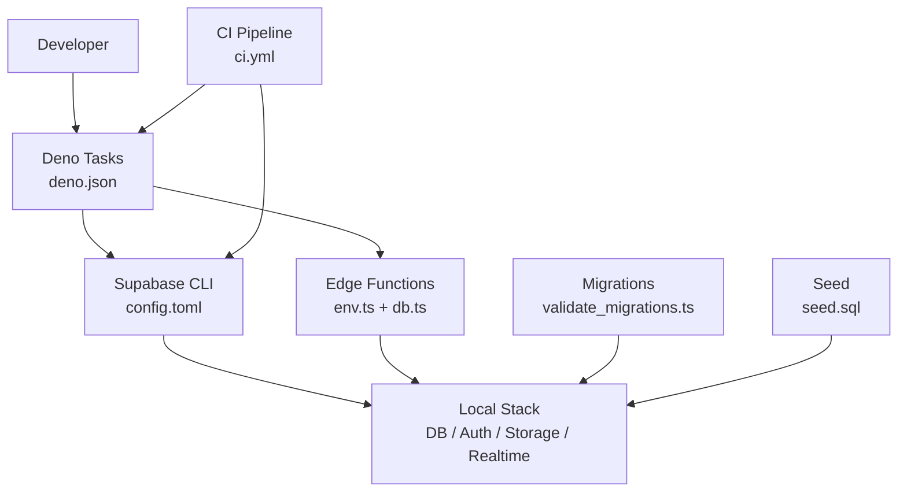
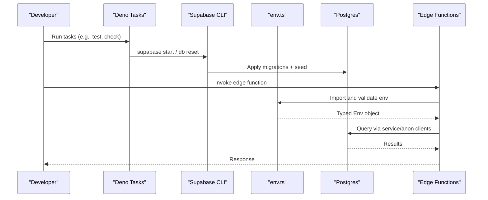
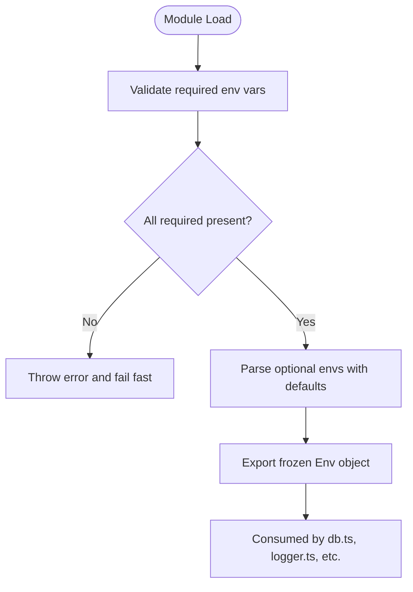
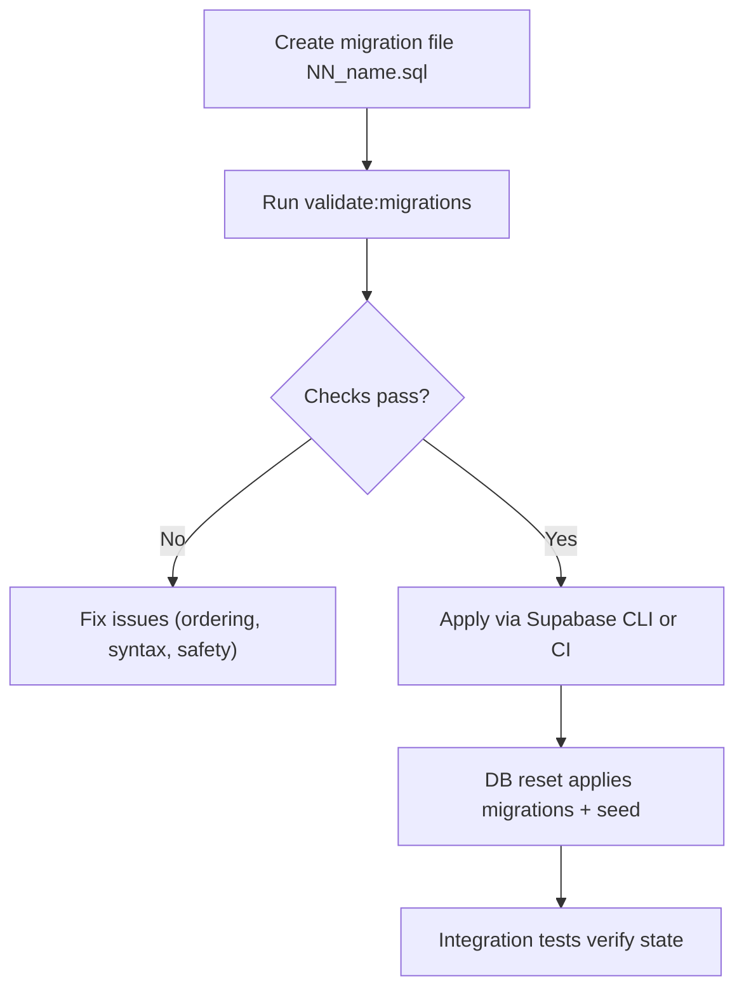
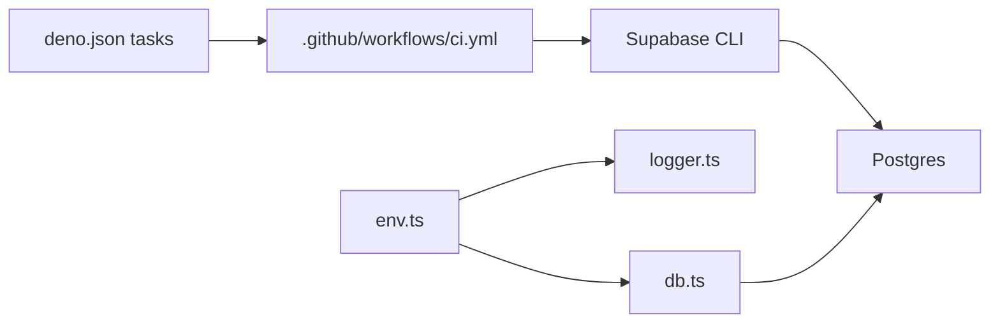

# Environment Management

<cite>
**Referenced Files in This Document**
- [config.toml](file://supabase/config.toml)
- [deno.json](file://deno.json)
- [env.ts](file://supabase/functions/_shared/env.ts)
- [validate_migrations.ts](file://scripts/validate_migrations.ts)
- [setup_env.ts](file://tests/utils/setup_env.ts)
- [seed.sql](file://supabase/seed.sql)
- [ci.yml](file://.github/workflows/ci.yml)
- [db.ts](file://supabase/functions/_shared/db.ts)
- [logger.ts](file://supabase/functions/_shared/logger.ts)
</cite>

## Table of Contents

1. [Introduction](#introduction)
2. [Project Structure](#project-structure)
3. [Core Components](#core-components)
4. [Architecture Overview](#architecture-overview)
5. [Detailed Component Analysis](#detailed-component-analysis)
6. [Dependency Analysis](#dependency-analysis)
7. [Performance Considerations](#performance-considerations)
8. [Troubleshooting Guide](#troubleshooting-guide)
9. [Conclusion](#conclusion)
10. [Appendices](#appendices)

## Introduction

This document explains how Setura Hospital OS manages environments across
development, staging, and production. It covers:

- Supabase platform configuration via supabase/config.toml
- Deno runtime configuration via deno.json
- Centralized environment variable validation and typing
- Database migration strategy, versioning, rollback considerations, and data
  seeding
- Secret management for API keys, database credentials, and third-party services
- Environment variable validation, templates, and consistency practices
- Common issues and debugging techniques

## Project Structure

The repository organizes environment-related concerns into clear layers:

- Platform configuration: supabase/config.toml defines local stack ports,
  features, and secrets placeholders
- Runtime configuration: deno.json defines tasks, imports, and tooling behavior
- Environment validation: supabase/functions/_shared/env.ts validates and
  exports typed environment variables at module load time
- Migration tooling: scripts/validate_migrations.ts performs static checks on
  SQL migrations to ensure safe evolution
- Data seeding: supabase/seed.sql provides deterministic seed data applied by
  the Supabase CLI
- CI pipeline: .github/workflows/ci.yml orchestrates quality gates and
  integration tests against a full local Supabase stack

**Diagram sources**

- [config.toml:1-120](file://supabase/config.toml#L1-L120)
- [deno.json:11-21](file://deno.json#L11-L21)
- [env.ts:16-112](file://supabase/functions/_shared/env.ts#L16-L112)
- [db.ts:1-80](file://supabase/functions/_shared/db.ts#L1-L80)
- [validate_migrations.ts:46-89](file://scripts/validate_migrations.ts#L46-L89)
- [seed.sql:1-36](file://supabase/seed.sql#L1-L36)
- [ci.yml:28-84](file://.github/workflows/ci.yml#L28-L84)

**Section sources**

- [config.toml:1-120](file://supabase/config.toml#L1-L120)
- [deno.json:11-21](file://deno.json#L11-L21)
- [ci.yml:28-84](file://.github/workflows/ci.yml#L28-L84)

## Core Components

- Supabase configuration (config.toml): Defines project_id, API, DB, Realtime,
  Studio, Inbucket, Storage, Auth, Edge Runtime, Analytics, and experimental
  settings. Secrets are referenced using env(...) substitution patterns.
- Deno runtime (deno.json): Declares compiler options, external imports, and
  tasks for formatting, linting, type checking, testing, migration validation,
  and database reset.
- Environment validation (env.ts): Provides typed accessors for required and
  optional variables, enforces allowed values, and fails fast during cold start
  if required variables are missing or invalid.
- Migration validation (validate_migrations.ts): Static analysis of migrations
  to enforce ordering, detect duplicates, warn about rollback risks, and ensure
  schema safety.
- Seed data (seed.sql): Deterministic, idempotent seed script executed by the
  Supabase CLI after migrations.
- CI (ci.yml): Runs format/lint/typecheck/migration validation/unit tests and
  boots the full Supabase stack for integration smoke tests.

**Section sources**

- [config.toml:1-409](file://supabase/config.toml#L1-L409)
- [deno.json:1-40](file://deno.json#L1-L40)
- [env.ts:16-278](file://supabase/functions/_shared/env.ts#L16-L278)
- [validate_migrations.ts:1-503](file://scripts/validate_migrations.ts#L1-L503)
- [seed.sql:1-200](file://supabase/seed.sql#L1-L200)
- [ci.yml:1-85](file://.github/workflows/ci.yml#L1-L85)

## Architecture Overview

Environment configuration flows from platform config and runtime tasks into edge
functions that validate and consume environment variables. The CI pipeline
ensures consistent application of migrations and seeds before running tests.

**Diagram sources**

- [deno.json:11-21](file://deno.json#L11-L21)
- [config.toml:53-65](file://supabase/config.toml#L53-L65)
- [env.ts:82-112](file://supabase/functions/_shared/env.ts#L82-L112)
- [db.ts:32-78](file://supabase/functions/_shared/db.ts#L32-L78)
- [ci.yml:72-84](file://.github/workflows/ci.yml#L72-L84)

## Detailed Component Analysis

### Supabase Configuration Strategy (config.toml)

- Project isolation: project_id sets the local project identity used by the CLI
  and container names.
- Services and ports: API, DB, Studio, Inbucket, Analytics, and pooler ports are
  explicitly configured to avoid conflicts.
- Migrations and seeding: [db.migrations] enables migrations; [db.seed] enables
  seed execution with sql_paths pointing to seed.sql.
- Secrets: Uses env(...) placeholders for sensitive values such as OpenAI key,
  Twilio token, S3 credentials, and others. These must be provided by the
  runtime environment where the CLI runs.
- Auth and storage: Auth is enabled with redirect URLs and JWT settings; storage
  supports S3 protocol and configurable buckets.
- Edge runtime: Enabled with per-worker policy and Deno version pinning.

Best practices derived from config:

- Keep secrets out of the file; supply them via environment variables consumed
  by the CLI and runtime.
- Pin major versions (e.g., Postgres major_version, Deno version) to reduce
  drift between environments.
- Use explicit ports and enable TLS only when needed.

**Section sources**

- [config.toml:1-120](file://supabase/config.toml#L1-L120)
- [config.toml:150-207](file://supabase/config.toml#L150-L207)
- [config.toml:283-289](file://supabase/config.toml#L283-L289)
- [config.toml:369-379](file://supabase/config.toml#L369-L379)
- [config.toml:383-400](file://supabase/config.toml#L383-L400)

### Deno Runtime Configuration (deno.json)

- Compiler strictness: Enforces strict mode and no implicit returns to improve
  reliability.
- External imports: Pins versions for zod and Supabase JS client to ensure
  reproducible builds.
- Tasks:
  - Formatting and linting: fmt, fmt:check, lint
  - Type checking: check across functions, scripts, and tests
  - Testing: unit and integration tests with appropriate permissions
  - Validation: validate:migrations to run static checks on SQL
  - Codegen: gen:types to regenerate TypeScript types from local schema
  - Database: db:reset to reset local DB using Supabase CLI

Operational guidance:

- Use deno task commands consistently across dev, CI, and deployment pipelines.
- Ensure environment variables are set before running tasks that import env.ts.

**Section sources**

- [deno.json:1-40](file://deno.json#L1-L40)

### Environment Variable Validation and Usage (env.ts)

Design principles:

- Fail-fast: Required variables are validated eagerly at module load time to
  surface misconfiguration early.
- Typed accessors: requireEnv, optionalEnv, requireUrlEnv, optionalIntEnv,
  optionalBooleanEnv provide consistent parsing and validation.
- Allowed values: APP_ENV is restricted to development, production, or test;
  defaults vary by environment (e.g., LOG_LEVEL).
- Central export: Env object exposes all validated variables to other modules,
  including Supabase clients and logging.

Key categories:

- Core Supabase: URL and keys for anon and service role clients
- Application: APP_ENV flags and feature toggles
- Third-party integrations: Meta WhatsApp, Razorpay
- Internal scheduling: Cron and worker secrets
- Observability: Log level, Sentry DSN, deployment version
- Runtime limits: Booking windows, rate limiting, idempotency TTL
- CORS: ALLOWED_ORIGINS with environment-specific defaults

Integration points:

- db.ts uses Env.SUPABASE_URL and keys to create service and anon clients
- logger.ts reads Env.LOG_LEVEL and Env.APP_ENV to control output and include
  context

**Diagram sources**

- [env.ts:18-76](file://supabase/functions/_shared/env.ts#L18-L76)
- [env.ts:82-112](file://supabase/functions/_shared/env.ts#L82-L112)
- [env.ts:227-275](file://supabase/functions/_shared/env.ts#L227-L275)
- [db.ts:32-78](file://supabase/functions/_shared/db.ts#L32-L78)
- [logger.ts:24-26](file://supabase/functions/_shared/logger.ts#L24-L26)

**Section sources**

- [env.ts:16-278](file://supabase/functions/_shared/env.ts#L16-L278)
- [db.ts:1-80](file://supabase/functions/_shared/db.ts#L1-L80)
- [logger.ts:1-190](file://supabase/functions/_shared/logger.ts#L1-L190)

### Database Migration Process Across Environments

Version control and ordering:

- Migrations are numbered NN_ and must be sequential without gaps or duplicates.
  The validator enforces this and reports errors for violations.
- Non-ASCII bytes in migrations are rejected to prevent encoding corruption on
  different platforms.

Safety checks:

- Detects markdown fences or non-SQL artifacts in SQL files.
- Tracks object definitions (tables, indexes, functions, policies, triggers,
  types, views) and warns about re-run safety (missing IF NOT EXISTS or OR
  REPLACE guards).
- Flags destructive statements without IF EXISTS and TRUNCATE usage.
- Checks for unsafe enum value usage within the same transaction segment.

Rollback considerations:

- The validator highlights risky operations (DROP/ALTER DROP without IF EXISTS,
  TRUNCATE) to guide safer migration design.
- Downstream metadata tables track applied migrations and can store rollback
  scripts and checksums for advanced workflows.

Seeding:

- Seed data is deterministic and idempotent, wrapped in a single transactional
  block to avoid batch-splitting side effects.
- Fixed identifiers and passwords ensure reproducibility across environments.

**Diagram sources**

- [validate_migrations.ts:46-89](file://scripts/validate_migrations.ts#L46-L89)
- [validate_migrations.ts:204-399](file://scripts/validate_migrations.ts#L204-L399)
- [validate_migrations.ts:408-476](file://scripts/validate_migrations.ts#L408-L476)
- [seed.sql:1-36](file://supabase/seed.sql#L1-L36)
- [ci.yml:72-84](file://.github/workflows/ci.yml#L72-L84)

**Section sources**

- [validate_migrations.ts:1-503](file://scripts/validate_migrations.ts#L1-L503)
- [seed.sql:1-200](file://supabase/seed.sql#L1-L200)
- [ci.yml:72-84](file://.github/workflows/ci.yml#L72-L84)

### Secret Management Practices

- Config-level secrets: config.toml references secrets via env(...) placeholders
  for OpenAI, Twilio, and S3 credentials. Provide these through the environment
  where the Supabase CLI runs.
- Runtime secrets: Edge functions read secrets from environment variables
  validated by env.ts (e.g., SUPABASE_URL, SUPABASE_ANON_KEY,
  SUPABASE_SERVICE_ROLE_KEY, META_* keys, RAZORPAY_* keys, CRON_SECRET,
  WORKER_SECRET, SENTRY_DSN).
- Test isolation: Tests set minimal fake credentials via setup_env.ts before
  importing any module that depends on env.ts.

Guidelines:

- Never commit secrets to version control.
- Use environment-specific secret stores (local env files for dev, platform
  secret managers for staging/production).
- Validate required secrets at startup to fail fast and avoid partial
  initialization.

**Section sources**

- [config.toml:95-95](file://supabase/config.toml#L95-L95)
- [config.toml:283-289](file://supabase/config.toml#L283-L289)
- [config.toml:394-400](file://supabase/config.toml#L394-L400)
- [env.ts:82-112](file://supabase/functions/_shared/env.ts#L82-L112)
- [env.ts:118-149](file://supabase/functions/_shared/env.ts#L118-L149)
- [env.ts:155-162](file://supabase/functions/_shared/env.ts#L155-L162)
- [setup_env.ts:33-37](file://tests/utils/setup_env.ts#L33-L37)

### Environment-Specific Setup and Isolation

- Development:
  - Local Supabase stack started via CLI; ports defined in config.toml isolate
    services.
  - Deno tasks run locally with appropriate permissions.
  - Logging defaults to debug; CORS allows localhost origins.
- Staging/Production:
  - Deploy with environment variables providing real secrets and endpoints.
  - Logging levels typically set to info or higher; CORS restricts to production
    domains.
  - Feature flags and runtime limits tuned for scale and safety.
- Testing:
  - Unit tests use fake credentials and do not touch network or database.
  - Integration tests boot the full local stack and exercise migrations and
    seed.

Consistency tips:

- Pin versions in deno.json and config.toml to minimize drift.
- Use the same tasks and validation steps in CI as developers run locally.

**Section sources**

- [config.toml:10-15](file://supabase/config.toml#L10-L15)
- [config.toml:27-36](file://supabase/config.toml#L27-L36)
- [config.toml:81-95](file://supabase/config.toml#L81-L95)
- [config.toml:150-207](file://supabase/config.toml#L150-L207)
- [env.ts:96-112](file://supabase/functions/_shared/env.ts#L96-L112)
- [env.ts:155-162](file://supabase/functions/_shared/env.ts#L155-L162)
- [env.ts:211-221](file://supabase/functions/_shared/env.ts#L211-L221)
- [deno.json:11-21](file://deno.json#L11-L21)
- [ci.yml:28-84](file://.github/workflows/ci.yml#L28-L84)

### Configuration Templates and Best Practices

- Maintain a single source of truth for configuration keys in env.ts; add new
  variables there to ensure consistent validation and typing.
- Use default values for optional settings to keep environments functional
  without over-configuration.
- Restrict APP_ENV to known values and derive booleans like IS_PRODUCTION from
  it.
- Keep secrets out of code; reference them via env(...) in config and
  environment variables at runtime.
- Use CI to enforce formatting, linting, type checks, and migration validation
  before merging changes.

**Section sources**

- [env.ts:16-112](file://supabase/functions/_shared/env.ts#L16-L112)
- [env.ts:227-275](file://supabase/functions/_shared/env.ts#L227-L275)
- [deno.json:11-21](file://deno.json#L11-L21)
- [ci.yml:28-53](file://.github/workflows/ci.yml#L28-L53)

## Dependency Analysis

Environment configuration dependencies:

- Edge functions depend on env.ts for validated configuration.
- Database clients depend on env.ts for connection details and keys.
- Logger depends on env.ts for log level and environment context.
- CI depends on deno tasks and Supabase CLI to apply migrations and seed data.

**Diagram sources**

- [env.ts:227-275](file://supabase/functions/_shared/env.ts#L227-L275)
- [db.ts:32-78](file://supabase/functions/_shared/db.ts#L32-L78)
- [logger.ts:24-26](file://supabase/functions/_shared/logger.ts#L24-L26)
- [deno.json:11-21](file://deno.json#L11-L21)
- [ci.yml:72-84](file://.github/workflows/ci.yml#L72-L84)

**Section sources**

- [env.ts:227-275](file://supabase/functions/_shared/env.ts#L227-L275)
- [db.ts:32-78](file://supabase/functions/_shared/db.ts#L32-L78)
- [logger.ts:24-26](file://supabase/functions/_shared/logger.ts#L24-L26)
- [deno.json:11-21](file://deno.json#L11-L21)
- [ci.yml:72-84](file://.github/workflows/ci.yml#L72-L84)

## Performance Considerations

- Fail-fast validation prevents wasted work on misconfigured environments.
- Pinned versions in deno.json and config.toml reduce cold-start variability and
  dependency resolution overhead.
- Logging levels should be tuned per environment to balance observability and
  performance.
- Migration validation runs offline to catch issues early, avoiding expensive
  failures during deployment.

[No sources needed since this section provides general guidance]

## Troubleshooting Guide

Common issues and resolutions:

- Missing required environment variables:
  - Symptom: Cold start throws an error indicating a required variable is
    missing or empty.
  - Resolution: Ensure SUPABASE_URL, SUPABASE_ANON_KEY, and
    SUPABASE_SERVICE_ROLE_KEY are set; add any additional required variables
    your environment needs.
- Invalid URL for SUPABASE_URL:
  - Symptom: Error stating the URL is invalid.
  - Resolution: Provide a valid base URL for the Supabase API endpoint.
- Incorrect APP_ENV:
  - Symptom: Error indicating an invalid APP_ENV value.
  - Resolution: Set APP_ENV to development, production, or test.
- CORS mismatches:
  - Symptom: Requests blocked due to origin restrictions.
  - Resolution: Configure ALLOWED_ORIGINS appropriately for each environment;
    production should list trusted domains.
- Migration validation failures:
  - Symptom: Errors or warnings from validate:migrations regarding ordering,
    duplicates, or rollback risks.
  - Resolution: Fix migration numbering, add IF NOT EXISTS guards, avoid
    destructive statements without guards, and separate transactions where
    necessary.
- Seed data inconsistencies:
  - Symptom: Unexpected state after db reset.
  - Resolution: Review seed.sql for deterministic inserts and idempotent
    upserts; ensure it matches current schema expectations.

Debugging techniques:

- Enable detailed logs in development by setting LOG_LEVEL to debug.
- Use correlation IDs in requests to trace logs across components.
- Run deno task check and deno task validate:migrations locally before pushing
  changes.
- In CI, inspect the quality and stack jobs to pinpoint failures.

**Section sources**

- [env.ts:18-49](file://supabase/functions/_shared/env.ts#L18-L49)
- [env.ts:96-112](file://supabase/functions/_shared/env.ts#L96-L112)
- [env.ts:211-221](file://supabase/functions/_shared/env.ts#L211-L221)
- [validate_migrations.ts:46-89](file://scripts/validate_migrations.ts#L46-L89)
- [validate_migrations.ts:204-399](file://scripts/validate_migrations.ts#L204-L399)
- [seed.sql:1-36](file://supabase/seed.sql#L1-L36)
- [logger.ts:24-26](file://supabase/functions/_shared/logger.ts#L24-L26)

## Conclusion

Setura Hospital OS employs a robust environment management strategy centered on
centralized validation, strict configuration control, and automated quality
gates. By isolating environments through explicit ports and secrets, validating
configuration at startup, and enforcing safe migration practices, the system
maintains consistency and reliability across development, staging, and
production. Following the documented practices will help teams avoid common
pitfalls and maintain predictable deployments.

[No sources needed since this section summarizes without analyzing specific
files]

## Appendices

### Environment Variables Reference

- Core Supabase:
  - SUPABASE_URL: Base URL for Supabase API (validated as URL)
  - SUPABASE_ANON_KEY: Anon key for RLS-enforced queries
  - SUPABASE_SERVICE_ROLE_KEY: Service role key for bypassing RLS
- Application:
  - APP_ENV: One of development, production, test
  - LOG_LEVEL: debug, info, warn, error
  - DEPLOYMENT_VERSION: String identifying deployed version
- Integrations:
  - META_ACCESS_TOKEN, META_APP_SECRET, META_WEBHOOK_VERIFY_TOKEN,
    META_PHONE_NUMBER_ID, META_API_VERSION
  - RAZORPAY_KEY_ID, RAZORPAY_KEY_SECRET
- Internal:
  - CRON_SECRET, WORKER_SECRET, ENABLE_WORKER_TRIGGER
- Observability:
  - SENTRY_DSN
- Runtime:
  - MAX_BOOKING_ADVANCE_DAYS, DEFAULT_WORKER_LEASE_SECS, IDEMPOTENCY_TTL_HOURS,
    RATE_LIMIT_WINDOW_MINUTES, RATE_LIMIT_MAX_ATTEMPTS
- CORS:
  - ALLOWED_ORIGINS: Comma-separated list of allowed origins

**Section sources**

- [env.ts:82-112](file://supabase/functions/_shared/env.ts#L82-L112)
- [env.ts:118-149](file://supabase/functions/_shared/env.ts#L118-L149)
- [env.ts:155-162](file://supabase/functions/_shared/env.ts#L155-L162)
- [env.ts:168-191](file://supabase/functions/_shared/env.ts#L168-L191)
- [env.ts:197-205](file://supabase/functions/_shared/env.ts#L197-L205)
- [env.ts:211-221](file://supabase/functions/_shared/env.ts#L211-L221)
