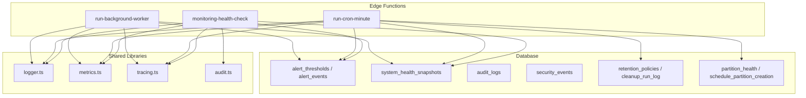
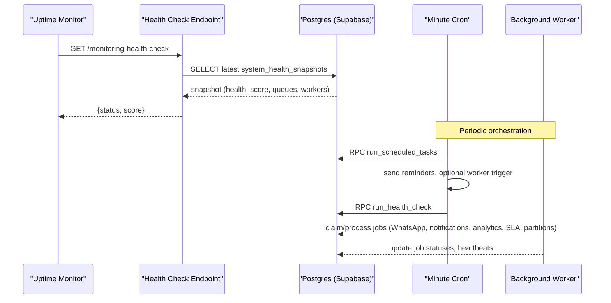
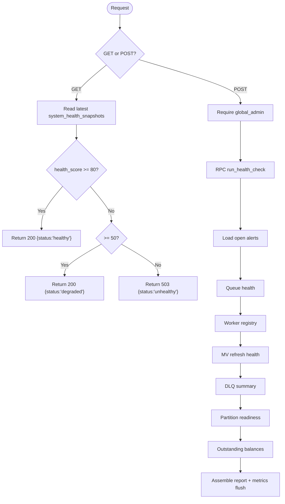
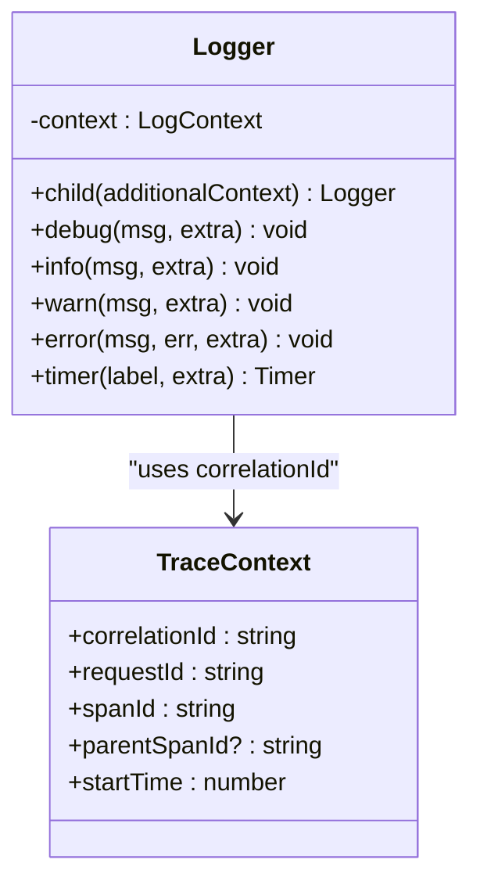
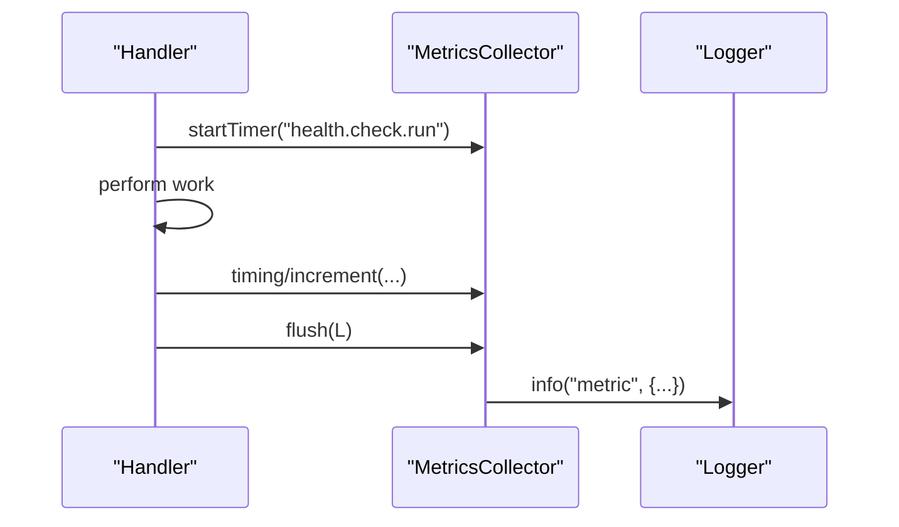
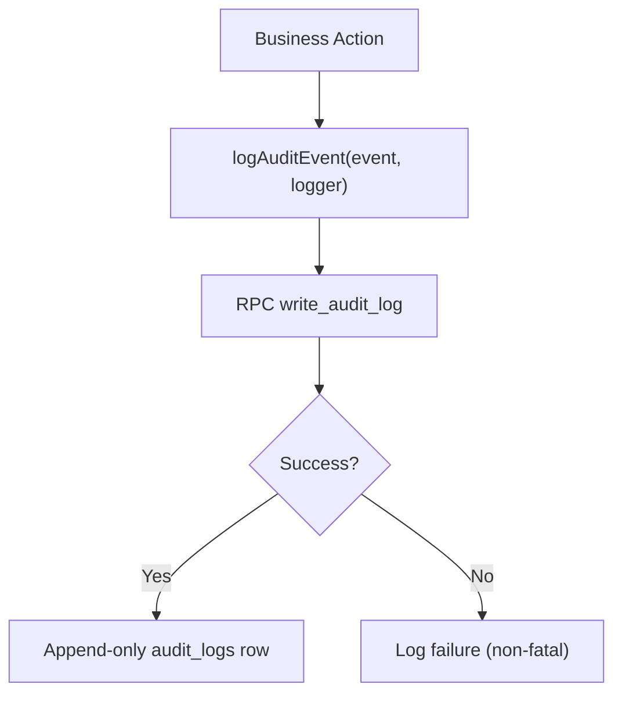
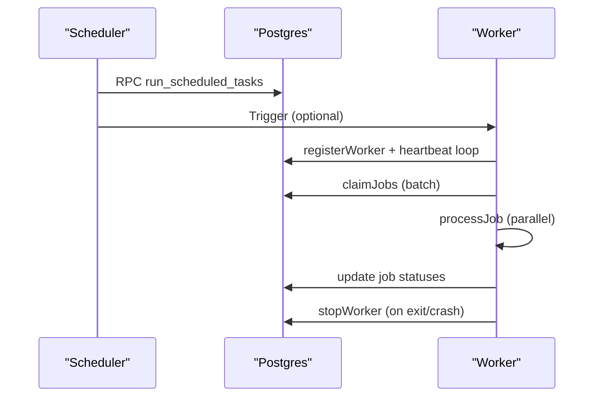
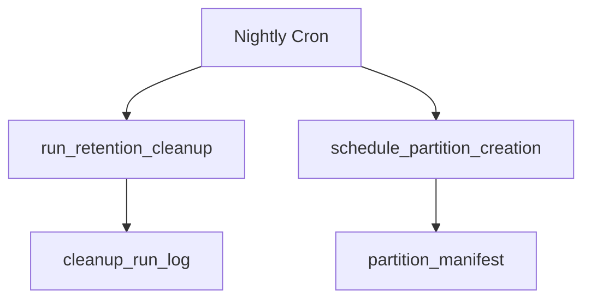
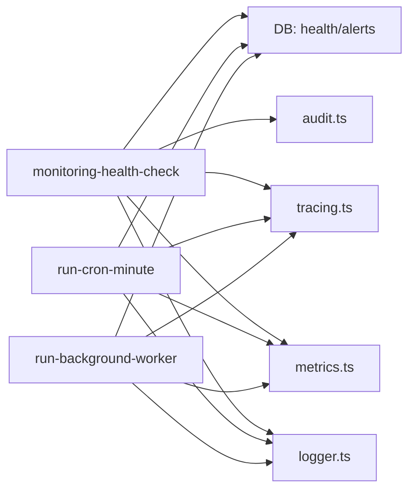

# Production Operations

<cite>
**Referenced Files in This Document**
- [monitoring-health-check/index.ts](file://supabase/functions/monitoring-health-check/index.ts)
- [logger.ts](file://supabase/functions/_shared/logger.ts)
- [metrics.ts](file://supabase/functions/_shared/metrics.ts)
- [tracing.ts](file://supabase/functions/_shared/tracing.ts)
- [audit.ts](file://supabase/functions/_shared/audit.ts)
- [run-cron-minute/index.ts](file://supabase/functions/run-cron-minute/index.ts)
- [run-background-worker/index.ts](file://supabase/functions/run-background-worker/index.ts)
- [24_operational-monitoring_engine.sql](file://supabase/migrations/24_operational-monitoring_engine.sql)
- [10_audit_&_security_engine.sql](file://supabase/migrations/10_audit_&_security_engine.sql)
- [23_retention_&_cleanup_engine.sql](file://supabase/migrations/23_retention_&_cleanup_engine.sql)
- [22_partition_automation.sql](file://supabase/migrations/22_partition_automation.sql)
- [config.toml](file://supabase/config.toml)
- [deno.json](file://deno.json)
- [ROADMAP.md](file://ROADMAP.md)
</cite>

## Table of Contents

1. Introduction
2. Project Structure
3. Core Components
4. Architecture Overview
5. Detailed Component Analysis
6. Dependency Analysis
7. Performance Considerations
8. Troubleshooting Guide
9. Conclusion
10. Appendices

## Introduction

This document provides production operations guidance for the Setura Hospital
OS, focusing on monitoring and alerting, logging and metrics, incident response,
dashboards and KPIs, log aggregation and retention, capacity planning, security
operations, runbooks, automated remediation, and post-incident review. It is
grounded in the repository’s built-in health checks, structured logging, metrics
collection, alerting engine, audit/security logs, background workers, and
scheduled tasks.

## Project Structure

The operational surface spans:

- Edge Functions for health checks, cron jobs, and background workers
- Shared libraries for logging, tracing, metrics, and auditing
- Database migrations defining alert thresholds, health snapshots, SLA tracking,
  audit/security logs, retention policies, and partition automation
- Configuration files for runtime behavior and tooling

**Diagram sources**

- [monitoring-health-check/index.ts:22-230](file://supabase/functions/monitoring-health-check/index.ts#L22-L230)
- [run-cron-minute/index.ts:123-347](file://supabase/functions/run-cron-minute/index.ts#L123-L347)
- [run-background-worker/index.ts:247-454](file://supabase/functions/run-background-worker/index.ts#L247-L454)
- [logger.ts:122-189](file://supabase/functions/_shared/logger.ts#L122-L189)
- [metrics.ts:24-118](file://supabase/functions/_shared/metrics.ts#L24-L118)
- [tracing.ts:17-49](file://supabase/functions/_shared/tracing.ts#L17-L49)
- [audit.ts:51-74](file://supabase/functions/_shared/audit.ts#L51-L74)
- [24_operational-monitoring_engine.sql:37-185](file://supabase/migrations/24_operational-monitoring_engine.sql#L37-L185)
- [10_audit_&_security_engine.sql:43-189](file://supabase/migrations/10_audit_&_security_engine.sql#L43-L189)
- [23_retention_&_cleanup_engine.sql:1-52](file://supabase/migrations/23_retention_&_cleanup_engine.sql#L1-L52)
- [22_partition_automation.sql:387-614](file://supabase/migrations/22_partition_automation.sql#L387-L614)

**Section sources**

- [monitoring-health-check/index.ts:22-230](file://supabase/functions/monitoring-health-check/index.ts#L22-L230)
- [run-cron-minute/index.ts:123-347](file://supabase/functions/run-cron-minute/index.ts#L123-L347)
- [run-background-worker/index.ts:247-454](file://supabase/functions/run-background-worker/index.ts#L247-L454)
- [24_operational-monitoring_engine.sql:37-185](file://supabase/migrations/24_operational-monitoring_engine.sql#L37-L185)
- [10_audit_&_security_engine.sql:43-189](file://supabase/migrations/10_audit_&_security_engine.sql#L43-L189)
- [23_retention_&_cleanup_engine.sql:1-52](file://supabase/migrations/23_retention_&_cleanup_engine.sql#L1-L52)
- [22_partition_automation.sql:387-614](file://supabase/migrations/22_partition_automation.sql#L387-L614)

## Core Components

- Health check endpoint: Provides a lightweight GET uptime probe and an
  authenticated POST that runs a comprehensive system health check, aggregates
  alerts, queue status, worker status, materialized view freshness, DLQ summary,
  partitions readiness, and revenue backlog.
- Structured logging: JSON-based logs with correlation IDs, request context,
  error serialization, and level filtering.
- Metrics collection: In-process counters, timings, and gauges flushed as
  structured log lines for external collectors.
- Distributed tracing: Correlation/request/span IDs propagated across calls to
  enable cross-service traceability.
- Audit and security logging: Fire-and-forget audit events and immutable audit
  logs; security event capture and resolution workflow.
- Scheduled and background processing: Minute-level cron orchestrator and
  long-running background worker with heartbeat and crash recovery.

**Section sources**

- [monitoring-health-check/index.ts:22-230](file://supabase/functions/monitoring-health-check/index.ts#L22-L230)
- [logger.ts:122-189](file://supabase/functions/_shared/logger.ts#L122-L189)
- [metrics.ts:24-118](file://supabase/functions/_shared/metrics.ts#L24-L118)
- [tracing.ts:17-49](file://supabase/functions/_shared/tracing.ts#L17-L49)
- [audit.ts:51-74](file://supabase/functions/_shared/audit.ts#L51-L74)
- [run-cron-minute/index.ts:123-347](file://supabase/functions/run-cron-minute/index.ts#L123-L347)
- [run-background-worker/index.ts:247-454](file://supabase/functions/run-background-worker/index.ts#L247-L454)

## Architecture Overview

The operational architecture centers on edge functions that emit structured logs
and metrics, persist health snapshots and alerts, and coordinate background work
via queues and workers. Scheduled tasks drive periodic maintenance and
reporting.

**Diagram sources**

- [monitoring-health-check/index.ts:34-96](file://supabase/functions/monitoring-health-check/index.ts#L34-L96)
- [monitoring-health-check/index.ts:108-210](file://supabase/functions/monitoring-health-check/index.ts#L108-L210)
- [run-cron-minute/index.ts:136-254](file://supabase/functions/run-cron-minute/index.ts#L136-L254)
- [run-background-worker/index.ts:328-421](file://supabase/functions/run-background-worker/index.ts#L328-L421)
- [24_operational-monitoring_engine.sql:283-397](file://supabase/migrations/24_operational-monitoring_engine.sql#L283-L397)

## Detailed Component Analysis

### Health Check and Alerting

- GET returns a lightweight status derived from the latest health snapshot,
  mapping health_score to healthy/degraded/unhealthy and returning appropriate
  HTTP status.
- POST requires global admin role and executes a full health check, collects
  open alerts, queue health, worker registry, MV refresh health, DLQ summary,
  partition readiness, and outstanding balances.
- Alerting uses configurable thresholds and fires deduplicated events within a
  time window.

**Diagram sources**

- [monitoring-health-check/index.ts:34-210](file://supabase/functions/monitoring-health-check/index.ts#L34-L210)
- [24_operational-monitoring_engine.sql:216-277](file://supabase/migrations/24_operational-monitoring_engine.sql#L216-L277)

**Section sources**

- [monitoring-health-check/index.ts:34-210](file://supabase/functions/monitoring-health-check/index.ts#L34-L210)
- [24_operational-monitoring_engine.sql:37-185](file://supabase/migrations/24_operational-monitoring_engine.sql#L37-L185)

### Logging Framework and Structured Practices

- Every log line is a single JSON object with timestamp, level, message,
  service, version, environment, and contextual fields including correlationId.
- Error serialization preserves stack traces in non-production and captures
  custom fields when present.
- Request-scoped logger attaches method, URL, and endpoint metadata; child
  loggers merge additional context without mutating the parent.

**Diagram sources**

- [logger.ts:122-189](file://supabase/functions/_shared/logger.ts#L122-L189)
- [tracing.ts:17-49](file://supabase/functions/_shared/tracing.ts#L17-L49)

**Section sources**

- [logger.ts:122-189](file://supabase/functions/_shared/logger.ts#L122-L189)
- [tracing.ts:17-49](file://supabase/functions/_shared/tracing.ts#L17-L49)

### Metrics Collection and Emission

- Collectors track timings, increments, and gauges per request with base tags
  (endpoint, correlationId, hospitalId).
- At handler completion, metrics are flushed as structured log lines with
  msg="metric", enabling parsing by Datadog/Grafana Loki/CloudWatch Logs
  Insights.

**Diagram sources**

- [metrics.ts:24-118](file://supabase/functions/_shared/metrics.ts#L24-L118)
- [monitoring-health-check/index.ts:108-210](file://supabase/functions/monitoring-health-check/index.ts#L108-L210)

**Section sources**

- [metrics.ts:24-118](file://supabase/functions/_shared/metrics.ts#L24-L118)

### Audit and Security Logging

- Audit events are written fire-and-forget via a database function; failures do
  not impact business flows.
- Audit logs are append-only and immutable at the database layer; security
  events capture risk scores, fingerprints, and resolution workflows.

**Diagram sources**

- [audit.ts:51-74](file://supabase/functions/_shared/audit.ts#L51-L74)
- [10_audit_&_security_engine.sql:232-320](file://supabase/migrations/10_audit_&_security_engine.sql#L232-L320)

**Section sources**

- [audit.ts:51-74](file://supabase/functions/_shared/audit.ts#L51-L74)
- [10_audit_&_security_engine.sql:43-189](file://supabase/migrations/10_audit_&_security_engine.sql#L43-L189)

### Scheduled Tasks and Background Workers

- Minute cron orchestrates scheduled tasks, reminder generation, optional worker
  wake-up, and health snapshot updates.
- Background worker claims batches of jobs, processes them concurrently,
  maintains heartbeats, and records crash state on failure.

**Diagram sources**

- [run-cron-minute/index.ts:136-254](file://supabase/functions/run-cron-minute/index.ts#L136-L254)
- [run-background-worker/index.ts:309-439](file://supabase/functions/run-background-worker/index.ts#L309-L439)

**Section sources**

- [run-cron-minute/index.ts:136-254](file://supabase/functions/run-cron-minute/index.ts#L136-L254)
- [run-background-worker/index.ts:309-439](file://supabase/functions/run-background-worker/index.ts#L309-L439)

### Retention, Cleanup, and Partitioning

- Retention policies and cleanup run logs provide governance for data lifecycle.
- Partition automation plans and schedules future partitions based on configured
  tables and thresholds, ensuring query performance at scale.

**Diagram sources**

- [23_retention_&_cleanup_engine.sql:1-52](file://supabase/migrations/23_retention_&_cleanup_engine.sql#L1-L52)
- [22_partition_automation.sql:537-614](file://supabase/migrations/22_partition_automation.sql#L537-L614)

**Section sources**

- [23_retention_&_cleanup_engine.sql:1-52](file://supabase/migrations/23_retention_&_cleanup_engine.sql#L1-L52)
- [22_partition_automation.sql:387-614](file://supabase/migrations/22_partition_automation.sql#L387-L614)

## Dependency Analysis

- Health check depends on shared logging, tracing, metrics, auth, DB client, and
  database functions/tables for snapshots and alerts.
- Cron and worker depend on shared utilities and database RPCs; worker also
  interacts with downstream functions for messaging and notifications.
- Audit and security rely on database functions and RLS policies to enforce
  access control.

**Diagram sources**

- [monitoring-health-check/index.ts:22-230](file://supabase/functions/monitoring-health-check/index.ts#L22-L230)
- [run-cron-minute/index.ts:123-347](file://supabase/functions/run-cron-minute/index.ts#L123-L347)
- [run-background-worker/index.ts:247-454](file://supabase/functions/run-background-worker/index.ts#L247-L454)

**Section sources**

- [monitoring-health-check/index.ts:22-230](file://supabase/functions/monitoring-health-check/index.ts#L22-L230)
- [run-cron-minute/index.ts:123-347](file://supabase/functions/run-cron-minute/index.ts#L123-L347)
- [run-background-worker/index.ts:247-454](file://supabase/functions/run-background-worker/index.ts#L247-L454)

## Performance Considerations

- Use the minute cron to keep health snapshots fresh and avoid heavy synchronous
  checks in user-facing paths.
- Batch job processing in the background worker reduces contention and improves
  throughput; tune batch size and poll interval as needed.
- Leverage partitioning and retention to maintain query performance and manage
  storage growth.
- Emit metrics as structured logs to minimize overhead while enabling
  observability via external collectors.

[No sources needed since this section provides general guidance]

## Troubleshooting Guide

- Health degraded or unhealthy:
  - Inspect latest health snapshot and open alerts; correlate with queue
    backlogs, worker crashes, and DLQ counts.
  - Validate cron execution results and worker heartbeat presence.
- High queue backlog:
  - Confirm worker registration and heartbeats; verify job claim and processing
    logic; check DLQ for stuck items.
- WhatsApp delivery issues:
  - Review webhook processing logs and notification queue; ensure idempotency
    keys and retry/backoff strategies are effective.
- Analytics lag:
  - Verify analytics rollups and MV refresh jobs; check compute-sla and
    refresh_analytics tasks.
- Capacity constraints:
  - Review partition readiness and plan ahead using partition scheduling; adjust
    retention policies to balance cost and compliance.

**Section sources**

- [monitoring-health-check/index.ts:34-210](file://supabase/functions/monitoring-health-check/index.ts#L34-L210)
- [run-background-worker/index.ts:328-421](file://supabase/functions/run-background-worker/index.ts#L328-L421)
- [24_operational-monitoring_engine.sql:216-397](file://supabase/migrations/24_operational-monitoring_engine.sql#L216-L397)

## Conclusion

Setura Hospital OS includes a robust operational foundation: health endpoints,
structured logging, metrics emission, alerting, audit/security logs, scheduled
tasks, and background workers. By integrating these components into your
observability stack and following the procedures outlined here, teams can
monitor system health proactively, respond quickly to incidents, and maintain
reliable, scalable operations.

[No sources needed since this section summarizes without analyzing specific
files]

## Appendices

### Monitoring and Alerting Setup

- Uptime probes: Configure external monitors to call the GET health endpoint and
  assert status codes and thresholds.
- Deep health checks: Schedule authenticated POST calls to run full diagnostics
  and push results to dashboards.
- Alert thresholds: Manage via alert_thresholds; use severity levels to route
  critical vs warning alerts.

**Section sources**

- [monitoring-health-check/index.ts:34-210](file://supabase/functions/monitoring-health-check/index.ts#L34-L210)
- [24_operational-monitoring_engine.sql:37-185](file://supabase/migrations/24_operational-monitoring_engine.sql#L37-L185)

### Logging and Metrics Integration

- Parse structured logs for requests, errors, and metrics; correlate via
  correlationId across services.
- Forward metric log lines to your metrics backend for dashboards and alerting.

**Section sources**

- [logger.ts:122-189](file://supabase/functions/_shared/logger.ts#L122-L189)
- [metrics.ts:24-118](file://supabase/functions/_shared/metrics.ts#L24-L118)

### Incident Response Procedures

- Triage:
  - Check health score and open alerts; identify affected subsystems (queues,
    workers, WhatsApp, analytics).
- Containment:
  - Pause problematic cron steps if necessary; scale workers or increase batch
    sizes temporarily.
- Resolution:
  - Address root cause (e.g., DLQ backlog, failed external integrations); re-run
    failed tasks where safe.
- Post-incident:
  - Generate incident summaries from health snapshots and logs; update alert
    thresholds if needed.

**Section sources**

- [monitoring-health-check/index.ts:108-210](file://supabase/functions/monitoring-health-check/index.ts#L108-L210)
- [run-cron-minute/index.ts:136-254](file://supabase/functions/run-cron-minute/index.ts#L136-L254)

### Operational Dashboards and KPIs

- Key views:
  - monitoring_dashboard for latest health indicators
  - alert_events for active alerts
  - system_health_snapshots for historical trends
  - sla_daily_tracking for SLA performance
- Business metrics:
  - Queue depths, worker success/failure rates, WhatsApp permanent failures, DLQ
    backlog, MV refresh lag, outstanding balances.

**Section sources**

- [24_operational-monitoring_engine.sql:433-447](file://supabase/migrations/24_operational-monitoring_engine.sql#L433-L447)
- [24_operational-monitoring_engine.sql:403-427](file://supabase/migrations/24_operational-monitoring_engine.sql#L403-L427)

### Log Aggregation and Retention Policies

- Aggregation:
  - Ingest structured logs and metric lines into your log platform; parse
    correlationId for distributed tracing.
- Retention:
  - Use retention_policies and cleanup_run_log to govern data lifecycle; align
    with compliance requirements.

**Section sources**

- [23_retention_&_cleanup_engine.sql:1-52](file://supabase/migrations/23_retention_&_cleanup_engine.sql#L1-L52)

### Capacity Planning and Proactive Maintenance

- Partitioning:
  - Enable auto-partition scheduling for high-volume tables; monitor
    partition_health and plan ahead.
- Resource monitoring:
  - Track worker throughput, queue backlogs, and analytics refresh times; adjust
    concurrency and batch sizes.
- Maintenance:
  - Schedule nightly tasks for rollups, SLA computation, retention cleanup, and
    partition planning.

**Section sources**

- [22_partition_automation.sql:387-614](file://supabase/migrations/22_partition_automation.sql#L387-L614)
- [run-cron-nightly/index.ts:167-257](file://supabase/functions/run-cron-nightly/index.ts#L167-L257)

### Security Operations

- Access monitoring:
  - Use security_events to detect failed logins, unauthorized access attempts,
    and suspicious activity; resolve and record notes.
- Audit logging:
  - Ensure all sensitive actions emit audit events; leverage immutability
    guarantees for compliance.
- Compliance reporting:
  - Export audit_logs and security_events for audits; filter by severity and
    date ranges.

**Section sources**

- [10_audit_&_security_engine.sql:43-189](file://supabase/migrations/10_audit_&_security_engine.sql#L43-L189)
- [audit.ts:51-74](file://supabase/functions/_shared/audit.ts#L51-L74)

### Runbooks

- Health check fails:
  - Verify cron execution; inspect health snapshots and alerts; restart workers
    if needed.
- Queue backlog spikes:
  - Scale workers; investigate stuck jobs; clear DLQ after root cause
    resolution.
- WhatsApp delivery failures:
  - Check webhook processing; validate templates and recipients; re-enqueue
    failed messages.
- Analytics lag:
  - Trigger analytics rollups; verify compute-sla tasks; refresh materialized
    views.

[No sources needed since this section provides procedural guidance]

### Automated Remediation

- Cron-driven:
  - Reminder generation, worker wake-ups, health snapshots, retention cleanup,
    partition scheduling.
- Worker-driven:
  - Automatic retries and backoffs for transient failures; move persistent
    failures to DLQ for inspection.

**Section sources**

- [run-cron-minute/index.ts:136-254](file://supabase/functions/run-cron-minute/index.ts#L136-L254)
- [run-background-worker/index.ts:328-421](file://supabase/functions/run-background-worker/index.ts#L328-L421)

### Post-Incident Review Processes

- Data sources:
  - Health snapshots, alert_events, audit_logs, security_events, worker logs,
    cron results.
- Actions:
  - Identify timeline via correlationId; assess impact; update thresholds and
    runbooks; schedule follow-ups.

**Section sources**

- [monitoring-health-check/index.ts:108-210](file://supabase/functions/monitoring-health-check/index.ts#L108-L210)
- [10_audit_&_security_engine.sql:232-320](file://supabase/migrations/10_audit_&_security_engine.sql#L232-L320)

### Operational Excellence and Team Coordination

- Continuous improvement:
  - Regularly review alert thresholds and KPIs; refine runbooks based on
    incidents.
- Team coordination:
  - Use correlationId to collaborate across shifts; centralize dashboards for
    visibility; standardize incident communication.

**Section sources**

- [ROADMAP.md:331-380](file://ROADMAP.md#L331-L380)
