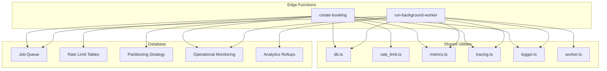
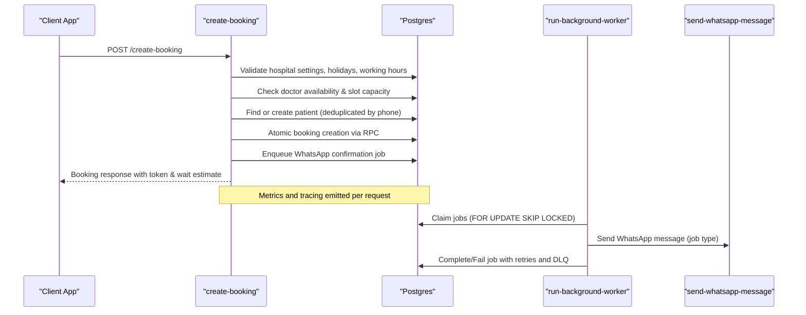
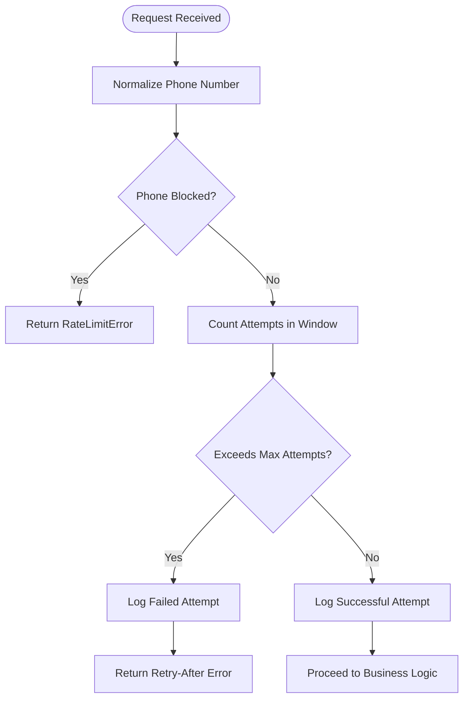
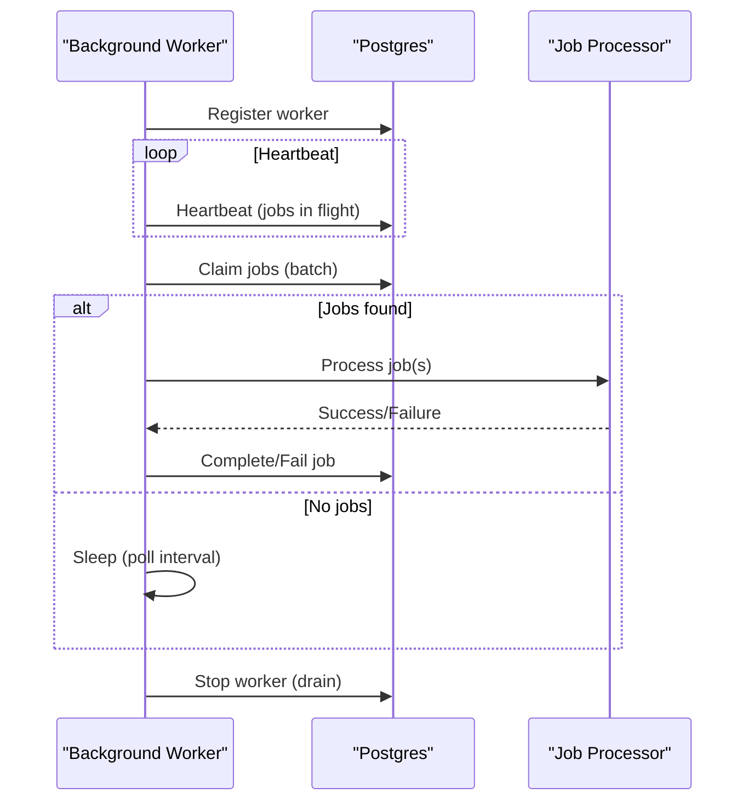
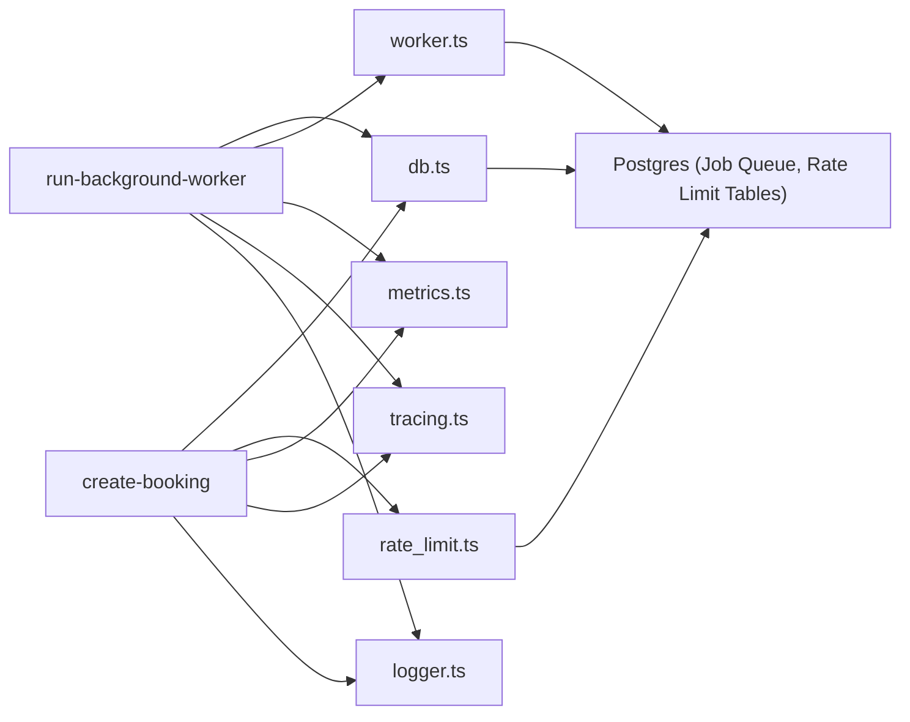

# Scaling & Performance

<cite>
**Referenced Files in This Document**
- [rate_limit.ts](file://supabase/functions/_shared/rate_limit.ts)
- [db.ts](file://supabase/functions/_shared/db.ts)
- [metrics.ts](file://supabase/functions/_shared/metrics.ts)
- [tracing.ts](file://supabase/functions/_shared/tracing.ts)
- [worker.ts](file://supabase/functions/_shared/worker.ts)
- [logger.ts](file://supabase/functions/_shared/logger.ts)
- [create-booking/index.ts](file://supabase/functions/create-booking/index.ts)
- [run-background-worker/index.ts](file://supabase/functions/run-background-worker/index.ts)
- [09_abuse_protection_&_rate_limiting.sql](file://supabase/migrations/09_abuse_protection_&_rate_limiting.sql)
- [06_background_job_queue.sql](file://supabase/migrations/06_background_job_queue.sql)
- [15_partitioning_strategy.sql](file://supabase/migrations/15_partitioning_strategy.sql)
- [24_operational-monitoring_engine.sql](file://supabase/migrations/24_operational-monitoring_engine.sql)
- [21_analytics_rollups.sql](file://supabase/migrations/21_analytics_rollups.sql)
</cite>

## Table of Contents

1. [Introduction](#introduction)
2. [Project Structure](#project-structure)
3. [Core Components](#core-components)
4. [Architecture Overview](#architecture-overview)
5. [Detailed Component Analysis](#detailed-component-analysis)
6. [Dependency Analysis](#dependency-analysis)
7. [Performance Considerations](#performance-considerations)
8. [Troubleshooting Guide](#troubleshooting-guide)
9. [Conclusion](#conclusion)
10. [Appendices](#appendices)

## Introduction

This document provides comprehensive scaling and performance guidance for the
Setura Hospital OS, focusing on:

- Serverless edge function scaling characteristics and cold start optimization
- Database performance tuning (connection pooling, query optimization, indexing,
  partitioning)
- Rate limiting and traffic management for high availability
- Monitoring key performance metrics, identifying bottlenecks, and caching
  strategies
- Load testing, profiling, capacity planning for healthcare workloads
- Cost optimization, resource utilization monitoring, and scaling policies
- Troubleshooting performance issues with actionable recommendations

The system is built on Supabase Edge Functions (Deno Deploy) with a
Postgres-backed job queue, analytics rollups, and operational monitoring.

## Project Structure

Key areas relevant to scaling and performance:

- Shared runtime utilities: database clients, rate limiting, metrics, tracing,
  logging, worker orchestration
- Edge functions: request handlers (e.g., create-booking), background workers
  (run-background-worker)
- Database migrations: abuse protection/rate limiting, background job queue,
  partitioning strategy, operational monitoring, analytics rollups

**Diagram sources**

- [create-booking/index.ts:67-666](file://supabase/functions/create-booking/index.ts#L67-L666)
- [run-background-worker/index.ts:247-454](file://supabase/functions/run-background-worker/index.ts#L247-L454)
- [db.ts:1-169](file://supabase/functions/_shared/db.ts#L1-L169)
- [rate_limit.ts:1-124](file://supabase/functions/_shared/rate_limit.ts#L1-L124)
- [metrics.ts:1-119](file://supabase/functions/_shared/metrics.ts#L1-L119)
- [tracing.ts:1-50](file://supabase/functions/_shared/tracing.ts#L1-L50)
- [logger.ts:1-190](file://supabase/functions/_shared/logger.ts#L1-L190)
- [worker.ts:1-257](file://supabase/functions/_shared/worker.ts#L1-L257)
- [06_background_job_queue.sql:41-138](file://supabase/migrations/06_background_job_queue.sql#L41-L138)
- [09_abuse_protection_&_rate_limiting.sql:81-167](file://supabase/migrations/09_abuse_protection_&_rate_limiting.sql#L81-L167)
- [15_partitioning_strategy.sql:35-166](file://supabase/migrations/15_partitioning_strategy.sql#L35-L166)
- [24_operational-monitoring_engine.sql:37-188](file://supabase/migrations/24_operational-monitoring_engine.sql#L37-L188)
- [21_analytics_rollups.sql:34-160](file://supabase/migrations/21_analytics_rollups.sql#L34-L160)

**Section sources**

- [create-booking/index.ts:67-666](file://supabase/functions/create-booking/index.ts#L67-L666)
- [run-background-worker/index.ts:247-454](file://supabase/functions/run-background-worker/index.ts#L247-L454)

## Core Components

- Edge Function client management: service-role, anon, and per-request auth
  clients are cached at module level to minimize cold start overhead and
  connection setup costs.
- Distributed rate limiting: sliding window checks against booking_attempt_logs
  with DB-backed counters; fail-open on DB errors to preserve availability.
- Background job queue: robust worker model with leases, heartbeats, crash
  recovery, retry with exponential backoff, dead-letter queue.
- Operational monitoring: health snapshots, alert thresholds, SLA tracking,
  dashboard view.
- Analytics rollups: weekly/monthly/quarterly aggregations offloading heavy
  reads from hot paths.
- Metrics and tracing: structured logs and timing emitted per request;
  correlation IDs propagate across services.

**Section sources**

- [db.ts:1-169](file://supabase/functions/_shared/db.ts#L1-L169)
- [rate_limit.ts:1-124](file://supabase/functions/_shared/rate_limit.ts#L1-L124)
- [06_background_job_queue.sql:41-138](file://supabase/migrations/06_background_job_queue.sql#L41-L138)
- [worker.ts:1-257](file://supabase/functions/_shared/worker.ts#L1-L257)
- [24_operational-monitoring_engine.sql:37-188](file://supabase/migrations/24_operational-monitoring_engine.sql#L37-L188)
- [21_analytics_rollups.sql:34-160](file://supabase/migrations/21_analytics_rollups.sql#L34-L160)
- [metrics.ts:1-119](file://supabase/functions/_shared/metrics.ts#L1-L119)
- [tracing.ts:1-50](file://supabase/functions/_shared/tracing.ts#L1-L50)

## Architecture Overview

High-level flow for a booking creation request and background processing:

**Diagram sources**

- [create-booking/index.ts:67-666](file://supabase/functions/create-booking/index.ts#L67-L666)
- [run-background-worker/index.ts:247-454](file://supabase/functions/run-background-worker/index.ts#L247-L454)
- [06_background_job_queue.sql:264-317](file://supabase/migrations/06_background_job_queue.sql#L264-L317)

## Detailed Component Analysis

### Edge Function Scaling and Cold Start Optimization

- Module-level singleton clients: Service and anon Supabase clients are created
  once per isolate lifetime, reducing cold start latency and connection
  overhead. Per-request auth clients are not cached to enforce RLS correctly.
- Minimal initialization path: Handlers avoid heavy imports until needed; error
  handling uses lazy imports where appropriate.
- Structured metrics and tracing: Each handler records timings for critical
  steps (auth, parsing, DB calls) and flushes metrics at the end of the request.
- Idempotency: Prevents duplicate processing under retries and concurrent
  requests, improving resilience during scale-up events.

Recommendations:

- Keep shared modules lean; defer heavy dependencies to reduce cold start time.
- Use short-lived connections via Supabase client; rely on platform pooling.
- Batch non-critical operations into background jobs to keep request paths fast.

**Section sources**

- [db.ts:30-106](file://supabase/functions/_shared/db.ts#L30-L106)
- [create-booking/index.ts:76-83](file://supabase/functions/create-booking/index.ts#L76-L83)
- [create-booking/index.ts:142-166](file://supabase/functions/create-booking/index.ts#L142-L166)
- [metrics.ts:24-119](file://supabase/functions/_shared/metrics.ts#L24-L119)
- [tracing.ts:17-50](file://supabase/functions/_shared/tracing.ts#L17-L50)

### Database Performance Tuning

Connection pooling and client usage:

- Three client types: service-role (bypasses RLS), anon (subject to RLS), and
  per-request auth client. Service and anon clients are module-level singletons;
  auth client is created per request.
- Global headers include client identity and deployment version for
  observability.

Query optimization and indexing:

- Rate limiting uses targeted indexes on booking_attempt_logs for
  phone/IP/device + time windows.
- Job queue uses selective partial indexes for pending, failed, and processing
  states to optimize claim queries.
- Partitioning strategy includes generators and readiness checks for large
  tables (bookings, audit logs, whatsapp messages, financial ledger, payment
  attempts, booking events).

Partitioning approaches:

- Monthly range partitions generated via SQL functions for high-volume tables.
- Readiness monitoring and maintenance advice provided through functions and
  views.

Recommendations:

- Ensure indexes align with frequent filters (hospital_id, normalized_phone,
  created_at).
- Use partial indexes for active subsets (e.g., status = 'pending').
- Schedule partition migrations during maintenance windows after benchmarking.

**Section sources**

- [db.ts:30-106](file://supabase/functions/_shared/db.ts#L30-L106)
- [09_abuse_protection_&_rate_limiting.sql:120-167](file://supabase/migrations/09_abuse_protection_&_rate_limiting.sql#L120-L167)
- [06_background_job_queue.sql:101-138](file://supabase/migrations/06_background_job_queue.sql#L101-L138)
- [15_partitioning_strategy.sql:35-166](file://supabase/migrations/15_partitioning_strategy.sql#L35-L166)
- [15_partitioning_strategy.sql:412-503](file://supabase/migrations/15_partitioning_strategy.sql#L412-L503)

### Rate Limiting Implementation and Traffic Management

- Sliding window rate limiter backed by booking_attempt_logs; counts recent
  attempts within a configurable window per hospital and phone number.
- Blocked numbers check before rate limit counting; fail-open on DB errors to
  maintain availability.
- IP extraction from standard headers for distributed safety.

Traffic management patterns:

- Fail-open behavior ensures legitimate requests proceed even if rate limit
  checks fail due to transient DB issues.
- Configurable windows and max attempts allow tuning per hospital needs.

**Diagram sources**

- [rate_limit.ts:27-111](file://supabase/functions/_shared/rate_limit.ts#L27-L111)
- [09_abuse_protection_&_rate_limiting.sql:120-167](file://supabase/migrations/09_abuse_protection_&_rate_limiting.sql#L120-L167)

**Section sources**

- [rate_limit.ts:1-124](file://supabase/functions/_shared/rate_limit.ts#L1-L124)
- [09_abuse_protection_&_rate_limiting.sql:81-167](file://supabase/migrations/09_abuse_protection_&_rate_limiting.sql#L81-L167)

### Background Workers and Job Queue Scaling

- Worker lifecycle: register, heartbeat loop, claim jobs with FOR UPDATE SKIP
  LOCKED, process with retries, complete/fail, stop with drain support.
- Crash recovery: per-job leases ensure reclamation when workers die; stale jobs
  reclaimed by timeout.
- Backoff and DLQ: failed jobs retry with exponential backoff; after max
  attempts, moved to dead letter queue.

Scaling considerations:

- Multiple worker instances can run concurrently without double-processing due
  to SKIP LOCKED.
- Batch size and poll interval tune throughput vs. latency trade-offs.

**Diagram sources**

- [worker.ts:30-94](file://supabase/functions/_shared/worker.ts#L30-L94)
- [worker.ts:98-151](file://supabase/functions/_shared/worker.ts#L98-L151)
- [worker.ts:191-257](file://supabase/functions/_shared/worker.ts#L191-L257)
- [06_background_job_queue.sql:264-317](file://supabase/migrations/06_background_job_queue.sql#L264-L317)
- [06_background_job_queue.sql:357-446](file://supabase/migrations/06_background_job_queue.sql#L357-L446)

**Section sources**

- [run-background-worker/index.ts:247-454](file://supabase/functions/run-background-worker/index.ts#L247-L454)
- [worker.ts:1-257](file://supabase/functions/_shared/worker.ts#L1-L257)
- [06_background_job_queue.sql:41-138](file://supabase/migrations/06_background_job_queue.sql#L41-L138)

### Monitoring Key Performance Metrics and Bottleneck Identification

- Metrics collector emits timing, counters, and gauges per request; flushed as
  structured logs for external collectors.
- Tracing provides correlation IDs across services for end-to-end visibility.
- Operational monitoring engine captures system health snapshots, alert
  thresholds, and SLA tracking.

Bottleneck identification:

- Use per-step timers (auth, parsing, DB calls) to locate slow segments.
- Monitor job queue backlog, worker crashes, WhatsApp failures, and DLQ depth
  via health snapshots and alerts.

Caching strategies:

- Prefer read-heavy analytics via precomputed rollups to reduce live aggregation
  cost.
- Cache configuration/hospital settings in memory within isolate lifetime where
  safe; otherwise rely on efficient DB queries with proper indexes.

**Section sources**

- [metrics.ts:1-119](file://supabase/functions/_shared/metrics.ts#L1-L119)
- [tracing.ts:1-50](file://supabase/functions/_shared/tracing.ts#L1-L50)
- [24_operational-monitoring_engine.sql:37-188](file://supabase/migrations/24_operational-monitoring_engine.sql#L37-L188)
- [21_analytics_rollups.sql:34-160](file://supabase/migrations/21_analytics_rollups.sql#L34-L160)

### Load Testing, Performance Profiling, and Capacity Planning

Load testing:

- Simulate peak booking bursts with idempotent requests to validate rate
  limiting and atomic booking creation.
- Stress test background workers by enqueueing large batches and measuring claim
  throughput and failure rates.

Profiling:

- Leverage metrics and tracing to identify hotspots (auth resolution, DB RPCs,
  external calls like WhatsApp).
- Use structured logs to correlate request flows across services.

Capacity planning:

- Scale worker instances based on job queue backlog and average processing time.
- Adjust batch size and poll intervals to balance latency and throughput.
- Plan partition migrations for high-growth tables using readiness checks and
  maintenance advice.

**Section sources**

- [create-booking/index.ts:67-666](file://supabase/functions/create-booking/index.ts#L67-L666)
- [run-background-worker/index.ts:247-454](file://supabase/functions/run-background-worker/index.ts#L247-L454)
- [15_partitioning_strategy.sql:412-503](file://supabase/migrations/15_partitioning_strategy.sql#L412-L503)

### Cost Optimization and Resource Utilization

- Minimize cold starts by keeping shared modules lightweight and deferring heavy
  imports.
- Offload expensive computations to background jobs (analytics rollups, SLA
  computation).
- Use partial indexes and partitioning to reduce scan sizes and improve query
  efficiency.
- Tune rate limits and worker concurrency to avoid over-provisioning while
  maintaining SLAs.

Resource utilization monitoring:

- Track worker runtime, batch sizes, success/failure rates via metrics.
- Monitor health snapshots for queue depths and alert thresholds.

Scaling policies:

- Auto-scale workers based on queue backlog and processing lag.
- Adjust rate limit windows and max attempts dynamically per hospital workload.

**Section sources**

- [metrics.ts:24-119](file://supabase/functions/_shared/metrics.ts#L24-L119)
- [24_operational-monitoring_engine.sql:37-188](file://supabase/migrations/24_operational-monitoring_engine.sql#L37-L188)
- [15_partitioning_strategy.sql:35-166](file://supabase/migrations/15_partitioning_strategy.sql#L35-L166)

## Dependency Analysis

Key dependency relationships impacting scaling:

- Edge functions depend on shared utilities for DB access, rate limiting,
  metrics, tracing, and worker orchestration.
- Background workers depend on job queue RPCs and worker lease management.
- Database schemas provide indexes and functions that enable efficient scaling
  (partial indexes, SKIP LOCKED, partitioning helpers).

**Diagram sources**

- [create-booking/index.ts:67-666](file://supabase/functions/create-booking/index.ts#L67-L666)
- [run-background-worker/index.ts:247-454](file://supabase/functions/run-background-worker/index.ts#L247-L454)
- [db.ts:1-169](file://supabase/functions/_shared/db.ts#L1-L169)
- [rate_limit.ts:1-124](file://supabase/functions/_shared/rate_limit.ts#L1-L124)
- [worker.ts:1-257](file://supabase/functions/_shared/worker.ts#L1-L257)

**Section sources**

- [create-booking/index.ts:67-666](file://supabase/functions/create-booking/index.ts#L67-L666)
- [run-background-worker/index.ts:247-454](file://supabase/functions/run-background-worker/index.ts#L247-L454)
- [db.ts:1-169](file://supabase/functions/_shared/db.ts#L1-L169)
- [worker.ts:1-257](file://supabase/functions/_shared/worker.ts#L1-L257)

## Performance Considerations

- Connection pooling: Rely on Supabase client pooling; avoid creating new
  connections per request beyond necessary auth client instantiation.
- Query optimization: Use targeted indexes and partial indexes; prefer RPCs for
  complex atomic operations.
- Partitioning: Apply monthly partitions for high-volume tables; use readiness
  checks and maintenance advisors before migration.
- Rate limiting: Tune window and max attempts per hospital; monitor blocked
  numbers and temporary restrictions.
- Background processing: Optimize batch size and poll intervals; monitor worker
  heartbeats and job lifecycles.
- Monitoring: Emit structured metrics and leverage operational dashboards; set
  alert thresholds for critical backlogs.

[No sources needed since this section provides general guidance]

## Troubleshooting Guide

Common performance issues and remedies:

- High latency in booking creation:
  - Inspect per-step timers (auth, parsing, DB RPCs) via metrics and tracing.
  - Verify indexes on booking_attempt_logs and job queue tables.
  - Check hospital settings and holiday/working hours queries for
    inefficiencies.
- Job queue backlog:
  - Increase worker instances or batch size; adjust poll intervals.
  - Review failed jobs and DLQ; analyze error patterns and retry backoff.
- Rate limiting false positives:
  - Confirm DB connectivity; fail-open behavior allows requests through on
    errors.
  - Validate window and max attempts configuration per hospital.
- Analytics refresh lag:
  - Monitor health snapshots and alert thresholds; schedule rollups during
    off-peak.

Actionable checks:

- Use operational monitoring dashboard to assess health score and queue depths.
- Correlate request IDs across logs to trace end-to-end flows.
- Validate partition readiness and apply maintenance advice for large tables.

**Section sources**

- [24_operational-monitoring_engine.sql:194-397](file://supabase/migrations/24_operational-monitoring_engine.sql#L194-L397)
- [06_background_job_queue.sql:357-446](file://supabase/migrations/06_background_job_queue.sql#L357-L446)
- [rate_limit.ts:60-111](file://supabase/functions/_shared/rate_limit.ts#L60-L111)
- [15_partitioning_strategy.sql:412-503](file://supabase/migrations/15_partitioning_strategy.sql#L412-L503)

## Conclusion

Setura Hospital OS employs a robust serverless architecture with careful
attention to scaling, performance, and reliability:

- Edge functions leverage module-level client caching, structured metrics, and
  tracing to minimize cold start impact and provide observability.
- Database design emphasizes efficient indexing, partitioning, and atomic
  operations to handle high-throughput healthcare workloads.
- Background workers provide resilient processing with crash recovery, retries,
  and dead-letter handling.
- Operational monitoring and analytics rollups enable proactive scaling and cost
  optimization.

Adopting the recommended tuning, monitoring, and capacity planning practices
will ensure high availability and optimal performance under varying load
conditions.

[No sources needed since this section summarizes without analyzing specific
files]

## Appendices

- Environment variables and configuration: Refer to shared env module for rate
  limit windows, log levels, and deployment metadata.
- Migration scripts: Review partitioning and monitoring migrations for
  operational guidance and readiness checks.

[No sources needed since this section provides general guidance]
