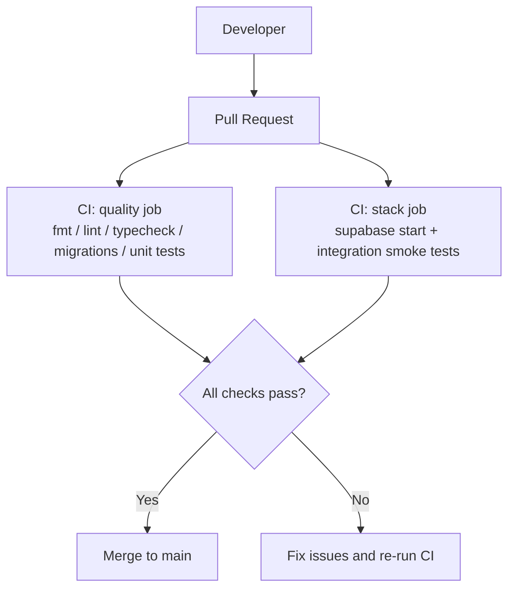
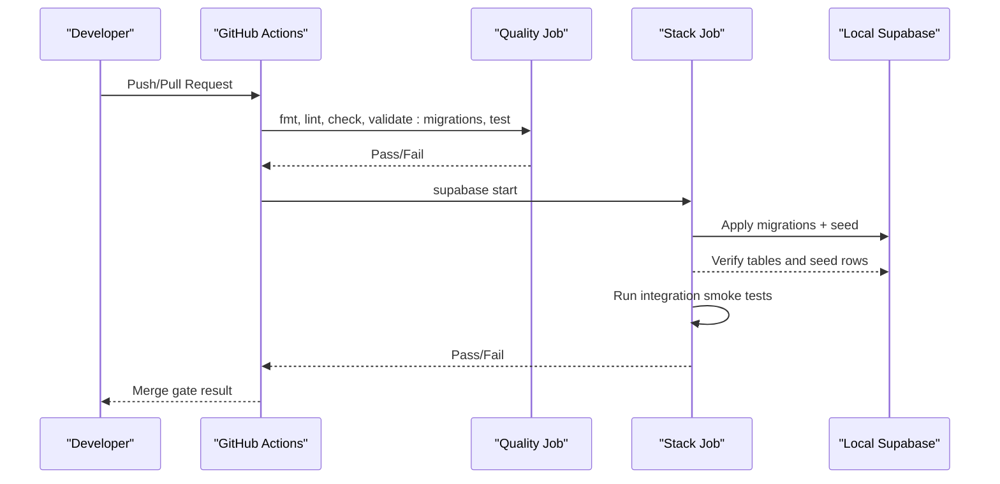
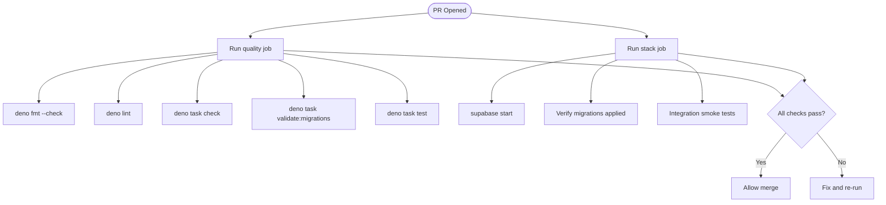
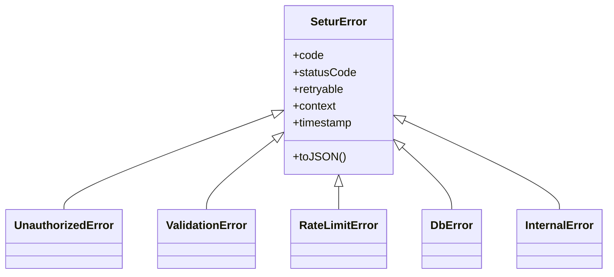
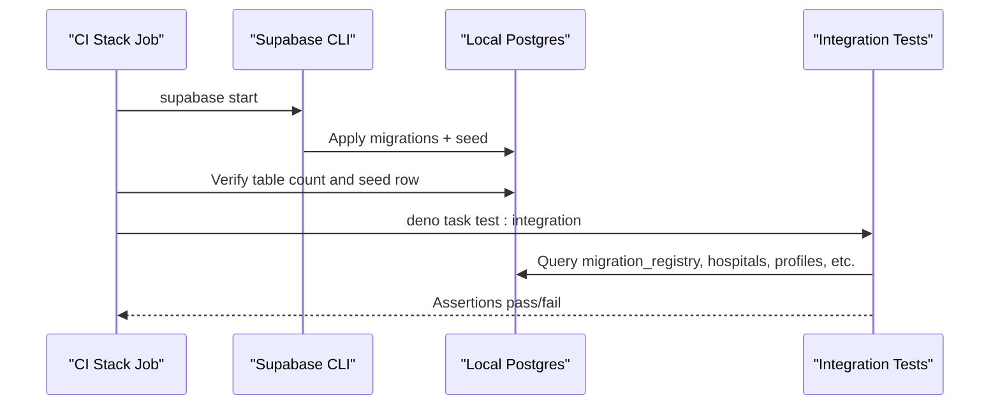
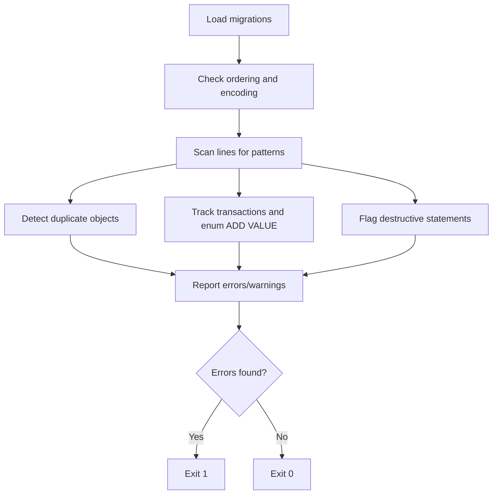
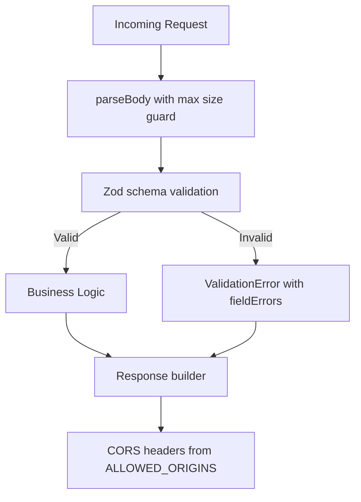
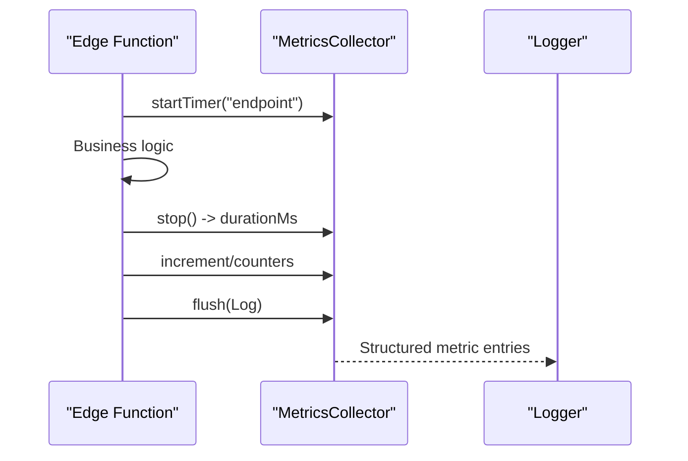
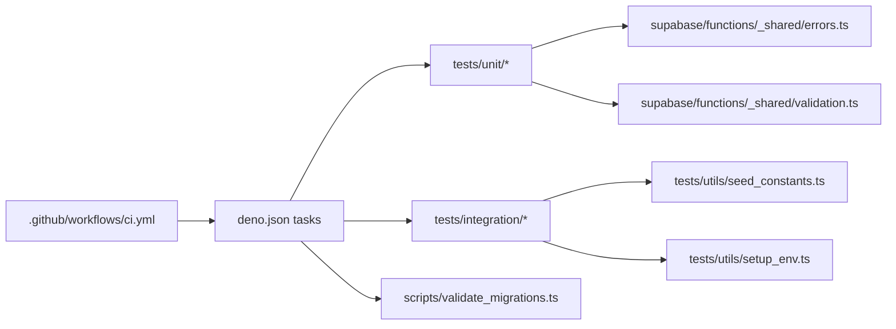

# Code Review & Quality Assurance

<cite>
**Referenced Files in This Document**
- [ci.yml](file://.github/workflows/ci.yml)
- [deno.json](file://deno.json)
- [local_stack.test.ts](file://tests/integration/local_stack.test.ts)
- [errors.test.ts](file://tests/unit/errors.test.ts)
- [response.test.ts](file://tests/unit/response.test.ts)
- [validation.test.ts](file://tests/unit/validation.test.ts)
- [validate_migrations.ts](file://scripts/validate_migrations.ts)
- [seed_constants.ts](file://tests/utils/seed_constants.ts)
- [setup_env.ts](file://tests/utils/setup_env.ts)
- [errors.ts](file://supabase/functions/_shared/errors.ts)
- [validation.ts](file://supabase/functions/_shared/validation.ts)
- [metrics.ts](file://supabase/functions/_shared/metrics.ts)
- [config.toml](file://supabase/config.toml)
</cite>

## Table of Contents

1. [Introduction](#introduction)
2. [Project Structure](#project-structure)
3. [Core Components](#core-components)
4. [Architecture Overview](#architecture-overview)
5. [Detailed Component Analysis](#detailed-component-analysis)
6. [Dependency Analysis](#dependency-analysis)
7. [Performance Considerations](#performance-considerations)
8. [Troubleshooting Guide](#troubleshooting-guide)
9. [Conclusion](#conclusion)
10. [Appendices](#appendices)

## Introduction

This document defines the code review and quality assurance guidelines for the
Setura Hospital OS development workflow. It covers pull request gates, automated
checks, unit and integration testing strategies, performance benchmarking,
security scanning, and deployment gates. The goal is to ensure every change is
safe, maintainable, and observable before it reaches production.

## Project Structure

The repository uses a Deno-based runtime with Supabase Edge Functions and a
local Supabase stack for integration tests. Quality gates are enforced via
GitHub Actions CI, which runs formatting, linting, type checking, migration
validation, unit tests, and an integration smoke suite against a real local
database.

**Diagram sources**

- [ci.yml:1-85](file://.github/workflows/ci.yml#L1-L85)

**Section sources**

- [ci.yml:1-85](file://.github/workflows/ci.yml#L1-L85)
- [deno.json:1-40](file://deno.json#L1-L40)

## Core Components

- CI pipeline: Two jobs enforce quality and integration readiness on every push
  or pull request.
- Unit tests: Pure module tests validate error types, response builders, and
  input validation schemas without network or database access.
- Integration tests: Deterministic seed and assertions verify migrations, seeded
  data, and schema state against the live local Supabase stack.
- Migration validator: Static analysis tool enforces ordering, safety, and
  consistency across SQL migrations without requiring a database.
- Shared utilities: Centralized typed errors, Zod-based validators, metrics
  collector, and environment configuration underpin consistent behavior across
  functions.

**Section sources**

- [ci.yml:28-84](file://.github/workflows/ci.yml#L28-L84)
- [errors.test.ts:1-151](file://tests/unit/errors.test.ts#L1-L151)
- [response.test.ts:1-147](file://tests/unit/response.test.ts#L1-L147)
- [validation.test.ts:1-203](file://tests/unit/validation.test.ts#L1-L203)
- [local_stack.test.ts:1-269](file://tests/integration/local_stack.test.ts#L1-L269)
- [validate_migrations.ts:1-503](file://scripts/validate_migrations.ts#L1-L503)
- [errors.ts:1-323](file://supabase/functions/_shared/errors.ts#L1-L323)
- [validation.ts:1-157](file://supabase/functions/_shared/validation.ts#L1-L157)
- [metrics.ts:1-118](file://supabase/functions/_shared/metrics.ts#L1-L118)
- [config.toml:1-409](file://supabase/config.toml#L1-L409)

## Architecture Overview

The quality pipeline ensures correctness at multiple layers:

- Pre-commit and PR gates: Formatting, linting, type checking, migration
  validation, and unit tests run automatically.
- Integration readiness: A full Supabase stack is started locally by CI;
  deterministic seed is applied; smoke tests assert schema and seeded data
  integrity.
- Runtime observability: Metrics collectors emit structured logs per request for
  downstream monitoring.

**Diagram sources**

- [ci.yml:28-84](file://.github/workflows/ci.yml#L28-L84)
- [local_stack.test.ts:32-78](file://tests/integration/local_stack.test.ts#L32-L78)

**Section sources**

- [ci.yml:1-85](file://.github/workflows/ci.yml#L1-L85)
- [local_stack.test.ts:1-269](file://tests/integration/local_stack.test.ts#L1-L269)

## Detailed Component Analysis

### Pull Request Process and Required Checks

- Every pull request triggers two parallel jobs:
  - Quality job: format check, lint, type check (Edge Functions, scripts,
    tests), migration validation, and unit tests.
  - Stack job: starts the local Supabase stack, verifies migrations applied, and
    runs integration smoke tests.
- Any failure fails the pipeline; no step is advisory.

**Diagram sources**

- [ci.yml:28-84](file://.github/workflows/ci.yml#L28-L84)

**Section sources**

- [ci.yml:1-85](file://.github/workflows/ci.yml#L1-L85)

### Unit Testing Requirements and Organization

- Scope: Unit tests target pure modules only (error hierarchy, response
  builders, validation schemas). They do not touch the database or external
  services.
- Environment bootstrap: Fake environment variables are set before importing any
  module that validates env eagerly.
- Coverage expectations: While no explicit coverage threshold is configured in
  tasks, unit tests should cover:
  - Error classes and guards (codes, statuses, retryable flags, serialization).
  - Response builders (status codes, headers, envelope fields).
  - Validation schemas (normalization, constraints, parseBody size guard,
    field-level errors).
- Test organization:
  - Place unit tests under tests/unit/.
  - Use deterministic inputs and avoid randomness or live clocks in assertions.

**Diagram sources**

- [errors.ts:70-323](file://supabase/functions/_shared/errors.ts#L70-L323)

**Section sources**

- [errors.test.ts:1-151](file://tests/unit/errors.test.ts#L1-L151)
- [response.test.ts:1-147](file://tests/unit/response.test.ts#L1-L147)
- [validation.test.ts:1-203](file://tests/unit/validation.test.ts#L1-L203)
- [setup_env.ts:1-40](file://tests/utils/setup_env.ts#L1-L40)

### Integration Testing Strategy

- Local stack testing:
  - CI boots the full Supabase stack and applies all migrations plus seed.
  - Integration tests read local status from the Supabase CLI, set environment,
    and connect via the service client to assert schema and seeded data.
- Deterministic seed:
  - Fixed identifiers and expected counts are centralized to ensure idempotent
    seeding and stable assertions.
- Mocking policy:
  - No mocks for Postgres interactions; integration tests exercise the real
    schema and RLS policies. External HTTP APIs are never called from tests;
    only pure transforms are covered by unit tests.

**Diagram sources**

- [ci.yml:55-84](file://.github/workflows/ci.yml#L55-L84)
- [local_stack.test.ts:32-99](file://tests/integration/local_stack.test.ts#L32-L99)
- [seed_constants.ts:1-35](file://tests/utils/seed_constants.ts#L1-L35)

**Section sources**

- [local_stack.test.ts:1-269](file://tests/integration/local_stack.test.ts#L1-L269)
- [seed_constants.ts:1-35](file://tests/utils/seed_constants.ts#L1-L35)
- [setup_env.ts:1-40](file://tests/utils/setup_env.ts#L1-L40)

### Migration Validation and Safety

- Static checks run without a database:
  - Ordering: sequential numbering with no gaps or duplicates.
  - Syntax artifacts: rejects markdown fences or non-SQL content.
  - Duplicate objects: detects repeated definitions without proper guards.
  - Enum hazards: warns when LANGUAGE sql functions reference newly added enum
    values in the same transaction.
  - Rollback risks: flags destructive statements without IF EXISTS and TRUNCATE
    usage.
  - Missing constraints: warns about CREATE TABLE without PRIMARY KEY.
- Exit code: errors fail the pipeline; warnings are informational.

**Diagram sources**

- [validate_migrations.ts:46-117](file://scripts/validate_migrations.ts#L46-L117)
- [validate_migrations.ts:199-399](file://scripts/validate_migrations.ts#L199-L399)
- [validate_migrations.ts:406-503](file://scripts/validate_migrations.ts#L406-L503)

**Section sources**

- [validate_migrations.ts:1-503](file://scripts/validate_migrations.ts#L1-L503)

### Security Scanning Procedures

- Input validation: All inbound request bodies are validated using Zod schemas
  before reaching business logic. Field-level errors are aggregated and returned
  consistently.
- Error taxonomy: Centralized error types encode machine-readable codes, HTTP
  status mapping, and retry semantics, ensuring consistent handling and safe
  responses.
- CORS and origins: Responses include CORS headers derived from allowed origins
  configuration.
- Database security: Local Supabase config enables RLS and restricts API
  exposure; ensure policies remain active and service-role keys are not exposed
  in user-facing paths.

**Diagram sources**

- [validation.ts:99-134](file://supabase/functions/_shared/validation.ts#L99-L134)
- [response.test.ts:135-146](file://tests/unit/response.test.ts#L135-L146)
- [errors.ts:13-64](file://supabase/functions/_shared/errors.ts#L13-L64)

**Section sources**

- [validation.ts:1-157](file://supabase/functions/_shared/validation.ts#L1-L157)
- [errors.ts:1-323](file://supabase/functions/_shared/errors.ts#L1-L323)
- [config.toml:1-409](file://supabase/config.toml#L1-L409)

### Performance Benchmarking Requirements

- Baseline measurements: Record p50/p95/p99 latency for critical endpoints such
  as create-booking, advance queue, and payment verification.
- Metrics collection: Use the shared metrics collector to record timing,
  counters, and gauges per request; flush structured logs for observability.
- Regression detection: Compare new baselines against previous runs; flag
  regressions exceeding defined thresholds.

**Diagram sources**

- [metrics.ts:24-118](file://supabase/functions/_shared/metrics.ts#L24-L118)

**Section sources**

- [metrics.ts:1-118](file://supabase/functions/_shared/metrics.ts#L1-L118)

### Code Review Checklist

Use this checklist during manual reviews to ensure quality across functionality,
security, performance, and maintainability:

- Functionality
  - Does the change align with the API contract and schema freeze?
  - Are all unit tests passing and covering new logic?
  - Do integration tests still pass against the local Supabase stack?
  - Are edge cases handled (empty inputs, boundary dates, invalid IDs)?
- Security
  - Is input validated via Zod schemas before processing?
  - Are responses free of sensitive details and use standardized error
    envelopes?
  - Are RLS policies intact and service-role keys not leaked?
  - Are rate limits and idempotency enforced where applicable?
- Performance
  - Are hot paths measured and baseline updated if changed?
  - Are unnecessary queries or heavy transformations avoided?
  - Are metrics emitted for key operations?
- Maintainability
  - Is code formatted and lint-clean?
  - Are types strict and consistent?
  - Are migrations safe (IF NOT EXISTS, guarded re-runs) and ordered?
  - Are comments and docs updated for behavioral changes?

[No sources needed since this section provides general guidance]

### Guidelines for Writing Effective Tests

- Unit tests
  - Keep them pure and fast; no network or database calls.
  - Bootstrap fake environment before importing modules that validate env
    eagerly.
  - Assert both success and failure paths, including field-level validation
    errors.
- Integration tests
  - Use deterministic seed constants to assert exact row counts and attributes.
  - Verify migrations registry and latest migration application.
  - Avoid mocking Postgres; exercise real schema and policies.
- Documentation
  - Update README or inline comments when behavior changes.
  - Keep seed constants synchronized with seed.sql changes.

**Section sources**

- [setup_env.ts:1-40](file://tests/utils/setup_env.ts#L1-L40)
- [seed_constants.ts:1-35](file://tests/utils/seed_constants.ts#L1-L35)
- [local_stack.test.ts:1-269](file://tests/integration/local_stack.test.ts#L1-L269)

### Continuous Integration Pipeline Requirements

- Triggers: Runs on push to main and on pull requests.
- Concurrency: Cancels in-progress pipelines for the same branch to save
  resources.
- Jobs:
  - Quality: format, lint, type check, migration validation, unit tests.
  - Stack: start Supabase, verify migrations, run integration smoke tests.
- Gates: Any failure blocks merging.

**Section sources**

- [ci.yml:1-85](file://.github/workflows/ci.yml#L1-L85)

### Deployment Gates

- Pre-deployment requirements:
  - All CI checks must pass.
  - Migration validation must report zero errors.
  - Integration smoke tests must pass against the local stack.
- Recommended additional gates:
  - Security scan results reviewed and approved.
  - Performance baselines compared and approved for critical paths.
  - Audit and compliance checks passed for sensitive changes.

[No sources needed since this section provides general guidance]

## Dependency Analysis

The quality pipeline depends on Deno tasks and Supabase CLI. Unit tests depend
on shared error and validation modules. Integration tests depend on the local
Supabase stack and deterministic seed constants.

**Diagram sources**

- [ci.yml:28-84](file://.github/workflows/ci.yml#L28-L84)
- [deno.json:11-21](file://deno.json#L11-L21)
- [errors.test.ts:1-151](file://tests/unit/errors.test.ts#L1-L151)
- [validation.test.ts:1-203](file://tests/unit/validation.test.ts#L1-L203)
- [local_stack.test.ts:1-269](file://tests/integration/local_stack.test.ts#L1-L269)
- [validate_migrations.ts:1-503](file://scripts/validate_migrations.ts#L1-L503)

**Section sources**

- [deno.json:1-40](file://deno.json#L1-L40)
- [ci.yml:1-85](file://.github/workflows/ci.yml#L1-L85)

## Performance Considerations

- Measure critical paths and publish baselines for regression detection.
- Use structured metrics to track endpoint latencies and resource usage.
- Ensure migrations are idempotent and indexes are present for hot queries.
- Avoid large payloads; enforce body size limits in parsers.

[No sources needed since this section provides general guidance]

## Troubleshooting Guide

- CI failures
  - Format/lint/type errors: fix style and types; re-run CI.
  - Migration validation errors: address ordering, unsafe constructs, or missing
    guards.
  - Unit test failures: inspect assertion messages and update seeds/constants if
    needed.
  - Integration test failures: ensure Supabase CLI is installed and stack is
    running; verify seed constants match seed.sql.
- Local stack issues
  - If local status cannot be read, ensure Supabase CLI is on PATH and stack is
    started.
  - Confirm migrations applied by querying the migration registry and verifying
    table counts.

**Section sources**

- [ci.yml:28-84](file://.github/workflows/ci.yml#L28-L84)
- [local_stack.test.ts:32-78](file://tests/integration/local_stack.test.ts#L32-L78)
- [validate_migrations.ts:488-503](file://scripts/validate_migrations.ts#L488-L503)

## Conclusion

Setura’s quality framework combines static checks, comprehensive unit tests, and
robust integration tests against a real local stack. Migration validation
safeguards schema evolution, while metrics and standardized errors improve
observability and reliability. Adhering to these guidelines ensures safe,
performant, and maintainable releases.

[No sources needed since this section summarizes without analyzing specific
files]

## Appendices

### Task Reference

- Format and lint: deno fmt, deno lint
- Type check: deno task check
- Migration validation: deno task validate:migrations
- Unit tests: deno task test
- Integration tests: deno task test:integration

**Section sources**

- [deno.json:11-21](file://deno.json#L11-L21)

### Local Stack Configuration Highlights

- API port and schemas enabled
- Database major version and health timeout
- Seed file path configured
- Realtime and Studio enabled for local development

**Section sources**

- [config.toml:1-409](file://supabase/config.toml#L1-L409)
