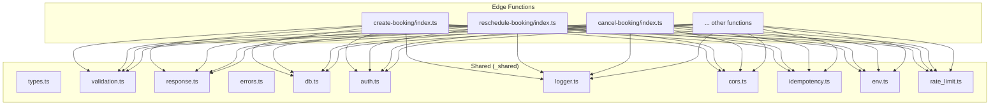
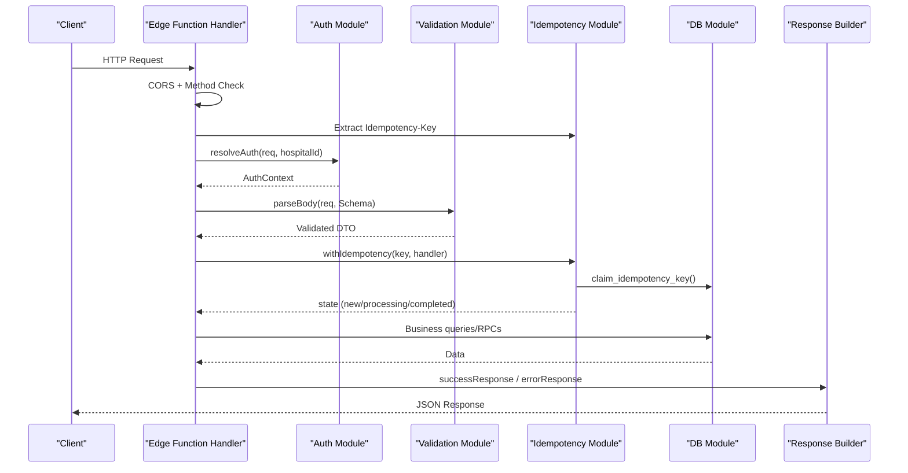
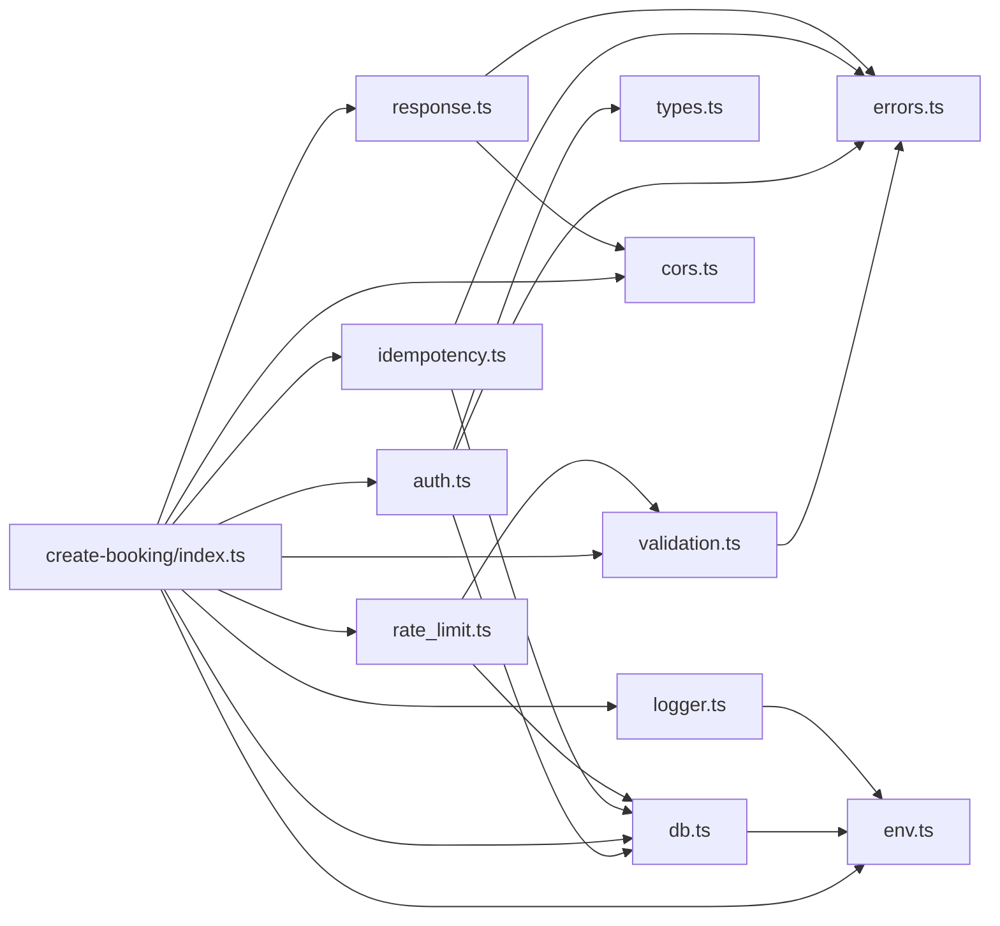

# Coding Standards

<cite>
**Referenced Files in This Document**
- [deno.json](file://deno.json)
- [types.ts](file://supabase/functions/_shared/types.ts)
- [validation.ts](file://supabase/functions/_shared/validation.ts)
- [response.ts](file://supabase/functions/_shared/response.ts)
- [errors.ts](file://supabase/functions/_shared/errors.ts)
- [db.ts](file://supabase/functions/_shared/db.ts)
- [auth.ts](file://supabase/functions/_shared/auth.ts)
- [logger.ts](file://supabase/functions/_shared/logger.ts)
- [cors.ts](file://supabase/functions/_shared/cors.ts)
- [idempotency.ts](file://supabase/functions/_shared/idempotency.ts)
- [env.ts](file://supabase/functions/_shared/env.ts)
- [rate_limit.ts](file://supabase/functions/_shared/rate_limit.ts)
- [create-booking/index.ts](file://supabase/functions/create-booking/index.ts)
- [validation.test.ts](file://tests/unit/validation.test.ts)
</cite>

## Table of Contents

1. Introduction
2. Project Structure
3. Core Components
4. Architecture Overview
5. Detailed Component Analysis
6. Dependency Analysis
7. Performance Considerations
8. Troubleshooting Guide
9. Conclusion
10. Appendices

## Introduction

This document defines the coding standards for the Setura Hospital OS TypeScript
codebase. It covers strict TypeScript configuration, type safety requirements,
edge function architecture patterns, naming conventions, import/export and
module structure guidelines, Zod-based validation patterns, formatting and
linting rules enforced by Deno, and best practices for shared utilities and type
definitions. The goal is to ensure consistent, safe, and maintainable code
across all edge functions and shared modules.

## Project Structure

The project follows an edge function architecture where each business capability
lives under its own directory with a single entry point (index.ts). Shared logic
is centralized under _shared to avoid duplication and enforce consistency.
Database migrations live under supabase/migrations, and tests are organized
under tests/unit and tests/integration.

**Diagram sources**

- [create-booking/index.ts:34-63](file://supabase/functions/create-booking/index.ts#L34-L63)
- [types.ts:1-329](file://supabase/functions/_shared/types.ts#L1-L329)
- [validation.ts:1-157](file://supabase/functions/_shared/validation.ts#L1-L157)
- [response.ts:1-206](file://supabase/functions/_shared/response.ts#L1-L206)
- [errors.ts:1-323](file://supabase/functions/_shared/errors.ts#L1-L323)
- [db.ts:1-169](file://supabase/functions/_shared/db.ts#L1-L169)
- [auth.ts:1-237](file://supabase/functions/_shared/auth.ts#L1-L237)
- [logger.ts:1-190](file://supabase/functions/_shared/logger.ts#L1-L190)
- [cors.ts:1-34](file://supabase/functions/_shared/cors.ts#L1-L34)
- [idempotency.ts:1-259](file://supabase/functions/_shared/idempotency.ts#L1-L259)
- [env.ts:1-279](file://supabase/functions/_shared/env.ts#L1-L279)
- [rate_limit.ts:1-124](file://supabase/functions/_shared/rate_limit.ts#L1-L124)

**Section sources**

- [deno.json:1-40](file://deno.json#L1-L40)
- [create-booking/index.ts:1-666](file://supabase/functions/create-booking/index.ts#L1-L666)

## Core Components

- Strict TypeScript configuration enforces strong typing and predictable
  behavior.
- Edge functions encapsulate one domain operation per directory with clear
  separation of concerns.
- Shared utilities provide reusable, typed, and validated building blocks for
  auth, DB access, logging, CORS, idempotency, rate limiting, and response
  shaping.
- Zod schemas define request contracts and normalize inputs before they reach
  business logic.
- Centralized error hierarchy ensures consistent error codes, status codes, and
  retry semantics.
- Standardized responses include correlation IDs, timestamps, and structured
  data or errors.

Key responsibilities:

- types.ts: Defines database row interfaces, enums, API DTOs, and pagination
  types.
- validation.ts: Provides Zod schemas, normalization helpers, and a generic
  parseBody utility.
- response.ts: Builds success/error responses consistently with CORS headers.
- errors.ts: Typed error classes and guards for structured error handling.
- db.ts: Manages Supabase clients (service, anon, per-request auth) and typed
  RPC helpers.
- auth.ts: JWT validation, role resolution, hospital access control, and
  middleware composition.
- logger.ts: Structured JSON logging with correlation IDs, timing, and error
  serialization.
- cors.ts: Handles preflight and sets allowed origins/headers.
- idempotency.ts: Ensures safe retries and deduplication via idempotency keys.
- env.ts: Validates environment variables at startup with typed getters.
- rate_limit.ts: Distributed rate limiting backed by the database.

**Section sources**

- [types.ts:1-329](file://supabase/functions/_shared/types.ts#L1-L329)
- [validation.ts:1-157](file://supabase/functions/_shared/validation.ts#L1-L157)
- [response.ts:1-206](file://supabase/functions/_shared/response.ts#L1-L206)
- [errors.ts:1-323](file://supabase/functions/_shared/errors.ts#L1-L323)
- [db.ts:1-169](file://supabase/functions/_shared/db.ts#L1-L169)
- [auth.ts:1-237](file://supabase/functions/_shared/auth.ts#L1-L237)
- [logger.ts:1-190](file://supabase/functions/_shared/logger.ts#L1-L190)
- [cors.ts:1-34](file://supabase/functions/_shared/cors.ts#L1-L34)
- [idempotency.ts:1-259](file://supabase/functions/_shared/idempotency.ts#L1-L259)
- [env.ts:1-279](file://supabase/functions/_shared/env.ts#L1-L279)
- [rate_limit.ts:1-124](file://supabase/functions/_shared/rate_limit.ts#L1-L124)

## Architecture Overview

Each edge function follows a consistent flow:

- Handle CORS preflight
- Enforce method constraints
- Create tracing context and request-scoped logger
- Extract and validate idempotency key
- Resolve authentication and authorization
- Parse and validate request body using Zod
- Apply rate limiting and business rule checks
- Perform atomic operations via service-role client
- Enqueue background jobs as needed
- Write audit logs
- Complete idempotency key
- Return standardized response

**Diagram sources**

- [create-booking/index.ts:67-665](file://supabase/functions/create-booking/index.ts#L67-L665)
- [auth.ts:42-124](file://supabase/functions/_shared/auth.ts#L42-L124)
- [validation.ts:99-134](file://supabase/functions/_shared/validation.ts#L99-L134)
- [idempotency.ts:196-259](file://supabase/functions/_shared/idempotency.ts#L196-L259)
- [response.ts:44-92](file://supabase/functions/_shared/response.ts#L44-L92)

## Detailed Component Analysis

### TypeScript Configuration and Type Safety

- Strict mode is enabled globally, ensuring null checks, strict function types,
  and more.
- noImplicitAny is enforced to prevent accidental any usage.
- noImplicitReturns ensures every branch returns a value.
- Imports are pinned to specific versions for reproducibility.
- Generated database types must not be hand-edited; regenerate via task when
  schema changes.

Best practices:

- Always specify explicit return types for exported functions.
- Prefer narrow types over any; use z.infer from Zod schemas for validated
  payloads.
- Use enum-like string literal unions for constrained values (e.g.,
  BookingStatus, UserRoleType).
- Keep API DTOs separate from database row types to avoid leaking internal
  columns.

**Section sources**

- [deno.json:1-40](file://deno.json#L1-L40)
- [types.ts:1-329](file://supabase/functions/_shared/types.ts#L1-L329)

### Edge Function Patterns and Separation of Concerns

- Each function directory contains a single index.ts that orchestrates
  cross-cutting concerns and delegates to shared modules.
- Cross-cutting concerns (CORS, auth, validation, idempotency, rate limiting,
  logging, metrics, response shaping) are implemented in _shared and reused
  across functions.
- Business logic is isolated within the handler passed to withIdempotency to
  ensure atomicity and idempotent execution.

Example pattern:

- Validate input early with Zod and parseBody.
- Enforce roles and hospital access via auth helpers.
- Wrap critical mutations in withIdempotency to handle duplicates safely.
- Use service-role client for writes; anon or per-request auth client for reads
  where RLS applies.
- Return standardized responses via response builders.

**Section sources**

- [create-booking/index.ts:34-665](file://supabase/functions/create-booking/index.ts#L34-L665)
- [auth.ts:187-237](file://supabase/functions/_shared/auth.ts#L187-L237)
- [idempotency.ts:196-259](file://supabase/functions/_shared/idempotency.ts#L196-L259)

### Naming Conventions

- Functions: camelCase verbs describing action (e.g., createBooking,
  requireRole, checkAndLogBookingAttempt).
- Variables: camelCase, descriptive names indicating scope and purpose (e.g.,
  hospitalId, normalizedPhone, settingsTimer).
- Types and Interfaces: PascalCase nouns (e.g., DbHospital,
  CreateBookingRequest, ApiSuccessResponse).
- Enums/Literal Unions: PascalCase union members aligned with database enums
  (e.g., BookingStatus, JobPriority).
- Database entities: snake_case column names reflected in Db* interfaces; never
  expose these directly in API responses.
- Constants: UPPER_SNAKE_CASE for environment-derived constants (e.g.,
  ALLOWED_ORIGINS, MAX_BOOKING_ADVANCE_DAYS).

Guidelines:

- Keep DTOs distinct from DB models; map Db* to API DTOs before returning.
- Use meaningful prefixes for shared utilities (e.g., buildCorsHeaders,
  createRequestLogger).
- Align field names between Zod schemas and DTOs to reduce mapping overhead.

**Section sources**

- [types.ts:11-329](file://supabase/functions/_shared/types.ts#L11-L329)
- [validation.ts:29-88](file://supabase/functions/_shared/validation.ts#L29-L88)
- [response.ts:14-32](file://supabase/functions/_shared/response.ts#L14-L32)

### Import/Export Patterns and Module Structure

- Prefer relative imports within _shared and absolute-style imports from root
  for clarity.
- Export only what is necessary; keep internal helpers private to modules.
- Use lazy imports for heavy dependencies inside hot paths to reduce cold start
  impact (e.g., dynamic import of response builders in middleware).
- Avoid circular dependencies; if unavoidable, use lazy imports or restructure.

Module organization:

- _shared: pure utilities, typed services, and cross-cutting concerns.
- functions/<feature>/index.ts: thin orchestrators that compose shared modules.
- tests: unit tests for shared modules; integration tests for end-to-end flows.

**Section sources**

- [auth.ts:13-21](file://supabase/functions/_shared/auth.ts#L13-L21)
- [auth.ts:203-237](file://supabase/functions/_shared/auth.ts#L203-L237)
- [create-booking/index.ts:34-63](file://supabase/functions/create-booking/index.ts#L34-L63)

### Zod Schema Definition Patterns

- Define primitive schemas for reuse (UUID, Phone, Date, FutureDate, Gender,
  BloodGroup, BookingSource).
- Normalize inputs in transforms (e.g., phone normalization strips separators
  and country codes).
- Use .default() for optional booleans to simplify downstream logic.
- Aggregate field-level errors into a structured format via parseBody.
- Infer TypeScript types from schemas using z.infer to keep runtime and
  compile-time in sync.

Examples:

- PhoneSchema normalizes and validates Indian mobile numbers.
- CreateBookingSchema composes primitives and applies defaults.
- parseBody enforces size limits and maps Zod issues to ValidationError with
  fieldErrors.

**Section sources**

- [validation.ts:13-88](file://supabase/functions/_shared/validation.ts#L13-L88)
- [validation.ts:99-134](file://supabase/functions/_shared/validation.ts#L99-L134)
- [validation.test.ts:29-170](file://tests/unit/validation.test.ts#L29-L170)

### Error Handling and Response Standards

- All domain errors extend SeturError with machine-readable codes, HTTP status
  codes, retry flags, and context metadata.
- Use specialized error classes for common cases (UnauthorizedError,
  ForbiddenError, ValidationError, RateLimitError, etc.).
- Convert errors to standardized responses via response builders; centralize
  conversion in handleErrorResponse.
- Include correlationId and timestamp in every response for traceability.
- For validation failures, return fieldErrors mapped by field path.

Patterns:

- Throw typed errors in handlers; catch once at the top level and convert to
  Response.
- Use isSeturError and isRetryable to decide retry behavior upstream.
- Log errors with structured context via Logger.

**Section sources**

- [errors.ts:13-323](file://supabase/functions/_shared/errors.ts#L13-L323)
- [response.ts:44-206](file://supabase/functions/_shared/response.ts#L44-L206)
- [logger.ts:52-99](file://supabase/functions/_shared/logger.ts#L52-L99)

### Database Access and Security

- Three client strategies:
  - Service-role client for internal writes and RPCs (bypasses RLS).
  - Anon client for public read-only queries subject to RLS.
  - Per-request auth client impersonating the caller for user-facing mutations
    where RLS must apply.
- Use typed RPC helper callRpc to invoke Postgres functions with full type
  safety.
- Use assertNoError to fail fast on unexpected DB results.
- Never expose service-role client to user-controlled input; always validate and
  sanitize inputs first.

**Section sources**

- [db.ts:1-169](file://supabase/functions/_shared/db.ts#L1-L169)

### Authentication and Authorization

- JWT validation uses Supabase’s auth.getUser to handle signature, expiry, and
  revocation automatically.
- Role resolution reads from the database to ensure up-to-date permissions.
- Hospital access is enforced before any business logic runs.
- Provide helper functions for role checks (requireRole, canManageQueue,
  canViewAnalytics).
- Compose middleware with withAuth to standardize auth flow across functions.

**Section sources**

- [auth.ts:22-124](file://supabase/functions/_shared/auth.ts#L22-L124)
- [auth.ts:126-185](file://supabase/functions/_shared/auth.ts#L126-L185)
- [auth.ts:187-237](file://supabase/functions/_shared/auth.ts#L187-L237)

### Logging and Observability

- Every log line is a single JSON object with correlationId, requestId,
  endpoint, and durationMs where applicable.
- Logger supports child contexts to enrich logs per request without mutating
  parent context.
- Errors are serialized preserving stack traces in non-production environments.
- Timing helpers measure durations for performance analysis.

**Section sources**

- [logger.ts:1-190](file://supabase/functions/_shared/logger.ts#L1-L190)

### CORS and Environment Management

- CORS headers are built based on configured allowed origins; preflight requests
  return 204.
- Environment variables are validated at module load time to fail fast on
  misconfiguration.
- Feature flags and runtime limits are exposed through a frozen Env object for
  type safety.

**Section sources**

- [cors.ts:1-34](file://supabase/functions/_shared/cors.ts#L1-L34)
- [env.ts:1-279](file://supabase/functions/_shared/env.ts#L1-L279)

### Idempotency and Rate Limiting

- Idempotency keys are extracted and validated; claims are stored atomically to
  prevent duplicate processing.
- withIdempotency wraps handlers to cache successful responses and detect
  concurrent processing.
- Rate limiting uses a sliding window backed by the database; blocked numbers
  are checked before counting attempts.

**Section sources**

- [idempotency.ts:37-259](file://supabase/functions/_shared/idempotency.ts#L37-L259)
- [rate_limit.ts:16-124](file://supabase/functions/_shared/rate_limit.ts#L16-L124)

## Dependency Analysis

The following diagram shows how core components depend on each other:

**Diagram sources**

- [create-booking/index.ts:34-63](file://supabase/functions/create-booking/index.ts#L34-L63)
- [validation.ts:1-157](file://supabase/functions/_shared/validation.ts#L1-L157)
- [auth.ts:1-237](file://supabase/functions/_shared/auth.ts#L1-L237)
- [response.ts:1-206](file://supabase/functions/_shared/response.ts#L1-L206)
- [db.ts:1-169](file://supabase/functions/_shared/db.ts#L1-L169)
- [logger.ts:1-190](file://supabase/functions/_shared/logger.ts#L1-L190)
- [cors.ts:1-34](file://supabase/functions/_shared/cors.ts#L1-L34)
- [idempotency.ts:1-259](file://supabase/functions/_shared/idempotency.ts#L1-L259)
- [rate_limit.ts:1-124](file://supabase/functions/_shared/rate_limit.ts#L1-L124)
- [env.ts:1-279](file://supabase/functions/_shared/env.ts#L1-L279)

**Section sources**

- [create-booking/index.ts:34-63](file://supabase/functions/create-booking/index.ts#L34-L63)
- [db.ts:1-169](file://supabase/functions/_shared/db.ts#L1-L169)

## Performance Considerations

- Minimize cold start latency by avoiding heavy synchronous initialization;
  prefer lazy imports for non-critical modules.
- Reuse singleton clients for service and anon modes; create per-request clients
  only when required (auth client).
- Use database-backed rate limiting and idempotency to avoid in-memory state
  loss across cold starts.
- Measure and log timings around expensive operations (DB calls, RPCs, external
  services).
- Keep request bodies small; enforce Content-Length limits in parseBody.

[No sources needed since this section provides general guidance]

## Troubleshooting Guide

Common issues and resolutions:

- Validation errors: Ensure Zod schemas match expected inputs; use parseBody to
  get structured fieldErrors.
- Authentication failures: Verify Bearer token presence and validity; confirm
  user profile exists and is active.
- Database errors: Inspect error codes and messages; wrap DB calls with
  assertNoError for clearer diagnostics.
- Rate limit exceeded: Check blocked numbers and recent attempt counts; adjust
  window and thresholds via environment.
- Idempotency conflicts: Confirm Idempotency-Key header is present and unique
  per request; handle 202 responses appropriately.

Useful tools:

- Logger.error with structured context for quick triage.
- handleErrorResponse to convert errors to standardized responses with
  correlationId.
- Unit tests for validation schemas to catch regressions early.

**Section sources**

- [validation.test.ts:114-170](file://tests/unit/validation.test.ts#L114-L170)
- [response.ts:196-206](file://supabase/functions/_shared/response.ts#L196-L206)
- [logger.ts:149-169](file://supabase/functions/_shared/logger.ts#L149-L169)

## Conclusion

This codebase adopts a rigorous approach to TypeScript type safety, structured
error handling, and consistent edge function design. By centralizing shared
logic, enforcing strict validation with Zod, and standardizing responses and
logging, the system achieves reliability, observability, and maintainability.
Following these coding standards will help teams scale features while preserving
correctness and performance.

[No sources needed since this section summarizes without analyzing specific
files]

## Appendices

### Code Formatting and Linting Rules

- Formatter: Deno formatter is configured with exclude patterns for generated
  files and temp directories.
- Linter: Deno linter excludes generated files and disables specific rules where
  necessary.
- Tasks:
  - fmt: Format code.
  - fmt:check: Check formatting without writing.
  - lint: Run linter.
  - check: Type-check all relevant TS files.
  - test: Run unit tests.
  - test:integration: Run integration tests with network and environment access.
  - validate:migrations: Validate migration scripts.
  - gen:types: Regenerate database types from local schema.

Ensure:

- Run deno fmt and deno lint before committing.
- Keep generated files excluded from formatting/linting.
- Use deno check to catch type errors early.

**Section sources**

- [deno.json:11-38](file://deno.json#L11-L38)

### Example: Well-Structured Edge Function Flow

A reference implementation demonstrates:

- Early CORS and method checks
- Tracing and request-scoped logging
- Idempotency key extraction and claim
- Auth resolution and role enforcement
- Body parsing and validation
- Business rule checks and DB interactions
- Background job enqueues
- Audit logging
- Idempotency completion
- Standardized response

**Section sources**

- [create-booking/index.ts:67-665](file://supabase/functions/create-booking/index.ts#L67-L665)

### Example: Shared Utility Patterns

- Validation: Primitive schemas, transforms, and parseBody for robust input
  handling.
- Response: Consistent success/error structures with correlationId and
  timestamps.
- Errors: Typed error hierarchy with codes, status codes, retry flags, and
  context.
- DB: Typed clients and helpers for safe, type-safe database access.
- Auth: JWT validation, role resolution, and middleware composition.
- Logger: Structured JSON logs with correlation tracking and timing.
- CORS: Configurable allowed origins and headers.
- Idempotency: Atomic key management and handler wrapping.
- Rate Limiting: Sliding window checks and blocked number enforcement.
- Env: Typed, validated environment access.

**Section sources**

- [validation.ts:13-134](file://supabase/functions/_shared/validation.ts#L13-L134)
- [response.ts:14-206](file://supabase/functions/_shared/response.ts#L14-L206)
- [errors.ts:13-323](file://supabase/functions/_shared/errors.ts#L13-L323)
- [db.ts:30-169](file://supabase/functions/_shared/db.ts#L30-L169)
- [auth.ts:22-237](file://supabase/functions/_shared/auth.ts#L22-L237)
- [logger.ts:101-190](file://supabase/functions/_shared/logger.ts#L101-L190)
- [cors.ts:6-34](file://supabase/functions/_shared/cors.ts#L6-L34)
- [idempotency.ts:37-259](file://supabase/functions/_shared/idempotency.ts#L37-L259)
- [rate_limit.ts:16-124](file://supabase/functions/_shared/rate_limit.ts#L16-L124)
- [env.ts:18-279](file://supabase/functions/_shared/env.ts#L18-L279)
