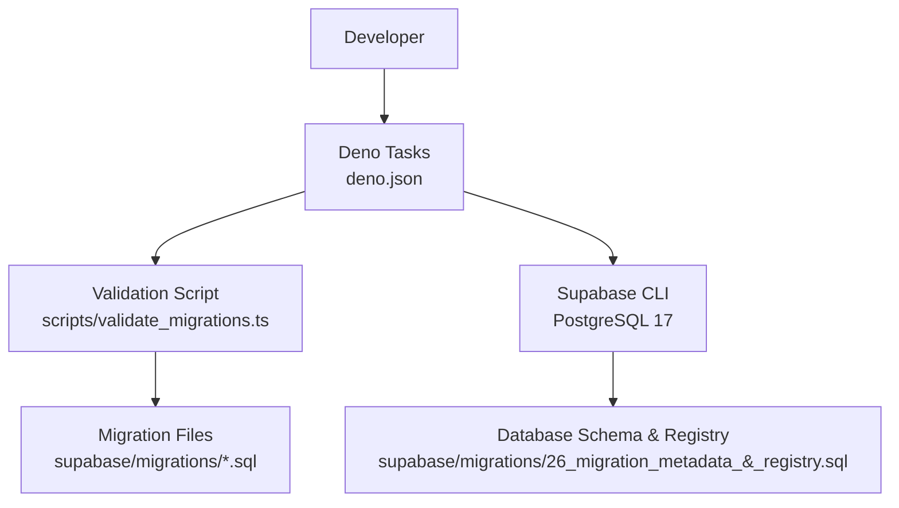
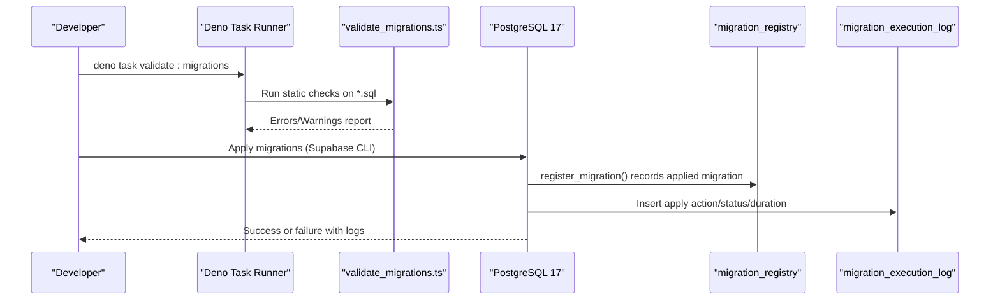
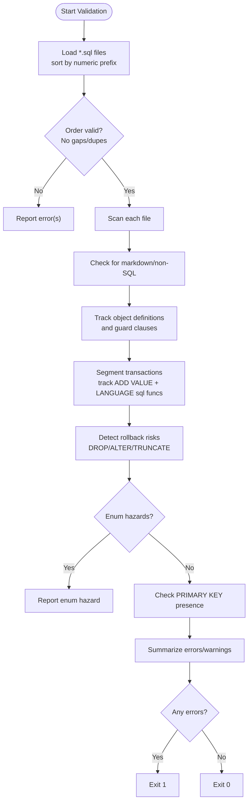
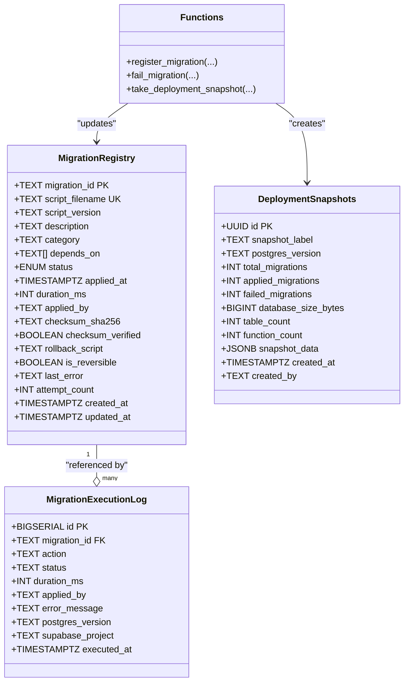
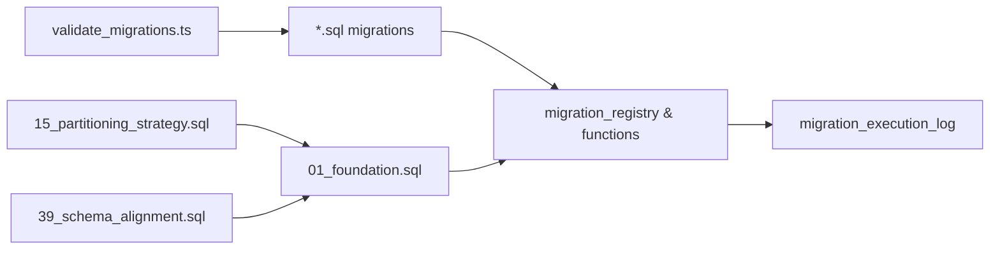

# Database Migration Process

<cite>
**Referenced Files in This Document**
- [validate_migrations.ts](file://scripts/validate_migrations.ts)
- [01_foundation.sql](file://supabase/migrations/01_foundation.sql)
- [26_migration_metadata_&_registry.sql](file://supabase/migrations/26_migration_metadata_&_registry.sql)
- [15_partitioning_strategy.sql](file://supabase/migrations/15_partitioning_strategy.sql)
- [39_schema_alignment.sql](file://supabase/migrations/39_schema_alignment.sql)
- [config.toml](file://supabase/config.toml)
- [deno.json](file://deno.json)
</cite>

## Table of Contents

1. [Introduction](#introduction)
2. [Project Structure](#project-structure)
3. [Core Components](#core-components)
4. [Architecture Overview](#architecture-overview)
5. [Detailed Component Analysis](#detailed-component-analysis)
6. [Dependency Analysis](#dependency-analysis)
7. [Performance Considerations](#performance-considerations)
8. [Troubleshooting Guide](#troubleshooting-guide)
9. [Conclusion](#conclusion)
10. [Appendices](#appendices)

## Introduction

This document explains the database migration process for Setura Hospital OS
with a focus on PostgreSQL 17, migration file naming conventions, validation and
testing before deployment, rollback strategies, data preservation, backward
compatibility, the migration registry and version tracking system, examples of
complex migrations (tables, indexes, stored procedures, triggers), performance
considerations for large datasets, and production deployment strategies.

## Project Structure

Migrations are SQL files under supabase/migrations/. The project uses Supabase
CLI configured to target PostgreSQL 17 and runs Deno-based tooling for
validation and tasks. A dedicated validation script performs static analysis of
all migration files without requiring a live database.

**Diagram sources**

- [deno.json:11-20](file://deno.json#L11-L20)
- [config.toml:27-36](file://supabase/config.toml#L27-L36)
- [26_migration_metadata_&_registry.sql:33-90](file://supabase/migrations/26_migration_metadata_&_registry.sql#L33-L90)

**Section sources**

- [deno.json:11-20](file://deno.json#L11-L20)
- [config.toml:27-36](file://supabase/config.toml#L27-L36)

## Core Components

- Migration file naming convention: sequential two-digit numbering followed by
  descriptive names (e.g., 01_foundation.sql,
  26_migration_metadata_&_registry.sql).
- Validation pipeline: deno task validate:migrations executes
  scripts/validate_migrations.ts to enforce ordering, syntax safety, duplicate
  object detection, enum hazards, rollback risks, and missing constraints.
- Migration registry and version tracking: schema and functions in
  26_migration_metadata_&_registry.sql provide a registry table, execution log,
  status view, snapshotting, and helper functions to record applied migrations
  and failures.
- Example migrations: foundation tables/triggers/policies; partitioning
  strategy; schema alignment updates for stored procedures.

**Section sources**

- [validate_migrations.ts:46-117](file://scripts/validate_migrations.ts#L46-L117)
- [26_migration_metadata_&_registry.sql:33-90](file://supabase/migrations/26_migration_metadata_&_registry.sql#L33-L90)
- [01_foundation.sql:100-150](file://supabase/migrations/01_foundation.sql#L100-L150)
- [15_partitioning_strategy.sql:35-76](file://supabase/migrations/15_partitioning_strategy.sql#L35-L76)
- [39_schema_alignment.sql:35-78](file://supabase/migrations/39_schema_alignment.sql#L35-L78)

## Architecture Overview

The migration architecture combines static validation, idempotent SQL
migrations, and an in-database registry that tracks versions, statuses,
checksums, durations, and errors. It also provides snapshots for
pre/post-deployment state comparison.

**Diagram sources**

- [deno.json:11-20](file://deno.json#L11-L20)
- [validate_migrations.ts:46-117](file://scripts/validate_migrations.ts#L46-L117)
- [26_migration_metadata_&_registry.sql:199-284](file://supabase/migrations/26_migration_metadata_&_registry.sql#L199-L284)

## Detailed Component Analysis

### Migration File Naming Convention

- Files must be named with a two-digit sequential number prefix followed by an
  underscore and a descriptive name (e.g., 01_foundation.sql).
- The validator enforces:
  - Numeric ordering with no gaps or duplicates.
  - ASCII-only content to avoid encoding issues during Supabase CLI reads on
    Windows.
  - No markdown fences or non-SQL artifacts inside SQL files.

Best practices:

- Keep filenames concise but descriptive.
- Avoid special characters beyond underscores and hyphens.
- Maintain strict ascending order; do not reuse numbers.

**Section sources**

- [validate_migrations.ts:46-117](file://scripts/validate_migrations.ts#L46-L117)

### SQL Best Practices for PostgreSQL 17

- Use idempotent DDL: CREATE TABLE IF NOT EXISTS, CREATE INDEX IF NOT EXISTS,
  CREATE OR REPLACE FUNCTION/VIEW, DROP ... IF EXISTS before re-create.
- Guard destructive operations: wrap DROP/ALTER DROP/TRUNCATE with safeguards;
  prefer safe patterns like conditional drops and explicit transactions where
  appropriate.
- Enum handling: avoid using newly added enum values within the same transaction
  that defines them when referenced by LANGUAGE sql functions; commit between
  ADD VALUE and function definitions if needed.
- Row Level Security: enable and force RLS on sensitive tables; define policies
  explicitly.
- Indexes: use partial and composite indexes where beneficial; consider
  CONCURRENTLY for large tables when supported by your runner.
- Triggers: ensure updated_at triggers exist for auditability; drop before
  create to support re-runs.

Examples in codebase:

- Foundation tables, triggers, and policies in 01_foundation.sql.
- Partitioning planning and helpers in 15_partitioning_strategy.sql.
- Stored procedure signature alignment in 39_schema_alignment.sql.

**Section sources**

- [01_foundation.sql:66-150](file://supabase/migrations/01_foundation.sql#L66-L150)
- [15_partitioning_strategy.sql:172-200](file://supabase/migrations/15_partitioning_strategy.sql#L172-L200)
- [39_schema_alignment.sql:139-167](file://supabase/migrations/39_schema_alignment.sql#L139-L167)
- [validate_migrations.ts:319-340](file://scripts/validate_migrations.ts#L319-L340)
- [validate_migrations.ts:371-394](file://scripts/validate_migrations.ts#L371-L394)

### Migration Validation Process

The validation script performs:

- Ordering checks: ensures NN_ prefix, detects gaps/duplicates.
- Syntax artifact checks: flags markdown fences or non-SQL wrappers.
- Duplicate object detection: identifies repeated
  table/index/function/policy/trigger/type definitions without proper guards.
- Enum hazard detection: warns/errors when LANGUAGE sql functions reference new
  enum values in the same transaction.
- Rollback risk detection: flags destructive statements without IF EXISTS,
  TRUNCATE usage, and unguarded creates.
- Missing constraints: warns when CREATE TABLE lacks PRIMARY KEY.

Run via:

- deno task validate:migrations

Exit codes:

- 0 = clean, 1 = errors found. Warnings do not fail the run.

**Diagram sources**

- [validate_migrations.ts:46-117](file://scripts/validate_migrations.ts#L46-L117)
- [validate_migrations.ts:152-195](file://scripts/validate_migrations.ts#L152-L195)
- [validate_migrations.ts:319-394](file://scripts/validate_migrations.ts#L319-L394)
- [validate_migrations.ts:451-476](file://scripts/validate_migrations.ts#L451-L476)
- [validate_migrations.ts:478-503](file://scripts/validate_migrations.ts#L478-L503)

**Section sources**

- [validate_migrations.ts:46-117](file://scripts/validate_migrations.ts#L46-L117)
- [validate_migrations.ts:152-195](file://scripts/validate_migrations.ts#L152-L195)
- [validate_migrations.ts:319-394](file://scripts/validate_migrations.ts#L319-L394)
- [validate_migrations.ts:451-476](file://scripts/validate_migrations.ts#L451-L476)
- [validate_migrations.ts:478-503](file://scripts/validate_migrations.ts#L478-L503)

### Testing Requirements Before Deployment

- Static validation: always run deno task validate:migrations locally and in CI.
- Local database tests: reset and apply migrations against a local PostgreSQL 17
  instance via Supabase CLI to verify runtime behavior.
- Integration tests: execute relevant integration tests to validate edge
  functions and database interactions post-migration.
- Snapshot verification: after applying migrations, take a deployment snapshot
  to baseline the environment.

Recommended workflow:

- Validate -> Reset local DB -> Apply migrations -> Run unit/integration tests
  -> Take snapshot -> Deploy to staging -> Repeat validation and tests in
  staging -> Promote to production.

**Section sources**

- [deno.json:11-20](file://deno.json#L11-L20)
- [26_migration_metadata_&_registry.sql:426-508](file://supabase/migrations/26_migration_metadata_&_registry.sql#L426-L508)

### Rollback Strategies and Data Preservation

- Prefer idempotent migrations so re-runs are safe; use IF NOT EXISTS and CREATE
  OR REPLACE patterns.
- For destructive changes, include DROP ... IF EXISTS prior to re-creation and
  guard ALTER TABLE DROP COLUMN with IF EXISTS where possible.
- Use transactions around risky sequences to allow atomic rollbacks.
- Leverage the registry’s is_reversible flag and rollback_script field to
  document and store inverse operations when applicable.
- Capture deployment snapshots before major changes to enable quick recovery.

Data preservation techniques:

- Back up critical tables before destructive migrations.
- Use soft deletes (e.g., deleted_at flags) instead of hard deletes where
  feasible.
- Archive historical data into partitions or separate tables before dropping
  columns or truncating.

Backward compatibility considerations:

- Add new columns with defaults and nullable where necessary before enforcing
  constraints.
- Introduce new stored procedures via CREATE OR REPLACE and maintain existing
  signatures to avoid breaking callers.
- Update policies incrementally and test access paths thoroughly.

**Section sources**

- [validate_migrations.ts:319-340](file://scripts/validate_migrations.ts#L319-L340)
- [26_migration_metadata_&_registry.sql:33-90](file://supabase/migrations/26_migration_metadata_&_registry.sql#L33-L90)
- [26_migration_metadata_&_registry.sql:426-508](file://supabase/migrations/26_migration_metadata_&_registry.sql#L426-L508)

### Migration Registry System and Version Tracking

The registry system includes:

- migration_status enum: pending, applied, failed, rolled_back, skipped.
- migration_registry table: stores migration_id, script_filename, description,
  category, depends_on, status, timestamps, duration, checksums, reversibility,
  rollback scripts, last_error, attempt_count.
- migration_execution_log table: logs actions (apply, rollback, verify, skip),
  status (started, completed, failed), duration, errors, server_version, and
  timestamps.
- Functions:
  - register_migration(): marks a migration as applied and logs success.
  - fail_migration(): marks a migration as failed and logs error details.
  - take_deployment_snapshot(): captures database size, counts, and migration
    status snapshot for auditing.
- Views:
  - migration_status_view: simplified view over registry for reporting.

**Diagram sources**

- [26_migration_metadata_&_registry.sql:33-90](file://supabase/migrations/26_migration_metadata_&_registry.sql#L33-L90)
- [26_migration_metadata_&_registry.sql:130-170](file://supabase/migrations/26_migration_metadata_&_registry.sql#L130-L170)
- [26_migration_metadata_&_registry.sql:372-404](file://supabase/migrations/26_migration_metadata_&_registry.sql#L372-L404)
- [26_migration_metadata_&_registry.sql:199-284](file://supabase/migrations/26_migration_metadata_&_registry.sql#L199-L284)
- [26_migration_metadata_&_registry.sql:305-343](file://supabase/migrations/26_migration_metadata_&_registry.sql#L305-L343)
- [26_migration_metadata_&_registry.sql:426-508](file://supabase/migrations/26_migration_metadata_&_registry.sql#L426-L508)

**Section sources**

- [26_migration_metadata_&_registry.sql:33-90](file://supabase/migrations/26_migration_metadata_&_registry.sql#L33-L90)
- [26_migration_metadata_&_registry.sql:130-170](file://supabase/migrations/26_migration_metadata_&_registry.sql#L130-L170)
- [26_migration_metadata_&_registry.sql:199-284](file://supabase/migrations/26_migration_metadata_&_registry.sql#L199-L284)
- [26_migration_metadata_&_registry.sql:305-343](file://supabase/migrations/26_migration_metadata_&_registry.sql#L305-L343)
- [26_migration_metadata_&_registry.sql:372-404](file://supabase/migrations/26_migration_metadata_&_registry.sql#L372-L404)
- [26_migration_metadata_&_registry.sql:426-508](file://supabase/migrations/26_migration_metadata_&_registry.sql#L426-L508)

### Examples of Complex Migrations

#### Table Creation, Index Optimization, Triggers, Policies

- Foundation tables (hospitals, profiles, user_roles, patients, working hours,
  holidays) with primary keys, constraints, indexes, updated_at triggers, and
  row-level security policies.
- Demonstrates best practices for indexing (partial indexes, GIN trigram),
  trigger management (drop before create), and policy enforcement.

**Section sources**

- [01_foundation.sql:100-150](file://supabase/migrations/01_foundation.sql#L100-L150)
- [01_foundation.sql:155-197](file://supabase/migrations/01_foundation.sql#L155-L197)
- [01_foundation.sql:202-255](file://supabase/migrations/01_foundation.sql#L202-L255)
- [01_foundation.sql:382-463](file://supabase/migrations/01_foundation.sql#L382-L463)
- [01_foundation.sql:468-501](file://supabase/migrations/01_foundation.sql#L468-L501)
- [01_foundation.sql:562-575](file://supabase/migrations/01_foundation.sql#L562-L575)
- [01_foundation.sql:580-603](file://supabase/migrations/01_foundation.sql#L580-L603)

#### Stored Procedures and Function Alignment

- Schema alignment migration adds or updates stored procedures with correct
  parameter defaults and grants, ensuring compatibility with edge functions and
  maintaining idempotency.

**Section sources**

- [39_schema_alignment.sql:35-78](file://supabase/migrations/39_schema_alignment.sql#L35-L78)
- [39_schema_alignment.sql:84-133](file://supabase/migrations/39_schema_alignment.sql#L84-L133)
- [39_schema_alignment.sql:139-167](file://supabase/migrations/39_schema_alignment.sql#L139-L167)

#### Partitioning Strategy and Automation

- Provides partition management configuration, DDL generators, health views, and
  maintenance advice to plan and automate partition creation for high-volume
  tables.

**Section sources**

- [15_partitioning_strategy.sql:35-76](file://supabase/migrations/15_partitioning_strategy.sql#L35-L76)
- [15_partitioning_strategy.sql:172-200](file://supabase/migrations/15_partitioning_strategy.sql#L172-L200)
- [15_partitioning_strategy.sql:458-503](file://supabase/migrations/15_partitioning_strategy.sql#L458-L503)

## Dependency Analysis

- Validation script depends on migration file naming and content structure.
- Registry functions depend on schema objects created in the metadata migration.
- Foundation migration establishes core types, tables, triggers, and policies
  used by subsequent migrations.
- Partitioning strategy depends on core tables and functions to generate and
  manage partitions.
- Schema alignment depends on existing procedures and types to update signatures
  safely.

**Diagram sources**

- [validate_migrations.ts:46-117](file://scripts/validate_migrations.ts#L46-L117)
- [01_foundation.sql:100-150](file://supabase/migrations/01_foundation.sql#L100-L150)
- [15_partitioning_strategy.sql:35-76](file://supabase/migrations/15_partitioning_strategy.sql#L35-L76)
- [39_schema_alignment.sql:35-78](file://supabase/migrations/39_schema_alignment.sql#L35-L78)
- [26_migration_metadata_&_registry.sql:130-170](file://supabase/migrations/26_migration_metadata_&_registry.sql#L130-L170)

**Section sources**

- [validate_migrations.ts:46-117](file://scripts/validate_migrations.ts#L46-L117)
- [01_foundation.sql:100-150](file://supabase/migrations/01_foundation.sql#L100-L150)
- [15_partitioning_strategy.sql:35-76](file://supabase/migrations/15_partitioning_strategy.sql#L35-L76)
- [39_schema_alignment.sql:35-78](file://supabase/migrations/39_schema_alignment.sql#L35-L78)
- [26_migration_metadata_&_registry.sql:130-170](file://supabase/migrations/26_migration_metadata_&_registry.sql#L130-L170)

## Performance Considerations

- Large datasets:
  - Use partitioning strategy and automation to keep query ranges small and
    maintenance manageable.
  - Create targeted indexes (partial/composite) to optimize frequent queries.
  - Monitor index bloat and rebuild as needed.
- Transaction boundaries:
  - Wrap long-running migrations in transactions to allow rollback and reduce
    lock contention.
- Concurrency:
  - When supported by your runner, use CONCURRENTLY for index creation to avoid
    blocking writes.
- Enum changes:
  - Avoid referencing new enum values in the same transaction as their addition
    when used by LANGUAGE sql functions; commit between steps if necessary.
- Snapshotting:
  - Take deployment snapshots before and after major changes to compare sizes
    and counts.

[No sources needed since this section provides general guidance]

## Troubleshooting Guide

Common issues detected by validation:

- Ordering errors: missing or duplicate migration numbers; fix by renaming and
  reordering files.
- Syntax artifacts: markdown fences or non-SQL content; remove or move to
  seed/data files.
- Duplicate objects: repeated definitions without guards; add IF NOT EXISTS or
  CREATE OR REPLACE appropriately.
- Enum hazards: LANGUAGE sql functions referencing new enum values in the same
  transaction; split into separate transactions or commit between steps.
- Rollback risks: destructive statements without IF EXISTS; add guards or wrap
  in transactions.
- Missing constraints: tables without PRIMARY KEY; add constraints to ensure
  integrity.

Operational checks:

- Review migration_execution_log for failed migrations and error messages.
- Inspect migration_registry for status and last_error fields.
- Use take_deployment_snapshot to capture current state for comparison.

**Section sources**

- [validate_migrations.ts:319-394](file://scripts/validate_migrations.ts#L319-L394)
- [validate_migrations.ts:451-476](file://scripts/validate_migrations.ts#L451-L476)
- [26_migration_metadata_&_registry.sql:305-343](file://supabase/migrations/26_migration_metadata_&_registry.sql#L305-L343)
- [26_migration_metadata_&_registry.sql:426-508](file://supabase/migrations/26_migration_metadata_&_registry.sql#L426-L508)

## Conclusion

Setura Hospital OS employs a robust migration process combining strict file
naming, comprehensive static validation, idempotent SQL practices, and an
in-database registry for version tracking and auditing. The system supports
complex migrations including tables, indexes, stored procedures, triggers, and
partitioning strategies. By following the validation and testing requirements,
leveraging rollback strategies, and considering performance implications for
large datasets, teams can deploy confidently to production while preserving data
integrity and enabling rapid recovery.

[No sources needed since this section summarizes without analyzing specific
files]

## Appendices

### PostgreSQL 17 Configuration

- Supabase CLI targets PostgreSQL 17; ensure local and remote environments
  match.

**Section sources**

- [config.toml:27-36](file://supabase/config.toml#L27-L36)

### Deno Tasks

- Key tasks:
  - validate:migrations: runs static validation.
  - db:reset: resets local database.
  - gen:types: regenerates TypeScript types from schema.

**Section sources**

- [deno.json:11-20](file://deno.json#L11-L20)
