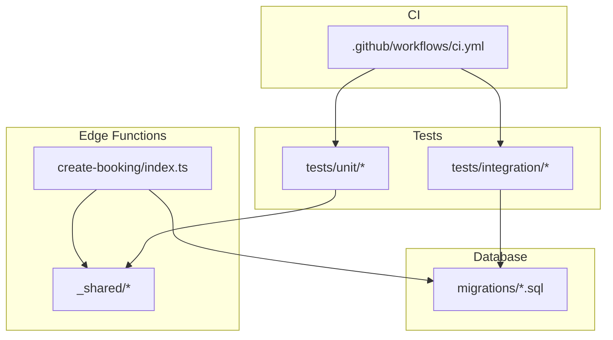
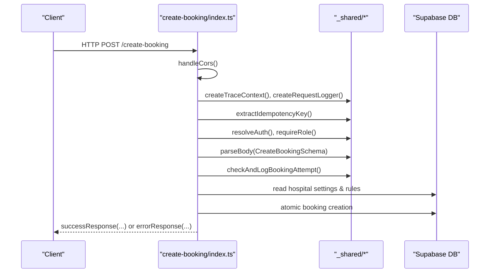
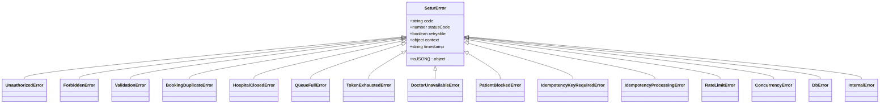
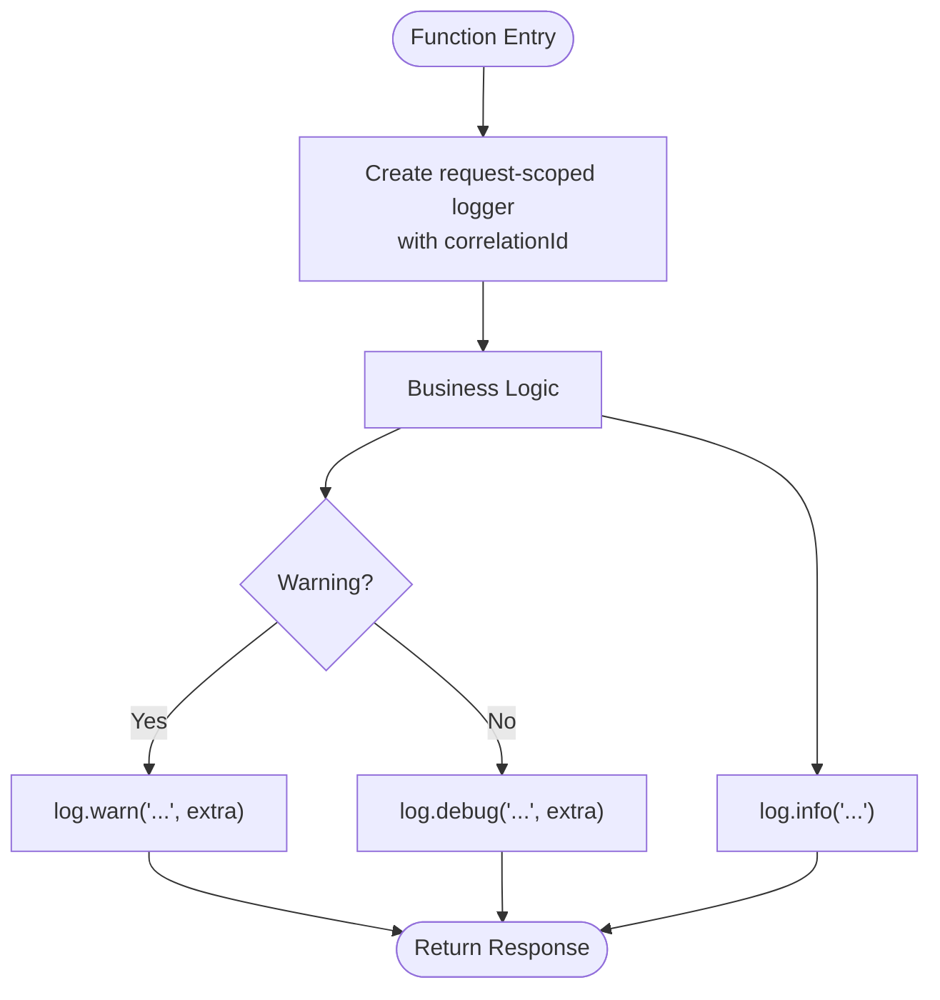
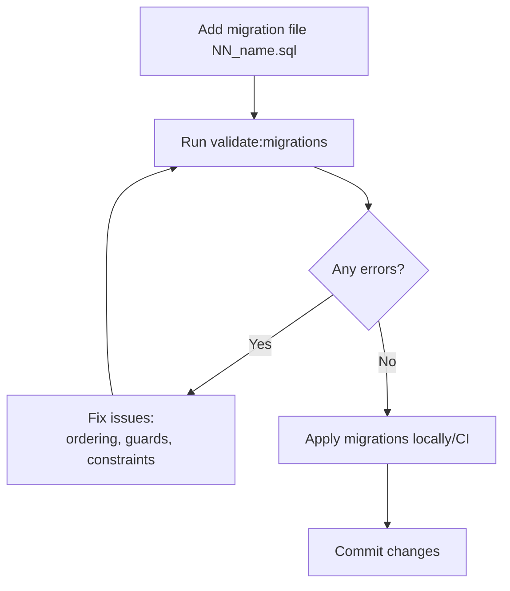
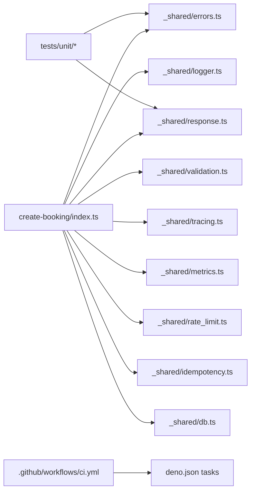

# Development Guidelines

<cite>
**Referenced Files in This Document**
- [deno.json](file://deno.json)
- [ROADMAP.md](file://ROADMAP.md)
- [supabase/config.toml](file://supabase/config.toml)
- [scripts/validate_migrations.ts](file://scripts/validate_migrations.ts)
- [supabase/functions/_shared/errors.ts](file://supabase/functions/_shared/errors.ts)
- [supabase/functions/_shared/logger.ts](file://supabase/functions/_shared/logger.ts)
- [supabase/functions/_shared/validation.ts](file://supabase/functions/_shared/validation.ts)
- [supabase/functions/_shared/response.ts](file://supabase/functions/_shared/response.ts)
- [supabase/functions/create-booking/index.ts](file://supabase/functions/create-booking/index.ts)
- [tests/unit/errors.test.ts](file://tests/unit/errors.test.ts)
- [tests/unit/response.test.ts](file://tests/unit/response.test.ts)
- [.github/workflows/ci.yml](file://.github/workflows/ci.yml)
</cite>

## Table of Contents

1. [Introduction](#introduction)
2. [Project Structure](#project-structure)
3. [Core Components](#core-components)
4. [Architecture Overview](#architecture-overview)
5. [Detailed Component Analysis](#detailed-component-analysis)
6. [Dependency Analysis](#dependency-analysis)
7. [Performance Considerations](#performance-considerations)
8. [Troubleshooting Guide](#troubleshooting-guide)
9. [Conclusion](#conclusion)
10. [Appendices](#appendices)

## Introduction

This document provides comprehensive development guidelines for contributing to
the Setura Hospital OS. It codifies TypeScript coding standards, database
migration practices, error handling and logging conventions, code review and CI
quality gates, testing requirements, performance and security considerations,
accessibility guidance, and documentation standards. The guidelines are grounded
in the repository’s shared modules, functions, tests, and CI configuration.

## Project Structure

The project is a Deno-based backend with Supabase Edge Functions, SQL
migrations, unit and integration tests, and a GitHub Actions pipeline. Key
areas:

- Shared libraries under supabase/functions/_shared for errors, logging,
  validation, responses, tracing, metrics, rate limiting, idempotency, and DB
  access.
- Feature functions under supabase/functions/<feature>/index.ts implementing
  business flows (e.g., create-booking).
- Database schema and migrations under supabase/migrations/*.sql.
- Tests under tests/unit and tests/integration.
- CI under .github/workflows/ci.yml enforcing formatting, linting, type checks,
  migration validation, unit tests, and integration smoke tests.
- Configuration via deno.json and supabase/config.toml.

**Diagram sources**

- [supabase/functions/create-booking/index.ts:1-200](file://supabase/functions/create-booking/index.ts#L1-L200)
- [supabase/functions/_shared/logger.ts:1-190](file://supabase/functions/_shared/logger.ts#L1-L190)
- [supabase/functions/_shared/errors.ts:1-323](file://supabase/functions/_shared/errors.ts#L1-L323)
- [supabase/functions/_shared/validation.ts:1-157](file://supabase/functions/_shared/validation.ts#L1-L157)
- [supabase/functions/_shared/response.ts:1-206](file://supabase/functions/_shared/response.ts#L1-L206)
- [scripts/validate_migrations.ts:1-503](file://scripts/validate_migrations.ts#L1-L503)
- [tests/unit/errors.test.ts:1-151](file://tests/unit/errors.test.ts#L1-L151)
- [tests/unit/response.test.ts:1-147](file://tests/unit/response.test.ts#L1-L147)
- [.github/workflows/ci.yml:1-85](file://.github/workflows/ci.yml#L1-L85)

**Section sources**

- [deno.json:1-40](file://deno.json#L1-L40)
- [supabase/config.toml:1-409](file://supabase/config.toml#L1-L409)
- [ROADMAP.md:25-66](file://ROADMAP.md#L25-L66)

## Core Components

- Error hierarchy: Centralized typed errors with codes, status codes,
  retryability, and context; includes domain-specific errors and helpers.
- Logging: Structured JSON logs with correlation IDs, request-scoped loggers,
  timers, and safe error serialization.
- Validation: Zod schemas and a generic parseBody helper that enforces size
  limits and returns field-level errors.
- Response builders: Consistent API envelope with success/error shapes, CORS
  headers, and standardized error mapping from typed errors.
- Migration validation: Static analysis tooling to enforce ordering, safety,
  duplicates, enum hazards, and rollback risks without running a database.

**Section sources**

- [supabase/functions/_shared/errors.ts:1-323](file://supabase/functions/_shared/errors.ts#L1-L323)
- [supabase/functions/_shared/logger.ts:1-190](file://supabase/functions/_shared/logger.ts#L1-L190)
- [supabase/functions/_shared/validation.ts:1-157](file://supabase/functions/_shared/validation.ts#L1-L157)
- [supabase/functions/_shared/response.ts:1-206](file://supabase/functions/_shared/response.ts#L1-L206)
- [scripts/validate_migrations.ts:1-503](file://scripts/validate_migrations.ts#L1-L503)

## Architecture Overview

The system follows a consistent pattern per function:

- Handle CORS preflight.
- Create trace context and request-scoped logger.
- Extract and validate auth and hospital context.
- Parse and validate request body using Zod.
- Enforce idempotency and rate limiting.
- Execute business logic with service-role DB client.
- Emit audit events and metrics.
- Return standardized responses or map errors to responses.

**Diagram sources**

- [supabase/functions/create-booking/index.ts:1-200](file://supabase/functions/create-booking/index.ts#L1-L200)
- [supabase/functions/_shared/validation.ts:71-134](file://supabase/functions/_shared/validation.ts#L71-L134)
- [supabase/functions/_shared/response.ts:44-112](file://supabase/functions/_shared/response.ts#L44-L112)
- [supabase/functions/_shared/logger.ts:175-189](file://supabase/functions/_shared/logger.ts#L175-L189)

## Detailed Component Analysis

### TypeScript Coding Standards

- Strict mode enabled globally; no implicit any; no implicit returns enforced by
  compiler options.
- Use Zod schemas for all inbound payloads; prefer parseBody helper for uniform
  parsing and error reporting.
- Prefer strongly-typed responses via response builders; avoid ad-hoc JSON
  objects.
- Keep shared utilities in _shared; feature functions should remain thin
  orchestrators.

**Section sources**

- [deno.json:1-20](file://deno.json#L1-L20)
- [supabase/functions/_shared/validation.ts:94-134](file://supabase/functions/_shared/validation.ts#L94-L134)
- [supabase/functions/_shared/response.ts:14-32](file://supabase/functions/_shared/response.ts#L14-L32)

### Error Handling Framework

- All domain errors extend a central base class with code, statusCode, retryable
  flag, and context.
- Use specific error classes per domain (auth, validation, booking, idempotency,
  rate limit, concurrency, DB, internal).
- Convert errors to responses using fromSeturError or handleErrorResponse at
  handler boundaries.
- Field-level validation errors carry structured fieldErrors for clients.

**Diagram sources**

- [supabase/functions/_shared/errors.ts:70-323](file://supabase/functions/_shared/errors.ts#L70-L323)

**Section sources**

- [supabase/functions/_shared/errors.ts:1-323](file://supabase/functions/_shared/errors.ts#L1-L323)
- [supabase/functions/_shared/response.ts:94-112](file://supabase/functions/_shared/response.ts#L94-L112)
- [tests/unit/errors.test.ts:29-151](file://tests/unit/errors.test.ts#L29-L151)

### Logging Standards

- Every log line is a single JSON object with fields like ts, level, msg,
  service, version, env, plus contextual keys.
- Correlation ID flows through all logs; created per request from headers or
  generated if missing.
- Use Logger.child to add scoped context; use timer helpers to measure
  durations.
- Errors are serialized safely; stack traces included in non-production
  environments.

**Diagram sources**

- [supabase/functions/_shared/logger.ts:75-169](file://supabase/functions/_shared/logger.ts#L75-L169)
- [supabase/functions/_shared/logger.ts:175-189](file://supabase/functions/_shared/logger.ts#L175-L189)

**Section sources**

- [supabase/functions/_shared/logger.ts:1-190](file://supabase/functions/_shared/logger.ts#L1-L190)

### Validation and Request Parsing

- Use Zod schemas for all inputs; normalize values within transforms (e.g.,
  phone normalization).
- parseBody enforces Content-Length limits, parses JSON, validates against
  schema, and throws ValidationError with fieldErrors on failure.
- Reuse shared schemas across functions to ensure consistency.

**Section sources**

- [supabase/functions/_shared/validation.ts:1-157](file://supabase/functions/_shared/validation.ts#L1-L157)

### API Response Formatting

- All responses use a consistent envelope with success, data/error,
  correlationId, timestamp, and optional meta.
- Dedicated builders exist for common cases: success, created, unauthorized,
  forbidden, conflict, validation error, rate limit, internal error.
- Map typed errors to responses automatically via fromSeturError and
  handleErrorResponse.

**Section sources**

- [supabase/functions/_shared/response.ts:1-206](file://supabase/functions/_shared/response.ts#L1-L206)
- [tests/unit/response.test.ts:40-147](file://tests/unit/response.test.ts#L40-L147)

### Database Migrations Process

- Naming convention: two-digit sequential prefix (NN_) followed by descriptive
  name; no gaps or duplicates allowed.
- Static validation ensures:
  - Ordering and numbering integrity.
  - No markdown artifacts or non-SQL content.
  - Duplicate object definitions without re-run guards.
  - Enum hazards where new values are referenced in same transaction.
  - Rollback risks such as destructive statements without IF EXISTS.
  - Missing primary keys on tables.
- Run validation via task before committing changes.

**Diagram sources**

- [scripts/validate_migrations.ts:1-503](file://scripts/validate_migrations.ts#L1-L503)

**Section sources**

- [scripts/validate_migrations.ts:1-503](file://scripts/validate_migrations.ts#L1-L503)
- [ROADMAP.md:25-66](file://ROADMAP.md#L25-L66)

### Testing Requirements

- Unit tests: Validate error behavior, response envelopes, and validation
  outcomes.
- Integration tests: Boot local Supabase stack via CI and run smoke tests
  against it.
- Coverage expectations: Ensure critical paths (auth, validation, error mapping,
  response building) have explicit tests.
- Performance benchmarks: Baseline latency for key endpoints (e.g.,
  create-booking) and track regressions.

**Section sources**

- [tests/unit/errors.test.ts:1-151](file://tests/unit/errors.test.ts#L1-L151)
- [tests/unit/response.test.ts:1-147](file://tests/unit/response.test.ts#L1-L147)
- [ROADMAP.md:381-401](file://ROADMAP.md#L381-L401)

### Code Review and Pull Request Process

- PRs must pass CI: format check, lint, type check, migration validation, unit
  tests, and integration smoke tests.
- Changes to shared modules require updated tests and clear rationale.
- New features must include:
  - Typed request/response contracts.
  - Structured logging with correlation IDs.
  - Audit events where applicable.
  - Error handling mapped to typed errors.
- Review checklist:
  - Type safety and strictness.
  - Validation coverage for all inputs.
  - Error responses conform to envelope.
  - Migrations validated and safe to re-run.
  - Security: RLS and role checks present.
  - Observability: logs and metrics emitted.

**Section sources**

- [.github/workflows/ci.yml:28-85](file://.github/workflows/ci.yml#L28-L85)
- [ROADMAP.md:25-66](file://ROADMAP.md#L25-L66)

### Performance Optimization

- Use service-role DB client for mutations; enforce RLS at auth layer.
- Leverage idempotency to prevent duplicate work and retries.
- Measure and log durations with timer helpers; monitor metrics.
- Avoid unnecessary DB calls; batch operations when possible.
- Respect rate limits and backoff strategies for external services.

**Section sources**

- [supabase/functions/create-booking/index.ts:1-200](file://supabase/functions/create-booking/index.ts#L1-L200)
- [supabase/functions/_shared/logger.ts:156-169](file://supabase/functions/_shared/logger.ts#L156-L169)

### Security Considerations

- Auth and role enforcement before DB access; hospital scoping via headers and
  claims.
- CORS configured centrally; only allow necessary origins.
- Secrets via environment variables; never hardcode credentials.
- Input validation and size limits to prevent abuse.
- Audit logging for sensitive actions.

**Section sources**

- [supabase/functions/create-booking/index.ts:96-119](file://supabase/functions/create-booking/index.ts#L96-L119)
- [supabase/config.toml:150-207](file://supabase/config.toml#L150-L207)

### Accessibility Requirements

- While this backend does not render UI, ensure APIs support accessible
  patterns:
  - Clear error messages and codes for clients to surface to users.
  - Consistent response envelope aids frontend accessibility tooling.
  - Provide stable contracts to reduce breaking changes impacting assistive
    technologies.

[No sources needed since this section provides general guidance]

### Documentation Standards

- Code comments: Explain intent, especially around concurrency guarantees,
  idempotency, and business rules.
- API documentation: Maintain OpenAPI spec externally; keep function headers
  describing flow and guarantees.
- Architectural decisions: Record in ARCHITECTURE.md after freeze; reference
  frozen contracts and patterns.

**Section sources**

- [ROADMAP.md:43-66](file://ROADMAP.md#L43-L66)
- [supabase/functions/create-booking/index.ts:1-32](file://supabase/functions/create-booking/index.ts#L1-L32)

## Dependency Analysis

- Functions depend on shared modules for cross-cutting concerns (errors,
  logging, validation, responses, tracing, metrics, rate limiting, idempotency,
  DB).
- Tests depend on shared modules to assert behavior deterministically.
- CI depends on tasks defined in deno.json to orchestrate checks.

**Diagram sources**

- [supabase/functions/create-booking/index.ts:34-63](file://supabase/functions/create-booking/index.ts#L34-L63)
- [tests/unit/response.test.ts:10-27](file://tests/unit/response.test.ts#L10-L27)
- [deno.json:11-20](file://deno.json#L11-L20)
- [.github/workflows/ci.yml:28-53](file://.github/workflows/ci.yml#L28-L53)

**Section sources**

- [deno.json:11-20](file://deno.json#L11-L20)
- [.github/workflows/ci.yml:28-85](file://.github/workflows/ci.yml#L28-L85)

## Performance Considerations

- Use structured logging sparingly in hot paths; rely on metrics for counters
  and timings.
- Prefer database-side constraints and atomic operations to reduce contention.
- Implement exponential backoff for transient failures; honor Retry-After
  headers.
- Monitor p50/p95/p99 latencies for critical endpoints and set alerts.

[No sources needed since this section provides general guidance]

## Troubleshooting Guide

- If requests fail validation, inspect fieldErrors in the response envelope and
  correlate via correlationId in logs.
- For rate limiting, check Retry-After and adjust client retry strategy.
- For idempotency conflicts, ensure unique Idempotency-Key per operation and
  handle 202 processing responses appropriately.
- For DB errors, review audit logs and metrics; consider concurrency retries for
  transient errors.

**Section sources**

- [supabase/functions/_shared/response.ts:69-112](file://supabase/functions/_shared/response.ts#L69-L112)
- [supabase/functions/_shared/logger.ts:52-73](file://supabase/functions/_shared/logger.ts#L52-L73)

## Conclusion

These guidelines establish a robust, type-safe, and observable foundation for
contributing to Setura Hospital OS. By adhering to the centralized error
hierarchy, structured logging, Zod-based validation, standardized responses, and
rigorous migration validation, teams can deliver reliable, secure, and
maintainable features. CI quality gates and testing practices ensure consistency
and confidence across releases.

## Appendices

### Quick Reference: Tasks and Commands

- Format and lint: deno fmt, deno lint
- Type check: deno task check
- Validate migrations: deno task validate:migrations
- Unit tests: deno task test
- Integration tests: deno task test:integration

**Section sources**

- [deno.json:11-20](file://deno.json#L11-L20)
