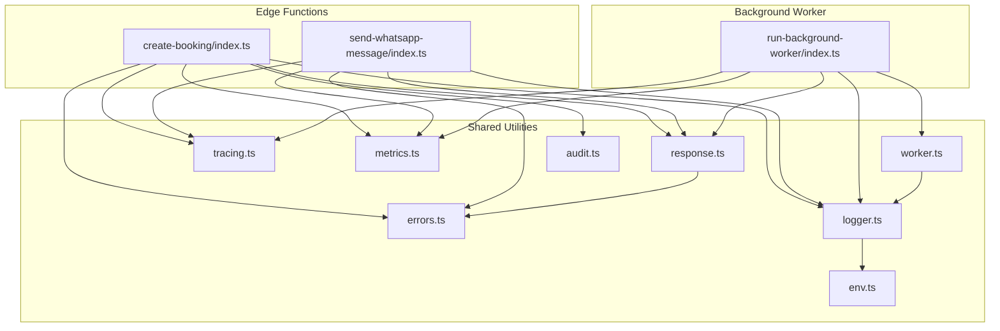
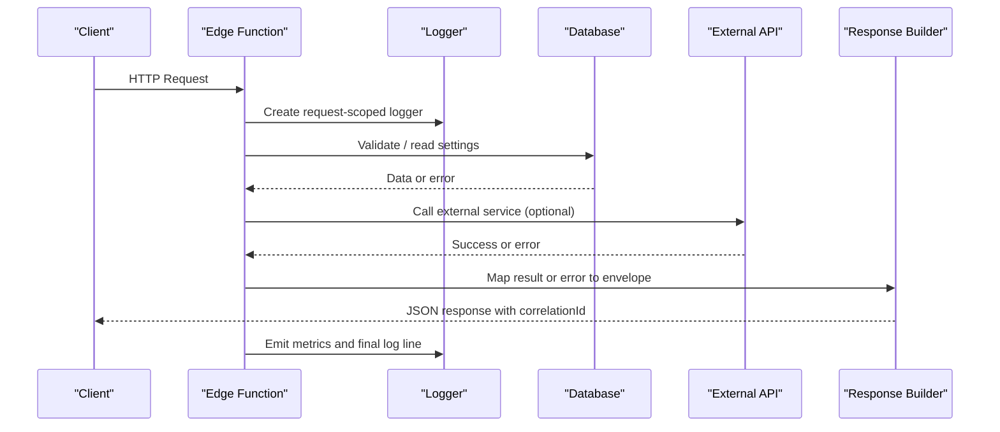
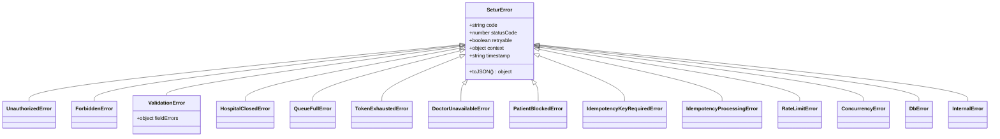
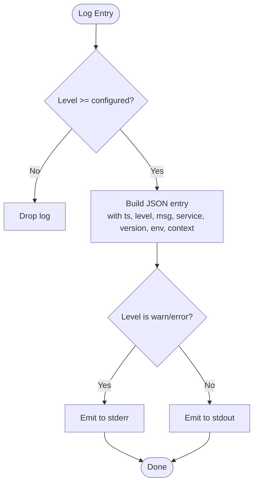
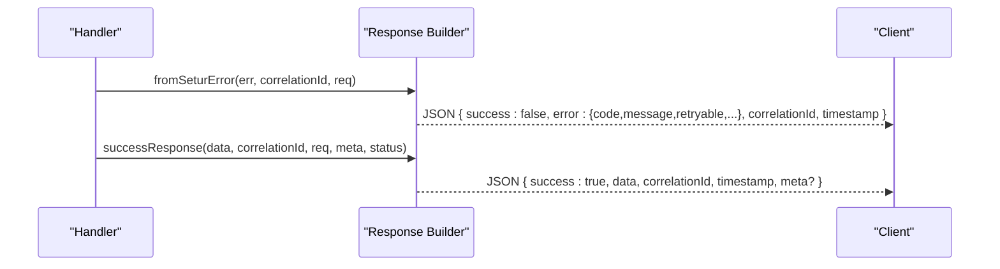
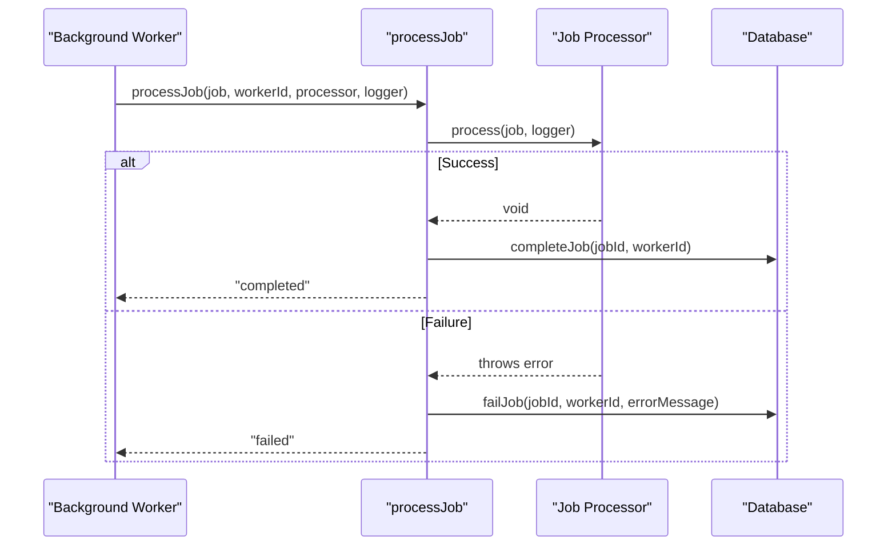
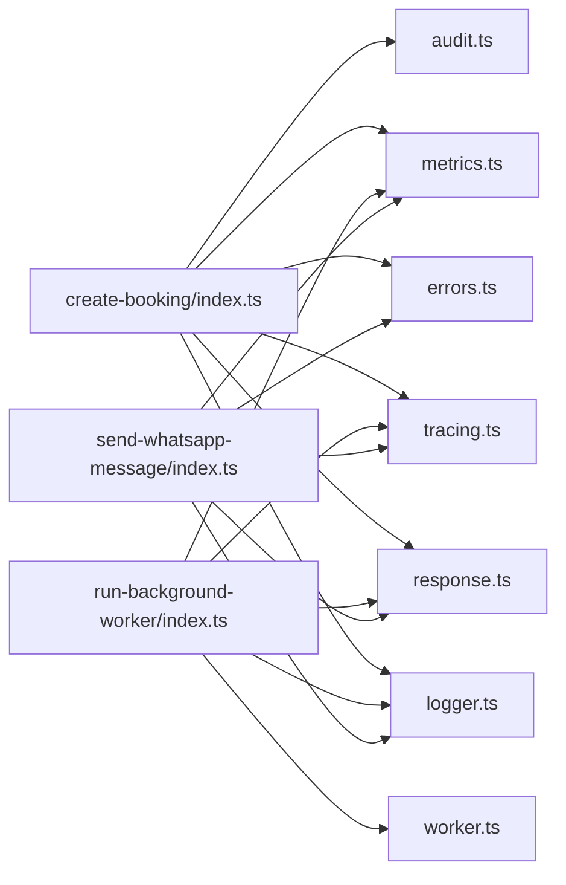

# Error Handling & Logging

<cite>
**Referenced Files in This Document**
- [errors.ts](file://supabase/functions/_shared/errors.ts)
- [logger.ts](file://supabase/functions/_shared/logger.ts)
- [response.ts](file://supabase/functions/_shared/response.ts)
- [env.ts](file://supabase/functions/_shared/env.ts)
- [tracing.ts](file://supabase/functions/_shared/tracing.ts)
- [metrics.ts](file://supabase/functions/_shared/metrics.ts)
- [worker.ts](file://supabase/functions/_shared/worker.ts)
- [audit.ts](file://supabase/functions/_shared/audit.ts)
- [create-booking/index.ts](file://supabase/functions/create-booking/index.ts)
- [run-background-worker/index.ts](file://supabase/functions/run-background-worker/index.ts)
- [send-whatsapp-message/index.ts](file://supabase/functions/send-whatsapp-message/index.ts)
- [errors.test.ts](file://tests/unit/errors.test.ts)
- [response.test.ts](file://tests/unit/response.test.ts)
</cite>

## Table of Contents

1. [Introduction](#introduction)
2. [Project Structure](#project-structure)
3. [Core Components](#core-components)
4. [Architecture Overview](#architecture-overview)
5. [Detailed Component Analysis](#detailed-component-analysis)
6. [Dependency Analysis](#dependency-analysis)
7. [Performance Considerations](#performance-considerations)
8. [Troubleshooting Guide](#troubleshooting-guide)
9. [Conclusion](#conclusion)
10. [Appendices](#appendices)

## Introduction

This document explains the centralized error handling and structured logging
system used across Setura Hospital OS Edge Functions and background workers. It
covers:

- A typed, domain-specific error hierarchy that standardizes error codes, HTTP
  status mapping, retryability, and context.
- Structured JSON logging with correlation IDs, log levels, timing helpers, and
  safe error serialization.
- Consistent API response envelopes for both success and error cases.
- Error propagation patterns from edge functions to background workers and
  external services.
- Environment-aware logging behavior and best practices for development,
  staging, and production.
- Monitoring integration points (metrics, audit logs, and environment variables
  for observability).
- Security considerations when logging errors and sensitive data.

## Project Structure

The error handling and logging capabilities are implemented as shared utilities
under the functions’ _shared directory and consumed by each Edge Function and
worker. The key modules are:

- Centralized error types and helpers
- Structured logger with request-scoped context
- Standardized response builders
- Tracing utilities for correlation IDs and span propagation
- Metrics collector emitting structured metric logs
- Worker lifecycle and job processing helpers
- Audit event writer for compliance and traceability

**Diagram sources**

- [errors.ts:1-323](file://supabase/functions/_shared/errors.ts#L1-L323)
- [logger.ts:1-190](file://supabase/functions/_shared/logger.ts#L1-L190)
- [response.ts:1-206](file://supabase/functions/_shared/response.ts#L1-L206)
- [tracing.ts:1-50](file://supabase/functions/_shared/tracing.ts#L1-L50)
- [metrics.ts:1-119](file://supabase/functions/_shared/metrics.ts#L1-L119)
- [worker.ts:1-257](file://supabase/functions/_shared/worker.ts#L1-L257)
- [audit.ts:1-75](file://supabase/functions/_shared/audit.ts#L1-L75)
- [env.ts:1-279](file://supabase/functions/_shared/env.ts#L1-L279)
- [create-booking/index.ts:1-666](file://supabase/functions/create-booking/index.ts#L1-L666)
- [run-background-worker/index.ts:1-454](file://supabase/functions/run-background-worker/index.ts#L1-L454)
- [send-whatsapp-message/index.ts:1-583](file://supabase/functions/send-whatsapp-message/index.ts#L1-L583)

**Section sources**

- [errors.ts:1-323](file://supabase/functions/_shared/errors.ts#L1-L323)
- [logger.ts:1-190](file://supabase/functions/_shared/logger.ts#L1-L190)
- [response.ts:1-206](file://supabase/functions/_shared/response.ts#L1-L206)
- [tracing.ts:1-50](file://supabase/functions/_shared/tracing.ts#L1-L50)
- [metrics.ts:1-119](file://supabase/functions/_shared/metrics.ts#L1-L119)
- [worker.ts:1-257](file://supabase/functions/_shared/worker.ts#L1-L257)
- [audit.ts:1-75](file://supabase/functions/_shared/audit.ts#L1-L75)
- [env.ts:1-279](file://supabase/functions/_shared/env.ts#L1-L279)
- [create-booking/index.ts:1-666](file://supabase/functions/create-booking/index.ts#L1-L666)
- [run-background-worker/index.ts:1-454](file://supabase/functions/run-background-worker/index.ts#L1-L454)
- [send-whatsapp-message/index.ts:1-583](file://supabase/functions/send-whatsapp-message/index.ts#L1-L583)

## Core Components

- Centralized error hierarchy: A base error type carries a machine-readable
  code, HTTP status, retry flag, timestamp, and arbitrary context.
  Domain-specific subclasses encapsulate common failure modes such as auth,
  validation, booking, idempotency, rate limiting, database, and internal
  errors. Type guards identify these errors and determine retryability.
- Structured logger: Emits single-line JSON entries with consistent fields
  including timestamp, level, message, service, version, environment, and
  contextual metadata. Supports child loggers per request, timers for duration
  measurement, and safe error serialization that preserves stack traces only in
  non-production environments.
- Response envelope: All API responses include success flag, correlation ID,
  timestamp, and either data or an error block. Helpers map domain errors to
  standardized responses and provide named builders for common statuses like
  unauthorized, forbidden, validation, conflict, rate limit, and internal
  errors.
- Tracing and metrics: Correlation IDs flow through all logs and responses.
  Metrics are collected per request and flushed as structured log lines for
  downstream collectors.

**Section sources**

- [errors.ts:13-104](file://supabase/functions/_shared/errors.ts#L13-L104)
- [errors.ts:106-323](file://supabase/functions/_shared/errors.ts#L106-L323)
- [logger.ts:13-190](file://supabase/functions/_shared/logger.ts#L13-L190)
- [response.ts:14-206](file://supabase/functions/_shared/response.ts#L14-L206)
- [tracing.ts:9-50](file://supabase/functions/_shared/tracing.ts#L9-L50)
- [metrics.ts:16-119](file://supabase/functions/_shared/metrics.ts#L16-L119)

## Architecture Overview

The system follows a layered approach:

- Edge functions create a trace context and request-scoped logger at entry, then
  use shared utilities to validate input, enforce authorization, perform
  business logic, and return standardized responses.
- Errors thrown within handlers are caught centrally and converted into
  consistent error responses using the response module.
- Background workers claim jobs, process them with robust error handling, and
  mark completion or failure while maintaining worker leases and heartbeats.
- External calls (e.g., WhatsApp provider) are wrapped with timeouts and mapped
  to appropriate error responses.

**Diagram sources**

- [create-booking/index.ts:67-666](file://supabase/functions/create-booking/index.ts#L67-L666)
- [send-whatsapp-message/index.ts:326-583](file://supabase/functions/send-whatsapp-message/index.ts#L326-L583)
- [logger.ts:122-190](file://supabase/functions/_shared/logger.ts#L122-L190)
- [response.ts:44-206](file://supabase/functions/_shared/response.ts#L44-L206)

## Detailed Component Analysis

### Centralized Error Hierarchy

- Base error type includes code, statusCode, retryable, context, and timestamp,
  with a toJSON method for structured logging.
- Domain-specific errors cover authentication, authorization, validation,
  booking rules, idempotency, rate limiting, concurrency, database issues,
  external service failures, and internal server errors.
- Type guards allow callers to detect SeturError instances and whether an error
  is retryable.

**Diagram sources**

- [errors.ts:70-104](file://supabase/functions/_shared/errors.ts#L70-L104)
- [errors.ts:106-323](file://supabase/functions/_shared/errors.ts#L106-L323)

**Section sources**

- [errors.ts:13-104](file://supabase/functions/_shared/errors.ts#L13-L104)
- [errors.ts:106-323](file://supabase/functions/_shared/errors.ts#L106-L323)
- [errors.test.ts:29-151](file://tests/unit/errors.test.ts#L29-L151)

### Structured JSON Logging

- Every log line is a single JSON object with fields: timestamp, level, message,
  service, version, environment, plus contextual keys.
- Log levels are filtered based on configuration; default level adapts to
  environment.
- Child loggers propagate correlation IDs and other context across function
  boundaries.
- Error serialization preserves name, message, stack (in non-production), and
  any custom fields present on SeturError.

**Diagram sources**

- [logger.ts:17-30](file://supabase/functions/_shared/logger.ts#L17-L30)
- [logger.ts:75-99](file://supabase/functions/_shared/logger.ts#L75-L99)
- [logger.ts:122-190](file://supabase/functions/_shared/logger.ts#L122-L190)

**Section sources**

- [logger.ts:13-190](file://supabase/functions/_shared/logger.ts#L13-L190)
- [env.ts:155-163](file://supabase/functions/_shared/env.ts#L155-L163)

### Consistent API Response Formatting

- Success responses include success flag, data, correlationId, timestamp, and
  optional meta.
- Error responses include success=false, error.code, error.message,
  error.retryable, and optional fieldErrors.
- Helpers map SeturError instances to responses, preserving retryability and
  field-level validation details.
- Specialized builders exist for common scenarios: unauthorized, forbidden,
  validation, conflict, rate limit, and internal errors.

**Diagram sources**

- [response.ts:44-206](file://supabase/functions/_shared/response.ts#L44-L206)

**Section sources**

- [response.ts:14-206](file://supabase/functions/_shared/response.ts#L14-L206)
- [response.test.ts:40-147](file://tests/unit/response.test.ts#L40-L147)

### Error Propagation Across Edge Functions and Workers

- Edge functions catch errors and delegate to a central handler that maps known
  errors to responses and wraps unknowns as internal errors.
- Background workers wrap job processing with try/catch, log failures, and call
  failJob to record errors and backoff/dead-letter behavior.
- External API calls (e.g., WhatsApp provider) are wrapped with timeouts and
  mapped to appropriate errors; rate limits and permanent failures are tracked
  via metrics.

**Diagram sources**

- [worker.ts:219-257](file://supabase/functions/_shared/worker.ts#L219-L257)
- [run-background-worker/index.ts:363-391](file://supabase/functions/run-background-worker/index.ts#L363-L391)

**Section sources**

- [create-booking/index.ts:658-664](file://supabase/functions/create-booking/index.ts#L658-L664)
- [run-background-worker/index.ts:328-454](file://supabase/functions/run-background-worker/index.ts#L328-L454)
- [send-whatsapp-message/index.ts:477-583](file://supabase/functions/send-whatsapp-message/index.ts#L477-L583)
- [worker.ts:219-257](file://supabase/functions/_shared/worker.ts#L219-L257)

### Logging Best Practices by Environment

- Development: Default log level is debug; stack traces are included in
  serialized errors for easier debugging.
- Production: Default log level is info; stack traces are omitted to avoid
  leaking internals.
- Use child loggers to attach request-scoped context (correlationId, endpoint,
  method, url) to every log line.
- Avoid logging secrets or sensitive PII; mask identifiers where necessary.
- Use timers to measure durations and emit metrics for performance analysis.

**Section sources**

- [env.ts:155-163](file://supabase/functions/_shared/env.ts#L155-L163)
- [logger.ts:52-73](file://supabase/functions/_shared/logger.ts#L52-L73)
- [logger.ts:178-190](file://supabase/functions/_shared/logger.ts#L178-L190)

### Error Monitoring Integration and Alerting Strategies

- Metrics are emitted as structured log lines tagged with endpoint and
  correlationId, suitable for ingestion by log-based analytics platforms.
- Environment variables expose DSN for error tracking and feature flags for
  enabling tracing and metrics.
- Audit events are written fire-and-forget to support compliance and operational
  visibility without impacting user flows.

**Section sources**

- [metrics.ts:1-119](file://supabase/functions/_shared/metrics.ts#L1-L119)
- [env.ts:155-205](file://supabase/functions/_shared/env.ts#L155-L205)
- [audit.ts:1-75](file://supabase/functions/_shared/audit.ts#L1-L75)

### Examples of Proper Error Handling

#### Edge Function Example: Booking Creation

- Validates headers and body, enforces roles, checks hospital rules, handles
  idempotency, performs atomic operations, and returns standardized responses.
- Uses domain errors for business rule violations and wraps unexpected failures
  as internal errors.
- Logs at each stage with correlationId and emits metrics.

**Section sources**

- [create-booking/index.ts:67-666](file://supabase/functions/create-booking/index.ts#L67-L666)
- [errors.ts:154-243](file://supabase/functions/_shared/errors.ts#L154-L243)
- [response.ts:44-206](file://supabase/functions/_shared/response.ts#L44-L206)

#### Database Operations Example

- Detects constraint violations and maps them to domain-appropriate errors.
- Wraps retries and concurrency conflicts with retryable errors where
  applicable.

**Section sources**

- [create-booking/index.ts:448-493](file://supabase/functions/create-booking/index.ts#L448-L493)
- [errors.ts:284-300](file://supabase/functions/_shared/errors.ts#L284-L300)

#### External API Calls Example: WhatsApp Messaging

- Enforces worker-only access via secret header.
- Calls external API with timeout, parses responses, and distinguishes rate
  limits and permanent failures.
- Maps failures to internal errors with rich context and increments relevant
  metrics.

**Section sources**

- [send-whatsapp-message/index.ts:326-583](file://supabase/functions/send-whatsapp-message/index.ts#L326-L583)
- [errors.ts:304-312](file://supabase/functions/_shared/errors.ts#L304-L312)

### Security Considerations for Error Messages and Sensitive Data Logging

- Never log raw secrets or tokens; rely on environment variables and never echo
  them in logs.
- Mask or truncate sensitive identifiers (e.g., phone numbers) in logs where
  appropriate.
- In production, omit stack traces and detailed internal messages from error
  responses and logs.
- Use correlation IDs to trace requests without embedding sensitive payloads.

**Section sources**

- [logger.ts:52-73](file://supabase/functions/_shared/logger.ts#L52-L73)
- [response.ts:179-206](file://supabase/functions/_shared/response.ts#L179-L206)
- [create-booking/index.ts:136-140](file://supabase/functions/create-booking/index.ts#L136-L140)

## Dependency Analysis

- Edge functions depend on shared utilities for logging, responses, tracing,
  metrics, and error types.
- Background workers depend on worker utilities for lease management, heartbeat,
  and job processing.
- Audit logging is decoupled and fire-and-forget to avoid impacting core flows.

**Diagram sources**

- [create-booking/index.ts:34-666](file://supabase/functions/create-booking/index.ts#L34-L666)
- [run-background-worker/index.ts:6-454](file://supabase/functions/run-background-worker/index.ts#L6-L454)
- [send-whatsapp-message/index.ts:7-583](file://supabase/functions/send-whatsapp-message/index.ts#L7-L583)
- [errors.ts:1-323](file://supabase/functions/_shared/errors.ts#L1-L323)
- [logger.ts:1-190](file://supabase/functions/_shared/logger.ts#L1-L190)
- [response.ts:1-206](file://supabase/functions/_shared/response.ts#L1-L206)
- [tracing.ts:1-50](file://supabase/functions/_shared/tracing.ts#L1-L50)
- [metrics.ts:1-119](file://supabase/functions/_shared/metrics.ts#L1-L119)
- [worker.ts:1-257](file://supabase/functions/_shared/worker.ts#L1-L257)
- [audit.ts:1-75](file://supabase/functions/_shared/audit.ts#L1-L75)

**Section sources**

- [create-booking/index.ts:34-666](file://supabase/functions/create-booking/index.ts#L34-L666)
- [run-background-worker/index.ts:6-454](file://supabase/functions/run-background-worker/index.ts#L6-L454)
- [send-whatsapp-message/index.ts:7-583](file://supabase/functions/send-whatsapp-message/index.ts#L7-L583)

## Performance Considerations

- Use timers to measure critical sections and emit metrics for bottleneck
  identification.
- Prefer batch processing in workers with bounded concurrency and periodic
  heartbeats to maintain resilience.
- Avoid synchronous blocking operations; use timeouts for external calls to
  prevent long-running requests.
- Keep log payload minimal and avoid high-frequency debug logs in production.

[No sources needed since this section provides general guidance]

## Troubleshooting Guide

- If requests fail with generic internal errors, inspect correlationId in logs
  and responses to locate the exact invocation.
- For validation failures, check fieldErrors in the response to guide
  client-side corrections.
- For rate limiting, honor Retry-After headers and adjust client retry
  strategies accordingly.
- For worker failures, review job logs and dead-letter queues; ensure heartbeats
  are active and leases are renewed.
- For external API issues, examine metrics tags and error context to distinguish
  transient vs permanent failures.

**Section sources**

- [response.ts:69-206](file://supabase/functions/_shared/response.ts#L69-L206)
- [worker.ts:180-257](file://supabase/functions/_shared/worker.ts#L180-L257)
- [send-whatsapp-message/index.ts:477-583](file://supabase/functions/send-whatsapp-message/index.ts#L477-L583)

## Conclusion

Setura Hospital OS implements a robust, centralized approach to error handling
and logging:

- A typed error hierarchy ensures consistent semantics across domains.
- Structured JSON logging with correlation IDs enables precise tracing across
  services.
- Standardized response envelopes simplify client error handling and monitoring.
- Background workers integrate resilient job processing with clear error
  reporting.
- Environment-aware logging and security-conscious practices protect sensitive
  data while providing actionable insights.

[No sources needed since this section summarizes without analyzing specific
files]

## Appendices

### Appendix A: Environment Variables Relevant to Observability

- LOG_LEVEL: Controls minimum log verbosity; defaults differ by environment.
- DEPLOYMENT_VERSION: Included in log entries for version correlation.
- ENABLE_TRACING / ENABLE_METRICS: Feature flags to enable tracing and metrics
  emission.
- SENTRY_DSN: Optional DSN for error tracking integration.

**Section sources**

- [env.ts:155-205](file://supabase/functions/_shared/env.ts#L155-L205)

### Appendix B: Unit Tests Coverage Highlights

- Error hierarchy tests verify codes, statuses, retryability, context, and
  serialization.
- Response tests validate envelope structure, status codes, CORS headers, and
  error mapping.

**Section sources**

- [errors.test.ts:29-151](file://tests/unit/errors.test.ts#L29-L151)
- [response.test.ts:40-147](file://tests/unit/response.test.ts#L40-L147)
