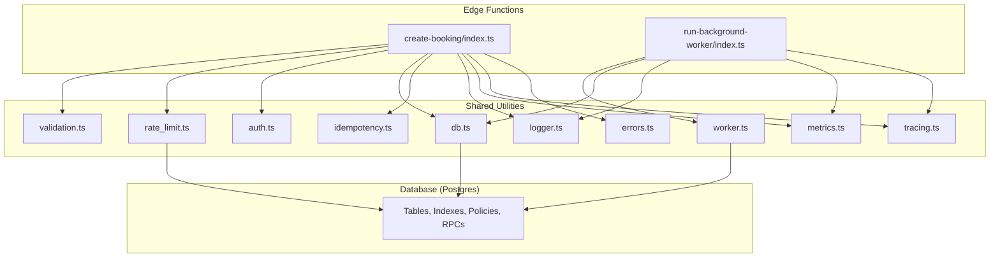
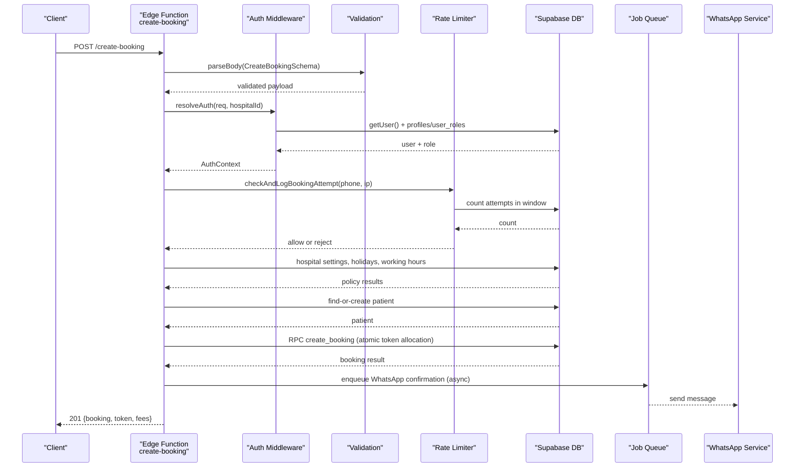
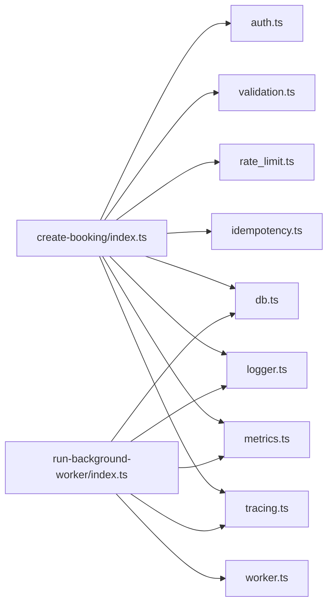

# Performance & Security Best Practices

<cite>
**Referenced Files in This Document**
- [rate_limit.ts](file://supabase/functions/_shared/rate_limit.ts)
- [validation.ts](file://supabase/functions/_shared/validation.ts)
- [auth.ts](file://supabase/functions/_shared/auth.ts)
- [db.ts](file://supabase/functions/_shared/db.ts)
- [worker.ts](file://supabase/functions/_shared/worker.ts)
- [errors.ts](file://supabase/functions/_shared/errors.ts)
- [metrics.ts](file://supabase/functions/_shared/metrics.ts)
- [tracing.ts](file://supabase/functions/_shared/tracing.ts)
- [idempotency.ts](file://supabase/functions/_shared/idempotency.ts)
- [logger.ts](file://supabase/functions/_shared/logger.ts)
- [create-booking/index.ts](file://supabase/functions/create-booking/index.ts)
- [run-background-worker/index.ts](file://supabase/functions/run-background-worker/index.ts)
- [09_abuse_protection_&_rate_limiting.sql](file://supabase/migrations/09_abuse_protection_&_rate_limiting.sql)
- [10_audit_&_security_engine.sql](file://supabase/migrations/10_audit_&_security_engine.sql)
</cite>

## Table of Contents

1. Introduction
2. Project Structure
3. Core Components
4. Architecture Overview
5. Detailed Component Analysis
6. Dependency Analysis
7. Performance Considerations
8. Troubleshooting Guide
9. Conclusion
10. Appendices

## Introduction

This document provides comprehensive performance and security best practices for
the Setura Hospital OS, focusing on:

- Database query optimization
- Caching strategies
- Edge function efficiency
- Input validation, authentication, authorization, and data protection
- Rate limiting and abuse prevention
- Memory management for long-running operations and background workers
- Secure coding practices for sensitive healthcare data and HIPAA considerations
- Performance monitoring, profiling tools, and security scanning integration
- Scalability and load testing guidance

## Project Structure

The system is organized around Supabase Edge Functions with shared utilities for
database access, validation, auth, rate limiting, idempotency, worker
orchestration, logging, metrics, and tracing. SQL migrations define tables,
functions, and policies that enforce security and operational controls.

**Diagram sources**

- [create-booking/index.ts:67-666](file://supabase/functions/create-booking/index.ts#L67-L666)
- [run-background-worker/index.ts:247-454](file://supabase/functions/run-background-worker/index.ts#L247-L454)
- [db.ts:1-169](file://supabase/functions/_shared/db.ts#L1-L169)
- [rate_limit.ts:1-124](file://supabase/functions/_shared/rate_limit.ts#L1-L124)
- [worker.ts:1-257](file://supabase/functions/_shared/worker.ts#L1-L257)

**Section sources**

- [create-booking/index.ts:67-666](file://supabase/functions/create-booking/index.ts#L67-L666)
- [run-background-worker/index.ts:247-454](file://supabase/functions/run-background-worker/index.ts#L247-L454)
- [db.ts:1-169](file://supabase/functions/_shared/db.ts#L1-L169)

## Core Components

- Validation: Centralized Zod schemas and request parsing with size guards and
  normalization to prevent injection and malformed payloads.
- Authentication & Authorization: JWT validation via Supabase Auth, role
  resolution from database, hospital-scoped access control, and middleware
  composition.
- Database Access: Three client types (service-role, anon, per-request auth)
  with typed RPC helpers and error assertion utilities.
- Rate Limiting & Abuse Protection: Distributed sliding-window checks backed by
  Postgres, phone/IP/device tracking, blocked lists, and temporary restrictions.
- Idempotency: Key-based deduplication with state machine semantics, body
  hashing, and safe retries.
- Background Workers: Lease-based job claiming with heartbeat, crash recovery,
  and batched processing.
- Observability: Structured logging, correlation IDs, timing, and metrics
  emission.

**Section sources**

- [validation.ts:1-157](file://supabase/functions/_shared/validation.ts#L1-L157)
- [auth.ts:1-237](file://supabase/functions/_shared/auth.ts#L1-L237)
- [db.ts:1-169](file://supabase/functions/_shared/db.ts#L1-L169)
- [rate_limit.ts:1-124](file://supabase/functions/_shared/rate_limit.ts#L1-L124)
- [idempotency.ts:1-259](file://supabase/functions/_shared/idempotency.ts#L1-L259)
- [worker.ts:1-257](file://supabase/functions/_shared/worker.ts#L1-L257)
- [logger.ts:1-190](file://supabase/functions/_shared/logger.ts#L1-L190)
- [metrics.ts:1-119](file://supabase/functions/_shared/metrics.ts#L1-L119)
- [tracing.ts:1-50](file://supabase/functions/_shared/tracing.ts#L1-L50)

## Architecture Overview

The booking flow demonstrates a production-grade pipeline combining validation,
auth, idempotency, rate limiting, business rules, atomic DB operations, and
async notifications.

**Diagram sources**

- [create-booking/index.ts:67-666](file://supabase/functions/create-booking/index.ts#L67-L666)
- [rate_limit.ts:27-111](file://supabase/functions/_shared/rate_limit.ts#L27-L111)
- [db.ts:115-136](file://supabase/functions/_shared/db.ts#L115-L136)

## Detailed Component Analysis

### Input Validation and Normalization

- Enforce strict schemas for all inbound requests using Zod.
- Normalize phone numbers and validate formats before any DB writes.
- Guard against oversized payloads to mitigate resource exhaustion.

Best practices:

- Always parse and validate before business logic.
- Use transforms to normalize inputs consistently across services.
- Return structured field-level errors for client feedback.

**Section sources**

- [validation.ts:23-88](file://supabase/functions/_shared/validation.ts#L23-L88)
- [validation.ts:99-134](file://supabase/functions/_shared/validation.ts#L99-L134)

### Authentication and Authorization

- Validate JWT via Supabase Auth to benefit from key rotation and revocation
  handling.
- Resolve roles from the database to avoid stale claims.
- Enforce hospital-scoped access; global admins bypass tenant boundaries.
- Provide reusable middleware to wrap handlers with consistent auth checks.

Security notes:

- Never trust client-provided roles or hospital context without verification.
- Fail closed on auth failures with typed errors.

**Section sources**

- [auth.ts:22-124](file://supabase/functions/_shared/auth.ts#L22-L124)
- [auth.ts:126-185](file://supabase/functions/_shared/auth.ts#L126-L185)
- [auth.ts:187-237](file://supabase/functions/_shared/auth.ts#L187-L237)

### Database Access Patterns and Query Optimization

- Use service-role client only for internal operations; never expose to user
  input.
- Create per-request auth clients to enforce Row Level Security (RLS).
- Prefer typed RPC calls for complex transactions and atomic operations.
- Use indexes and scoped queries to minimize scan costs.

Performance tips:

- Batch reads/writes where possible.
- Leverage SQL-side logic (functions, constraints) for consistency.
- Avoid N+1 queries; fetch related data in single statements.

**Section sources**

- [db.ts:1-21](file://supabase/functions/_shared/db.ts#L1-L21)
- [db.ts:30-106](file://supabase/functions/_shared/db.ts#L30-L106)
- [db.ts:115-169](file://supabase/functions/_shared/db.ts#L115-L169)

### Rate Limiting and Abuse Prevention

- Sliding window rate limit checks backed by Postgres for distributed safety.
- Track attempts by normalized phone, IP, and device identifiers.
- Support blocked numbers and temporary restrictions with time-bound
  enforcement.
- Fail open on DB errors to preserve availability while logging warnings.

Operational guidance:

- Tune window and thresholds per hospital policy.
- Monitor attempt logs and abuse scores to adjust limits dynamically.

**Section sources**

- [rate_limit.ts:1-124](file://supabase/functions/_shared/rate_limit.ts#L1-L124)
- [09_abuse_protection_&_rate_limiting.sql:77-168](file://supabase/migrations/09_abuse_protection_&_rate_limiting.sql#L77-L168)
- [09_abuse_protection_&_rate_limiting.sql:169-316](file://supabase/migrations/09_abuse_protection_&_rate_limiting.sql#L169-L316)
- [09_abuse_protection_&_rate_limiting.sql:381-624](file://supabase/migrations/09_abuse_protection_&_rate_limiting.sql#L381-L624)

### Idempotency for Resilient APIs

- Require and validate UUID v4 Idempotency-Key headers.
- Compute request body hash to detect misuse of keys with different payloads.
- Claim key atomically; return cached responses for completed requests.
- Mark keys as failed on handler errors to allow retry with new keys.

Reliability benefits:

- Prevents duplicate bookings on network retries.
- Enables safe parallelism and resiliency across edge instances.

**Section sources**

- [idempotency.ts:1-68](file://supabase/functions/_shared/idempotency.ts#L1-L68)
- [idempotency.ts:70-129](file://supabase/functions/_shared/idempotency.ts#L70-L129)
- [idempotency.ts:131-182](file://supabase/functions/_shared/idempotency.ts#L131-L182)
- [idempotency.ts:184-259](file://supabase/functions/_shared/idempotency.ts#L184-L259)

### Background Workers and Long-Running Operations

- Worker registration and heartbeat ensure lease-based coordination and crash
  recovery.
- Jobs are claimed with FOR UPDATE SKIP LOCKED to avoid double-processing.
- Heartbeat loop maintains liveness; stopWorker drains or terminates gracefully.
- processJob wraps execution with complete/fail semantics and structured
  logging.

Memory and lifecycle:

- Keep jobs small and focused; offload heavy work to background workers.
- Use timeouts and bounded concurrency to prevent memory pressure.

**Section sources**

- [worker.ts:1-130](file://supabase/functions/_shared/worker.ts#L1-L130)
- [worker.ts:132-215](file://supabase/functions/_shared/worker.ts#L132-L215)
- [worker.ts:217-257](file://supabase/functions/_shared/worker.ts#L217-L257)
- [run-background-worker/index.ts:247-454](file://supabase/functions/run-background-worker/index.ts#L247-L454)

### Audit Logging and Security Events

- Immutable audit logs capture actor, entity, action, severity, and metadata.
- Security events track suspicious activity, risk scoring, and resolution
  workflows.
- RLS policies restrict access to admin roles; functions run with SECURITY
  DEFINER for controlled access.

Compliance alignment:

- Maintain append-only records for accountability and forensics.
- Capture relevant PII minimally and securely; consider encryption at rest for
  sensitive fields.

**Section sources**

- [10_audit_&_security_engine.sql:38-128](file://supabase/migrations/10_audit_&_security_engine.sql#L38-L128)
- [10_audit_&_security_engine.sql:130-225](file://supabase/migrations/10_audit_&_security_engine.sql#L130-L225)
- [10_audit_&_security_engine.sql:227-320](file://supabase/migrations/10_audit_&_security_engine.sql#L227-L320)
- [10_audit_&_security_engine.sql:321-488](file://supabase/migrations/10_audit_&_security_engine.sql#L321-L488)

### Error Handling and Observability

- Centralized typed error hierarchy with codes, status codes, retry flags, and
  context.
- Structured JSON logs with correlation IDs and timers for end-to-end tracing.
- Metrics collector emits timing, counters, and gauges as structured log lines
  for external collectors.

Operational value:

- Consistent error responses enable robust client retry logic.
- Correlation IDs link logs across services for faster debugging.

**Section sources**

- [errors.ts:1-65](file://supabase/functions/_shared/errors.ts#L1-L65)
- [errors.ts:66-162](file://supabase/functions/_shared/errors.ts#L66-L162)
- [errors.ts:163-323](file://supabase/functions/_shared/errors.ts#L163-L323)
- [logger.ts:1-190](file://supabase/functions/_shared/logger.ts#L1-L190)
- [metrics.ts:1-119](file://supabase/functions/_shared/metrics.ts#L1-L119)
- [tracing.ts:1-50](file://supabase/functions/_shared/tracing.ts#L1-L50)

## Dependency Analysis

Key runtime dependencies and their roles:

- Supabase JS client for typed DB access and RPC invocation.
- Zod for schema validation and transformation.
- Deno runtime for Edge Functions and crypto primitives.
- Postgres for persistence, indexing, and policy enforcement.

Coupling and cohesion:

- Shared modules encapsulate cross-cutting concerns (auth, validation, rate
  limiting, workers), improving cohesion.
- Handlers depend on shared modules but remain decoupled from implementation
  details.

Potential risks:

- Over-reliance on external services (e.g., WhatsApp) requires graceful
  degradation and retries.
- Ensure RLS policies align with intended access patterns to avoid accidental
  data exposure.

**Diagram sources**

- [create-booking/index.ts:67-666](file://supabase/functions/create-booking/index.ts#L67-L666)
- [run-background-worker/index.ts:247-454](file://supabase/functions/run-background-worker/index.ts#L247-L454)

**Section sources**

- [db.ts:23-28](file://supabase/functions/_shared/db.ts#L23-L28)
- [validation.ts:8-9](file://supabase/functions/_shared/validation.ts#L8-L9)

## Performance Considerations

- Database query optimization:
  - Use targeted selects and filters; leverage indexes on high-cardinality
    columns (e.g., hospital_id, normalized_phone, created_at).
  - Prefer SQL functions for complex logic to reduce round-trips and enforce
    consistency.
  - Batch operations and use upserts to minimize contention.
- Caching strategies:
  - Cache read-heavy configuration (e.g., hospital settings) within short TTLs
    if appropriate; otherwise rely on efficient DB queries and indexes.
  - Avoid caching mutable state in Edge Functions due to cold starts; persist
    state in Postgres.
- Edge function efficiency:
  - Minimize payload sizes; validate early and fail fast.
  - Use async patterns and Promise.allSettled for independent tasks (e.g.,
    enqueuing multiple jobs).
  - Keep handlers focused; delegate heavy work to background workers.
- Monitoring and profiling:
  - Emit metrics for critical paths (auth, parsing, DB calls, rate limit
    checks).
  - Use correlation IDs to trace requests across services.
  - Integrate with log aggregators (Datadog, Grafana Loki, CloudWatch) for
    dashboards and alerts.

[No sources needed since this section provides general guidance]

## Troubleshooting Guide

Common issues and resolutions:

- Validation failures:
  - Check field-level errors returned by the validator; ensure client sends
    correctly formatted data.
- Auth failures:
  - Verify JWT presence and validity; confirm user profile exists and is active;
    ensure hospital context matches.
- Rate limit exceeded:
  - Inspect attempt logs and blocked numbers; adjust thresholds if necessary;
    investigate abuse patterns.
- Idempotency conflicts:
  - Ensure clients generate unique UUID v4 keys per request; handle 202
    responses for in-progress requests.
- Worker crashes:
  - Review heartbeat and claim logs; verify lease expiration and reclamation;
    inspect job failure reasons.

Operational steps:

- Use correlation IDs to correlate logs across services.
- Enable detailed logging in non-production environments; keep production logs
  concise and actionable.
- Set up alerts for error spikes, rate limit triggers, and worker failures.

**Section sources**

- [errors.ts:106-162](file://supabase/functions/_shared/errors.ts#L106-L162)
- [rate_limit.ts:60-111](file://supabase/functions/_shared/rate_limit.ts#L60-L111)
- [idempotency.ts:184-259](file://supabase/functions/_shared/idempotency.ts#L184-L259)
- [worker.ts:180-215](file://supabase/functions/_shared/worker.ts#L180-L215)

## Conclusion

Setura Hospital OS implements robust performance and security patterns:

- Strict input validation and normalization protect against malformed or
  malicious payloads.
- Centralized authentication and authorization enforce least privilege and
  tenant isolation.
- Distributed rate limiting and abuse protection safeguard availability and
  fairness.
- Idempotency ensures resilience under retries and concurrent requests.
- Background workers provide scalable, reliable processing with crash recovery.
- Comprehensive observability enables proactive monitoring and rapid incident
  response.

Adopt these practices to maintain high reliability, security, and performance in
production healthcare environments.

[No sources needed since this section summarizes without analyzing specific
files]

## Appendices

### HIPAA and Data Protection Guidance

- Minimize PII in logs; mask sensitive fields (e.g., phone numbers) in logs and
  responses.
- Encrypt sensitive data at rest and in transit; use HTTPS and secure storage.
- Implement access controls aligned with need-to-know principles; audit all
  accesses.
- Retain audit logs immutably for compliance and forensic analysis.
- Conduct regular security assessments and penetration tests.

[No sources needed since this section provides general guidance]

### Scalability and Load Testing

- Scale horizontally by deploying multiple Edge Function instances; rely on
  Postgres for coordination.
- Use background workers to absorb bursts; tune batch sizes and poll intervals
  based on throughput.
- Perform load testing to identify bottlenecks in DB queries, external API
  calls, and rate limit thresholds.
- Monitor key metrics: latency percentiles, error rates, queue depths, and
  worker utilization.

[No sources needed since this section provides general guidance]
