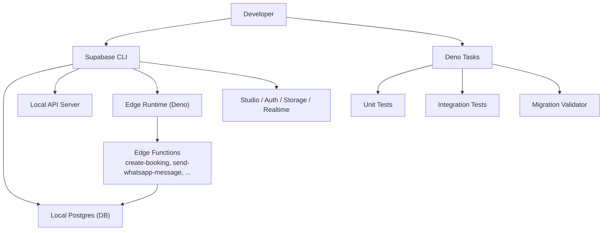
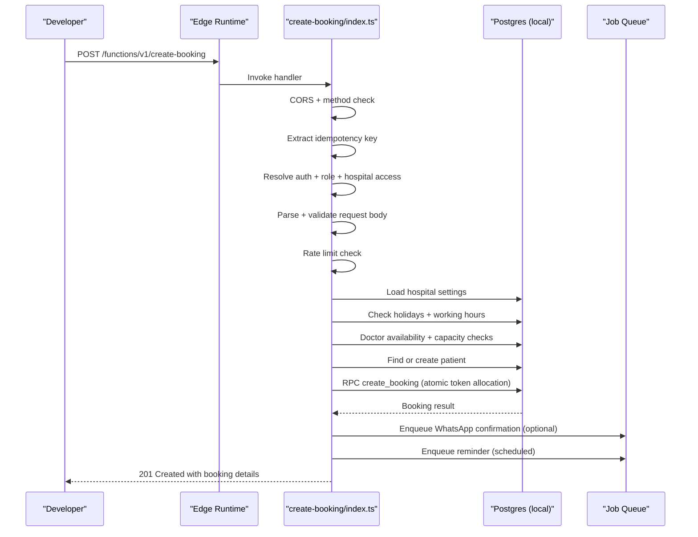
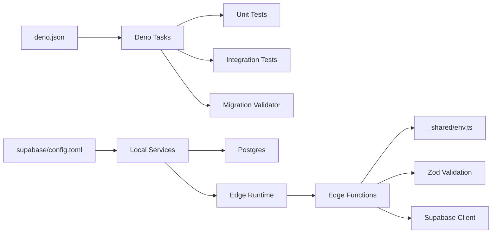

# Getting Started

<cite>
**Referenced Files in This Document**
- [deno.json](file://deno.json)
- [supabase/config.toml](file://supabase/config.toml)
- [scripts/validate_migrations.ts](file://scripts/validate_migrations.ts)
- [tests/utils/setup_env.ts](file://tests/utils/setup_env.ts)
- [tests/integration/local_stack.test.ts](file://tests/integration/local_stack.test.ts)
- [supabase/functions/create-booking/index.ts](file://supabase/functions/create-booking/index.ts)
- [supabase/functions/_shared/env.ts](file://supabase/functions/_shared/env.ts)
- [supabase/seed.sql](file://supabase/seed.sql)
- [ROADMAP.md](file://ROADMAP.md)
</cite>

## Table of Contents

1. [Introduction](#introduction)
2. [Project Structure](#project-structure)
3. [Core Components](#core-components)
4. [Architecture Overview](#architecture-overview)
5. [Detailed Component Analysis](#detailed-component-analysis)
6. [Dependency Analysis](#dependency-analysis)
7. [Performance Considerations](#performance-considerations)
8. [Troubleshooting Guide](#troubleshooting-guide)
9. [Conclusion](#conclusion)
10. [Appendices](#appendices)

## Introduction

This guide helps you set up the Setura Hospital OS development environment from
scratch. You will install prerequisites, initialize and run the local Supabase
stack, apply all database migrations, seed sample data, and validate everything
with tests. You will also learn how to run edge functions locally, execute tests
with Deno, and make your first API calls to create a hospital context, register
a doctor, and book a patient appointment.

The project uses:

- Deno for runtime and task orchestration
- Supabase CLI for local services (API, database, auth, storage, realtime,
  studio)
- SQL migrations under supabase/migrations
- Edge Functions under supabase/functions
- Tests under tests/

**Section sources**

- [ROADMAP.md:25-39](file://ROADMAP.md#L25-L39)

## Project Structure

Key directories and their roles:

- supabase/functions: Edge Functions implementing business APIs (e.g.,
  create-booking). Shared utilities live under supabase/functions/_shared.
- supabase/migrations: Ordered SQL migrations that define schema, policies,
  functions, and metadata. The latest migration is 39_schema_alignment.sql.
- supabase/seed.sql: Deterministic seed script creating a pilot hospital, users,
  roles, schedules, settings, and feature flags.
- scripts/validate_migrations.ts: Static analysis tool to validate migration
  file ordering, syntax artifacts, duplicate objects, enum hazards, rollback
  risks, and missing constraints.
- tests/: Unit and integration tests using Deno test runner. Integration tests
  run against the real local Supabase stack.
- deno.json: Deno configuration including tasks for formatting, linting, type
  checking, testing, migration validation, and DB reset.
- supabase/config.toml: Local Supabase service configuration (ports, features,
  seeds, edge runtime).

**Diagram sources**

- [supabase/config.toml:7-65](file://supabase/config.toml#L7-L65)
- [deno.json:11-20](file://deno.json#L11-L20)
- [supabase/functions/create-booking/index.ts:67-114](file://supabase/functions/create-booking/index.ts#L67-L114)

**Section sources**

- [deno.json:1-40](file://deno.json#L1-L40)
- [supabase/config.toml:1-120](file://supabase/config.toml#L1-L120)
- [scripts/validate_migrations.ts:1-22](file://scripts/validate_migrations.ts#L1-L22)
- [supabase/seed.sql:1-35](file://supabase/seed.sql#L1-L35)

## Core Components

- Supabase local stack: Provides Postgres, REST API, GraphQL, Auth, Storage,
  Realtime, Studio, and Edge Runtime.
- Migrations: Define the complete schema and engine components across 39 files.
- Seed data: Creates a deterministic pilot hospital, users, roles, schedules,
  settings, and feature flags.
- Edge Functions: Implement APIs like create-booking with robust validation,
  idempotency, rate limiting, audit logging, and background job enqueuing.
- Tests: Validate migrations, seed idempotency, and core logic; integration
  tests exercise the real local stack.

**Section sources**

- [supabase/config.toml:27-65](file://supabase/config.toml#L27-L65)
- [supabase/functions/create-booking/index.ts:1-32](file://supabase/functions/create-booking/index.ts#L1-L32)
- [tests/integration/local_stack.test.ts:1-16](file://tests/integration/local_stack.test.ts#L1-L16)

## Architecture Overview

High-level flow for booking creation via an Edge Function:

**Diagram sources**

- [supabase/functions/create-booking/index.ts:67-114](file://supabase/functions/create-booking/index.ts#L67-L114)
- [supabase/functions/create-booking/index.ts:156-182](file://supabase/functions/create-booking/index.ts#L156-L182)
- [supabase/functions/create-booking/index.ts:220-283](file://supabase/functions/create-booking/index.ts#L220-L283)
- [supabase/functions/create-booking/index.ts:321-396](file://supabase/functions/create-booking/index.ts#L321-L396)
- [supabase/functions/create-booking/index.ts:421-498](file://supabase/functions/create-booking/index.ts#L421-L498)
- [supabase/functions/create-booking/index.ts:520-585](file://supabase/functions/create-booking/index.ts#L520-L585)

## Detailed Component Analysis

### Prerequisites and Installation

- Install Deno: Use the official installer for your platform.
- Install Supabase CLI: Follow the official installation instructions for your
  OS.
- Verify installations by running:
  - deno --version
  - supabase version

No additional package managers are required because dependencies are resolved at
runtime by Deno and Supabase CLI.

**Section sources**

- [deno.json:1-20](file://deno.json#L1-L20)
- [supabase/config.toml:369-378](file://supabase/config.toml#L369-L378)

### Initialize and Start the Local Supabase Stack

- Navigate to the repository root.
- Start the local stack:
  - supabase start
- This command starts Postgres, API, Auth, Storage, Realtime, Studio, and Edge
  Runtime according to supabase/config.toml.

Ports used by default:

- API: 54321
- Database: 54322
- Studio: 54323
- Inbucket: 54324
- Analytics: 54327

Migrations and seed:

- Migrations are enabled by default and applied automatically during
  start/reset.
- Seed file is configured to run on db reset.

**Section sources**

- [supabase/config.toml:7-15](file://supabase/config.toml#L7-L15)
- [supabase/config.toml:27-36](file://supabase/config.toml#L27-L36)
- [supabase/config.toml:53-65](file://supabase/config.toml#L53-L65)
- [supabase/config.toml:81-102](file://supabase/config.toml#L81-L102)
- [supabase/config.toml:383-387](file://supabase/config.toml#L383-L387)

### Apply All Database Migrations

Migrations are located under supabase/migrations and numbered sequentially from
01 to 39. They include foundational tables, scheduling engines, messaging
queues, settlement engine, analytics, abuse protection, audit/security,
presence, rollups, partitioning, idempotency, monitoring, config versioning,
background workers, permissions, enhancements, device sessions, leave
management, subscriptions, ledger cleanup, hospital config enhancements, audit
standardization, feature flags, and schema alignment.

To ensure they are applied:

- Run supabase start (migrations enabled by default).
- If you need to reset the database and reapply migrations plus seed:
  - supabase db reset

You can also validate migration integrity without a database:

- deno task validate:migrations

This runs static checks for ordering, syntax artifacts, duplicate objects, enum
hazards, rollback risks, and missing constraints.

**Section sources**

- [supabase/config.toml:53-65](file://supabase/config.toml#L53-L65)
- [scripts/validate_migrations.ts:1-22](file://scripts/validate_migrations.ts#L1-L22)
- [scripts/validate_migrations.ts:46-117](file://scripts/validate_migrations.ts#L46-L117)
- [scripts/validate_migrations.ts:478-503](file://scripts/validate_migrations.ts#L478-L503)

### Run the Seed Data Script

Seed data creates a deterministic pilot hospital, users, profiles, roles, doctor
specializations, working hours, doctor schedules, fee policy, queue
configuration, and feature flags. It is idempotent and safe to re-run.

To apply seed:

- supabase db reset (applies migrations then seed)
- Or rely on supabase start if your workflow triggers seed automatically

Seed behavior is configured in supabase/config.toml under [db.seed].

**Section sources**

- [supabase/config.toml:60-65](file://supabase/config.toml#L60-L65)
- [supabase/seed.sql:1-35](file://supabase/seed.sql#L1-L35)
- [supabase/seed.sql:99-142](file://supabase/seed.sql#L99-L142)
- [supabase/seed.sql:144-200](file://supabase/seed.sql#L144-L200)

### Development Workflow: Running Edge Functions Locally

Use the Supabase Edge Runtime to run functions locally:

- supabase functions serve

This starts the local function server and hot-reloads changes. Ensure the local
stack is running so functions can connect to Postgres and other services.

Environment variables for functions:

- Required: SUPABASE_URL, SUPABASE_ANON_KEY, SUPABASE_SERVICE_ROLE_KEY
- Optional: META_* keys, RAZORPAY_* keys, CRON_SECRET, WORKER_SECRET,
  ENABLE_WORKER_TRIGGER, LOG_LEVEL, SENTRY_DSN, DEPLOYMENT_VERSION,
  MAX_BOOKING_ADVANCE_DAYS, IDEMPOTENCY_TTL_HOURS, RATE_LIMIT_WINDOW_MINUTES,
  RATE_LIMIT_MAX_ATTEMPTS, ENABLE_TRACING, ENABLE_METRICS, ALLOWED_ORIGINS

These are validated eagerly at module load to fail fast on cold start.

**Section sources**

- [supabase/config.toml:369-378](file://supabase/config.toml#L369-L378)
- [supabase/functions/_shared/env.ts:16-28](file://supabase/functions/_shared/env.ts#L16-L28)
- [supabase/functions/_shared/env.ts:82-90](file://supabase/functions/_shared/env.ts#L82-L90)
- [supabase/functions/_shared/env.ts:118-191](file://supabase/functions/_shared/env.ts#L118-L191)
- [supabase/functions/_shared/env.ts:197-221](file://supabase/functions/_shared/env.ts#L197-L221)
- [supabase/functions/_shared/env.ts:227-275](file://supabase/functions/_shared/env.ts#L227-L275)

### Execute Tests with Deno Test Runner

Run unit tests (no network, no database):

- deno task test

Run integration tests against the real local stack:

- deno task test:integration

Integration tests verify:

- Local stack status
- Migration registry includes latest migration
- Seed created a complete working hospital with expected attributes and counts
- Idempotency guarantees (no duplicates)

Test environment bootstrap sets required environment variables before importing
modules that depend on them.

**Section sources**

- [deno.json:11-20](file://deno.json#L11-L20)
- [tests/utils/setup_env.ts:1-40](file://tests/utils/setup_env.ts#L1-L40)
- [tests/integration/local_stack.test.ts:1-16](file://tests/integration/local_stack.test.ts#L1-L16)
- [tests/integration/local_stack.test.ts:32-78](file://tests/integration/local_stack.test.ts#L32-L78)
- [tests/integration/local_stack.test.ts:82-99](file://tests/integration/local_stack.test.ts#L82-L99)
- [tests/integration/local_stack.test.ts:103-119](file://tests/integration/local_stack.test.ts#L103-L119)
- [tests/integration/local_stack.test.ts:123-150](file://tests/integration/local_stack.test.ts#L123-L150)
- [tests/integration/local_stack.test.ts:154-175](file://tests/integration/local_stack.test.ts#L154-L175)
- [tests/integration/local_stack.test.ts:179-198](file://tests/integration/local_stack.test.ts#L179-L198)
- [tests/integration/local_stack.test.ts:202-218](file://tests/integration/local_stack.test.ts#L202-L218)
- [tests/integration/local_stack.test.ts:222-237](file://tests/integration/local_stack.test.ts#L222-L237)
- [tests/integration/local_stack.test.ts:241-252](file://tests/integration/local_stack.test.ts#L241-L252)
- [tests/integration/local_stack.test.ts:256-268](file://tests/integration/local_stack.test.ts#L256-L268)

### Validate Migrations Without a Database

Use the migration validator to perform static checks:

- deno task validate:migrations

Checks include:

- File naming and ordering
- Syntax artifacts (markdown fences)
- Duplicate object definitions without guards
- Enum hazards within transactions
- Rollback risks (DROP/ALTER DROP without IF EXISTS, TRUNCATE)
- Missing primary keys on CREATE TABLE

Exit code 0 means clean; exit code 1 indicates errors found.

**Section sources**

- [scripts/validate_migrations.ts:1-22](file://scripts/validate_migrations.ts#L1-L22)
- [scripts/validate_migrations.ts:46-117](file://scripts/validate_migrations.ts#L46-L117)
- [scripts/validate_migrations.ts:199-399](file://scripts/validate_migrations.ts#L199-L399)
- [scripts/validate_migrations.ts:408-476](file://scripts/validate_migrations.ts#L408-L476)
- [scripts/validate_migrations.ts:478-503](file://scripts/validate_migrations.ts#L478-L503)

### First API Calls Examples

Below are conceptual examples for common operations. Replace placeholders with
actual values from your local stack.

- Create a hospital context:
  - Method: POST
  - Endpoint: http://127.0.0.1:54321/rest/v1/hospitals
  - Headers:
    - Authorization: Bearer <SUPABASE_ANON_KEY> -apikey: <SUPABASE_ANON_KEY>
    - Content-Type: application/json
  - Body fields: name, slug, phone, email, country, state, district, town,
    address, timezone, is_active, subscription_active, online_booking_enabled,
    max_advance_booking_days
  - Notes: The seed already creates a pilot hospital; use this endpoint to add
    more hospitals.

- Register a doctor:
  - Create a user via Auth:
    - Method: POST
    - Endpoint: http://127.0.0.1:54321/auth/v1/signup
    - Body: { email, password }
  - Assign role:
    - Method: POST
    - Endpoint: http://127.0.0.1:54321/rest/v1/user_roles
    - Headers: Authorization: Bearer <SERVICE_ROLE_KEY>
    - Body: { user_id, hospital_id, role: "doctor", is_primary: true }
  - Add specialization:
    - Method: POST
    - Endpoint: http://127.0.0.1:54321/rest/v1/doctor_specializations
    - Headers: Authorization: Bearer <SERVICE_ROLE_KEY>
    - Body: { doctor_id, hospital_id, specialization_name, consultation_fee }

- Make a patient booking:
  - Method: POST
  - Endpoint: http://127.0.0.1:54321/functions/v1/create-booking
  - Headers:
    - Authorization: Bearer <JWT>
    - X-Hospital-ID: <hospital_id>
    - Content-Type: application/json
  - Body fields:
    - patientPhone, patientName, appointmentDate, bookingSource, hospitalId
    - Optional: doctorId, queueSessionId, patientAge, patientGender, village,
      bloodGroup, hasDiabetes, hasBp
  - Response includes:
    - bookingId, tokenNumber, bookingReference, estimatedWaitMinutes, patientId,
      appointmentDate, queueSessionId, fees

Notes:

- The create-booking function validates hospital rules, holiday/working hours,
  doctor availability, queue capacity, and ensures idempotency.
- Background jobs may enqueue WhatsApp confirmations and reminders based on
  hospital settings.

**Section sources**

- [supabase/functions/create-booking/index.ts:67-114](file://supabase/functions/create-booking/index.ts#L67-L114)
- [supabase/functions/create-booking/index.ts:121-140](file://supabase/functions/create-booking/index.ts#L121-L140)
- [supabase/functions/create-booking/index.ts:156-182](file://supabase/functions/create-booking/index.ts#L156-L182)
- [supabase/functions/create-booking/index.ts:220-283](file://supabase/functions/create-booking/index.ts#L220-L283)
- [supabase/functions/create-booking/index.ts:321-396](file://supabase/functions/create-booking/index.ts#L321-L396)
- [supabase/functions/create-booking/index.ts:421-498](file://supabase/functions/create-booking/index.ts#L421-L498)
- [supabase/functions/create-booking/index.ts:520-585](file://supabase/functions/create-booking/index.ts#L520-L585)
- [supabase/functions/create-booking/index.ts:616-634](file://supabase/functions/create-booking/index.ts#L616-L634)

## Dependency Analysis

Runtime and tooling dependencies:

- Deno: Used for tasks, tests, and Edge Runtime.
- Supabase CLI: Orchestrates local services and applies migrations/seeds.
- Supabase JS client: Imported via Deno imports for database interactions in
  shared modules.
- Zod: Used for request/response validation in edge functions.

Configuration dependencies:

- supabase/config.toml defines ports, features, and seed behavior.
- deno.json defines tasks and import maps.

**Diagram sources**

- [deno.json:1-20](file://deno.json#L1-L20)
- [supabase/config.toml:7-65](file://supabase/config.toml#L7-L65)
- [supabase/functions/_shared/env.ts:227-275](file://supabase/functions/_shared/env.ts#L227-L275)

**Section sources**

- [deno.json:1-20](file://deno.json#L1-L20)
- [supabase/config.toml:7-65](file://supabase/config.toml#L7-L65)

## Performance Considerations

- Use idempotency keys to prevent duplicate bookings under retries or concurrent
  requests.
- Leverage atomic token allocation via database RPCs to avoid race conditions.
- Enable metrics and tracing in development to monitor latency and error rates.
- Keep rate limits reasonable to protect the system from abuse while allowing
  normal usage.
- Avoid unnecessary network calls in tests; unit tests target pure modules only.

[No sources needed since this section provides general guidance]

## Troubleshooting Guide

Common setup issues and resolutions:

- Port conflicts:
  - Symptoms: Services fail to start due to port in use.
  - Resolution: Change ports in supabase/config.toml for API, DB, Studio,
    Inbucket, Analytics. Ensure no other processes bind those ports.

- Database connection problems:
  - Symptoms: Edge functions cannot connect to Postgres; tests fail to reach
    local stack.
  - Resolution: Ensure supabase start is running; verify SUPABASE_URL points to
    http://127.0.0.1:54321; check firewall and network restrictions.

- Environment variable configuration:
  - Symptoms: Cold start failures in edge functions due to missing required
    variables.
  - Resolution: Set SUPABASE_URL, SUPABASE_ANON_KEY, SUPABASE_SERVICE_ROLE_KEY.
    For optional integrations, set META_* and RAZORPAY_* keys as needed.
    Configure ALLOWED_ORIGINS for CORS.

- Migrations not applied:
  - Symptoms: Schema mismatch; tests fail on missing tables or columns.
  - Resolution: Run supabase db reset to reapply migrations and seed; use deno
    task validate:migrations to detect issues; check migration numbering and
    content.

- Edge functions not loading:
  - Symptoms: Import errors or missing env vars when serving functions.
  - Resolution: Ensure supabase functions serve is executed from the repo root;
    verify environment variables are available to the Edge Runtime; check
    deno.json tasks and imports.

- Integration tests failing:
  - Symptoms: Cannot read local stack status; tests throw errors about stack not
    running.
  - Resolution: Run supabase start; ensure supabase CLI is on PATH; verify test
    environment variables are set by setup_env.ts.

**Section sources**

- [supabase/config.toml:7-15](file://supabase/config.toml#L7-L15)
- [supabase/config.toml:27-36](file://supabase/config.toml#L27-L36)
- [supabase/config.toml:81-102](file://supabase/config.toml#L81-L102)
- [supabase/config.toml:383-387](file://supabase/config.toml#L383-L387)
- [supabase/functions/_shared/env.ts:16-28](file://supabase/functions/_shared/env.ts#L16-L28)
- [supabase/functions/_shared/env.ts:82-90](file://supabase/functions/_shared/env.ts#L82-L90)
- [supabase/functions/_shared/env.ts:211-221](file://supabase/functions/_shared/env.ts#L211-L221)
- [tests/integration/local_stack.test.ts:32-78](file://tests/integration/local_stack.test.ts#L32-L78)

## Conclusion

You now have a complete understanding of how to set up and operate the Setura
Hospital OS development environment. You can start the local stack, apply
migrations, seed data, run edge functions, execute tests, and validate
migrations. With these tools, you can confidently develop and iterate on
features such as hospital management, doctor registration, and patient bookings.

[No sources needed since this section summarizes without analyzing specific
files]

## Appendices

### Quick Commands Reference

- Start local stack: supabase start
- Reset DB and apply migrations + seed: supabase db reset
- Serve edge functions locally: supabase functions serve
- Run unit tests: deno task test
- Run integration tests: deno task test:integration
- Validate migrations statically: deno task validate:migrations
- Format code: deno task fmt
- Lint code: deno task lint
- Type check: deno task check

**Section sources**

- [deno.json:11-20](file://deno.json#L11-L20)
