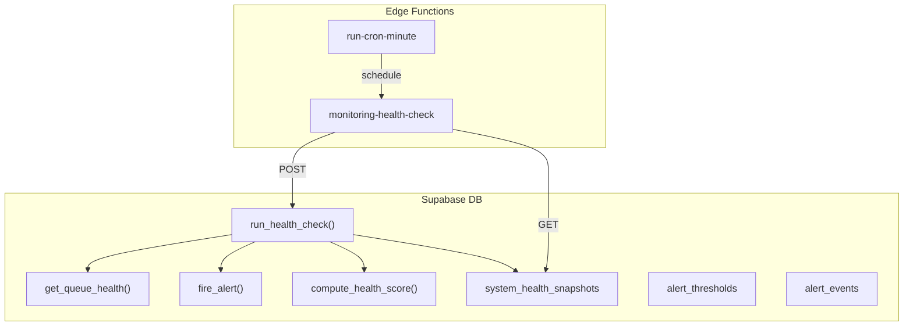
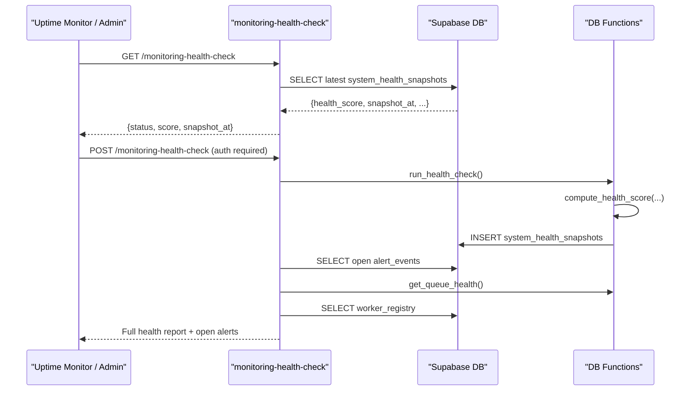
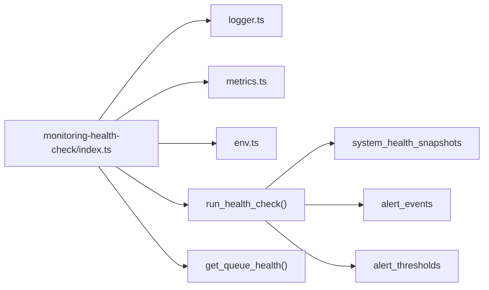
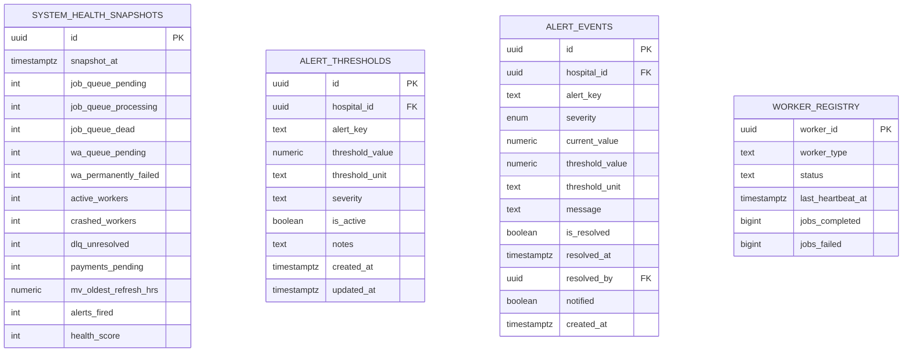
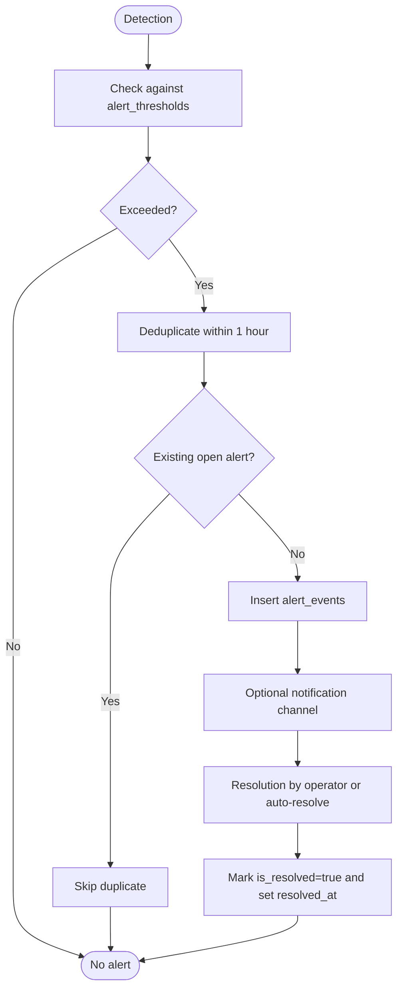

# Health Checks & Alerting

<cite>
**Referenced Files in This Document**
- [monitoring-health-check/index.ts](file://supabase/functions/monitoring-health-check/index.ts)
- [24_operational-monitoring_engine.sql](file://supabase/migrations/24_operational-monitoring_engine.sql)
- [17_queue_monitoring_engine.sql](file://supabase/migrations/17_queue_monitoring_engine.sql)
- [run-cron-minute/index.ts](file://supabase/functions/run-cron-minute/index.ts)
- [_shared/logger.ts](file://supabase/functions/_shared/logger.ts)
- [_shared/metrics.ts](file://supabase/functions/_shared/metrics.ts)
- [_shared/env.ts](file://supabase/functions/_shared/env.ts)
- [database.generated.ts](file://supabase/functions/_shared/database.generated.ts)
</cite>

## Table of Contents

1. [Introduction](#introduction)
2. [Project Structure](#project-structure)
3. [Core Components](#core-components)
4. [Architecture Overview](#architecture-overview)
5. [Detailed Component Analysis](#detailed-component-analysis)
6. [Dependency Analysis](#dependency-analysis)
7. [Performance Considerations](#performance-considerations)
8. [Troubleshooting Guide](#troubleshooting-guide)
9. [Conclusion](#conclusion)
10. [Appendices](#appendices)

## Introduction

This document explains the health check and alerting system in Setura Hospital
OS. It covers:

- The health endpoint that exposes system status for uptime monitors and
  dashboards
- How health is computed from queues, workers, dead-letter queue (DLQ),
  materialized view freshness, and payments
- The alerting mechanism that records open alerts and supports severity-based
  handling
- Configuration options for thresholds and observability settings
- The alert lifecycle from detection to resolution
- Examples for custom health checks, proactive monitoring, and responding to
  different severities
- Integration with external monitoring tools and incident response workflows

## Project Structure

The health and alerting system spans Edge Functions and Supabase database
objects:

- An Edge Function exposes a GET endpoint for lightweight uptime checks and a
  POST endpoint for full health runs
- A scheduled cron triggers periodic health checks and worker activity
- Database functions compute health scores, collect queue metrics, and persist
  snapshots
- Tables store alert thresholds, alert events, and health snapshots

**Diagram sources**

- [monitoring-health-check/index.ts:22-230](file://supabase/functions/monitoring-health-check/index.ts#L22-L230)
- [run-cron-minute/index.ts:195-254](file://supabase/functions/run-cron-minute/index.ts#L195-L254)
- [24_operational-monitoring_engine.sql:194-397](file://supabase/migrations/24_operational-monitoring_engine.sql#L194-L397)
- [17_queue_monitoring_engine.sql:124-147](file://supabase/migrations/17_queue_monitoring_engine.sql#L124-L147)

**Section sources**

- [monitoring-health-check/index.ts:22-230](file://supabase/functions/monitoring-health-check/index.ts#L22-L230)
- [run-cron-minute/index.ts:195-254](file://supabase/functions/run-cron-minute/index.ts#L195-L254)
- [24_operational-monitoring_engine.sql:157-189](file://supabase/migrations/24_operational-monitoring_engine.sql#L157-L189)
- [24_operational-monitoring_engine.sql:194-397](file://supabase/migrations/24_operational-monitoring_engine.sql#L194-L397)
- [17_queue_monitoring_engine.sql:124-147](file://supabase/migrations/17_queue_monitoring_engine.sql#L124-L147)

## Core Components

- Health endpoint (GET/POST):
  - GET returns the latest snapshot’s score and status without authentication
  - POST requires global admin role and executes a comprehensive health run
- Health scoring algorithm:
  - Derived from critical/warning alerts and crashed workers; clamped to 0–100
- Alerting engine:
  - Thresholds define when to alert and at what severity
  - fire_alert prevents duplicate alerts within an hour per
    key/hospital/severity
  - Open alerts are queryable by severity and time
- Queue and DLQ monitoring:
  - get_queue_health aggregates job and WhatsApp queues
  - Dead-letter queue counts feed into health and alerts
- Materialized view freshness:
  - MV refresh health is included in the full report
- Worker registry:
  - Active/crashed workers tracked via heartbeat timestamps
- Observability:
  - Structured logging and metrics emitted as log lines for external collectors

**Section sources**

- [monitoring-health-check/index.ts:33-97](file://supabase/functions/monitoring-health-check/index.ts#L33-L97)
- [monitoring-health-check/index.ts:103-210](file://supabase/functions/monitoring-health-check/index.ts#L103-L210)
- [24_operational-monitoring_engine.sql:194-210](file://supabase/migrations/24_operational-monitoring_engine.sql#L194-L210)
- [24_operational-monitoring_engine.sql:216-277](file://supabase/migrations/24_operational-monitoring_engine.sql#L216-L277)
- [17_queue_monitoring_engine.sql:124-147](file://supabase/migrations/17_queue_monitoring_engine.sql#L124-L147)
- [_shared/logger.ts:122-169](file://supabase/functions/_shared/logger.ts#L122-L169)
- [_shared/metrics.ts:24-103](file://supabase/functions/_shared/metrics.ts#L24-L103)

## Architecture Overview

The system combines Edge Functions with server-side SQL logic:

- Cron triggers periodic checks and worker runs
- The health endpoint orchestrates data collection and reporting
- Database functions encapsulate complex checks and scoring
- Alerts are persisted with deduplication and severity classification

**Diagram sources**

- [monitoring-health-check/index.ts:22-230](file://supabase/functions/monitoring-health-check/index.ts#L22-L230)
- [24_operational-monitoring_engine.sql:194-397](file://supabase/migrations/24_operational-monitoring_engine.sql#L194-L397)
- [17_queue_monitoring_engine.sql:124-147](file://supabase/migrations/17_queue_monitoring_engine.sql#L124-L147)

## Detailed Component Analysis

### Health Endpoint (monitoring-health-check)

Responsibilities:

- CORS handling and request tracing
- GET: return lightweight status from the latest snapshot
- POST: authenticate, run full health check, gather open alerts, queue health,
  worker status, MV freshness, DLQ summary, partition readiness, and revenue
  backlog
- Emit metrics and structured logs

Key behaviors:

- Status mapping: healthy if score >= 80, degraded if >= 50, unhealthy otherwise
- HTTP status: 200 for degraded or better, 503 for unhealthy or errors
- Auth: POST requires global admin role

**Section sources**

- [monitoring-health-check/index.ts:22-97](file://supabase/functions/monitoring-health-check/index.ts#L22-L97)
- [monitoring-health-check/index.ts:103-210](file://supabase/functions/monitoring-health-check/index.ts#L103-L210)

### Health Scoring Algorithm

Algorithm inputs:

- Number of critical alerts
- Number of warning alerts
- Number of crashed workers

Scoring rules:

- Start at 100
- Subtract 20 per critical alert
- Subtract 5 per warning alert
- Subtract 15 per crashed worker
- Clamp result to minimum 0

Status thresholds:

- healthy: score >= 80
- degraded: score >= 50
- unhealthy: score < 50

**Section sources**

- [24_operational-monitoring_engine.sql:194-210](file://supabase/migrations/24_operational-monitoring_engine.sql#L194-L210)
- [monitoring-health-check/index.ts:63-69](file://supabase/functions/monitoring-health-check/index.ts#L63-L69)

### Alerting Mechanism

Thresholds:

- Configurable per hospital or globally (hospital_id NULL)
- Include threshold value, unit, severity, and notes

Alert events:

- Deduplicated: no new alert for same key/hospital/severity within 1 hour
- Tracks current value, threshold, unit, message, and resolution state

Open alerts:

- Queryable by severity and creation time
- Used in health reports and dashboards

**Section sources**

- [24_operational-monitoring_engine.sql:37-103](file://supabase/migrations/24_operational-monitoring_engine.sql#L37-L103)
- [24_operational-monitoring_engine.sql:109-151](file://supabase/migrations/24_operational-monitoring_engine.sql#L109-L151)
- [24_operational-monitoring_engine.sql:216-277](file://supabase/migrations/24_operational-monitoring_engine.sql#L216-L277)
- [monitoring-health-check/index.ts:128-137](file://supabase/functions/monitoring-health-check/index.ts#L128-L137)

### Queue and DLQ Monitoring

Queue health:

- Aggregates pending, processing, failed, and dead counts
- Includes oldest pending age and throughput metrics

Dead-letter queue:

- Unresolved items contribute to health and alerting
- Indexed for efficient querying of unresolved and alertable items

**Section sources**

- [17_queue_monitoring_engine.sql:124-147](file://supabase/migrations/17_queue_monitoring_engine.sql#L124-L147)
- [24_operational-monitoring_engine.sql:157-189](file://supabase/migrations/24_operational-monitoring_engine.sql#L157-L189)

### Worker Health

Worker registry:

- Tracks worker type, status, last heartbeat, jobs completed/failed
- Used to detect crashed or inactive workers

Health impact:

- Crashed worker count influences health score

**Section sources**

- [monitoring-health-check/index.ts:144-151](file://supabase/functions/monitoring-health-check/index.ts#L144-L151)
- [24_operational-monitoring_engine.sql:194-210](file://supabase/migrations/24_operational-monitoring_engine.sql#L194-L210)

### Materialized View Freshness

MV health:

- Included in full health report
- Oldest refresh lag contributes to operational visibility

**Section sources**

- [monitoring-health-check/index.ts:153-156](file://supabase/functions/monitoring-health-check/index.ts#L153-L156)

### Scheduling and Proactive Monitoring

Cron integration:

- Minute-level cron can trigger background worker and health checks
- Ensures snapshots reflect recent queue states

**Section sources**

- [run-cron-minute/index.ts:195-254](file://supabase/functions/run-cron-minute/index.ts#L195-L254)

### Observability and Metrics

Logging:

- Structured JSON logs with correlation IDs and error serialization
- Request-scoped logger with child contexts

Metrics:

- Timing, counters, and gauges recorded per request
- Flushed as structured log lines for external collectors

Environment configuration:

- LOG_LEVEL controls verbosity
- ENABLE_METRICS toggles metric emission

**Section sources**

- [_shared/logger.ts:122-169](file://supabase/functions/_shared/logger.ts#L122-L169)
- [_shared/metrics.ts:24-103](file://supabase/functions/_shared/metrics.ts#L24-L103)
- [_shared/env.ts:155-162](file://supabase/functions/_shared/env.ts#L155-L162)
- [_shared/env.ts:197-205](file://supabase/functions/_shared/env.ts#L197-L205)

## Dependency Analysis

Key dependencies and relationships:

- monitoring-health-check depends on:
  - Supabase client for RPC calls and table queries
  - Shared auth, logger, metrics, tracing, and response utilities
- Database functions depend on:
  - Queue tables, worker registry, alert tables, and health snapshot table
- Cron function depends on:
  - Environment flags and secrets for secure internal calls

**Diagram sources**

- [monitoring-health-check/index.ts:12-18](file://supabase/functions/monitoring-health-check/index.ts#L12-L18)
- [24_operational-monitoring_engine.sql:157-189](file://supabase/migrations/24_operational-monitoring_engine.sql#L157-L189)
- [24_operational-monitoring_engine.sql:194-397](file://supabase/migrations/24_operational-monitoring_engine.sql#L194-L397)

**Section sources**

- [monitoring-health-check/index.ts:12-18](file://supabase/functions/monitoring-health-check/index.ts#L12-L18)
- [24_operational-monitoring_engine.sql:157-189](file://supabase/migrations/24_operational-monitoring_engine.sql#L157-L189)
- [24_operational-monitoring_engine.sql:194-397](file://supabase/migrations/24_operational-monitoring_engine.sql#L194-L397)

## Performance Considerations

- Prefer GET endpoint for lightweight uptime checks to minimize load
- Use POST only when full diagnostics are needed
- Ensure indexes exist on alert_events and health snapshots for fast queries
- Tune LOG_LEVEL and ENABLE_METRICS to balance observability and overhead
- Schedule health checks at appropriate intervals to avoid excessive writes

[No sources needed since this section provides general guidance]

## Troubleshooting Guide

Common issues and resolutions:

- GET returns unknown or DB unavailable:
  - Check database connectivity and permissions
  - Verify system_health_snapshots table exists and is accessible
- POST fails with auth errors:
  - Ensure caller has global_admin role
  - Validate authentication headers and tokens
- No open alerts shown:
  - Confirm fire_alert is invoked by health checks
  - Check alert_thresholds for correct keys and values
- High queue backlogs:
  - Inspect get_queue_health output for pending/processing/dead counts
  - Review worker registry for active/crashed workers
- MV refresh lag:
  - Check MV refresh logs and schedules
  - Investigate long-running refreshes or failures

**Section sources**

- [monitoring-health-check/index.ts:33-97](file://supabase/functions/monitoring-health-check/index.ts#L33-L97)
- [monitoring-health-check/index.ts:103-137](file://supabase/functions/monitoring-health-check/index.ts#L103-L137)
- [24_operational-monitoring_engine.sql:216-277](file://supabase/migrations/24_operational-monitoring_engine.sql#L216-L277)
- [17_queue_monitoring_engine.sql:124-147](file://supabase/migrations/17_queue_monitoring_engine.sql#L124-L147)

## Conclusion

Setura’s health and alerting system provides robust operational visibility
through:

- A clear health scoring model based on alerts and worker health
- Persistent alert tracking with deduplication and severity levels
- Comprehensive queue and DLQ monitoring
- Scheduled checks and worker coordination
- Structured logging and metrics for external tooling

Use the GET endpoint for uptime monitoring and the POST endpoint for deep
diagnostics. Configure thresholds to match your SLAs and integrate with external
monitoring and incident response workflows.

[No sources needed since this section summarizes without analyzing specific
files]

## Appendices

### API Definitions

- GET /monitoring-health-check
  - Purpose: Lightweight uptime check
  - Auth: None
  - Response fields: status, score, snapshot_at, crashed_workers,
    job_queue_pending
  - Status codes: 200 (healthy/degraded), 503 (unhealthy or DB unavailable)
- POST /monitoring-health-check
  - Purpose: Full health run and report
  - Auth: Global admin required
  - Response fields: health, openAlerts, queueHealth, workers, mvHealth,
    dlqSummary, partitions, revenueBacklog, generatedAt, durationMs

**Section sources**

- [monitoring-health-check/index.ts:33-97](file://supabase/functions/monitoring-health-check/index.ts#L33-L97)
- [monitoring-health-check/index.ts:103-210](file://supabase/functions/monitoring-health-check/index.ts#L103-L210)

### Data Models

**Diagram sources**

- [24_operational-monitoring_engine.sql:157-189](file://supabase/migrations/24_operational-monitoring_engine.sql#L157-L189)
- [24_operational-monitoring_engine.sql:37-103](file://supabase/migrations/24_operational-monitoring_engine.sql#L37-L103)
- [24_operational-monitoring_engine.sql:109-151](file://supabase/migrations/24_operational-monitoring_engine.sql#L109-L151)
- [monitoring-health-check/index.ts:144-151](file://supabase/functions/monitoring-health-check/index.ts#L144-L151)

### Alert Lifecycle Flow

**Diagram sources**

- [24_operational-monitoring_engine.sql:216-277](file://supabase/migrations/24_operational-monitoring_engine.sql#L216-L277)

### Custom Health Checks

Steps to add a new service health check:

- Define a new alert_key in alert_thresholds with threshold_value, unit, and
  severity
- Extend run_health_check or create a dedicated RPC to measure the service
- Call fire_alert when thresholds are exceeded
- Include the new metric in the health report via the monitoring-health-check
  endpoint

**Section sources**

- [24_operational-monitoring_engine.sql:37-103](file://supabase/migrations/24_operational-monitoring_engine.sql#L37-L103)
- [24_operational-monitoring_engine.sql:216-277](file://supabase/migrations/24_operational-monitoring_engine.sql#L216-L277)
- [monitoring-health-check/index.ts:103-210](file://supabase/functions/monitoring-health-check/index.ts#L103-L210)

### External Integrations

- Logging:
  - Structured JSON logs enable ingestion by Datadog, Grafana Loki, CloudWatch
    Logs Insights
- Metrics:
  - Metrics flushed as structured log lines for parsing by external collectors
- Cron:
  - Use environment variables for secure internal scheduling and worker
    triggering

**Section sources**

- [_shared/logger.ts:122-169](file://supabase/functions/_shared/logger.ts#L122-L169)
- [_shared/metrics.ts:24-103](file://supabase/functions/_shared/metrics.ts#L24-L103)
- [_shared/env.ts:155-162](file://supabase/functions/_shared/env.ts#L155-L162)
- [_shared/env.ts:197-205](file://supabase/functions/_shared/env.ts#L197-L205)
- [run-cron-minute/index.ts:195-254](file://supabase/functions/run-cron-minute/index.ts#L195-L254)
