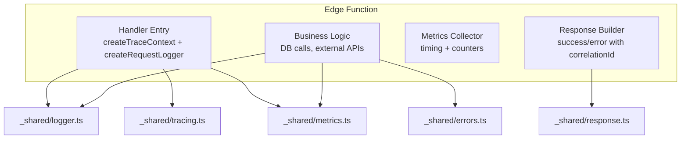
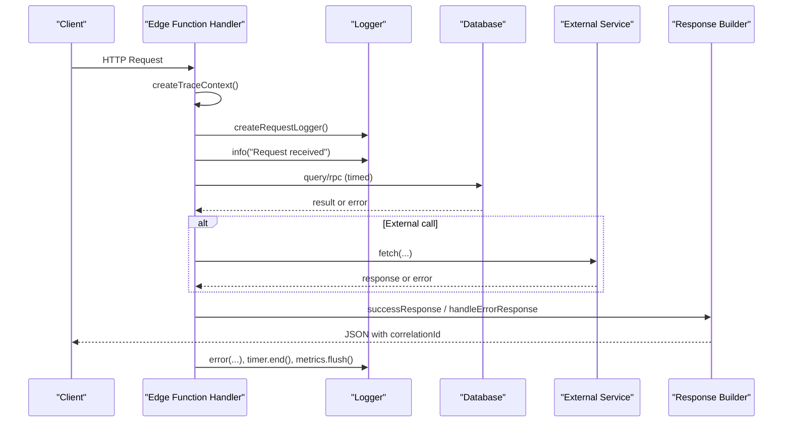
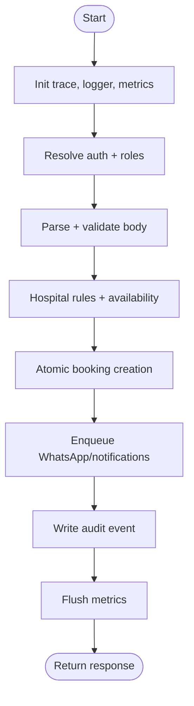
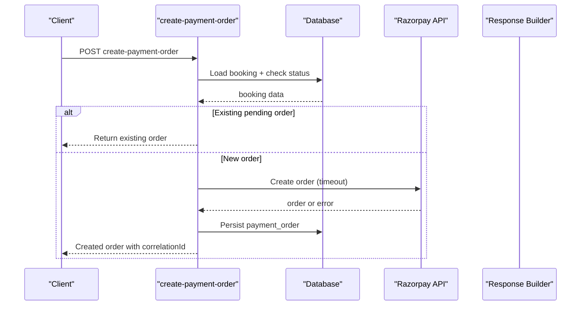
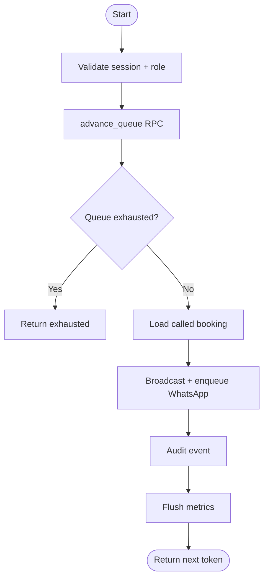
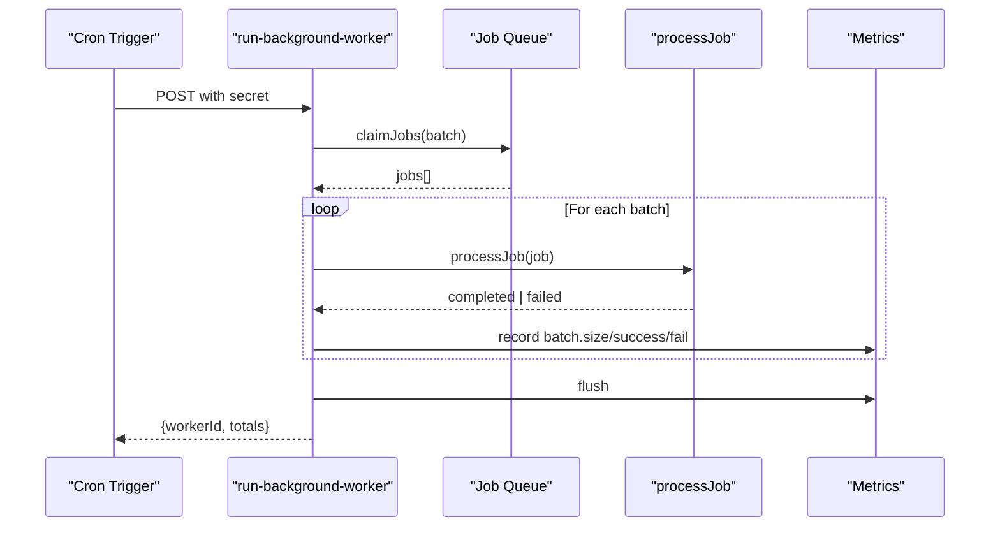
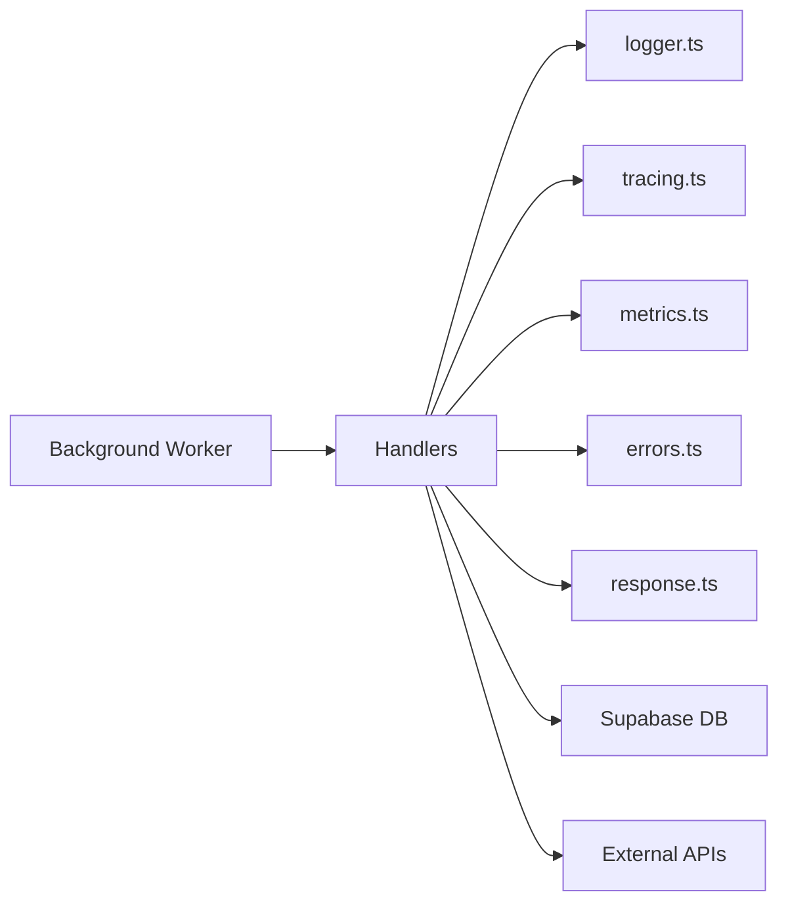

# Log Analysis & Debugging

<cite>
**Referenced Files in This Document**
- [logger.ts](file://supabase/functions/_shared/logger.ts)
- [tracing.ts](file://supabase/functions/_shared/tracing.ts)
- [errors.ts](file://supabase/functions/_shared/errors.ts)
- [metrics.ts](file://supabase/functions/_shared/metrics.ts)
- [response.ts](file://supabase/functions/_shared/response.ts)
- [env.ts](file://supabase/functions/_shared/env.ts)
- [audit.ts](file://supabase/functions/_shared/audit.ts)
- [create-booking/index.ts](file://supabase/functions/create-booking/index.ts)
- [create-payment-order/index.ts](file://supabase/functions/create-payment-order/index.ts)
- [queue-next-patient/index.ts](file://supabase/functions/queue-next-patient/index.ts)
- [run-background-worker/index.ts](file://supabase/functions/run-background-worker/index.ts)
</cite>

## Table of Contents

1. [Introduction](#introduction)
2. [Project Structure](#project-structure)
3. [Core Components](#core-components)
4. [Architecture Overview](#architecture-overview)
5. [Detailed Component Analysis](#detailed-component-analysis)
6. [Dependency Analysis](#dependency-analysis)
7. [Performance Considerations](#performance-considerations)
8. [Troubleshooting Guide](#troubleshooting-guide)
9. [Conclusion](#conclusion)
10. [Appendices](#appendices)

## Introduction

This document explains how to analyze logs and debug issues in Setura Hospital
OS using the built-in structured logging, distributed tracing, metrics, and
error handling. It focuses on:

- Using correlation IDs to trace requests across functions and services
- Identifying bottlenecks via timing and metrics
- Querying and filtering logs for efficient troubleshooting
- Debugging common issues: database connectivity, queue processing, payment
  gateway errors, and authentication problems
- Integrating with log analysis tools (ELK Stack, Splunk, cloud-native logging)
- Creating diagnostic queries, generating debug reports, and implementing
  automated alerts
- Sampling strategies for high-volume environments and privacy considerations

## Project Structure

Setura’s Edge Functions follow a consistent pattern:

- Each function initializes tracing context, request-scoped logger, and metrics
  collector at entry
- Business logic is wrapped with idempotency guards where applicable
- Errors are typed and converted into standardized responses
- Metrics are flushed as structured log lines for external collectors
- Audit events are written asynchronously for compliance and forensics

**Diagram sources**

- [create-booking/index.ts:67-85](file://supabase/functions/create-booking/index.ts#L67-L85)
- [create-payment-order/index.ts:104-116](file://supabase/functions/create-payment-order/index.ts#L104-L116)
- [queue-next-patient/index.ts:46-68](file://supabase/functions/queue-next-patient/index.ts#L46-L68)
- [run-background-worker/index.ts:247-302](file://supabase/functions/run-background-worker/index.ts#L247-L302)
- [logger.ts:122-189](file://supabase/functions/_shared/logger.ts#L122-L189)
- [tracing.ts:17-49](file://supabase/functions/_shared/tracing.ts#L17-L49)
- [metrics.ts:24-119](file://supabase/functions/_shared/metrics.ts#L24-L119)
- [errors.ts:70-104](file://supabase/functions/_shared/errors.ts#L70-L104)
- [response.ts:44-206](file://supabase/functions/_shared/response.ts#L44-L206)

**Section sources**

- [create-booking/index.ts:67-85](file://supabase/functions/create-booking/index.ts#L67-L85)
- [create-payment-order/index.ts:104-116](file://supabase/functions/create-payment-order/index.ts#L104-L116)
- [queue-next-patient/index.ts:46-68](file://supabase/functions/queue-next-patient/index.ts#L46-L68)
- [run-background-worker/index.ts:247-302](file://supabase/functions/run-background-worker/index.ts#L247-L302)

## Core Components

- Structured Logger: Emits JSON log lines with level hierarchy, correlation ID,
  service metadata, and optional error serialization. Supports child loggers per
  request and timers for durations.
- Tracing: Creates correlationId, requestId, spanId, and helper methods to
  propagate headers downstream and compute elapsed time.
- Error Handling: Centralized typed error hierarchy with codes, status codes,
  retry flags, and context; safe conversion to API responses.
- Metrics: Collects timings, counters, and gauges per request; flushes as
  structured log lines for ingestion by observability backends.
- Response Builders: Standardize success/error payloads including correlationId
  and timestamps.
- Environment: Validates and exposes configuration such as LOG_LEVEL, feature
  flags, and integrations.

Key behaviors:

- Correlation ID flows from request headers or is generated if missing
- Errors are serialized safely; stack traces included only when not in
  production
- Metrics are emitted even on error paths to preserve observability
- Audit events are fire-and-forget to avoid impacting user-facing latency

**Section sources**

- [logger.ts:15-189](file://supabase/functions/_shared/logger.ts#L15-L189)
- [tracing.ts:9-49](file://supabase/functions/_shared/tracing.ts#L9-L49)
- [errors.ts:13-104](file://supabase/functions/_shared/errors.ts#L13-L104)
- [metrics.ts:16-119](file://supabase/functions/_shared/metrics.ts#L16-L119)
- [response.ts:14-206](file://supabase/functions/_shared/response.ts#L14-L206)
- [env.ts:155-205](file://supabase/functions/_shared/env.ts#L155-L205)

## Architecture Overview

The system uses a request-scoped context that carries correlationId across all
components. Each handler creates a trace context, a logger, and a metrics
collector. Database and external API calls are timed and instrumented. Errors
are caught and transformed into standardized responses while preserving
correlationId.

**Diagram sources**

- [create-booking/index.ts:67-85](file://supabase/functions/create-booking/index.ts#L67-L85)
- [create-payment-order/index.ts:104-116](file://supabase/functions/create-payment-order/index.ts#L104-L116)
- [queue-next-patient/index.ts:46-68](file://supabase/functions/queue-next-patient/index.ts#L46-L68)
- [logger.ts:122-189](file://supabase/functions/_shared/logger.ts#L122-L189)
- [metrics.ts:76-119](file://supabase/functions/_shared/metrics.ts#L76-L119)
- [response.ts:44-206](file://supabase/functions/_shared/response.ts#L44-L206)

## Detailed Component Analysis

### Correlation ID and Distributed Tracing

- Correlation ID source: X-Correlation-ID or X-Request-ID header; falls back to
  random UUID
- Propagation: traceHeaders can be used when calling downstream services
- Timing: elapsedMs computes duration from creation point
- Usage: Every handler sets correlationId in logger context and includes it in
  responses

Practical tips:

- Always include X-Correlation-ID in client requests for cross-service tracing
- Use child loggers to add request-specific fields without mutating global state
- For downstream calls, attach trace headers to correlate logs across boundaries

**Section sources**

- [tracing.ts:17-49](file://supabase/functions/_shared/tracing.ts#L17-L49)
- [logger.ts:178-189](file://supabase/functions/_shared/logger.ts#L178-L189)
- [create-booking/index.ts:77-85](file://supabase/functions/create-booking/index.ts#L77-L85)
- [create-payment-order/index.ts:111-116](file://supabase/functions/create-payment-order/index.ts#L111-L116)

### Structured Logging Patterns

- Log levels: debug < info < warn < error; controlled by LOG_LEVEL environment
  variable
- Context: correlationId, endpoint, method, url, userId, hospitalId, durationMs
- Error serialization: preserves name, message, code, statusCode, retryable,
  context; stacks omitted in production
- Timers: use logger.timer(label) to measure and log durations

Querying guidance:

- Filter by level: level="error" or level="warn"
- Filter by correlationId to trace a single request
- Filter by endpoint or hospitalId to isolate scope
- Use durationMs to find slow operations

**Section sources**

- [logger.ts:15-99](file://supabase/functions/_shared/logger.ts#L15-L99)
- [logger.ts:122-189](file://supabase/functions/_shared/logger.ts#L122-L189)
- [env.ts:155-158](file://supabase/functions/_shared/env.ts#L155-L158)

### Metrics and Performance Instrumentation

- MetricsCollector records timings, increments counters, and supports tags like
  endpoint and correlationId
- Flush emits structured metric log lines with msg="metric" for ingestion by log
  analytics platforms
- Common timings: request.total, auth.resolve, db.* operations, external API
  calls
- Counters: booking.created, booking.duplicate, payment.order.created,
  queue.advanced, worker.batch.success/failure

Bottleneck identification:

- Look for high request.total values correlated with specific endpoints
- Compare db.* timings to detect slow queries or RPCs
- Monitor external API timings to identify third-party slowness

**Section sources**

- [metrics.ts:24-119](file://supabase/functions/_shared/metrics.ts#L24-L119)
- [create-booking/index.ts:97-124](file://supabase/functions/create-booking/index.ts#L97-L124)
- [create-payment-order/index.ts:301-324](file://supabase/functions/create-payment-order/index.ts#L301-L324)
- [queue-next-patient/index.ts:357-374](file://supabase/functions/queue-next-patient/index.ts#L357-L374)
- [run-background-worker/index.ts:398-447](file://supabase/functions/run-background-worker/index.ts#L398-L447)

### Error Handling and Diagnostics

- Centralized error types with machine-readable codes and status codes
- Retryable flag indicates whether clients should retry
- handleErrorResponse converts errors to standardized JSON with correlationId
- Audit events capture important actions for forensic analysis

Debugging workflow:

- Inspect error.code and error.message for root cause
- Check context fields for additional details (e.g., bookingId, hospitalId)
- Use correlationId to pull full request trace from logs
- Validate retryable flag to decide client-side retry strategy

**Section sources**

- [errors.ts:13-104](file://supabase/functions/_shared/errors.ts#L13-L104)
- [response.ts:94-206](file://supabase/functions/_shared/response.ts#L94-L206)
- [audit.ts:51-75](file://supabase/functions/_shared/audit.ts#L51-L75)

### End-to-End Flow Examples

#### Create Booking Flow

- Initializes tracing, logging, metrics
- Validates auth, body, rate limits, hospital rules
- Performs atomic booking creation and enqueues notifications
- Emits metrics and audit events; returns success or error with correlationId

**Diagram sources**

- [create-booking/index.ts:67-666](file://supabase/functions/create-booking/index.ts#L67-L666)

**Section sources**

- [create-booking/index.ts:67-666](file://supabase/functions/create-booking/index.ts#L67-L666)

#### Payment Order Creation Flow

- Validates auth and booking eligibility
- Checks existing pending orders for idempotency
- Calls Razorpay order API with timeout and error handling
- Persists payment_order row and emits audit event

**Diagram sources**

- [create-payment-order/index.ts:104-407](file://supabase/functions/create-payment-order/index.ts#L104-L407)

**Section sources**

- [create-payment-order/index.ts:104-407](file://supabase/functions/create-payment-order/index.ts#L104-L407)

#### Queue Advance Flow

- Validates session and permissions
- Advances queue atomically
- Broadcasts realtime updates and enqueues WhatsApp notification
- Emits metrics and audit events

**Diagram sources**

- [queue-next-patient/index.ts:46-409](file://supabase/functions/queue-next-patient/index.ts#L46-L409)

**Section sources**

- [queue-next-patient/index.ts:46-409](file://supabase/functions/queue-next-patient/index.ts#L46-L409)

#### Background Worker Flow

- Registers worker, starts heartbeat loop
- Claims jobs in batches, processes multiple job types
- Tracks success/failure metrics and runtime
- Stops worker cleanly and flushes metrics

**Diagram sources**

- [run-background-worker/index.ts:247-454](file://supabase/functions/run-background-worker/index.ts#L247-L454)

**Section sources**

- [run-background-worker/index.ts:247-454](file://supabase/functions/run-background-worker/index.ts#L247-L454)

## Dependency Analysis

- Handlers depend on _shared modules for logging, tracing, metrics, errors, and
  responses
- External dependencies: Supabase DB, Razorpay API, WhatsApp messaging
- Internal dependencies: background worker invokes other functions via internal
  URLs
- Coupling: High cohesion within _shared; handlers remain focused on business
  flow

**Diagram sources**

- [create-booking/index.ts:34-58](file://supabase/functions/create-booking/index.ts#L34-L58)
- [create-payment-order/index.ts:25-45](file://supabase/functions/create-payment-order/index.ts#L25-L45)
- [queue-next-patient/index.ts:7-22](file://supabase/functions/queue-next-patient/index.ts#L7-L22)
- [run-background-worker/index.ts:6-21](file://supabase/functions/run-background-worker/index.ts#L6-L21)

**Section sources**

- [create-booking/index.ts:34-58](file://supabase/functions/create-booking/index.ts#L34-L58)
- [create-payment-order/index.ts:25-45](file://supabase/functions/create-payment-order/index.ts#L25-L45)
- [queue-next-patient/index.ts:7-22](file://supabase/functions/queue-next-patient/index.ts#L7-L22)
- [run-background-worker/index.ts:6-21](file://supabase/functions/run-background-worker/index.ts#L6-L21)

## Performance Considerations

- Use timers around expensive operations (auth, DB calls, external APIs) to
  identify hotspots
- Prefer server-side validation and minimal payload sizes to reduce parsing
  overhead
- Batch job processing in workers to improve throughput
- Ensure metrics are flushed on both success and error paths to maintain
  visibility
- Avoid synchronous blocking operations in request handlers; offload to
  background workers where possible

[No sources needed since this section provides general guidance]

## Troubleshooting Guide

### Database Connection Problems

Symptoms:

- Elevated DB_ERROR counts, timeouts, or concurrency errors
- Slow db.* timings in metrics

Diagnostic steps:

- Filter logs by level="error" and correlationId to isolate failing requests
- Check db.* timing metrics for spikes
- Inspect error.context for detailed messages
- Verify environment variables for database access

Queries:

- Find recent DB errors: level="error" AND msg contains "DB_ERROR"
- Identify slow DB calls: metricName contains "db." AND metricUnit="ms" AND
  metricValue > threshold

Remediation:

- Review connection pooling and query plans
- Check for lock contention or long-running transactions
- Adjust timeouts and retry policies based on retryable flag

**Section sources**

- [errors.ts:293-300](file://supabase/functions/_shared/errors.ts#L293-L300)
- [metrics.ts:47-74](file://supabase/functions/_shared/metrics.ts#L47-L74)

### Queue Processing Failures

Symptoms:

- queue.exhausted or queue.advance.error counters increasing
- Failed advance_queue RPC logs

Diagnostic steps:

- Filter by correlationId to trace queue advances
- Inspect queue session state and active flags
- Check realtime broadcast and WhatsApp enqueue failures

Queries:

- Queue errors: level="error" AND msg contains "queue"
- Exhaustion: metricName="queue.exhausted"

Remediation:

- Ensure sessions are active and not ended prematurely
- Investigate race conditions in token advancement
- Validate downstream notification enqueues

**Section sources**

- [queue-next-patient/index.ts:159-184](file://supabase/functions/queue-next-patient/index.ts#L159-L184)
- [queue-next-patient/index.ts:189-213](file://supabase/functions/queue-next-patient/index.ts#L189-L213)
- [queue-next-patient/index.ts:357-374](file://supabase/functions/queue-next-patient/index.ts#L357-L374)

### Payment Gateway Errors

Symptoms:

- InternalError wrapping Razorpay failures
- Invalid order responses or amount mismatches

Diagnostic steps:

- Filter logs by correlationId and inspect error.context for gateway errors
- Check timing metrics for razorpay.create_order
- Validate amounts and currency settings

Queries:

- Payment errors: level="error" AND msg contains "payment" OR "Razorpay"
- Amount mismatches: metricName="razorpay.create_order" AND metricValue
  anomalies

Remediation:

- Implement retries for transient gateway errors (retryable=true)
- Add robust error parsing for gateway responses
- Ensure server-side amount verification against DB snapshots

**Section sources**

- [create-payment-order/index.ts:64-102](file://supabase/functions/create-payment-order/index.ts#L64-L102)
- [create-payment-order/index.ts:299-324](file://supabase/functions/create-payment-order/index.ts#L299-L324)
- [create-payment-order/index.ts:386-404](file://supabase/functions/create-payment-order/index.ts#L386-L404)

### Authentication Issues

Symptoms:

- UNAUTHORIZED or FORBIDDEN responses
- Missing required headers (X-Hospital-ID)

Diagnostic steps:

- Filter logs by correlationId and inspect auth resolution steps
- Validate JWT and role checks
- Ensure correct headers are sent by clients

Queries:

- Auth errors: level="error" AND msg contains "auth" OR "UNAUTHORIZED"
- Validation errors: level="error" AND msg contains "Missing X-Hospital-ID"

Remediation:

- Enforce required headers in client SDKs
- Improve error messages with actionable guidance
- Audit role assignments and hospital access

**Section sources**

- [create-booking/index.ts:97-119](file://supabase/functions/create-booking/index.ts#L97-L119)
- [create-payment-order/index.ts:118-127](file://supabase/functions/create-payment-order/index.ts#L118-L127)
- [errors.ts:108-150](file://supabase/functions/_shared/errors.ts#L108-L150)

### Analyzing Error Patterns and Security Incidents

- Aggregate error.codes over time to detect regressions or spikes
- Use correlationId to reconstruct full request flows for incident investigation
- Audit events provide immutable records of critical actions (bookings,
  payments, role changes)
- Filter by severity and actionType to focus on security-relevant events

Queries:

- Error patterns: group by error.code over time windows
- Security incidents: actionType in ["login", "role_assign",
  "hospital_setting_update"]

**Section sources**

- [audit.ts:15-33](file://supabase/functions/_shared/audit.ts#L15-L33)
- [audit.ts:51-75](file://supabase/functions/_shared/audit.ts#L51-L75)

### Integration with Log Analysis Tools

- ELK Stack: Ingest structured JSON logs; index fields like level,
  correlationId, endpoint, metricName
- Splunk: Parse JSON logs; build dashboards for error rates, latency
  percentiles, and queue health
- Cloud-native logging: Use log-based metrics and alerts on key counters
  (booking.error, payment.order.error, worker.run.error)

Best practices:

- Normalize field names for consistent querying
- Retain correlationId across services for end-to-end tracing
- Create alerts on thresholds (e.g., error rate > 1%, p95 latency > 500ms)

[No sources needed since this section provides general guidance]

### Diagnostic Queries and Debug Reports

Examples:

- Recent errors with correlationId: level="error" AND ts > now()-1h
- Slow requests: metricName="request.total" AND metricUnit="ms" AND metricValue
  > 1000
- Queue exhaustion trends: metricName="queue.exhausted" grouped by hour
- Payment failures: level="error" AND msg contains "Razorpay"

Report generation:

- Export filtered logs for a given correlationId range
- Summarize metrics by endpoint and time window
- Include top error codes and their contexts

[No sources needed since this section provides general guidance]

### Automated Alerts

- Alert on error rate spikes: sum(rate(level="error"[5m])) > threshold
- Alert on latency regressions: histogram_quantile(0.95,
  rate(metricName="request.total"[5m])) > threshold
- Alert on queue exhaustion: increase(queue.exhausted[5m]) > threshold
- Alert on worker failures: increase(worker.run.error[5m]) > threshold

[No sources needed since this section provides general guidance]

### Log Sampling Strategies and Privacy

Sampling:

- Reduce debug-level logs in production; keep info/warn/error
- Sample high-frequency metrics or logs during peak traffic
- Use feature flags to enable verbose logging temporarily

Privacy:

- Avoid logging sensitive data (PII, secrets, tokens)
- Mask phone numbers and identifiers in logs (e.g., last 4 digits)
- Ensure audit events do not include unnecessary sensitive fields

**Section sources**

- [env.ts:155-158](file://supabase/functions/_shared/env.ts#L155-L158)
- [logger.ts:52-73](file://supabase/functions/_shared/logger.ts#L52-L73)
- [create-booking/index.ts:136-140](file://supabase/functions/create-booking/index.ts#L136-L140)

## Conclusion

Setura Hospital OS provides a robust foundation for log analysis and debugging
through structured logging, distributed tracing, metrics, and centralized error
handling. By leveraging correlation IDs, timing instrumentation, and
standardized responses, teams can efficiently trace requests, identify
bottlenecks, and resolve issues across distributed components. Integrating with
log analysis tools and implementing automated alerts further enhances
operational visibility and reliability. Adhering to sampling strategies and
privacy best practices ensures scalable and secure observability.

[No sources needed since this section summarizes without analyzing specific
files]

## Appendices

### Quick Reference: Key Fields and Patterns

- correlationId: present in all logs and responses for tracing
- level: debug/info/warn/error for filtering
- metricName: request.total, db.*, razorpay.create_order, queue.exhausted
- error.code: UNAUTHORIZED, VALIDATION_ERROR, DB_ERROR, RATE_LIMIT_EXCEEDED,
  etc.
- retryable: indicates client-side retry policy

[No sources needed since this section provides general guidance]
