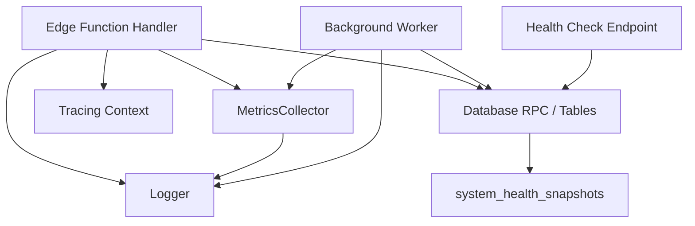
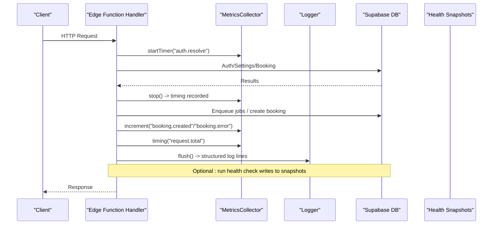
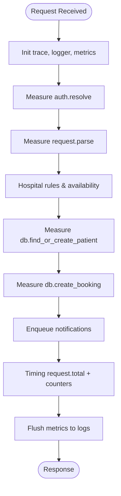
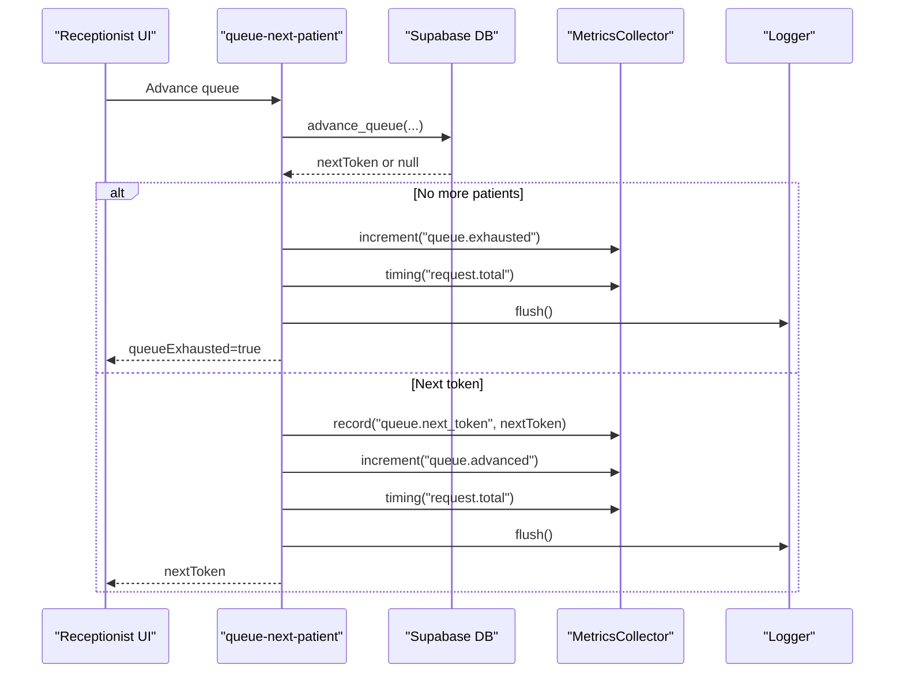
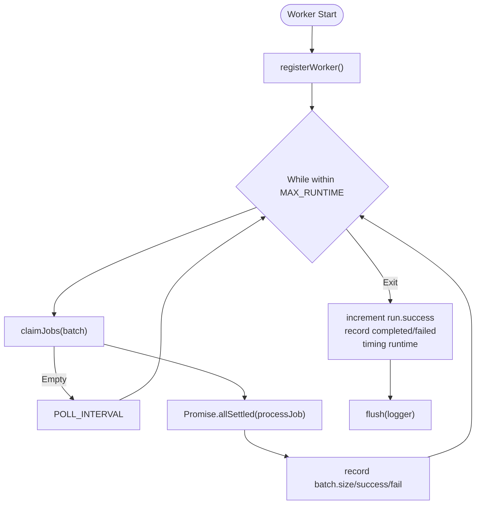
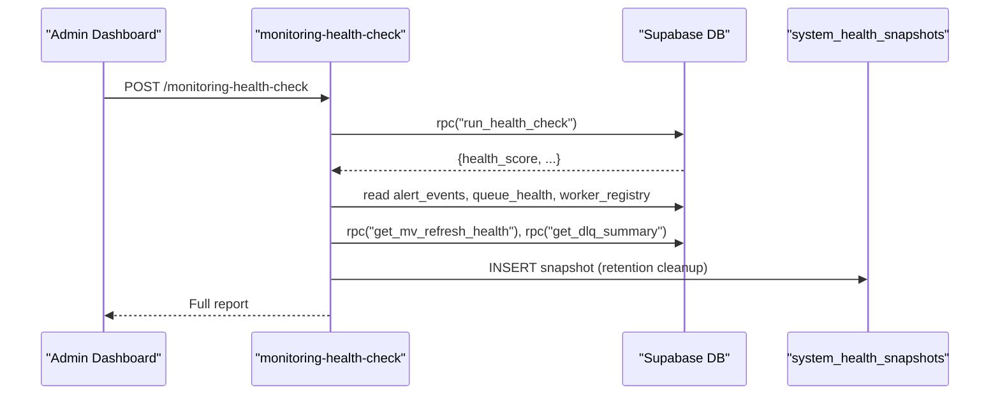
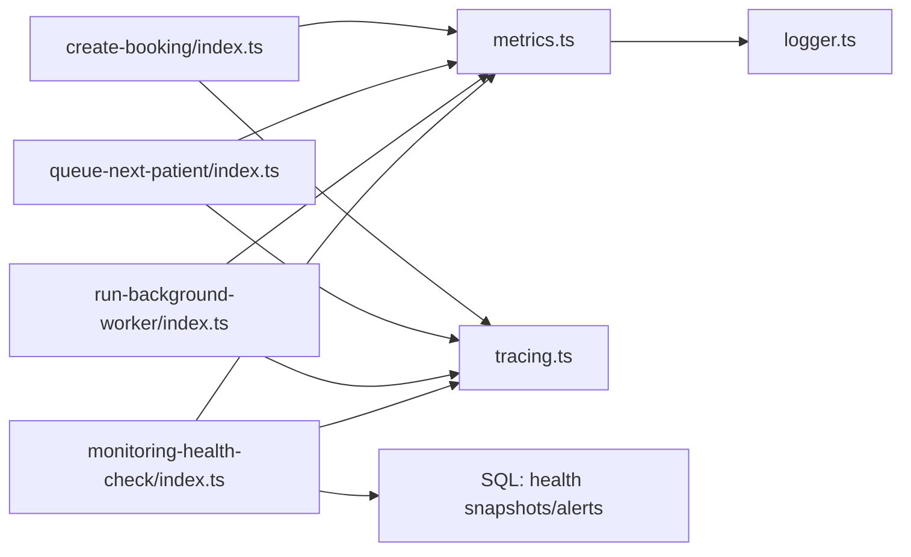

# Metrics Collection & Analytics

<cite>
**Referenced Files in This Document**
- [metrics.ts](file://supabase/functions/_shared/metrics.ts)
- [logger.ts](file://supabase/functions/_shared/logger.ts)
- [tracing.ts](file://supabase/functions/_shared/tracing.ts)
- [env.ts](file://supabase/functions/_shared/env.ts)
- [create-booking/index.ts](file://supabase/functions/create-booking/index.ts)
- [queue-next-patient/index.ts](file://supabase/functions/queue-next-patient/index.ts)
- [run-background-worker/index.ts](file://supabase/functions/run-background-worker/index.ts)
- [monitoring-health-check/index.ts](file://supabase/functions/monitoring-health-check/index.ts)
- [24_operational-monitoring_engine.sql](file://supabase/migrations/24_operational-monitoring_engine.sql)
- [19_background_worker_engine.sql](file://supabase/migrations/19_background_worker_engine.sql)
</cite>

## Table of Contents

1. Introduction
2. Project Structure
3. Core Components
4. Architecture Overview
5. Detailed Component Analysis
6. Dependency Analysis
7. Performance Considerations
8. Troubleshooting Guide
9. Conclusion

## Introduction

This document explains the metrics collection system used by Setura Hospital OS
to monitor runtime performance, operational health, and business KPIs across
Edge Functions and background workers. It covers timing measurements, counters,
gauges, metric export via structured logs, integration with log-based
observability platforms, and database-backed health snapshots for dashboards and
alerts.

## Project Structure

The metrics system is implemented as a small shared library used consistently
across request handlers and background workers:

- Shared metrics collector emits per-request metrics as structured logs
- Tracing utilities propagate correlation IDs across services
- Logger centralizes structured JSON logging and timers
- Environment flags enable/disable features like tracing and metrics
- Handlers instrument key operations (auth, DB calls, queue operations, external
  calls)
- Background worker records batch processing metrics and runtime duration
- Database migration provides health snapshots and alerting tables for
  dashboards

**Diagram sources**

- [create-booking/index.ts:76-83](file://supabase/functions/create-booking/index.ts#L76-L83)
- [run-background-worker/index.ts:297-301](file://supabase/functions/run-background-worker/index.ts#L297-L301)
- [monitoring-health-check/index.ts:26-31](file://supabase/functions/monitoring-health-check/index.ts#L26-L31)
- [24_operational-monitoring_engine.sql:157-188](file://supabase/migrations/24_operational-monitoring_engine.sql#L157-L188)

**Section sources**

- [metrics.ts:1-119](file://supabase/functions/_shared/metrics.ts#L1-L119)
- [logger.ts:1-190](file://supabase/functions/_shared/logger.ts#L1-L190)
- [tracing.ts:1-50](file://supabase/functions/_shared/tracing.ts#L1-L50)
- [env.ts:155-205](file://supabase/functions/_shared/env.ts#L155-L205)

## Core Components

- MetricsCollector: In-memory per-request collector that supports timing,
  increments, and arbitrary gauge-like records; flushes as structured log lines
  tagged with endpoint, correlationId, and optional hospitalId.
- Logger: Structured JSON logger with child contexts, error serialization, and a
  timer helper; used to emit metrics and operational logs.
- Tracing: Lightweight distributed tracing context with correlation/request/span
  IDs and elapsed time helpers; headers propagated to downstream calls.
- Environment: Feature flags and configuration including LOG_LEVEL,
  ENABLE_METRICS, and deployment metadata.

Key capabilities:

- Timing measurements: measure durations for auth, parsing, DB queries, external
  calls, and total request time
- Counters: increment events such as booking created/duplicate, errors, queue
  advanced/exhausted, health checks
- Gauges: record values like next token, batch sizes, completed/failed counts,
  runtime duration

Export format:

- Each metric is emitted as a separate structured log line with fields for name,
  value, unit, tags, and timestamp
- Log-based collectors (Datadog, Grafana Loki, CloudWatch Logs Insights) can
  parse these entries

**Section sources**

- [metrics.ts:16-119](file://supabase/functions/_shared/metrics.ts#L16-L119)
- [logger.ts:75-168](file://supabase/functions/_shared/logger.ts#L75-L168)
- [tracing.ts:9-50](file://supabase/functions/_shared/tracing.ts#L9-L50)
- [env.ts:155-205](file://supabase/functions/_shared/env.ts#L155-L205)

## Architecture Overview

The runtime architecture instruments each request or job with a MetricsCollector
and Logger, using Tracing to correlate logs and metrics across services. At the
end of execution, metrics are flushed to structured logs. Operational health
data is also persisted into the database for dashboards and alerting.

**Diagram sources**

- [create-booking/index.ts:97-124](file://supabase/functions/create-booking/index.ts#L97-L124)
- [create-booking/index.ts:422-498](file://supabase/functions/create-booking/index.ts#L422-L498)
- [create-booking/index.ts:638-663](file://supabase/functions/create-booking/index.ts#L638-L663)
- [24_operational-monitoring_engine.sql:283-397](file://supabase/migrations/24_operational-monitoring_engine.sql#L283-L397)

## Detailed Component Analysis

### Metrics Collector API and Usage

- Create a collector per request/job with base tags (endpoint, correlationId,
  hospitalId)
- Record timings with startTimer().stop() around critical sections
- Increment counters for events (success/failure)
- Record gauges for stateful values (e.g., next token, batch size)
- Flush at the end of handler to emit structured logs

Examples in codebase:

- Request-level timings: auth resolution, body parsing, DB operations, total
  request duration
- Counters: booking created/duplicate, queue advanced/exhausted, health check
  success/error
- Gauges: next token number, worker batch size, completed/failed counts, runtime

**Section sources**

- [metrics.ts:24-119](file://supabase/functions/_shared/metrics.ts#L24-L119)
- [create-booking/index.ts:97-124](file://supabase/functions/create-booking/index.ts#L97-L124)
- [create-booking/index.ts:638-663](file://supabase/functions/create-booking/index.ts#L638-L663)
- [queue-next-patient/index.ts:193-203](file://supabase/functions/queue-next-patient/index.ts#L193-L203)
- [queue-next-patient/index.ts:360-374](file://supabase/functions/queue-next-patient/index.ts#L360-L374)
- [run-background-worker/index.ts:398-447](file://supabase/functions/run-background-worker/index.ts#L398-L447)

### Request Lifecycle Instrumentation (Create Booking)

- Initializes tracing, logger, and metrics
- Measures auth, parsing, rate limiting, settings fetch, patient lookup, booking
  creation
- Emits counters for duplicates vs new bookings and total request time
- On error, increments error counter and flushes metrics before returning

**Diagram sources**

- [create-booking/index.ts:76-83](file://supabase/functions/create-booking/index.ts#L76-L83)
- [create-booking/index.ts:97-124](file://supabase/functions/create-booking/index.ts#L97-L124)
- [create-booking/index.ts:322-397](file://supabase/functions/create-booking/index.ts#L322-L397)
- [create-booking/index.ts:422-498](file://supabase/functions/create-booking/index.ts#L422-L498)
- [create-booking/index.ts:638-663](file://supabase/functions/create-booking/index.ts#L638-L663)

**Section sources**

- [create-booking/index.ts:67-665](file://supabase/functions/create-booking/index.ts#L67-L665)

### Queue Operations Instrumentation (Next Patient)

- Measures total request time
- Increments queue.exhausted when no more patients
- Records gauge queue.next_token when advancing
- Emits queue.advanced on success

**Diagram sources**

- [queue-next-patient/index.ts:159-213](file://supabase/functions/queue-next-patient/index.ts#L159-L213)
- [queue-next-patient/index.ts:360-374](file://supabase/functions/queue-next-patient/index.ts#L360-L374)

**Section sources**

- [queue-next-patient/index.ts:46-408](file://supabase/functions/queue-next-patient/index.ts#L46-L408)

### Background Worker Metrics

- Registers worker and starts heartbeat loop
- Claims batches of jobs and processes them concurrently
- Records batch size, successes, failures, total completed/failed, and runtime
- On crash, increments worker.run.error

**Diagram sources**

- [run-background-worker/index.ts:309-326](file://supabase/functions/run-background-worker/index.ts#L309-L326)
- [run-background-worker/index.ts:333-421](file://supabase/functions/run-background-worker/index.ts#L333-L421)
- [run-background-worker/index.ts:422-447](file://supabase/functions/run-background-worker/index.ts#L422-L447)

**Section sources**

- [run-background-worker/index.ts:247-453](file://supabase/functions/run-background-worker/index.ts#L247-L453)

### Health Check and System Snapshots

- GET returns lightweight status from system_health_snapshots
- POST runs full health check via SQL function, aggregates open alerts, queue
  health, worker status, MV freshness, DLQ summary, partitions, and revenue
  backlog
- Writes snapshots and computes health score; enforces retention cleanup

**Diagram sources**

- [monitoring-health-check/index.ts:103-210](file://supabase/functions/monitoring-health-check/index.ts#L103-L210)
- [24_operational-monitoring_engine.sql:283-397](file://supabase/migrations/24_operational-monitoring_engine.sql#L283-L397)

**Section sources**

- [monitoring-health-check/index.ts:22-230](file://supabase/functions/monitoring-health-check/index.ts#L22-L230)
- [24_operational-monitoring_engine.sql:157-188](file://supabase/migrations/24_operational-monitoring_engine.sql#L157-L188)

## Dependency Analysis

- MetricsCollector depends on Logger to emit structured logs
- Handlers depend on Tracing for correlation IDs and elapsedMs
- Background worker depends on worker registry and job queue functions
- Health check depends on SQL functions and tables for snapshots and alerts

**Diagram sources**

- [metrics.ts:14-119](file://supabase/functions/_shared/metrics.ts#L14-L119)
- [logger.ts:12-168](file://supabase/functions/_shared/logger.ts#L12-L168)
- [tracing.ts:17-50](file://supabase/functions/_shared/tracing.ts#L17-L50)
- [create-booking/index.ts:76-83](file://supabase/functions/create-booking/index.ts#L76-L83)
- [queue-next-patient/index.ts:56-68](file://supabase/functions/queue-next-patient/index.ts#L56-L68)
- [run-background-worker/index.ts:297-301](file://supabase/functions/run-background-worker/index.ts#L297-L301)
- [monitoring-health-check/index.ts:26-31](file://supabase/functions/monitoring-health-check/index.ts#L26-L31)

**Section sources**

- [metrics.ts:14-119](file://supabase/functions/_shared/metrics.ts#L14-L119)
- [logger.ts:12-168](file://supabase/functions/_shared/logger.ts#L12-L168)
- [tracing.ts:17-50](file://supabase/functions/_shared/tracing.ts#L17-L50)

## Performance Considerations

- Keep tag cardinality low: use fixed sets for endpoint, correlationId,
  hospitalId; avoid high-cardinality fields like user IDs or phone numbers in
  metric tags
- Batch emissions: collect per-request and flush once at the end to minimize log
  volume
- Use timers only around hot paths; avoid excessive instrumentation overhead
- Prefer counters for event rates and gauges for current state; avoid recording
  every individual value unless necessary
- For high-frequency metrics, consider aggregating in-process (e.g., sum/count)
  and emitting summaries rather than raw samples
- Ensure LOG_LEVEL is appropriate for environment to control verbosity
- Use feature flag ENABLE_METRICS to disable metrics in constrained environments
  if needed

[No sources needed since this section provides general guidance]

## Troubleshooting Guide

Common issues and where to look:

- Missing or invalid environment variables: env validation fails fast during
  cold start; verify required keys and types
- Metrics not appearing: ensure ENABLE_METRICS is true and LOG_LEVEL allows
  info; confirm flush is called in both success and error paths
- High cardinality causing storage pressure: audit tags and remove
  high-cardinality fields from metric tags
- Worker crashes: check worker.run.error counter and worker_registry status;
  inspect heartbeat logs and job leases
- Health dashboard stale: verify run_health_check runs and snapshots are being
  written; check retention policies

**Section sources**

- [env.ts:18-76](file://supabase/functions/_shared/env.ts#L18-L76)
- [env.ts:155-205](file://supabase/functions/_shared/env.ts#L155-L205)
- [create-booking/index.ts:638-663](file://supabase/functions/create-booking/index.ts#L638-L663)
- [run-background-worker/index.ts:422-447](file://supabase/functions/run-background-worker/index.ts#L422-L447)
- [24_operational-monitoring_engine.sql:385-387](file://supabase/migrations/24_operational-monitoring_engine.sql#L385-L387)

## Conclusion

Setura’s metrics system uses a simple, robust pattern: per-request collectors
that emit structured logs, combined with database-backed health snapshots for
dashboards and alerts. By measuring timing, counting events, and recording
gauges across requests and background jobs, operators gain visibility into
latency, error rates, queue depths, worker performance, and business KPIs.
Following the guidelines above ensures scalable, low-overhead monitoring
suitable for production hospital operations.
