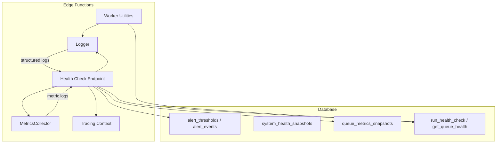
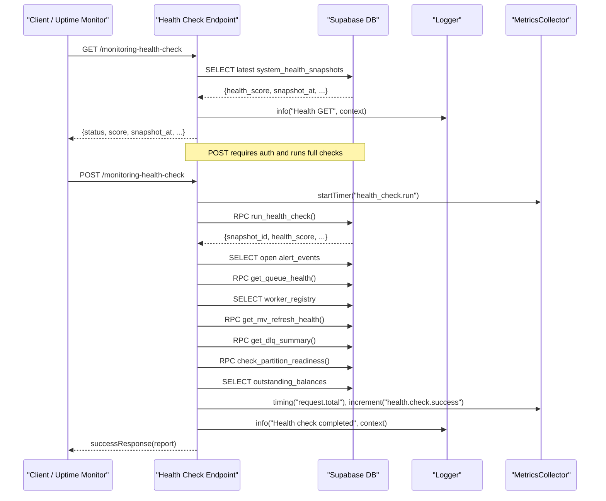
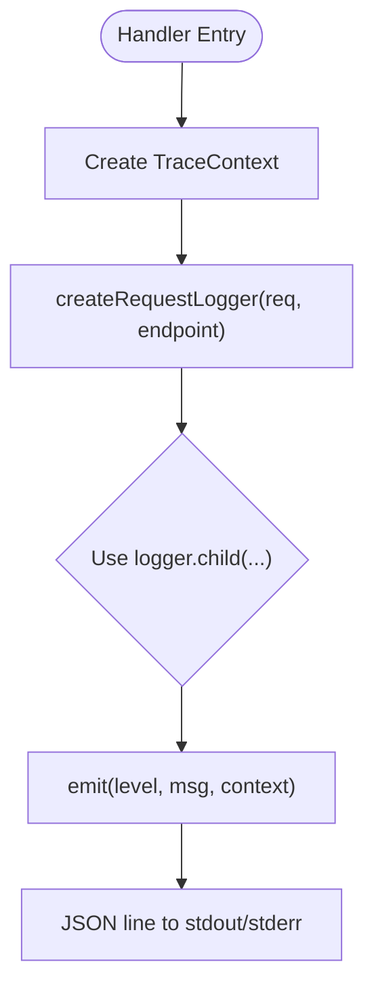
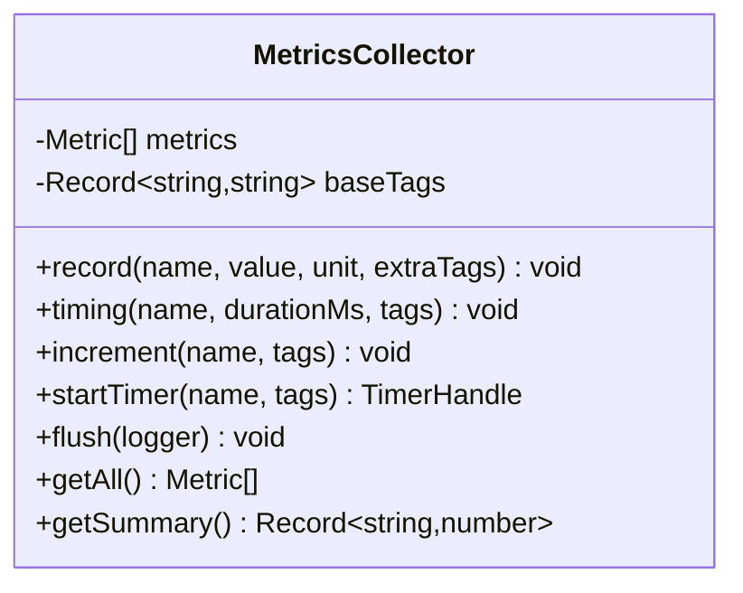
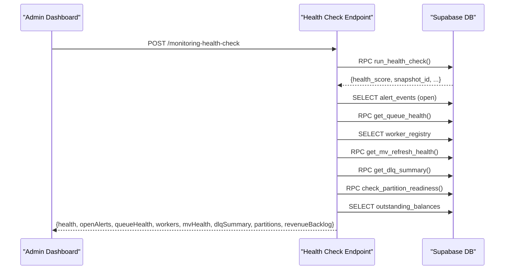
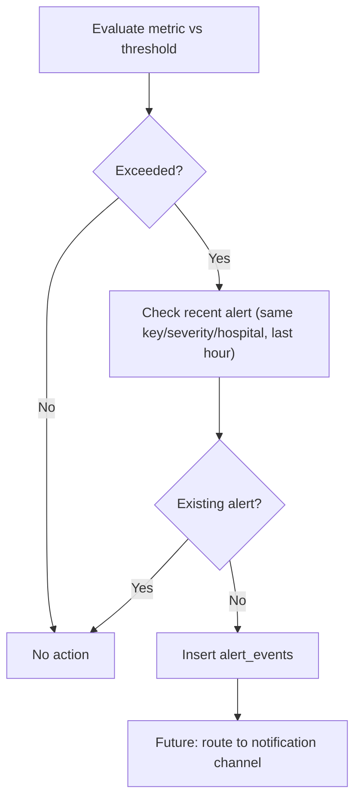
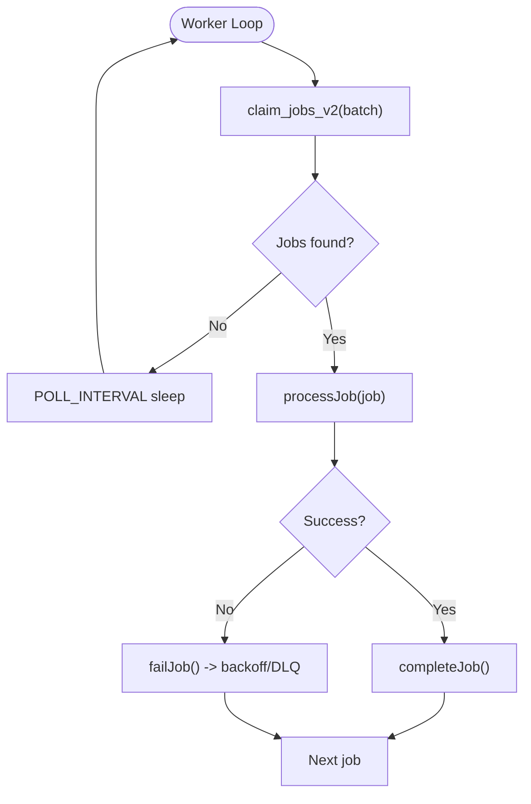
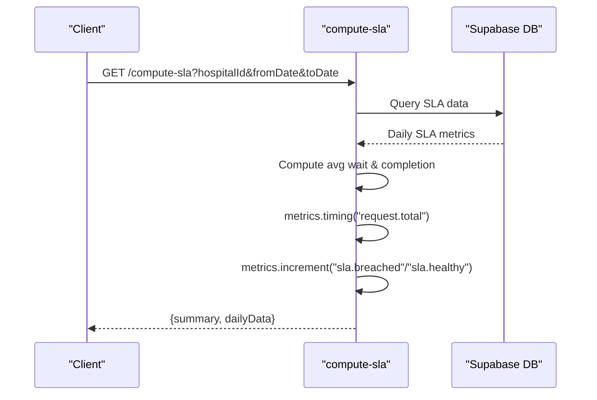
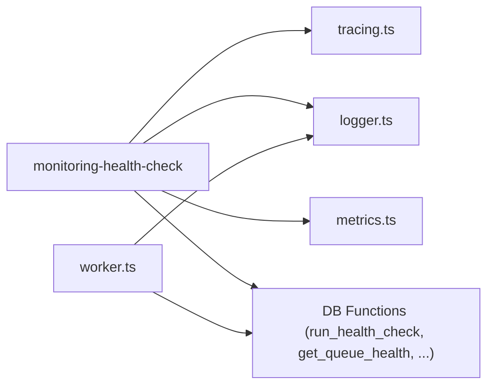

# Monitoring & Observability

<cite>
**Referenced Files in This Document**
- [logger.ts](file://supabase/functions/_shared/logger.ts)
- [metrics.ts](file://supabase/functions/_shared/metrics.ts)
- [tracing.ts](file://supabase/functions/_shared/tracing.ts)
- [env.ts](file://supabase/functions/_shared/env.ts)
- [response.ts](file://supabase/functions/_shared/response.ts)
- [worker.ts](file://supabase/functions/_shared/worker.ts)
- [monitoring-health-check/index.ts](file://supabase/functions/monitoring-health-check/index.ts)
- [24_operational-monitoring_engine.sql](file://supabase/migrations/24_operational-monitoring_engine.sql)
- [17_queue_monitoring_engine.sql](file://supabase/migrations/17_queue_monitoring_engine.sql)
- [compute-sla/index.ts](file://supabase/functions/compute-sla/index.ts)
- [refresh-rollups/index.ts](file://supabase/functions/refresh-rollups/index.ts)
</cite>

## Table of Contents

1. [Introduction](#introduction)
2. [Project Structure](#project-structure)
3. [Core Components](#core-components)
4. [Architecture Overview](#architecture-overview)
5. [Detailed Component Analysis](#detailed-component-analysis)
6. [Dependency Analysis](#dependency-analysis)
7. [Performance Considerations](#performance-considerations)
8. [Troubleshooting Guide](#troubleshooting-guide)
9. [Conclusion](#conclusion)
10. [Appendices](#appendices)

## Introduction

This document explains the monitoring and observability system for Setura
Hospital OS. It covers structured logging with correlation IDs, metrics
collection, health checks, alerting, log analysis techniques, dashboard data
sources, troubleshooting workflows, and guidance for setting up monitoring
infrastructure, configuring alerts, and responding to incidents. It also
includes performance profiling approaches, bottleneck identification, and
capacity planning based on collected metrics.

## Project Structure

The observability stack is implemented across shared utilities and Edge
Functions, backed by database tables and functions that persist operational
state and metrics:

- Structured logging with correlation IDs and timing helpers
- Metrics collectors emitting structured logs for external parsing
- Distributed tracing context propagation via headers
- Health check endpoint aggregating queue depth, worker status, DLQ counts,
  materialized view freshness, and open alerts
- Database-backed alert thresholds, alert events, health snapshots, and queue
  metrics snapshots
- Background workers with heartbeat and job processing telemetry

**Diagram sources**

- [monitoring-health-check/index.ts:22-230](file://supabase/functions/monitoring-health-check/index.ts#L22-L230)
- [logger.ts:122-189](file://supabase/functions/_shared/logger.ts#L122-L189)
- [metrics.ts:24-118](file://supabase/functions/_shared/metrics.ts#L24-L118)
- [tracing.ts:17-49](file://supabase/functions/_shared/tracing.ts#L17-L49)
- [24_operational-monitoring_engine.sql:157-397](file://supabase/migrations/24_operational-monitoring_engine.sql#L157-L397)
- [17_queue_monitoring_engine.sql:124-488](file://supabase/migrations/17_queue_monitoring_engine.sql#L124-L488)

**Section sources**

- [monitoring-health-check/index.ts:22-230](file://supabase/functions/monitoring-health-check/index.ts#L22-L230)
- [logger.ts:122-189](file://supabase/functions/_shared/logger.ts#L122-L189)
- [metrics.ts:24-118](file://supabase/functions/_shared/metrics.ts#L24-L118)
- [tracing.ts:17-49](file://supabase/functions/_shared/tracing.ts#L17-L49)
- [24_operational-monitoring_engine.sql:157-397](file://supabase/migrations/24_operational-monitoring_engine.sql#L157-L397)
- [17_queue_monitoring_engine.sql:124-488](file://supabase/migrations/17_queue_monitoring_engine.sql#L124-L488)

## Core Components

- Structured Logger: Produces JSON log lines with level hierarchy,
  correlation/request context, error serialization, and timers.
- Metrics Collector: Records timings, counters, and gauges per request; flushes
  as structured logs for external collectors.
- Tracing Context: Propagates correlation ID, request ID, span ID, and parent
  span ID across service boundaries via headers.
- Environment Configuration: Centralizes feature flags (logging level, tracing,
  metrics), deployment version, and runtime limits.
- Response Helpers: Standardize success/error responses including correlation ID
  and timestamps.
- Worker Utilities: Provide heartbeat loops, job claiming, completion/failure
  handling, and per-job timing.

Key capabilities:

- Correlation IDs flow through all logs and traces for cross-service request
  tracing.
- Metrics are emitted as structured logs parseable by Datadog/Grafana
  Loki/CloudWatch Logs Insights.
- Health checks aggregate multiple subsystems into a single report and compute a
  health score.

**Section sources**

- [logger.ts:15-189](file://supabase/functions/_shared/logger.ts#L15-L189)
- [metrics.ts:16-118](file://supabase/functions/_shared/metrics.ts#L16-L118)
- [tracing.ts:9-49](file://supabase/functions/_shared/tracing.ts#L9-L49)
- [env.ts:155-205](file://supabase/functions/_shared/env.ts#L155-L205)
- [response.ts:44-205](file://supabase/functions/_shared/response.ts#L44-L205)
- [worker.ts:182-256](file://supabase/functions/_shared/worker.ts#L182-L256)

## Architecture Overview

The health check endpoint orchestrates a comprehensive system health report by
querying database functions and tables, collecting metrics, and returning a
unified response. Background workers continuously emit telemetry and maintain
heartbeats.

**Diagram sources**

- [monitoring-health-check/index.ts:22-230](file://supabase/functions/monitoring-health-check/index.ts#L22-L230)
- [24_operational-monitoring_engine.sql:283-397](file://supabase/migrations/24_operational-monitoring_engine.sql#L283-L397)
- [17_queue_monitoring_engine.sql:124-277](file://supabase/migrations/17_queue_monitoring_engine.sql#L124-L277)

## Detailed Component Analysis

### Structured Logging with Correlation IDs

- Request-scoped logger created at handler entry merges correlation ID from
  headers or generates one.
- Child loggers propagate context across nested calls.
- Error serialization preserves stack traces in non-production and captures
  custom fields.
- Timers measure duration and log them with context.

**Diagram sources**

- [tracing.ts:17-49](file://supabase/functions/_shared/tracing.ts#L17-L49)
- [logger.ts:122-189](file://supabase/functions/_shared/logger.ts#L122-L189)

**Section sources**

- [logger.ts:15-189](file://supabase/functions/_shared/logger.ts#L15-L189)
- [tracing.ts:9-49](file://supabase/functions/_shared/tracing.ts#L9-L49)

### Metrics Collection and Flushing

- MetricsCollector records timings, increments, and gauges with tags (endpoint,
  correlationId, hospitalId).
- At the end of handlers, metrics are flushed as structured log lines with
  metricName, metricValue, metricUnit, metricTags, and timestamp.
- Used across endpoints to capture request durations and business KPIs (e.g.,
  SLA breaches).

**Diagram sources**

- [metrics.ts:24-118](file://supabase/functions/_shared/metrics.ts#L24-L118)

**Section sources**

- [metrics.ts:16-118](file://supabase/functions/_shared/metrics.ts#L16-L118)
- [compute-sla/index.ts:176-180](file://supabase/functions/compute-sla/index.ts#L176-L180)
- [refresh-rollups/index.ts:157-168](file://supabase/functions/refresh-rollups/index.ts#L157-L168)

### Health Check System

- GET returns lightweight uptime status using the latest system_health_snapshots
  and maps health_score to healthy/degraded/unhealthy.
- POST (auth required) runs a full health check via run_health_check, collects
  open alerts, queue health, worker registry, MV refresh health, DLQ summary,
  partition readiness, and revenue backlog.
- Emits metrics and logs for request duration and success/error counts.

**Diagram sources**

- [monitoring-health-check/index.ts:22-230](file://supabase/functions/monitoring-health-check/index.ts#L22-L230)
- [24_operational-monitoring_engine.sql:283-397](file://supabase/migrations/24_operational-monitoring_engine.sql#L283-L397)
- [17_queue_monitoring_engine.sql:124-277](file://supabase/migrations/17_queue_monitoring_engine.sql#L124-L277)

**Section sources**

- [monitoring-health-check/index.ts:22-230](file://supabase/functions/monitoring-health-check/index.ts#L22-L230)
- [24_operational-monitoring_engine.sql:157-397](file://supabase/migrations/24_operational-monitoring_engine.sql#L157-L397)

### Alerting Mechanisms

- Configurable alert thresholds per hospital or globally with severity levels
  and units.
- fire_alert function prevents duplicate alerts within an hour for the same
  key/severity/hospital.
- Default thresholds cover queue backlogs, worker crashes, WhatsApp failures,
  DLQ backlog, and analytics refresh lag.
- Open alerts can be queried and surfaced in health reports.

**Diagram sources**

- [24_operational-monitoring_engine.sql:37-103](file://supabase/migrations/24_operational-monitoring_engine.sql#L37-L103)
- [24_operational-monitoring_engine.sql:216-277](file://supabase/migrations/24_operational-monitoring_engine.sql#L216-L277)

**Section sources**

- [24_operational-monitoring_engine.sql:37-103](file://supabase/migrations/24_operational-monitoring_engine.sql#L37-L103)
- [24_operational-monitoring_engine.sql:216-277](file://supabase/migrations/24_operational-monitoring_engine.sql#L216-L277)

### Queue and Worker Telemetry

- Queue metrics snapshots capture pending, processing, failed, dead counts,
  oldest pending age, throughput, and average retry counts.
- get_queue_health provides live metrics for job queues, WhatsApp messages, and
  notifications.
- Workers emit heartbeat loops and per-job timing; claim_jobs_v2 supports crash
  recovery leases.

**Diagram sources**

- [worker.ts:98-130](file://supabase/functions/_shared/worker.ts#L98-L130)
- [worker.ts:182-256](file://supabase/functions/_shared/worker.ts#L182-L256)
- [17_queue_monitoring_engine.sql:407-488](file://supabase/migrations/17_queue_monitoring_engine.sql#L407-L488)

**Section sources**

- [17_queue_monitoring_engine.sql:124-488](file://supabase/migrations/17_queue_monitoring_engine.sql#L124-L488)
- [worker.ts:98-130](file://supabase/functions/_shared/worker.ts#L98-L130)
- [worker.ts:182-256](file://supabase/functions/_shared/worker.ts#L182-L256)

### Business KPIs and SLA Tracking

- SLA computation endpoint emits metrics for breached vs healthy days and
  returns aggregated summaries.
- Daily SLA tracking table stores wait times, completion rates, no-show and
  cancellation rates per hospital.

**Diagram sources**

- [compute-sla/index.ts:176-180](file://supabase/functions/compute-sla/index.ts#L176-L180)
- [24_operational-monitoring_engine.sql:403-427](file://supabase/migrations/24_operational-monitoring_engine.sql#L403-L427)

**Section sources**

- [compute-sla/index.ts:176-180](file://supabase/functions/compute-sla/index.ts#L176-L180)
- [24_operational-monitoring_engine.sql:403-427](file://supabase/migrations/24_operational-monitoring_engine.sql#L403-L427)

## Dependency Analysis

- Health Check depends on:
  - Tracing for correlation IDs
  - Logger for structured logs
  - Metrics for request timing and success/error counters
  - Database functions for health scoring, queue health, MV refresh health, DLQ
    summary, partition readiness
- Workers depend on:
  - Logger for per-job timing and errors
  - Database functions for job claiming and completion
  - Heartbeat loop for worker liveness

**Diagram sources**

- [monitoring-health-check/index.ts:22-230](file://supabase/functions/monitoring-health-check/index.ts#L22-L230)
- [worker.ts:98-130](file://supabase/functions/_shared/worker.ts#L98-L130)
- [17_queue_monitoring_engine.sql:124-277](file://supabase/migrations/17_queue_monitoring_engine.sql#L124-L277)

**Section sources**

- [monitoring-health-check/index.ts:22-230](file://supabase/functions/monitoring-health-check/index.ts#L22-L230)
- [worker.ts:98-130](file://supabase/functions/_shared/worker.ts#L98-L130)
- [17_queue_monitoring_engine.sql:124-277](file://supabase/migrations/17_queue_monitoring_engine.sql#L124-L277)

## Performance Considerations

- Use timers to measure critical paths:
  - Request-level timing via MetricsCollector.startTimer
  - Per-job timing via Logger.timer
- Track throughput and latency:
  - queue_metrics_snapshots include throughput_per_minute and p95_processing_ms
    where applicable
  - get_queue_health exposes last-hour throughput
- Identify bottlenecks:
  - Stuck jobs detection via get_stuck_jobs
  - MV refresh lag via get_mv_refresh_health
  - Queue backlog alerts via check_queue_backlog_alerts
- Capacity planning:
  - Analyze queue backlogs, worker crash counts, and throughput trends
  - Adjust batch sizes and polling intervals based on observed load
  - Monitor MV refresh durations and schedule accordingly

[No sources needed since this section provides general guidance]

## Troubleshooting Guide

- Use correlation IDs:
  - Extract X-Correlation-ID from requests and filter logs across services to
    trace a single request.
- Investigate health status:
  - Call GET /monitoring-health-check to see current health_score and recent
    snapshot metrics.
  - For deeper diagnostics, call POST /monitoring-health-check (requires global
    admin) to retrieve open alerts, queue health, worker status, MV freshness,
    DLQ summary, and partition readiness.
- Analyze alerts:
  - Query alert_events for open issues and alert_thresholds to understand
    configured thresholds.
- Diagnose queues and workers:
  - Use get_queue_health to inspect pending/processing/failed/dead counts and
    throughput.
  - Use get_stuck_jobs to find long-running jobs.
  - Review worker_registry for active/crashed workers and heartbeats.
- Review logs and metrics:
  - Parse structured logs for metric entries (msg="metric") to reconstruct time
    series.
  - Filter by correlationId to isolate problematic requests.
- Respond to incidents:
  - If health_score < 50, treat as unhealthy; investigate queue backlogs, worker
    crashes, and DLQ growth.
  - Resolve stuck jobs or scale workers if throughput is insufficient.
  - Refresh materialized views if analytics staleness is detected.

**Section sources**

- [monitoring-health-check/index.ts:34-97](file://supabase/functions/monitoring-health-check/index.ts#L34-L97)
- [monitoring-health-check/index.ts:108-209](file://supabase/functions/monitoring-health-check/index.ts#L108-L209)
- [24_operational-monitoring_engine.sql:216-277](file://supabase/migrations/24_operational-monitoring_engine.sql#L216-L277)
- [17_queue_monitoring_engine.sql:283-401](file://supabase/migrations/17_queue_monitoring_engine.sql#L283-L401)

## Conclusion

Setura Hospital OS implements a robust observability foundation:

- Structured logging with correlation IDs enables precise request tracing.
- Metrics collectors emit standardized, parseable metrics for external tools.
- Health checks provide both lightweight uptime checks and comprehensive
  diagnostics.
- Alerting mechanisms detect and record operational anomalies with configurable
  thresholds.
- Queue and worker telemetry support performance tuning and capacity planning.
  With these components, teams can set up dashboards, configure alerts, and
  respond efficiently to incidents while maintaining high availability and
  performance.

[No sources needed since this section summarizes without analyzing specific
files]

## Appendices

### Setting Up Monitoring Infrastructure

- Configure environment variables:
  - LOG_LEVEL controls verbosity (default info in production).
  - ENABLE_TRACING and ENABLE_METRICS toggle features.
  - DEPLOYMENT_VERSION included in logs for traceability.
- Ingest structured logs:
  - Route stdout/stderr to a log aggregator (Datadog, Grafana Loki, CloudWatch).
  - Parse metric entries (msg="metric") to build time series.
- Persist operational data:
  - Ensure migrations for alert_thresholds, alert_events,
    system_health_snapshots, and queue_metrics_snapshots are applied.
- Schedule periodic tasks:
  - Run write_queue_metrics_snapshot and run_scheduled_tasks to persist metrics
    and perform maintenance.

**Section sources**

- [env.ts:155-205](file://supabase/functions/_shared/env.ts#L155-L205)
- [17_queue_monitoring_engine.sql:702-777](file://supabase/migrations/17_queue_monitoring_engine.sql#L702-L777)

### Configuring Alerts

- Define thresholds in alert_thresholds with appropriate severity and units.
- Use fire_alert to create deduplicated alert events when thresholds are
  exceeded.
- Surface open alerts via alert_events and integrate with notification channels
  in future phases.

**Section sources**

- [24_operational-monitoring_engine.sql:37-103](file://supabase/migrations/24_operational-monitoring_engine.sql#L37-L103)
- [24_operational-monitoring_engine.sql:216-277](file://supabase/migrations/24_operational-monitoring_engine.sql#L216-L277)

### Dashboard Creation

- Data sources:
  - monitoring_dashboard view for latest health snapshot
  - system_health_snapshots for historical trends
  - queue_metrics_snapshots for queue performance
  - alert_events for incident history
  - worker_registry for worker status
- Build dashboards to visualize:
  - Health score over time
  - Queue backlogs and throughput
  - Open alerts and resolution times
  - Worker liveness and job completion rates

**Section sources**

- [24_operational-monitoring_engine.sql:433-447](file://supabase/migrations/24_operational-monitoring_engine.sql#L433-L447)
- [17_queue_monitoring_engine.sql:14-74](file://supabase/migrations/17_queue_monitoring_engine.sql#L14-L74)

### Log Analysis Techniques

- Filter by correlationId to trace requests across services.
- Search for metric entries to extract timings and counters.
- Use error logs to identify failures and stack traces in non-production
  environments.

**Section sources**

- [logger.ts:52-99](file://supabase/functions/_shared/logger.ts#L52-L99)
- [metrics.ts:80-90](file://supabase/functions/_shared/metrics.ts#L80-L90)

### Performance Profiling and Bottleneck Identification

- Profile endpoints using MetricsCollector timers.
- Inspect queue_metrics_snapshots for p95 latencies and throughput.
- Detect stuck jobs and stale MVs to pinpoint bottlenecks.

**Section sources**

- [metrics.ts:62-74](file://supabase/functions/_shared/metrics.ts#L62-L74)
- [17_queue_monitoring_engine.sql:283-342](file://supabase/migrations/17_queue_monitoring_engine.sql#L283-L342)
- [17_queue_monitoring_engine.sql:653-696](file://supabase/migrations/17_queue_monitoring_engine.sql#L653-L696)
