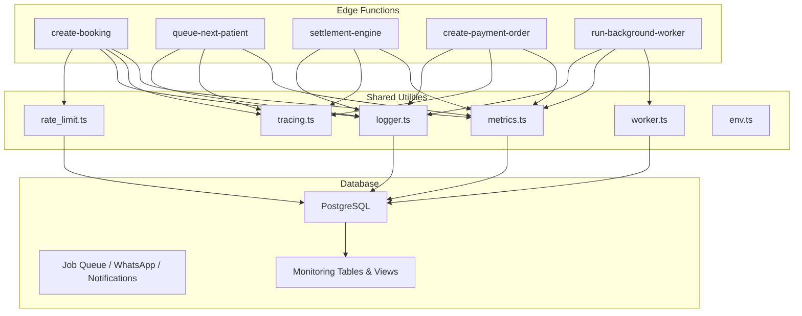
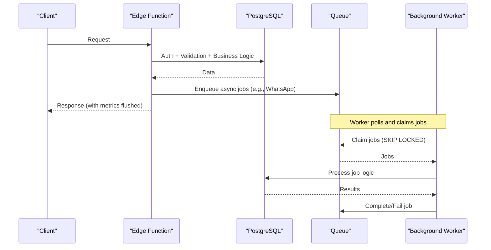
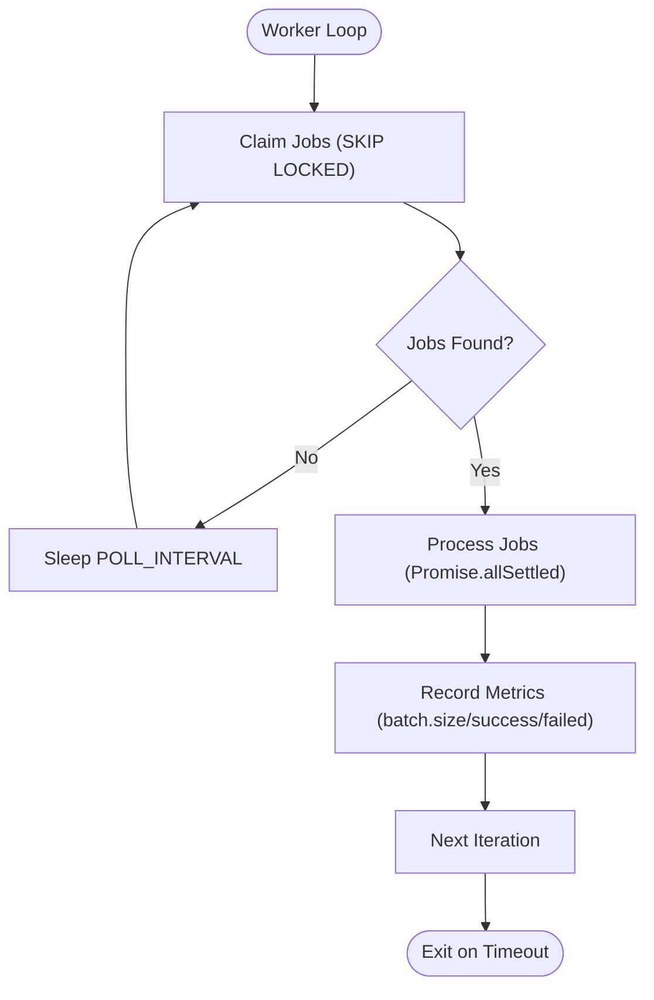
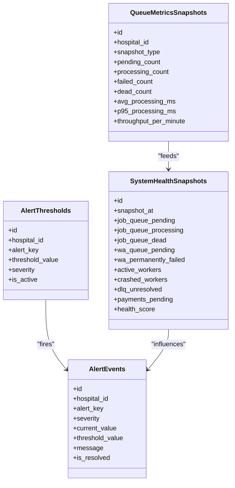
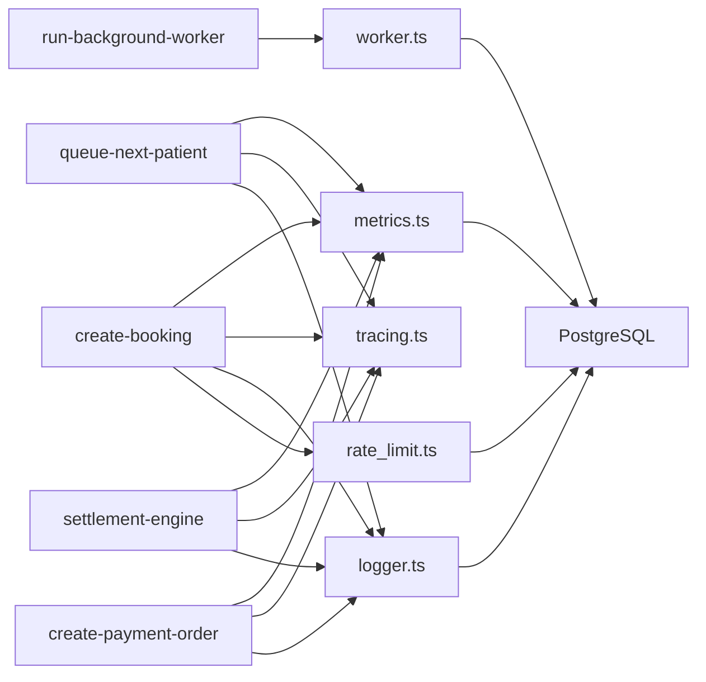

# Performance Profiling & Optimization

<cite>
**Referenced Files in This Document**
- [metrics.ts](file://supabase/functions/_shared/metrics.ts)
- [tracing.ts](file://supabase/functions/_shared/tracing.ts)
- [logger.ts](file://supabase/functions/_shared/logger.ts)
- [worker.ts](file://supabase/functions/_shared/worker.ts)
- [rate_limit.ts](file://supabase/functions/_shared/rate_limit.ts)
- [env.ts](file://supabase/functions/_shared/env.ts)
- [create-booking/index.ts](file://supabase/functions/create-booking/index.ts)
- [run-background-worker/index.ts](file://supabase/functions/run-background-worker/index.ts)
- [queue-next-patient/index.ts](file://supabase/functions/queue-next-patient/index.ts)
- [settlement-engine/index.ts](file://supabase/functions/settlement-engine/index.ts)
- [create-payment-order/index.ts](file://supabase/functions/create-payment-order/index.ts)
- [24_operational-monitoring_engine.sql](file://supabase/migrations/24_operational-monitoring_engine.sql)
- [17_queue_monitoring_engine.sql](file://supabase/migrations/17_queue_monitoring_engine.sql)
- [config.toml](file://supabase/config.toml)
</cite>

## Table of Contents

1. [Introduction](#introduction)
2. [Project Structure](#project-structure)
3. [Core Components](#core-components)
4. [Architecture Overview](#architecture-overview)
5. [Detailed Component Analysis](#detailed-component-analysis)
6. [Dependency Analysis](#dependency-analysis)
7. [Performance Considerations](#performance-considerations)
8. [Troubleshooting Guide](#troubleshooting-guide)
9. [Conclusion](#conclusion)
10. [Appendices](#appendices)

## Introduction

This document explains how to profile and optimize performance in Setura
Hospital OS across edge functions, database queries, background workers, queues,
payments, and real-time features. It covers identifying bottlenecks using
metrics and logs, detecting slow queries, analyzing resource utilization,
monitoring queue throughput, capacity planning from historical metrics, load
testing approaches, scaling considerations, dashboard interpretation, alert
setup, performance reviews, and best practices for regression testing and
continuous monitoring.

## Project Structure

Setura’s runtime observability is implemented via shared utilities that every
edge function uses:

- Metrics collection and flushing as structured logs
- Distributed tracing context propagation
- Structured logging with timers
- Worker lease management and heartbeat
- Rate limiting backed by the database
- Environment configuration and feature flags

**Diagram sources**

- [create-booking/index.ts:67-85](file://supabase/functions/create-booking/index.ts#L67-L85)
- [queue-next-patient/index.ts:46-68](file://supabase/functions/queue-next-patient/index.ts#L46-L68)
- [settlement-engine/index.ts:55-67](file://supabase/functions/settlement-engine/index.ts#L55-L67)
- [create-payment-order/index.ts:104-116](file://supabase/functions/create-payment-order/index.ts#L104-L116)
- [run-background-worker/index.ts:247-304](file://supabase/functions/run-background-worker/index.ts#L247-L304)
- [metrics.ts:24-119](file://supabase/functions/_shared/metrics.ts#L24-L119)
- [tracing.ts:17-50](file://supabase/functions/_shared/tracing.ts#L17-L50)
- [logger.ts:122-190](file://supabase/functions/_shared/logger.ts#L122-L190)
- [worker.ts:30-257](file://supabase/functions/_shared/worker.ts#L30-L257)
- [rate_limit.ts:27-124](file://supabase/functions/_shared/rate_limit.ts#L27-L124)
- [env.ts:155-205](file://supabase/functions/_shared/env.ts#L155-L205)

**Section sources**

- [create-booking/index.ts:67-85](file://supabase/functions/create-booking/index.ts#L67-L85)
- [metrics.ts:24-119](file://supabase/functions/_shared/metrics.ts#L24-L119)
- [tracing.ts:17-50](file://supabase/functions/_shared/tracing.ts#L17-L50)
- [logger.ts:122-190](file://supabase/functions/_shared/logger.ts#L122-L190)
- [worker.ts:30-257](file://supabase/functions/_shared/worker.ts#L30-L257)
- [rate_limit.ts:27-124](file://supabase/functions/_shared/rate_limit.ts#L27-L124)
- [env.ts:155-205](file://supabase/functions/_shared/env.ts#L155-L205)

## Core Components

- MetricsCollector: records timing, counters, gauges per request; flushes as
  structured logs for external collectors.
- Tracing: creates correlation/request/span IDs and computes elapsed time;
  propagates headers downstream.
- Logger: structured JSON logs with levels, child contexts, error serialization,
  and timers.
- Worker utilities: register worker, heartbeat loop, claim jobs with SKIP LOCKED
  semantics, complete/fail job, processJob wrapper.
- Rate limiter: sliding window check against booking_attempt_logs; blocks or
  allows based on thresholds.
- Environment: typed env validation, feature flags (ENABLE_METRICS,
  ENABLE_TRACING), log level, rate limit defaults.

Key usage patterns:

- Each handler initializes trace, logger, and metrics at the top.
- Timers wrap expensive operations (auth, parsing, DB calls).
- Metrics are flushed before returning responses or errors.
- Background workers run loops with heartbeats and batch processing.

**Section sources**

- [metrics.ts:24-119](file://supabase/functions/_shared/metrics.ts#L24-L119)
- [tracing.ts:17-50](file://supabase/functions/_shared/tracing.ts#L17-L50)
- [logger.ts:122-190](file://supabase/functions/_shared/logger.ts#L122-L190)
- [worker.ts:30-257](file://supabase/functions/_shared/worker.ts#L30-L257)
- [rate_limit.ts:27-124](file://supabase/functions/_shared/rate_limit.ts#L27-L124)
- [env.ts:155-205](file://supabase/functions/_shared/env.ts#L155-L205)

## Architecture Overview

The system combines edge functions with a robust database-backed queue and
monitoring engine. Edge functions emit metrics and logs; background workers
consume jobs; database functions compute health scores and snapshots.

**Diagram sources**

- [create-booking/index.ts:145-635](file://supabase/functions/create-booking/index.ts#L145-L635)
- [run-background-worker/index.ts:328-421](file://supabase/functions/run-background-worker/index.ts#L328-L421)
- [worker.ts:98-178](file://supabase/functions/_shared/worker.ts#L98-L178)

## Detailed Component Analysis

### Edge Function: create-booking

- Measures auth, parsing, rate limit checks, hospital settings, patient lookup,
  fees, and booking creation.
- Uses idempotency to prevent duplicate bookings.
- Emits metrics for total request time and success/duplicate/error counts.
- Enqueues WhatsApp confirmation and reminders asynchronously.

Optimization tips:

- Profile each timer segment to identify slow steps (e.g.,
  db.find_or_create_patient, db.create_booking).
- Ensure indexes exist for lookups by normalized_phone and hospital_id.
- Batch or cache frequently read settings where appropriate.

**Section sources**

- [create-booking/index.ts:95-124](file://supabase/functions/create-booking/index.ts#L95-L124)
- [create-booking/index.ts:158-182](file://supabase/functions/create-booking/index.ts#L158-L182)
- [create-booking/index.ts:321-397](file://supabase/functions/create-booking/index.ts#L321-L397)
- [create-booking/index.ts:421-498](file://supabase/functions/create-booking/index.ts#L421-L498)
- [create-booking/index.ts:638-663](file://supabase/functions/create-booking/index.ts#L638-L663)

### Edge Function: queue-next-patient

- Advances the queue atomically and broadcasts updates via realtime.
- Emits metrics for queue exhaustion and next token.
- Non-blocking notifications and audit logging ensure responsiveness.

Optimization tips:

- Monitor advance_queue RPC latency.
- Ensure queue_sessions and bookings are indexed appropriately.
- Keep realtime broadcast failures non-fatal to avoid blocking.

**Section sources**

- [queue-next-patient/index.ts:156-184](file://supabase/functions/queue-next-patient/index.ts#L156-L184)
- [queue-next-patient/index.ts:257-320](file://supabase/functions/queue-next-patient/index.ts#L257-L320)
- [queue-next-patient/index.ts:357-374](file://supabase/functions/queue-next-patient/index.ts#L357-L374)

### Edge Function: settlement-engine

- Idempotent settlement creation and payment recording.
- Reads outstanding balances and pending entries efficiently.
- Emits metrics for actions and total request time.

Optimization tips:

- Validate date ranges to avoid heavy computations.
- Use server-side atomic SQL for settlement creation to reduce contention.
- Monitor query times for outstanding balance reads.

**Section sources**

- [settlement-engine/index.ts:231-393](file://supabase/functions/settlement-engine/index.ts#L231-L393)
- [settlement-engine/index.ts:395-480](file://supabase/functions/settlement-engine/index.ts#L395-L480)
- [settlement-engine/index.ts:486-519](file://supabase/functions/settlement-engine/index.ts#L486-L519)

### Edge Function: create-payment-order

- Creates Razorpay orders with idempotency and amount verification.
- Checks existing pending orders to avoid duplicates.
- Emits metrics for order creation/reuse and total time.

Optimization tips:

- Cache or short-circuit when an existing pending order is found.
- Ensure timeouts for external API calls to prevent long tails.
- Verify amounts server-side to avoid retries due to client tampering.

**Section sources**

- [create-payment-order/index.ts:141-190](file://supabase/functions/create-payment-order/index.ts#L141-L190)
- [create-payment-order/index.ts:213-261](file://supabase/functions/create-payment-order/index.ts#L213-L261)
- [create-payment-order/index.ts:299-330](file://supabase/functions/create-payment-order/index.ts#L299-L330)
- [create-payment-order/index.ts:386-403](file://supabase/functions/create-payment-order/index.ts#L386-L403)

### Background Worker: run-background-worker

- Multi-type job processor with worker registration, heartbeat, crash recovery,
  and batch processing.
- Processes WhatsApp messages, analytics refresh, SLA computation, and
  notifications.
- Tracks batch size, successes, failures, and runtime metrics.

Optimization tips:

- Tune BATCH_SIZE and POLL_INTERVAL for throughput vs. latency trade-offs.
- Monitor stuck jobs and dead-letter queues.
- Use Promise.allSettled to parallelize independent jobs within a batch.

**Section sources**

- [run-background-worker/index.ts:247-304](file://supabase/functions/run-background-worker/index.ts#L247-L304)
- [run-background-worker/index.ts:328-421](file://supabase/functions/run-background-worker/index.ts#L328-L421)
- [run-background-worker/index.ts:441-447](file://supabase/functions/run-background-worker/index.ts#L441-L447)

### Shared Worker Utilities

- Registration, heartbeat loop, claim_jobs_v2 with per-job leases, complete/fail
  job, and processJob wrapper with timers.

**Diagram sources**

- [worker.ts:98-178](file://supabase/functions/_shared/worker.ts#L98-L178)
- [worker.ts:191-215](file://supabase/functions/_shared/worker.ts#L191-L215)
- [worker.ts:230-257](file://supabase/functions/_shared/worker.ts#L230-L257)
- [run-background-worker/index.ts:328-421](file://supabase/functions/run-background-worker/index.ts#L328-L421)

**Section sources**

- [worker.ts:30-257](file://supabase/functions/_shared/worker.ts#L30-L257)

### Monitoring Engine and Dashboards

- Operational monitoring engine defines alert thresholds, alert events, system
  health snapshots, and health score computation.
- Queue monitoring engine provides queue health, stuck job detection, backlog
  alerts, snapshot writing, materialized view refresh tracking, and scheduled
  tasks.

**Diagram sources**

- [24_operational-monitoring_engine.sql:37-185](file://supabase/migrations/24_operational-monitoring_engine.sql#L37-L185)
- [17_queue_monitoring_engine.sql:14-74](file://supabase/migrations/17_queue_monitoring_engine.sql#L14-L74)

**Section sources**

- [24_operational-monitoring_engine.sql:37-185](file://supabase/migrations/24_operational-monitoring_engine.sql#L37-L185)
- [24_operational-monitoring_engine.sql:194-397](file://supabase/migrations/24_operational-monitoring_engine.sql#L194-L397)
- [17_queue_monitoring_engine.sql:124-488](file://supabase/migrations/17_queue_monitoring_engine.sql#L124-L488)

## Dependency Analysis

- Edge functions depend on shared modules for metrics, tracing, logging, rate
  limiting, and environment configuration.
- Background workers depend on worker utilities and database RPCs for job
  lifecycle management.
- Monitoring relies on database functions and tables to aggregate health and
  queue metrics.

**Diagram sources**

- [create-booking/index.ts:67-85](file://supabase/functions/create-booking/index.ts#L67-L85)
- [queue-next-patient/index.ts:46-68](file://supabase/functions/queue-next-patient/index.ts#L46-L68)
- [settlement-engine/index.ts:55-67](file://supabase/functions/settlement-engine/index.ts#L55-L67)
- [create-payment-order/index.ts:104-116](file://supabase/functions/create-payment-order/index.ts#L104-L116)
- [run-background-worker/index.ts:247-304](file://supabase/functions/run-background-worker/index.ts#L247-L304)
- [metrics.ts:24-119](file://supabase/functions/_shared/metrics.ts#L24-L119)
- [tracing.ts:17-50](file://supabase/functions/_shared/tracing.ts#L17-L50)
- [logger.ts:122-190](file://supabase/functions/_shared/logger.ts#L122-L190)
- [worker.ts:30-257](file://supabase/functions/_shared/worker.ts#L30-L257)
- [rate_limit.ts:27-124](file://supabase/functions/_shared/rate_limit.ts#L27-L124)

**Section sources**

- [create-booking/index.ts:67-85](file://supabase/functions/create-booking/index.ts#L67-L85)
- [metrics.ts:24-119](file://supabase/functions/_shared/metrics.ts#L24-L119)
- [worker.ts:30-257](file://supabase/functions/_shared/worker.ts#L30-L257)

## Performance Considerations

- Identify bottlenecks:
  - Use per-request timers around auth, parsing, DB calls, and external APIs.
  - Track request.total and operation-specific timings via MetricsCollector.
  - Correlate logs using correlationId and requestId for end-to-end tracing.
- Slow query detection:
  - Inspect queue health and stuck job detection functions to find long-running
    or stalled jobs.
  - Review materialized view refresh logs to detect slow analytics refreshes.
- Resource utilization:
  - Monitor worker heartbeat and active/crashed worker counts.
  - Observe queue backlogs and DLQ growth to infer throughput limits.
- Capacity planning:
  - Use historical queue_metrics_snapshots and system_health_snapshots to model
    peak loads.
  - Adjust worker batch sizes and poll intervals based on observed throughput
    and latency.
- Load testing:
  - Simulate high concurrency on create-booking and queue-next-patient
    endpoints.
  - Measure p95/p99 latencies and error rates; tune timeouts and retry policies.
- Scaling considerations:
  - Increase worker instances to handle higher job volumes.
  - Ensure database indexes support high-frequency lookups (e.g.,
    normalized_phone, hospital_id).
  - Enable or tune rate limiting to protect services under load.

[No sources needed since this section provides general guidance]

## Troubleshooting Guide

- Interpreting dashboards:
  - Health score reflects critical warnings, warning alerts, and crashed
    workers.
  - Queue metrics show pending, processing, failed, and dead counts; track
    oldest pending age and throughput.
- Setting up alerts:
  - Configure alert_thresholds for queue backlogs, worker crashes, WhatsApp
    failures, DLQ backlog, and analytics refresh lag.
  - Use fire_alert to record events and monitor open alerts.
- Common issues:
  - Stuck jobs: use get_stuck_jobs to identify jobs exceeding processing
    thresholds.
  - Backlog alerts: check_queue_backlog_alerts to detect high pending counts or
    stale jobs.
  - Materialized view staleness: get_mv_refresh_health to verify freshness and
    duration.
- Debugging edge functions:
  - Use correlationId and requestId to trace requests across logs and metrics.
  - Check metric flush outputs and structured logs for timing breakdowns.

**Section sources**

- [24_operational-monitoring_engine.sql:194-397](file://supabase/migrations/24_operational-monitoring_engine.sql#L194-L397)
- [17_queue_monitoring_engine.sql:283-488](file://supabase/migrations/17_queue_monitoring_engine.sql#L283-L488)
- [17_queue_monitoring_engine.sql:653-697](file://supabase/migrations/17_queue_monitoring_engine.sql#L653-L697)
- [metrics.ts:76-119](file://supabase/functions/_shared/metrics.ts#L76-L119)
- [logger.ts:122-190](file://supabase/functions/_shared/logger.ts#L122-L190)

## Conclusion

Setura Hospital OS provides comprehensive observability through structured
metrics, distributed tracing, and robust database-backed monitoring. By
instrumenting edge functions with timers, leveraging worker utilities for
resilient queue processing, and utilizing the operational monitoring engine,
teams can identify bottlenecks, optimize slow queries, improve throughput, and
plan capacity effectively. Continuous monitoring, alerting, and load testing
ensure sustained performance and reliability.

[No sources needed since this section summarizes without analyzing specific
files]

## Appendices

### Example Optimizations

- Optimize slow database queries:
  - Add or refine indexes for frequent filters (e.g., normalized_phone,
    hospital_id, status fields).
  - Use atomic SQL operations (e.g., create_booking, create_hospital_settlement)
    to reduce contention and retries.
  - Monitor get_queue_health and mv_refresh_log to identify slow paths.

- Reduce function execution time:
  - Wrap expensive steps with timers and analyze timing distributions.
  - Short-circuit when possible (e.g., reuse existing payment orders).
  - Ensure external API calls have timeouts and are retried judiciously.

- Improve queue throughput:
  - Tune BATCH_SIZE and POLL_INTERVAL in the background worker.
  - Monitor worker heartbeat and job claim latency; adjust worker count.
  - Investigate stuck jobs and dead-letter queues to recover throughput.

- Memory usage analysis:
  - Avoid large in-memory structures; process batches incrementally.
  - Use structured logging sparingly in hot paths; rely on metrics for
    high-volume data.

- CPU profiling:
  - Focus on tight loops and heavy computations; offload to database functions
    where feasible.
  - Profile analytics refresh routines and schedule during off-peak hours.

- Network performance optimization:
  - Set timeouts for external calls (e.g., Razorpay, WhatsApp).
  - Reuse connections where supported; minimize round trips by batching
    requests.

- Performance regression testing:
  - Include latency SLOs in CI for critical endpoints.
  - Compare p95/p99 metrics across deployments; fail builds if regressions
    exceed thresholds.

- Continuous performance monitoring:
  - Persist metrics and logs to external collectors for trend analysis.
  - Automate alert rules based on alert_thresholds and health scores.

**Section sources**

- [create-payment-order/index.ts:213-261](file://supabase/functions/create-payment-order/index.ts#L213-L261)
- [create-payment-order/index.ts:299-330](file://supabase/functions/create-payment-order/index.ts#L299-L330)
- [run-background-worker/index.ts:328-421](file://supabase/functions/run-background-worker/index.ts#L328-L421)
- [17_queue_monitoring_engine.sql:283-488](file://supabase/migrations/17_queue_monitoring_engine.sql#L283-L488)
- [24_operational-monitoring_engine.sql:194-397](file://supabase/migrations/24_operational-monitoring_engine.sql#L194-L397)
