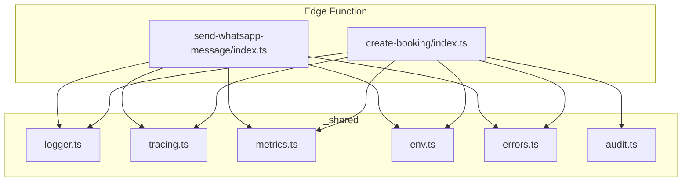
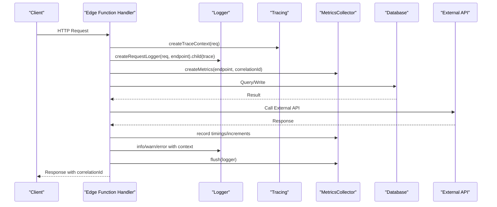
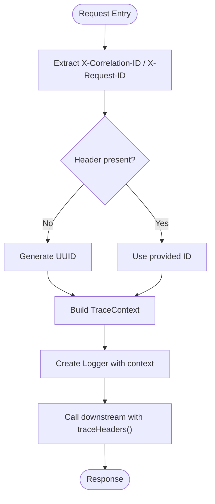
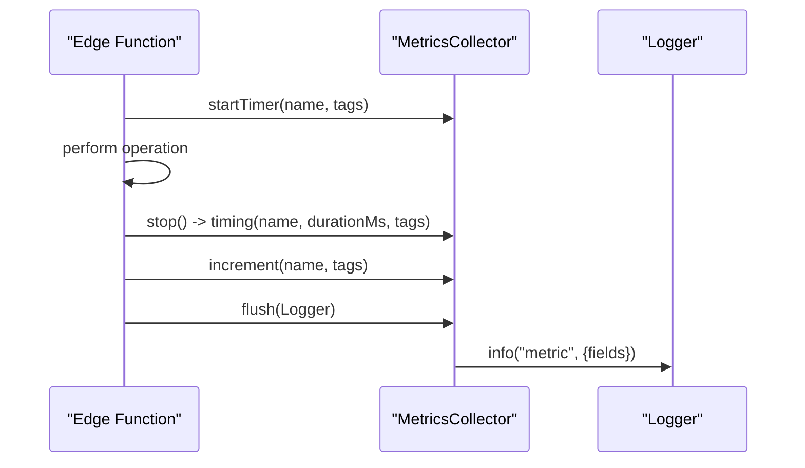
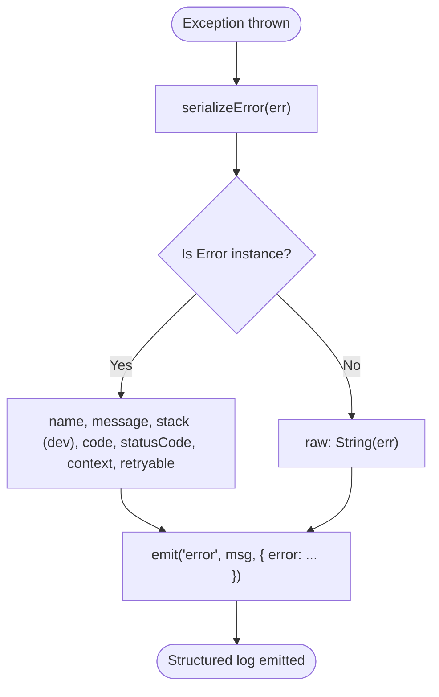
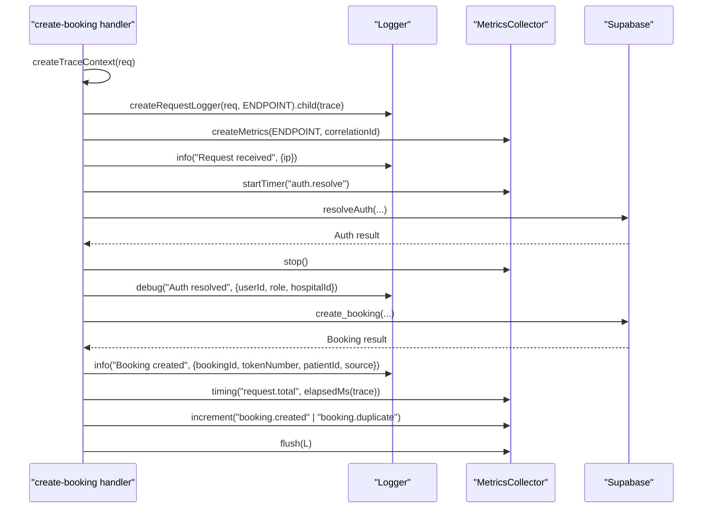
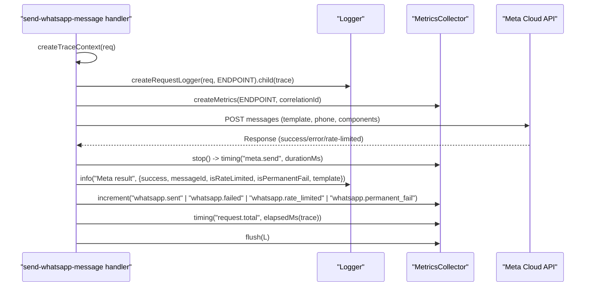
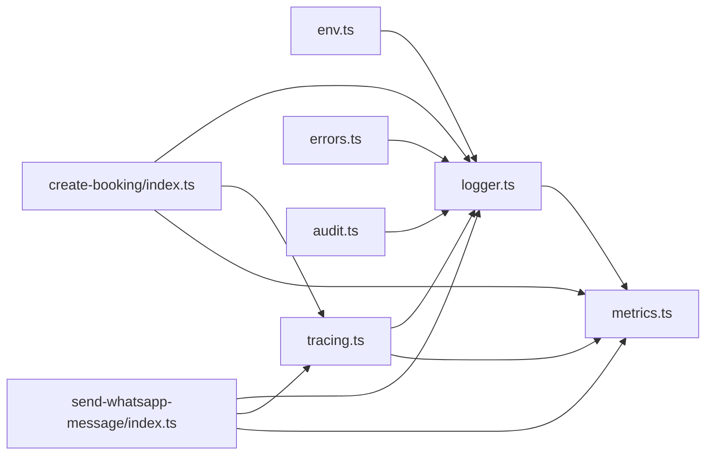

# Structured Logging System

<cite>
**Referenced Files in This Document**
- [logger.ts](file://supabase/functions/_shared/logger.ts)
- [tracing.ts](file://supabase/functions/_shared/tracing.ts)
- [metrics.ts](file://supabase/functions/_shared/metrics.ts)
- [env.ts](file://supabase/functions/_shared/env.ts)
- [errors.ts](file://supabase/functions/_shared/errors.ts)
- [audit.ts](file://supabase/functions/_shared/audit.ts)
- [create-booking/index.ts](file://supabase/functions/create-booking/index.ts)
- [send-whatsapp-message/index.ts](file://supabase/functions/send-whatsapp-message/index.ts)
</cite>

## Table of Contents

1. [Introduction](#introduction)
2. [Project Structure](#project-structure)
3. [Core Components](#core-components)
4. [Architecture Overview](#architecture-overview)
5. [Detailed Component Analysis](#detailed-component-analysis)
6. [Dependency Analysis](#dependency-analysis)
7. [Performance Considerations](#performance-considerations)
8. [Troubleshooting Guide](#troubleshooting-guide)
9. [Conclusion](#conclusion)
10. [Appendices](#appendices)

## Introduction

This document explains the structured logging system used across Setura Hospital
OS Edge Functions. It covers:

- Correlation IDs for request tracing across distributed components
- Log levels and structured log formats
- Context propagation from request to downstream calls
- Safe inclusion of request/response data and sensitive information filtering
- Examples for business operations, database queries, and external API calls
- Log aggregation strategies, rotation policies, and integration with external
  logging services
- Performance considerations for high-volume logging and debugging techniques
  using structured logs

## Project Structure

The logging subsystem is implemented as shared utilities under
supabase/functions/_shared and consumed by individual Edge Functions. Key
modules:

- logger.ts: Core Logger class, log levels, structured JSON emission, error
  serialization, timers, and request-scoped logger creation
- tracing.ts: Trace context (correlationId, requestId, spanId), child spans,
  elapsed time, and header propagation
- metrics.ts: MetricsCollector that emits metrics as structured log lines for
  external collectors
- env.ts: Environment configuration including LOG_LEVEL, deployment version, and
  feature flags
- errors.ts: Centralized typed error hierarchy integrated with logger error
  serialization
- audit.ts: Audit event writer that uses the logger for non-fatal failures
- Example functions: create-booking and send-whatsapp-message demonstrate
  end-to-end usage



**Diagram sources**

- [create-booking/index.ts:76-85](file://supabase/functions/create-booking/index.ts#L76-L85)
- [send-whatsapp-message/index.ts:347-359](file://supabase/functions/send-whatsapp-message/index.ts#L347-L359)
- [logger.ts:122-189](file://supabase/functions/_shared/logger.ts#L122-L189)
- [tracing.ts:17-49](file://supabase/functions/_shared/tracing.ts#L17-L49)
- [metrics.ts:24-118](file://supabase/functions/_shared/metrics.ts#L24-L118)
- [env.ts:155-162](file://supabase/functions/_shared/env.ts#L155-L162)
- [errors.ts:70-104](file://supabase/functions/_shared/errors.ts#L70-L104)
- [audit.ts:51-74](file://supabase/functions/_shared/audit.ts#L51-L74)

**Section sources**

- [logger.ts:1-190](file://supabase/functions/_shared/logger.ts#L1-L190)
- [tracing.ts:1-50](file://supabase/functions/_shared/tracing.ts#L1-L50)
- [metrics.ts:1-119](file://supabase/functions/_shared/metrics.ts#L1-L119)
- [env.ts:1-279](file://supabase/functions/_shared/env.ts#L1-L279)
- [errors.ts:1-323](file://supabase/functions/_shared/errors.ts#L1-L323)
- [audit.ts:1-75](file://supabase/functions/_shared/audit.ts#L1-L75)
- [create-booking/index.ts:1-666](file://supabase/functions/create-booking/index.ts#L1-L666)
- [send-whatsapp-message/index.ts:1-583](file://supabase/functions/send-whatsapp-message/index.ts#L1-L583)

## Core Components

- Logger class: Provides debug/info/warn/error methods, child logger context
  merging, timers, and safe error serialization. Emits single-line JSON objects.
- Request-scoped logger: createRequestLogger extracts correlation/request
  identifiers from headers or generates them, and attaches endpoint/method/url
  context.
- Tracing context: Creates correlationId, requestId, spanId, parentSpanId,
  startTime; provides helpers to compute elapsed time and propagate headers to
  downstream calls.
- Metrics collector: Records timings, increments, gauges, and flushes as
  structured log lines with consistent fields for parsing by external systems.
- Environment: Configures LOG_LEVEL, DEPLOYMENT_VERSION, APP_ENV, and feature
  toggles for observability.
- Error handling: Centralized error types integrate with logger to serialize
  error details consistently.

**Section sources**

- [logger.ts:15-169](file://supabase/functions/_shared/logger.ts#L15-L169)
- [logger.ts:175-189](file://supabase/functions/_shared/logger.ts#L175-L189)
- [tracing.ts:9-49](file://supabase/functions/_shared/tracing.ts#L9-L49)
- [metrics.ts:16-118](file://supabase/functions/_shared/metrics.ts#L16-L118)
- [env.ts:155-162](file://supabase/functions/_shared/env.ts#L155-L162)
- [errors.ts:70-104](file://supabase/functions/_shared/errors.ts#L70-L104)

## Architecture Overview

The logging architecture ensures every request has a stable correlation ID that
flows through all logs and downstream calls. Each Edge Function creates a trace
context and a request-scoped logger at the top of the handler. Business logic
logs events with contextual fields, while metrics are flushed at the end of the
request. Errors are serialized with stack traces in non-production environments.



**Diagram sources**

- [create-booking/index.ts:76-85](file://supabase/functions/create-booking/index.ts#L76-L85)
- [create-booking/index.ts:638-663](file://supabase/functions/create-booking/index.ts#L638-L663)
- [send-whatsapp-message/index.ts:347-359](file://supabase/functions/send-whatsapp-message/index.ts#L347-L359)
- [send-whatsapp-message/index.ts:527-579](file://supabase/functions/send-whatsapp-message/index.ts#L527-L579)
- [logger.ts:122-189](file://supabase/functions/_shared/logger.ts#L122-L189)
- [tracing.ts:17-49](file://supabase/functions/_shared/tracing.ts#L17-L49)
- [metrics.ts:24-118](file://supabase/functions/_shared/metrics.ts#L24-L118)

## Detailed Component Analysis

### Logger Implementation and Log Levels

- Log levels: debug < info < warn < error, filtered by configured LOG_LEVEL from
  environment.
- Structured format: Each log line is a JSON object containing timestamp, level,
  message, service, version, environment, plus merged context fields.
- Error serialization: Errors are serialized into a structured object preserving
  name, message, stack (in non-production), and custom fields like code,
  statusCode, retryable, context.
- Child loggers: Create isolated contexts per operation without mutating the
  parent logger.
- Timers: Provide durationMs for operations via timer.end().

```mermaid
classDiagram
class Logger {
-context : LogContext
+child(additionalContext) : Logger
+debug(msg, extra) : void
+info(msg, extra) : void
+warn(msg, extra) : void
+error(msg, err?, extra) : void
+timer(label, extra) : {end() : number}
}
class LogContext {
+correlationId? : string
+requestId? : string
+userId? : string
+hospitalId? : string
+endpoint? : string
+durationMs? : number
+[key : unknown] : unknown
}
class LogEntry {
+ts : string
+level : LogLevel
+msg : string
+service : string
+version : string
+env : string
+[key : unknown] : unknown
}
Logger --> LogContext : "uses"
Logger --> LogEntry : "emits"
```

**Diagram sources**

- [logger.ts:32-50](file://supabase/functions/_shared/logger.ts#L32-L50)
- [logger.ts:122-169](file://supabase/functions/_shared/logger.ts#L122-L169)

**Section sources**

- [logger.ts:15-30](file://supabase/functions/_shared/logger.ts#L15-L30)
- [logger.ts:52-99](file://supabase/functions/_shared/logger.ts#L52-L99)
- [logger.ts:108-169](file://supabase/functions/_shared/logger.ts#L108-L169)

### Correlation IDs and Context Propagation

- Correlation ID source: Extracted from X-Correlation-ID or X-Request-ID
  headers; falls back to generated UUID.
- Request-scoped logger: Attaches correlationId, endpoint, method, url to every
  log line.
- Tracing context: Adds requestId, spanId, parentSpanId, startTime; supports
  child spans for nested work units.
- Header propagation: traceHeaders returns standardized headers to pass
  correlationId, requestId, spanId, and optional parentSpanId to downstream
  services.



**Diagram sources**

- [logger.ts:175-189](file://supabase/functions/_shared/logger.ts#L175-L189)
- [tracing.ts:17-49](file://supabase/functions/_shared/tracing.ts#L17-L49)

**Section sources**

- [logger.ts:175-189](file://supabase/functions/_shared/logger.ts#L175-L189)
- [tracing.ts:17-49](file://supabase/functions/_shared/tracing.ts#L17-L49)

### Metrics Integration

- MetricsCollector records timing, increment, gauge metrics with tags and
  timestamps.
- Flush emits each metric as a structured log line with msg="metric" and fields
  like metricName, metricValue, metricUnit, metricTags, metricTs.
- Pre-tagging with endpoint, correlationId, hospitalId enables easy filtering
  and aggregation.



**Diagram sources**

- [metrics.ts:32-90](file://supabase/functions/_shared/metrics.ts#L32-L90)
- [metrics.ts:108-118](file://supabase/functions/_shared/metrics.ts#L108-L118)

**Section sources**

- [metrics.ts:16-118](file://supabase/functions/_shared/metrics.ts#L16-L118)

### Error Handling and Serialization

- Centralized error types extend SeturError with code, statusCode, retryable,
  context, timestamp.
- Logger.error serializes errors into structured objects, preserving stack
  traces in non-production.
- Audit writes use fire-and-forget pattern; failures are logged but do not fail
  business operations.



**Diagram sources**

- [logger.ts:52-73](file://supabase/functions/_shared/logger.ts#L52-L73)
- [errors.ts:70-104](file://supabase/functions/_shared/errors.ts#L70-L104)
- [audit.ts:51-74](file://supabase/functions/_shared/audit.ts#L51-L74)

**Section sources**

- [logger.ts:52-99](file://supabase/functions/_shared/logger.ts#L52-L99)
- [errors.ts:70-104](file://supabase/functions/_shared/errors.ts#L70-L104)
- [audit.ts:51-74](file://supabase/functions/_shared/audit.ts#L51-L74)

### Usage Patterns in Edge Functions

#### Business Operations: Booking Creation

- Creates trace context and request-scoped logger at handler entry.
- Logs request receipt, parsed body (with sensitive data masked), auth
  resolution, and booking creation success.
- Uses timers to measure durations for auth, parsing, rate limit checks, DB
  operations, and total request time.
- Emits metrics for request.total and domain counters, then flushes structured
  logs.



**Diagram sources**

- [create-booking/index.ts:76-85](file://supabase/functions/create-booking/index.ts#L76-L85)
- [create-booking/index.ts:97-119](file://supabase/functions/create-booking/index.ts#L97-L119)
- [create-booking/index.ts:159-182](file://supabase/functions/create-booking/index.ts#L159-L182)
- [create-booking/index.ts:422-498](file://supabase/functions/create-booking/index.ts#L422-L498)
- [create-booking/index.ts:500-505](file://supabase/functions/create-booking/index.ts#L500-L505)
- [create-booking/index.ts:638-663](file://supabase/functions/create-booking/index.ts#L638-L663)

**Section sources**

- [create-booking/index.ts:76-85](file://supabase/functions/create-booking/index.ts#L76-L85)
- [create-booking/index.ts:97-119](file://supabase/functions/create-booking/index.ts#L97-L119)
- [create-booking/index.ts:159-182](file://supabase/functions/create-booking/index.ts#L159-L182)
- [create-booking/index.ts:422-498](file://supabase/functions/create-booking/index.ts#L422-L498)
- [create-booking/index.ts:500-505](file://supabase/functions/create-booking/index.ts#L500-L505)
- [create-booking/index.ts:638-663](file://supabase/functions/create-booking/index.ts#L638-L663)

#### Database Queries: Timing and Context

- Wrap DB calls with metrics.startTimer to capture durationMs and tag with
  operation names.
- Include relevant identifiers (hospitalId, sessionId) in log context for
  filtering.
- Handle errors with logger.warn or logger.error, preserving error structure.

**Section sources**

- [create-booking/index.ts:159-182](file://supabase/functions/create-booking/index.ts#L159-L182)
- [create-booking/index.ts:322-397](file://supabase/functions/create-booking/index.ts#L322-L397)
- [create-booking/index.ts:422-498](file://supabase/functions/create-booking/index.ts#L422-L498)

#### External API Calls: WhatsApp Messaging

- Validate worker secret and payload before calling Meta Cloud API.
- Measure callMeta duration with metrics.startTimer.
- Log success/failure with structured fields (success, messageId, isRateLimited,
  isPermanentFail, template).
- Increment domain-specific counters and flush metrics.



**Diagram sources**

- [send-whatsapp-message/index.ts:347-359](file://supabase/functions/send-whatsapp-message/index.ts#L347-L359)
- [send-whatsapp-message/index.ts:477-501](file://supabase/functions/send-whatsapp-message/index.ts#L477-L501)
- [send-whatsapp-message/index.ts:527-579](file://supabase/functions/send-whatsapp-message/index.ts#L527-L579)

**Section sources**

- [send-whatsapp-message/index.ts:347-359](file://supabase/functions/send-whatsapp-message/index.ts#L347-L359)
- [send-whatsapp-message/index.ts:477-501](file://supabase/functions/send-whatsapp-message/index.ts#L477-L501)
- [send-whatsapp-message/index.ts:527-579](file://supabase/functions/send-whatsapp-message/index.ts#L527-L579)

## Dependency Analysis

- logger.ts depends on env.ts for LOG_LEVEL and deployment metadata.
- metrics.ts depends on logger.ts to emit metrics as structured logs.
- tracing.ts is independent and provides context propagation utilities.
- Edge functions depend on all three to implement consistent observability.
- errors.ts integrates with logger for consistent error serialization.
- audit.ts uses logger for non-fatal failure reporting.



**Diagram sources**

- [logger.ts:13-27](file://supabase/functions/_shared/logger.ts#L13-L27)
- [metrics.ts:14-15](file://supabase/functions/_shared/metrics.ts#L14-L15)
- [tracing.ts:17-49](file://supabase/functions/_shared/tracing.ts#L17-L49)
- [create-booking/index.ts:76-85](file://supabase/functions/create-booking/index.ts#L76-L85)
- [send-whatsapp-message/index.ts:347-359](file://supabase/functions/send-whatsapp-message/index.ts#L347-L359)

**Section sources**

- [logger.ts:13-27](file://supabase/functions/_shared/logger.ts#L13-L27)
- [metrics.ts:14-15](file://supabase/functions/_shared/metrics.ts#L14-L15)
- [tracing.ts:17-49](file://supabase/functions/_shared/tracing.ts#L17-L49)
- [create-booking/index.ts:76-85](file://supabase/functions/create-booking/index.ts#L76-L85)
- [send-whatsapp-message/index.ts:347-359](file://supabase/functions/send-whatsapp-message/index.ts#L347-L359)

## Performance Considerations

- Log level filtering: Only logs at or above configured LOG_LEVEL are emitted,
  reducing overhead in production where default is "info".
- Single-line JSON: Each log is a compact JSON object, minimizing parsing cost
  for collectors.
- Non-blocking logger: Logger failures are swallowed to avoid impacting request
  latency.
- Timers: Use Logger.timer and MetricsCollector.startTimer to measure durations
  without manual timing code duplication.
- Sensitive data masking: In examples, sensitive fields (e.g., phone numbers)
  are truncated or masked before logging.
- Avoid heavy payloads: Keep context fields small and relevant; prefer IDs over
  full objects.
- Batch metrics: Collect metrics during request and flush once at the end to
  reduce log volume spikes.

[No sources needed since this section provides general guidance]

## Troubleshooting Guide

- Missing correlationId: Ensure clients send X-Correlation-ID or X-Request-ID;
  otherwise, a UUID is generated. Verify response headers include correlationId
  for client-side tracing.
- High log volume: Lower LOG_LEVEL or remove verbose debug logs in production;
  ensure timers and metrics are used instead of excessive info logs.
- Sensitive data leaks: Review context objects passed to logger.info/warn/error;
  mask or omit PII such as full phone numbers, tokens, or secrets.
- Error visibility: Check that errors are caught and logged via logger.error;
  verify stack traces appear in non-production environments.
- Metrics gaps: Confirm metrics.flush is called at the end of handlers and in
  error paths; validate metric names and tags for consistency.

**Section sources**

- [logger.ts:75-99](file://supabase/functions/_shared/logger.ts#L75-L99)
- [logger.ts:175-189](file://supabase/functions/_shared/logger.ts#L175-L189)
- [create-booking/index.ts:638-663](file://supabase/functions/create-booking/index.ts#L638-L663)
- [send-whatsapp-message/index.ts:527-579](file://supabase/functions/send-whatsapp-message/index.ts#L527-L579)

## Conclusion

Setura’s structured logging system provides consistent, machine-parseable logs
with correlation IDs that flow across distributed components. The Logger class,
tracing utilities, and metrics collector enable robust observability for Edge
Functions. By following the patterns demonstrated in create-booking and
send-whatsapp-message—using child loggers, timers, and careful context
management—you can safely log business operations, database queries, and
external API calls while maintaining performance and security.

[No sources needed since this section summarizes without analyzing specific
files]

## Appendices

### How to Implement Custom Loggers for Edge Functions

- Create a request-scoped logger at the top of your handler using
  createRequestLogger and attach trace context via child({ correlationId,
  requestId }).
- Use Logger.timer for measuring critical sections and
  MetricsCollector.startTimer for timing metrics.
- Always flush metrics at the end of the handler, including error paths.
- Propagate trace headers to downstream calls using traceHeaders(ctx) to
  maintain correlation across services.

**Section sources**

- [logger.ts:175-189](file://supabase/functions/_shared/logger.ts#L175-L189)
- [tracing.ts:17-49](file://supabase/functions/_shared/tracing.ts#L17-L49)
- [metrics.ts:108-118](file://supabase/functions/_shared/metrics.ts#L108-L118)

### Including Request/Response Data Safely

- Include only identifiers (IDs, endpoints, methods) and sanitized values in log
  context.
- Mask or truncate sensitive fields (e.g., phone numbers, tokens) before
  logging.
- Avoid logging raw request bodies or responses; summarize status codes and
  outcomes.

**Section sources**

- [create-booking/index.ts:136-140](file://supabase/functions/create-booking/index.ts#L136-L140)
- [send-whatsapp-message/index.ts:492-501](file://supabase/functions/send-whatsapp-message/index.ts#L492-L501)

### Handling Sensitive Information Filtering

- Apply masking at the point of logging; never store or forward sensitive data
  in logs.
- Use child logger context to add sanitized fields rather than modifying
  original objects.
- Review logs regularly to ensure no PII or secrets are included.

[No sources needed since this section provides general guidance]

### Log Aggregation Strategies

- Emit structured JSON lines for ingestion by Datadog, Grafana Loki, or
  CloudWatch Logs Insights.
- Tag logs with endpoint, correlationId, hospitalId for filtering and
  dashboards.
- Use consistent field names (metricName, metricValue, metricUnit, metricTags,
  metricTs) for metrics.

**Section sources**

- [metrics.ts:76-90](file://supabase/functions/_shared/metrics.ts#L76-L90)
- [metrics.ts:108-118](file://supabase/functions/_shared/metrics.ts#L108-L118)

### Log Rotation Policies

- Rely on platform-level log rotation managed by the hosting environment (Deno
  Deploy/Supabase).
- Configure retention and archival at the logging service layer (e.g.,
  Datadog/Loki/CloudWatch).
- Avoid implementing local file rotation in Edge Functions due to ephemeral
  runtime constraints.

[No sources needed since this section provides general guidance]

### Integration with External Logging Services

- Parse structured logs with field-based queries (level, correlationId,
  endpoint).
- Map metric logs to time series using metricName and metricTags.
- Correlate errors with correlationId across services to reconstruct request
  flows.

**Section sources**

- [metrics.ts:76-90](file://supabase/functions/_shared/metrics.ts#L76-L90)
- [logger.ts:75-99](file://supabase/functions/_shared/logger.ts#L75-L99)

### Debugging Techniques Using Structured Logs

- Filter logs by correlationId to trace a single request end-to-end.
- Use durationMs from Logger.timer and MetricsCollector to identify slow
  operations.
- Inspect error.context for additional diagnostic fields when errors occur.

**Section sources**

- [logger.ts:159-169](file://supabase/functions/_shared/logger.ts#L159-L169)
- [errors.ts:70-104](file://supabase/functions/_shared/errors.ts#L70-L104)
- [create-booking/index.ts:638-663](file://supabase/functions/create-booking/index.ts#L638-L663)
