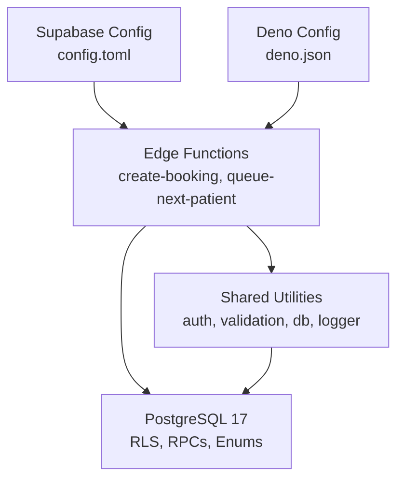
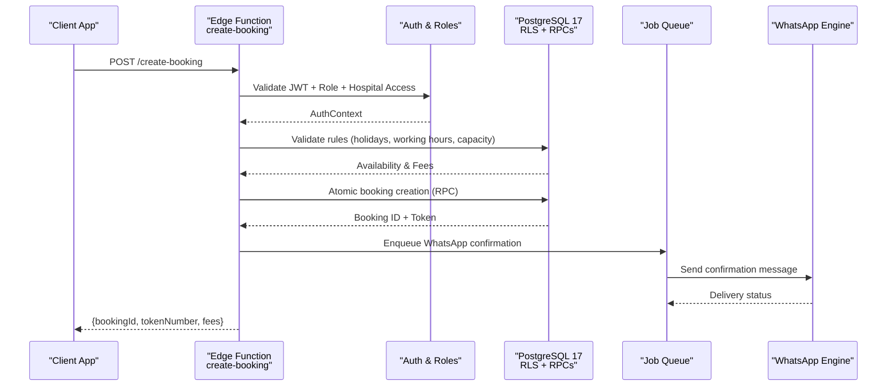
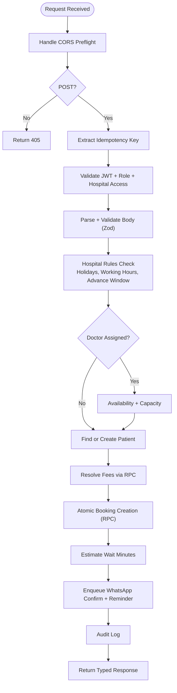
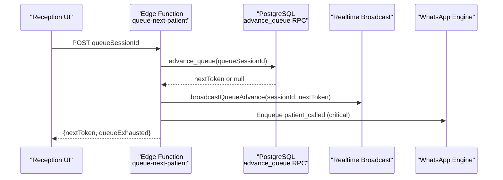
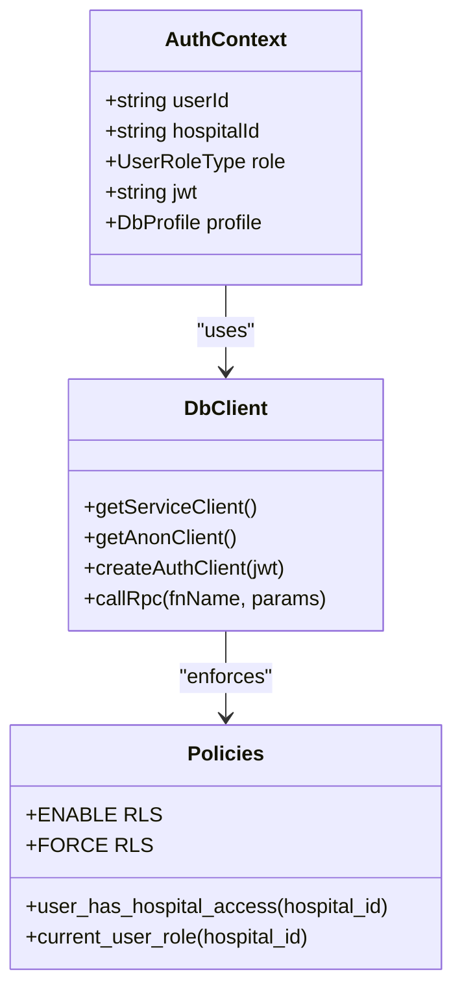
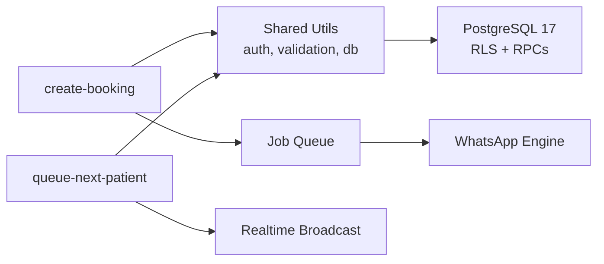

# Project Overview

<cite>
**Referenced Files in This Document**
- [deno.json](file://deno.json)
- [supabase/config.toml](file://supabase/config.toml)
- [supabase/functions/create-booking/index.ts](file://supabase/functions/create-booking/index.ts)
- [supabase/functions/queue-next-patient/index.ts](file://supabase/functions/queue-next-patient/index.ts)
- [supabase/functions/_shared/types.ts](file://supabase/functions/_shared/types.ts)
- [supabase/functions/_shared/validation.ts](file://supabase/functions/_shared/validation.ts)
- [supabase/functions/_shared/auth.ts](file://supabase/functions/_shared/auth.ts)
- [supabase/functions/_shared/db.ts](file://supabase/functions/_shared/db.ts)
- [supabase/migrations/01_foundation.sql](file://supabase/migrations/01_foundation.sql)
- [ROADMAP.md](file://ROADMAP.md)
- [AUDIT_REPORT.md](file://AUDIT_REPORT.md)
</cite>

## Table of Contents

1. Introduction
2. Project Structure
3. Core Components
4. Architecture Overview
5. Detailed Component Analysis
6. Dependency Analysis
7. Performance Considerations
8. Troubleshooting Guide
9. Conclusion

## Introduction

Setura Hospital OS is an enterprise hospital management platform designed to
support multiple hospitals with robust patient booking, queue management,
payment processing, and communication systems. It is built on Supabase edge
functions using the Deno runtime, with PostgreSQL as the primary data store. The
system emphasizes multi-hospital isolation, secure authentication, idempotent
operations, and real-time patient flow updates.

Key mission areas:

- Multi-hospital support with strict tenant isolation via row-level security and
  header-based context validation.
- End-to-end booking lifecycle from creation through confirmation, reminders,
  queue progression, consultation, and completion.
- Queue management that advances patients safely under concurrency using
  database-level locking primitives.
- Payment processing integration with order creation, verification, and
  settlement workflows.
- Communication engine for WhatsApp messaging, including webhooks, retries,
  dead-letter handling, and delivery tracking.

Healthcare domain challenges addressed:

- HIPAA-aligned considerations: least privilege access, audit logging,
  role-based permissions, and strict tenant boundaries.
- Multi-tenant isolation enforced at both application and database layers.
- Real-time patient flow management with low-latency queue advancement and
  broadcast notifications.

Terminology used throughout:

- Edge functions: serverless handlers running in Deno on Supabase.
- Hospital isolation: tenant scoping via hospital_id and RLS policies.
- Booking lifecycle: state transitions across booked, checked-in, waiting,
  called, in-consultation, completed, cancelled, no-show, rescheduled, skipped.
- Queue management: token allocation, session control, and safe advancement.

[No sources needed since this section provides a high-level overview]

## Project Structure

The repository organizes functionality into:

- supabase/functions: Edge function modules implementing business logic (e.g.,
  create-booking, queue-next-patient, send-whatsapp-message).
- supabase/functions/_shared: Shared utilities for auth, validation, database
  clients, logging, metrics, tracing, errors, and response formatting.
- supabase/migrations: Declarative schema evolution with 37 migrations covering
  foundation, queues, payments, analytics, retention, and more.
- scripts and tests: Validation scripts and unit/integration tests.
- deno.json: Deno configuration, tasks, and dependency imports.
- supabase/config.toml: Supabase project configuration including Postgres
  version, realtime, storage, and edge runtime settings.

**Diagram sources**

- [supabase/config.toml:27-36](file://supabase/config.toml#L27-L36)
- [deno.json:7-10](file://deno.json#L7-L10)
- [supabase/functions/create-booking/index.ts:34-63](file://supabase/functions/create-booking/index.ts#L34-L63)
- [supabase/functions/_shared/db.ts:30-106](file://supabase/functions/_shared/db.ts#L30-L106)

**Section sources**

- [supabase/config.toml:1-120](file://supabase/config.toml#L1-L120)
- [deno.json:1-40](file://deno.json#L1-L40)

## Core Components

- Authentication and authorization: JWT validation, role resolution, and
  hospital access enforcement before any business logic executes.
- Request validation: Zod schemas normalize and validate inputs (phone numbers,
  dates, enums), preventing invalid data from reaching core logic.
- Database client management: Service-role, anon, and per-request auth clients
  ensure correct RLS behavior and secure mutations.
- Idempotency and rate limiting: Prevent duplicate bookings and protect against
  abuse via idempotency keys and request throttling.
- Queue advancement: Safe, concurrent queue progression using database-level
  locking and atomic operations.
- Notifications and communications: Enqueue jobs for WhatsApp confirmations and
  reminders; process webhooks and track delivery states.
- Audit and observability: Structured logging, correlation IDs, metrics
  collection, and audit logs for compliance and debugging.

**Section sources**

- [supabase/functions/_shared/auth.ts:32-124](file://supabase/functions/_shared/auth.ts#L32-L124)
- [supabase/functions/_shared/validation.ts:71-134](file://supabase/functions/_shared/validation.ts#L71-L134)
- [supabase/functions/_shared/db.ts:30-106](file://supabase/functions/_shared/db.ts#L30-L106)
- [supabase/functions/create-booking/index.ts:87-153](file://supabase/functions/create-booking/index.ts#L87-L153)
- [supabase/functions/queue-next-patient/index.ts:156-184](file://supabase/functions/queue-next-patient/index.ts#L156-L184)

## Architecture Overview

Setura uses a serverless microservices approach with edge functions
orchestrating business flows while delegating complex, transactional work to
PostgreSQL stored procedures and functions. Event-driven processing is
implemented via job queues for asynchronous tasks like WhatsApp messaging and
reminders. Realtime capabilities provide live updates for queue progression and
operational dashboards.

**Diagram sources**

- [supabase/functions/create-booking/index.ts:96-153](file://supabase/functions/create-booking/index.ts#L96-L153)
- [supabase/functions/create-booking/index.ts:421-446](file://supabase/functions/create-booking/index.ts#L421-L446)
- [supabase/functions/create-booking/index.ts:520-548](file://supabase/functions/create-booking/index.ts#L520-L548)
- [supabase/functions/_shared/auth.ts:32-124](file://supabase/functions/_shared/auth.ts#L32-L124)
- [supabase/functions/_shared/db.ts:115-136](file://supabase/functions/_shared/db.ts#L115-L136)

## Detailed Component Analysis

### Create Booking Flow

The create-booking edge function implements a comprehensive booking lifecycle:

- CORS preflight and method validation.
- Idempotency key extraction and claim to prevent duplicate requests.
- JWT validation, role checks, and hospital access enforcement.
- Request body parsing and Zod validation (phone normalization, date
  constraints, enum values).
- Rate limit checks based on phone number and IP address.
- Hospital rule validation (online booking enabled, advance booking window,
  holidays, working hours).
- Doctor availability and slot capacity checks when applicable.
- Find-or-create patient deduplicated by normalized phone within hospital scope.
- Fee resolution via database RPC.
- Atomic booking creation using database RPC to generate next token safely.
- Estimated wait time calculation.
- Enqueue WhatsApp confirmation and reminder jobs.
- Audit logging and typed response return.

**Diagram sources**

- [supabase/functions/create-booking/index.ts:67-153](file://supabase/functions/create-booking/index.ts#L67-L153)
- [supabase/functions/create-booking/index.ts:158-283](file://supabase/functions/create-booking/index.ts#L158-L283)
- [supabase/functions/create-booking/index.ts:321-446](file://supabase/functions/create-booking/index.ts#L321-L446)
- [supabase/functions/create-booking/index.ts:507-585](file://supabase/functions/create-booking/index.ts#L507-L585)

**Section sources**

- [supabase/functions/create-booking/index.ts:1-666](file://supabase/functions/create-booking/index.ts#L1-L666)
- [supabase/functions/_shared/validation.ts:71-134](file://supabase/functions/_shared/validation.ts#L71-L134)

### Queue Management

The queue-next-patient edge function advances the queue safely:

- Validates hospital context and roles.
- Loads active queue session and ensures it belongs to the requesting hospital.
- Advances queue using database RPC with SKIP LOCKED semantics to avoid race
  conditions.
- Handles queue exhaustion gracefully.
- Loads the called booking and broadcasts queue advancement via realtime.
- Enqueues critical WhatsApp notification for the called patient.
- Logs audit events and emits metrics.

**Diagram sources**

- [supabase/functions/queue-next-patient/index.ts:70-184](file://supabase/functions/queue-next-patient/index.ts#L70-L184)
- [supabase/functions/queue-next-patient/index.ts:257-320](file://supabase/functions/queue-next-patient/index.ts#L257-L320)

**Section sources**

- [supabase/functions/queue-next-patient/index.ts:1-409](file://supabase/functions/queue-next-patient/index.ts#L1-L409)

### Security and Multi-Tenant Isolation

Security is enforced at multiple layers:

- JWT validation via Supabase Auth client ensures signature, expiry, and
  revocation are handled correctly.
- Role resolution occurs from the database to avoid stale claims.
- Hospital access is validated before any business logic runs, rejecting
  cross-tenant access.
- Row-Level Security (RLS) is enabled and forced on all relevant tables,
  ensuring tenant isolation even if application code misbehaves.
- Service-role clients bypass RLS only for internal operations where necessary,
  never exposed to user input.

**Diagram sources**

- [supabase/functions/_shared/auth.ts:32-124](file://supabase/functions/_shared/auth.ts#L32-L124)
- [supabase/functions/_shared/db.ts:30-106](file://supabase/functions/_shared/db.ts#L30-L106)
- [supabase/migrations/01_foundation.sql:559-574](file://supabase/migrations/01_foundation.sql#L559-L574)
- [supabase/migrations/01_foundation.sql:261-344](file://supabase/migrations/01_foundation.sql#L261-L344)

**Section sources**

- [supabase/functions/_shared/auth.ts:1-237](file://supabase/functions/_shared/auth.ts#L1-L237)
- [supabase/functions/_shared/db.ts:1-169](file://supabase/functions/_shared/db.ts#L1-L169)
- [supabase/migrations/01_foundation.sql:559-574](file://supabase/migrations/01_foundation.sql#L559-L574)

### Technology Stack Overview

- TypeScript with strict compiler options for type safety.
- Supabase SDK for database and auth interactions.
- Zod for runtime validation and normalization of request bodies.
- PostgreSQL 17 with extensions (pgcrypto, uuid-ossp, pg_trgm, citext) and
  advanced features like ENUMs, triggers, and SECURITY DEFINER functions.
- Deno runtime for edge functions with per-worker policy for hot reload during
  development.

**Section sources**

- [deno.json:1-20](file://deno.json#L1-L20)
- [supabase/config.toml:27-36](file://supabase/config.toml#L27-L36)
- [supabase/config.toml:369-378](file://supabase/config.toml#L369-L378)
- [supabase/migrations/01_foundation.sql:7-14](file://supabase/migrations/01_foundation.sql#L7-L14)

## Dependency Analysis

Core dependencies and relationships:

- Edge functions depend on shared utilities for auth, validation, database
  clients, logging, metrics, and error handling.
- Database layer relies on stored procedures and functions for atomic operations
  (booking creation, queue advancement, fee resolution).
- Job queues decouple asynchronous tasks (WhatsApp messages, reminders) from
  synchronous request paths.
- Realtime broadcasting enables live updates for queue progression without
  blocking core operations.

**Diagram sources**

- [supabase/functions/create-booking/index.ts:34-63](file://supabase/functions/create-booking/index.ts#L34-L63)
- [supabase/functions/queue-next-patient/index.ts:7-22](file://supabase/functions/queue-next-patient/index.ts#L7-L22)
- [supabase/functions/_shared/db.ts:115-136](file://supabase/functions/_shared/db.ts#L115-L136)

**Section sources**

- [supabase/functions/create-booking/index.ts:1-666](file://supabase/functions/create-booking/index.ts#L1-L666)
- [supabase/functions/queue-next-patient/index.ts:1-409](file://supabase/functions/queue-next-patient/index.ts#L1-L409)

## Performance Considerations

- Atomic operations: Token allocation and booking creation use database-level
  atomicity to prevent race conditions and ensure consistency.
- Concurrency safeguards: SKIP LOCKED semantics in queue advancement prevent
  double-processing and ensure safe concurrent access.
- Asynchronous processing: Non-critical tasks (WhatsApp notifications,
  reminders) are enqueued to avoid blocking request paths.
- Metrics and tracing: Per-request timing and metrics collection help identify
  bottlenecks and monitor performance.
- Database optimization: Indexes on frequently queried columns (hospital_id,
  normalized_phone, last_visit_date) improve lookup performance.

[No sources needed since this section provides general guidance]

## Troubleshooting Guide

Common issues and resolutions:

- Missing X-Hospital-ID header: Ensure the header is provided and matches the
  authenticated user’s hospital context.
- Invalid JWT: Verify token validity and expiration; re-authenticate if
  necessary.
- Validation failures: Check request body against Zod schemas for required
  fields and format constraints.
- Queue exhaustion: Handle cases where no patients remain in the queue and
  inform users accordingly.
- WhatsApp delivery failures: Monitor DLQ for permanently failed messages and
  implement retry logic for transient errors.
- Audit log gaps: Ensure audit events are logged for critical operations and
  verify logging pipelines are functioning.

**Section sources**

- [supabase/functions/create-booking/index.ts:96-134](file://supabase/functions/create-booking/index.ts#L96-L134)
- [supabase/functions/queue-next-patient/index.ts:186-213](file://supabase/functions/queue-next-patient/index.ts#L186-L213)
- [ROADMAP.md:72-121](file://ROADMAP.md#L72-L121)

## Conclusion

Setura Hospital OS provides a robust, enterprise-grade platform for managing
multiple hospitals with secure, scalable, and compliant healthcare operations.
Its architecture leverages serverless edge functions, event-driven processing,
and PostgreSQL’s advanced features to deliver reliable patient booking, queue
management, payment processing, and communication systems. The emphasis on
multi-tenant isolation, real-time updates, and comprehensive auditing ensures
both operational efficiency and regulatory compliance.

[No sources needed since this section summarizes without analyzing specific
files]
