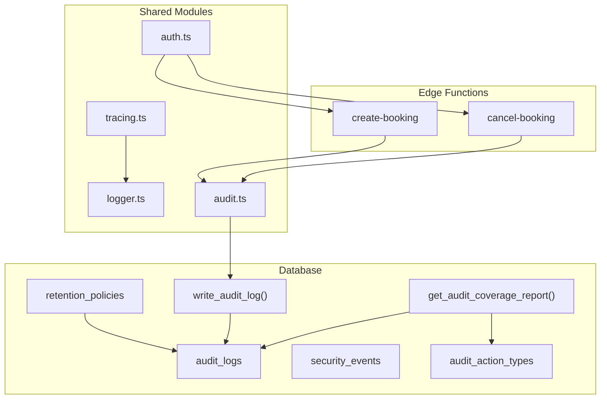
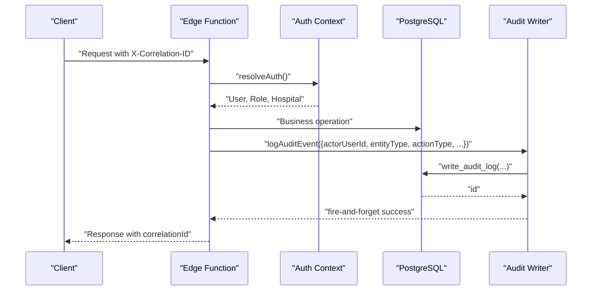
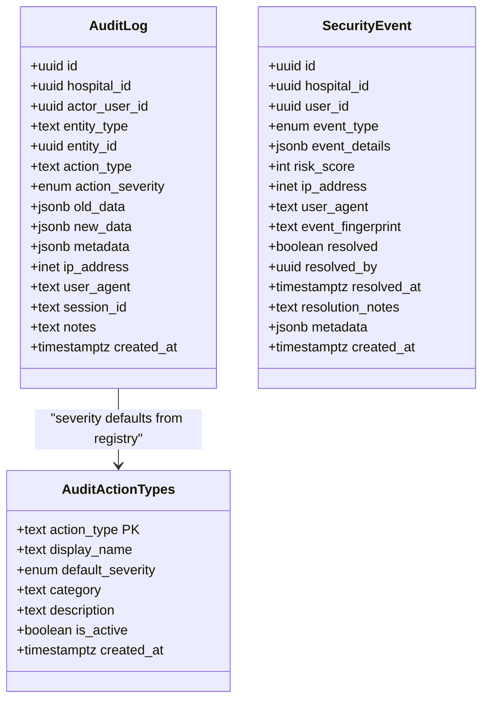
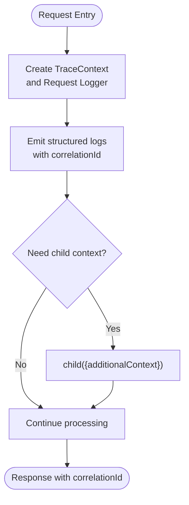
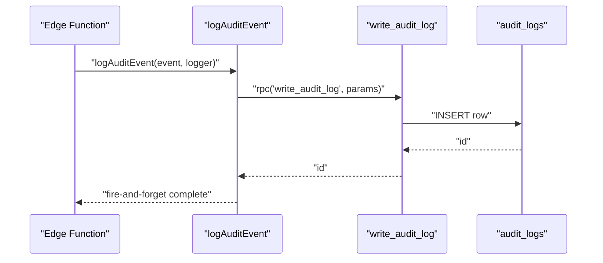
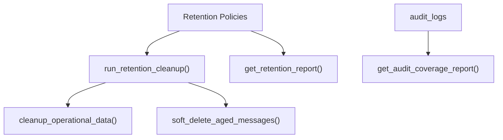
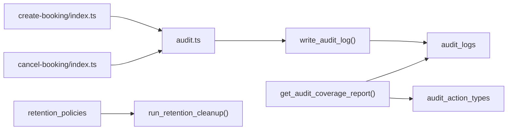

# Audit Logging & Compliance

<cite>
**Referenced Files in This Document**
- [audit.ts](file://supabase/functions/_shared/audit.ts)
- [logger.ts](file://supabase/functions/_shared/logger.ts)
- [tracing.ts](file://supabase/functions/_shared/tracing.ts)
- [auth.ts](file://supabase/functions/_shared/auth.ts)
- [10_audit_&_security_engine.sql](file://supabase/migrations/10_audit_&_security_engine.sql)
- [36_audit_standardization.sql](file://supabase/migrations/36_audit_standardization.sql)
- [23_retention_&_cleanup_engine.sql](file://supabase/migrations/23_retention_&_cleanup_engine.sql)
- [create-booking/index.ts](file://supabase/functions/create-booking/index.ts)
- [cancel-booking/index.ts](file://supabase/functions/cancel-booking/index.ts)
- [AUDIT_REPORT.md](file://AUDIT_REPORT.md)
</cite>

## Table of Contents

1. [Introduction](#introduction)
2. [Project Structure](#project-structure)
3. [Core Components](#core-components)
4. [Architecture Overview](#architecture-overview)
5. [Detailed Component Analysis](#detailed-component-analysis)
6. [Dependency Analysis](#dependency-analysis)
7. [Performance Considerations](#performance-considerations)
8. [Troubleshooting Guide](#troubleshooting-guide)
9. [Conclusion](#conclusion)
10. [Appendices](#appendices)

## Introduction

This document explains the audit logging and compliance features in Setura
Hospital OS. It covers:

- The comprehensive audit trail that records sensitive operations such as user
  access, data modifications, and administrative actions.
- Structured logging with correlation IDs for tracing requests across
  distributed components.
- Compliance-oriented design including immutability controls, role-based access
  to logs, retention policies, and built-in reporting functions.
- How to implement custom audit events and integrate with external compliance
  tools.
- Security measures protecting audit logs from tampering and unauthorized
  access.
- Log aggregation, analysis, and reporting capabilities for operational
  monitoring and compliance audits.
- Guidance on configuring audit levels based on regulatory requirements and
  operational needs.

## Project Structure

The audit and compliance system spans shared runtime modules and database
migrations:

- Shared modules provide structured logging, tracing, authentication context,
  and a fire-and-forget audit writer.
- Database migrations define immutable audit tables, security event tracking,
  centralized writers, and reporting functions.
- Edge functions emit audit events at key business steps (e.g., booking
  creation, cancellation).

**Diagram sources**

- [audit.ts:51-74](file://supabase/functions/_shared/audit.ts#L51-L74)
- [logger.ts:175-189](file://supabase/functions/_shared/logger.ts#L175-L189)
- [tracing.ts:17-49](file://supabase/functions/_shared/tracing.ts#L17-L49)
- [auth.ts:42-124](file://supabase/functions/_shared/auth.ts#L42-L124)
- [10_audit_&_security_engine.sql:43-89](file://supabase/migrations/10_audit_&_security_engine.sql#L43-L89)
- [36_audit_standardization.sql:593-649](file://supabase/migrations/36_audit_standardization.sql#L593-L649)
- [23_retention_&_cleanup_engine.sql:55-84](file://supabase/migrations/23_retention_&_cleanup_engine.sql#L55-L84)

**Section sources**

- [audit.ts:1-75](file://supabase/functions/_shared/audit.ts#L1-L75)
- [logger.ts:1-190](file://supabase/functions/_shared/logger.ts#L1-L190)
- [tracing.ts:1-50](file://supabase/functions/_shared/tracing.ts#L1-L50)
- [auth.ts:1-237](file://supabase/functions/_shared/auth.ts#L1-L237)
- [10_audit_&_security_engine.sql:1-488](file://supabase/migrations/10_audit_&_security_engine.sql#L1-L488)
- [36_audit_standardization.sql:1-685](file://supabase/migrations/36_audit_standardization.sql#L1-L685)
- [23_retention_&_cleanup_engine.sql:1-369](file://supabase/migrations/23_retention_&_cleanup_engine.sql#L1-L369)

## Core Components

- Audit event writer: A fire-and-forget utility that writes audit events via a
  central database function. Failures are logged but never thrown, ensuring core
  operations remain unaffected.
- Structured logger: Emits JSON log lines with correlation IDs, request
  metadata, and error serialization. Supports child loggers per request and
  timing helpers.
- Tracing context: Generates and propagates correlation IDs, request IDs, span
  IDs, and parent span IDs across service boundaries using headers.
- Authentication context: Validates JWTs, resolves roles and hospital access,
  and provides helpers for authorization checks used by edge functions.
- Immutable audit storage: PostgreSQL tables enforce append-only semantics with
  triggers preventing updates or deletions.
- Centralized writers and policies: Database functions write audit and security
  events; Row Level Security restricts access to authorized roles.
- Retention engine: Configurable retention policies and cleanup routines for
  operational data and messages.

**Section sources**

- [audit.ts:1-75](file://supabase/functions/_shared/audit.ts#L1-L75)
- [logger.ts:1-190](file://supabase/functions/_shared/logger.ts#L1-L190)
- [tracing.ts:1-50](file://supabase/functions/_shared/tracing.ts#L1-L50)
- [auth.ts:1-237](file://supabase/functions/_shared/auth.ts#L1-L237)
- [10_audit_&_security_engine.sql:43-249](file://supabase/migrations/10_audit_&_security_engine.sql#L43-L249)
- [23_retention_&_cleanup_engine.sql:55-184](file://supabase/migrations/23_retention_&_cleanup_engine.sql#L55-L184)

## Architecture Overview

The audit architecture ensures reliable, tamper-resistant recording of sensitive
operations while preserving performance and availability.

**Diagram sources**

- [tracing.ts:17-49](file://supabase/functions/_shared/tracing.ts#L17-L49)
- [auth.ts:42-124](file://supabase/functions/_shared/auth.ts#L42-L124)
- [audit.ts:51-74](file://supabase/functions/_shared/audit.ts#L51-L74)
- [10_audit_&_security_engine.sql:255-305](file://supabase/migrations/10_audit_&_security_engine.sql#L255-L305)

## Detailed Component Analysis

### Audit Event Model and Storage

- Tables:
  - audit_logs: Append-only record of sensitive operations with actor, entity,
    action, severity, old/new data, IP/user agent/session, notes, and
    timestamps.
  - security_events: Records security incidents with risk scoring, fingerprints,
    resolution state, and metadata.
- Immutability:
  - Triggers prevent UPDATE or DELETE on audit_logs to ensure tamper resistance.
- Access control:
  - Row Level Security enabled and forced on both tables.
  - Policies restrict SELECT/UPDATE to global admins or hospital admins.
- Centralized writing:
  - write_audit_log() is SECURITY DEFINER and grants controlled execution to
    authenticated users.
  - log_security_event() and resolve_security_event() similarly encapsulate
    writes and updates.

**Diagram sources**

- [10_audit_&_security_engine.sql:43-89](file://supabase/migrations/10_audit_&_security_engine.sql#L43-L89)
- [10_audit_&_security_engine.sql:134-191](file://supabase/migrations/10_audit_&_security_engine.sql#L134-L191)
- [36_audit_standardization.sql:60-87](file://supabase/migrations/36_audit_standardization.sql#L60-L87)

**Section sources**

- [10_audit_&_security_engine.sql:43-249](file://supabase/migrations/10_audit_&_security_engine.sql#L43-L249)
- [10_audit_&_security_engine.sql:255-387](file://supabase/migrations/10_audit_&_security_engine.sql#L255-L387)
- [36_audit_standardization.sql:60-87](file://supabase/migrations/36_audit_standardization.sql#L60-L87)

### Structured Logging and Correlation IDs

- Logger emits machine-parseable JSON lines with level, timestamp, service,
  version, environment, and contextual fields.
- Correlation ID propagation:
  - createRequestLogger extracts correlation ID from headers or generates one.
  - child loggers inherit and extend context.
- Error handling:
  - Errors are serialized safely without crashing requests.
- Timing:
  - timer helper logs duration for operations.

**Diagram sources**

- [logger.ts:122-189](file://supabase/functions/_shared/logger.ts#L122-L189)
- [tracing.ts:17-49](file://supabase/functions/_shared/tracing.ts#L17-L49)

**Section sources**

- [logger.ts:1-190](file://supabase/functions/_shared/logger.ts#L1-L190)
- [tracing.ts:1-50](file://supabase/functions/_shared/tracing.ts#L1-L50)

### Audit Writers and Business Integration

- Fire-and-forget audit writing:
  - logAuditEvent calls write_audit_log RPC; failures are caught and logged
    internally.
- Example integrations:
  - Booking creation logs with entity details and fee information.
  - Booking cancellation logs include old/new status and refund initiation
    flags.
- Severity and categories:
  - Default severities can be derived from audit_action_types registry when
    unspecified.

**Diagram sources**

- [audit.ts:51-74](file://supabase/functions/_shared/audit.ts#L51-L74)
- [10_audit_&_security_engine.sql:255-305](file://supabase/migrations/10_audit_&_security_engine.sql#L255-L305)
- [create-booking/index.ts:580-607](file://supabase/functions/create-booking/index.ts#L580-L607)
- [cancel-booking/index.ts:390-415](file://supabase/functions/cancel-booking/index.ts#L390-L415)

**Section sources**

- [audit.ts:1-75](file://supabase/functions/_shared/audit.ts#L1-L75)
- [create-booking/index.ts:580-607](file://supabase/functions/create-booking/index.ts#L580-L607)
- [cancel-booking/index.ts:390-415](file://supabase/functions/cancel-booking/index.ts#L390-L415)

### Compliance Features

- Immutability:
  - Triggers block updates/deletes on audit_logs to preserve evidence integrity.
- Access control:
  - Row Level Security enforces hospital isolation and admin-only access to
    audit and security tables.
- Retention policies:
  - Configurable per-table retention with legal basis annotations.
  - Defaults include multi-year retention for medical records and shorter
    periods for operational logs.
- Reporting:
  - get_audit_coverage_report() shows coverage of registered action types over
    time ranges.
  - get_retention_report() lists active policies and durations.

**Diagram sources**

- [23_retention_&_cleanup_engine.sql:190-321](file://supabase/migrations/23_retention_&_cleanup_engine.sql#L190-L321)
- [36_audit_standardization.sql:593-649](file://supabase/migrations/36_audit_standardization.sql#L593-L649)

**Section sources**

- [10_audit_&_security_engine.sql:227-249](file://supabase/migrations/10_audit_&_security_engine.sql#L227-L249)
- [10_audit_&_security_engine.sql:422-472](file://supabase/migrations/10_audit_&_security_engine.sql#L422-L472)
- [23_retention_&_cleanup_engine.sql:55-184](file://supabase/migrations/23_retention_&_cleanup_engine.sql#L55-L184)
- [36_audit_standardization.sql:593-649](file://supabase/migrations/36_audit_standardization.sql#L593-L649)

### Custom Audit Events and External Integrations

- Implementing custom events:
  - Use logAuditEvent with a unique actionType, appropriate severity, and
    structured oldData/newData.
  - Register new action types in audit_action_types to standardize display
    names, categories, and default severities.
- External integration points:
  - Export audit logs via secure admin interfaces or scheduled jobs that query
    audit_logs within retention windows.
  - Forward high-severity events to SIEM or compliance platforms using outbound
    HTTP calls from background workers or cron jobs.
  - Enrich logs with correlation IDs for cross-system traceability.

**Section sources**

- [audit.ts:1-75](file://supabase/functions/_shared/audit.ts#L1-L75)
- [36_audit_standardization.sql:60-87](file://supabase/migrations/36_audit_standardization.sql#L60-L87)

### Security Measures Protecting Audit Logs

- Immutability enforcement prevents tampering.
- Row Level Security isolates tenant data and restricts access to
  administrators.
- Centralized writers run with elevated privileges under controlled schemas,
  minimizing direct table writes from application code.
- Sensitive fields (IP, user agent, session) captured for forensic analysis.

**Section sources**

- [10_audit_&_security_engine.sql:227-249](file://supabase/migrations/10_audit_&_security_engine.sql#L227-L249)
- [10_audit_&_security_engine.sql:422-472](file://supabase/migrations/10_audit_&_security_engine.sql#L422-L472)

### Log Aggregation, Analysis, and Reporting

- Aggregation:
  - Collect structured JSON logs from Edge Functions into a centralized logging
    platform.
  - Use correlation IDs to join logs across services and database operations.
- Analysis:
  - Query audit_logs for action_type, severity, actor, and time windows.
  - Use get_audit_coverage_report() to verify completeness of audit
    instrumentation.
- Reporting:
  - Build dashboards for high/critical events, failed logins, role changes,
    payment anomalies.
  - Generate compliance reports by filtering audit_logs and security_events
    within retention periods.

**Section sources**

- [logger.ts:1-190](file://supabase/functions/_shared/logger.ts#L1-L190)
- [36_audit_standardization.sql:593-649](file://supabase/migrations/36_audit_standardization.sql#L593-L649)

## Dependency Analysis

- Edge functions depend on shared modules for auth, logging, tracing, and audit
  writing.
- Audit writing depends on database functions and tables defined in migrations.
- Reporting functions depend on audit logs and action type registry.
- Retention engine depends on policy configuration and cleanup routines.

**Diagram sources**

- [create-booking/index.ts:580-607](file://supabase/functions/create-booking/index.ts#L580-L607)
- [cancel-booking/index.ts:390-415](file://supabase/functions/cancel-booking/index.ts#L390-L415)
- [audit.ts:51-74](file://supabase/functions/_shared/audit.ts#L51-L74)
- [10_audit_&_security_engine.sql:255-305](file://supabase/migrations/10_audit_&_security_engine.sql#L255-L305)
- [36_audit_standardization.sql:593-649](file://supabase/migrations/36_audit_standardization.sql#L593-L649)
- [23_retention_&_cleanup_engine.sql:294-321](file://supabase/migrations/23_retention_&_cleanup_engine.sql#L294-L321)

**Section sources**

- [create-booking/index.ts:580-607](file://supabase/functions/create-booking/index.ts#L580-L607)
- [cancel-booking/index.ts:390-415](file://supabase/functions/cancel-booking/index.ts#L390-L415)
- [audit.ts:51-74](file://supabase/functions/_shared/audit.ts#L51-L74)
- [10_audit_&_security_engine.sql:255-305](file://supabase/migrations/10_audit_&_security_engine.sql#L255-L305)
- [36_audit_standardization.sql:593-649](file://supabase/migrations/36_audit_standardization.sql#L593-L649)
- [23_retention_&_cleanup_engine.sql:294-321](file://supabase/migrations/23_retention_&_cleanup_engine.sql#L294-L321)

## Performance Considerations

- Fire-and-forget audit writes avoid impacting critical paths; failures are
  logged without throwing errors.
- Indexes on audit_logs optimize queries by entity, hospital/date, actor,
  severity, and action type.
- Structured logging minimizes overhead and enables efficient parsing and
  indexing in log aggregators.
- Retention policies reduce long-term storage costs while preserving
  compliance-required data.

[No sources needed since this section provides general guidance]

## Troubleshooting Guide

- Audit write failures:
  - Check internal logs for non-fatal errors from logAuditEvent.
  - Verify connectivity and permissions for write_audit_log().
- Missing audit coverage:
  - Use get_audit_coverage_report() to identify unlogged action types.
  - Ensure new business flows call logAuditEvent with appropriate actionType.
- Access denied to audit logs:
  - Confirm user has required role (global_admin or hospital_admin) per Row
    Level Security policies.
- Retention not applied:
  - Verify run_retention_cleanup() is scheduled and executed.
  - Check retention_policies entries and legal_basis annotations.

**Section sources**

- [audit.ts:51-74](file://supabase/functions/_shared/audit.ts#L51-L74)
- [36_audit_standardization.sql:593-649](file://supabase/migrations/36_audit_standardization.sql#L593-L649)
- [10_audit_&_security_engine.sql:422-472](file://supabase/migrations/10_audit_&_security_engine.sql#L422-L472)
- [23_retention_&_cleanup_engine.sql:294-321](file://supabase/migrations/23_retention_&_cleanup_engine.sql#L294-L321)

## Conclusion

Setura Hospital OS implements a robust, compliant audit logging system:

- Immutable, access-controlled audit logs capture sensitive operations with rich
  context.
- Structured logging and correlation IDs enable end-to-end tracing across
  distributed components.
- Built-in reporting and retention policies support compliance and operational
  needs.
- Fire-and-forget design ensures reliability without compromising core
  functionality.
- Extensible action type registry and centralized writers simplify adding new
  audit events and integrating with external compliance tools.

[No sources needed since this section summarizes without analyzing specific
files]

## Appendices

### HIPAA Considerations and Data Handling

- Immutability and access controls help satisfy auditability and confidentiality
  requirements.
- Capturing actor identity, timestamps, and entity context supports
  accountability.
- Retention policies align with healthcare recordkeeping norms; configure
  durations and legal_basis accordingly.
- Limit exposure of PHI in audit payloads; prefer identifiers and minimal
  necessary detail.

[No sources needed since this section provides general guidance]

### Configuring Audit Levels

- Use severity levels (low, medium, high, critical) to prioritize alerts and
  reporting.
- Leverage audit_action_types to standardize default severities per action
  category.
- Adjust LOG_LEVEL in logger configuration to balance verbosity and performance.

**Section sources**

- [36_audit_standardization.sql:60-87](file://supabase/migrations/36_audit_standardization.sql#L60-L87)
- [logger.ts:17-30](file://supabase/functions/_shared/logger.ts#L17-L30)

### Examples of Implementing Custom Audit Events

- Add a new action type in audit_action_types with display name, category, and
  default severity.
- Call logAuditEvent in your edge function with actorUserId, entityType,
  entityId, actionType, severity, and optional oldData/newData.
- Validate coverage using get_audit_coverage_report() after deployment.

**Section sources**

- [36_audit_standardization.sql:60-87](file://supabase/migrations/36_audit_standardization.sql#L60-L87)
- [audit.ts:51-74](file://supabase/functions/_shared/audit.ts#L51-L74)
- [36_audit_standardization.sql:593-649](file://supabase/migrations/36_audit_standardization.sql#L593-L649)

### Integrating with External Compliance Tools

- Export audit_logs and security_events via secure admin endpoints or scheduled
  jobs.
- Forward high-severity events to SIEM using outbound calls from background
  workers or cron jobs.
- Enrich events with correlation IDs for cross-platform traceability.

**Section sources**

- [10_audit_&_security_engine.sql:134-191](file://supabase/migrations/10_audit_&_security_engine.sql#L134-L191)
- [tracing.ts:17-49](file://supabase/functions/_shared/tracing.ts#L17-L49)

### Operational Monitoring and Compliance Audits

- Use get_audit_coverage_report() to ensure all critical actions are
  instrumented.
- Monitor high/critical severity events and unresolved security events.
- Schedule periodic retention cleanup and validate via get_retention_report().

**Section sources**

- [36_audit_standardization.sql:593-649](file://supabase/migrations/36_audit_standardization.sql#L593-L649)
- [23_retention_&_cleanup_engine.sql:268-321](file://supabase/migrations/23_retention_&_cleanup_engine.sql#L268-L321)
