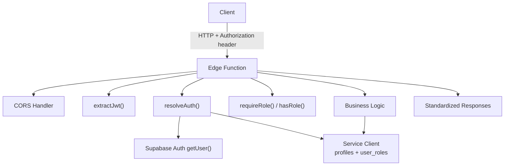
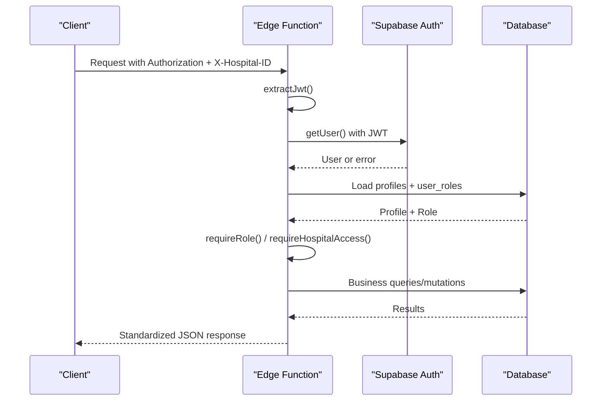
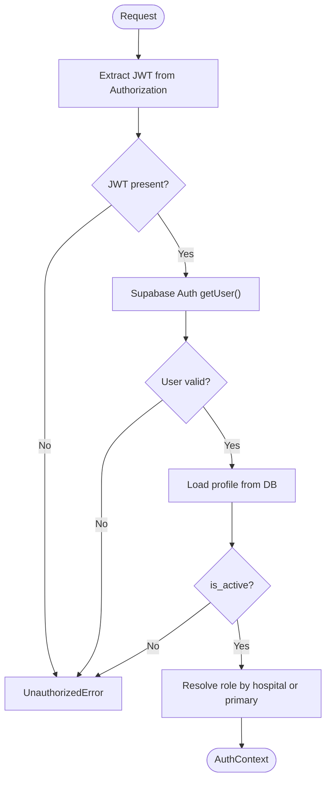
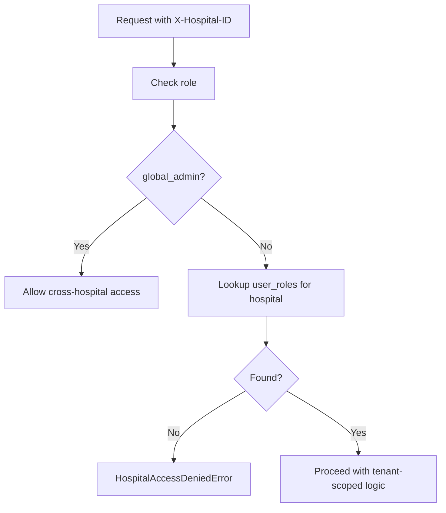
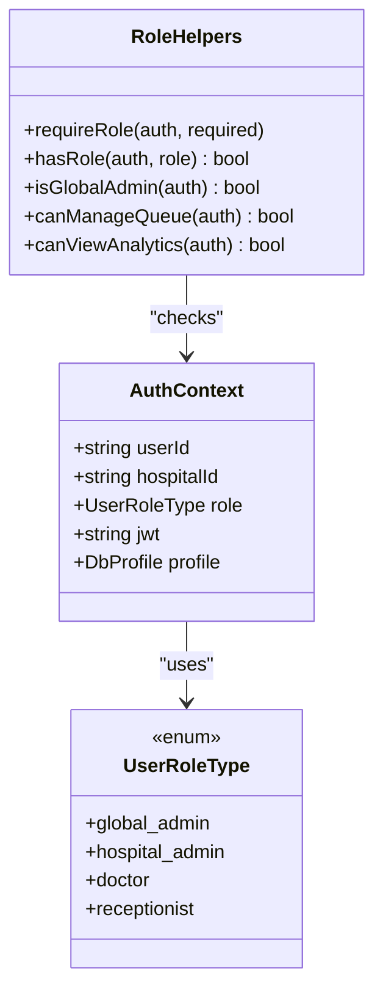
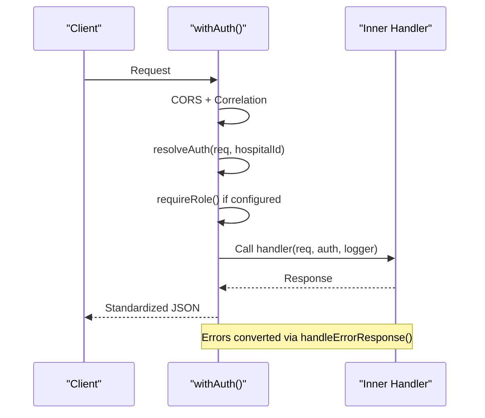
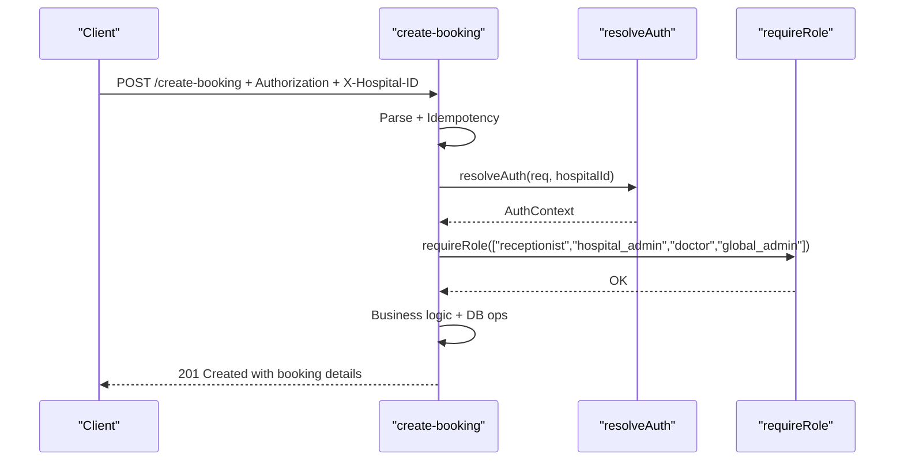
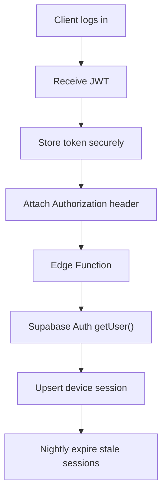
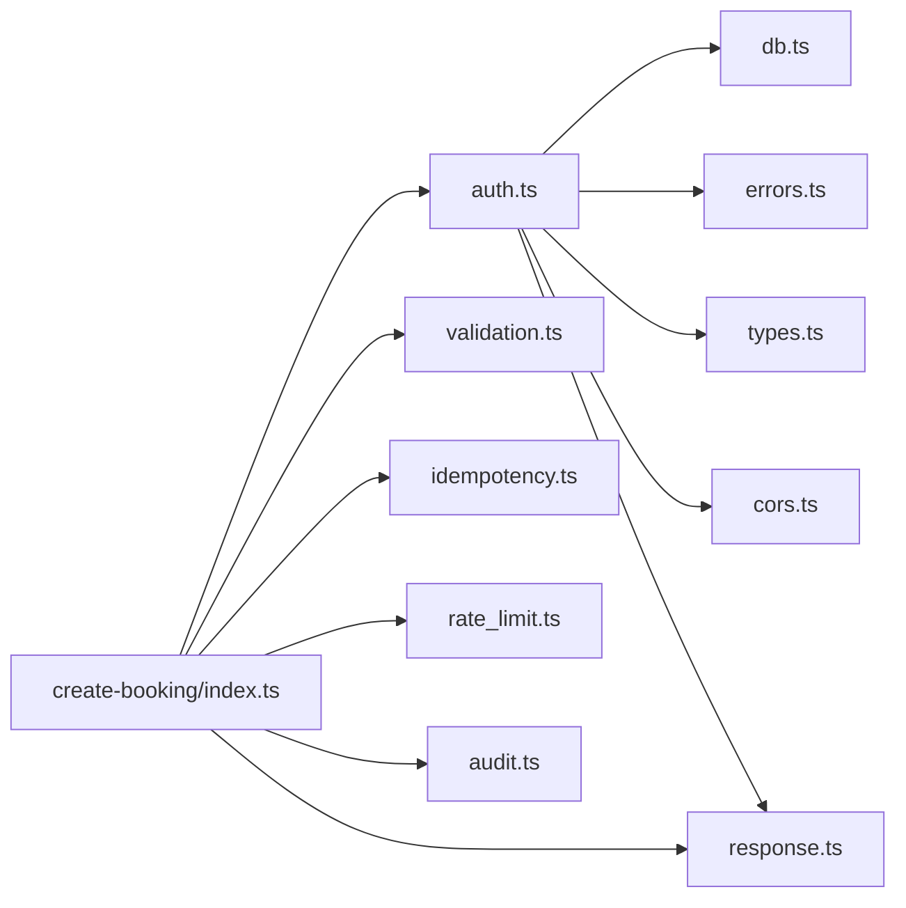

# Authentication & Authorization

<cite>
**Referenced Files in This Document**
- [auth.ts](file://supabase/functions/_shared/auth.ts)
- [types.ts](file://supabase/functions/_shared/types.ts)
- [errors.ts](file://supabase/functions/_shared/errors.ts)
- [response.ts](file://supabase/functions/_shared/response.ts)
- [db.ts](file://supabase/functions/_shared/db.ts)
- [cors.ts](file://supabase/functions/_shared/cors.ts)
- [create-booking/index.ts](file://supabase/functions/create-booking/index.ts)
- [27_role_permissions.sql](file://supabase/migrations/27_role_permissions.sql)
- [01_foundation.sql](file://supabase/migrations/01_foundation.sql)
- [30_device_sessions.sql](file://supabase/migrations/30_device_sessions.sql)
</cite>

## Table of Contents

1. [Introduction](#introduction)
2. [Project Structure](#project-structure)
3. [Core Components](#core-components)
4. [Architecture Overview](#architecture-overview)
5. [Detailed Component Analysis](#detailed-component-analysis)
6. [Dependency Analysis](#dependency-analysis)
7. [Performance Considerations](#performance-considerations)
8. [Troubleshooting Guide](#troubleshooting-guide)
9. [Conclusion](#conclusion)
10. [Appendices](#appendices)

## Introduction

This document explains the authentication and authorization model for Setura
Hospital OS. It covers:

- JWT-based authentication using Supabase Auth, including token extraction,
  validation, and user context resolution
- Multi-tenant security with hospital isolation via headers and role checks
- Role-based access control (RBAC) for global_admin, hospital_admin, doctor, and
  receptionist
- Practical middleware usage with the withAuth wrapper
- The AuthContext structure and its usage across edge functions
- Token lifecycle management, session handling, and error responses
- Guidance for securing API endpoints and implementing authorization checks in
  edge functions

## Project Structure

Authentication and authorization are implemented as shared utilities in the
Supabase Edge Functions layer, with RBAC enforced both at the function level and
in the database via Row-Level Security (RLS).

**Diagram sources**

- [auth.ts:22-124](file://supabase/functions/_shared/auth.ts#L22-L124)
- [db.ts:80-108](file://supabase/functions/_shared/db.ts#L80-L108)
- [response.ts:192-206](file://supabase/functions/_shared/response.ts#L192-L206)

**Section sources**

- [auth.ts:22-124](file://supabase/functions/_shared/auth.ts#L22-L124)
- [db.ts:80-108](file://supabase/functions/_shared/db.ts#L80-L108)
- [response.ts:192-206](file://supabase/functions/_shared/response.ts#L192-L206)

## Core Components

- JWT extraction and validation: extractJwt(), resolveAuth()
- Role and hospital enforcement: requireRole(), requireHospitalAccess(),
  hasRole(), isGlobalAdmin()
- Middleware composition: withAuth()
- Error taxonomy: UnauthorizedError, HospitalAccessDeniedError,
  RoleInsufficientError
- Standardized responses: handleErrorResponse(), successResponse(),
  unauthorizedResponse(), forbiddenResponse()
- Database clients: createAuthClient(jwt), getServiceClient()

Key responsibilities:

- Always validate tokens via Supabase Auth rather than manual decoding
- Resolve roles from the authoritative user_roles table
- Enforce hospital isolation before any business logic runs
- Return typed errors mapped to standardized HTTP responses

**Section sources**

- [auth.ts:22-185](file://supabase/functions/_shared/auth.ts#L22-L185)
- [errors.ts:106-150](file://supabase/functions/_shared/errors.ts#L106-L150)
- [response.ts:44-132](file://supabase/functions/_shared/response.ts#L44-L132)
- [db.ts:80-108](file://supabase/functions/_shared/db.ts#L80-L108)

## Architecture Overview

The system uses a layered approach:

- Transport layer: Edge Functions receive requests with Authorization: Bearer
  <token> and X-Hospital-ID
- Auth layer: extractJwt validates presence; resolveAuth calls Supabase Auth to
  verify signature, expiry, revocation; loads profile and resolves role per
  hospital
- Policy layer: requireRole and requireHospitalAccess enforce RBAC and tenant
  boundaries
- Data layer: Service client writes data; RLS policies further restrict row
  access by hospital and role

**Diagram sources**

- [auth.ts:22-124](file://supabase/functions/_shared/auth.ts#L22-L124)
- [db.ts:80-108](file://supabase/functions/_shared/db.ts#L80-L108)
- [response.ts:192-206](file://supabase/functions/_shared/response.ts#L192-L206)

## Detailed Component Analysis

### JWT Extraction and Validation

- Token extraction: Reads Authorization header, expects Bearer scheme
- Validation: Uses Supabase Auth client created with the provided JWT to call
  getUser(); this handles key rotation, expiry, and revocation
- Profile loading: Fetches profile from profiles table and ensures account is
  active
- Role resolution:
  - If hospitalId is present, look up user_roles for that hospital; if not
    found, check for global_admin
  - If no hospitalId, load primary role where is_primary = true

**Diagram sources**

- [auth.ts:22-124](file://supabase/functions/_shared/auth.ts#L22-L124)

**Section sources**

- [auth.ts:22-124](file://supabase/functions/_shared/auth.ts#L22-L124)

### Multi-Tenant Security Model (Hospital Isolation)

- Every request must include X-Hospital-ID header for tenant scoping
- resolveAuth enforces membership:
  - For non-global_admin users, requires a matching user_roles entry for the
    hospital
  - global_admin bypasses tenant isolation
- requireHospitalAccess provides explicit checks when needed
- Database-level isolation:
  - Tables carry hospital_id
  - RLS policies and helper functions (e.g., has_permission) enforce tenant
    boundaries

**Diagram sources**

- [auth.ts:78-124](file://supabase/functions/_shared/auth.ts#L78-L124)
- [27_role_permissions.sql:133-155](file://supabase/migrations/27_role_permissions.sql#L133-L155)

**Section sources**

- [auth.ts:78-124](file://supabase/functions/_shared/auth.ts#L78-L124)
- [27_role_permissions.sql:133-155](file://supabase/migrations/27_role_permissions.sql#L133-L155)

### Role-Based Access Control (RBAC)

Roles and hierarchy:

- global_admin: highest privilege, bypasses hospital isolation
- hospital_admin: full hospital control
- doctor: clinical operations
- receptionist: front-desk booking and communication

Enforcement:

- ROLE_HIERARCHY defines numeric levels
- requireRole asserts minimum required roles
- hasRole and isGlobalAdmin provide boolean checks
- Database permissions:
  - role_permissions maps roles to granular permissions
  - has_permission(current_user_has_permission) used by RLS policies
  - get_user_permissions returns effective permissions array

**Diagram sources**

- [types.ts:11-15](file://supabase/functions/_shared/types.ts#L11-L15)
- [types.ts:264-270](file://supabase/functions/_shared/types.ts#L264-L270)
- [auth.ts:129-185](file://supabase/functions/_shared/auth.ts#L129-L185)
- [27_role_permissions.sql:70-125](file://supabase/migrations/27_role_permissions.sql#L70-L125)

**Section sources**

- [auth.ts:129-185](file://supabase/functions/_shared/auth.ts#L129-L185)
- [types.ts:11-15](file://supabase/functions/_shared/types.ts#L11-L15)
- [types.ts:264-270](file://supabase/functions/_shared/types.ts#L264-L270)
- [27_role_permissions.sql:70-125](file://supabase/migrations/27_role_permissions.sql#L70-L125)

### Middleware: withAuth Wrapper

withAuth is a reusable middleware that:

- Handles CORS preflight
- Resolves correlation ID
- Extracts hospitalId from X-Hospital-ID header
- Calls resolveAuth to authenticate and authorize
- Optionally enforces required roles via requireRole
- Invokes the inner handler with a guaranteed non-null AuthContext
- Catches errors and converts them to standardized responses

Practical usage pattern:

- Wrap your handler with withAuth(handler, { requiredRoles: [...] })
- Ensure callers send Authorization: Bearer <token> and X-Hospital-ID

**Diagram sources**

- [auth.ts:187-236](file://supabase/functions/_shared/auth.ts#L187-L236)
- [response.ts:192-206](file://supabase/functions/_shared/response.ts#L192-L206)

**Section sources**

- [auth.ts:187-236](file://supabase/functions/_shared/auth.ts#L187-L236)

### Example: Securing an Endpoint

In create-booking/index.ts:

- Validates method and extracts idempotency key
- Requires X-Hospital-ID header
- Calls resolveAuth with hospitalId
- Enforces allowed roles for booking creation
- Proceeds with business logic only after successful authz

**Diagram sources**

- [create-booking/index.ts:67-119](file://supabase/functions/create-booking/index.ts#L67-L119)
- [auth.ts:42-124](file://supabase/functions/_shared/auth.ts#L42-L124)

**Section sources**

- [create-booking/index.ts:67-119](file://supabase/functions/create-booking/index.ts#L67-L119)
- [auth.ts:42-124](file://supabase/functions/_shared/auth.ts#L42-L124)

### AuthContext Structure

AuthContext carries the authenticated identity and scope:

- userId: Supabase user UUID
- hospitalId: Tenant context (nullable for global operations)
- role: One of the four roles (or null if not resolved)
- jwt: Original token string
- profile: Full profile record

It is passed into handlers to enable fine-grained decisions without re-parsing
requests.

**Section sources**

- [types.ts:264-270](file://supabase/functions/_shared/types.ts#L264-L270)

### Token Lifecycle Management and Session Handling

- Token validation: Per-request validation via Supabase Auth getUser() ensures
  current validity (signature, expiry, revocation)
- Session tracking: device_sessions records per-device sessions keyed by hashed
  JWT; supports multi-device access and staleness cleanup
- Best practices:
  - Do not cache per-request auth clients; create fresh per invocation
  - Use service-role client for privileged writes; rely on RLS for row-level
    safety
  - Log security events and audit actions for traceability

**Diagram sources**

- [db.ts:80-108](file://supabase/functions/_shared/db.ts#L80-L108)
- [30_device_sessions.sql:14-35](file://supabase/migrations/30_device_sessions.sql#L14-L35)
- [30_device_sessions.sql:76-127](file://supabase/migrations/30_device_sessions.sql#L76-L127)
- [30_device_sessions.sql:161-177](file://supabase/migrations/30_device_sessions.sql#L161-L177)

**Section sources**

- [db.ts:80-108](file://supabase/functions/_shared/db.ts#L80-L108)
- [30_device_sessions.sql:14-35](file://supabase/migrations/30_device_sessions.sql#L14-L35)
- [30_device_sessions.sql:76-127](file://supabase/migrations/30_device_sessions.sql#L76-L127)
- [30_device_sessions.sql:161-177](file://supabase/migrations/30_device_sessions.sql#L161-L177)

### Error Responses for Authentication Failures

- UnauthorizedError: Missing or invalid/expired token → 401
- HospitalAccessDeniedError: Not a member of requested hospital → 403
- RoleInsufficientError: Insufficient role for endpoint → 403
- All errors are converted to standardized JSON via handleErrorResponse

Common fields in error responses:

- success: false
- error.code, error.message, error.retryable
- correlationId, timestamp

**Section sources**

- [errors.ts:106-150](file://supabase/functions/_shared/errors.ts#L106-L150)
- [response.ts:69-132](file://supabase/functions/_shared/response.ts#L69-L132)
- [response.ts:192-206](file://supabase/functions/_shared/response.ts#L192-L206)

## Dependency Analysis

- auth.ts depends on:
  - db.ts for Supabase clients (auth and service)
  - errors.ts for typed exceptions
  - types.ts for AuthContext and role enums
  - cors.ts and response.ts via dynamic imports in withAuth
- create-booking/index.ts composes:
  - auth.ts for resolveAuth and requireRole
  - validation.ts for schema parsing
  - idempotency.ts for idempotent operations
  - rate_limit.ts for throttling
  - audit.ts for logging
  - response.ts for standardized outputs

**Diagram sources**

- [auth.ts:13-21](file://supabase/functions/_shared/auth.ts#L13-L21)
- [auth.ts:212-236](file://supabase/functions/_shared/auth.ts#L212-L236)
- [create-booking/index.ts:34-51](file://supabase/functions/create-booking/index.ts#L34-L51)

**Section sources**

- [auth.ts:13-21](file://supabase/functions/_shared/auth.ts#L13-L21)
- [auth.ts:212-236](file://supabase/functions/_shared/auth.ts#L212-L236)
- [create-booking/index.ts:34-51](file://supabase/functions/create-booking/index.ts#L34-L51)

## Performance Considerations

- Avoid per-request caching of auth clients; create fresh instances to ensure
  correct impersonation and RLS behavior
- Prefer server-side role and permission checks in edge functions; do not trust
  client-provided roles
- Keep auth path minimal: extract JWT, call getUser(), load profile and role
  once per request
- Use service-role client only for necessary writes; rely on RLS for read
  isolation
- Batch or coalesce DB reads where possible within the same transactional
  boundary

[No sources needed since this section provides general guidance]

## Troubleshooting Guide

Common issues and resolutions:

- Missing Authorization header: Ensure client sends Authorization: Bearer
  <token>
- Invalid or expired token: Re-authenticate to obtain a new token; Supabase Auth
  getUser() will reject stale tokens
- Inactive profile: Contact admin to activate the account
- Hospital access denied: Verify X-Hospital-ID matches a hospital where the user
  has a role; global_admin can bypass
- Role insufficient: Confirm user has one of the required roles for the
  endpoint; adjust roles accordingly
- Unexpected 500: Check logs for unhandled exceptions; wrap handlers with
  withAuth to standardize error mapping

Useful diagnostics:

- correlationId from response body helps correlate logs across services
- Audit logs capture actorUserId, entityType, entityId, actionType for
  traceability

**Section sources**

- [errors.ts:106-150](file://supabase/functions/_shared/errors.ts#L106-L150)
- [response.ts:192-206](file://supabase/functions/_shared/response.ts#L192-L206)
- [create-booking/index.ts:587-607](file://supabase/functions/create-booking/index.ts#L587-L607)

## Conclusion

Setura’s authentication and authorization model centers on robust JWT validation
via Supabase Auth, strict hospital isolation, and fine-grained RBAC. The
withAuth middleware standardizes auth flow across edge functions, while
database-level RLS and permission functions provide defense-in-depth. By
following the patterns outlined here—validating tokens, resolving roles per
hospital, enforcing required roles, and returning standardized errors—you can
secure APIs consistently and safely.

[No sources needed since this section summarizes without analyzing specific
files]

## Appendices

### Implementing Authentication Middleware with withAuth

- Wrap your handler: Deno.serve(withAuth(async (req, auth, logger) => { ... }, {
  requiredRoles: ["receptionist", "hospital_admin"] }))
- Ensure callers include:
  - Authorization: Bearer <token>
  - X-Hospital-ID: <hospital UUID>
- Inside handler, use auth.userId, auth.hospitalId, auth.role for decisions

**Section sources**

- [auth.ts:187-236](file://supabase/functions/_shared/auth.ts#L187-L236)

### Securing API Endpoints and Authorization Checks

- Always require X-Hospital-ID for tenant-scoped endpoints
- Use requireRole to gate sensitive operations
- For fine-grained permissions, consult role_permissions and has_permission in
  SQL
- Combine function-level checks with RLS policies for comprehensive protection

**Section sources**

- [auth.ts:129-185](file://supabase/functions/_shared/auth.ts#L129-L185)
- [27_role_permissions.sql:133-155](file://supabase/migrations/27_role_permissions.sql#L133-L155)

### Role Definitions and Permissions Matrix

- Roles defined in foundation migration and enforced in role_permissions
  migration
- Global admin has all permissions; hospital admins have broad hospital control;
  doctors and receptionists have scoped capabilities

**Section sources**

- [01_foundation.sql:20-30](file://supabase/migrations/01_foundation.sql#L20-L30)
- [27_role_permissions.sql:70-125](file://supabase/migrations/27_role_permissions.sql#L70-L125)
