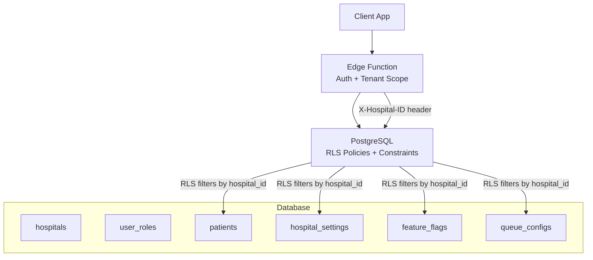
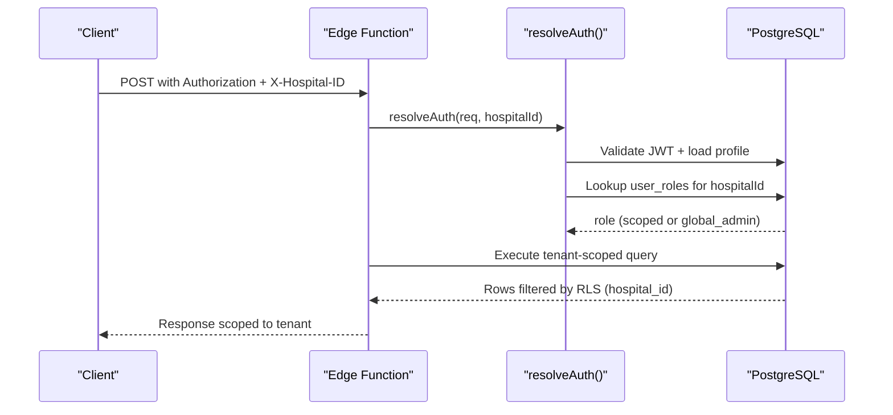
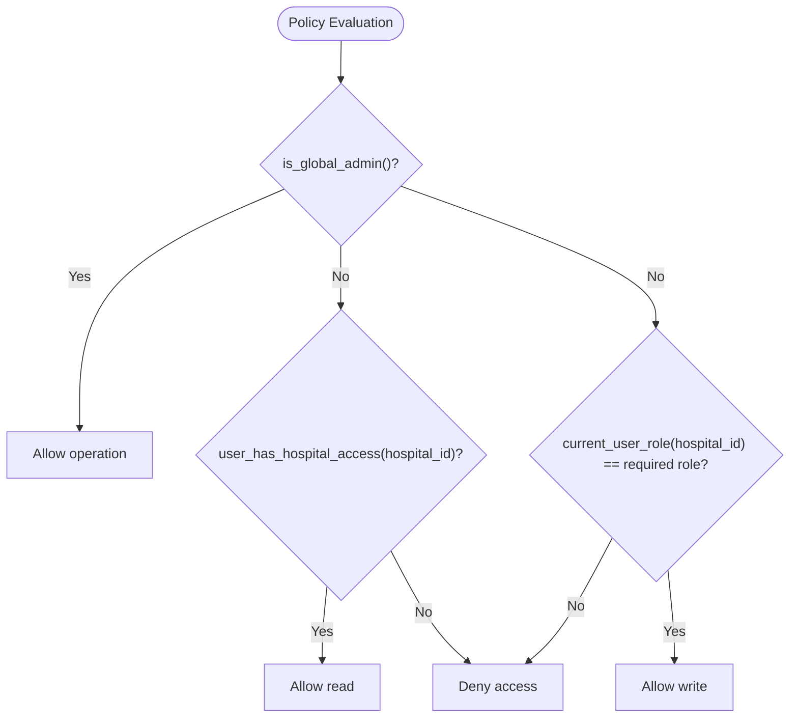
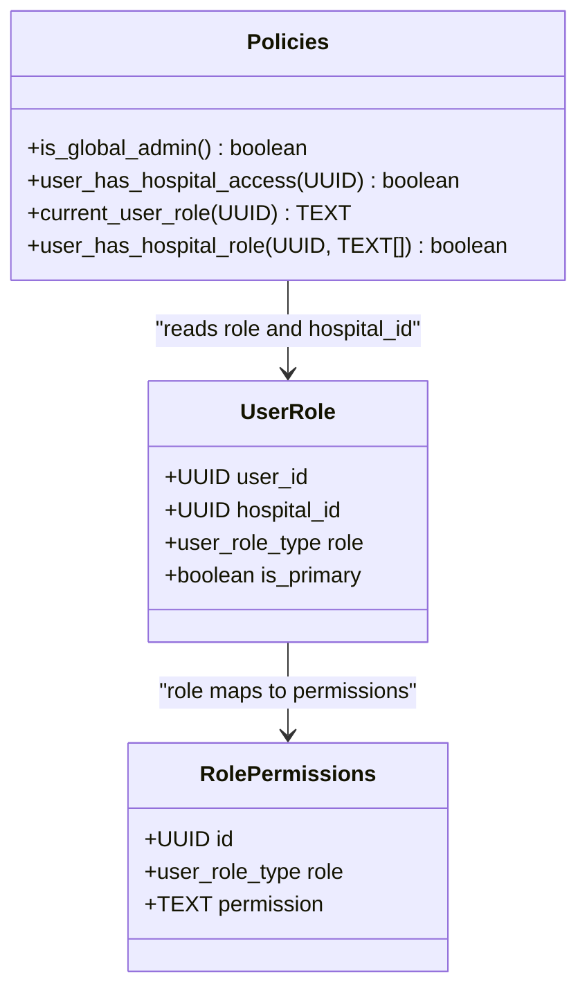
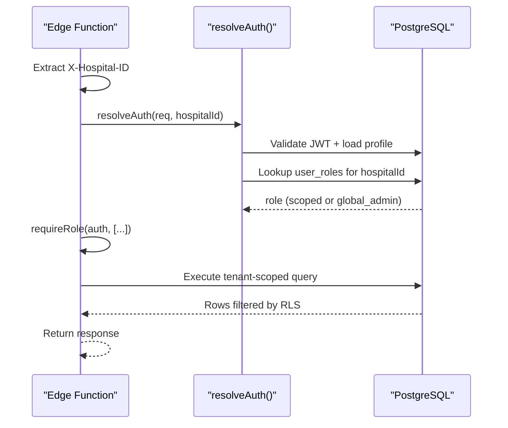
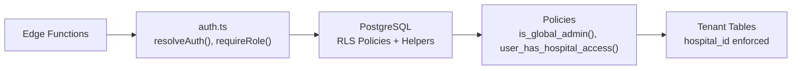

# Multi-Tenant Isolation

<cite>
**Referenced Files in This Document**
- [01_foundation.sql](file://supabase/migrations/01_foundation.sql)
- [27_role_permissions.sql](file://supabase/migrations/27_role_permissions.sql)
- [12_hospital_configuration_engine.sql](file://supabase/migrations/12_hospital_configuration_engine.sql)
- [auth.ts](file://supabase/functions/_shared/auth.ts)
- [create-booking/index.ts](file://supabase/functions/create-booking/index.ts)
- [carry-forward-tokens/index.ts](file://supabase/functions/carry-forward-tokens/index.ts)
- [process-refund/index.ts](file://supabase/functions/process-refund/index.ts)
- [cors.ts](file://supabase/functions/_shared/cors.ts)
- [AUDIT_REPORT.md](file://AUDIT_REPORT.md)
- [CROSS_CHECK_REPORT.md](file://CROSS_CHECK_REPORT.md)
</cite>

## Table of Contents

1. [Introduction](#introduction)
2. [Project Structure](#project-structure)
3. [Core Components](#core-components)
4. [Architecture Overview](#architecture-overview)
5. [Detailed Component Analysis](#detailed-component-analysis)
6. [Dependency Analysis](#dependency-analysis)
7. [Performance Considerations](#performance-considerations)
8. [Troubleshooting Guide](#troubleshooting-guide)
9. [Conclusion](#conclusion)
10. [Appendices](#appendices)

## Introduction

This document explains how Setura Hospital OS enforces strict multi-tenant
isolation between hospitals using row-level security (RLS), database
constraints, and edge function authorization. It details the hospital_id
enforcement mechanism, the role hierarchy where global_admin has cross-hospital
access while other roles are scoped to a single hospital, and provides guidance
for implementing tenant-scoped queries and safe context switching in edge
functions. It also outlines best practices to maintain multi-tenant integrity
and handle cross-hospital administrative operations securely.

## Project Structure

The multi-tenant architecture spans three layers:

- Database schema and RLS policies define tenant boundaries and enforce them at
  query time.
- Edge Functions validate the hospital context from request headers and resolve
  user roles before executing business logic.
- Shared utilities provide consistent auth resolution, role checks, and error
  handling across all endpoints.

**Diagram sources**

- [01_foundation.sql:558-592](file://supabase/migrations/01_foundation.sql#L558-L592)
- [12_hospital_configuration_engine.sql:565-690](file://supabase/migrations/12_hospital_configuration_engine.sql#L565-L690)
- [auth.ts:42-124](file://supabase/functions/_shared/auth.ts#L42-L124)

**Section sources**

- [01_foundation.sql:558-592](file://supabase/migrations/01_foundation.sql#L558-L592)
- [12_hospital_configuration_engine.sql:565-690](file://supabase/migrations/12_hospital_configuration_engine.sql#L565-L690)
- [auth.ts:42-124](file://supabase/functions/_shared/auth.ts#L42-L124)

## Core Components

- Tenant boundary key: Every tenant-scoped table includes a hospital_id column
  with foreign keys to hospitals.
- Row-Level Security: RLS is enabled and forced on core tables; policies use
  helper functions to check user membership or global admin status.
- Role hierarchy: global_admin can operate across hospitals; other roles are
  scoped to a specific hospital via user_roles.
- Immutability guard: A trigger prevents changing hospital_id after insert to
  avoid accidental tenant reassignment.
- Edge function authorization: Each endpoint validates X-Hospital-ID, resolves
  JWT, loads profile and role, and enforces scope.

Key implementation references:

- RLS helpers and policies:
  [01_foundation.sql:254-376](file://supabase/migrations/01_foundation.sql#L254-L376),
  [01_foundation.sql:558-792](file://supabase/migrations/01_foundation.sql#L558-L792)
- Role permissions engine:
  [27_role_permissions.sql:128-209](file://supabase/migrations/27_role_permissions.sql#L128-L209)
- Immutability trigger:
  [01_foundation.sql:76-94](file://supabase/migrations/01_foundation.sql#L76-L94)
- Edge auth resolution:
  [auth.ts:42-124](file://supabase/functions/_shared/auth.ts#L42-L124)

**Section sources**

- [01_foundation.sql:76-94](file://supabase/migrations/01_foundation.sql#L76-L94)
- [01_foundation.sql:254-376](file://supabase/migrations/01_foundation.sql#L254-L376)
- [01_foundation.sql:558-792](file://supabase/migrations/01_foundation.sql#L558-L792)
- [27_role_permissions.sql:128-209](file://supabase/migrations/27_role_permissions.sql#L128-L209)
- [auth.ts:42-124](file://supabase/functions/_shared/auth.ts#L42-L124)

## Architecture Overview

The system enforces multi-tenancy through layered controls:

- Request layer: Edge functions require X-Hospital-ID and validate it against
  the authenticated user’s resolved role and hospital membership.
- Authorization layer: Auth resolution checks JWT validity, loads profile, and
  determines role for the specified hospital or global_admin.
- Data layer: PostgreSQL RLS policies filter rows by hospital_id using helper
  functions; triggers prevent tenant ID mutation.

**Diagram sources**

- [auth.ts:42-124](file://supabase/functions/_shared/auth.ts#L42-L124)
- [01_foundation.sql:558-792](file://supabase/migrations/01_foundation.sql#L558-L792)

## Detailed Component Analysis

### Database Layer: RLS and Constraints

- RLS helpers:
  - current_user_role(hospital_id): returns the user’s role at a hospital.
  - is_global_admin(): true if the user has global_admin role.
  - user_has_hospital_access(hospital_id): true if the user has any role at that
    hospital.
  - user_has_hospital_role(hospital_id, roles[]): true if the user has one of
    the listed roles at that hospital.
- RLS policies:
  - Read policies typically allow global_admin or users with access to the
    hospital_id.
  - Write policies restrict mutations to authorized roles per hospital.
- Immutability:
  - prevent_hospital_id_update() raises an exception on attempts to change
    hospital_id, preventing tenant reassignment.

Examples of policy usage:

- Hospitals read/write:
  [01_foundation.sql:580-602](file://supabase/migrations/01_foundation.sql#L580-L602)
- Profiles self-access and admin read:
  [01_foundation.sql:608-638](file://supabase/migrations/01_foundation.sql#L608-L638)
- User roles read/manage:
  [01_foundation.sql:644-666](file://supabase/migrations/01_foundation.sql#L644-L666)
- Patients read/insert/update:
  [01_foundation.sql:672-728](file://supabase/migrations/01_foundation.sql#L672-L728)
- Working hours/holidays manage:
  [01_foundation.sql:734-792](file://supabase/migrations/01_foundation.sql#L734-L792)
- Configuration engine policies:
  [12_hospital_configuration_engine.sql:584-690](file://supabase/migrations/12_hospital_configuration_engine.sql#L584-L690)

**Diagram sources**

- [01_foundation.sql:254-376](file://supabase/migrations/01_foundation.sql#L254-L376)
- [01_foundation.sql:580-792](file://supabase/migrations/01_foundation.sql#L580-L792)

**Section sources**

- [01_foundation.sql:254-376](file://supabase/migrations/01_foundation.sql#L254-L376)
- [01_foundation.sql:580-792](file://supabase/migrations/01_foundation.sql#L580-L792)
- [12_hospital_configuration_engine.sql:584-690](file://supabase/migrations/12_hospital_configuration_engine.sql#L584-L690)

### Role Hierarchy and Permissions

- Roles: global_admin, hospital_admin, doctor, receptionist.
- Global admin bypasses tenant isolation; other roles are scoped to a specific
  hospital.
- Permission matrix defines granular capabilities per role; has_permission() and
  get_user_permissions() support fine-grained checks.

References:

- Role enum and user_roles constraints:
  [01_foundation.sql:20-30](file://supabase/migrations/01_foundation.sql#L20-L30),
  [01_foundation.sql:202-235](file://supabase/migrations/01_foundation.sql#L202-L235)
- Permission functions:
  [27_role_permissions.sql:128-209](file://supabase/migrations/27_role_permissions.sql#L128-L209)

**Diagram sources**

- [01_foundation.sql:202-235](file://supabase/migrations/01_foundation.sql#L202-L235)
- [27_role_permissions.sql:42-55](file://supabase/migrations/27_role_permissions.sql#L42-L55)
- [01_foundation.sql:254-376](file://supabase/migrations/01_foundation.sql#L254-L376)

**Section sources**

- [01_foundation.sql:20-30](file://supabase/migrations/01_foundation.sql#L20-L30)
- [01_foundation.sql:202-235](file://supabase/migrations/01_foundation.sql#L202-L235)
- [27_role_permissions.sql:128-209](file://supabase/migrations/27_role_permissions.sql#L128-L209)

### Edge Functions: Tenant Context Enforcement

- Header requirement: X-Hospital-ID must be present; otherwise, validation fails
  early.
- Auth resolution: resolveAuth() validates JWT, loads profile, and resolves role
  for the given hospital or global_admin.
- Role enforcement: requireRole() ensures only allowed roles can perform
  sensitive operations; global_admin always passes.
- Optional scope protection: Some endpoints explicitly verify that the resolved
  hospitalId matches the requested hospitalId for non-global admins.

Examples:

- create-booking: requires X-Hospital-ID and calls resolveAuth();
  [create-booking/index.ts:95-106](file://supabase/functions/create-booking/index.ts#L95-L106)
- carry-forward-tokens: enforces role and optional hospital scope mismatch
  check;
  [carry-forward-tokens/index.ts:67-120](file://supabase/functions/carry-forward-tokens/index.ts#L67-L120)
- process-refund: enforces X-Hospital-ID and role requirements;
  [process-refund/index.ts:122-134](file://supabase/functions/process-refund/index.ts#L122-L134)
- CORS allows X-Hospital-ID header;
  [cors.ts:6-22](file://supabase/functions/_shared/cors.ts#L6-L22)

**Diagram sources**

- [auth.ts:42-124](file://supabase/functions/_shared/auth.ts#L42-L124)
- [create-booking/index.ts:95-106](file://supabase/functions/create-booking/index.ts#L95-L106)
- [carry-forward-tokens/index.ts:67-120](file://supabase/functions/carry-forward-tokens/index.ts#L67-L120)
- [process-refund/index.ts:122-134](file://supabase/functions/process-refund/index.ts#L122-L134)

**Section sources**

- [auth.ts:42-124](file://supabase/functions/_shared/auth.ts#L42-L124)
- [create-booking/index.ts:95-106](file://supabase/functions/create-booking/index.ts#L95-L106)
- [carry-forward-tokens/index.ts:67-120](file://supabase/functions/carry-forward-tokens/index.ts#L67-L120)
- [process-refund/index.ts:122-134](file://supabase/functions/process-refund/index.ts#L122-L134)
- [cors.ts:6-22](file://supabase/functions/_shared/cors.ts#L6-L22)

### Examples of Implementing Hospital-Scoped Queries

- Use the service client to query tenant tables with explicit hospital_id
  filters.
- RLS will further ensure the current user can see only their hospital’s data.
- For admin-only reads/writes, rely on policies that check is_global_admin().

References:

- Tenant-scoped tables include hospital_id and RLS policies:
  [01_foundation.sql:558-792](file://supabase/migrations/01_foundation.sql#L558-L792)
- Configuration engine policies:
  [12_hospital_configuration_engine.sql:584-690](file://supabase/migrations/12_hospital_configuration_engine.sql#L584-L690)

Note: Always pass hospital_id consistently in queries and rely on RLS as the
final enforcement layer.

**Section sources**

- [01_foundation.sql:558-792](file://supabase/migrations/01_foundation.sql#L558-L792)
- [12_hospital_configuration_engine.sql:584-690](file://supabase/migrations/12_hospital_configuration_engine.sql#L584-L690)

### Security Implications of Hospital Context Switching

- If a user belongs to multiple hospitals, the X-Hospital-ID header determines
  the active tenant context for that request.
- Non-global-admin users cannot switch contexts arbitrarily; resolveAuth()
  verifies membership for the provided hospitalId.
- Global_admin can operate across hospitals but should still specify
  X-Hospital-ID to scope operations and logging.

References:

- Auth resolution and scope enforcement:
  [auth.ts:78-124](file://supabase/functions/_shared/auth.ts#L78-L124)
- Cross-check confirmation of header validation and isolation:
  [CROSS_CHECK_REPORT.md:149-163](file://CROSS_CHECK_REPORT.md#L149-L163)

**Section sources**

- [auth.ts:78-124](file://supabase/functions/_shared/auth.ts#L78-L124)
- [CROSS_CHECK_REPORT.md:149-163](file://CROSS_CHECK_REPORT.md#L149-L163)

### Best Practices for Developing Features with Multi-Tenant Integrity

- Always require X-Hospital-ID in edge functions and validate it before
  resolving auth.
- Use resolveAuth() to obtain the authenticated user’s role and hospital
  context; never trust client-provided IDs beyond validation.
- Enforce role-based access with requireRole() and rely on RLS policies for
  data-level isolation.
- Avoid direct SQL without hospital_id filters; let RLS enforce tenant
  boundaries.
- For cross-hospital admin operations, explicitly scope actions to a target
  hospital and log the operator and correlation IDs.
- Keep configuration changes within tenant scope unless performed by
  global_admin; leverage immutability triggers to prevent accidental tenant
  reassignment.

References:

- Header validation and auth flow:
  [create-booking/index.ts:95-106](file://supabase/functions/create-booking/index.ts#L95-L106),
  [auth.ts:42-124](file://supabase/functions/_shared/auth.ts#L42-L124)
- Immutability guard:
  [01_foundation.sql:76-94](file://supabase/migrations/01_foundation.sql#L76-L94)
- Policy enforcement patterns:
  [01_foundation.sql:558-792](file://supabase/migrations/01_foundation.sql#L558-L792)

**Section sources**

- [create-booking/index.ts:95-106](file://supabase/functions/create-booking/index.ts#L95-L106)
- [auth.ts:42-124](file://supabase/functions/_shared/auth.ts#L42-L124)
- [01_foundation.sql:76-94](file://supabase/migrations/01_foundation.sql#L76-L94)
- [01_foundation.sql:558-792](file://supabase/migrations/01_foundation.sql#L558-L792)

## Dependency Analysis

The multi-tenant system depends on cohesive interactions between edge functions,
auth utilities, and database policies:

- Edge functions depend on shared auth utilities to resolve context and roles.
- Database policies depend on helper functions to evaluate user membership and
  admin status.
- Configuration tables depend on RLS to ensure per-tenant visibility and
  modification rights.

**Diagram sources**

- [auth.ts:42-124](file://supabase/functions/_shared/auth.ts#L42-L124)
- [01_foundation.sql:254-376](file://supabase/migrations/01_foundation.sql#L254-L376)
- [01_foundation.sql:558-792](file://supabase/migrations/01_foundation.sql#L558-L792)

**Section sources**

- [auth.ts:42-124](file://supabase/functions/_shared/auth.ts#L42-L124)
- [01_foundation.sql:254-376](file://supabase/migrations/01_foundation.sql#L254-L376)
- [01_foundation.sql:558-792](file://supabase/migrations/01_foundation.sql#L558-L792)

## Performance Considerations

- RLS adds minimal overhead but ensures correctness; ensure indexes on
  hospital_id columns for efficient filtering.
- Helper functions are SECURITY DEFINER and STABLE; they execute quickly and
  reduce repeated checks.
- Prefer scoped queries with explicit hospital_id filters to leverage indexes
  and minimize scan size.
- Batch operations should remain within tenant scope to avoid unnecessary
  cross-tenant scans.

[No sources needed since this section provides general guidance]

## Troubleshooting Guide

Common issues and resolutions:

- Missing X-Hospital-ID header: Ensure clients send the header; edge functions
  reject requests without it.
  - Reference:
    [create-booking/index.ts:95-106](file://supabase/functions/create-booking/index.ts#L95-L106)
- Unauthorized or expired token: Verify JWT validity and user profile status;
  resolveAuth() handles these cases.
  - Reference:
    [auth.ts:47-76](file://supabase/functions/_shared/auth.ts#L47-L76)
- Hospital access denied: Confirm the user has a role in the specified hospital;
  global_admin bypasses this check.
  - Reference:
    [auth.ts:78-124](file://supabase/functions/_shared/auth.ts#L78-L124)
- Attempted tenant reassignment: prevent_hospital_id_update() blocks updates to
  hospital_id; fix upstream logic.
  - Reference:
    [01_foundation.sql:76-94](file://supabase/migrations/01_foundation.sql#L76-L94)
- Policy violations: Review RLS policies for the affected table and ensure
  correct role and hospital context.
  - Reference:
    [01_foundation.sql:558-792](file://supabase/migrations/01_foundation.sql#L558-L792)

**Section sources**

- [create-booking/index.ts:95-106](file://supabase/functions/create-booking/index.ts#L95-L106)
- [auth.ts:47-76](file://supabase/functions/_shared/auth.ts#L47-L76)
- [auth.ts:78-124](file://supabase/functions/_shared/auth.ts#L78-L124)
- [01_foundation.sql:76-94](file://supabase/migrations/01_foundation.sql#L76-L94)
- [01_foundation.sql:558-792](file://supabase/migrations/01_foundation.sql#L558-L792)

## Conclusion

Setura Hospital OS enforces robust multi-tenant isolation through a combination
of database constraints, RLS policies, and edge function authorization. The
hospital_id field acts as the primary tenant boundary, with RLS ensuring data
separation at query time. The role hierarchy grants global_admin cross-hospital
privileges while scoping other roles to their assigned hospital. Edge functions
validate the X-Hospital-ID header and resolve user context before executing
operations, preventing data leakage between tenants. Following the best
practices outlined here ensures features maintain multi-tenant integrity and
supports secure cross-hospital administrative operations.

[No sources needed since this section summarizes without analyzing specific
files]

## Appendices

### Appendix A: Key Migration References

- Foundation and RLS policies:
  [01_foundation.sql:558-792](file://supabase/migrations/01_foundation.sql#L558-L792)
- Role permissions engine:
  [27_role_permissions.sql:128-209](file://supabase/migrations/27_role_permissions.sql#L128-L209)
- Hospital configuration engine policies:
  [12_hospital_configuration_engine.sql:584-690](file://supabase/migrations/12_hospital_configuration_engine.sql#L584-L690)

**Section sources**

- [01_foundation.sql:558-792](file://supabase/migrations/01_foundation.sql#L558-L792)
- [27_role_permissions.sql:128-209](file://supabase/migrations/27_role_permissions.sql#L128-L209)
- [12_hospital_configuration_engine.sql:584-690](file://supabase/migrations/12_hospital_configuration_engine.sql#L584-L690)

### Appendix B: Audit and Cross-Check Confirmation

- Multi-tenant model and isolation mechanisms confirmed in audit reports.
  - Reference: [AUDIT_REPORT.md:293-347](file://AUDIT_REPORT.md#L293-L347)
  - Reference:
    [CROSS_CHECK_REPORT.md:149-163](file://CROSS_CHECK_REPORT.md#L149-L163)

**Section sources**

- [AUDIT_REPORT.md:293-347](file://AUDIT_REPORT.md#L293-L347)
- [CROSS_CHECK_REPORT.md:149-163](file://CROSS_CHECK_REPORT.md#L149-L163)
