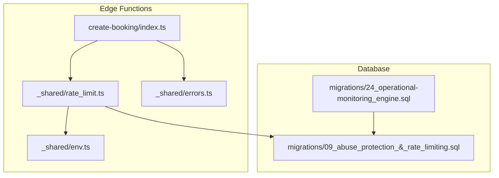
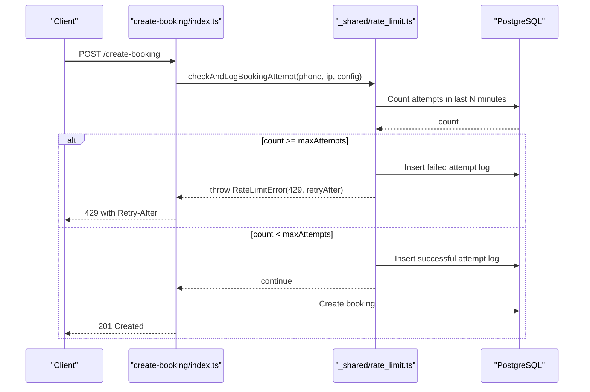
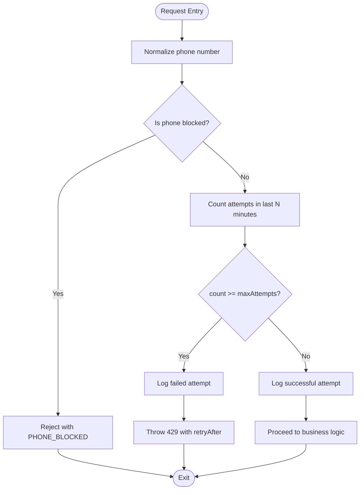
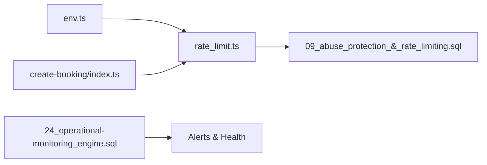
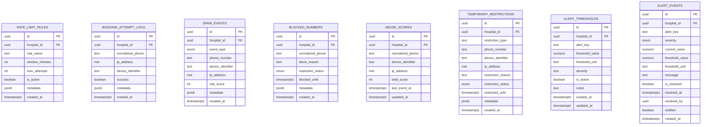

# Rate Limiting & Abuse Protection

<cite>
**Referenced Files in This Document**
- [rate_limit.ts](file://supabase/functions/_shared/rate_limit.ts)
- [errors.ts](file://supabase/functions/_shared/errors.ts)
- [env.ts](file://supabase/functions/_shared/env.ts)
- [create-booking/index.ts](file://supabase/functions/create-booking/index.ts)
- [09_abuse_protection_&_rate_limiting.sql](file://supabase/migrations/09_abuse_protection_&_rate_limiting.sql)
- [24_operational-monitoring_engine.sql](file://supabase/migrations/24_operational-monitoring_engine.sql)
</cite>

## Table of Contents

1. [Introduction](#introduction)
2. [Project Structure](#project-structure)
3. [Core Components](#core-components)
4. [Architecture Overview](#architecture-overview)
5. [Detailed Component Analysis](#detailed-component-analysis)
6. [Dependency Analysis](#dependency-analysis)
7. [Performance Considerations](#performance-considerations)
8. [Troubleshooting Guide](#troubleshooting-guide)
9. [Conclusion](#conclusion)
10. [Appendices](#appendices)

## Introduction

This document explains the rate limiting and abuse protection mechanisms in
Setura Hospital OS. It focuses on the sliding window rate limiting algorithm
used to prevent API abuse and system overload, configuration options for
per-endpoint, per-user, and per-hospital limits, abuse detection patterns (such
as rapid booking attempts), monitoring and alerting capabilities, and guidance
for tuning limits across environments while balancing security and user
experience.

## Project Structure

The rate limiting and abuse protection system spans shared runtime utilities,
edge functions, and database schema:

- Shared utilities implement distributed-safe rate checks and typed error
  handling.
- Edge functions integrate rate checks into request flows.
- Database migrations define tables, indexes, and SQL functions that back the
  sliding window counters, blocklists, abuse scores, and temporary restrictions.
- Operational monitoring provides alert thresholds and event tracking for
  detecting threats.

**Diagram sources**

- [create-booking/index.ts:158-166](file://supabase/functions/create-booking/index.ts#L158-L166)
- [rate_limit.ts:27-111](file://supabase/functions/_shared/rate_limit.ts#L27-L111)
- [09_abuse_protection_&_rate_limiting.sql:81-167](file://supabase/migrations/09_abuse_protection_&_rate_limiting.sql#L81-L167)
- [24_operational-monitoring_engine.sql:37-145](file://supabase/migrations/24_operational-monitoring_engine.sql#L37-L145)

**Section sources**

- [create-booking/index.ts:1-666](file://supabase/functions/create-booking/index.ts#L1-L666)
- [rate_limit.ts:1-124](file://supabase/functions/_shared/rate_limit.ts#L1-L124)
- [09_abuse_protection_&_rate_limiting.sql:1-729](file://supabase/migrations/09_abuse_protection_&_rate_limiting.sql#L1-L729)
- [24_operational-monitoring_engine.sql:1-200](file://supabase/migrations/24_operational-monitoring_engine.sql#L1-L200)

## Core Components

- Distributed sliding window rate limiter backed by a database table with
  time-bounded counts.
- Blocklist and temporary restriction tables to enforce immediate or time-bound
  blocks.
- Abuse scoring and spam event logging to track suspicious behavior over time.
- Typed error types for consistent rate limit responses and retry semantics.
- Environment-driven defaults for window size and attempt caps.
- Monitoring engine with configurable alert thresholds and event storage.

Key responsibilities:

- Enforce per-hospital, per-phone rate limits using a sliding window.
- Log all attempts (success/failure) for analysis and enforcement.
- Provide safe fail-open behavior when database checks fail to avoid blocking
  legitimate traffic.
- Expose structured errors with retry-after guidance.

**Section sources**

- [rate_limit.ts:16-124](file://supabase/functions/_shared/rate_limit.ts#L16-L124)
- [errors.ts:272-282](file://supabase/functions/_shared/errors.ts#L272-L282)
- [env.ts:183-191](file://supabase/functions/_shared/env.ts#L183-L191)
- [09_abuse_protection_&_rate_limiting.sql:120-167](file://supabase/migrations/09_abuse_protection_&_rate_limiting.sql#L120-L167)

## Architecture Overview

The system uses a database-backed sliding window to count recent attempts within
a configured time window. Each request triggers a check against the current
window; if the count exceeds the configured maximum, a rate limit error is
returned with a retry-after value. All attempts are logged for auditing and
further abuse detection.

**Diagram sources**

- [create-booking/index.ts:158-166](file://supabase/functions/create-booking/index.ts#L158-L166)
- [rate_limit.ts:27-111](file://supabase/functions/_shared/rate_limit.ts#L27-L111)
- [09_abuse_protection_&_rate_limiting.sql:120-167](file://supabase/migrations/09_abuse_protection_&_rate_limiting.sql#L120-L167)

## Detailed Component Analysis

### Sliding Window Rate Limiter

- Algorithm: Counts attempts within a rolling time window using a timestamped
  log table. The window and maximum attempts are configurable via environment
  variables or function-specific overrides.
- Distribution safety: No in-memory state; each check is a database read, making
  it safe across Edge Function cold starts.
- Fail-open: On database errors during the check, the request proceeds to avoid
  blocking legitimate users.
- Blocking: If a phone number is actively blocked or temporarily restricted,
  requests are rejected immediately.

**Diagram sources**

- [rate_limit.ts:27-111](file://supabase/functions/_shared/rate_limit.ts#L27-L111)
- [09_abuse_protection_&_rate_limiting.sql:120-167](file://supabase/migrations/09_abuse_protection_&_rate_limiting.sql#L120-L167)

**Section sources**

- [rate_limit.ts:27-111](file://supabase/functions/_shared/rate_limit.ts#L27-L111)
- [09_abuse_protection_&_rate_limiting.sql:120-167](file://supabase/migrations/09_abuse_protection_&_rate_limiting.sql#L120-L167)

### Configuration Options

- Global defaults:
  - Window duration in minutes and maximum attempts per window are sourced from
    environment variables.
- Per-call overrides:
  - The rate limiter accepts a configuration object including windowMinutes,
    maxAttempts, and hospitalId, enabling per-endpoint or per-hospital tuning
    without changing global defaults.
- IP extraction:
  - Caller IP is extracted from standard headers to support IP-based analytics
    and future IP-scoped rules.

Practical usage:

- In the create-booking flow, the rate limiter is invoked with the hospital
  context before any expensive operations, ensuring early rejection under load.

**Section sources**

- [env.ts:183-191](file://supabase/functions/_shared/env.ts#L183-L191)
- [rate_limit.ts:16-36](file://supabase/functions/_shared/rate_limit.ts#L16-L36)
- [create-booking/index.ts:158-166](file://supabase/functions/create-booking/index.ts#L158-L166)

### Abuse Detection System

- Spam events: Enumerated event types capture patterns such as rapid booking
  attempts, phone rotation, device rotation, payment failure floods, and IP
  floods. These can be recorded to build a history of suspicious activity.
- Abuse scores: A cumulative score per normalized phone (with optional device/IP
  association) enables progressive penalties based on observed behavior.
- Temporary restrictions: Time-bound restrictions can be applied to phones,
  devices, or IPs with an expiration time and reason.
- Cleanup: Automated cleanup marks expired restrictions as inactive to keep
  enforcement accurate over time.

Operational notes:

- The schema supports indexing for efficient queries by phone, IP, and time
  windows.
- Row-level security policies restrict administrative access to sensitive
  tables.

**Section sources**

- [09_abuse_protection_&_rate_limiting.sql:11-34](file://supabase/migrations/09_abuse_protection_&_rate_limiting.sql#L11-L34)
- [09_abuse_protection_&_rate_limiting.sql:173-213](file://supabase/migrations/09_abuse_protection_&_rate_limiting.sql#L173-L213)
- [09_abuse_protection_&_rate_limiting.sql:283-315](file://supabase/migrations/09_abuse_protection_&_rate_limiting.sql#L283-L315)
- [09_abuse_protection_&_rate_limiting.sql:329-379](file://supabase/migrations/09_abuse_protection_&_rate_limiting.sql#L329-L379)
- [09_abuse_protection_&_rate_limiting.sql:596-624](file://supabase/migrations/09_abuse_protection_&_rate_limiting.sql#L596-L624)

### Monitoring and Alerting

- Alert thresholds: Configurable thresholds per hospital enable dynamic
  sensitivity tuning for metrics like queue backlog, worker crashes, WhatsApp
  failures, and dead-letter queue backlogs.
- Alert events: When thresholds are breached, alert events are recorded with
  severity levels and contextual values.
- Health snapshots: Periodic snapshots aggregate key operational metrics to
  compute a health score and provide historical visibility.

Integration points:

- Use these tables to drive dashboards and external alerting systems.
- Combine abuse logs and rate limit violations with operational alerts to detect
  coordinated attacks or resource exhaustion.

**Section sources**

- [24_operational-monitoring_engine.sql:37-145](file://supabase/migrations/24_operational-monitoring_engine.sql#L37-L145)
- [24_operational-monitoring_engine.sql:157-200](file://supabase/migrations/24_operational-monitoring_engine.sql#L157-L200)

### Implementing Rate Limiting in Edge Functions

- Early invocation: Call the rate limiter after parsing and validating inputs
  but before executing expensive operations.
- Context: Pass hospitalId to scope limits per tenant.
- Error handling: Catch rate limit errors and return appropriate HTTP status
  codes with retry guidance.
- Metrics and tracing: Wrap calls with timing and metrics to monitor performance
  and identify hotspots.

Example integration point:

- The create-booking function invokes the rate limiter prior to loading hospital
  settings and performing availability checks.

**Section sources**

- [create-booking/index.ts:158-166](file://supabase/functions/create-booking/index.ts#L158-L166)

### Handling Rate Limit Exceeded Responses

- Response type: A typed rate limit error carries a retry-after value and
  metadata for clients to back off appropriately.
- Client behavior: Respect the retry-after interval and implement exponential
  backoff with jitter to reduce thundering herds.
- Observability: Ensure errors are logged with correlation IDs and context for
  troubleshooting.

**Section sources**

- [errors.ts:272-282](file://supabase/functions/_shared/errors.ts#L272-L282)

### Balancing Security and User Experience

- Grace periods: Use short initial windows with conservative limits to allow
  normal usage while catching automated abuse.
- Progressive penalties: Increase severity of restrictions as abuse scores rise
  (e.g., temporary restrictions with longer durations).
- Fail-open safeguards: Avoid blocking legitimate users during backend issues by
  allowing requests through when checks fail.
- Tuning: Adjust window sizes and attempt caps per environment (development vs
  production) and per endpoint sensitivity.

[No sources needed since this section provides general guidance]

### Tuning Rate Limits for Different Environments and Use Cases

- Development: Wider windows and higher attempt caps to facilitate testing
  without frequent throttling.
- Production: Tighter windows and lower caps to protect resources and maintain
  service stability.
- Endpoint-specific: Apply stricter limits to high-risk endpoints (e.g., booking
  creation) and more lenient limits to read-only endpoints.
- Tenant-specific: Use hospital-scoped configurations to accommodate varying
  traffic patterns and risk profiles.

**Section sources**

- [env.ts:183-191](file://supabase/functions/_shared/env.ts#L183-L191)
- [rate_limit.ts:16-36](file://supabase/functions/_shared/rate_limit.ts#L16-L36)

## Dependency Analysis

The rate limiting subsystem depends on:

- Environment configuration for default limits.
- Database schema for attempt logs, blocklists, abuse scores, and temporary
  restrictions.
- Edge function integration points to invoke checks at the right stage in
  request processing.
- Monitoring tables to record and act upon threshold breaches.

**Diagram sources**

- [env.ts:183-191](file://supabase/functions/_shared/env.ts#L183-L191)
- [rate_limit.ts:27-111](file://supabase/functions/_shared/rate_limit.ts#L27-L111)
- [create-booking/index.ts:158-166](file://supabase/functions/create-booking/index.ts#L158-L166)
- [09_abuse_protection_&_rate_limiting.sql:120-167](file://supabase/migrations/09_abuse_protection_&_rate_limiting.sql#L120-L167)
- [24_operational-monitoring_engine.sql:37-145](file://supabase/migrations/24_operational-monitoring_engine.sql#L37-L145)

**Section sources**

- [rate_limit.ts:27-111](file://supabase/functions/_shared/rate_limit.ts#L27-L111)
- [create-booking/index.ts:158-166](file://supabase/functions/create-booking/index.ts#L158-L166)
- [09_abuse_protection_&_rate_limiting.sql:120-167](file://supabase/migrations/09_abuse_protection_&_rate_limiting.sql#L120-L167)
- [24_operational-monitoring_engine.sql:37-145](file://supabase/migrations/24_operational-monitoring_engine.sql#L37-L145)

## Performance Considerations

- Database-backed sliding window avoids in-memory state and scales across
  distributed Edge Functions.
- Indexes on attempt logs by hospital, identifier, and timestamp optimize window
  queries.
- Fail-open behavior prevents cascading failures when the database is under
  stress.
- Logging every attempt adds write overhead; consider sampling or partitioning
  strategies for high-volume scenarios.
- Monitor query latency and adjust window sizes to balance accuracy and
  throughput.

[No sources needed since this section provides general guidance]

## Troubleshooting Guide

Common issues and resolutions:

- Frequent 429 responses:
  - Verify environment variables for window and max attempts.
  - Review attempt logs to identify spikes or misconfigurations.
- Legitimate users being blocked:
  - Check blocklists and temporary restrictions for active entries.
  - Ensure cleanup jobs run to expire old restrictions.
- High database load:
  - Reduce logging frequency or archive older logs.
  - Tune window sizes and attempt caps to reduce query pressure.
- Alerts firing unexpectedly:
  - Review alert thresholds and adjust sensitivity per environment.
  - Correlate alert events with rate limit violations and abuse scores.

**Section sources**

- [09_abuse_protection_&_rate_limiting.sql:596-624](file://supabase/migrations/09_abuse_protection_&_rate_limiting.sql#L596-L624)
- [24_operational-monitoring_engine.sql:37-145](file://supabase/migrations/24_operational-monitoring_engine.sql#L37-L145)

## Conclusion

Setura Hospital OS implements a robust, database-backed sliding window rate
limiter integrated into critical edge functions. Combined with blocklists, abuse
scoring, temporary restrictions, and a comprehensive monitoring engine, the
system provides strong protection against abuse while preserving user
experience. Proper configuration, continuous tuning, and proactive monitoring
ensure resilience across environments and use cases.

[No sources needed since this section summarizes without analyzing specific
files]

## Appendices

### Data Models Related to Rate Limiting and Abuse Protection

**Diagram sources**

- [09_abuse_protection_&_rate_limiting.sql:81-167](file://supabase/migrations/09_abuse_protection_&_rate_limiting.sql#L81-L167)
- [09_abuse_protection_&_rate_limiting.sql:173-213](file://supabase/migrations/09_abuse_protection_&_rate_limiting.sql#L173-L213)
- [09_abuse_protection_&_rate_limiting.sql:219-277](file://supabase/migrations/09_abuse_protection_&_rate_limiting.sql#L219-L277)
- [09_abuse_protection_&_rate_limiting.sql:283-315](file://supabase/migrations/09_abuse_protection_&_rate_limiting.sql#L283-L315)
- [09_abuse_protection_&_rate_limiting.sql:329-379](file://supabase/migrations/09_abuse_protection_&_rate_limiting.sql#L329-L379)
- [24_operational-monitoring_engine.sql:37-145](file://supabase/migrations/24_operational-monitoring_engine.sql#L37-L145)
