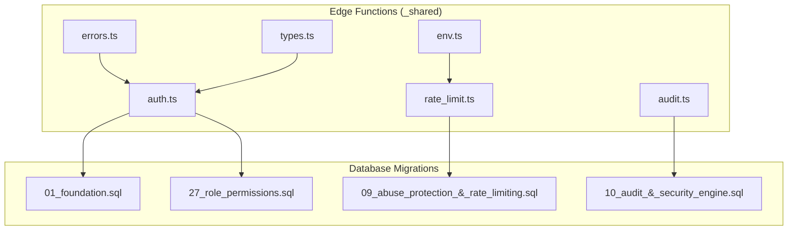
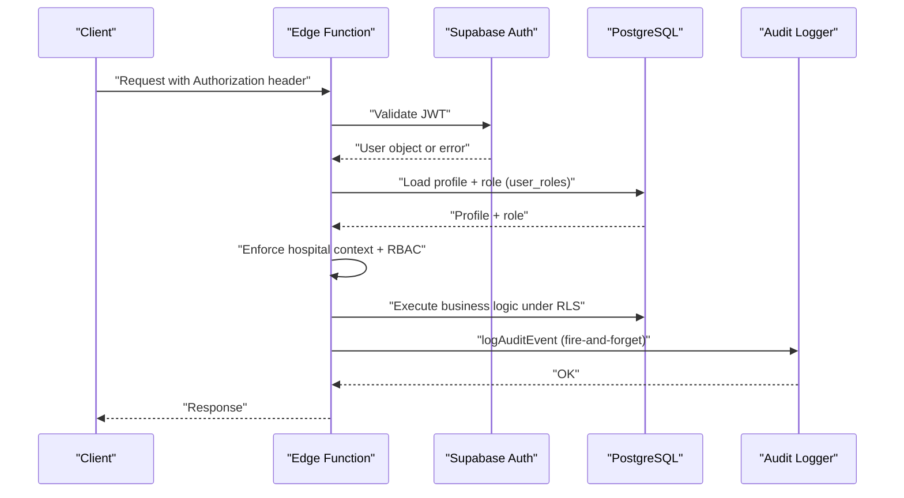
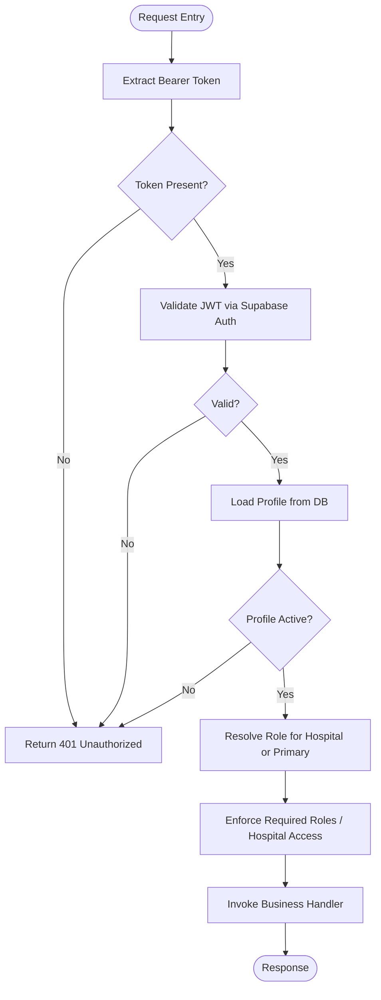
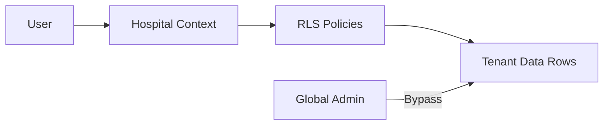
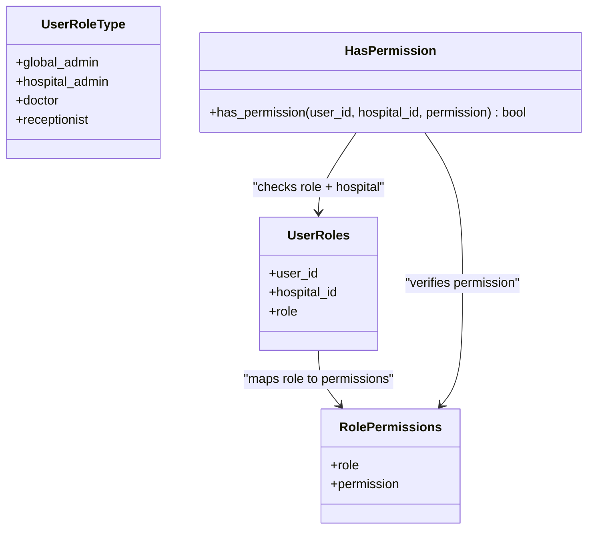
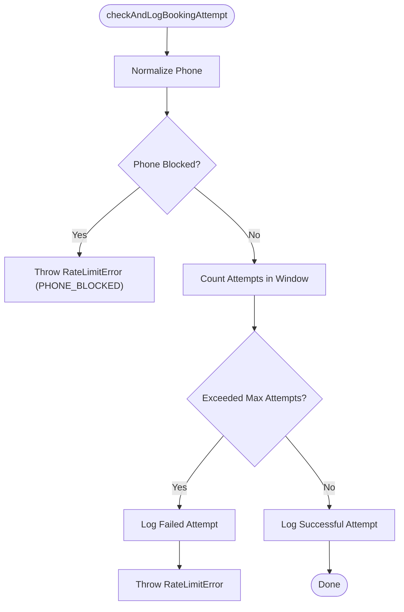
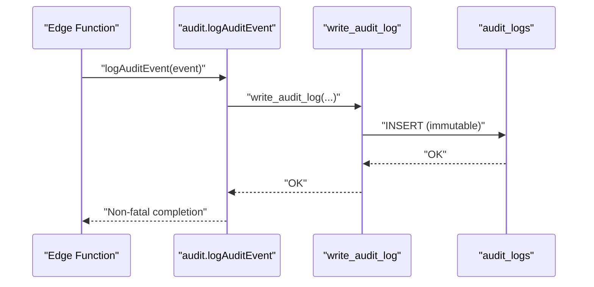
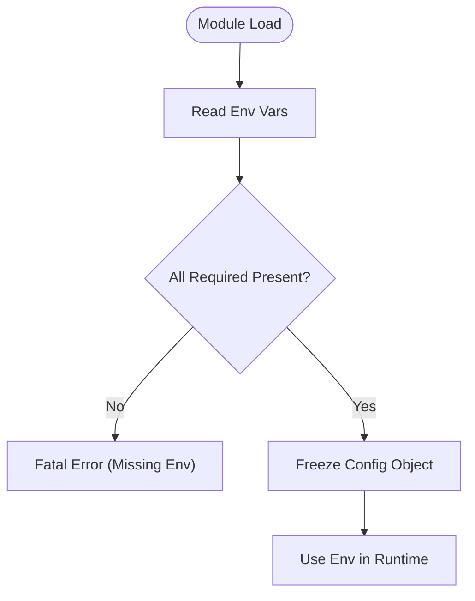
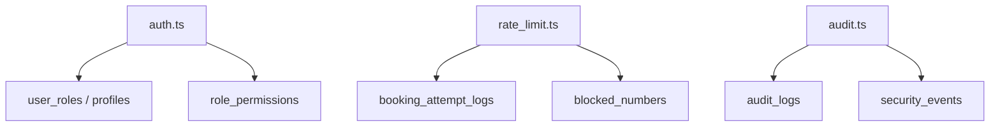

# Security & Authentication

<cite>
**Referenced Files in This Document**
- [auth.ts](file://supabase/functions/_shared/auth.ts)
- [rate_limit.ts](file://supabase/functions/_shared/rate_limit.ts)
- [audit.ts](file://supabase/functions/_shared/audit.ts)
- [errors.ts](file://supabase/functions/_shared/errors.ts)
- [types.ts](file://supabase/functions/_shared/types.ts)
- [env.ts](file://supabase/functions/_shared/env.ts)
- [01_foundation.sql](file://supabase/migrations/01_foundation.sql)
- [09_abuse_protection_&_rate_limiting.sql](file://supabase/migrations/09_abuse_protection_&_rate_limiting.sql)
- [10_audit_&_security_engine.sql](file://supabase/migrations/10_audit_&_security_engine.sql)
- [27_role_permissions.sql](file://supabase/migrations/27_role_permissions.sql)
- [config.toml](file://supabase/config.toml)
</cite>

## Table of Contents

1. Introduction
2. Project Structure
3. Core Components
4. Architecture Overview
5. Detailed Component Analysis
6. Dependency Analysis
7. Performance Considerations
8. Troubleshooting Guide
9. Conclusion
10. Appendices

## Introduction

This document explains the security and authentication model for Setura Hospital
OS, focusing on multi-tenant isolation, role-based access control, JWT
validation via Supabase Auth, rate limiting and abuse protection, audit logging,
secure configuration management, and healthcare compliance considerations. It is
intended for developers, security engineers, and operators who need to
understand how tenant isolation and permissions are enforced end-to-end across
Edge Functions and the database.

## Project Structure

Security-related logic spans two layers:

- Edge Function shared utilities (authentication, authorization helpers, rate
  limiting, audit logging, error types, environment validation)
- Database migrations that define roles, permissions, row-level security
  policies, abuse protection tables, and immutable audit logs

**Diagram sources**

- [auth.ts:1-237](file://supabase/functions/_shared/auth.ts#L1-L237)
- [rate_limit.ts:1-124](file://supabase/functions/_shared/rate_limit.ts#L1-L124)
- [audit.ts:1-75](file://supabase/functions/_shared/audit.ts#L1-L75)
- [errors.ts:1-323](file://supabase/functions/_shared/errors.ts#L1-L323)
- [types.ts:1-329](file://supabase/functions/_shared/types.ts#L1-L329)
- [env.ts:1-279](file://supabase/functions/_shared/env.ts#L1-L279)
- [01_foundation.sql:200-376](file://supabase/migrations/01_foundation.sql#L200-L376)
- [09_abuse_protection_&_rate_limiting.sql:1-729](file://supabase/migrations/09_abuse_protection_&_rate_limiting.sql#L1-L729)
- [10_audit_&_security_engine.sql:1-488](file://supabase/migrations/10_audit_&_security_engine.sql#L1-L488)
- [27_role_permissions.sql:1-273](file://supabase/migrations/27_role_permissions.sql#L1-L273)

**Section sources**

- [auth.ts:1-237](file://supabase/functions/_shared/auth.ts#L1-L237)
- [01_foundation.sql:200-376](file://supabase/migrations/01_foundation.sql#L200-L376)
- [27_role_permissions.sql:1-273](file://supabase/migrations/27_role_permissions.sql#L1-L273)
- [09_abuse_protection_&_rate_limiting.sql:1-729](file://supabase/migrations/09_abuse_protection_&_rate_limiting.sql#L1-L729)
- [10_audit_&_security_engine.sql:1-488](file://supabase/migrations/10_audit_&_security_engine.sql#L1-L488)

## Core Components

- Multi-tenant isolation: Every tenant-scoped table includes hospital_id;
  Row-Level Security (RLS) policies restrict access by hospital. Global admin
  can bypass tenant boundaries.
- Authentication flow: Edge Functions validate JWT using Supabase Auth client,
  resolve user profile and role from DB, enforce hospital context, and return a
  typed AuthContext.
- Role-based access control (RBAC): Roles are global_admin, hospital_admin,
  doctor, receptionist. Permissions are explicitly mapped per role and enforced
  via SQL functions and RLS policies.
- Rate limiting and abuse protection: Sliding window checks against
  booking_attempt_logs with support for blocked numbers, temporary restrictions,
  and abuse scoring.
- Audit logging: Immutable audit_logs with severity levels and centralized
  writer function; security_events capture security incidents.
- Secure configuration: Environment variables validated at startup; secrets
  injected via environment; CORS and auth settings configured in config.

**Section sources**

- [auth.ts:32-124](file://supabase/functions/_shared/auth.ts#L32-L124)
- [01_foundation.sql:200-376](file://supabase/migrations/01_foundation.sql#L200-L376)
- [27_role_permissions.sql:42-159](file://supabase/migrations/27_role_permissions.sql#L42-L159)
- [rate_limit.ts:22-111](file://supabase/functions/_shared/rate_limit.ts#L22-L111)
- [09_abuse_protection_&_rate_limiting.sql:120-371](file://supabase/migrations/09_abuse_protection_&_rate_limiting.sql#L120-L371)
- [audit.ts:47-75](file://supabase/functions/_shared/audit.ts#L47-L75)
- [10_audit_&_security_engine.sql:43-128](file://supabase/migrations/10_audit_&_security_engine.sql#L43-L128)
- [env.ts:82-279](file://supabase/functions/_shared/env.ts#L82-L279)

## Architecture Overview

The system enforces security at multiple layers:

- Edge Functions authenticate requests via JWT and resolve roles/hospital
  context before business logic runs.
- Database RLS policies ensure data isolation by hospital; helper functions
  provide safe checks for roles and permissions.
- Abuse protection tracks attempts and blocks abusive actors; audit logs record
  critical actions immutably.

**Diagram sources**

- [auth.ts:22-124](file://supabase/functions/_shared/auth.ts#L22-L124)
- [01_foundation.sql:261-376](file://supabase/migrations/01_foundation.sql#L261-L376)
- [27_role_permissions.sql:133-212](file://supabase/migrations/27_role_permissions.sql#L133-L212)
- [audit.ts:47-75](file://supabase/functions/_shared/audit.ts#L47-L75)

## Detailed Component Analysis

### Authentication Flow and JWT Validation

- Extracts Bearer token from Authorization header.
- Validates JWT via Supabase Auth client; rejects invalid/expired tokens.
- Loads user profile and ensures account is active.
- Resolves role for the requested hospital or primary role if no hospital
  context.
- Provides middleware wrapper to enforce required roles and handle errors
  consistently.

**Diagram sources**

- [auth.ts:22-124](file://supabase/functions/_shared/auth.ts#L22-L124)
- [auth.ts:189-237](file://supabase/functions/_shared/auth.ts#L189-L237)

**Section sources**

- [auth.ts:22-124](file://supabase/functions/_shared/auth.ts#L22-L124)
- [auth.ts:189-237](file://supabase/functions/_shared/auth.ts#L189-L237)
- [types.ts:264-279](file://supabase/functions/_shared/types.ts#L264-L279)

### Multi-Tenant Isolation and Row-Level Security

- All tenant-scoped tables include hospital_id; RLS is enabled and forced across
  security-sensitive tables.
- Helper functions determine current user role, global admin status, and
  hospital access.
- Policies restrict reads/writes based on role and hospital context;
  global_admin can bypass tenant isolation where permitted.

**Diagram sources**

- [01_foundation.sql:261-376](file://supabase/migrations/01_foundation.sql#L261-L376)
- [09_abuse_protection_&_rate_limiting.sql:630-729](file://supabase/migrations/09_abuse_protection_&_rate_limiting.sql#L630-L729)
- [10_audit_&_security_engine.sql:426-473](file://supabase/migrations/10_audit_&_security_engine.sql#L426-L473)

**Section sources**

- [01_foundation.sql:261-376](file://supabase/migrations/01_foundation.sql#L261-L376)
- [09_abuse_protection_&_rate_limiting.sql:630-729](file://supabase/migrations/09_abuse_protection_&_rate_limiting.sql#L630-L729)
- [10_audit_&_security_engine.sql:426-473](file://supabase/migrations/10_audit_&_security_engine.sql#L426-L473)

### Role-Based Access Control (RBAC)

- Roles: global_admin, hospital_admin, doctor, receptionist.
- Permissions matrix defined in role_permissions; has_permission() centralizes
  authorization checks for both RLS and Edge Functions.
- get_user_permissions() returns an array of permissions for the current user at
  a hospital, used in policy expressions.

**Diagram sources**

- [27_role_permissions.sql:42-159](file://supabase/migrations/27_role_permissions.sql#L42-L159)
- [27_role_permissions.sql:189-212](file://supabase/migrations/27_role_permissions.sql#L189-L212)
- [types.ts:11-15](file://supabase/functions/_shared/types.ts#L11-L15)

**Section sources**

- [27_role_permissions.sql:42-159](file://supabase/migrations/27_role_permissions.sql#L42-L159)
- [27_role_permissions.sql:189-212](file://supabase/migrations/27_role_permissions.sql#L189-L212)
- [auth.ts:129-185](file://supabase/functions/_shared/auth.ts#L129-L185)

### Rate Limiting and Abuse Protection

- Sliding window rate limiter counts recent booking attempts per phone within a
  configurable window.
- Supports blocked numbers and temporary restrictions; records failed attempts
  and updates abuse scores.
- IP extraction supports common headers for accurate source identification.

**Diagram sources**

- [rate_limit.ts:22-111](file://supabase/functions/_shared/rate_limit.ts#L22-L111)
- [09_abuse_protection_&_rate_limiting.sql:120-371](file://supabase/migrations/09_abuse_protection_&_rate_limiting.sql#L120-L371)

**Section sources**

- [rate_limit.ts:22-111](file://supabase/functions/_shared/rate_limit.ts#L22-L111)
- [09_abuse_protection_&_rate_limiting.sql:120-371](file://supabase/migrations/09_abuse_protection_&_rate_limiting.sql#L120-L371)
- [errors.ts:274-282](file://supabase/functions/_shared/errors.ts#L274-L282)

### Audit Logging and Security Monitoring

- Immutable audit_logs prevent modification or deletion; centralized write
  function ensures consistent structure.
- Security_events capture incidents with risk scores and resolution tracking.
- Fire-and-forget logging avoids impacting core operations; failures are logged
  internally.

**Diagram sources**

- [audit.ts:47-75](file://supabase/functions/_shared/audit.ts#L47-L75)
- [10_audit_&_security_engine.sql:255-320](file://supabase/migrations/10_audit_&_security_engine.sql#L255-L320)
- [10_audit_&_security_engine.sql:232-250](file://supabase/migrations/10_audit_&_security_engine.sql#L232-L250)

**Section sources**

- [audit.ts:47-75](file://supabase/functions/_shared/audit.ts#L47-L75)
- [10_audit_&_security_engine.sql:43-128](file://supabase/migrations/10_audit_&_security_engine.sql#L43-L128)
- [10_audit_&_security_engine.sql:232-320](file://supabase/migrations/10_audit_&_security_engine.sql#L232-L320)

### Secure Configuration Management and Secrets

- Environment variables validated at module load; missing required keys fail
  fast during cold start.
- Sensitive values (Supabase keys, payment provider secrets, messaging tokens)
  loaded via environment.
- CORS origins and auth settings controlled through configuration; production
  defaults restrict allowed origins.

**Diagram sources**

- [env.ts:18-76](file://supabase/functions/_shared/env.ts#L18-L76)
- [env.ts:82-279](file://supabase/functions/_shared/env.ts#L82-L279)
- [config.toml:150-207](file://supabase/config.toml#L150-L207)

**Section sources**

- [env.ts:18-76](file://supabase/functions/_shared/env.ts#L18-L76)
- [env.ts:82-279](file://supabase/functions/_shared/env.ts#L82-L279)
- [config.toml:150-207](file://supabase/config.toml#L150-L207)

## Dependency Analysis

- Edge Functions depend on Supabase Auth for JWT validation and on PostgreSQL
  for role/permission checks and RLS enforcement.
- Rate limiting depends on booking_attempt_logs and blocked_numbers tables;
  audit logging depends on audit_logs and security_events.
- RBAC relies on user_roles and role_permissions tables and SQL helper
  functions.

**Diagram sources**

- [auth.ts:62-124](file://supabase/functions/_shared/auth.ts#L62-L124)
- [27_role_permissions.sql:42-159](file://supabase/migrations/27_role_permissions.sql#L42-L159)
- [rate_limit.ts:37-111](file://supabase/functions/_shared/rate_limit.ts#L37-L111)
- [09_abuse_protection_&_rate_limiting.sql:120-371](file://supabase/migrations/09_abuse_protection_&_rate_limiting.sql#L120-L371)
- [audit.ts:55-75](file://supabase/functions/_shared/audit.ts#L55-L75)
- [10_audit_&_security_engine.sql:43-128](file://supabase/migrations/10_audit_&_security_engine.sql#L43-L128)

**Section sources**

- [auth.ts:62-124](file://supabase/functions/_shared/auth.ts#L62-L124)
- [27_role_permissions.sql:42-159](file://supabase/migrations/27_role_permissions.sql#L42-L159)
- [rate_limit.ts:37-111](file://supabase/functions/_shared/rate_limit.ts#L37-L111)
- [09_abuse_protection_&_rate_limiting.sql:120-371](file://supabase/migrations/09_abuse_protection_&_rate_limiting.sql#L120-L371)
- [audit.ts:55-75](file://supabase/functions/_shared/audit.ts#L55-L75)
- [10_audit_&_security_engine.sql:43-128](file://supabase/migrations/10_audit_&_security_engine.sql#L43-L128)

## Performance Considerations

- Prefer database-backed rate limiting to avoid state loss across cold starts;
  use indexes on time-series fields for efficient sliding windows.
- Keep audit writes fire-and-forget to avoid blocking critical paths; ensure
  indexes on audit_logs and security_events for high-volume queries.
- Use SECURITY DEFINER functions judiciously and limit their scope to specific
  checks (e.g., has_permission, write_audit_log).
- Configure appropriate JWT expiry and refresh rotation to balance security and
  performance.

[No sources needed since this section provides general guidance]

## Troubleshooting Guide

Common issues and resolutions:

- Missing or invalid JWT: Ensure Authorization header contains a valid Bearer
  token; check token expiry and revocation via Supabase Auth.
- Hospital access denied: Verify X-Hospital-ID matches resolved auth context;
  confirm user_roles entry for the hospital or global_admin status.
- Role insufficient: Confirm required roles are set in user_roles and
  role_permissions; global_admin always passes.
- Rate limit exceeded: Review booking_attempt_logs and blocked_numbers; adjust
  RATE_LIMIT_WINDOW_MINUTES and RATE_LIMIT_MAX_ATTEMPTS via environment if
  necessary.
- Audit write failure: Non-fatal; inspect internal logs for write failures;
  ensure write_audit_log function is accessible.

**Section sources**

- [auth.ts:22-124](file://supabase/functions/_shared/auth.ts#L22-L124)
- [errors.ts:108-150](file://supabase/functions/_shared/errors.ts#L108-L150)
- [rate_limit.ts:22-111](file://supabase/functions/_shared/rate_limit.ts#L22-L111)
- [audit.ts:47-75](file://supabase/functions/_shared/audit.ts#L47-L75)

## Conclusion

Setura Hospital OS implements a robust, multi-layered security model:

- Strong authentication via Supabase Auth with JWT validation and user context
  resolution.
- Strict multi-tenant isolation enforced by RLS policies and helper functions.
- Explicit RBAC with a clear permissions matrix and centralized authorization
  checks.
- Comprehensive abuse protection and rate limiting backed by durable database
  structures.
- Immutable audit logging and security event tracking for compliance and
  monitoring.
- Secure configuration management with environment-driven secrets and strict
  validation.

[No sources needed since this section summarizes without analyzing specific
files]

## Appendices

### Healthcare Compliance Considerations

- Data privacy: Minimize sensitive data exposure in API responses; rely on DTOs
  rather than leaking DB rows.
- Audit trails: Maintain immutable audit_logs with actor identity, entity
  details, and timestamps; protect against modification or deletion.
- Access controls: Enforce least privilege via RBAC; restrict access to
  sensitive tables using RLS policies scoped to hospital context.
- Retention and cleanup: Use retention policies and cleanup logs to manage data
  lifecycle while preserving audit integrity.

**Section sources**

- [10_audit_&_security_engine.sql:43-128](file://supabase/migrations/10_audit_&_security_engine.sql#L43-L128)
- [27_role_permissions.sql:258-273](file://supabase/migrations/27_role_permissions.sql#L258-L273)
- [09_abuse_protection_&_rate_limiting.sql:630-729](file://supabase/migrations/09_abuse_protection_&_rate_limiting.sql#L630-L729)
