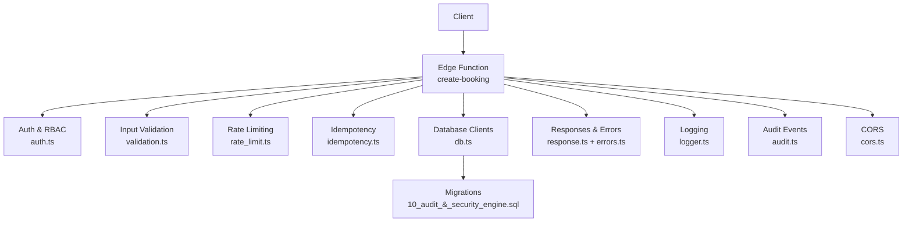
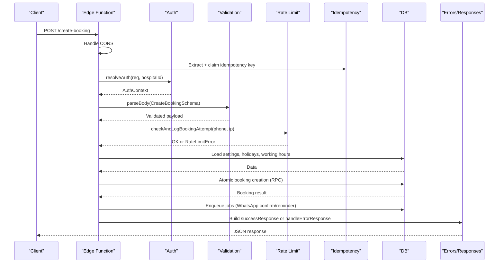
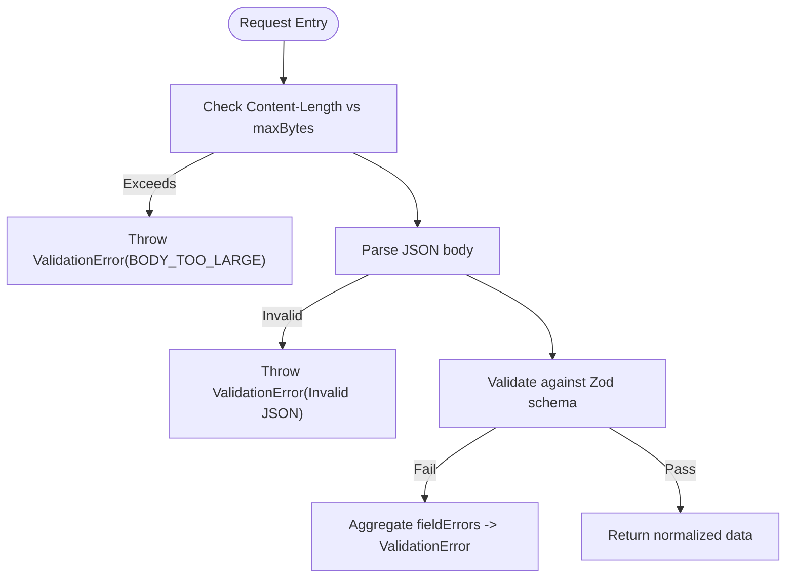
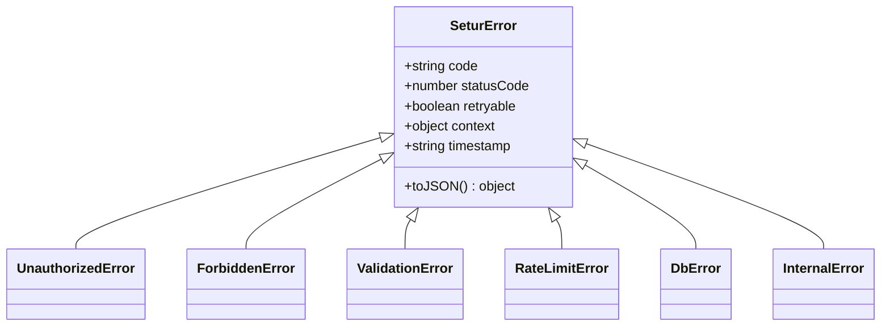
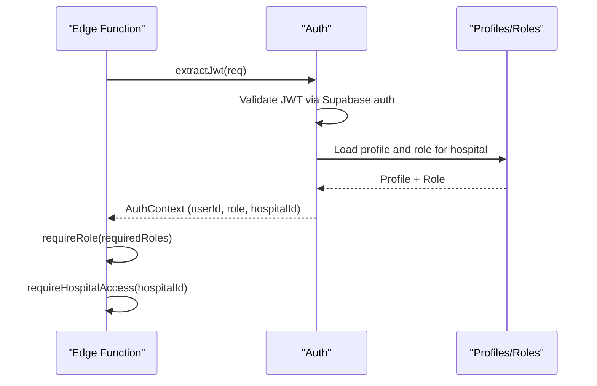
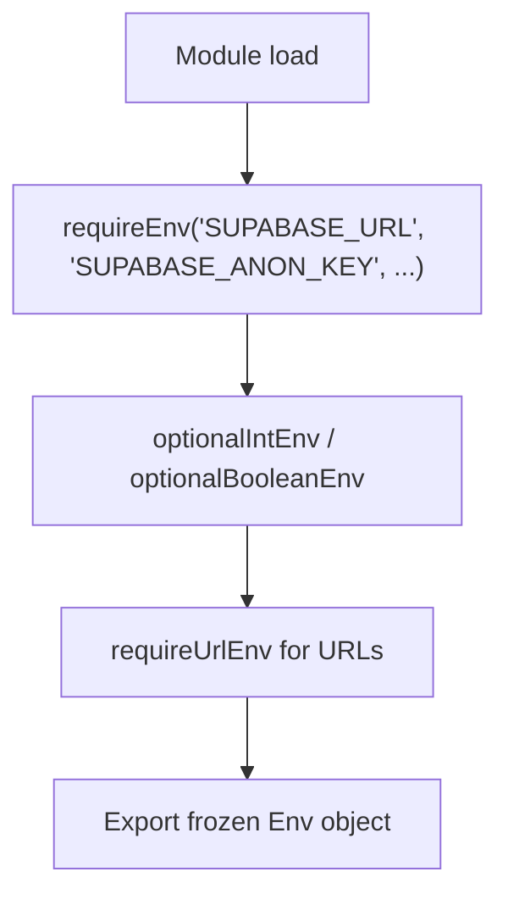
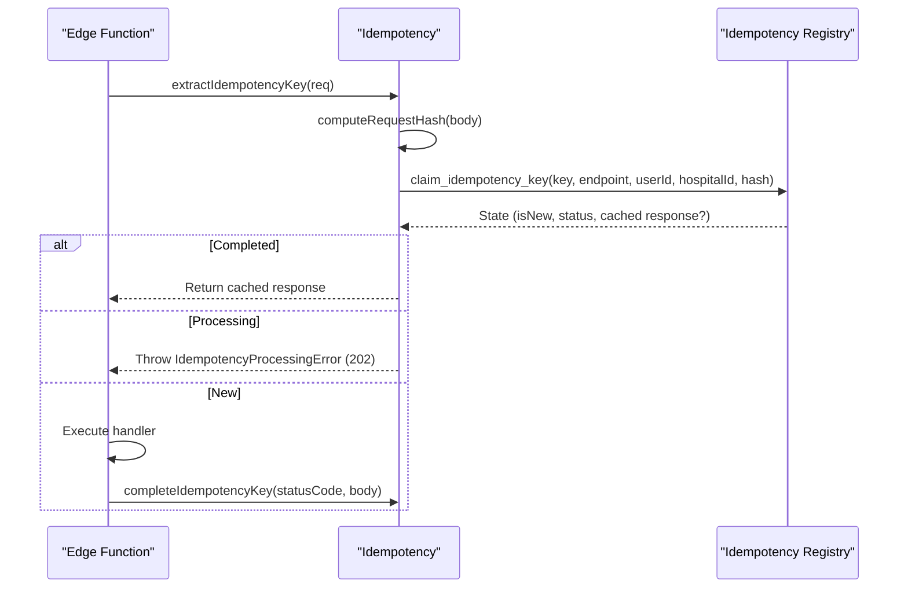
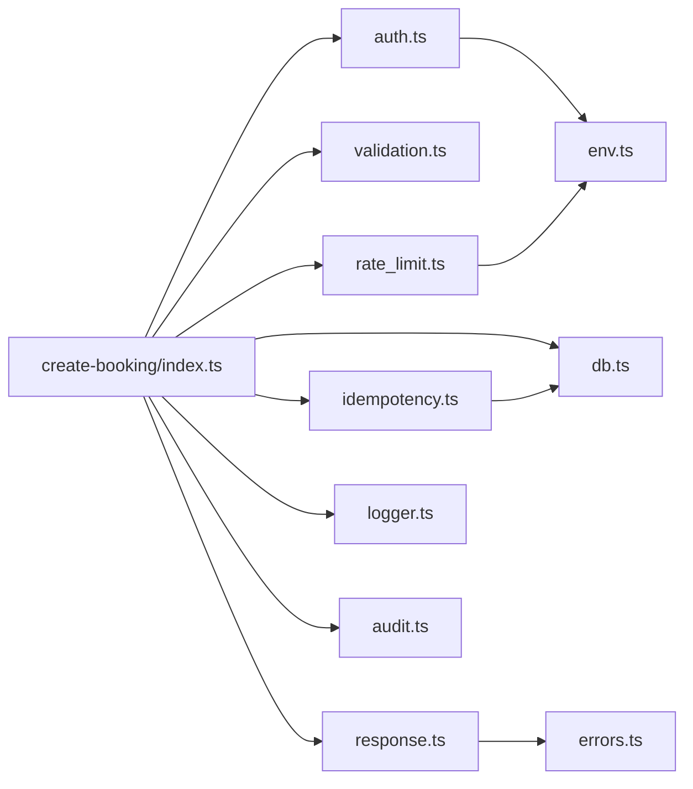

# Security Best Practices

<cite>
**Referenced Files in This Document**
- [validation.ts](file://supabase/functions/_shared/validation.ts)
- [errors.ts](file://supabase/functions/_shared/errors.ts)
- [auth.ts](file://supabase/functions/_shared/auth.ts)
- [env.ts](file://supabase/functions/_shared/env.ts)
- [response.ts](file://supabase/functions/_shared/response.ts)
- [rate_limit.ts](file://supabase/functions/_shared/rate_limit.ts)
- [cors.ts](file://supabase/functions/_shared/cors.ts)
- [idempotency.ts](file://supabase/functions/_shared/idempotency.ts)
- [logger.ts](file://supabase/functions/_shared/logger.ts)
- [db.ts](file://supabase/functions/_shared/db.ts)
- [audit.ts](file://supabase/functions/_shared/audit.ts)
- [create-booking/index.ts](file://supabase/functions/create-booking/index.ts)
- [10_audit_&_security_engine.sql](file://supabase/migrations/10_audit_&_security_engine.sql)
- [validation.test.ts](file://tests/unit/validation.test.ts)
- [errors.test.ts](file://tests/unit/errors.test.ts)
</cite>

## Table of Contents

1. Introduction
2. Project Structure
3. Core Components
4. Architecture Overview
5. Detailed Component Analysis
6. Dependency Analysis
7. Performance Considerations
8. Troubleshooting Guide
9. Conclusion
10. Appendices

## Introduction

This document provides comprehensive security best practices for the Setura
Hospital OS, grounded in the actual implementation across Edge Functions and
shared modules. It covers secure coding patterns (input validation, output
encoding, error handling), secure configuration management, API design and
request sanitization, security testing, and deployment security considerations.
The goal is to help developers and operators prevent common vulnerabilities such
as SQL injection, cross-site scripting (XSS), and cross-site request forgery
(CSRF), while ensuring robust authentication, authorization, idempotency, rate
limiting, and auditability.

## Project Structure

Setura’s backend is implemented as Deno-based Supabase Edge Functions with a
shared library of security utilities:

- Shared modules under supabase/functions/_shared provide centralized security
  controls:
  - Input validation and normalization (Zod schemas)
  - Centralized typed errors and response builders
  - JWT validation, role enforcement, and hospital access control
  - Environment variable validation and secrets loading
  - CORS handling
  - Distributed rate limiting backed by database tables
  - Idempotency key management to prevent duplicate processing
  - Structured logging and correlation tracking
  - Database client management (service-role, anon, per-request auth)
  - Audit event writing
- Feature functions (e.g., create-booking) compose these modules into secure
  request flows.
- Migrations define schema-level protections (constraints, indexes, checks).
- Unit tests validate validation logic and error behavior.

**Diagram sources**

- [create-booking/index.ts:67-124](file://supabase/functions/create-booking/index.ts#L67-L124)
- [auth.ts:42-124](file://supabase/functions/_shared/auth.ts#L42-L124)
- [validation.ts:99-134](file://supabase/functions/_shared/validation.ts#L99-L134)
- [rate_limit.ts:27-111](file://supabase/functions/_shared/rate_limit.ts#L27-L111)
- [idempotency.ts:196-259](file://supabase/functions/_shared/idempotency.ts#L196-L259)
- [db.ts:30-106](file://supabase/functions/_shared/db.ts#L30-L106)
- [response.ts:94-206](file://supabase/functions/_shared/response.ts#L94-L206)
- [logger.ts:122-189](file://supabase/functions/_shared/logger.ts#L122-L189)
- [audit.ts:51-74](file://supabase/functions/_shared/audit.ts#L51-L74)
- [cors.ts:6-33](file://supabase/functions/_shared/cors.ts#L6-L33)
- [10_audit_&_security_engine.sql:158-216](file://supabase/migrations/10_audit_&_security_engine.sql#L158-L216)

**Section sources**

- [create-booking/index.ts:1-32](file://supabase/functions/create-booking/index.ts#L1-L32)
- [db.ts:1-21](file://supabase/functions/_shared/db.ts#L1-L21)

## Core Components

- Secure input validation and normalization:
  - All inbound requests are parsed and validated using Zod schemas before
    business logic runs. Schemas normalize phone numbers, enforce date formats,
    restrict enums, and apply defaults. Body size limits are enforced early to
    mitigate abuse.
- Centralized error model:
  - A typed error hierarchy carries machine-readable codes, HTTP status codes,
    retry flags, and structured context. Errors are never leaked raw; they are
    converted to safe responses.
- Authentication and authorization:
  - JWTs are validated via Supabase auth; roles are resolved from the database
    (authoritative source). Hospital-scoped access control is enforced before
    any data access. Role helpers enforce minimum roles and hospital boundaries.
- Secure configuration and secrets:
  - Environment variables are validated at module load time. Required secrets
    fail fast on cold start. Allowed origins are validated and applied
    consistently.
- Response building:
  - Standardized success/error responses include correlation IDs and timestamps.
    Error responses omit internal details and expose only safe fields.
- Rate limiting:
  - Distributed sliding window rate limiting uses database-backed logs and
    supports blocked number checks. Fail-open on DB errors avoids blocking
    legitimate traffic.
- Idempotency:
  - Idempotency keys are required for critical endpoints, validated as UUID v4,
    scoped to endpoint/user/hospital, and used to deduplicate requests and cache
    responses. Request body hashing detects misuse.
- Logging and audit:
  - Structured JSON logs carry correlation IDs and contextual metadata without
    leaking sensitive data. Audit events are written fire-and-forget to avoid
    impacting core flows.
- Database clients:
  - Service-role client bypasses RLS for internal operations; anon client is
    subject to RLS; per-request auth client impersonates users to enforce RLS
    policies.

**Section sources**

- [validation.ts:1-157](file://supabase/functions/_shared/validation.ts#L1-L157)
- [errors.ts:13-323](file://supabase/functions/_shared/errors.ts#L13-L323)
- [auth.ts:22-185](file://supabase/functions/_shared/auth.ts#L22-L185)
- [env.ts:18-279](file://supabase/functions/_shared/env.ts#L18-L279)
- [response.ts:14-206](file://supabase/functions/_shared/response.ts#L14-L206)
- [rate_limit.ts:16-124](file://supabase/functions/_shared/rate_limit.ts#L16-L124)
- [idempotency.ts:37-259](file://supabase/functions/_shared/idempotency.ts#L37-L259)
- [logger.ts:1-190](file://supabase/functions/_shared/logger.ts#L1-L190)
- [db.ts:30-106](file://supabase/functions/_shared/db.ts#L30-L106)
- [audit.ts:1-75](file://supabase/functions/_shared/audit.ts#L1-L75)

## Architecture Overview

The create-booking function demonstrates a secure end-to-end flow:

- CORS preflight handled first.
- Idempotency key extracted and validated.
- JWT resolved and roles/hospital access enforced.
- Request body parsed and validated against strict schemas.
- Rate limit checked and logged.
- Business rules enforced (hospital open/holiday/advance booking).
- Doctor availability and queue capacity validated.
- Patient find-or-create with deduplication.
- Atomic booking creation via RPC with idempotency key uniqueness.
- Asynchronous jobs enqueued (WhatsApp confirmation/reminders).
- Audit event recorded.
- Success or error response built centrally.

**Diagram sources**

- [create-booking/index.ts:67-666](file://supabase/functions/create-booking/index.ts#L67-L666)
- [auth.ts:42-124](file://supabase/functions/_shared/auth.ts#L42-L124)
- [validation.ts:99-134](file://supabase/functions/_shared/validation.ts#L99-L134)
- [rate_limit.ts:27-111](file://supabase/functions/_shared/rate_limit.ts#L27-L111)
- [idempotency.ts:196-259](file://supabase/functions/_shared/idempotency.ts#L196-L259)
- [response.ts:94-206](file://supabase/functions/_shared/response.ts#L94-L206)

## Detailed Component Analysis

### Secure Input Validation and Normalization

- Use strict schemas for all inputs:
  - Enforce types, ranges, formats, and allowed values.
  - Normalize phone numbers to canonical form to prevent bypasses and ensure
    consistent matching.
  - Reject oversized bodies early to mitigate resource exhaustion.
- Field-level error aggregation:
  - Provide actionable field errors to clients without exposing internals.
- Date and enum constraints:
  - Ensure future dates where required and restrict enums to known values.

**Diagram sources**

- [validation.ts:99-134](file://supabase/functions/_shared/validation.ts#L99-L134)

**Section sources**

- [validation.ts:1-157](file://supabase/functions/_shared/validation.ts#L1-L157)
- [validation.test.ts:29-170](file://tests/unit/validation.test.ts#L29-L170)

### Centralized Error Handling and Safe Responses

- Typed error hierarchy:
  - Each error carries code, HTTP status, retry flag, and context for logging.
- Response builders:
  - Standardize success and error payloads with correlation IDs and timestamps.
  - Map domain errors to appropriate HTTP statuses and safe messages.
- Never leak stack traces or internal details to clients.

**Diagram sources**

- [errors.ts:70-323](file://supabase/functions/_shared/errors.ts#L70-L323)

**Section sources**

- [errors.ts:13-323](file://supabase/functions/_shared/errors.ts#L13-L323)
- [response.ts:69-206](file://supabase/functions/_shared/response.ts#L69-L206)
- [errors.test.ts:29-151](file://tests/unit/errors.test.ts#L29-L151)

### Authentication, Authorization, and Hospital Access Control

- JWT validation via Supabase auth ensures signature, expiry, and revocation
  handling.
- Roles resolved from database to avoid stale claims.
- Hospital-scoped access enforced before any data access.
- Role helpers enforce minimum roles and hospital boundaries.

**Diagram sources**

- [auth.ts:22-185](file://supabase/functions/_shared/auth.ts#L22-L185)

**Section sources**

- [auth.ts:22-185](file://supabase/functions/_shared/auth.ts#L22-L185)

### Secure Configuration Management and Secrets

- Fail-fast environment validation:
  - Required secrets must be present; invalid values throw during module load.
- URL validation for endpoints and services.
- Strict environment type guards for booleans and integers.
- Controlled feature flags and CORS origins.

**Diagram sources**

- [env.ts:18-279](file://supabase/functions/_shared/env.ts#L18-L279)

**Section sources**

- [env.ts:18-279](file://supabase/functions/_shared/env.ts#L18-L279)

### API Design, Parameter Validation, and Request Sanitization

- Enforce method restrictions and reject unsupported methods.
- Require idempotency keys for state-changing endpoints.
- Validate headers (e.g., X-Hospital-ID) and ensure consistency with body fields
  to prevent cross-hospital injection.
- Normalize and sanitize inputs (phone numbers, dates) to canonical forms.

**Section sources**

- [create-booking/index.ts:67-134](file://supabase/functions/create-booking/index.ts#L67-L134)
- [idempotency.ts:37-68](file://supabase/functions/_shared/idempotency.ts#L37-L68)
- [validation.ts:23-88](file://supabase/functions/_shared/validation.ts#L23-L88)

### Idempotency and Duplicate Prevention

- Idempotency-Key header required and validated as UUID v4.
- Keys scoped to endpoint, user, and hospital; request body hashed to detect
  mismatched payloads.
- Atomic claim/completion/fail lifecycle prevents double-processing and enables
  safe retries.

**Diagram sources**

- [idempotency.ts:61-259](file://supabase/functions/_shared/idempotency.ts#L61-L259)

**Section sources**

- [idempotency.ts:37-259](file://supabase/functions/_shared/idempotency.ts#L37-L259)

### Rate Limiting and Abuse Protection

- Sliding window rate limiting based on normalized phone and IP.
- Blocked number checks with active restriction windows.
- Fail-open on DB errors to avoid blocking legitimate traffic; log warnings.
- Consistent 429 responses with Retry-After guidance.

**Section sources**

- [rate_limit.ts:16-124](file://supabase/functions/_shared/rate_limit.ts#L16-L124)

### CORS and Network Security

- Strict origin allowlist configured via environment variables.
- Preflight handling returns appropriate headers.
- Credentials allowed only when origin matches allowlist.

**Section sources**

- [cors.ts:6-33](file://supabase/functions/_shared/cors.ts#L6-L33)
- [env.ts:211-221](file://supabase/functions/_shared/env.ts#L211-L221)

### Database Security and Client Usage

- Service-role client bypasses RLS; use only for internal operations not exposed
  to user input.
- Anon client subject to RLS for public reads.
- Per-request auth client impersonates caller to enforce RLS policies.
- RPC calls typed against generated schema; errors wrapped in DbError.

**Section sources**

- [db.ts:30-106](file://supabase/functions/_shared/db.ts#L30-L106)
- [db.ts:115-136](file://supabase/functions/_shared/db.ts#L115-L136)

### Audit and Security Event Logging

- Audit events captured for critical actions (e.g., booking_create).
- Fire-and-forget writes ensure operational resilience.
- Security events table supports risk scoring and resolution workflows.

**Section sources**

- [audit.ts:1-75](file://supabase/functions/_shared/audit.ts#L1-L75)
- [10_audit_&_security_engine.sql:158-216](file://supabase/migrations/10_audit_&_security_engine.sql#L158-L216)

## Dependency Analysis

Security components are composed within each Edge Function. Key dependencies:

- create-booking depends on auth, validation, idempotency, rate_limit, db,
  logger, metrics, tracing, response, and audit.
- Shared modules depend on env for configuration and on db for persistence.
- Tests validate validation and error behaviors independently.

**Diagram sources**

- [create-booking/index.ts:34-58](file://supabase/functions/create-booking/index.ts#L34-L58)
- [auth.ts:13-20](file://supabase/functions/_shared/auth.ts#L13-L20)
- [rate_limit.ts:10-14](file://supabase/functions/_shared/rate_limit.ts#L10-L14)
- [idempotency.ts:20-26](file://supabase/functions/_shared/idempotency.ts#L20-L26)
- [response.ts:11-12](file://supabase/functions/_shared/response.ts#L11-L12)

**Section sources**

- [create-booking/index.ts:34-58](file://supabase/functions/create-booking/index.ts#L34-L58)

## Performance Considerations

- Early validation and size guards reduce unnecessary processing and protect
  resources.
- Rate limiting uses efficient database queries with head counts to minimize
  overhead.
- Idempotency caching avoids redundant work and reduces load on downstream
  systems.
- Structured logging and metrics enable performance tuning without impacting
  request paths.

[No sources needed since this section provides general guidance]

## Troubleshooting Guide

- Authentication failures:
  - Missing or invalid JWT results in 401; verify Authorization header and token
    validity.
- Authorization failures:
  - Role insufficient or hospital access denied yields 403; confirm user roles
    and hospital membership.
- Validation errors:
  - 422 responses include fieldErrors; inspect request payload against schemas.
- Rate limiting:
  - 429 responses indicate exceeded limits; back off using Retry-After and
    review usage patterns.
- Idempotency conflicts:
  - 202 indicates concurrent processing; retry after delay with same key.
- Database errors:
  - 500 responses wrap internal errors; check logs for correlation ID and
    context.

**Section sources**

- [auth.ts:42-124](file://supabase/functions/_shared/auth.ts#L42-L124)
- [response.ts:69-206](file://supabase/functions/_shared/response.ts#L69-L206)
- [errors.ts:154-323](file://supabase/functions/_shared/errors.ts#L154-L323)

## Conclusion

Setura’s Edge Functions implement a comprehensive security posture through
centralized validation, typed errors, strict authentication and authorization,
idempotency, rate limiting, CORS controls, structured logging, and auditability.
By adhering to these patterns and guidelines, teams can prevent common
vulnerabilities, maintain operational resilience, and deliver secure APIs for
hospital operations.

[No sources needed since this section summarizes without analyzing specific
files]

## Appendices

### Secure Coding Patterns Checklist

- Always validate and normalize inputs using schemas before business logic.
- Enforce method and header requirements; reject unknown or unsafe values.
- Use service-role client only for internal operations; never pass
  user-controlled input directly to it.
- Convert all errors to standardized responses; never leak internal details.
- Require idempotency keys for state-changing endpoints.
- Apply rate limiting and blocked number checks prior to mutations.
- Log with correlation IDs and avoid sensitive data in logs.
- Write audit events for critical actions; make them non-fatal.

[No sources needed since this section provides general guidance]

### Security Testing Approaches

- Unit tests for validation schemas and error behaviors.
- Penetration testing focusing on authentication, authorization, input
  validation, and rate limiting.
- Vulnerability scanning for dependencies and container images.
- Security code reviews emphasizing RLS usage, secret handling, and error
  exposure.

**Section sources**

- [validation.test.ts:1-203](file://tests/unit/validation.test.ts#L1-L203)
- [errors.test.ts:1-151](file://tests/unit/errors.test.ts#L1-L151)

### Deployment Security Considerations

- Container security:
  - Pin base images, scan for vulnerabilities, minimize attack surface.
- Network security:
  - Restrict CORS origins; enforce HTTPS; use least-privilege network policies.
- Infrastructure hardening:
  - Rotate secrets regularly; store in secure vaults; validate at startup.
  - Enable monitoring and alerting for security events and anomalies.

[No sources needed since this section provides general guidance]
