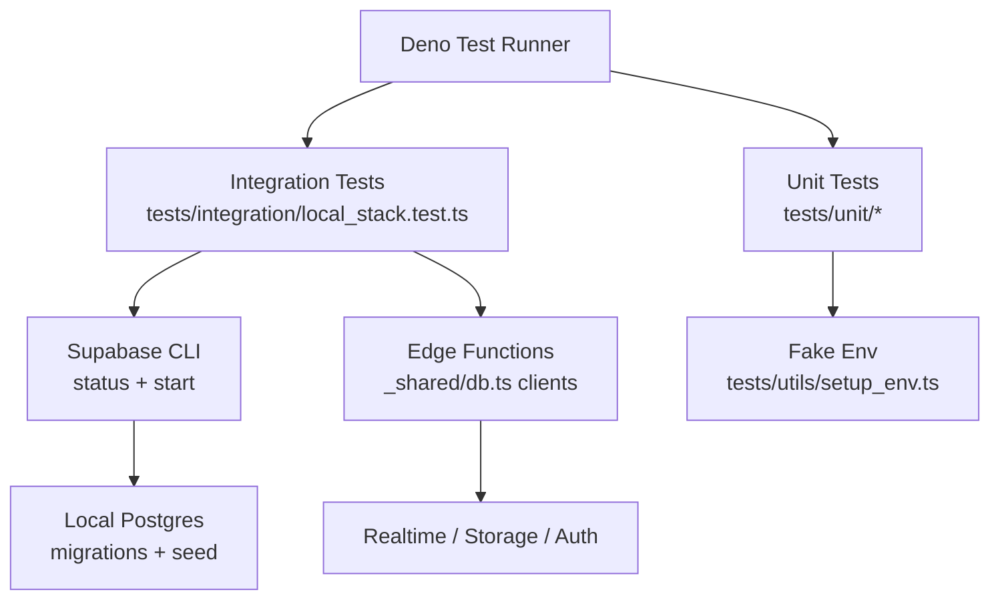
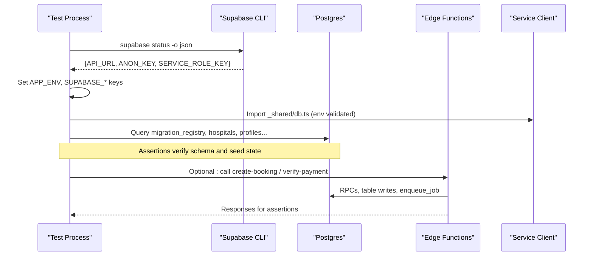
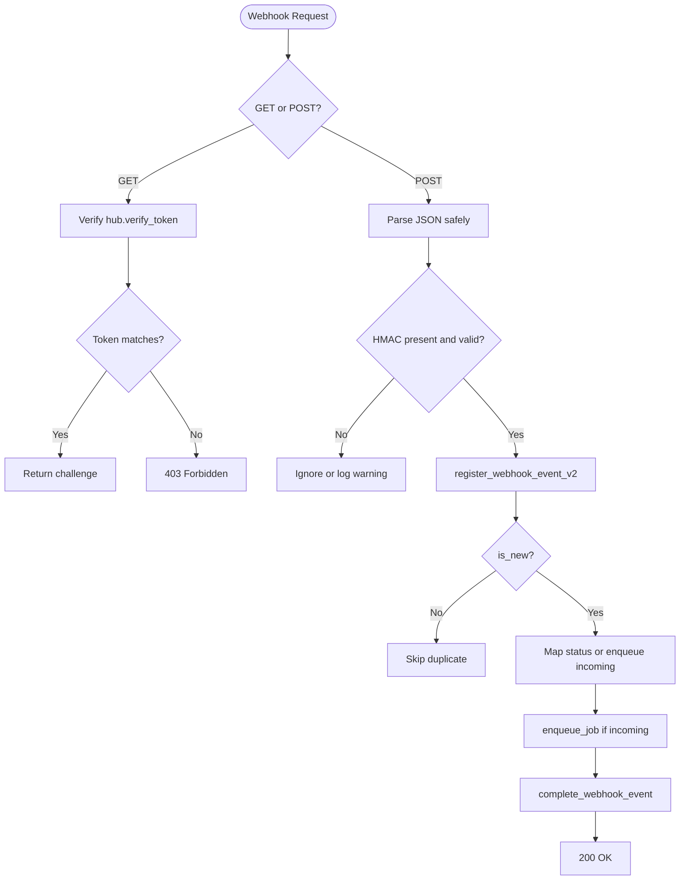
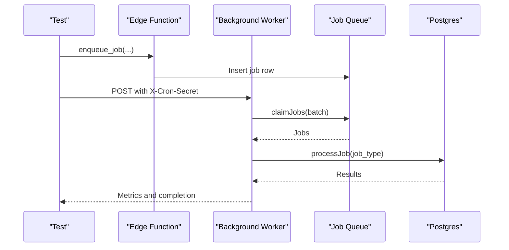
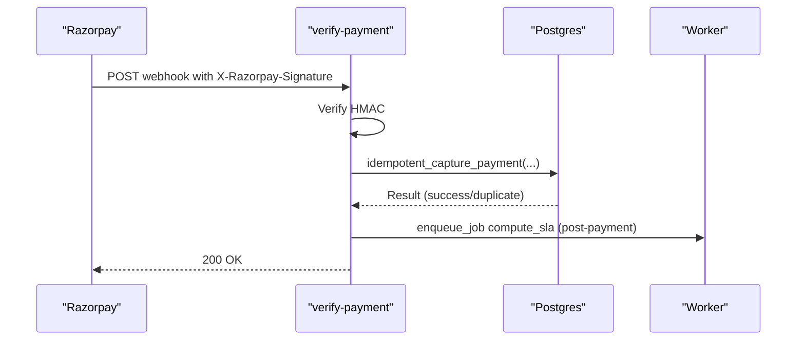
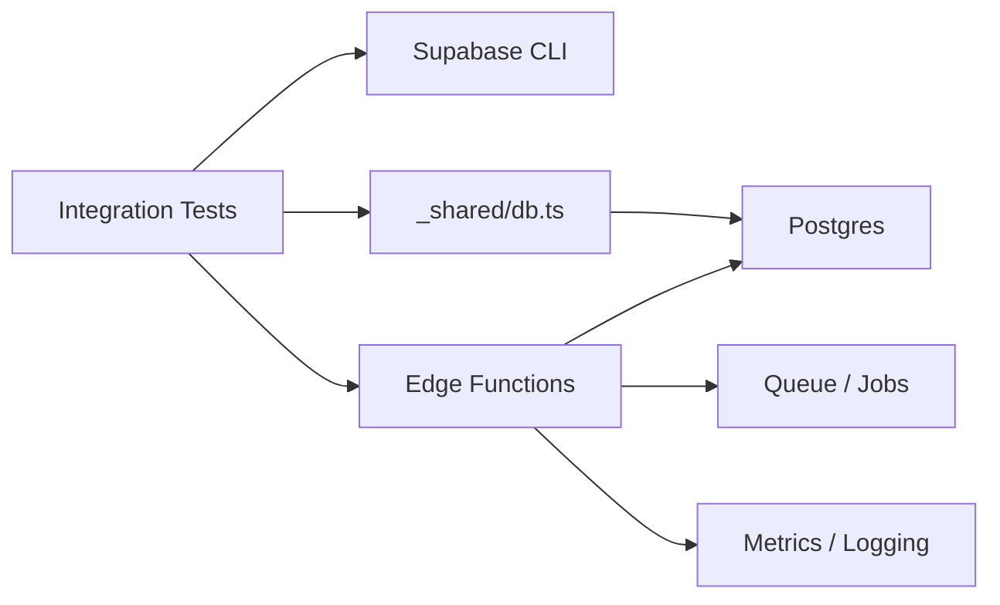

# Integration Testing

<cite>
**Referenced Files in This Document**
- [local_stack.test.ts](file://tests/integration/local_stack.test.ts)
- [setup_env.ts](file://tests/utils/setup_env.ts)
- [seed_constants.ts](file://tests/utils/seed_constants.ts)
- [config.toml](file://supabase/config.toml)
- [seed.sql](file://supabase/seed.sql)
- [db.ts](file://supabase/functions/_shared/db.ts)
- [process-whatsapp-webhook/index.ts](file://supabase/functions/process-whatsapp-webhook/index.ts)
- [create-booking/index.ts](file://supabase/functions/create-booking/index.ts)
- [run-background-worker/index.ts](file://supabase/functions/run-background-worker/index.ts)
- [verify-payment/index.ts](file://supabase/functions/verify-payment/index.ts)
- [ci.yml](file://.github/workflows/ci.yml)
- [deno.json](file://deno.json)
</cite>

## Table of Contents

1. [Introduction](#introduction)
2. [Project Structure](#project-structure)
3. [Core Components](#core-components)
4. [Architecture Overview](#architecture-overview)
5. [Detailed Component Analysis](#detailed-component-analysis)
6. [Dependency Analysis](#dependency-analysis)
7. [Performance Considerations](#performance-considerations)
8. [Troubleshooting Guide](#troubleshooting-guide)
9. [Conclusion](#conclusion)
10. [Appendices](#appendices)

## Introduction

This document explains how to set up and run integration tests for the Setura
Hospital OS against a local Supabase stack. It covers database initialization,
service configuration, environment setup, and testing strategies for API
endpoints, database transactions, cross-service communication, edge functions,
webhooks, background jobs, real-time features, queues, payments, test data
management, cleanup, parallel execution, and external integrations (WhatsApp API
and payment gateways).

## Project Structure

The project uses Deno for tests and Supabase for the local runtime. The CI
pipeline boots the full local stack and runs integration smoke tests that
validate migrations and seed state. Unit tests target pure modules without
network or database access.

**Diagram sources**

- [ci.yml:55-84](file://.github/workflows/ci.yml#L55-L84)
- [local_stack.test.ts:32-73](file://tests/integration/local_stack.test.ts#L32-L73)
- [config.toml:27-66](file://supabase/config.toml#L27-L66)
- [deno.json:11-21](file://deno.json#L11-L21)

**Section sources**

- [ci.yml:1-85](file://.github/workflows/ci.yml#L1-L85)
- [deno.json:1-40](file://deno.json#L1-L40)
- [config.toml:1-409](file://supabase/config.toml#L1-L409)

## Core Components

- Local stack bootstrap: The integration test discovers the running Supabase
  services via the CLI and configures environment variables before importing
  shared modules that eagerly validate environment variables.
- Database client: Shared module provides service-role, anon, and per-request
  auth clients plus typed RPC helpers used by edge functions and tests.
- Deterministic seed: SQL seed creates a fixed hospital, users, roles,
  schedules, settings, fees, queue configs, and feature flags with idempotent
  inserts.
- Edge functions: Endpoints for booking creation, WhatsApp webhook processing,
  background job processing, and payment verification demonstrate transactional
  flows, queues, and external integrations.

Key responsibilities:

- Environment setup ensures deterministic behavior and fail-fast validation on
  import.
- Service-role client is used for internal mutations and webhook handlers; anon
  client respects RLS; per-request auth client impersonates callers.
- Seed guarantees stable baseline state for assertions.

**Section sources**

- [local_stack.test.ts:32-73](file://tests/integration/local_stack.test.ts#L32-L73)
- [db.ts:1-169](file://supabase/functions/_shared/db.ts#L1-L169)
- [seed.sql:1-200](file://supabase/seed.sql#L1-L200)
- [setup_env.ts:1-40](file://tests/utils/setup_env.ts#L1-L40)

## Architecture Overview

The integration test suite exercises the live local Supabase stack. It validates
migrations and seed state through direct DB queries using the service-role
client. Edge functions are invoked as part of end-to-end flows when needed,
while unit tests isolate pure logic.

**Diagram sources**

- [local_stack.test.ts:32-73](file://tests/integration/local_stack.test.ts#L32-L73)
- [db.ts:30-106](file://supabase/functions/_shared/db.ts#L30-L106)
- [create-booking/index.ts:67-666](file://supabase/functions/create-booking/index.ts#L67-L666)
- [verify-payment/index.ts:188-480](file://supabase/functions/verify-payment/index.ts#L188-L480)

## Detailed Component Analysis

### Local Stack Setup and Environment

- Discovery: The integration test calls the Supabase CLI to obtain the local API
  URL and keys. If unavailable, it fails fast with a clear message.
- Environment injection: Before importing any module that depends on environment
  variables, the test sets APP_ENV and Supabase credentials so that eager
  validation passes.
- Client lifecycle: A single service-role client is created lazily and reused
  across tests to minimize startup overhead.

Testing implications:

- Always run `supabase start` before integration tests.
- Ensure the Supabase CLI is installed and on PATH.
- Use the same project_id so container names match CI expectations.

**Section sources**

- [local_stack.test.ts:32-73](file://tests/integration/local_stack.test.ts#L32-L73)
- [config.toml:1-10](file://supabase/config.toml#L1-L10)
- [deno.json:11-21](file://deno.json#L11-L21)

### Database Initialization and Seed Verification

- Migrations: The test asserts that the migration registry contains entries and
  that the latest migration is applied.
- Seed: The test verifies exact counts and values for hospital, profiles, roles,
  working hours, fee policy, queue configs, and feature flags using
  deterministic constants.

Data integrity strategy:

- Idempotent seed with ON CONFLICT clauses prevents duplicates on re-runs.
- Fixed UUIDs and emails provide stable references for assertions.

Cleanup strategy:

- Re-run `supabase db reset` between test runs to ensure a clean state.
- In CI, `supabase start` applies all migrations and seed automatically.

**Section sources**

- [local_stack.test.ts:82-268](file://tests/integration/local_stack.test.ts#L82-L268)
- [seed_constants.ts:1-35](file://tests/utils/seed_constants.ts#L1-L35)
- [seed.sql:1-200](file://supabase/seed.sql#L1-L200)
- [config.toml:53-66](file://supabase/config.toml#L53-L66)

### API Endpoint Testing Strategy

- Booking creation: The create-booking function enforces CORS, idempotency, role
  checks, rate limiting, hospital rules, doctor availability, queue capacity,
  patient deduplication, atomic booking creation, and async notifications. Tests
  can assert DB state changes and queued jobs after calling this endpoint.
- Payment verification: The verify-payment function handles both Razorpay
  webhooks and frontend callbacks, verifying signatures and performing
  idempotent capture. Tests can simulate webhook payloads and callback requests
  to assert ledger updates and audit logs.

Recommended approach:

- For API-level tests, use the service-role client to assert DB state before and
  after calls.
- For request/response validation, send HTTP requests to the local Edge Runtime
  endpoints and assert status codes and bodies.

**Section sources**

- [create-booking/index.ts:67-666](file://supabase/functions/create-booking/index.ts#L67-L666)
- [verify-payment/index.ts:188-480](file://supabase/functions/verify-payment/index.ts#L188-L480)

### Webhook Handler Testing (WhatsApp)

The process-whatsapp-webhook handler:

- Supports Meta verification challenge GET and POST for delivery/read receipts
  and incoming messages.
- Verifies HMAC signatures when configured.
- Registers events idempotently and enqueues background jobs for incoming
  messages.

Testing strategy:

- Send GET with hub.verify_token matching configured token to validate challenge
  flow.
- Send POST with valid HMAC signature and sample payload to assert event
  registration and job enqueueing.
- Assert metrics counters and logs for success/error paths.

**Diagram sources**

- [process-whatsapp-webhook/index.ts:124-657](file://supabase/functions/process-whatsapp-webhook/index.ts#L124-L657)

**Section sources**

- [process-whatsapp-webhook/index.ts:1-657](file://supabase/functions/process-whatsapp-webhook/index.ts#L1-L657)

### Background Job Processing

The run-background-worker processes multiple job types including WhatsApp
messaging, analytics refresh, SLA computation, and notifications. It claims jobs
in batches, processes them concurrently, and tracks success/failure metrics.

Testing strategy:

- Enqueue jobs via RPC from tests or edge functions.
- Invoke the worker endpoint with the required secret header to trigger
  processing.
- Assert job outcomes by querying relevant tables and checking metrics.

**Diagram sources**

- [run-background-worker/index.ts:247-454](file://supabase/functions/run-background-worker/index.ts#L247-L454)
- [db.ts:115-136](file://supabase/functions/_shared/db.ts#L115-L136)

**Section sources**

- [run-background-worker/index.ts:1-454](file://supabase/functions/run-background-worker/index.ts#L1-L454)

### Real-Time Features

Realtime is enabled in the local stack configuration. While the integration
tests focus on DB state, you can extend tests to subscribe to realtime channels
and assert presence or broadcast events after mutations.

Recommendations:

- Use the anon or auth client to subscribe to channels.
- Assert presence and broadcasts after creating/updating rows.
- Timebox subscriptions and handle disconnects gracefully.

**Section sources**

- [config.toml:81-87](file://supabase/config.toml#L81-L87)

### Queue Processing and Idempotency

Queues are implemented via database-backed job tables and RPCs. The system uses
idempotency keys and hash-based deduplication for webhooks and payments.

Testing strategy:

- Enqueue jobs with unique idempotency keys and assert they appear in the queue.
- Run the worker and verify completion states.
- For webhooks and payments, send duplicate payloads and assert only one side
  effect occurs.

**Section sources**

- [process-whatsapp-webhook/index.ts:382-493](file://supabase/functions/process-whatsapp-webhook/index.ts#L382-L493)
- [verify-payment/index.ts:133-186](file://supabase/functions/verify-payment/index.ts#L133-L186)

### Payment Workflows

The verify-payment function supports two flows:

- Razorpay webhook: Validates HMAC signature, processes captured events, and
  triggers settlement jobs.
- Frontend callback: Validates booking ownership and payment signature, then
  captures payment idempotently.

Testing strategy:

- Simulate Razorpay webhook payloads with correct HMAC using the configured key
  secret.
- Simulate frontend callback with generated signature based on order and payment
  IDs.
- Assert ledger updates, audit logs, and downstream jobs.

**Diagram sources**

- [verify-payment/index.ts:188-480](file://supabase/functions/verify-payment/index.ts#L188-L480)

**Section sources**

- [verify-payment/index.ts:1-480](file://supabase/functions/verify-payment/index.ts#L1-L480)

### External Integrations: Mocks and Stubs

- WhatsApp API: The webhook handler does not call Meta directly; it registers
  events and enqueues jobs. Tests should assert event registration and job
  enqueueing rather than outbound HTTP calls.
- Payment Gateways: The verify-payment function performs server-side HMAC
  verification and RPC calls. Tests should supply crafted payloads and
  signatures without contacting Razorpay.

Guidelines:

- Never call external APIs from tests.
- Validate transforms and signatures locally.
- Use service-role client to assert DB state changes caused by integrations.

**Section sources**

- [process-whatsapp-webhook/index.ts:222-278](file://supabase/functions/process-whatsapp-webhook/index.ts#L222-L278)
- [verify-payment/index.ts:59-110](file://supabase/functions/verify-payment/index.ts#L59-L110)

### Test Data Management and Cleanup

- Deterministic seed: Provides fixed entities and counts for reliable
  assertions.
- Reset strategy: Use `supabase db reset` to reapply migrations and seed before
  integration tests.
- Isolation: Each test should query expected counts and specific rows using
  fixed IDs from seed constants.

Best practices:

- Keep seed constants synchronized with seed SQL.
- Avoid random or time-dependent values in assertions.
- Prefer exact counts and known fields for robustness.

**Section sources**

- [seed_constants.ts:1-35](file://tests/utils/seed_constants.ts#L1-L35)
- [seed.sql:1-200](file://supabase/seed.sql#L1-L200)
- [local_stack.test.ts:82-268](file://tests/integration/local_stack.test.ts#L82-L268)

### Parallel Test Execution

- Deno test runner supports parallel execution by default.
- Ensure tests do not mutate shared global state beyond the isolated DB session.
- Use deterministic IDs and avoid race conditions by asserting final states
  rather than transient intermediates.

Notes:

- The integration test uses a single service-role client instance per process;
  this is safe because each test queries distinct tables or filters by fixed
  IDs.
- For concurrent edge function invocations, rely on idempotency keys and
  database constraints to prevent duplicates.

**Section sources**

- [deno.json:11-21](file://deno.json#L11-L21)
- [local_stack.test.ts:54-78](file://tests/integration/local_stack.test.ts#L54-L78)

## Dependency Analysis

The integration tests depend on:

- Supabase CLI for status discovery and stack management.
- Local Postgres for schema and seed state.
- Edge functions for complex workflows like bookings, webhooks, and payments.

**Diagram sources**

- [local_stack.test.ts:32-73](file://tests/integration/local_stack.test.ts#L32-L73)
- [db.ts:30-106](file://supabase/functions/_shared/db.ts#L30-L106)
- [create-booking/index.ts:67-666](file://supabase/functions/create-booking/index.ts#L67-L666)
- [verify-payment/index.ts:188-480](file://supabase/functions/verify-payment/index.ts#L188-L480)

**Section sources**

- [local_stack.test.ts:32-73](file://tests/integration/local_stack.test.ts#L32-L73)
- [db.ts:1-169](file://supabase/functions/_shared/db.ts#L1-L169)

## Performance Considerations

- Minimize DB round-trips by batching queries where possible.
- Use count-only queries for assertions when exact rows are not needed.
- Leverage idempotency to avoid redundant work during retries.
- Monitor metrics emitted by edge functions to detect bottlenecks.

[No sources needed since this section provides general guidance]

## Troubleshooting Guide

Common issues and resolutions:

- Local stack not running: Ensure `supabase start` has been executed and the CLI
  is available. The integration test will fail fast if status cannot be
  retrieved.
- Migration failures: Verify migrations are applied by checking the migration
  registry; re-run `supabase db reset` if needed.
- Seed mismatches: Confirm seed constants match seed SQL; re-run seed to
  converge state.
- Edge function errors: Check logs and metrics; ensure required headers and
  secrets are provided for protected endpoints.

**Section sources**

- [local_stack.test.ts:32-73](file://tests/integration/local_stack.test.ts#L32-L73)
- [ci.yml:72-84](file://.github/workflows/ci.yml#L72-L84)

## Conclusion

The Setura Hospital OS integration testing strategy centers on a deterministic
local Supabase stack with a robust seed and strict environment validation. Tests
assert schema readiness, seed integrity, and functional outcomes of edge
functions and background jobs. By avoiding external calls and relying on
idempotency and queues, tests remain fast, reliable, and aligned with production
behavior.

[No sources needed since this section summarizes without analyzing specific
files]

## Appendices

### Running Tests Locally

- Start the local stack: `supabase start`
- Run integration tests: `deno task test:integration`
- Reset database: `deno task db:reset`

**Section sources**

- [deno.json:11-21](file://deno.json#L11-L21)
- [ci.yml:72-84](file://.github/workflows/ci.yml#L72-L84)

### CI Pipeline Overview

- Quality job: format, lint, type check, migration validation, unit tests.
- Stack job: install Supabase CLI, start local stack, verify migrations, run
  integration smoke tests.

**Section sources**

- [ci.yml:1-85](file://.github/workflows/ci.yml#L1-L85)
