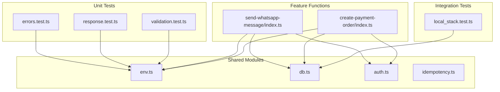
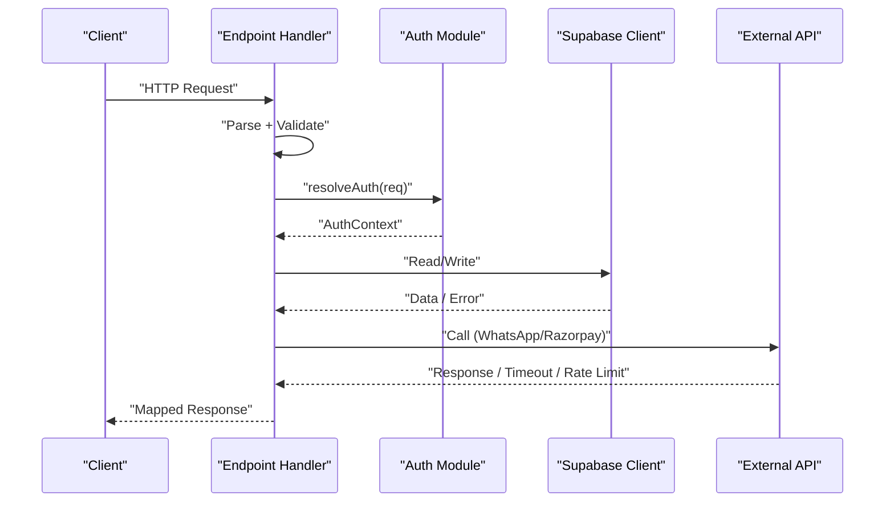
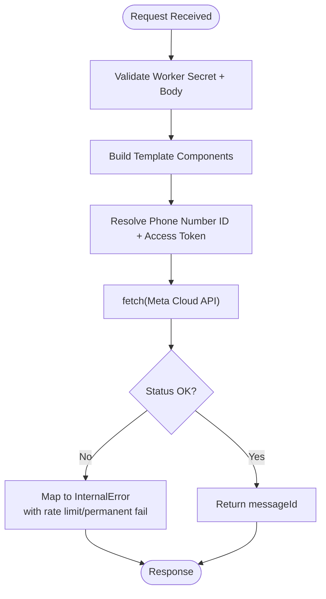
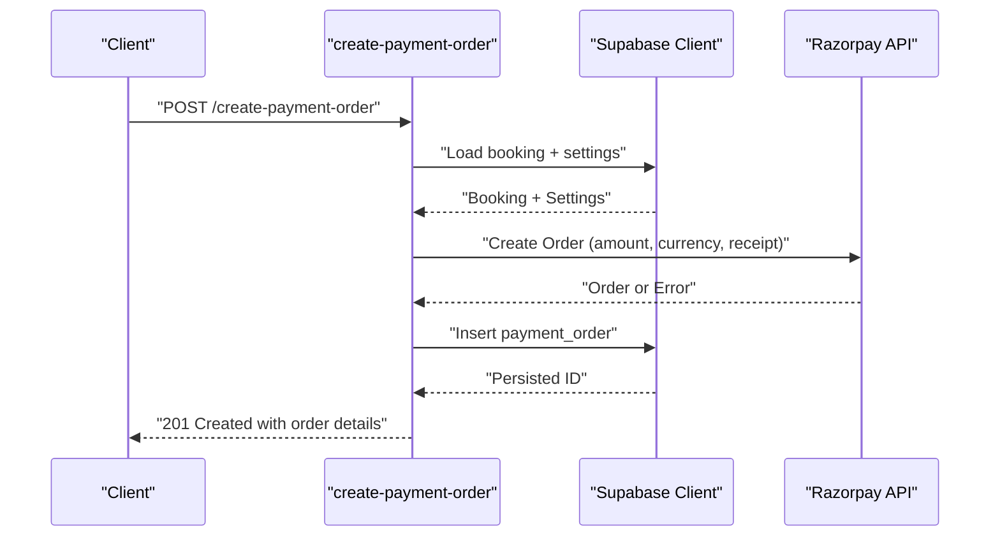
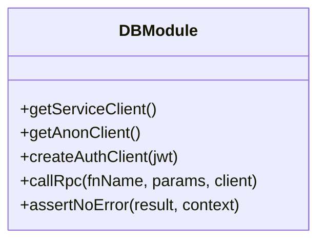
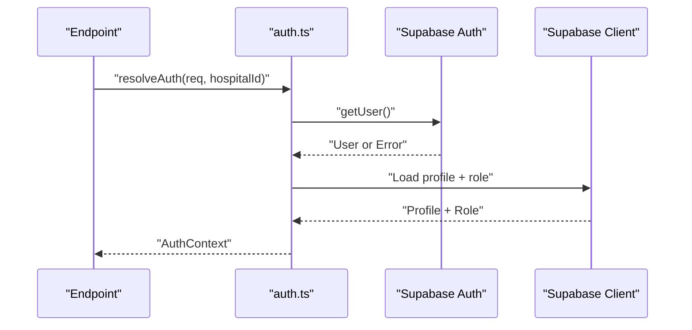
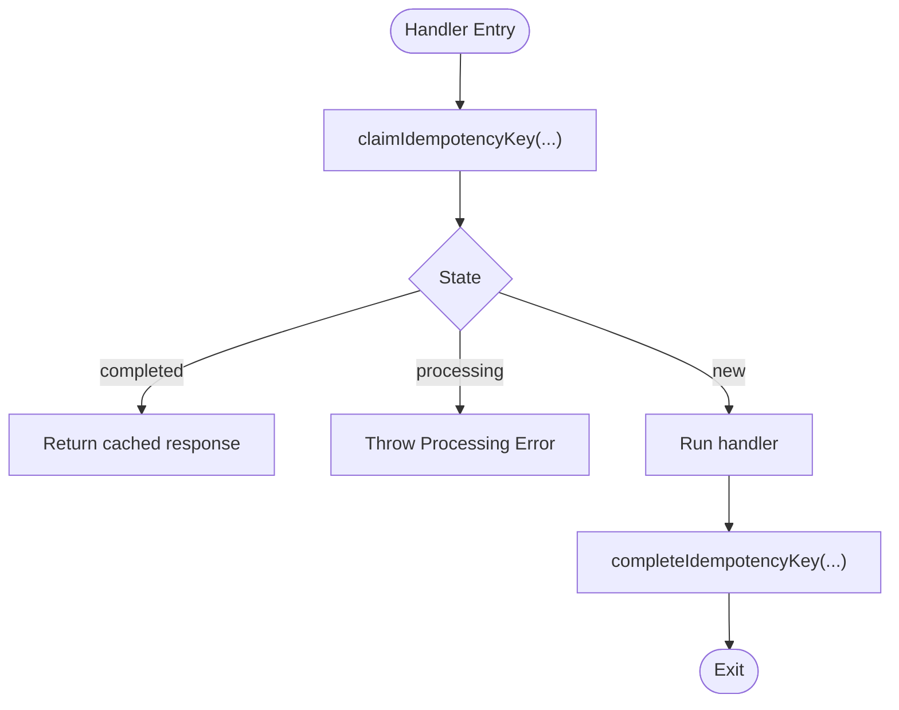
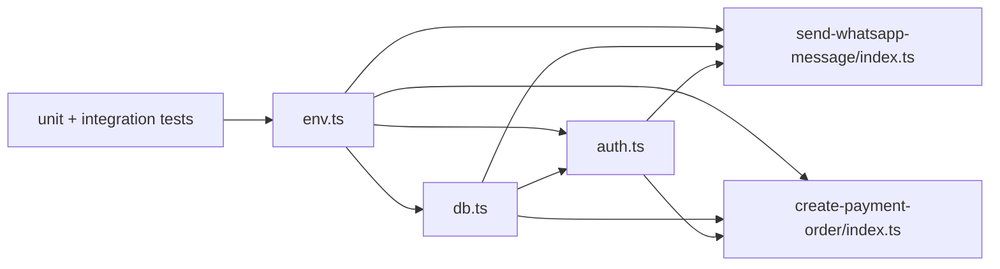

# Mocking Strategies

<cite>
**Referenced Files in This Document**
- [deno.json](file://deno.json)
- [setup_env.ts](file://tests/utils/setup_env.ts)
- [env.ts](file://supabase/functions/_shared/env.ts)
- [db.ts](file://supabase/functions/_shared/db.ts)
- [auth.ts](file://supabase/functions/_shared/auth.ts)
- [idempotency.ts](file://supabase/functions/_shared/idempotency.ts)
- [errors.test.ts](file://tests/unit/errors.test.ts)
- [response.test.ts](file://tests/unit/response.test.ts)
- [validation.test.ts](file://tests/unit/validation.test.ts)
- [local_stack.test.ts](file://tests/integration/local_stack.test.ts)
- [send-whatsapp-message/index.ts](file://supabase/functions/send-whatsapp-message/index.ts)
- [create-payment-order/index.ts](file://supabase/functions/create-payment-order/index.ts)
</cite>

## Table of Contents

1. [Introduction](#introduction)
2. [Project Structure](#project-structure)
3. [Core Components](#core-components)
4. [Architecture Overview](#architecture-overview)
5. [Detailed Component Analysis](#detailed-component-analysis)
6. [Dependency Analysis](#dependency-analysis)
7. [Performance Considerations](#performance-considerations)
8. [Troubleshooting Guide](#troubleshooting-guide)
9. [Conclusion](#conclusion)
10. [Appendices](#appendices)

## Introduction

This document explains the mocking strategies used across Setura Hospital OS to
test external services (WhatsApp API, payment gateways), database operations,
authentication, and third-party integrations. It covers how to create realistic
test doubles, handle asynchronous operations and timeouts, manage test state,
and maintain fast, reliable tests. The project intentionally avoids a
general-purpose mocking framework; instead, it uses environment-based
configuration, pure unit tests for logic, and integration tests against a real
local Supabase stack.

## Project Structure

The repository separates concerns into:

- Shared runtime modules under supabase/functions/_shared that encapsulate
  environment, database clients, auth, idempotency, errors, validation, and
  response helpers.
- Feature functions under supabase/functions that implement HTTP endpoints and
  orchestrate external calls (e.g., WhatsApp, Razorpay).
- Tests under tests/unit for pure logic and tests/integration for end-to-end
  verification against a live local stack.

**Diagram sources**

- [env.ts:1-279](file://supabase/functions/_shared/env.ts#L1-L279)
- [db.ts:1-169](file://supabase/functions/_shared/db.ts#L1-L169)
- [auth.ts:1-237](file://supabase/functions/_shared/auth.ts#L1-L237)
- [idempotency.ts:1-259](file://supabase/functions/_shared/idempotency.ts#L1-L259)
- [send-whatsapp-message/index.ts:1-583](file://supabase/functions/send-whatsapp-message/index.ts#L1-L583)
- [create-payment-order/index.ts:1-407](file://supabase/functions/create-payment-order/index.ts#L1-L407)
- [local_stack.test.ts:1-269](file://tests/integration/local_stack.test.ts#L1-L269)

**Section sources**

- [deno.json:11-18](file://deno.json#L11-L18)
- [setup_env.ts:1-40](file://tests/utils/setup_env.ts#L1-L40)

## Core Components

- Environment configuration: Centralized typed env with required/optional values
  and feature flags. Used by all modules at cold start.
- Database client: Service, anon, and per-request auth clients plus RPC helpers
  and error assertion utilities.
- Authentication: JWT extraction, user profile loading, role resolution, and
  authorization helpers.
- Idempotency: Key claim/completion/failure via Postgres RPCs with safe fallback
  behavior.
- External integrations: WhatsApp messaging via Meta Cloud API; payments via
  Razorpay Orders API.

Key design principles for testing:

- Unit tests target pure modules only (errors, validation, response builders)
  and run without network or database.
- Integration tests run against a real local Supabase stack to validate
  migrations, seed data, and schema-driven behavior.
- External APIs are not called from tests; their pure transforms are tested
  directly.

**Section sources**

- [env.ts:16-279](file://supabase/functions/_shared/env.ts#L16-L279)
- [db.ts:1-169](file://supabase/functions/_shared/db.ts#L1-L169)
- [auth.ts:1-237](file://supabase/functions/_shared/auth.ts#L1-L237)
- [idempotency.ts:1-259](file://supabase/functions/_shared/idempotency.ts#L1-L259)
- [setup_env.ts:1-40](file://tests/utils/setup_env.ts#L1-L40)

## Architecture Overview

The system composes HTTP handlers with shared infrastructure. Handlers parse and
validate requests, enforce auth and idempotency, call the database, and invoke
external APIs. Errors are normalized and mapped to consistent responses.

**Diagram sources**

- [send-whatsapp-message/index.ts:326-583](file://supabase/functions/send-whatsapp-message/index.ts#L326-L583)
- [create-payment-order/index.ts:104-407](file://supabase/functions/create-payment-order/index.ts#L104-L407)
- [auth.ts:42-124](file://supabase/functions/_shared/auth.ts#L42-L124)
- [db.ts:34-106](file://supabase/functions/_shared/db.ts#L34-L106)

## Detailed Component Analysis

### WhatsApp Messaging (Meta Cloud API)

- Endpoint validates worker secret, parses body, builds template components,
  reads hospital-specific phone number ID if provided, and calls Meta Cloud API
  with a timeout.
- Handles rate limiting, permanent failures, and network errors, returning
  structured results and metrics.

Mocking strategy:

- Do not call Meta API in tests. Instead:
  - Test pure transforms (template component building) using unit tests on the
    handler’s internal logic.
  - For endpoint-level tests, use environment toggles or a thin adapter layer to
    swap fetch calls with a test double when refactoring is possible. Currently,
    tests avoid calling external APIs entirely.
  - Use setup_env.ts to provide dummy credentials so modules load without
    network access.

**Diagram sources**

- [send-whatsapp-message/index.ts:326-583](file://supabase/functions/send-whatsapp-message/index.ts#L326-L583)

**Section sources**

- [send-whatsapp-message/index.ts:1-583](file://supabase/functions/send-whatsapp-message/index.ts#L1-L583)
- [env.ts:115-127](file://supabase/functions/_shared/env.ts#L115-L127)

### Payment Orders (Razorpay)

- Endpoint enforces roles, checks booking eligibility, resolves fees, creates
  Razorpay order with auto-capture, persists immutable payment_order row, and
  returns order details.
- Uses idempotency to prevent duplicate orders and verifies amounts server-side.

Mocking strategy:

- Avoid calling Razorpay in tests. Focus on:
  - Pure validations and business rules (booking status checks, amount
    calculations).
  - Idempotency flow assertions via integration tests against the real database.
  - If you need to assert HTTP behavior without network, refactor the Razorpay
    call behind an injectable interface and supply a test double in tests.

**Diagram sources**

- [create-payment-order/index.ts:104-407](file://supabase/functions/create-payment-order/index.ts#L104-L407)

**Section sources**

- [create-payment-order/index.ts:1-407](file://supabase/functions/create-payment-order/index.ts#L1-L407)
- [env.ts:129-135](file://supabase/functions/_shared/env.ts#L129-L135)

### Database Operations

- Three client modes: service-role (bypasses RLS), anon (subject to RLS), and
  per-request auth (impersonates caller).
- RPC helper wraps Postgres SECURITY DEFINER functions and throws typed DbError
  on failure.
- Assertion helper normalizes DB errors and ensures no unexpected nulls.

Mocking strategy:

- Unit tests do not touch the database; they test pure logic.
- Integration tests run against a real local Supabase stack to validate
  migrations, seed data, and schema-driven behavior.
- To simulate DB failures in isolated tests, consider injecting a test double
  for db.ts methods where feasible; otherwise rely on integration tests.

**Diagram sources**

- [db.ts:34-169](file://supabase/functions/_shared/db.ts#L34-L169)

**Section sources**

- [db.ts:1-169](file://supabase/functions/_shared/db.ts#L1-L169)

### Authentication Services

- Extracts JWT, validates via Supabase auth, loads profile, resolves role for
  hospital context, and provides role enforcement helpers.
- Middleware wrapper composes CORS, auth resolution, role checks, and error
  mapping.

Mocking strategy:

- Unit tests focus on pure modules; integration tests exercise auth flows
  against the real Supabase Auth and database.
- For isolated tests, mock the Supabase auth client creation and DB queries if
  you introduce an abstraction layer; currently, tests avoid direct auth calls.

**Diagram sources**

- [auth.ts:42-124](file://supabase/functions/_shared/auth.ts#L42-L124)

**Section sources**

- [auth.ts:1-237](file://supabase/functions/_shared/auth.ts#L1-L237)

### Idempotency

- Extracts and validates Idempotency-Key header, computes request hash, claims
  key atomically via RPC, handles processing/completed/failed states, and
  completes or fails keys around handler execution.
- Safe fallback: if claiming fails, proceed to allow the request rather than
  blocking on infra issues.

Mocking strategy:

- Unit tests verify error types and parsing logic.
- Integration tests ensure idempotent behavior with real DB state.
- To isolate idempotency logic, wrap RPC calls behind an injectable interface
  and supply a test double that simulates claim/complete/fail outcomes.

**Diagram sources**

- [idempotency.ts:79-259](file://supabase/functions/_shared/idempotency.ts#L79-L259)

**Section sources**

- [idempotency.ts:1-259](file://supabase/functions/_shared/idempotency.ts#L1-L259)

### Unit Testing Patterns

- Errors: Assert code, status, retryability, context fields, and type guards.
- Responses: Verify envelope structure, headers, and error mapping from typed
  errors.
- Validation: Test normalization, schema constraints, and parseBody behavior
  including oversized bodies and field-level errors.

These tests are fast, deterministic, and require no network or database.

**Section sources**

- [errors.test.ts:1-151](file://tests/unit/errors.test.ts#L1-L151)
- [response.test.ts:1-147](file://tests/unit/response.test.ts#L1-L147)
- [validation.test.ts:1-203](file://tests/unit/validation.test.ts#L1-L203)

### Integration Testing Strategy

- Bootstraps environment variables before importing modules that eagerly
  validate env.
- Uses the local Supabase CLI to discover endpoints and keys, then dynamically
  imports the service client to query the real database.
- Validates migrations, seeded data, and exact row counts to ensure idempotency
  and schema correctness.

**Section sources**

- [local_stack.test.ts:1-269](file://tests/integration/local_stack.test.ts#L1-L269)
- [setup_env.ts:1-40](file://tests/utils/setup_env.ts#L1-L40)

## Dependency Analysis

- All modules depend on env.ts for configuration; this centralizes secrets and
  feature flags.
- Feature functions depend on db.ts, auth.ts, idempotency.ts, and response/error
  utilities.
- Tests depend on setup_env.ts to configure environment before module import.

**Diagram sources**

- [env.ts:16-279](file://supabase/functions/_shared/env.ts#L16-L279)
- [db.ts:1-169](file://supabase/functions/_shared/db.ts#L1-L169)
- [auth.ts:1-237](file://supabase/functions/_shared/auth.ts#L1-L237)
- [send-whatsapp-message/index.ts:1-583](file://supabase/functions/send-whatsapp-message/index.ts#L1-L583)
- [create-payment-order/index.ts:1-407](file://supabase/functions/create-payment-order/index.ts#L1-L407)

**Section sources**

- [deno.json:11-18](file://deno.json#L11-L18)
- [setup_env.ts:1-40](file://tests/utils/setup_env.ts#L1-L40)

## Performance Considerations

- Keep unit tests pure and fast by avoiding network and DB calls.
- Use integration tests sparingly for schema and workflow validation; they are
  slower but more accurate.
- External API calls include timeouts to prevent hanging tests and long-running
  requests.
- Prefer deterministic assertions and avoid randomness or live clocks in tests.

[No sources needed since this section provides general guidance]

## Troubleshooting Guide

Common issues and resolutions:

- Missing environment variables: Ensure setup_env.ts sets required keys before
  importing modules that validate env.
- Network timeouts: External calls use AbortSignal.timeout; adjust or mock if
  necessary.
- Rate limiting: WhatsApp and payment endpoints return structured rate-limit
  info; tests should assert mapped errors and headers.
- Database errors: Use integration tests to validate schema changes; unit tests
  should not depend on DB state.

**Section sources**

- [send-whatsapp-message/index.ts:234-263](file://supabase/functions/send-whatsapp-message/index.ts#L234-L263)
- [create-payment-order/index.ts:73-102](file://supabase/functions/create-payment-order/index.ts#L73-L102)
- [setup_env.ts:33-37](file://tests/utils/setup_env.ts#L33-L37)

## Conclusion

Setura Hospital OS adopts a pragmatic approach to testing:

- No general-purpose mocking framework; rely on environment configuration and
  pure unit tests.
- Integration tests against a real local Supabase stack ensure schema and
  workflow correctness.
- External services are not called from tests; their pure transforms are
  validated directly.
- When introducing new abstractions, prefer dependency injection to enable
  targeted test doubles for network-bound calls while keeping tests fast and
  reliable.

[No sources needed since this section summarizes without analyzing specific
files]

## Appendices

### Best Practices for Maintaining Mock Consistency

- Keep mocks minimal and aligned with real interfaces; avoid over-mocking pure
  logic.
- Synchronize test constants with seed data to prevent drift.
- Use typed errors and response builders to keep contracts stable across tests
  and production.

[No sources needed since this section provides general guidance]

### Handling Asynchronous Operations and Timeouts

- External calls use AbortSignal.timeout; tests should assert mapped errors for
  timeouts and rate limits.
- Wrap async handlers with idempotency to safely handle retries and concurrent
  requests.

**Section sources**

- [send-whatsapp-message/index.ts:234-263](file://supabase/functions/send-whatsapp-message/index.ts#L234-L263)
- [create-payment-order/index.ts:73-102](file://supabase/functions/create-payment-order/index.ts#L73-L102)
- [idempotency.ts:196-259](file://supabase/functions/_shared/idempotency.ts#L196-L259)

### Managing Test State

- Use deterministic seed data and fixed identifiers to assert exact row counts
  and relationships.
- Reset or re-run migrations locally to ensure clean state for integration
  tests.

**Section sources**

- [local_stack.test.ts:82-269](file://tests/integration/local_stack.test.ts#L82-L269)
- [seed_constants.ts:1-35](file://tests/utils/seed_constants.ts#L1-L35)

### Testing Concurrent Operations and Race Conditions

- Idempotency protects against duplicate operations; integration tests can
  assert idempotent behavior under concurrency.
- Use database constraints (unique keys) and atomic RPCs to prevent race
  conditions in production; validate via integration tests.

**Section sources**

- [idempotency.ts:196-259](file://supabase/functions/_shared/idempotency.ts#L196-L259)
- [create-payment-order/index.ts:213-261](file://supabase/functions/create-payment-order/index.ts#L213-L261)
