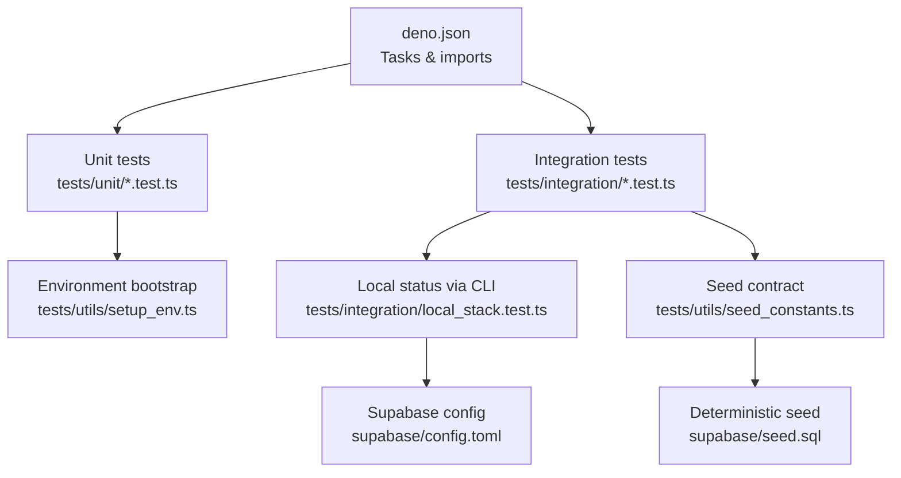
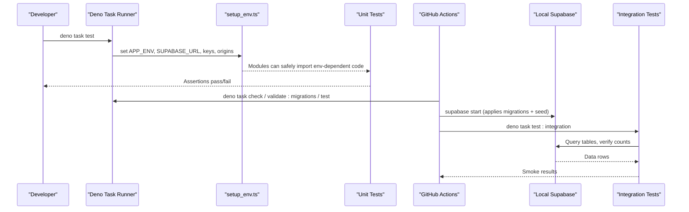
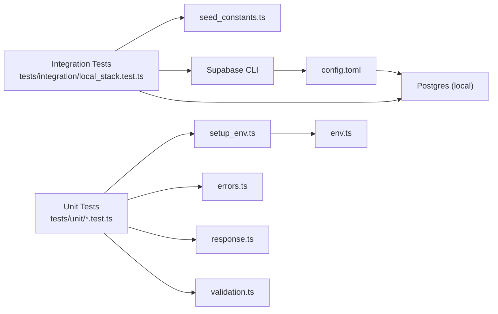

# Test Infrastructure

<cite>
**Referenced Files in This Document**
- [deno.json](file://deno.json)
- [ci.yml](file://.github/workflows/ci.yml)
- [setup_env.ts](file://tests/utils/setup_env.ts)
- [seed_constants.ts](file://tests/utils/seed_constants.ts)
- [local_stack.test.ts](file://tests/integration/local_stack.test.ts)
- [errors.test.ts](file://tests/unit/errors.test.ts)
- [response.test.ts](file://tests/unit/response.test.ts)
- [validation.test.ts](file://tests/unit/validation.test.ts)
- [env.ts](file://supabase/functions/_shared/env.ts)
- [config.toml](file://supabase/config.toml)
- [seed.sql](file://supabase/seed.sql)
</cite>

## Table of Contents

1. [Introduction](#introduction)
2. [Project Structure](#project-structure)
3. [Core Components](#core-components)
4. [Architecture Overview](#architecture-overview)
5. [Detailed Component Analysis](#detailed-component-analysis)
6. [Dependency Analysis](#dependency-analysis)
7. [Performance Considerations](#performance-considerations)
8. [Troubleshooting Guide](#troubleshooting-guide)
9. [Conclusion](#conclusion)

## Introduction

This document explains the test infrastructure for the Setura Hospital OS. It
covers how tests are configured and run, how environment variables are managed,
how seed data is generated and verified, how integration tests interact with a
local Supabase stack, and how continuous integration executes automated testing.
It also includes guidance on performance optimization and debugging failing
tests.

## Project Structure

The repository uses Deno as the runtime and test runner. Tests are organized
into:

- Unit tests under tests/unit that validate pure modules (errors, response
  builders, validation).
- Integration tests under tests/integration that exercise the real local
  Supabase stack.
- Shared utilities under tests/utils for environment bootstrap and deterministic
  seed constants.

**Diagram sources**

- [deno.json:11-20](file://deno.json#L11-L20)
- [setup_env.ts:1-40](file://tests/utils/setup_env.ts#L1-L40)
- [local_stack.test.ts:1-269](file://tests/integration/local_stack.test.ts#L1-L269)
- [config.toml:53-66](file://supabase/config.toml#L53-L66)
- [seed_constants.ts:1-35](file://tests/utils/seed_constants.ts#L1-L35)
- [seed.sql:1-200](file://supabase/seed.sql#L1-L200)

**Section sources**

- [deno.json:11-20](file://deno.json#L11-L20)
- [ci.yml:28-84](file://.github/workflows/ci.yml#L28-L84)

## Core Components

- Test runner configuration: Deno tasks define unit and integration test
  commands, import maps, and formatting/linting rules.
- Environment management: A dedicated bootstrap sets required environment
  variables before any module that validates env at load time is imported.
- Seed data and fixtures: Deterministic SQL seed defines fixed IDs and counts; a
  TypeScript constant mirrors these values to assert idempotency and
  completeness.
- Integration smoke suite: A single integration test verifies migrations, seeded
  entities, and exact row counts against the live local Supabase stack.
- CI pipeline: GitHub Actions runs quality gates (format, lint, typecheck,
  migration validation), then boots the full local Supabase stack and runs
  integration tests.

**Section sources**

- [deno.json:11-20](file://deno.json#L11-L20)
- [setup_env.ts:1-40](file://tests/utils/setup_env.ts#L1-L40)
- [seed_constants.ts:1-35](file://tests/utils/seed_constants.ts#L1-L35)
- [local_stack.test.ts:1-269](file://tests/integration/local_stack.test.ts#L1-L269)
- [ci.yml:28-84](file://.github/workflows/ci.yml#L28-L84)

## Architecture Overview

The test architecture separates concerns between fast, deterministic unit tests
and slower, realistic integration tests.

**Diagram sources**

- [deno.json:11-20](file://deno.json#L11-L20)
- [setup_env.ts:33-38](file://tests/utils/setup_env.ts#L33-L38)
- [ci.yml:28-84](file://.github/workflows/ci.yml#L28-L84)
- [local_stack.test.ts:52-78](file://tests/integration/local_stack.test.ts#L52-L78)
- [config.toml:53-66](file://supabase/config.toml#L53-L66)

## Detailed Component Analysis

### Test Runner Configuration

- Tasks:
  - Unit tests: run with minimal permissions and only unit directory.
  - Integration tests: require network, environment, and process execution
    permissions to call the Supabase CLI and connect to the local stack.
- Import map: Centralizes external dependencies such as Zod and Supabase client
  versions.
- Formatting and linting: Excludes generated files and enforces consistent style
  and rules.

Key implications:

- Keep unit tests free of network calls to remain fast and deterministic.
- Use integration tests only when exercising database behavior or end-to-end
  flows.

**Section sources**

- [deno.json:11-20](file://deno.json#L11-L20)
- [deno.json:22-38](file://deno.json#L22-L38)

### Environment Management

- Bootstrap file sets critical environment variables before importing any module
  that validates environment eagerly.
- The shared environment module validates required variables at module load time
  and exposes typed configuration, including CORS allowed origins used by
  response builders.

Best practices:

- Always import setup_env.ts as the first import in any test that transitively
  loads env-dependent modules.
- For integration tests, dynamically read local stack credentials from the
  Supabase CLI and set them before importing the service client.

**Section sources**

- [setup_env.ts:1-40](file://tests/utils/setup_env.ts#L1-L40)
- [env.ts:18-49](file://supabase/functions/_shared/env.ts#L18-L49)
- [env.ts:82-112](file://supabase/functions/_shared/env.ts#L82-L112)
- [env.ts:211-221](file://supabase/functions/_shared/env.ts#L211-L221)

### Assertion Libraries and Utilities

- All tests use the Deno standard library assertion module for equality,
  existence, string inclusion, type checks, and rejection assertions.
- No external mocking framework is used; pure logic is tested directly, while
  integration tests hit the real database.

Examples of usage:

- Equality and existence checks in integration tests.
- Type guards and instance checks in unit error tests.
- Parsing and validation helpers in unit validation tests.

**Section sources**

- [local_stack.test.ts:18-22](file://tests/integration/local_stack.test.ts#L18-L22)
- [errors.test.ts:6-10](file://tests/unit/errors.test.ts#L6-L10)
- [response.test.ts:10-13](file://tests/unit/response.test.ts#L10-L13)
- [validation.test.ts:6-12](file://tests/unit/validation.test.ts#L6-L12)

### Test Data Management and Seed Fixtures

- Deterministic seed SQL creates a complete hospital entity set with fixed
  UUIDs, roles, schedules, settings, and feature flags. It is idempotent using
  upserts and natural key constraints.
- A TypeScript constant mirrors the expected IDs and counts, serving as the
  contract between seed and tests.
- Integration tests assert exact row counts and specific field values to ensure
  seed idempotency and correctness.

Operational notes:

- The seed is applied automatically by the Supabase CLI during start/reset based
  on configuration.
- CI verifies that migrations are applied and that the seeded hospital exists.

**Section sources**

- [seed.sql:1-200](file://supabase/seed.sql#L1-L200)
- [seed_constants.ts:9-34](file://tests/utils/seed_constants.ts#L9-L34)
- [local_stack.test.ts:82-99](file://tests/integration/local_stack.test.ts#L82-L99)
- [local_stack.test.ts:103-119](file://tests/integration/local_stack.test.ts#L103-L119)
- [local_stack.test.ts:123-150](file://tests/integration/local_stack.test.ts#L123-L150)
- [local_stack.test.ts:154-175](file://tests/integration/local_stack.test.ts#L154-L175)
- [local_stack.test.ts:179-198](file://tests/integration/local_stack.test.ts#L179-L198)
- [local_stack.test.ts:202-218](file://tests/integration/local_stack.test.ts#L202-L218)
- [local_stack.test.ts:222-237](file://tests/integration/local_stack.test.ts#L222-L237)
- [local_stack.test.ts:241-252](file://tests/integration/local_stack.test.ts#L241-L252)
- [local_stack.test.ts:256-268](file://tests/integration/local_stack.test.ts#L256-L268)
- [config.toml:53-66](file://supabase/config.toml#L53-L66)

### Database Fixtures and Local Stack

- The integration test bootstraps a database client by reading the local
  Supabase status via the CLI, setting environment variables, and dynamically
  importing the service client.
- It asserts:
  - Migration registry contains entries and all are applied.
  - The seeded hospital exists with expected attributes.
  - Exact counts for profiles, user roles, doctor specializations, schedules,
    working hours, queue configs, and feature flags.

Isolation strategy:

- Integration tests rely on a fresh local stack per CI job; locally, developers
  should reset the database before running integration tests to ensure
  isolation.

**Section sources**

- [local_stack.test.ts:32-78](file://tests/integration/local_stack.test.ts#L32-L78)
- [local_stack.test.ts:82-99](file://tests/integration/local_stack.test.ts#L82-L99)
- [local_stack.test.ts:103-268](file://tests/integration/local_stack.test.ts#L103-L268)

### Continuous Integration Setup

- Quality job:
  - Checks formatting, runs linter, performs type checking across scripts,
    tests, and functions, validates migrations, and runs unit tests.
- Stack job:
  - Boots the local Supabase stack, applies all migrations and seed, verifies
    table counts and seeded hospital presence, then runs integration smoke
    tests.

Coverage and reporting:

- No coverage tooling is configured in this repository; consider adding a
  coverage step if needed.

**Section sources**

- [ci.yml:28-53](file://.github/workflows/ci.yml#L28-L53)
- [ci.yml:55-84](file://.github/workflows/ci.yml#L55-L84)

### Mock Services and External Dependencies

- Design principle: Do not mock Postgres behavior; instead, use the real local
  stack for integration tests to avoid drift from schema changes.
- External HTTP APIs (e.g., WhatsApp, payment providers) are not called from
  tests; their pure transforms are covered by unit tests where applicable.

**Section sources**

- [setup_env.ts:18-27](file://tests/utils/setup_env.ts#L18-L27)
- [validation.test.ts:116-170](file://tests/unit/validation.test.ts#L116-L170)

### Test Isolation Strategies

- Unit tests:
  - Run without network or database access; they target pure modules and do not
    depend on external state.
- Integration tests:
  - Rely on a deterministic seed and exact counts to ensure repeatability.
  - Use a single database client instance per test file to minimize overhead.

**Section sources**

- [setup_env.ts:1-31](file://tests/utils/setup_env.ts#L1-L31)
- [local_stack.test.ts:52-78](file://tests/integration/local_stack.test.ts#L52-L78)

## Dependency Analysis

The following diagram shows how test components depend on each other and on
shared configuration.

**Diagram sources**

- [deno.json:11-20](file://deno.json#L11-L20)
- [setup_env.ts:33-38](file://tests/utils/setup_env.ts#L33-L38)
- [env.ts:82-112](file://supabase/functions/_shared/env.ts#L82-L112)
- [config.toml:53-66](file://supabase/config.toml#L53-L66)
- [local_stack.test.ts:32-78](file://tests/integration/local_stack.test.ts#L32-L78)

**Section sources**

- [deno.json:11-20](file://deno.json#L11-L20)
- [setup_env.ts:1-40](file://tests/utils/setup_env.ts#L1-L40)
- [env.ts:82-112](file://supabase/functions/_shared/env.ts#L82-L112)
- [config.toml:53-66](file://supabase/config.toml#L53-L66)
- [local_stack.test.ts:32-78](file://tests/integration/local_stack.test.ts#L32-L78)

## Performance Considerations

- Prefer unit tests for pure logic to keep suites fast and deterministic.
- Limit integration tests to essential smoke scenarios; avoid heavy data
  generation within tests.
- Reuse the database client instance in integration tests to reduce startup
  overhead.
- Ensure the local Supabase stack is started once per CI job; avoid repeated
  starts inside tests.
- Keep assertions focused on exact counts and stable fields to minimize
  flakiness.

[No sources needed since this section provides general guidance]

## Troubleshooting Guide

Common issues and resolutions:

- Missing environment variables:
  - Ensure setup_env.ts is imported before any module that validates environment
    variables.
  - For integration tests, confirm the Supabase CLI is installed and the local
    stack is running; the integration test reads credentials from the CLI status
    output.
- Local stack not available:
  - Start the stack with the Supabase CLI before running integration tests.
  - Verify ports and services are healthy; CI explicitly starts the stack and
    validates migrations.
- Seed mismatches:
  - If assertions fail on counts or fields, review the seed SQL and update both
    seed.sql and seed_constants.ts together to maintain the contract.
- Flaky tests due to time:
  - Avoid relying on current timestamps in assertions; compute expected values
    relative to Date.now() or use fixed dates in seeds.

**Section sources**

- [setup_env.ts:1-31](file://tests/utils/setup_env.ts#L1-L31)
- [local_stack.test.ts:32-78](file://tests/integration/local_stack.test.ts#L32-L78)
- [ci.yml:55-84](file://.github/workflows/ci.yml#L55-L84)
- [seed_constants.ts:1-35](file://tests/utils/seed_constants.ts#L1-L35)

## Conclusion

The test infrastructure combines fast, deterministic unit tests with targeted
integration tests against a real local Supabase stack. Environment variables are
centrally managed, seed data is deterministic and idempotent, and CI ensures
quality gates and end-to-end verification. This approach balances speed,
reliability, and confidence in production readiness.

[No sources needed since this section summarizes without analyzing specific
files]
