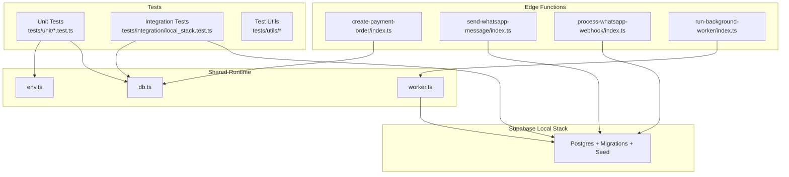
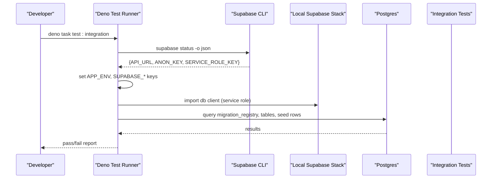
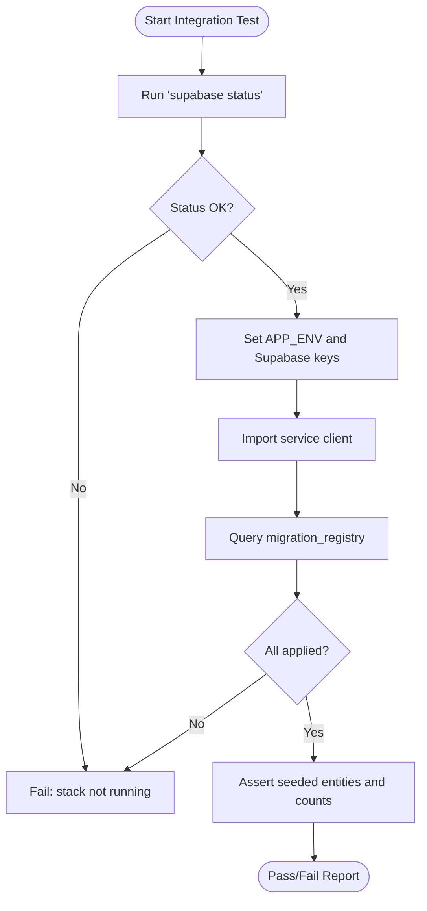
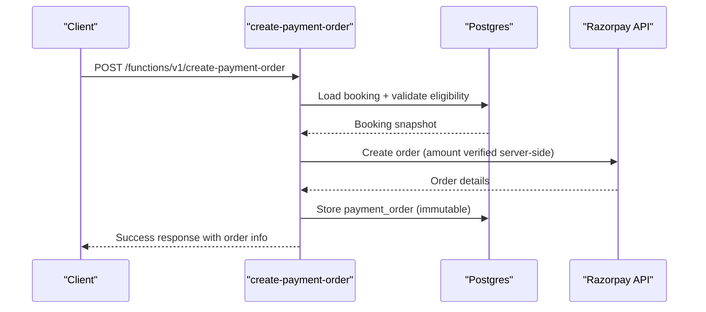
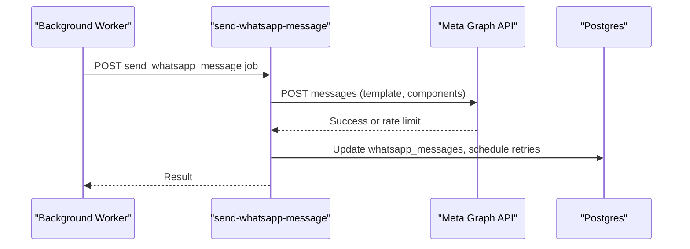
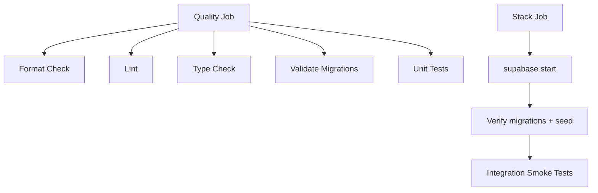
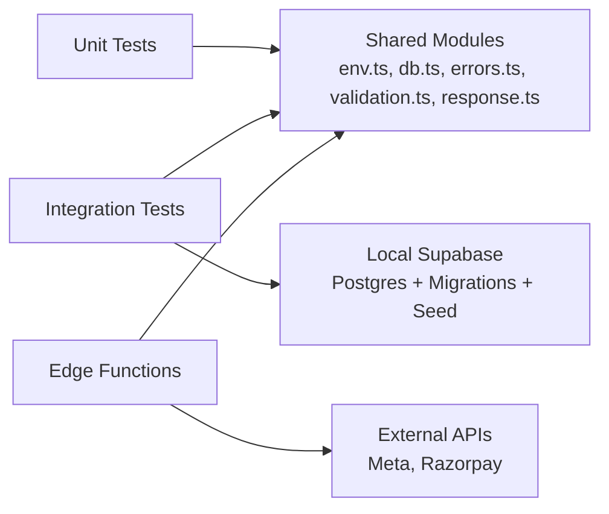

# Testing Strategy

<cite>
**Referenced Files in This Document**
- [deno.json](file://deno.json)
- [ci.yml](file://.github/workflows/ci.yml)
- [config.toml](file://supabase/config.toml)
- [seed.sql](file://supabase/seed.sql)
- [local_stack.test.ts](file://tests/integration/local_stack.test.ts)
- [errors.test.ts](file://tests/unit/errors.test.ts)
- [response.test.ts](file://tests/unit/response.test.ts)
- [validation.test.ts](file://tests/unit/validation.test.ts)
- [setup_env.ts](file://tests/utils/setup_env.ts)
- [seed_constants.ts](file://tests/utils/seed_constants.ts)
- [env.ts](file://supabase/functions/_shared/env.ts)
- [db.ts](file://supabase/functions/_shared/db.ts)
- [create-payment-order/index.ts](file://supabase/functions/create-payment-order/index.ts)
- [send-whatsapp-message/index.ts](file://supabase/functions/send-whatsapp-message/index.ts)
- [process-whatsapp-webhook/index.ts](file://supabase/functions/process-whatsapp-webhook/index.ts)
- [run-background-worker/index.ts](file://supabase/functions/run-background-worker/index.ts)
- [worker.ts](file://supabase/functions/_shared/worker.ts)
</cite>

## Table of Contents

1. Introduction
2. Project Structure
3. Core Components
4. Architecture Overview
5. Detailed Component Analysis
6. Dependency Analysis
7. Performance Considerations
8. Troubleshooting Guide
9. Conclusion
10. Appendices

## Introduction

This document defines the testing strategy for Setura Hospital OS using a
testing pyramid: unit tests for pure logic, integration tests against a local
Supabase stack, and end-to-end scenarios for critical user workflows. It
explains how to set up Deno test runner tasks, bootstrap environment variables,
manage deterministic seed data, mock external services by design, and run
continuous integration with automated checks. It also provides guidance for
testing edge functions, database queries, background jobs, and outlines
performance and load testing approaches for production readiness.

## Project Structure

The repository organizes tests alongside source code:

- Unit tests under tests/unit target pure modules (errors, validation,
  response).
- Integration tests under tests/integration exercise the real local Supabase
  stack via the service client.
- Test utilities under tests/utils provide environment bootstrapping and shared
  seed constants.
- Edge functions live under supabase/functions and are validated through type
  checking and integration flows.
- CI is defined under .github/workflows/ci.yml to enforce quality gates and run
  integration smoke tests on a local Supabase stack.

**Diagram sources**

- [local_stack.test.ts:1-269](file://tests/integration/local_stack.test.ts#L1-L269)
- [errors.test.ts:1-151](file://tests/unit/errors.test.ts#L1-L151)
- [response.test.ts:1-147](file://tests/unit/response.test.ts#L1-L147)
- [validation.test.ts:1-203](file://tests/unit/validation.test.ts#L1-L203)
- [setup_env.ts:1-40](file://tests/utils/setup_env.ts#L1-L40)
- [env.ts:1-279](file://supabase/functions/_shared/env.ts#L1-L279)
- [db.ts:1-169](file://supabase/functions/_shared/db.ts#L1-L169)
- [create-payment-order/index.ts:1-200](file://supabase/functions/create-payment-order/index.ts#L1-L200)
- [send-whatsapp-message/index.ts:189-582](file://supabase/functions/send-whatsapp-message/index.ts#L189-L582)
- [process-whatsapp-webhook/index.ts:1-62](file://supabase/functions/process-whatsapp-webhook/index.ts#L1-L62)
- [run-background-worker/index.ts:1-361](file://supabase/functions/run-background-worker/index.ts#L1-L361)
- [worker.ts:182-256](file://supabase/functions/_shared/worker.ts#L182-L256)

**Section sources**

- [deno.json:11-20](file://deno.json#L11-L20)
- [ci.yml:28-84](file://.github/workflows/ci.yml#L28-L84)
- [config.toml:53-65](file://supabase/config.toml#L53-L65)

## Core Components

- Environment validation: env.ts enforces required variables at module load
  time; tests must set them before importing dependent modules.
- Database client: db.ts exposes service, anon, and per-request auth clients
  plus typed RPC helpers used by integration tests and edge functions.
- Error hierarchy and response builders: errors.test.ts and response.test.ts
  validate typed error classes and standardized JSON responses with CORS
  headers.
- Validation layer: validation.test.ts covers Zod schemas, request parsing,
  phone normalization, date constraints, and body size limits.
- Seed contract: seed_constants.ts centralizes fixed identifiers and expected
  counts that integration tests assert against the seeded database.

Key responsibilities:

- Unit tests verify pure logic deterministically without network or database
  access.
- Integration tests start the local Supabase stack, apply migrations and seed,
  then assert schema state and seeded data integrity.
- Edge function tests rely on integration flows and unit-level assertions over
  transforms and error mapping.

**Section sources**

- [env.ts:16-112](file://supabase/functions/_shared/env.ts#L16-L112)
- [db.ts:30-106](file://supabase/functions/_shared/db.ts#L30-L106)
- [errors.test.ts:29-151](file://tests/unit/errors.test.ts#L29-L151)
- [response.test.ts:40-147](file://tests/unit/response.test.ts#L40-L147)
- [validation.test.ts:29-203](file://tests/unit/validation.test.ts#L29-L203)
- [seed_constants.ts:9-34](file://tests/utils/seed_constants.ts#L9-L34)

## Architecture Overview

The testing architecture follows a layered approach:

- Unit layer: fast, deterministic tests of pure functions and error/response
  mappings.
- Integration layer: boots the local Supabase stack, dynamically reads CLI
  status, sets environment, and asserts seeded state and migration application.
- CI pipeline: runs formatting, linting, type checks, migration validation, unit
  tests, starts the local stack, verifies migrations, and executes integration
  smoke tests.

**Diagram sources**

- [local_stack.test.ts:32-78](file://tests/integration/local_stack.test.ts#L32-L78)
- [ci.yml:55-84](file://.github/workflows/ci.yml#L55-L84)
- [config.toml:53-65](file://supabase/config.toml#L53-L65)

**Section sources**

- [local_stack.test.ts:1-269](file://tests/integration/local_stack.test.ts#L1-L269)
- [ci.yml:1-84](file://.github/workflows/ci.yml#L1-L84)

## Detailed Component Analysis

### Unit Testing Patterns

- Errors: Validate typed error classes, status codes, retry flags, context
  fields, and serialization behavior.
- Responses: Verify success/error envelopes, CORS headers, Retry-After header,
  and error mapping from typed errors to HTTP responses.
- Validation: Assert Zod schemas, parseBody behavior, phone normalization, date
  constraints, and oversized body handling.

Best practices:

- Import setup_env.ts first when testing modules that transitively import env.ts
  to ensure fake credentials are present before eager validation.
- Keep tests deterministic: avoid random() and live clocks; compute expectations
  relative to current time where necessary.

**Section sources**

- [setup_env.ts:1-40](file://tests/utils/setup_env.ts#L1-L40)
- [errors.test.ts:29-151](file://tests/unit/errors.test.ts#L29-L151)
- [response.test.ts:40-147](file://tests/unit/response.test.ts#L40-L147)
- [validation.test.ts:29-203](file://tests/unit/validation.test.ts#L29-L203)

### Integration Testing Against Local Supabase

- Bootstrap: The integration test calls the Supabase CLI to read API URL and
  keys, sets environment variables, and lazily imports the service client.
- Assertions: Validates migration registry entries, seeded hospital, profiles,
  roles, doctor schedules, working hours, settings, fee policy, queue configs,
  and feature flags using exact counts and values from seed_constants.ts.
- Idempotency: Uses deterministic seed with ON CONFLICT clauses to ensure
  re-runs do not create duplicates.

**Diagram sources**

- [local_stack.test.ts:32-99](file://tests/integration/local_stack.test.ts#L32-L99)
- [local_stack.test.ts:101-269](file://tests/integration/local_stack.test.ts#L101-L269)
- [seed_constants.ts:9-34](file://tests/utils/seed_constants.ts#L9-L34)

**Section sources**

- [local_stack.test.ts:1-269](file://tests/integration/local_stack.test.ts#L1-L269)
- [seed.sql:37-200](file://supabase/seed.sql#L37-L200)

### Edge Function Testing: Payment Orders

- Flow: Authorization and role checks, idempotency guard, booking validation,
  amount resolution, Razorpay order creation, and immutable record storage.
- Testing focus:
  - Unit: Validate input schemas, error mapping, and response envelope
    construction.
  - Integration: With a local stack, assert booking state transitions and
    payment_order records after calling the function endpoint.
- External service mocking strategy: Do not call Razorpay in tests; instead,
  isolate pure transforms and error handling in unit tests. For integration,
  stub or intercept HTTP calls if needed, or use a local proxy that returns
  deterministic responses.

**Diagram sources**

- [create-payment-order/index.ts:1-200](file://supabase/functions/create-payment-order/index.ts#L1-L200)

**Section sources**

- [create-payment-order/index.ts:1-200](file://supabase/functions/create-payment-order/index.ts#L1-L200)

### Edge Function Testing: WhatsApp Messaging

- Outgoing messages: send-whatsapp-message constructs payloads and calls Meta
  Graph API with timeouts and rate-limit handling.
- Incoming webhooks: process-whatsapp-webhook verifies HMAC signatures and
  persists events.
- Background worker: run-background-worker claims jobs, processes types
  including WhatsApp messaging, and uses worker utilities for heartbeats and
  retries.

Testing patterns:

- Unit: Validate payload transformation, error classification, and
  metrics/timing hooks.
- Integration: Use local stack to assert message queue states and webhook event
  persistence; avoid live Meta calls by isolating transforms or using a stubbed
  fetch in controlled environments.

**Diagram sources**

- [send-whatsapp-message/index.ts:189-582](file://supabase/functions/send-whatsapp-message/index.ts#L189-L582)
- [process-whatsapp-webhook/index.ts:1-62](file://supabase/functions/process-whatsapp-webhook/index.ts#L1-L62)
- [run-background-worker/index.ts:1-361](file://supabase/functions/run-background-worker/index.ts#L1-L361)
- [worker.ts:182-256](file://supabase/functions/_shared/worker.ts#L182-L256)

**Section sources**

- [send-whatsapp-message/index.ts:189-582](file://supabase/functions/send-whatsapp-message/index.ts#L189-L582)
- [process-whatsapp-webhook/index.ts:1-62](file://supabase/functions/process-whatsapp-webhook/index.ts#L1-L62)
- [run-background-worker/index.ts:1-361](file://supabase/functions/run-background-worker/index.ts#L1-L361)
- [worker.ts:182-256](file://supabase/functions/_shared/worker.ts#L182-L256)

### Database Transactions and Concurrency

- Seed idempotency: Deterministic seed uses ON CONFLICT DO NOTHING/UPDATE to
  converge state safely across repeated runs.
- Concurrency safety: Unique constraints and idempotency keys prevent duplicate
  orders and bookings; integration tests assert exact counts to detect
  duplicates.
- Best practices:
  - Use service-role client for internal mutations and background workers.
  - Enforce RLS via per-request auth client for user-facing operations.
  - Wrap complex sequences in transactions at the database level where possible;
    rely on Postgres constraints for atomicity.

**Section sources**

- [seed.sql:37-200](file://supabase/seed.sql#L37-L200)
- [db.ts:30-106](file://supabase/functions/_shared/db.ts#L30-L106)
- [local_stack.test.ts:121-175](file://tests/integration/local_stack.test.ts#L121-L175)

### Test Data Management

- Seed data: A single transactional seed script creates deterministic entities
  with fixed UUIDs and passwords, ensuring reproducibility.
- Constants: seed_constants.ts centralizes IDs and expected counts, acting as
  the contract between seed and tests.
- State management: Integration tests assert exact row counts and attribute
  values to guarantee idempotent seeding and schema alignment.

**Section sources**

- [seed.sql:37-200](file://supabase/seed.sql#L37-L200)
- [seed_constants.ts:9-34](file://tests/utils/seed_constants.ts#L9-L34)
- [local_stack.test.ts:101-269](file://tests/integration/local_stack.test.ts#L101-L269)

### Continuous Integration Setup

- Quality gate job: format check, lint, type check across scripts, tests, and
  edge functions; migration validation; unit tests.
- Stack job: installs Supabase CLI, starts local stack (applies migrations +
  seed), verifies table counts and seeded hospital, then runs integration smoke
  tests.
- Concurrency: CI cancels in-progress runs for the same branch to save
  resources.

**Diagram sources**

- [ci.yml:28-84](file://.github/workflows/ci.yml#L28-L84)

**Section sources**

- [ci.yml:1-84](file://.github/workflows/ci.yml#L1-L84)

## Dependency Analysis

- Unit tests depend on shared modules (errors, validation, response) and require
  environment bootstrapping before imports.
- Integration tests depend on the local Supabase stack and service client to
  query schema and seed state.
- Edge functions depend on environment configuration, database clients, and
  external APIs (Meta, Razorpay); tests should isolate pure logic and avoid live
  calls.

**Diagram sources**

- [setup_env.ts:1-40](file://tests/utils/setup_env.ts#L1-L40)
- [env.ts:16-112](file://supabase/functions/_shared/env.ts#L16-L112)
- [db.ts:30-106](file://supabase/functions/_shared/db.ts#L30-L106)
- [create-payment-order/index.ts:1-200](file://supabase/functions/create-payment-order/index.ts#L1-L200)
- [send-whatsapp-message/index.ts:189-582](file://supabase/functions/send-whatsapp-message/index.ts#L189-L582)

**Section sources**

- [deno.json:11-20](file://deno.json#L11-L20)
- [ci.yml:28-84](file://.github/workflows/ci.yml#L28-L84)

## Performance Considerations

- Unit tests: Keep them fast and deterministic; avoid heavy I/O and network
  calls.
- Integration tests: Run against a local stack to minimize latency; assert exact
  counts to catch regressions quickly.
- Background jobs: Use worker utilities for heartbeat and retry; measure
  durations with metrics timers to detect slow paths.
- Load and stress testing:
  - Simulate concurrent requests to endpoints like create-booking and
    create-payment-order to verify idempotency and concurrency controls.
  - Measure throughput and latency under sustained load; monitor connection
    pools and timeouts.
  - Validate resilience to external API rate limits and failures (e.g., Meta 429
    handling).

[No sources needed since this section provides general guidance]

## Troubleshooting Guide

- Missing environment variables: Ensure setup_env.ts is imported first in unit
  tests; confirm CI sets required variables or uses local stack outputs.
- Local stack not running: Integration tests will fail early if supabase status
  does not return valid JSON; start the stack before running tests.
- Migration mismatches: Verify migration_registry entries and latest migration
  status; CI validates migrations separately.
- External API failures: Isolate transforms in unit tests; for integration,
  consider stubbing fetch or using a local proxy to simulate responses.

**Section sources**

- [setup_env.ts:1-40](file://tests/utils/setup_env.ts#L1-L40)
- [local_stack.test.ts:32-78](file://tests/integration/local_stack.test.ts#L32-L78)
- [ci.yml:46-53](file://.github/workflows/ci.yml#L46-L53)

## Conclusion

The testing strategy combines fast, deterministic unit tests with robust
integration tests against a local Supabase stack, backed by a CI pipeline that
enforces quality and validates schema and seed integrity. By avoiding mocks for
database layers and focusing on pure logic isolation for external services, the
suite remains aligned with the real system behavior while remaining reliable and
maintainable.

[No sources needed since this section summarizes without analyzing specific
files]

## Appendices

### Running Tests Locally

- Unit tests: deno task test
- Integration tests: deno task test:integration (requires supabase start)
- Type checks: deno task check
- Migration validation: deno task validate:migrations

**Section sources**

- [deno.json:11-20](file://deno.json#L11-L20)

### Seed Configuration

- Seed enabled and configured to run during db reset/start.
- Seed file path points to seed.sql which contains deterministic data and
  convergence logic.

**Section sources**

- [config.toml:53-65](file://supabase/config.toml#L53-L65)
- [seed.sql:37-200](file://supabase/seed.sql#L37-L200)
