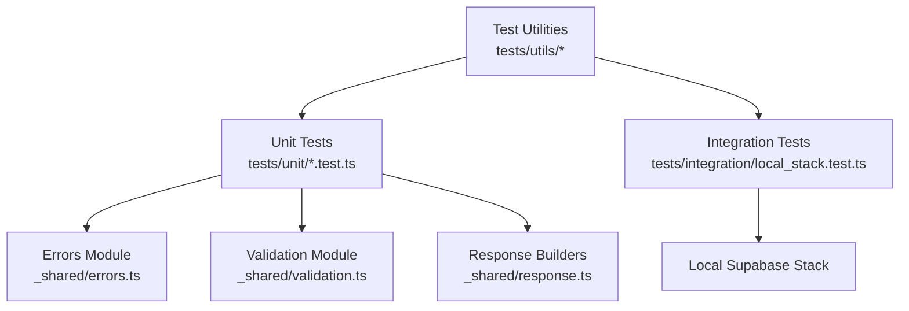
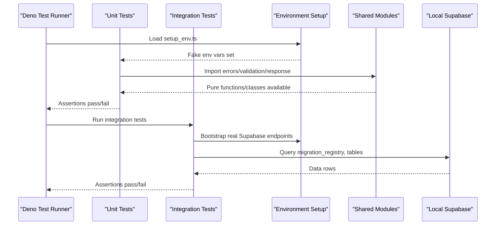
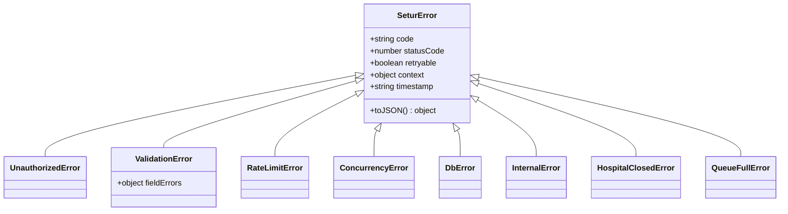
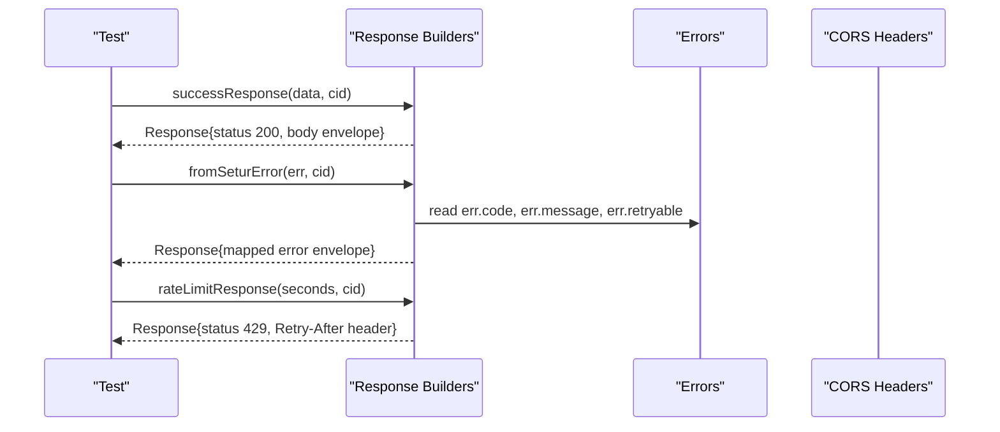
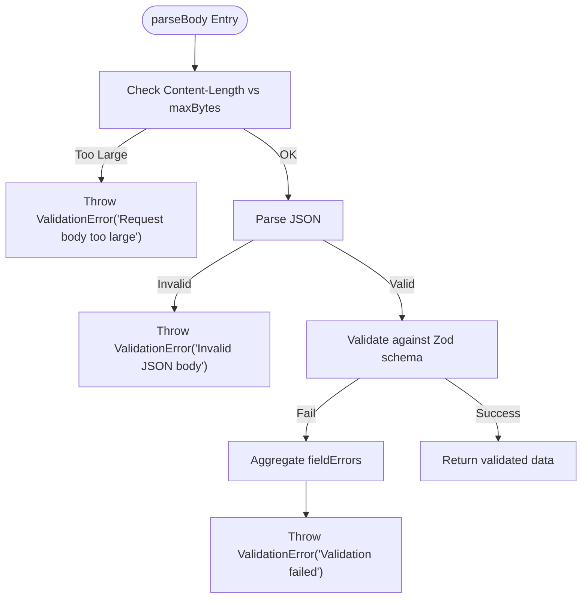
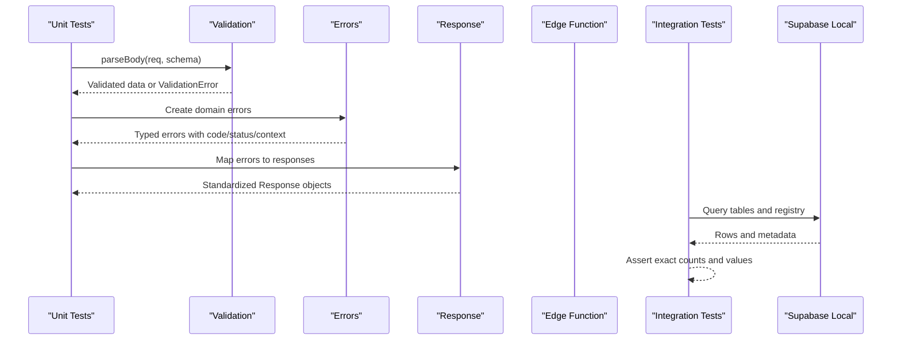
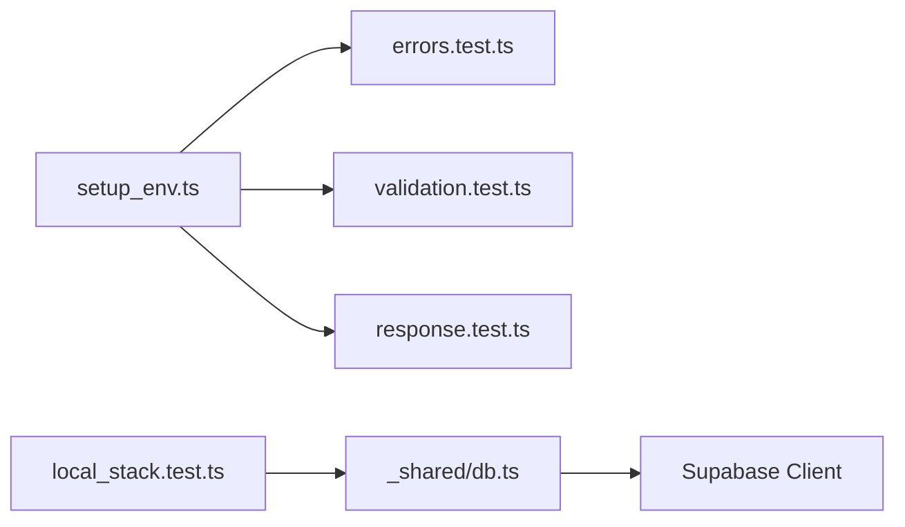

# Unit Testing

<cite>
**Referenced Files in This Document**
- [deno.json](file://deno.json)
- [errors.test.ts](file://tests/unit/errors.test.ts)
- [response.test.ts](file://tests/unit/response.test.ts)
- [validation.test.ts](file://tests/unit/validation.test.ts)
- [local_stack.test.ts](file://tests/integration/local_stack.test.ts)
- [setup_env.ts](file://tests/utils/setup_env.ts)
- [seed_constants.ts](file://tests/utils/seed_constants.ts)
- [errors.ts](file://supabase/functions/_shared/errors.ts)
- [response.ts](file://supabase/functions/_shared/response.ts)
- [validation.ts](file://supabase/functions/_shared/validation.ts)
- [env.ts](file://supabase/functions/_shared/env.ts)
- [create-booking/index.ts](file://supabase/functions/create-booking/index.ts)
</cite>

## Table of Contents

1. [Introduction](#introduction)
2. [Project Structure](#project-structure)
3. [Core Components](#core-components)
4. [Architecture Overview](#architecture-overview)
5. [Detailed Component Analysis](#detailed-component-analysis)
6. [Dependency Analysis](#dependency-analysis)
7. [Performance Considerations](#performance-considerations)
8. [Troubleshooting Guide](#troubleshooting-guide)
9. [Conclusion](#conclusion)
10. [Appendices](#appendices)

## Introduction

This document explains the unit testing approach for the Setura Hospital OS
using Deno’s built-in test runner and assertion library. It covers testing
patterns for error handling, response formatting, input validation, async
operations, and edge functions. It also provides guidance on mocking external
dependencies, testing database interactions via integration tests, and best
practices for maintainable tests with good coverage and performance.

## Project Structure

The repository organizes tests into:

- Unit tests under tests/unit that target pure modules (errors, validation,
  response).
- Integration tests under tests/integration that run against a real local
  Supabase stack.
- Shared test utilities under tests/utils for environment setup and
  deterministic seed constants.

**Diagram sources**

- [errors.test.ts:1-151](file://tests/unit/errors.test.ts#L1-L151)
- [validation.test.ts:1-203](file://tests/unit/validation.test.ts#L1-L203)
- [response.test.ts:1-147](file://tests/unit/response.test.ts#L1-L147)
- [local_stack.test.ts:1-269](file://tests/integration/local_stack.test.ts#L1-L269)
- [setup_env.ts:1-40](file://tests/utils/setup_env.ts#L1-L40)
- [seed_constants.ts:1-35](file://tests/utils/seed_constants.ts#L1-L35)

**Section sources**

- [deno.json:11-18](file://deno.json#L11-L18)
- [setup_env.ts:1-40](file://tests/utils/setup_env.ts#L1-L40)

## Core Components

The testing strategy centers around three core shared modules:

- Errors: A typed error hierarchy with codes, HTTP status codes, retryability,
  and context.
- Validation: Zod schemas and request parsing utilities that normalize and
  validate inputs.
- Response: Standardized API response builders that wrap data or errors with
  consistent envelopes and CORS headers.

Key testing patterns:

- Error handling: Assert error classes, codes, statuses, retryability, and
  structured context.
- Response formatting: Assert envelope fields, status codes, headers, and error
  mapping from typed errors.
- Input validation: Validate normalization, schema constraints, parseBody
  behavior, and field-level error aggregation.

**Section sources**

- [errors.ts:70-323](file://supabase/functions/_shared/errors.ts#L70-L323)
- [validation.ts:13-157](file://supabase/functions/_shared/validation.ts#L13-L157)
- [response.ts:14-206](file://supabase/functions/_shared/response.ts#L14-L206)

## Architecture Overview

The unit tests exercise pure logic without network or database access. The
integration tests bootstrap a real Supabase client and assert end-to-end state
after migrations and seed data are applied.

**Diagram sources**

- [setup_env.ts:33-38](file://tests/utils/setup_env.ts#L33-L38)
- [errors.test.ts:6-27](file://tests/unit/errors.test.ts#L6-L27)
- [validation.test.ts:6-27](file://tests/unit/validation.test.ts#L6-L27)
- [response.test.ts:8-32](file://tests/unit/response.test.ts#L8-L32)
- [local_stack.test.ts:52-78](file://tests/integration/local_stack.test.ts#L52-L78)

## Detailed Component Analysis

### Error Handling Tests

- Purpose: Verify the typed error hierarchy, default behaviors, and type guards.
- Patterns:
  - Construct domain-specific errors and assert code, statusCode, retryable,
    context, and timestamp format.
  - Use type guards to ensure correct classification of errors.
  - Validate inheritance from base error types.

**Diagram sources**

- [errors.ts:70-323](file://supabase/functions/_shared/errors.ts#L70-L323)

**Section sources**

- [errors.test.ts:29-150](file://tests/unit/errors.test.ts#L29-L150)
- [errors.ts:70-323](file://supabase/functions/_shared/errors.ts#L70-L323)

### Response Formatting Tests

- Purpose: Ensure standardized API responses include success envelope,
  correlationId, timestamp, and proper headers.
- Patterns:
  - Assert status codes for success and error responses.
  - Validate mapping from typed errors to response bodies, including fieldErrors
    propagation.
  - Confirm CORS headers derived from environment configuration.

**Diagram sources**

- [response.ts:34-206](file://supabase/functions/_shared/response.ts#L34-L206)
- [response.test.ts:40-147](file://tests/unit/response.test.ts#L40-L147)

**Section sources**

- [response.test.ts:40-147](file://tests/unit/response.test.ts#L40-L147)
- [response.ts:34-206](file://supabase/functions/_shared/response.ts#L34-L206)

### Input Validation Tests

- Purpose: Validate phone normalization, date formats, enum constraints, and
  request parsing.
- Patterns:
  - Use safeParse to assert schema acceptance/rejection.
  - Assert parseBody behavior for invalid JSON, oversized bodies, and aggregated
    field-level errors.
  - Validate business helpers like advance booking window and weekday
    computation.

**Diagram sources**

- [validation.ts:99-134](file://supabase/functions/_shared/validation.ts#L99-L134)

**Section sources**

- [validation.test.ts:31-203](file://tests/unit/validation.test.ts#L31-L203)
- [validation.ts:13-157](file://supabase/functions/_shared/validation.ts#L13-L157)

### Edge Function Testing Strategy

- Approach:
  - Unit tests isolate pure logic (errors, validation, response) without
    invoking the full edge function.
  - For edge functions like create-booking, unit tests focus on their pure
    dependencies (schemas, error mapping, response building).
  - Integration tests verify end-to-end flows by running against a real local
    Supabase stack, ensuring migrations and seed data produce expected state.

**Diagram sources**

- [create-booking/index.ts:67-666](file://supabase/functions/create-booking/index.ts#L67-L666)
- [local_stack.test.ts:82-269](file://tests/integration/local_stack.test.ts#L82-L269)

**Section sources**

- [create-booking/index.ts:67-666](file://supabase/functions/create-booking/index.ts#L67-L666)
- [local_stack.test.ts:1-269](file://tests/integration/local_stack.test.ts#L1-L269)

## Dependency Analysis

- Unit tests depend on pure modules; they do not require network or database
  access.
- Environment variables are set before importing modules that eagerly validate
  config.
- Integration tests dynamically import the database client after bootstrapping
  local Supabase endpoints.

**Diagram sources**

- [setup_env.ts:33-38](file://tests/utils/setup_env.ts#L33-L38)
- [local_stack.test.ts:52-78](file://tests/integration/local_stack.test.ts#L52-L78)

**Section sources**

- [setup_env.ts:1-40](file://tests/utils/setup_env.ts#L1-L40)
- [local_stack.test.ts:52-78](file://tests/integration/local_stack.test.ts#L52-L78)

## Performance Considerations

- Keep unit tests fast and deterministic: avoid randomness and live clocks;
  compute expectations relative to current time when necessary.
- Prefer pure module tests over heavy integration tests for frequent feedback
  during development.
- Use targeted assertions to minimize overhead; batch related checks within a
  single test where appropriate.
- Integration tests should be run separately due to startup costs of the local
  Supabase stack.

[No sources needed since this section provides general guidance]

## Troubleshooting Guide

Common issues and resolutions:

- Missing environment variables: Ensure setup_env.ts is imported first in any
  test that imports modules relying on env.ts.
- Network or database access in unit tests: Refactor to test pure logic only;
  move DB-dependent scenarios to integration tests.
- Flaky assertions involving timestamps: Compare ISO strings or use regex
  matches rather than exact equality.
- CORS header mismatches: Verify ALLOWED_ORIGINS configuration in setup_env.ts
  matches expected origins.

**Section sources**

- [setup_env.ts:1-40](file://tests/utils/setup_env.ts#L1-L40)
- [env.ts:18-49](file://supabase/functions/_shared/env.ts#L18-L49)
- [response.test.ts:135-147](file://tests/unit/response.test.ts#L135-L147)

## Conclusion

The Setura Hospital OS employs a clear separation between unit and integration
testing:

- Unit tests validate pure logic for errors, validation, and response formatting
  using Deno’s test runner and assertions.
- Integration tests exercise the real local Supabase stack to ensure migrations,
  seed data, and queries behave as expected. Following these patterns ensures
  reliable, maintainable tests with strong coverage and predictable performance.

[No sources needed since this section summarizes without analyzing specific
files]

## Appendices

### Running Tests

- Unit tests: deno task test
- Integration tests: deno task test:integration

**Section sources**

- [deno.json:11-18](file://deno.json#L11-L18)

### Test Utilities and Data

- Environment bootstrap: setup_env.ts sets fake credentials and allowed origins
  prior to module load.
- Deterministic seed constants: seed_constants.ts centralizes IDs and expected
  counts used across integration tests.

**Section sources**

- [setup_env.ts:33-38](file://tests/utils/setup_env.ts#L33-L38)
- [seed_constants.ts:9-34](file://tests/utils/seed_constants.ts#L9-L34)
