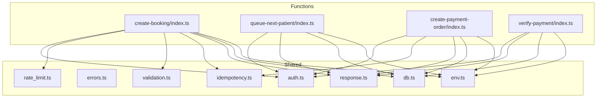
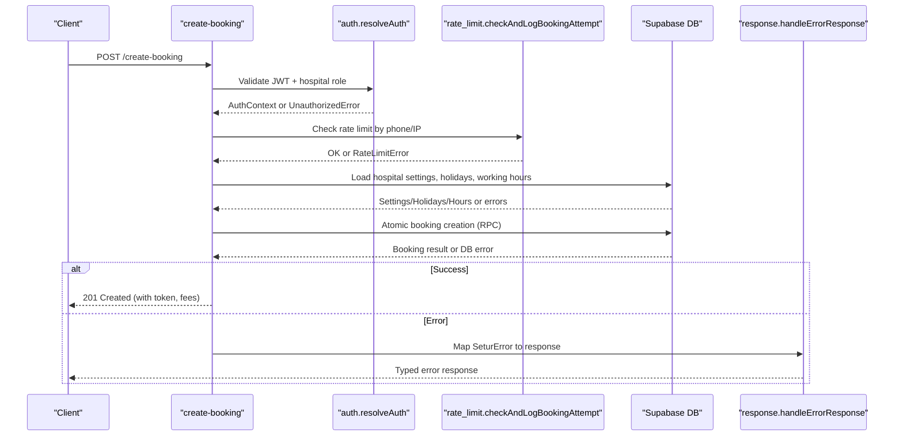
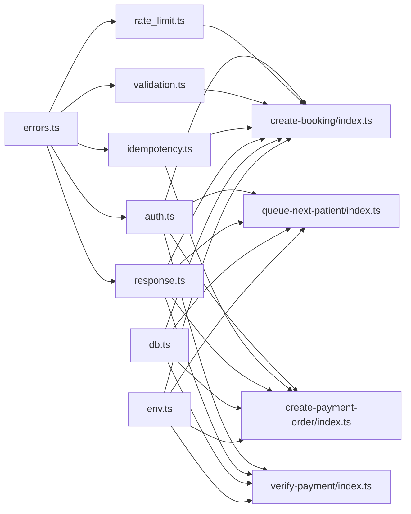
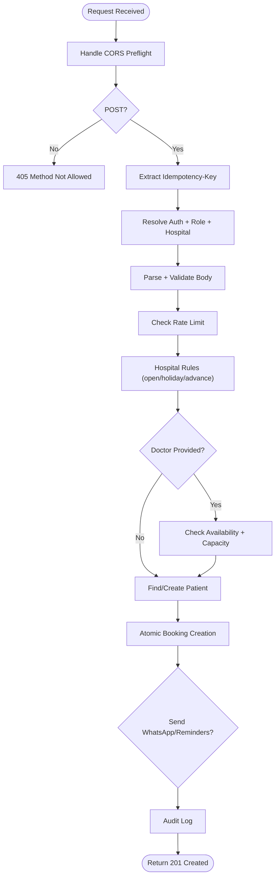

# Common Issues & Solutions

<cite>
**Referenced Files in This Document**
- [errors.ts](file://supabase/functions/_shared/errors.ts)
- [auth.ts](file://supabase/functions/_shared/auth.ts)
- [rate_limit.ts](file://supabase/functions/_shared/rate_limit.ts)
- [validation.ts](file://supabase/functions/_shared/validation.ts)
- [idempotency.ts](file://supabase/functions/_shared/idempotency.ts)
- [response.ts](file://supabase/functions/_shared/response.ts)
- [db.ts](file://supabase/functions/_shared/db.ts)
- [env.ts](file://supabase/functions/_shared/env.ts)
- [create-booking/index.ts](file://supabase/functions/create-booking/index.ts)
- [queue-next-patient/index.ts](file://supabase/functions/queue-next-patient/index.ts)
- [create-payment-order/index.ts](file://supabase/functions/create-payment-order/index.ts)
- [verify-payment/index.ts](file://supabase/functions/verify-payment/index.ts)
</cite>

## Table of Contents

1. [Introduction](#introduction)
2. [Project Structure](#project-structure)
3. [Core Components](#core-components)
4. [Architecture Overview](#architecture-overview)
5. [Detailed Component Analysis](#detailed-component-analysis)
6. [Dependency Analysis](#dependency-analysis)
7. [Performance Considerations](#performance-considerations)
8. [Troubleshooting Guide](#troubleshooting-guide)
9. [Conclusion](#conclusion)
10. [Appendices](#appendices)

## Introduction

This document provides a practical, code-backed guide to diagnosing and
resolving common operational issues in the Setura Hospital OS. It focuses on
frequent failure modes such as database connection failures, authentication
errors, booking conflicts, queue processing issues, payment gateway errors,
multi-tenant access problems, hospital configuration issues, and rate limiting
scenarios. For each issue, you will find:

- Symptom description
- Root cause analysis
- Step-by-step resolution procedures
- Preventive measures
- Specific error codes from the centralized error system with recovery steps

The guidance is grounded in the actual implementation across shared utilities
and Edge Functions for booking, queue management, and payments.

## Project Structure

Setura’s backend is implemented as Deno Edge Functions under supabase/functions.
Shared logic (auth, validation, idempotency, rate limiting, responses,
environment, DB clients) lives in _shared. Domain functions include
create-booking, queue-next-patient, create-payment-order, and verify-payment.

**Diagram sources**

- [auth.ts:1-237](file://supabase/functions/_shared/auth.ts#L1-L237)
- [errors.ts:1-323](file://supabase/functions/_shared/errors.ts#L1-L323)
- [rate_limit.ts:1-124](file://supabase/functions/_shared/rate_limit.ts#L1-L124)
- [validation.ts:1-157](file://supabase/functions/_shared/validation.ts#L1-L157)
- [idempotency.ts:1-259](file://supabase/functions/_shared/idempotency.ts#L1-L259)
- [response.ts:1-206](file://supabase/functions/_shared/response.ts#L1-L206)
- [db.ts:1-169](file://supabase/functions/_shared/db.ts#L1-L169)
- [env.ts:1-279](file://supabase/functions/_shared/env.ts#L1-L279)
- [create-booking/index.ts:1-666](file://supabase/functions/create-booking/index.ts#L1-L666)
- [queue-next-patient/index.ts:1-409](file://supabase/functions/queue-next-patient/index.ts#L1-L409)
- [create-payment-order/index.ts:1-407](file://supabase/functions/create-payment-order/index.ts#L1-L407)
- [verify-payment/index.ts:1-480](file://supabase/functions/verify-payment/index.ts#L1-L480)

**Section sources**

- [auth.ts:1-237](file://supabase/functions/_shared/auth.ts#L1-L237)
- [create-booking/index.ts:1-666](file://supabase/functions/create-booking/index.ts#L1-L666)
- [queue-next-patient/index.ts:1-409](file://supabase/functions/queue-next-patient/index.ts#L1-L409)
- [create-payment-order/index.ts:1-407](file://supabase/functions/create-payment-order/index.ts#L1-L407)
- [verify-payment/index.ts:1-480](file://supabase/functions/verify-payment/index.ts#L1-L480)

## Core Components

- Centralized typed error hierarchy defines domain-specific error codes and HTTP
  status mapping, including UNAUTHORIZED, FORBIDDEN, BOOKING_DUPLICATE,
  QUEUE_FULL, RATE_LIMIT_EXCEEDED, PAYMENT_FAILED, DB_ERROR, etc.
- Auth middleware validates JWT via Supabase, resolves roles and hospital
  membership, and enforces role-based access.
- Rate limiter uses a sliding window over booking_attempt_logs to protect
  against abuse and blocks numbers when configured.
- Validation layer normalizes inputs (e.g., phone normalization) and enforces
  schemas before business logic.
- Idempotency wrapper ensures safe retries and prevents duplicate operations
  using api_idempotency_keys.
- Response helpers standardize success/error payloads and map SeturError
  instances to consistent API responses.
- DB client abstraction manages service-role, anon, and per-request auth clients
  and wraps RPC calls with typed error handling.
- Environment loader validates required settings at cold start to fail fast if
  misconfigured.

**Section sources**

- [errors.ts:13-64](file://supabase/functions/_shared/errors.ts#L13-L64)
- [auth.ts:22-124](file://supabase/functions/_shared/auth.ts#L22-L124)
- [rate_limit.ts:22-111](file://supabase/functions/_shared/rate_limit.ts#L22-L111)
- [validation.ts:23-88](file://supabase/functions/_shared/validation.ts#L23-L88)
- [idempotency.ts:37-59](file://supabase/functions/_shared/idempotency.ts#L37-L59)
- [response.ts:94-112](file://supabase/functions/_shared/response.ts#L94-L112)
- [db.ts:30-106](file://supabase/functions/_shared/db.ts#L30-L106)
- [env.ts:18-49](file://supabase/functions/_shared/env.ts#L18-L49)

## Architecture Overview

The booking flow demonstrates how shared components collaborate to enforce
security, validation, idempotency, rate limits, and business rules.

**Diagram sources**

- [create-booking/index.ts:67-166](file://supabase/functions/create-booking/index.ts#L67-L166)
- [auth.ts:42-124](file://supabase/functions/_shared/auth.ts#L42-L124)
- [rate_limit.ts:27-111](file://supabase/functions/_shared/rate_limit.ts#L27-L111)
- [response.ts:196-205](file://supabase/functions/_shared/response.ts#L196-L205)

## Detailed Component Analysis

### Authentication Errors

Symptoms:

- Requests return 401 with UNAUTHORIZED or 403 with FORBIDDEN.
- Cross-hospital access returns HOSPITAL_ACCESS_DENIED.
- Role checks fail with ROLE_INSUFFICIENT.

Root causes:

- Missing or invalid Authorization header or expired JWT.
- User profile inactive or not found.
- User lacks required role or hospital membership.

Resolution steps:

- Ensure requests include a valid Bearer token and X-Hospital-ID header where
  required.
- Verify user profile exists and is active.
- Confirm user has the required role for the endpoint and belongs to the
  specified hospital (or is global_admin).

Preventive measures:

- Use withAuth middleware to centralize auth and role enforcement.
- Log correlation IDs for tracing auth failures.
- Avoid trusting client-provided hospital context; always validate via headers
  and server-side checks.

Relevant error codes:

- UNAUTHORIZED (401)
- FORBIDDEN (403)
- HOSPITAL_ACCESS_DENIED (403)
- ROLE_INSUFFICIENT (403)

**Section sources**

- [auth.ts:22-124](file://supabase/functions/_shared/auth.ts#L22-L124)
- [auth.ts:140-170](file://supabase/functions/_shared/auth.ts#L140-L170)
- [errors.ts:108-150](file://supabase/functions/_shared/errors.ts#L108-L150)
- [response.ts:114-132](file://supabase/functions/_shared/response.ts#L114-L132)

### Database Connection Failures

Symptoms:

- 500 INTERNAL_ERROR or DB_ERROR responses.
- Intermittent failures during RPC calls or table queries.

Root causes:

- Misconfigured SUPABASE_URL or keys.
- Network timeouts or transient DB errors.
- Service role vs anon role misuse leading to RLS denials.

Resolution steps:

- Validate environment variables at cold start (SUPABASE_URL, SUPABASE_ANON_KEY,
  SUPABASE_SERVICE_ROLE_KEY).
- Inspect error details (code, hint, details) returned by RPC wrappers.
- Retry only retryable errors; otherwise escalate.

Preventive measures:

- Use getServiceClient for internal mutations and createAuthClient for
  user-scoped operations.
- Wrap RPCs with typed callRpc to surface structured errors.
- Monitor logs for DB_ERROR occurrences and set up alerts.

Relevant error codes:

- DB_ERROR (500)
- DB_CONCURRENCY_ERROR (409, retryable)
- DB_TIMEOUT (500)

**Section sources**

- [db.ts:30-106](file://supabase/functions/_shared/db.ts#L30-L106)
- [db.ts:115-136](file://supabase/functions/_shared/db.ts#L115-L136)
- [db.ts:146-168](file://supabase/functions/_shared/db.ts#L146-L168)
- [errors.ts:295-299](file://supabase/functions/_shared/errors.ts#L295-L299)
- [env.ts:82-90](file://supabase/functions/_shared/env.ts#L82-L90)

### Booking Conflicts

Symptoms:

- Duplicate bookings detected; client receives 409 CONFLICT.
- Token exhaustion or queue full errors preventing new bookings.
- Doctor unavailable or advance booking window violations.

Root causes:

- Idempotency key collisions or double-click submissions.
- Queue capacity exceeded for the session/date.
- Doctor schedule constraints or holiday closures.

Resolution steps:

- Ensure clients send unique Idempotency-Key headers per request.
- If receiving BOOKING_DUPLICATE, reuse the existing bookingId/tokenNumber from
  the response.
- For TOKEN_EXHAUSTED or QUEUE_FULL, inform users to try alternative
  dates/doctors or wait for capacity.
- Respect hospital rules: online booking disabled, holidays, working hours,
  advance booking limits.

Preventive measures:

- Enforce idempotency via withIdempotency wrapper.
- Validate advance booking date against hospital max_advance_booking_days.
- Check doctor availability and remaining capacity before creating bookings.

Relevant error codes:

- BOOKING_DUPLICATE (409)
- TOKEN_EXHAUSTED (422)
- QUEUE_FULL (422)
- DOCTOR_UNAVAILABLE (422)
- HOSPITAL_CLOSED (422)

**Section sources**

- [create-booking/index.ts:87-166](file://supabase/functions/create-booking/index.ts#L87-L166)
- [create-booking/index.ts:168-283](file://supabase/functions/create-booking/index.ts#L168-L283)
- [create-booking/index.ts:421-493](file://supabase/functions/create-booking/index.ts#L421-L493)
- [errors.ts:166-228](file://supabase/functions/_shared/errors.ts#L166-L228)
- [idempotency.ts:196-259](file://supabase/functions/_shared/idempotency.ts#L196-L259)

### Queue Processing Issues

Symptoms:

- Queue advancement fails or returns no next token.
- Realtime broadcast or WhatsApp notifications fail but do not block queue
  progression.

Root causes:

- Invalid or inactive queue session.
- Session belongs to different hospital (multi-tenant mismatch).
- No more patients in queue (exhausted).

Resolution steps:

- Validate queueSessionId and ensure it is active and belongs to the requesting
  hospital.
- Call advance_queue RPC; handle null results as queue exhausted.
- Treat non-fatal side effects (realtime, WhatsApp) as warnings; they should not
  block core flow.

Preventive measures:

- Enforce hospital context via resolveAuth and requireRole.
- Log and monitor queue.advance.error metrics.
- Ensure queue sessions are created correctly with appropriate max_tokens.

Relevant error codes:

- VALIDATION_ERROR (422)
- FORBIDDEN (403)
- INTERNAL_ERROR (500)

**Section sources**

- [queue-next-patient/index.ts:70-154](file://supabase/functions/queue-next-patient/index.ts#L70-L154)
- [queue-next-patient/index.ts:159-213](file://supabase/functions/queue-next-patient/index.ts#L159-L213)
- [queue-next-patient/index.ts:258-320](file://supabase/functions/queue-next-patient/index.ts#L258-L320)
- [errors.ts:115-120](file://supabase/functions/_shared/errors.ts#L115-L120)

### Payment Gateway Errors

Symptoms:

- Payment order creation fails or Razorpay returns an error.
- Payment verification fails due to signature mismatch or missing credentials.
- Duplicate orders or already-paid bookings.

Root causes:

- Missing or invalid Razorpay credentials (RAZORPAY_KEY_ID,
  RAZORPAY_KEY_SECRET).
- Amount mismatch between server snapshot and gateway response.
- Signature verification failures for webhooks or frontend callbacks.
- Attempting to pay cancelled/completed bookings or zero-fee bookings.

Resolution steps:

- Ensure payment_enabled is true for the hospital and credentials are
  configured.
- Reuse existing pending payment order if present; avoid duplicate creation.
- Verify webhook signatures using HMAC-SHA256 and frontend signatures
  consistently.
- For amount mismatches, investigate gateway response and adjust server-side
  amount calculations.

Preventive measures:

- Use idempotency for payment order creation to prevent duplicates.
- Store immutable payment_order rows and track gateway responses.
- Always compute amounts server-side from booking snapshots; never trust
  client-provided amounts.

Relevant error codes:

- INTERNAL_ERROR (500)
- VALIDATION_ERROR (422)
- PAYMENT_FAILED (500)
- PAYMENT_NOT_FOUND (500)

**Section sources**

- [create-payment-order/index.ts:104-190](file://supabase/functions/create-payment-order/index.ts#L104-L190)
- [create-payment-order/index.ts:191-322](file://supabase/functions/create-payment-order/index.ts#L191-L322)
- [create-payment-order/index.ts:323-383](file://supabase/functions/create-payment-order/index.ts#L323-L383)
- [verify-payment/index.ts:59-110](file://supabase/functions/verify-payment/index.ts#L59-L110)
- [verify-payment/index.ts:207-309](file://supabase/functions/verify-payment/index.ts#L207-L309)
- [verify-payment/index.ts:362-434](file://supabase/functions/verify-payment/index.ts#L362-L434)
- [errors.ts:49-52](file://supabase/functions/_shared/errors.ts#L49-L52)

### Multi-Tenant Access Issues

Symptoms:

- Forbidden or validation errors when accessing resources belonging to another
  hospital.
- Cross-hospital injection attempts blocked.

Root causes:

- Mismatch between X-Hospital-ID header and resource ownership.
- Missing or incorrect role/hospital membership.

Resolution steps:

- Always pass X-Hospital-ID header and ensure it matches the resource’s
  hospital_id.
- Use resolveAuth to load hospital context and requireRole for protected
  endpoints.
- Validate body fields (e.g., hospitalId) against headers to prevent injection.

Preventive measures:

- Centralize hospital context extraction and validation in auth middleware.
- Enforce RLS policies and server-side checks for all cross-tenant operations.

Relevant error codes:

- HOSPITAL_ACCESS_DENIED (403)
- FORBIDDEN (403)
- VALIDATION_ERROR (422)

**Section sources**

- [auth.ts:78-124](file://supabase/functions/_shared/auth.ts#L78-L124)
- [auth.ts:153-161](file://supabase/functions/_shared/auth.ts#L153-L161)
- [create-booking/index.ts:96-134](file://supabase/functions/create-booking/index.ts#L96-L134)
- [queue-next-patient/index.ts:137-143](file://supabase/functions/queue-next-patient/index.ts#L137-L143)

### Hospital Configuration Problems

Symptoms:

- Online booking disabled or advance booking window violations.
- Holiday closures or working hours preventing bookings.
- Payments disabled for a hospital.

Root causes:

- Incorrect or missing hospital_settings entries.
- Date falls within a holiday or outside working hours.
- Max advance booking days exceeded.

Resolution steps:

- Check allow_online_booking and other flags in hospital_settings.
- Validate appointmentDate against max_advance_booking_days and holiday tables.
- Ensure payment_enabled is true and Razorpay credentials are configured for
  payment flows.

Preventive measures:

- Centralize configuration checks in booking and payment flows.
- Provide clear validation messages indicating allowed windows and reasons for
  closure.

Relevant error codes:

- HOSPITAL_CLOSED (422)
- VALIDATION_ERROR (422)
- INTERNAL_ERROR (500)

**Section sources**

- [create-booking/index.ts:168-249](file://supabase/functions/create-booking/index.ts#L168-L249)
- [create-payment-order/index.ts:263-297](file://supabase/functions/create-payment-order/index.ts#L263-L297)
- [validation.ts:138-148](file://supabase/functions/_shared/validation.ts#L138-L148)

### Rate Limiting Scenarios

Symptoms:

- 429 Too Many Requests with RATE_LIMIT_EXCEEDED.
- Phone number temporarily blocked.

Root causes:

- Excessive booking attempts within the configured window.
- Number listed in blocked_numbers with active restriction.

Resolution steps:

- Implement exponential backoff based on Retry-After seconds.
- Check blocked_numbers for active restrictions and notify users accordingly.
- Adjust rate limit thresholds via environment variables if legitimate usage
  spikes occur.

Preventive measures:

- Normalize phone numbers consistently to avoid bypasses.
- Log failed attempts and monitor patterns for abuse detection.

Relevant error codes:

- RATE_LIMIT_EXCEEDED (429)

**Section sources**

- [rate_limit.ts:27-111](file://supabase/functions/_shared/rate_limit.ts#L27-L111)
- [response.ts:154-177](file://supabase/functions/_shared/response.ts#L154-L177)
- [env.ts:183-191](file://supabase/functions/_shared/env.ts#L183-L191)

## Dependency Analysis

Key dependencies and their roles:

- errors.ts: Defines ErrorCode union and typed error classes used throughout.
- auth.ts: Provides JWT validation, role resolution, and hospital access
  control.
- rate_limit.ts: Implements distributed rate limiting backed by
  booking_attempt_logs.
- validation.ts: Zod schemas and input normalization (phone, dates).
- idempotency.ts: Guarantees safe retries and deduplication via
  api_idempotency_keys.
- response.ts: Standardizes API responses and maps SeturError to HTTP responses.
- db.ts: Manages Supabase clients and typed RPC wrappers.
- env.ts: Validates environment variables at startup.

**Diagram sources**

- [errors.ts:13-64](file://supabase/functions/_shared/errors.ts#L13-L64)
- [auth.ts:1-237](file://supabase/functions/_shared/auth.ts#L1-L237)
- [rate_limit.ts:1-124](file://supabase/functions/_shared/rate_limit.ts#L1-L124)
- [validation.ts:1-157](file://supabase/functions/_shared/validation.ts#L1-L157)
- [idempotency.ts:1-259](file://supabase/functions/_shared/idempotency.ts#L1-L259)
- [response.ts:1-206](file://supabase/functions/_shared/response.ts#L1-L206)
- [db.ts:1-169](file://supabase/functions/_shared/db.ts#L1-L169)
- [env.ts:1-279](file://supabase/functions/_shared/env.ts#L1-L279)
- [create-booking/index.ts:1-666](file://supabase/functions/create-booking/index.ts#L1-L666)
- [queue-next-patient/index.ts:1-409](file://supabase/functions/queue-next-patient/index.ts#L1-L409)
- [create-payment-order/index.ts:1-407](file://supabase/functions/create-payment-order/index.ts#L1-L407)
- [verify-payment/index.ts:1-480](file://supabase/functions/verify-payment/index.ts#L1-L480)

**Section sources**

- [errors.ts:13-64](file://supabase/functions/_shared/errors.ts#L13-L64)
- [auth.ts:1-237](file://supabase/functions/_shared/auth.ts#L1-L237)
- [create-booking/index.ts:1-666](file://supabase/functions/create-booking/index.ts#L1-L666)
- [queue-next-patient/index.ts:1-409](file://supabase/functions/queue-next-patient/index.ts#L1-L409)
- [create-payment-order/index.ts:1-407](file://supabase/functions/create-payment-order/index.ts#L1-L407)
- [verify-payment/index.ts:1-480](file://supabase/functions/verify-payment/index.ts#L1-L480)

## Performance Considerations

- Prefer atomic SQL operations (e.g., generate_next_token, advance_queue) to
  minimize contention.
- Use idempotency to safely handle retries without duplicating work.
- Offload non-critical tasks (WhatsApp, reminders, audit logging) to background
  jobs to keep request paths fast.
- Monitor metrics and timings around critical sections (auth, rate limit, DB
  calls) to identify bottlenecks.
- Fail open on non-critical checks (e.g., rate limit DB read failures) to avoid
  blocking legitimate traffic.

[No sources needed since this section provides general guidance]

## Troubleshooting Guide

### Quick Reference: Error Codes and Recovery

- UNAUTHORIZED (401): Missing/invalid JWT or inactive user. Fix: Provide valid
  Authorization header; ensure user profile is active.
- FORBIDDEN (403): Insufficient role or wrong hospital context. Fix: Assign
  correct role; include correct X-Hospital-ID.
- HOSPITAL_ACCESS_DENIED (403): Not a member of the requested hospital. Fix: Add
  user to hospital roles or use global_admin.
- ROLE_INSUFFICIENT (403): Endpoint requires specific roles. Fix: Upgrade user
  role or adjust endpoint requirements.
- VALIDATION_ERROR (422): Invalid request payload. Fix: Correct fields per
  schema; check phone/date formats.
- BOOKING_DUPLICATE (409): Duplicate idempotency key or concurrent submission.
  Fix: Use unique Idempotency-Key; reuse existing booking.
- TOKEN_EXHAUSTED (422): No tokens left for date. Fix: Choose another date or
  increase capacity.
- QUEUE_FULL (422): Session capacity reached. Fix: Wait or select alternative
  doctor/session.
- DOCTOR_UNAVAILABLE (422): Doctor not available on date. Fix: Choose another
  doctor/date.
- HOSPITAL_CLOSED (422): Closed due to holiday or working hours. Fix: Book on
  open days/times.
- RATE_LIMIT_EXCEEDED (429): Too many requests. Fix: Back off per Retry-After;
  check blocked_numbers.
- DB_ERROR (500): Database/RPC failure. Fix: Inspect error details; retry if
  retryable; escalate otherwise.
- DB_CONCURRENCY_ERROR (409): Concurrency conflict. Fix: Retry with backoff;
  ensure idempotency.
- PAYMENT_FAILED (500): Gateway or capture failure. Fix: Check credentials,
  signatures, amounts; retry if appropriate.
- PAYMENT_NOT_FOUND (500): Order/payment missing. Fix: Create order first;
  verify IDs.

**Section sources**

- [errors.ts:13-64](file://supabase/functions/_shared/errors.ts#L13-L64)
- [errors.ts:108-228](file://supabase/functions/_shared/errors.ts#L108-L228)
- [response.ts:94-112](file://supabase/functions/_shared/response.ts#L94-L112)

### Checklist: Booking Creation Failures

- Is X-Hospital-ID provided and matches body.hospitalId?
- Is Idempotency-Key present and unique per request?
- Are rate limits respected (no blocked numbers, within window)?
- Is the hospital open and not on a holiday?
- Is the doctor available and capacity remaining?
- Did atomic booking creation succeed or return duplicate?

**Section sources**

- [create-booking/index.ts:87-166](file://supabase/functions/create-booking/index.ts#L87-L166)
- [create-booking/index.ts:168-283](file://supabase/functions/create-booking/index.ts#L168-L283)
- [create-booking/index.ts:421-493](file://supabase/functions/create-booking/index.ts#L421-L493)

### Checklist: Queue Advancement Failures

- Is queueSessionId valid and active?
- Does the session belong to the requesting hospital?
- Did advance_queue return a next token or indicate exhaustion?
- Were non-fatal side effects (realtime, WhatsApp) logged but not blocking?

**Section sources**

- [queue-next-patient/index.ts:70-154](file://supabase/functions/queue-next-patient/index.ts#L70-L154)
- [queue-next-patient/index.ts:159-213](file://supabase/functions/queue-next-patient/index.ts#L159-L213)
- [queue-next-patient/index.ts:258-320](file://supabase/functions/queue-next-patient/index.ts#L258-L320)

### Checklist: Payment Flow Failures

- Are Razorpay credentials configured and payment_enabled true?
- Is there an existing pending order to reuse?
- Did webhook signature verification succeed?
- Did frontend signature verification succeed?
- Was amount validated against server snapshot?

**Section sources**

- [create-payment-order/index.ts:104-190](file://supabase/functions/create-payment-order/index.ts#L104-L190)
- [create-payment-order/index.ts:191-322](file://supabase/functions/create-payment-order/index.ts#L191-L322)
- [verify-payment/index.ts:59-110](file://supabase/functions/verify-payment/index.ts#L59-L110)
- [verify-payment/index.ts:207-309](file://supabase/functions/verify-payment/index.ts#L207-L309)
- [verify-payment/index.ts:362-434](file://supabase/functions/verify-payment/index.ts#L362-L434)

### Checklist: Database and Environment Issues

- Are SUPABASE_URL, SUPABASE_ANON_KEY, SUPABASE_SERVICE_ROLE_KEY set?
- Do RPC calls return structured errors with code/hint/details?
- Are environment validations passing at cold start?

**Section sources**

- [db.ts:30-106](file://supabase/functions/_shared/db.ts#L30-L106)
- [db.ts:115-136](file://supabase/functions/_shared/db.ts#L115-L136)
- [env.ts:18-49](file://supabase/functions/_shared/env.ts#L18-L49)

## Conclusion

By leveraging the centralized error system, robust auth middleware, idempotency,
and strict validation, Setura can reliably detect, diagnose, and recover from
common operational issues. The troubleshooting guides and checklists above
provide actionable steps aligned with the actual implementation, ensuring
consistent behavior across booking, queue, and payment workflows.

[No sources needed since this section summarizes without analyzing specific
files]

## Appendices

### End-to-End Booking Flow Diagram

**Diagram sources**

- [create-booking/index.ts:67-166](file://supabase/functions/create-booking/index.ts#L67-L166)
- [create-booking/index.ts:168-283](file://supabase/functions/create-booking/index.ts#L168-L283)
- [create-booking/index.ts:321-493](file://supabase/functions/create-booking/index.ts#L321-L493)
- [create-booking/index.ts:520-607](file://supabase/functions/create-booking/index.ts#L520-L607)
