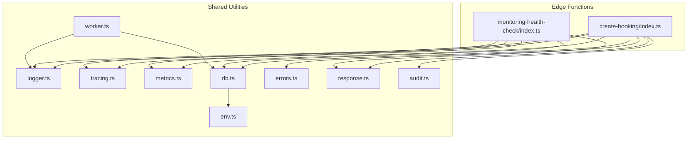
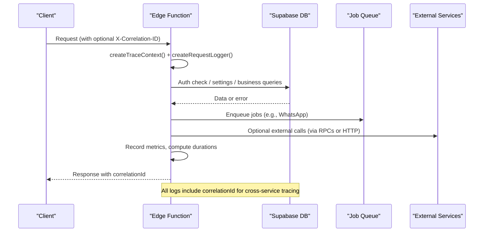
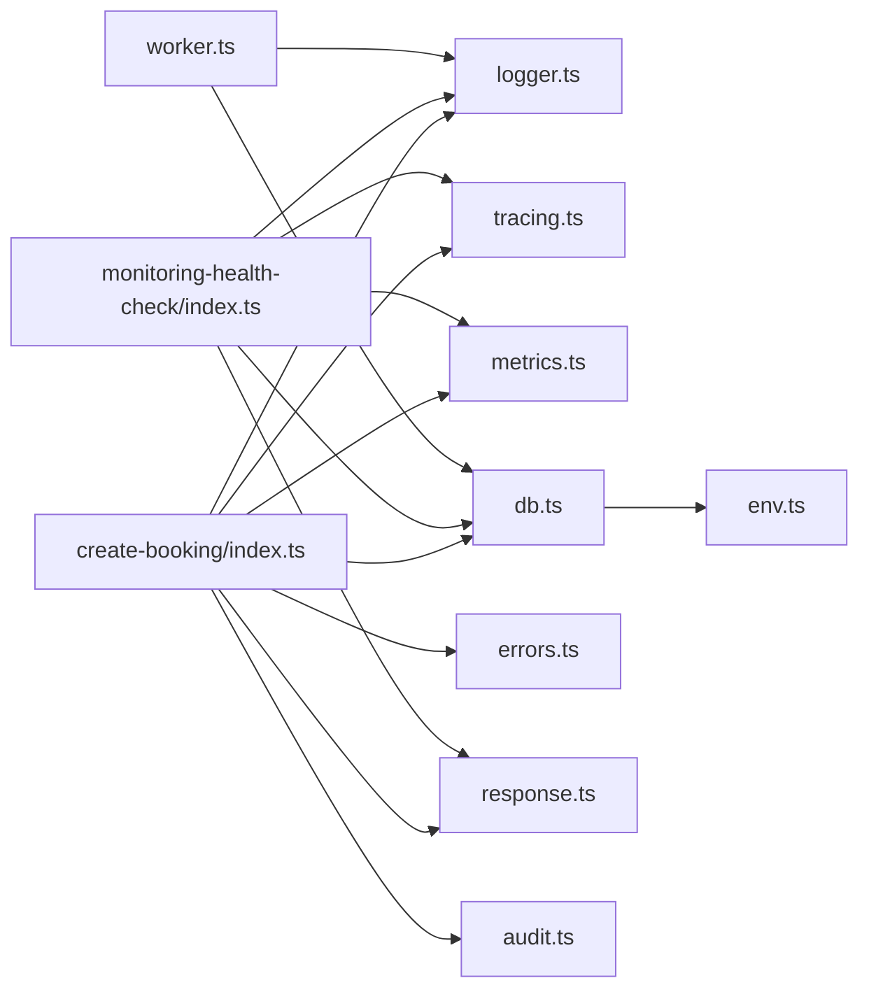
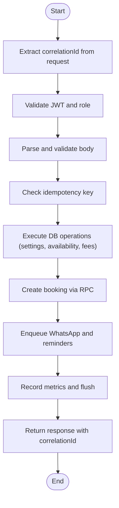

# Debugging Techniques

<cite>
**Referenced Files in This Document**
- [logger.ts](file://supabase/functions/_shared/logger.ts)
- [tracing.ts](file://supabase/functions/_shared/tracing.ts)
- [metrics.ts](file://supabase/functions/_shared/metrics.ts)
- [db.ts](file://supabase/functions/_shared/db.ts)
- [errors.ts](file://supabase/functions/_shared/errors.ts)
- [response.ts](file://supabase/functions/_shared/response.ts)
- [worker.ts](file://supabase/functions/_shared/worker.ts)
- [env.ts](file://supabase/functions/_shared/env.ts)
- [audit.ts](file://supabase/functions/_shared/audit.ts)
- [create-booking/index.ts](file://supabase/functions/create-booking/index.ts)
- [monitoring-health-check/index.ts](file://supabase/functions/monitoring-health-check/index.ts)
</cite>

## Table of Contents

1. Introduction
2. Project Structure
3. Core Components
4. Architecture Overview
5. Detailed Component Analysis
6. Dependency Analysis
7. Performance Considerations
8. Troubleshooting Guide
9. Conclusion
10. Appendices

## Introduction

This document provides practical debugging techniques for the Setura Hospital OS
edge functions and database operations. It focuses on:

- Structured logging with correlation IDs to trace requests across edge
  functions and database calls
- Monitoring dashboards and health endpoints for real-time system health,
  performance metrics, and error tracking
- Debugging edge function execution, database query optimization, and external
  service integration issues
- Log analysis patterns, metric interpretation, and alert investigation
  procedures
- Using Supabase’s built-in tools, custom diagnostic endpoints, and third-party
  monitoring integrations
- Effective debugging workflows for common issue types

## Project Structure

The debugging surface is implemented as shared utilities under
supabase/functions/_shared and consumed by individual edge functions. Key areas:

- Logging: structured JSON logs with correlation IDs and timers
- Tracing: request-scoped context propagation across downstream calls
- Metrics: per-request timing and counters flushed as structured logs
- Database clients: typed service/anon/auth clients with RPC helpers and error
  assertion
- Error handling: typed error hierarchy and standardized responses
- Worker orchestration: job claiming, heartbeat, completion/failure, and crash
  recovery
- Health endpoint: comprehensive system health report for dashboards and uptime
  monitors

**Diagram sources**

- [create-booking/index.ts:67-85](file://supabase/functions/create-booking/index.ts#L67-L85)
- [monitoring-health-check/index.ts:22-31](file://supabase/functions/monitoring-health-check/index.ts#L22-L31)
- [logger.ts:122-189](file://supabase/functions/_shared/logger.ts#L122-L189)
- [tracing.ts:17-49](file://supabase/functions/_shared/tracing.ts#L17-L49)
- [metrics.ts:24-118](file://supabase/functions/_shared/metrics.ts#L24-L118)
- [db.ts:30-169](file://supabase/functions/_shared/db.ts#L30-L169)
- [errors.ts:70-323](file://supabase/functions/_shared/errors.ts#L70-L323)
- [response.ts:44-206](file://supabase/functions/_shared/response.ts#L44-L206)
- [worker.ts:30-257](file://supabase/functions/_shared/worker.ts#L30-L257)
- [audit.ts:51-75](file://supabase/functions/_shared/audit.ts#L51-L75)
- [env.ts:155-205](file://supabase/functions/_shared/env.ts#L155-L205)

**Section sources**

- [create-booking/index.ts:67-85](file://supabase/functions/create-booking/index.ts#L67-L85)
- [monitoring-health-check/index.ts:22-31](file://supabase/functions/monitoring-health-check/index.ts#L22-L31)

## Core Components

- Structured Logger: Produces machine-parseable JSON logs with correlation IDs,
  environment metadata, and error serialization. Provides child loggers and
  timers.
- Tracing Context: Creates and propagates correlationId, requestId, spanId
  across boundaries; computes elapsed time and builds headers for downstream
  calls.
- Metrics Collector: Records timings, increments, and gauges per request;
  flushes as structured logs for observability backends.
- Database Clients: Service-role, anon, and per-request auth clients; typed RPC
  helper that throws DbError; assertNoError utility for consistent DB error
  handling.
- Error Hierarchy: Centralized typed errors with code, statusCode, retryable
  flag, and context; used consistently across handlers.
- Response Builders: Standardized success/error responses including
  correlationId and timestamps; unified error handler converts errors to HTTP
  responses.
- Worker Orchestration: Job claiming with per-job leases, heartbeat loop,
  completion/failure reporting, and safe processing wrapper.
- Audit Logging: Fire-and-forget audit event writing that never fails core
  flows.

**Section sources**

- [logger.ts:1-189](file://supabase/functions/_shared/logger.ts#L1-L189)
- [tracing.ts:1-50](file://supabase/functions/_shared/tracing.ts#L1-L50)
- [metrics.ts:1-119](file://supabase/functions/_shared/metrics.ts#L1-L119)
- [db.ts:1-169](file://supabase/functions/_shared/db.ts#L1-L169)
- [errors.ts:1-323](file://supabase/functions/_shared/errors.ts#L1-L323)
- [response.ts:1-206](file://supabase/functions/_shared/response.ts#L1-L206)
- [worker.ts:1-257](file://supabase/functions/_shared/worker.ts#L1-L257)
- [audit.ts:1-75](file://supabase/functions/_shared/audit.ts#L1-L75)

## Architecture Overview

End-to-end request flow with tracing, logging, metrics, and database
interactions:

**Diagram sources**

- [create-booking/index.ts:67-85](file://supabase/functions/create-booking/index.ts#L67-L85)
- [monitoring-health-check/index.ts:22-31](file://supabase/functions/monitoring-health-check/index.ts#L22-L31)
- [tracing.ts:17-49](file://supabase/functions/_shared/tracing.ts#L17-L49)
- [logger.ts:178-189](file://supabase/functions/_shared/logger.ts#L178-L189)
- [metrics.ts:108-118](file://supabase/functions/_shared/metrics.ts#L108-L118)
- [db.ts:115-136](file://supabase/functions/_shared/db.ts#L115-L136)

## Detailed Component Analysis

### Structured Logging with Correlation IDs

- Every request creates a logger with correlationId derived from headers or
  generated UUID. Child loggers propagate context through nested calls.
- Logs are single-line JSON with timestamp, level, message, service, version,
  env, and contextual fields. Errors are serialized preserving stack traces in
  non-production.
- Timers provide durationMs for specific operations.

Debugging workflow:

- Ensure callers pass X-Correlation-ID or X-Request-ID to correlate logs across
  services.
- Filter logs by correlationId to reconstruct full request path.
- Use child loggers to add operation-specific context (e.g., jobId, bookingId).

**Section sources**

- [logger.ts:17-30](file://supabase/functions/_shared/logger.ts#L17-L30)
- [logger.ts:32-50](file://supabase/functions/_shared/logger.ts#L32-L50)
- [logger.ts:52-73](file://supabase/functions/_shared/logger.ts#L52-L73)
- [logger.ts:75-99](file://supabase/functions/_shared/logger.ts#L75-L99)
- [logger.ts:122-189](file://supabase/functions/_shared/logger.ts#L122-L189)

### Distributed Tracing Across Boundaries

- Trace context includes correlationId, requestId, spanId, parentSpanId, and
  startTime. Headers can be propagated to downstream services.
- elapsedMs computes duration relative to trace start.

Debugging workflow:

- Propagate traceHeaders when calling downstream functions or services to
  maintain span chains.
- Use childSpan to segment work within a request.
- Attach correlationId to all logs and metrics for unified search.

**Section sources**

- [tracing.ts:9-15](file://supabase/functions/_shared/tracing.ts#L9-L15)
- [tracing.ts:17-49](file://supabase/functions/_shared/tracing.ts#L17-L49)

### Metrics Collection and Interpretation

- MetricsCollector records timings, increments, and gauges with tags (endpoint,
  correlationId, hospitalId).
- Flush emits structured log lines parseable by Datadog/Grafana Loki/CloudWatch.
- Per-request metrics enable latency percentiles and error rate analysis.

Interpretation guidance:

- Look for high request.total durations indicating slow paths.
- Track booking.created vs booking.duplicate to detect retries.
- Monitor health.check.success and health.check.error to assess health endpoint
  reliability.

**Section sources**

- [metrics.ts:16-22](file://supabase/functions/_shared/metrics.ts#L16-L22)
- [metrics.ts:24-118](file://supabase/functions/_shared/metrics.ts#L24-L118)
- [create-booking/index.ts:638-643](file://supabase/functions/create-booking/index.ts#L638-L643)
- [monitoring-health-check/index.ts:206-208](file://supabase/functions/monitoring-health-check/index.ts#L206-L208)

### Database Query Optimization and Debugging

- Use service-role client for internal mutations; anon client for public reads;
  auth client for user-impersonated operations.
- callRpc wraps RPC calls and throws DbError with details; assertNoError
  centralizes DB error handling.
- Instrument critical DB operations with metrics timers to identify bottlenecks.

Optimization techniques:

- Prefer RPCs for complex logic to reduce round-trips.
- Select only needed columns and use single() where appropriate.
- Add indexes for frequent filters (hospital_id, normalized_phone,
  appointment_date).
- Use SKIP LOCKED patterns for concurrency-safe claims (see worker job
  claiming).

**Section sources**

- [db.ts:30-106](file://supabase/functions/_shared/db.ts#L30-L106)
- [db.ts:115-169](file://supabase/functions/_shared/db.ts#L115-L169)
- [create-booking/index.ts:168-182](file://supabase/functions/create-booking/index.ts#L168-L182)
- [create-booking/index.ts:251-283](file://supabase/functions/create-booking/index.ts#L251-L283)
- [create-booking/index.ts:421-447](file://supabase/functions/create-booking/index.ts#L421-L447)

### External Service Integration Issues

- Enqueue background jobs for non-critical tasks (e.g., WhatsApp messages) to
  avoid blocking primary flows.
- Use idempotency keys for external calls to ensure safety against retries.
- Log failures without failing core operations; rely on DLQ and retry
  mechanisms.

Debugging workflow:

- Check queue_health and dlq_summary via health endpoint to identify stuck jobs.
- Inspect job logs using correlationId and jobId context.
- Validate external service credentials and rate limits via env configuration.

**Section sources**

- [create-booking/index.ts:520-548](file://supabase/functions/create-booking/index.ts#L520-L548)
- [create-booking/index.ts:550-585](file://supabase/functions/create-booking/index.ts#L550-L585)
- [monitoring-health-check/index.ts:139-166](file://supabase/functions/monitoring-health-check/index.ts#L139-L166)
- [env.ts:118-135](file://supabase/functions/_shared/env.ts#L118-L135)

### Monitoring Dashboard Usage

- GET /monitoring-health-check returns lightweight health score and snapshot
  data for uptime checks.
- POST /monitoring-health-check (auth required) runs full diagnostics: health,
  open alerts, queue health, workers, materialized view freshness, DLQ summary,
  partition readiness, revenue backlog.

Dashboard integration:

- Ingest structured logs and metrics into Grafana/Loki/Datadog.
- Build panels for request.latency, error.rate, queue.depth, worker.status,
  mv.freshness.
- Alert on health_score thresholds and open_alert severity.

**Section sources**

- [monitoring-health-check/index.ts:1-231](file://supabase/functions/monitoring-health-check/index.ts#L1-L231)

### Error Handling and Response Standardization

- Centralized error hierarchy ensures consistent codes, status codes, and retry
  flags.
- handleErrorResponse converts any thrown error to standardized API responses
  with correlationId.
- Success responses include correlationId and timestamp for traceability.

Debugging workflow:

- Search logs by error.code to group similar failures.
- Use retryable flag to implement exponential backoff at client side.
- Include fieldErrors for validation issues to guide client corrections.

**Section sources**

- [errors.ts:70-104](file://supabase/functions/_shared/errors.ts#L70-L104)
- [errors.ts:106-323](file://supabase/functions/_shared/errors.ts#L106-L323)
- [response.ts:44-206](file://supabase/functions/_shared/response.ts#L44-L206)

### Worker Execution Debugging

- Workers register, heartbeat, claim jobs, process with safe wrappers, and
  complete/fail with detailed logging.
- Heartbeat loop tracks jobsInFlight and reports status; crashes reclaim jobs
  automatically.

Debugging workflow:

- Monitor worker_registry for active workers and last_heartbeat_at.
- Inspect job logs with jobId and attempt_count to diagnose transient failures.
- Use DLQ to analyze persistent failures and adjust retry policies.

**Section sources**

- [worker.ts:30-94](file://supabase/functions/_shared/worker.ts#L30-L94)
- [worker.ts:96-178](file://supabase/functions/_shared/worker.ts#L96-L178)
- [worker.ts:180-257](file://supabase/functions/_shared/worker.ts#L180-L257)

### Audit Logging for Forensics

- Audit events are written fire-and-forget to support forensics without
  impacting core flows.
- Include actorUserId, entityType, entityId, actionType, severity, and新旧数据
  snapshots.

Debugging workflow:

- Query audit_logs for action_type and entity_id to reconstruct user actions.
- Correlate audit entries with edge function logs using correlationId.

**Section sources**

- [audit.ts:1-75](file://supabase/functions/_shared/audit.ts#L1-L75)

## Dependency Analysis

Key dependencies and coupling:

- Edge functions depend on shared utilities for logging, tracing, metrics, DB
  access, error handling, and responses.
- Worker module depends on DB and Logger for job lifecycle management.
- Environment configuration drives feature flags and runtime behavior.

**Diagram sources**

- [create-booking/index.ts:34-58](file://supabase/functions/create-booking/index.ts#L34-L58)
- [monitoring-health-check/index.ts:12-18](file://supabase/functions/monitoring-health-check/index.ts#L12-L18)
- [worker.ts:17-19](file://supabase/functions/_shared/worker.ts#L17-L19)
- [db.ts:23-28](file://supabase/functions/_shared/db.ts#L23-L28)

**Section sources**

- [create-booking/index.ts:34-58](file://supabase/functions/create-booking/index.ts#L34-L58)
- [monitoring-health-check/index.ts:12-18](file://supabase/functions/monitoring-health-check/index.ts#L12-L18)
- [worker.ts:17-19](file://supabase/functions/_shared/worker.ts#L17-L19)
- [db.ts:23-28](file://supabase/functions/_shared/db.ts#L23-L28)

## Performance Considerations

- Use timers around expensive operations (auth, parsing, DB queries, RPCs) to
  identify hotspots.
- Prefer service-role client for internal mutations to bypass RLS overhead where
  appropriate.
- Batch operations and minimize round-trips; leverage RPCs for complex logic.
- Monitor queue depth and worker heartbeats to prevent backlogs.
- Tune LOG_LEVEL and ENABLE_METRICS based on environment to balance verbosity
  and overhead.

[No sources needed since this section provides general guidance]

## Troubleshooting Guide

### Common Issue Patterns and Workflows

#### Edge Function Latency Spikes

- Steps:
  - Filter logs by correlationId for the affected request.
  - Inspect metrics.timing("request.total") and operation-specific timers.
  - Identify slow DB queries or RPCs; optimize with selective selects and proper
    indexing.
  - Check for external service delays; enqueue non-critical work to queues.

**Section sources**

- [create-booking/index.ts:97-124](file://supabase/functions/create-booking/index.ts#L97-L124)
- [create-booking/index.ts:158-182](file://supabase/functions/create-booking/index.ts#L158-L182)
- [create-booking/index.ts:421-447](file://supabase/functions/create-booking/index.ts#L421-L447)
- [metrics.ts:47-74](file://supabase/functions/_shared/metrics.ts#L47-L74)

#### Database Constraint Violations

- Steps:
  - Look for DbError or DB_CONSTRAINT_VIOLATION in logs.
  - Use assertNoError to catch and standardize DB errors.
  - Investigate unique constraints (e.g., idempotency_key) and handle duplicates
    gracefully.

**Section sources**

- [db.ts:146-169](file://supabase/functions/_shared/db.ts#L146-L169)
- [create-booking/index.ts:448-493](file://supabase/functions/create-booking/index.ts#L448-L493)
- [errors.ts:293-300](file://supabase/functions/_shared/errors.ts#L293-L300)

#### External Service Failures (WhatsApp, Payments)

- Steps:
  - Check queue_health and DLQ summaries via health endpoint.
  - Review job logs for failure reasons and retry counts.
  - Validate credentials and rate limits via environment configuration.

**Section sources**

- [monitoring-health-check/index.ts:139-166](file://supabase/functions/monitoring-health-check/index.ts#L139-L166)
- [create-booking/index.ts:520-548](file://supabase/functions/create-booking/index.ts#L520-L548)
- [env.ts:118-135](file://supabase/functions/_shared/env.ts#L118-L135)

#### Worker Crashes and Job Reclaims

- Steps:
  - Monitor worker_registry for last_heartbeat_at and status.
  - Inspect job attempts and DLQ for failed jobs.
  - Adjust lease durations and retry policies if necessary.

**Section sources**

- [worker.ts:56-94](file://supabase/functions/_shared/worker.ts#L56-L94)
- [worker.ts:180-215](file://supabase/functions/_shared/worker.ts#L180-L215)
- [monitoring-health-check/index.ts:144-151](file://supabase/functions/monitoring-health-check/index.ts#L144-L151)

#### Alert Investigation Procedures

- Steps:
  - Use POST /monitoring-health-check to fetch open alerts sorted by severity.
  - Correlate alerts with recent log spikes and metric anomalies.
  - Resolve root causes and verify alert resolution via updated health
    snapshots.

**Section sources**

- [monitoring-health-check/index.ts:128-137](file://supabase/functions/monitoring-health-check/index.ts#L128-L137)
- [monitoring-health-check/index.ts:187-198](file://supabase/functions/monitoring-health-check/index.ts#L187-L198)

### Log Analysis Patterns

- Filter by correlationId to reconstruct request flows across services.
- Group by error.code to identify recurring issues.
- Analyze metric tags (endpoint, hospitalId) to isolate problematic tenants or
  features.

**Section sources**

- [logger.ts:32-50](file://supabase/functions/_shared/logger.ts#L32-L50)
- [metrics.ts:16-22](file://supabase/functions/_shared/metrics.ts#L16-L22)

### Metric Interpretation

- request.total: overall latency; look for p95/p99 spikes.
- booking.created vs booking.duplicate: indicates client retries or idempotency
  effectiveness.
- health.check.success/error: reliability of health endpoint.
- queue depth and worker status: capacity and throughput indicators.

**Section sources**

- [create-booking/index.ts:638-643](file://supabase/functions/create-booking/index.ts#L638-L643)
- [monitoring-health-check/index.ts:206-208](file://supabase/functions/monitoring-health-check/index.ts#L206-L208)

### Third-Party Monitoring Integrations

- Emit structured logs and metrics for ingestion by Datadog, Grafana Loki,
  CloudWatch Logs Insights.
- Configure SENTRY_DSN for error tracking if enabled.
- Use health endpoint for uptime monitoring services like Uptime Robot.

**Section sources**

- [metrics.ts:1-12](file://supabase/functions/_shared/metrics.ts#L1-L12)
- [env.ts:155-163](file://supabase/functions/_shared/env.ts#L155-L163)
- [monitoring-health-check/index.ts:1-10](file://supabase/functions/monitoring-health-check/index.ts#L1-L10)

## Conclusion

Setura Hospital OS provides robust debugging capabilities through structured
logging, distributed tracing, metrics, and centralized error handling. By
leveraging correlation IDs, health endpoints, and worker orchestration, teams
can efficiently diagnose and resolve issues across edge functions, databases,
and external services. Adopting the recommended workflows and monitoring
practices will improve system reliability and operational visibility.

[No sources needed since this section summarizes without analyzing specific
files]

## Appendices

### Example Debugging Workflow: Booking Creation Failure

**Diagram sources**

- [create-booking/index.ts:67-85](file://supabase/functions/create-booking/index.ts#L67-L85)
- [create-booking/index.ts:87-153](file://supabase/functions/create-booking/index.ts#L87-L153)
- [create-booking/index.ts:158-447](file://supabase/functions/create-booking/index.ts#L158-L447)
- [create-booking/index.ts:520-585](file://supabase/functions/create-booking/index.ts#L520-L585)
- [create-booking/index.ts:638-664](file://supabase/functions/create-booking/index.ts#L638-L664)
