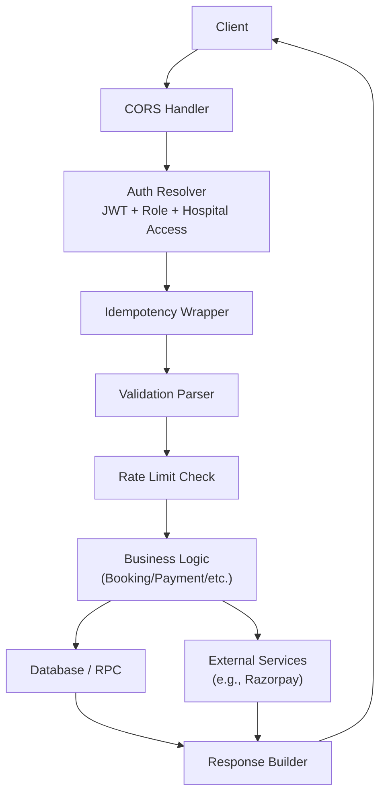
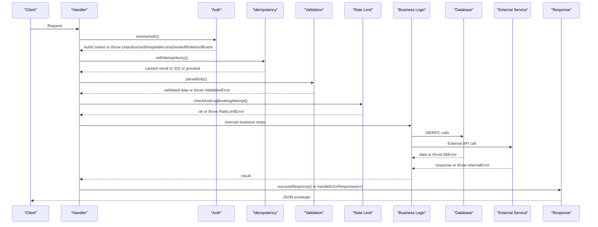
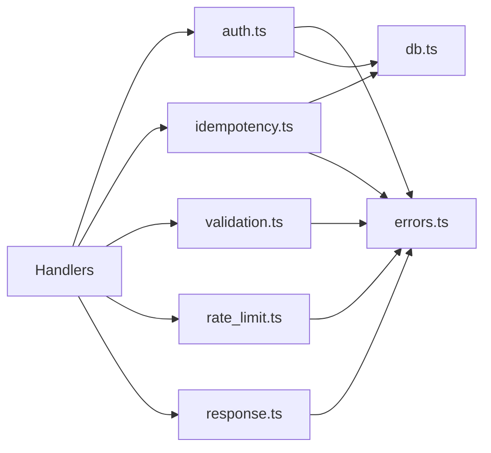
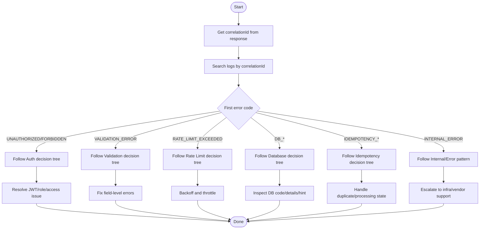

# Error Diagnosis

<cite>
**Referenced Files in This Document**
- [errors.ts](file://supabase/functions/_shared/errors.ts)
- [response.ts](file://supabase/functions/_shared/response.ts)
- [validation.ts](file://supabase/functions/_shared/validation.ts)
- [auth.ts](file://supabase/functions/_shared/auth.ts)
- [db.ts](file://supabase/functions/_shared/db.ts)
- [logger.ts](file://supabase/functions/_shared/logger.ts)
- [idempotency.ts](file://supabase/functions/_shared/idempotency.ts)
- [rate_limit.ts](file://supabase/functions/_shared/rate_limit.ts)
- [create-booking/index.ts](file://supabase/functions/create-booking/index.ts)
- [create-payment-order/index.ts](file://supabase/functions/create-payment-order/index.ts)
- [errors.test.ts](file://tests/unit/errors.test.ts)
- [response.test.ts](file://tests/unit/response.test.ts)
</cite>

## Table of Contents

1. [Introduction](#introduction)
2. [Project Structure](#project-structure)
3. [Core Components](#core-components)
4. [Architecture Overview](#architecture-overview)
5. [Detailed Component Analysis](#detailed-component-analysis)
6. [Dependency Analysis](#dependency-analysis)
7. [Performance Considerations](#performance-considerations)
8. [Troubleshooting Guide](#troubleshooting-guide)
9. [Conclusion](#conclusion)

## Introduction

This document explains how to systematically diagnose errors in the Setura
Hospital OS using its centralized error hierarchy and structured responses. It
covers:

- Domain-based error classification (authentication, validation, booking,
  payment, database)
- Step-by-step diagnostic procedures per domain
- Tracing error propagation through middleware and handlers
- Identifying root causes in complex workflows
- Correlating related errors across services
- Analyzing error context, interpreting stack traces, and recognizing error
  patterns
- Decision trees for common scenarios and escalation procedures

The system uses a typed error base class with standardized HTTP status codes,
retry flags, and rich context. All responses are wrapped in a consistent
envelope that includes correlation IDs for tracing.

## Project Structure

Errors are defined centrally and consumed by all Edge Functions. Handlers
validate inputs, enforce auth, perform business logic, and return either success
or mapped errors via a unified response builder. Middleware-like helpers (auth,
idempotency, rate limiting) wrap core flows and convert failures into typed
errors.

**Diagram sources**

- [auth.ts:42-124](file://supabase/functions/_shared/auth.ts#L42-L124)
- [idempotency.ts:196-259](file://supabase/functions/_shared/idempotency.ts#L196-L259)
- [validation.ts:99-134](file://supabase/functions/_shared/validation.ts#L99-L134)
- [rate_limit.ts:27-111](file://supabase/functions/_shared/rate_limit.ts#L27-L111)
- [response.ts:94-112](file://supabase/functions/_shared/response.ts#L94-L112)

**Section sources**

- [create-booking/index.ts:67-124](file://supabase/functions/create-booking/index.ts#L67-L124)
- [create-payment-order/index.ts:104-130](file://supabase/functions/create-payment-order/index.ts#L104-L130)

## Core Components

- Centralized error hierarchy with typed codes, HTTP statuses, retryability, and
  context.
- Structured API responses with correlation IDs and consistent envelopes.
- Validation layer that normalizes input and throws field-level errors.
- Auth middleware enforcing JWT validity, roles, and hospital access.
- Database client wrappers that translate DB errors into typed errors.
- Logging that serializes errors with context and stack traces (non-production).

Key responsibilities:

- Errors.ts: defines error types and utilities.
- Response.ts: maps errors to HTTP responses and provides builders.
- Validation.ts: parses and validates request bodies; throws validation errors.
- Auth.ts: resolves identity and permissions; throws auth errors.
- Db.ts: manages clients and converts DB/RPC errors to typed errors.
- Logger.ts: structured logging with correlation IDs and error serialization.
- Idempotency.ts: ensures safe retries and propagates processing state as
  errors.
- Rate limit.ts: enforces limits and returns retryable errors.

**Section sources**

- [errors.ts:13-104](file://supabase/functions/_shared/errors.ts#L13-L104)
- [response.ts:14-32](file://supabase/functions/_shared/response.ts#L14-L32)
- [validation.ts:99-134](file://supabase/functions/_shared/validation.ts#L99-L134)
- [auth.ts:42-124](file://supabase/functions/_shared/auth.ts#L42-L124)
- [db.ts:115-136](file://supabase/functions/_shared/db.ts#L115-L136)
- [logger.ts:52-73](file://supabase/functions/_shared/logger.ts#L52-L73)
- [idempotency.ts:39-59](file://supabase/functions/_shared/idempotency.ts#L39-L59)
- [rate_limit.ts:27-111](file://supabase/functions/_shared/rate_limit.ts#L27-L111)

## Architecture Overview

Error flow from request to response:

1. Request enters handler; CORS handled early.
2. Auth resolver validates JWT and role/hospital access; throws typed auth
   errors.
3. Idempotency wrapper claims keys and may return 202 if already processing.
4. Validation parser checks body size, JSON shape, and schema; throws validation
   errors.
5. Rate limiter checks blocked numbers and attempt windows; throws retryable
   rate limit errors.
6. Business logic performs DB operations and external calls; throws
   domain-specific errors.
7. Any thrown error is caught and converted to a standardized response via
   handleErrorResponse.

**Diagram sources**

- [auth.ts:42-124](file://supabase/functions/_shared/auth.ts#L42-L124)
- [idempotency.ts:196-259](file://supabase/functions/_shared/idempotency.ts#L196-L259)
- [validation.ts:99-134](file://supabase/functions/_shared/validation.ts#L99-L134)
- [rate_limit.ts:27-111](file://supabase/functions/_shared/rate_limit.ts#L27-L111)
- [response.ts:196-205](file://supabase/functions/_shared/response.ts#L196-L205)

## Detailed Component Analysis

### Error Hierarchy and Classification

- Base error carries code, statusCode, retryable, context, timestamp, and
  serializable toJSON.
- Domain categories:
  - Authentication: UNAUTHORIZED, FORBIDDEN, INVALID_JWT, SESSION_EXPIRED,
    HOSPITAL_ACCESS_DENIED, ROLE_INSUFFICIENT
  - Validation: VALIDATION_ERROR, INVALID_PHONE, INVALID_UUID, INVALID_DATE,
    MISSING_FIELD, BODY_TOO_LARGE
  - Booking: BOOKING_DUPLICATE, BOOKING_NOT_FOUND, TOKEN_EXHAUSTED, QUEUE_FULL,
    HOSPITAL_CLOSED, HOSPITAL_HOLIDAY, ADVANCE_BOOKING_EXCEEDED,
    DOCTOR_UNAVAILABLE, PATIENT_BLOCKED
  - Idempotency: IDEMPOTENCY_KEY_REQUIRED, IDEMPOTENCY_PROCESSING,
    IDEMPOTENCY_MISMATCH
  - Rate limit: RATE_LIMIT_EXCEEDED, IP_RATE_LIMIT_EXCEEDED
  - Queue/workers: JOB_CLAIM_FAILED, WORKER_LEASE_LOST, QUEUE_CONCURRENCY_ERROR
  - Payment: PAYMENT_FAILED, PAYMENT_NOT_FOUND, REFUND_EXCEEDS_AMOUNT
  - Database: DB_ERROR, DB_CONSTRAINT_VIOLATION, DB_TIMEOUT,
    DB_CONCURRENCY_ERROR
  - External services: WHATSAPP_SEND_FAILED, WHATSAPP_RATE_LIMITED
  - Server: INTERNAL_ERROR, NOT_IMPLEMENTED, SERVICE_UNAVAILABLE

Diagnostic tips:

- Use code to classify quickly; use context fields to narrow scope (hospitalId,
  userId, phone, bookingId).
- Retryable indicates transient issues suitable for exponential backoff.

**Section sources**

- [errors.ts:13-64](file://supabase/functions/_shared/errors.ts#L13-L64)
- [errors.ts:70-104](file://supabase/functions/_shared/errors.ts#L70-L104)
- [errors.ts:108-150](file://supabase/functions/_shared/errors.ts#L108-L150)
- [errors.ts:154-243](file://supabase/functions/_shared/errors.ts#L154-L243)
- [errors.ts:247-291](file://supabase/functions/_shared/errors.ts#L247-L291)
- [errors.ts:295-312](file://supabase/functions/_shared/errors.ts#L295-L312)

### Structured Responses and Mapping

- Success responses include success flag, data, correlationId, timestamp,
  optional meta.
- Error responses include success=false, error.code/message/retryable, optional
  fieldErrors, correlationId, timestamp.
- fromSeturError maps typed errors to responses, preserving fieldErrors when
  present.
- handleErrorResponse converts any thrown error to a safe internal error if not
  typed.

Diagnostic tips:

- Always inspect correlationId to trace logs across services.
- For validation errors, read fieldErrors to guide client corrections.
- For retryable errors, implement backoff respecting Retry-After headers where
  applicable.

**Section sources**

- [response.ts:14-32](file://supabase/functions/_shared/response.ts#L14-L32)
- [response.ts:69-112](file://supabase/functions/_shared/response.ts#L69-L112)
- [response.ts:196-205](file://supabase/functions/_shared/response.ts#L196-L205)

### Validation Layer Diagnostics

- Body size guard prevents oversized payloads.
- JSON parsing errors become validation errors.
- Zod schemas normalize phones and dates; refine rules produce field-level
  messages.
- parseBody aggregates issues into fieldErrors map.

Diagnostic steps:

- If VALIDATION_ERROR, examine fieldErrors to identify exact failing fields.
- Check normalization behavior for phone/date fields.
- Verify Content-Length against maxBytes.

**Section sources**

- [validation.ts:29-53](file://supabase/functions/_shared/validation.ts#L29-L53)
- [validation.ts:73-88](file://supabase/functions/_shared/validation.ts#L73-L88)
- [validation.ts:99-134](file://supabase/functions/_shared/validation.ts#L99-L134)

### Authentication Flow Diagnostics

- Extracts Bearer token; validates via Supabase auth client.
- Loads user profile and enforces active status.
- Resolves role per hospital or primary role; supports global admin overrides.
- requireRole enforces allowed roles; throws specific errors for insufficient
  roles or access denied.

Diagnostic steps:

- UNAUTHORIZED: verify Authorization header presence and token validity.
- HOSPITAL_ACCESS_DENIED: confirm X-Hospital-ID matches user’s membership or
  global admin.
- ROLE_INSUFFICIENT: ensure user has one of required roles for endpoint.

**Section sources**

- [auth.ts:24-30](file://supabase/functions/_shared/auth.ts#L24-L30)
- [auth.ts:42-124](file://supabase/functions/_shared/auth.ts#L42-L124)
- [auth.ts:140-151](file://supabase/functions/_shared/auth.ts#L140-L151)

### Idempotency and Concurrency Diagnostics

- extractIdempotencyKey requires UUID v4 when mandatory; otherwise returns null.
- withIdempotency claims key, detects duplicates, returns cached results, or
  signals processing with 202.
- Failures during claim are logged and fail-open to avoid blocking legitimate
  requests.
- Handler completion marks key completed; failures mark key failed.

Diagnostic steps:

- IDEMPOTENCY_KEY_REQUIRED: ensure client sends valid Idempotency-Key header.
- IDEMPOTENCY_PROCESSING: wait and retry after delay; do not resend same key.
- Mismatch detection: ensure identical payload for same key.

**Section sources**

- [idempotency.ts:39-59](file://supabase/functions/_shared/idempotency.ts#L39-L59)
- [idempotency.ts:79-129](file://supabase/functions/_shared/idempotency.ts#L79-L129)
- [idempotency.ts:196-259](file://supabase/functions/_shared/idempotency.ts#L196-L259)

### Rate Limiting Diagnostics

- Checks blocked numbers and recent attempts within sliding window.
- Throws RateLimitError with retry-after seconds and contextual details.
- Logs attempts regardless of success/failure for observability.

Diagnostic steps:

- RATE_LIMIT_EXCEEDED: reduce frequency; respect Retry-After.
- PHONE_BLOCKED: investigate restriction policies and duration.

**Section sources**

- [rate_limit.ts:27-111](file://supabase/functions/_shared/rate_limit.ts#L27-L111)

### Database and External Service Diagnostics

- DB/RPC errors are wrapped as DbError with original DB code, details, hint, and
  params.
- assertNoError surfaces DB errors with consistent structure.
- External service failures (e.g., Razorpay) are captured with response details
  and turned into InternalError.

Diagnostic steps:

- DB_ERROR: inspect dbCode, details, hint, and params to locate constraint or
  timeout issues.
- External errors: correlate gateway_order_id and amounts; verify credentials
  and network timeouts.

**Section sources**

- [db.ts:115-136](file://supabase/functions/_shared/db.ts#L115-L136)
- [db.ts:146-169](file://supabase/functions/_shared/db.ts#L146-L169)
- [create-payment-order/index.ts:64-102](file://supabase/functions/create-payment-order/index.ts#L64-L102)

### Logging and Stack Trace Interpretation

- Logger serializes errors including name, message, stack (non-production), and
  preserves SeturError fields.
- Every log line includes correlationId, enabling cross-service tracing.
- Errors in catch blocks are attached under error key for structured analysis.

Diagnostic steps:

- Filter logs by correlationId to reconstruct full request lifecycle.
- In non-production, review stack traces to pinpoint failure location.
- Use error.context fields to filter by hospitalId, userId, phone, bookingId.

**Section sources**

- [logger.ts:52-73](file://supabase/functions/_shared/logger.ts#L52-L73)
- [logger.ts:122-154](file://supabase/functions/_shared/logger.ts#L122-L154)
- [logger.ts:178-189](file://supabase/functions/_shared/logger.ts#L178-L189)

## Dependency Analysis

Error handling dependencies form a layered pipeline:

- Handlers depend on auth, idempotency, validation, rate limiting, and response
  modules.
- Auth depends on db and errors.
- Validation depends on errors.
- Rate limiting depends on errors and validation.
- Idempotency depends on db and errors.
- Response depends on errors and cors.

**Diagram sources**

- [auth.ts:13-20](file://supabase/functions/_shared/auth.ts#L13-L20)
- [idempotency.ts:20-26](file://supabase/functions/_shared/idempotency.ts#L20-L26)
- [validation.ts:8-10](file://supabase/functions/_shared/validation.ts#L8-L10)
- [rate_limit.ts:10-14](file://supabase/functions/_shared/rate_limit.ts#L10-L14)
- [response.ts:11-13](file://supabase/functions/_shared/response.ts#L11-L13)

**Section sources**

- [create-booking/index.ts:34-63](file://supabase/functions/create-booking/index.ts#L34-L63)
- [create-payment-order/index.ts:25-45](file://supabase/functions/create-payment-order/index.ts#L25-L45)

## Performance Considerations

- Prefer typed errors to avoid generic 500s; they carry retryable flags for
  efficient retries.
- Use correlationId to minimize log noise and speed up triage.
- Avoid excessive logging in hot paths; rely on metrics and sampled logs.
- Idempotency reduces duplicate work and protects downstream systems.
- Rate limiting prevents cascading failures under load.

[No sources needed since this section provides general guidance]

## Troubleshooting Guide

### End-to-End Diagnostic Workflow

1. Capture correlationId from response envelope.
2. Search logs by correlationId to reconstruct the request path.
3. Identify the first error type and domain based on error.code.
4. Inspect error.context for identifiers (hospitalId, userId, phone, bookingId).
5. Follow the pipeline stages to locate where the error was thrown.
6. Apply domain-specific decision tree below.

[No sources needed since this diagram shows conceptual workflow, not actual code
structure]

### Domain-Specific Decision Trees

#### Authentication

- Missing or invalid token → UNAUTHORIZED
  - Ensure Authorization: Bearer <token> is present and valid.
  - Verify token expiry and revocation via Supabase auth.
- Hospital mismatch → HOSPITAL_ACCESS_DENIED
  - Confirm X-Hospital-ID matches user’s membership or global admin.
- Insufficient role → ROLE_INSUFFICIENT
  - Check required roles for endpoint; ensure user has at least one.

**Section sources**

- [auth.ts:42-124](file://supabase/functions/_shared/auth.ts#L42-L124)
- [auth.ts:140-151](file://supabase/functions/_shared/auth.ts#L140-L151)

#### Validation

- Field errors → VALIDATION_ERROR with fieldErrors
  - Map each field to its error message; correct client input.
- Body too large → check Content-Length vs maxBytes
- Invalid JSON → ensure proper JSON formatting

**Section sources**

- [validation.ts:99-134](file://supabase/functions/_shared/validation.ts#L99-L134)

#### Booking

- Hospital closed or holiday → HOSPITAL_CLOSED
  - Check hospital settings and holidays for date.
- Doctor unavailable → DOCTOR_UNAVAILABLE
  - Verify doctor availability and slot capacity.
- Queue full → QUEUE_FULL
  - Reduce concurrent bookings or increase capacity.
- Advance booking exceeded → VALIDATION_ERROR with appointmentDate
  - Respect max_advance_booking_days policy.
- Patient blocked → PATIENT_BLOCKED
  - Review blocked_numbers restrictions.

**Section sources**

- [create-booking/index.ts:184-283](file://supabase/functions/create-booking/index.ts#L184-L283)
- [errors.ts:182-243](file://supabase/functions/_shared/errors.ts#L182-L243)

#### Payment

- Booking not found or ineligible → VALIDATION_ERROR
  - Ensure booking exists and is not cancelled/completed.
- Zero amount → VALIDATION_ERROR
  - Skip payment creation for zero-fee bookings.
- External gateway failure → INTERNAL_ERROR with gateway details
  - Inspect gateway response and credentials; retry with backoff.

**Section sources**

- [create-payment-order/index.ts:141-210](file://supabase/functions/create-payment-order/index.ts#L141-L210)
- [create-payment-order/index.ts:299-322](file://supabase/functions/create-payment-order/index.ts#L299-L322)

#### Database

- DB_ERROR with dbCode/details/hint
  - Use hints to fix constraints or queries; consider retries for transient
    errors.
- DB_CONCURRENCY_ERROR
  - Implement retry with backoff; ensure atomic operations.

**Section sources**

- [db.ts:115-136](file://supabase/functions/_shared/db.ts#L115-L136)
- [db.ts:146-169](file://supabase/functions/_shared/db.ts#L146-L169)

#### Idempotency

- IDEMPOTENCY_KEY_REQUIRED
  - Add Idempotency-Key header with UUID v4.
- IDEMPOTENCY_PROCESSING
  - Wait and retry; do not send duplicate keys.

**Section sources**

- [idempotency.ts:39-59](file://supabase/functions/_shared/idempotency.ts#L39-L59)
- [idempotency.ts:196-259](file://supabase/functions/_shared/idempotency.ts#L196-L259)

#### Rate Limiting

- RATE_LIMIT_EXCEEDED
  - Throttle requests; respect Retry-After.
- PHONE_BLOCKED
  - Investigate block policies and duration.

**Section sources**

- [rate_limit.ts:27-111](file://supabase/functions/_shared/rate_limit.ts#L27-L111)

### Error Context Analysis

- Common context fields:
  - hospitalId, userId, phone, bookingId, gateway_order_id, dbCode
- Use these fields to:
  - Filter logs across services
  - Correlate related events
  - Reproduce issues with minimal data

**Section sources**

- [logger.ts:52-73](file://supabase/functions/_shared/logger.ts#L52-L73)
- [response.ts:14-32](file://supabase/functions/_shared/response.ts#L14-L32)

### Stack Trace Interpretation

- In non-production, stack traces are included in logs for precise location.
- Focus on the first occurrence of the error in the chain.
- Map stack frames to modules (auth, validation, idempotency, business logic).

**Section sources**

- [logger.ts:52-73](file://supabase/functions/_shared/logger.ts#L52-L73)

### Error Pattern Recognition

- Repeated VALIDATION_ERROR on same field → client bug or schema change
- Frequent IDEMPOTENCY_PROCESSING → client retries without backoff
- DB_CONCURRENCY_ERROR spikes → contention on hot rows; consider batching or
  locking strategies
- External gateway errors → vendor outage or misconfiguration

[No sources needed since this section provides general guidance]

### Escalation Procedures

- Internal errors with no actionable context → escalate to platform team
- External service failures → contact vendor support with correlationId and
  gateway details
- Persistent DB errors → escalate to DBA with query plans and constraints

[No sources needed since this section provides general guidance]

## Conclusion

The Setura Hospital OS provides a robust, typed error system with structured
responses and comprehensive logging. By following the centralized error
hierarchy, leveraging correlation IDs, and applying domain-specific decision
trees, you can efficiently diagnose and resolve issues across authentication,
validation, booking, payment, and database layers. Consistent error context and
retry semantics enable reliable recovery and clear escalation paths.

[No sources needed since this section summarizes without analyzing specific
files]
