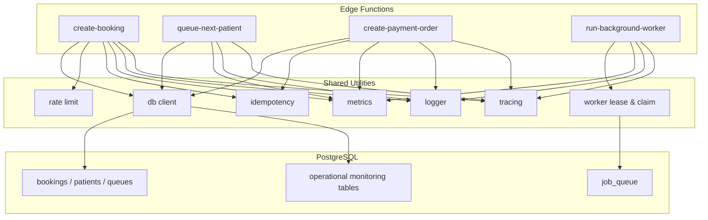
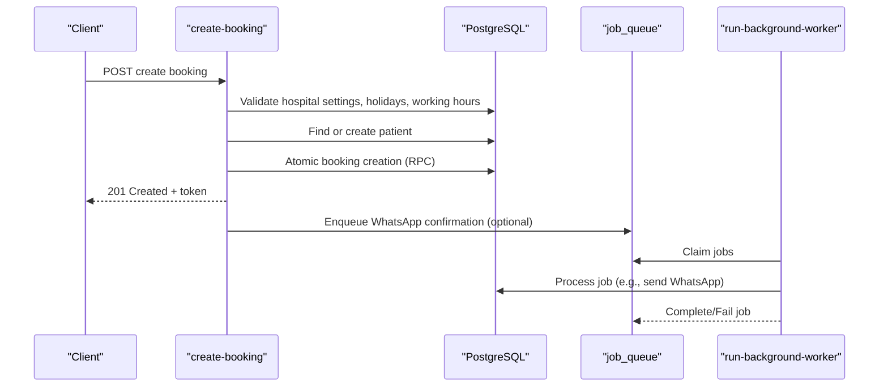
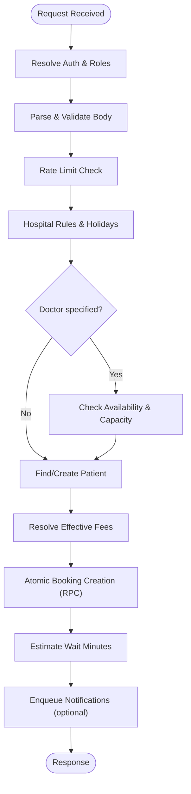
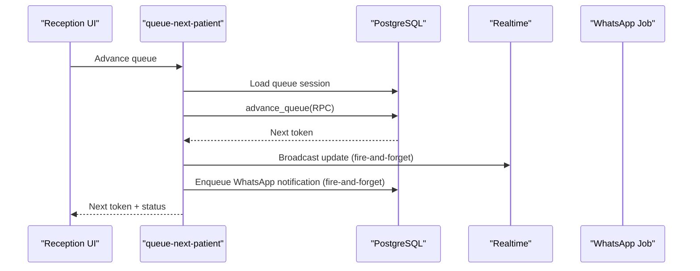
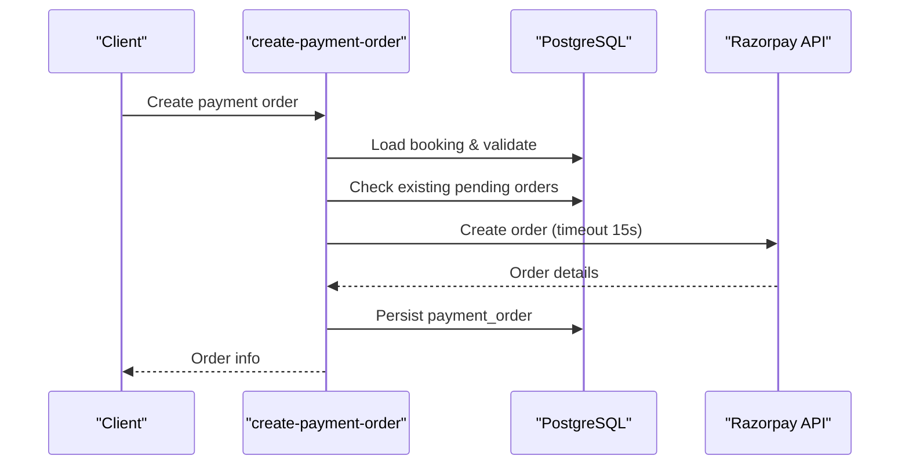
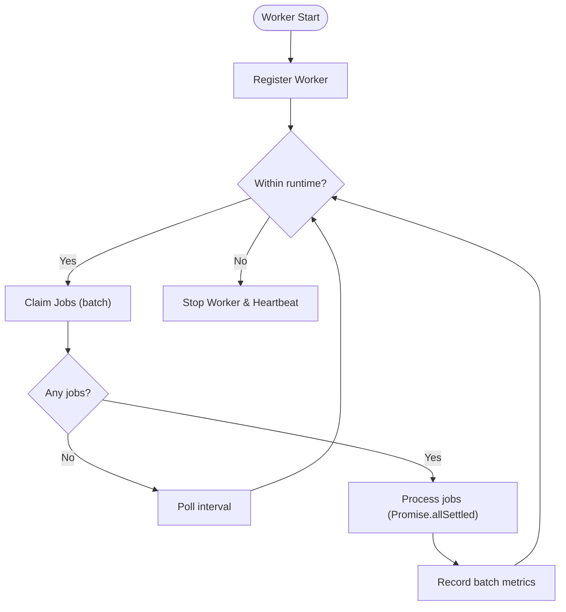
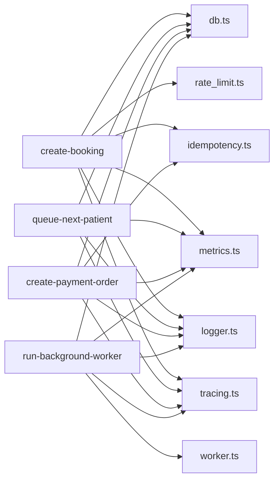

# Performance Troubleshooting

<cite>
**Referenced Files in This Document**
- [metrics.ts](file://supabase/functions/_shared/metrics.ts)
- [db.ts](file://supabase/functions/_shared/db.ts)
- [logger.ts](file://supabase/functions/_shared/logger.ts)
- [tracing.ts](file://supabase/functions/_shared/tracing.ts)
- [create-booking/index.ts](file://supabase/functions/create-booking/index.ts)
- [queue-next-patient/index.ts](file://supabase/functions/queue-next-patient/index.ts)
- [create-payment-order/index.ts](file://supabase/functions/create-payment-order/index.ts)
- [run-background-worker/index.ts](file://supabase/functions/run-background-worker/index.ts)
- [worker.ts](file://supabase/functions/_shared/worker.ts)
- [rate_limit.ts](file://supabase/functions/_shared/rate_limit.ts)
- [idempotency.ts](file://supabase/functions/_shared/idempotency.ts)
- [06_background_job_queue.sql](file://supabase/migrations/06_background_job_queue.sql)
- [24_operational-monitoring_engine.sql](file://supabase/migrations/24_operational-monitoring_engine.sql)
</cite>

## Table of Contents

1. Introduction
2. Project Structure
3. Core Components
4. Architecture Overview
5. Detailed Component Analysis
6. Dependency Analysis
7. Performance Considerations
8. Troubleshooting Guide
9. Conclusion
10. Appendices

## Introduction

This document provides a comprehensive performance troubleshooting guide for the
Setura Hospital OS. It focuses on identifying and resolving slow database
queries, memory leaks in edge functions, and resource exhaustion issues. It
explains how to analyze performance metrics, identify bottlenecks in booking
workflows, queue processing, and payment operations, and offers guidance on
optimizing PostgreSQL queries, managing connection pools, and scaling edge
functions. It also covers SLA monitoring, performance regression detection,
capacity planning strategies, profiling tools and commands, query analysis,
system resource monitoring, common anti-patterns, and optimization best
practices.

## Project Structure

The application is built as Supabase Edge Functions with shared utilities for
logging, tracing, metrics, database clients, rate limiting, idempotency, and
worker orchestration. Background jobs are processed by a long-running worker
function that claims jobs from a Postgres-backed queue. Operational monitoring
tables capture health snapshots and alert thresholds.

**Diagram sources**

- [create-booking/index.ts:67-666](file://supabase/functions/create-booking/index.ts#L67-L666)
- [queue-next-patient/index.ts:46-409](file://supabase/functions/queue-next-patient/index.ts#L46-L409)
- [create-payment-order/index.ts:104-407](file://supabase/functions/create-payment-order/index.ts#L104-L407)
- [run-background-worker/index.ts:247-454](file://supabase/functions/run-background-worker/index.ts#L247-L454)
- [db.ts:1-169](file://supabase/functions/_shared/db.ts#L1-L169)
- [logger.ts:1-190](file://supabase/functions/_shared/logger.ts#L1-L190)
- [metrics.ts:1-119](file://supabase/functions/_shared/metrics.ts#L1-L119)
- [tracing.ts:1-50](file://supabase/functions/_shared/tracing.ts#L1-L50)
- [rate_limit.ts:1-124](file://supabase/functions/_shared/rate_limit.ts#L1-L124)
- [idempotency.ts:1-259](file://supabase/functions/_shared/idempotency.ts#L1-L259)
- [worker.ts:1-257](file://supabase/functions/_shared/worker.ts#L1-L257)
- [06_background_job_queue.sql:41-137](file://supabase/migrations/06_background_job_queue.sql#L41-L137)
- [24_operational-monitoring_engine.sql:157-188](file://supabase/migrations/24_operational-monitoring_engine.sql#L157-L188)

**Section sources**

- [create-booking/index.ts:67-666](file://supabase/functions/create-booking/index.ts#L67-L666)
- [queue-next-patient/index.ts:46-409](file://supabase/functions/queue-next-patient/index.ts#L46-L409)
- [create-payment-order/index.ts:104-407](file://supabase/functions/create-payment-order/index.ts#L104-L407)
- [run-background-worker/index.ts:247-454](file://supabase/functions/run-background-worker/index.ts#L247-L454)
- [db.ts:1-169](file://supabase/functions/_shared/db.ts#L1-L169)
- [logger.ts:1-190](file://supabase/functions/_shared/logger.ts#L1-L190)
- [metrics.ts:1-119](file://supabase/functions/_shared/metrics.ts#L1-L119)
- [tracing.ts:1-50](file://supabase/functions/_shared/tracing.ts#L1-L50)
- [rate_limit.ts:1-124](file://supabase/functions/_shared/rate_limit.ts#L1-L124)
- [idempotency.ts:1-259](file://supabase/functions/_shared/idempotency.ts#L1-L259)
- [worker.ts:1-257](file://supabase/functions/_shared/worker.ts#L1-L257)
- [06_background_job_queue.sql:41-137](file://supabase/migrations/06_background_job_queue.sql#L41-L137)
- [24_operational-monitoring_engine.sql:157-188](file://supabase/migrations/24_operational-monitoring_engine.sql#L157-L188)

## Core Components

- Metrics collection: per-request timing, counters, and gauges emitted as
  structured logs for external collectors.
- Database clients: service-role (bypasses RLS), anon (RLS enforced), and
  per-request auth client; typed RPC helpers and error assertion.
- Structured logging: request-scoped logger with correlation IDs, timers, and
  safe error serialization.
- Distributed tracing: correlation/request/span IDs propagated across calls.
- Rate limiting: sliding window checks using Postgres-backed attempt logs.
- Idempotency: key-based deduplication with state machine semantics and response
  caching.
- Worker orchestration: job claiming with leases, heartbeat, crash recovery, and
  batched processing.

**Section sources**

- [metrics.ts:24-119](file://supabase/functions/_shared/metrics.ts#L24-L119)
- [db.ts:30-169](file://supabase/functions/_shared/db.ts#L30-L169)
- [logger.ts:122-190](file://supabase/functions/_shared/logger.ts#L122-L190)
- [tracing.ts:9-50](file://supabase/functions/_shared/tracing.ts#L9-L50)
- [rate_limit.ts:27-111](file://supabase/functions/_shared/rate_limit.ts#L27-L111)
- [idempotency.ts:79-259](file://supabase/functions/_shared/idempotency.ts#L79-L259)
- [worker.ts:30-257](file://supabase/functions/_shared/worker.ts#L30-L257)

## Architecture Overview

The system uses edge functions for user-facing operations (booking creation,
queue advancement, payment order creation) and a background worker for
asynchronous tasks (WhatsApp messaging, notifications, analytics refresh, SLA
computation). All components emit structured logs and metrics, and use tracing
headers for cross-cutting observability.

**Diagram sources**

- [create-booking/index.ts:67-666](file://supabase/functions/create-booking/index.ts#L67-L666)
- [run-background-worker/index.ts:247-454](file://supabase/functions/run-background-worker/index.ts#L247-L454)
- [06_background_job_queue.sql:41-137](file://supabase/migrations/06_background_job_queue.sql#L41-L137)

## Detailed Component Analysis

### Booking Workflow Performance

Key steps include auth resolution, body parsing, rate limiting, hospital rules
validation, doctor availability checks, queue session handling, patient
find-or-create, fee resolution, atomic booking creation via RPC, wait time
estimation, and enqueueing follow-up jobs. Each step is instrumented with timers
and metrics.

**Diagram sources**

- [create-booking/index.ts:67-666](file://supabase/functions/create-booking/index.ts#L67-L666)

**Section sources**

- [create-booking/index.ts:67-666](file://supabase/functions/create-booking/index.ts#L67-L666)

### Queue Processing Performance

Queue advancement uses an RPC that internally advances tokens safely. The
endpoint loads the active session, advances the queue, broadcasts updates,
enqueues WhatsApp notifications, and records audit events. Non-critical side
effects do not block core progression.

**Diagram sources**

- [queue-next-patient/index.ts:46-409](file://supabase/functions/queue-next-patient/index.ts#L46-L409)

**Section sources**

- [queue-next-patient/index.ts:46-409](file://supabase/functions/queue-next-patient/index.ts#L46-L409)

### Payment Operations Performance

Payment order creation validates booking eligibility, resolves fees, calls
Razorpay with timeouts, persists immutable order records, and returns order
details. Idempotency prevents duplicate orders.

**Diagram sources**

- [create-payment-order/index.ts:104-407](file://supabase/functions/create-payment-order/index.ts#L104-L407)

**Section sources**

- [create-payment-order/index.ts:104-407](file://supabase/functions/create-payment-order/index.ts#L104-L407)

### Background Worker Performance

The worker registers itself, heartbeats periodically, claims batches of jobs
using leases, processes them concurrently with Promise.allSettled, and tracks
success/failure metrics. It supports multiple job types including WhatsApp
messaging, incoming message processing, analytics refresh, and SLA computation.

**Diagram sources**

- [run-background-worker/index.ts:247-454](file://supabase/functions/run-background-worker/index.ts#L247-L454)
- [worker.ts:98-257](file://supabase/functions/_shared/worker.ts#L98-L257)

**Section sources**

- [run-background-worker/index.ts:247-454](file://supabase/functions/run-background-worker/index.ts#L247-L454)
- [worker.ts:98-257](file://supabase/functions/_shared/worker.ts#L98-L257)

## Dependency Analysis

- Edge functions depend on shared modules for DB access, logging, metrics,
  tracing, rate limiting, and idempotency.
- Background worker depends on worker utilities for lease management and job
  lifecycle.
- Database interactions rely on service-role client for internal mutations and
  RPCs.
- Monitoring relies on operational tables for health snapshots and alert
  thresholds.

**Diagram sources**

- [create-booking/index.ts:67-666](file://supabase/functions/create-booking/index.ts#L67-L666)
- [queue-next-patient/index.ts:46-409](file://supabase/functions/queue-next-patient/index.ts#L46-L409)
- [create-payment-order/index.ts:104-407](file://supabase/functions/create-payment-order/index.ts#L104-L407)
- [run-background-worker/index.ts:247-454](file://supabase/functions/run-background-worker/index.ts#L247-L454)
- [db.ts:1-169](file://supabase/functions/_shared/db.ts#L1-L169)
- [worker.ts:1-257](file://supabase/functions/_shared/worker.ts#L1-L257)
- [metrics.ts:1-119](file://supabase/functions/_shared/metrics.ts#L1-L119)
- [logger.ts:1-190](file://supabase/functions/_shared/logger.ts#L1-L190)
- [tracing.ts:1-50](file://supabase/functions/_shared/tracing.ts#L1-L50)
- [rate_limit.ts:1-124](file://supabase/functions/_shared/rate_limit.ts#L1-L124)
- [idempotency.ts:1-259](file://supabase/functions/_shared/idempotency.ts#L1-L259)

**Section sources**

- [db.ts:1-169](file://supabase/functions/_shared/db.ts#L1-L169)
- [worker.ts:1-257](file://supabase/functions/_shared/worker.ts#L1-L257)
- [metrics.ts:1-119](file://supabase/functions/_shared/metrics.ts#L1-L119)
- [logger.ts:1-190](file://supabase/functions/_shared/logger.ts#L1-L190)
- [tracing.ts:1-50](file://supabase/functions/_shared/tracing.ts#L1-L50)
- [rate_limit.ts:1-124](file://supabase/functions/_shared/rate_limit.ts#L1-L124)
- [idempotency.ts:1-259](file://supabase/functions/_shared/idempotency.ts#L1-L259)

## Performance Considerations

- Use service-role client for internal mutations to avoid RLS overhead where
  appropriate; ensure security boundaries at the function level.
- Prefer RPCs for complex, transactional logic to reduce round-trips and enforce
  consistency.
- Instrument all critical paths with timers and metrics; flush metrics at the
  end of handlers.
- Offload non-critical work (notifications, reminders, analytics refresh) to
  background jobs to keep request latency low.
- Use idempotency keys to prevent duplicate work under retries and concurrency.
- Apply rate limiting to protect against abuse and reduce load spikes.
- Monitor worker health via heartbeats and track job backlogs; tune batch sizes
  and poll intervals based on throughput needs.
- Ensure external API calls have timeouts to prevent resource exhaustion.

[No sources needed since this section provides general guidance]

## Troubleshooting Guide

### Identifying Slow Database Queries

- Add per-step timers around DB calls and RPCs in edge functions to isolate slow
  segments.
- Use structured logs to correlate requests with durations and tags (endpoint,
  hospitalId, userId).
- Analyze job processing times via worker logs and metrics to detect slow
  background tasks.
- Inspect indexes and query plans for hotspots in booking, queue, and payment
  flows.

**Section sources**

- [create-booking/index.ts:158-182](file://supabase/functions/create-booking/index.ts#L158-L182)
- [create-booking/index.ts:422-498](file://supabase/functions/create-booking/index.ts#L422-L498)
- [queue-next-patient/index.ts:159-184](file://supabase/functions/queue-next-patient/index.ts#L159-L184)
- [create-payment-order/index.ts:299-324](file://supabase/functions/create-payment-order/index.ts#L299-L324)
- [run-background-worker/index.ts:363-420](file://supabase/functions/run-background-worker/index.ts#L363-L420)

### Resolving Memory Leaks in Edge Functions

- Avoid retaining large objects in module-level caches; prefer per-request
  allocations.
- Ensure timers and metrics are flushed and not accumulating indefinitely.
- Keep external fetch calls short-lived and bounded by timeouts.
- Use child loggers and avoid attaching large payloads to context.

**Section sources**

- [metrics.ts:24-119](file://supabase/functions/_shared/metrics.ts#L24-L119)
- [logger.ts:122-190](file://supabase/functions/_shared/logger.ts#L122-L190)
- [create-payment-order/index.ts:64-102](file://supabase/functions/create-payment-order/index.ts#L64-L102)

### Addressing Resource Exhaustion

- Configure timeouts for external services (e.g., Razorpay) to prevent hanging
  connections.
- Tune worker batch size and poll intervals to match system capacity.
- Use rate limiting to cap inbound request rates and protect downstream systems.
- Monitor job queue backlog and dead-letter queues; scale workers accordingly.

**Section sources**

- [create-payment-order/index.ts:64-102](file://supabase/functions/create-payment-order/index.ts#L64-L102)
- [run-background-worker/index.ts:24-34](file://supabase/functions/run-background-worker/index.ts#L24-L34)
- [rate_limit.ts:27-111](file://supabase/functions/_shared/rate_limit.ts#L27-L111)
- [06_background_job_queue.sql:41-137](file://supabase/migrations/06_background_job_queue.sql#L41-L137)

### Analyzing Performance Metrics

- Collect per-endpoint timings and counters via metrics collector; flush at
  handler completion.
- Correlate metrics with structured logs using correlation IDs.
- Track worker batch sizes, success/failure counts, and runtime durations.

**Section sources**

- [metrics.ts:24-119](file://supabase/functions/_shared/metrics.ts#L24-L119)
- [create-booking/index.ts:638-644](file://supabase/functions/create-booking/index.ts#L638-L644)
- [run-background-worker/index.ts:398-447](file://supabase/functions/run-background-worker/index.ts#L398-L447)

### Identifying Bottlenecks in Workflows

- Booking workflow: focus on hospital settings lookup, holiday/working hours
  checks, doctor availability RPCs, and atomic booking creation.
- Queue processing: focus on session loading, advance_queue RPC, and side-effect
  enqueues.
- Payment operations: focus on Razorpay API latency and persistence of payment
  orders.

**Section sources**

- [create-booking/index.ts:168-283](file://supabase/functions/create-booking/index.ts#L168-L283)
- [create-booking/index.ts:422-498](file://supabase/functions/create-booking/index.ts#L422-L498)
- [queue-next-patient/index.ts:104-184](file://supabase/functions/queue-next-patient/index.ts#L104-L184)
- [create-payment-order/index.ts:141-324](file://supabase/functions/create-payment-order/index.ts#L141-L324)

### Optimizing PostgreSQL Queries

- Ensure indexes exist on frequently filtered columns (e.g., hospital_id,
  created_at, status).
- Use selective selects and single-row reads where possible.
- Prefer RPCs for complex transactions to minimize network overhead and maintain
  consistency.
- Monitor job queue indexes for efficient claiming and retry scheduling.

**Section sources**

- [06_background_job_queue.sql:101-137](file://supabase/migrations/06_background_job_queue.sql#L101-L137)
- [create-booking/index.ts:168-283](file://supabase/functions/create-booking/index.ts#L168-L283)
- [queue-next-patient/index.ts:104-184](file://supabase/functions/queue-next-patient/index.ts#L104-L184)

### Managing Connection Pools

- Reuse service-role and anon clients as module-level singletons to leverage
  connection pooling.
- Create per-request auth clients only when necessary; avoid caching them.
- Ensure timeouts and retries are configured for external calls to prevent pool
  exhaustion.

**Section sources**

- [db.ts:30-106](file://supabase/functions/_shared/db.ts#L30-L106)
- [create-payment-order/index.ts:64-102](file://supabase/functions/create-payment-order/index.ts#L64-L102)

### Scaling Edge Functions

- Scale horizontally by increasing function instances; ensure idempotency and
  distributed rate limiting.
- Offload heavy work to background jobs; keep request paths lightweight.
- Use batch processing in workers with tuned batch sizes and parallelism.

**Section sources**

- [idempotency.ts:196-259](file://supabase/functions/_shared/idempotency.ts#L196-L259)
- [run-background-worker/index.ts:363-420](file://supabase/functions/run-background-worker/index.ts#L363-L420)

### SLA Monitoring

- Use operational monitoring tables to capture system health snapshots and alert
  thresholds.
- Define thresholds for queue backlogs, worker crashes, WhatsApp failures, DLQ
  backlog, and analytics refresh lag.
- Alert on deviations and track resolved states.

**Section sources**

- [24_operational-monitoring_engine.sql:37-103](file://supabase/migrations/24_operational-monitoring_engine.sql#L37-L103)
- [24_operational-monitoring_engine.sql:157-188](file://supabase/migrations/24_operational-monitoring_engine.sql#L157-L188)

### Performance Regression Detection

- Establish baselines for request latencies and job processing times using
  metrics and logs.
- Compare current distributions against historical baselines; alert on
  regressions.
- Correlate changes in code or configuration with metric shifts.

**Section sources**

- [metrics.ts:24-119](file://supabase/functions/_shared/metrics.ts#L24-L119)
- [logger.ts:122-190](file://supabase/functions/_shared/logger.ts#L122-L190)

### Capacity Planning Strategies

- Monitor queue backlog trends and worker throughput to plan scaling.
- Use alert thresholds to trigger proactive scaling before SLA breaches.
- Plan capacity for external dependencies (payment gateways, messaging
  providers) with rate limits and timeouts.

**Section sources**

- [06_background_job_queue.sql:101-137](file://supabase/migrations/06_background_job_queue.sql#L101-L137)
- [24_operational-monitoring_engine.sql:37-103](file://supabase/migrations/24_operational-monitoring_engine.sql#L37-L103)

### Tools and Commands for Profiling and Monitoring

- Use structured logs to trace requests with correlation IDs and measure
  durations.
- Emit metrics per endpoint and flush at completion; parse logs with external
  collectors.
- Monitor worker heartbeats and job statuses to detect stalls or crashes.

**Section sources**

- [logger.ts:122-190](file://supabase/functions/_shared/logger.ts#L122-L190)
- [metrics.ts:24-119](file://supabase/functions/_shared/metrics.ts#L24-L119)
- [worker.ts:180-215](file://supabase/functions/_shared/worker.ts#L180-L215)

### Common Anti-Patterns and Best Practices

- Anti-patterns:
  - Blocking on non-critical side effects within request handlers.
  - Missing timeouts on external calls.
  - Caching per-request clients or large objects at module scope.
  - Overly broad selects or missing indexes leading to full table scans.
- Best practices:
  - Use idempotency keys for all mutating endpoints.
  - Offload async tasks to background jobs.
  - Instrument critical paths with timers and metrics.
  - Apply rate limiting and guardrails for abuse protection.
  - Maintain clear separation between service-role and auth clients.

**Section sources**

- [create-booking/index.ts:520-607](file://supabase/functions/create-booking/index.ts#L520-L607)
- [create-payment-order/index.ts:64-102](file://supabase/functions/create-payment-order/index.ts#L64-L102)
- [idempotency.ts:196-259](file://supabase/functions/_shared/idempotency.ts#L196-L259)
- [rate_limit.ts:27-111](file://supabase/functions/_shared/rate_limit.ts#L27-L111)
- [db.ts:30-106](file://supabase/functions/_shared/db.ts#L30-L106)

## Conclusion

By combining robust instrumentation, disciplined database usage, background job
processing, and operational monitoring, the Setura Hospital OS can achieve high
reliability and performance. Focus on measuring critical paths, offloading
non-critical work, applying idempotency and rate limits, and continuously tuning
based on metrics and alerts to meet SLAs and scale effectively.

[No sources needed since this section summarizes without analyzing specific
files]

## Appendices

### Key Metrics to Track

- Request total duration per endpoint
- Database operation timings (hospital settings, patient lookup, booking
  creation)
- External API call durations (e.g., Razorpay)
- Worker batch sizes, success/failure counts, runtime
- Queue backlog and DLQ counts
- Health score and alert events

**Section sources**

- [metrics.ts:24-119](file://supabase/functions/_shared/metrics.ts#L24-L119)
- [run-background-worker/index.ts:398-447](file://supabase/functions/run-background-worker/index.ts#L398-L447)
- [24_operational-monitoring_engine.sql:157-188](file://supabase/migrations/24_operational-monitoring_engine.sql#L157-L188)
