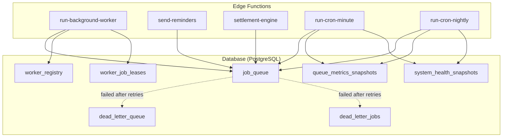
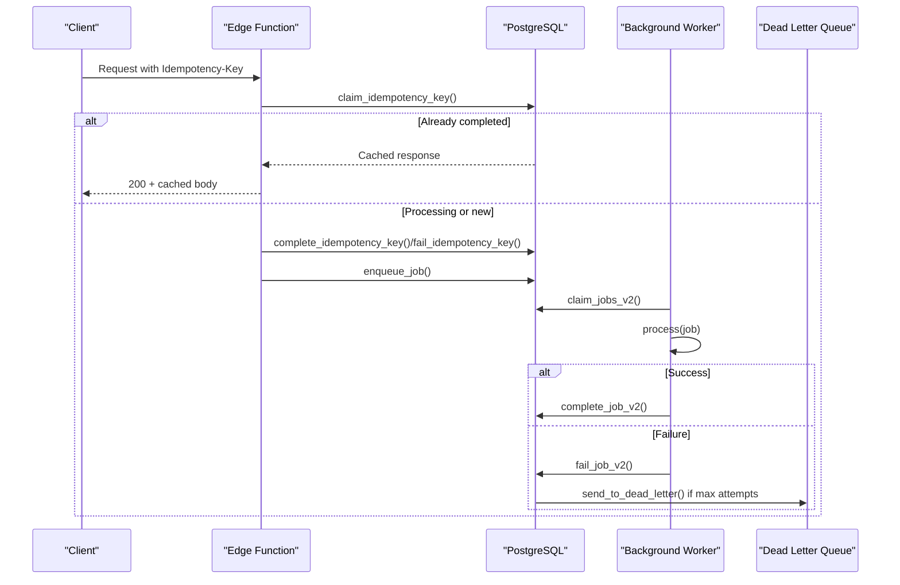
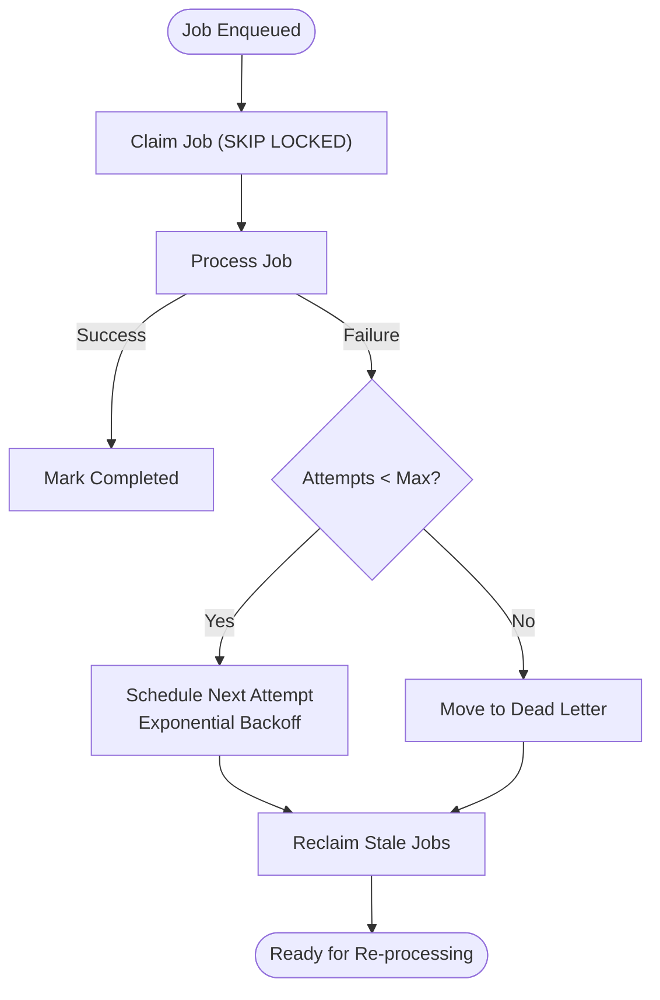
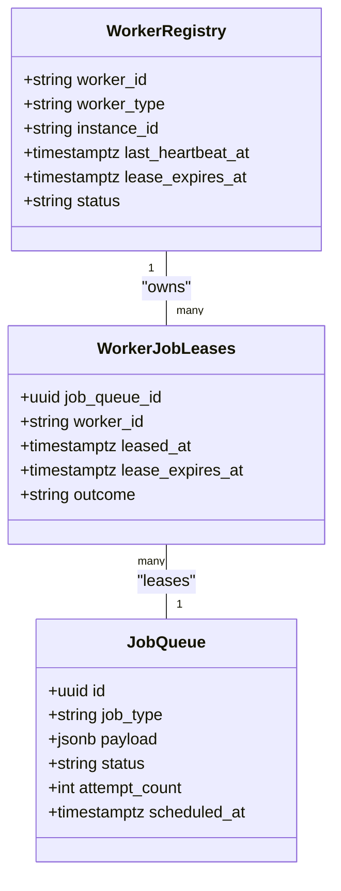
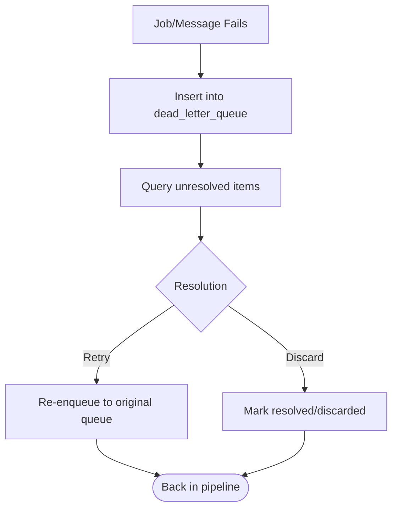
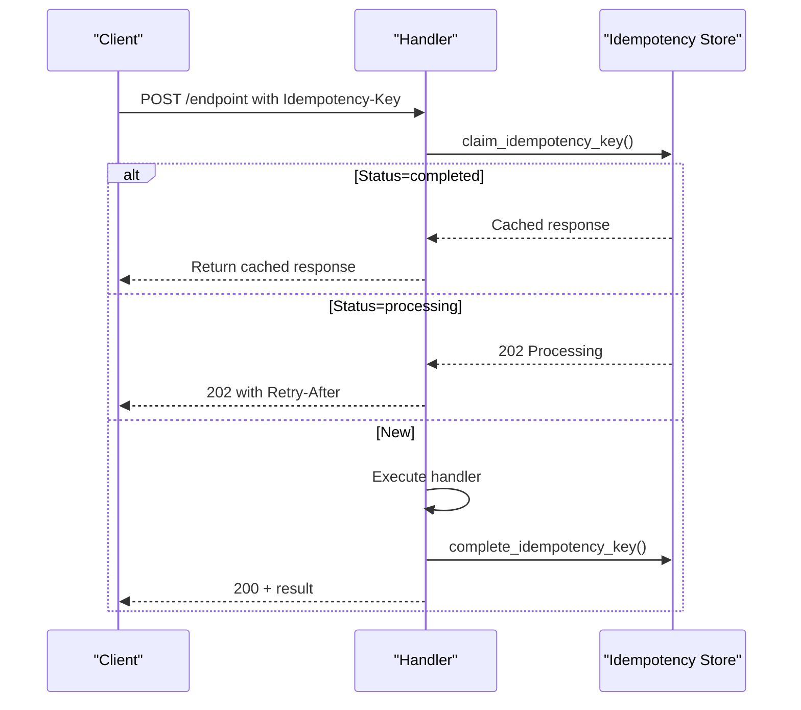
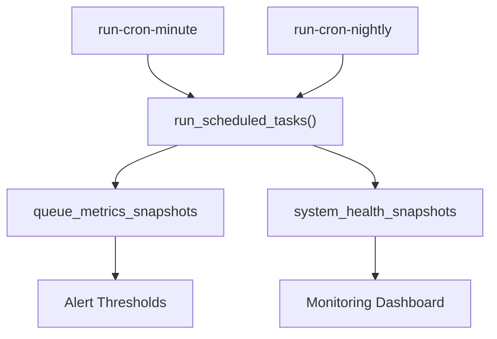
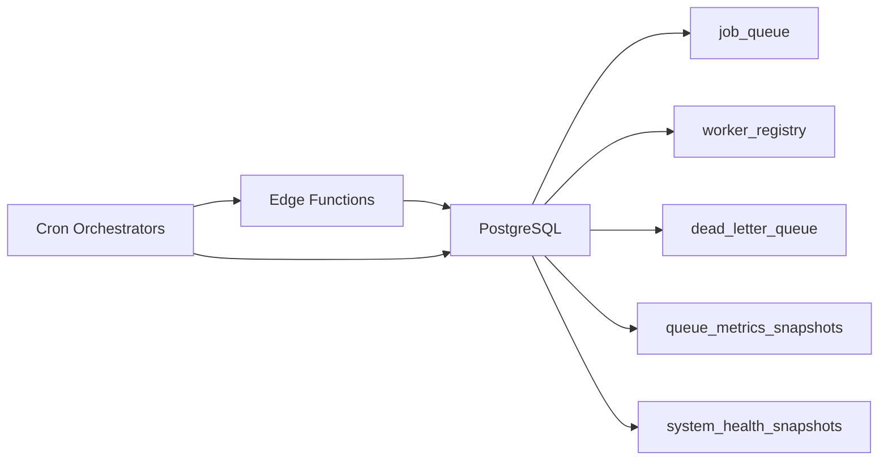

# Recovery Procedures

<cite>
**Referenced Files in This Document**
- [errors.ts](file://supabase/functions/_shared/errors.ts)
- [worker.ts](file://supabase/functions/_shared/worker.ts)
- [idempotency.ts](file://supabase/functions/_shared/idempotency.ts)
- [logger.ts](file://supabase/functions/_shared/logger.ts)
- [metrics.ts](file://supabase/functions/_shared/metrics.ts)
- [run-background-worker/index.ts](file://supabase/functions/run-background-worker/index.ts)
- [send-reminders/index.ts](file://supabase/functions/send-reminders/index.ts)
- [settlement-engine/index.ts](file://supabase/functions/settlement-engine/index.ts)
- [run-cron-minute/index.ts](file://supabase/functions/run-cron-minute/index.ts)
- [run-cron-nightly/index.ts](file://supabase/functions/run-cron-nightly/index.ts)
- [06_background_job_queue.sql](file://supabase/migrations/06_background_job_queue.sql)
- [14_dead_letter_queue.sql](file://supabase/migrations/14_dead_letter_queue.sql)
- [19_background_worker_engine.sql](file://supabase/migrations/19_background_worker_engine.sql)
- [17_queue_monitoring_engine.sql](file://supabase/migrations/17_queue_monitoring_engine.sql)
- [24_operational-monitoring_engine.sql](file://supabase/migrations/24_operational-monitoring_engine.sql)
- [config.toml](file://supabase/config.toml)
</cite>

## Table of Contents

1. Introduction
2. Project Structure
3. Core Components
4. Architecture Overview
5. Detailed Component Analysis
6. Dependency Analysis
7. Performance Considerations
8. Troubleshooting Guide
9. Conclusion
10. Appendices

## Introduction

This document provides comprehensive recovery procedures for the Setura Hospital
OS. It covers step-by-step recovery for failed deployments, corrupted data,
service outages, and system failures. It includes database rollback and
migration recovery, background job retry mechanisms, dead letter queue
processing, and data consistency restoration. It also addresses disaster
recovery scenarios, backup restoration, failover procedures, edge function
failures, queue processing interruptions, external service outages, critical
incident runbooks, data reconciliation processes, post-recovery health
verification, prevention strategies, and monitoring alerts.

## Project Structure

The system is composed of:

- Edge functions implementing business logic and background workers
- A robust background job queue with worker leases and crash recovery
- Dead letter queues for failed jobs and messages
- Monitoring and alerting infrastructure capturing queue health, metrics, and
  operational snapshots
- Cron orchestrators for periodic tasks and nightly maintenance

**Diagram sources**

- [run-background-worker/index.ts:247-454](file://supabase/functions/run-background-worker/index.ts#L247-L454)
- [send-reminders/index.ts:40-445](file://supabase/functions/send-reminders/index.ts#L40-L445)
- [settlement-engine/index.ts:55-521](file://supabase/functions/settlement-engine/index.ts#L55-L521)
- [run-cron-minute/index.ts:40-347](file://supabase/functions/run-cron-minute/index.ts#L40-L347)
- [run-cron-nightly/index.ts:62-346](file://supabase/functions/run-cron-nightly/index.ts#L62-L346)
- [06_background_job_queue.sql:41-183](file://supabase/migrations/06_background_job_queue.sql#L41-L183)
- [14_dead_letter_queue.sql:39-163](file://supabase/migrations/14_dead_letter_queue.sql#L39-L163)
- [19_background_worker_engine.sql:18-148](file://supabase/migrations/19_background_worker_engine.sql#L18-L148)
- [17_queue_monitoring_engine.sql:14-51](file://supabase/migrations/17_queue_monitoring_engine.sql#L14-L51)
- [24_operational-monitoring_engine.sql:157-185](file://supabase/migrations/24_operational-monitoring_engine.sql#L157-L185)

**Section sources**

- [run-background-worker/index.ts:247-454](file://supabase/functions/run-background-worker/index.ts#L247-L454)
- [run-cron-minute/index.ts:40-347](file://supabase/functions/run-cron-minute/index.ts#L40-L347)
- [run-cron-nightly/index.ts:62-346](file://supabase/functions/run-cron-nightly/index.ts#L62-L346)
- [06_background_job_queue.sql:41-183](file://supabase/migrations/06_background_job_queue.sql#L41-L183)
- [14_dead_letter_queue.sql:39-163](file://supabase/migrations/14_dead_letter_queue.sql#L39-L163)
- [19_background_worker_engine.sql:18-148](file://supabase/migrations/19_background_worker_engine.sql#L18-L148)
- [17_queue_monitoring_engine.sql:14-51](file://supabase/migrations/17_queue_monitoring_engine.sql#L14-L51)
- [24_operational-monitoring_engine.sql:157-185](file://supabase/migrations/24_operational-monitoring_engine.sql#L157-L185)

## Core Components

- Background job queue with claim/complete/fail semantics, exponential backoff,
  and dead-letter routing
- Worker engine with registration, heartbeat, per-job leases, crash detection,
  and reclaimed job handling
- Dead letter queue with source tracking, priority, resolution workflow, and
  re-enqueue support
- Idempotency enforcement for API requests to prevent duplicate side effects
  during retries
- Structured logging and metrics collection for observability and alerting
- Cron orchestrators for minute-level and nightly tasks including health checks
  and analytics refresh

Key responsibilities:

- Ensure at-least-once processing with idempotency and safe retries
- Recover from worker crashes by reclaiming leases and jobs
- Persist failure details for manual intervention via DLQ
- Provide real-time visibility into queue health and system status

**Section sources**

- [06_background_job_queue.sql:194-449](file://supabase/migrations/06_background_job_queue.sql#L194-L449)
- [19_background_worker_engine.sql:154-800](file://supabase/migrations/19_background_worker_engine.sql#L154-L800)
- [14_dead_letter_queue.sql:189-357](file://supabase/migrations/14_dead_letter_queue.sql#L189-L357)
- [idempotency.ts:79-259](file://supabase/functions/_shared/idempotency.ts#L79-L259)
- [worker.ts:30-257](file://supabase/functions/_shared/worker.ts#L30-L257)
- [logger.ts:122-190](file://supabase/functions/_shared/logger.ts#L122-L190)
- [metrics.ts:24-119](file://supabase/functions/_shared/metrics.ts#L24-L119)

## Architecture Overview

The recovery architecture centers on resilient job processing, durable state,
and automated recovery paths.

**Diagram sources**

- [idempotency.ts:79-259](file://supabase/functions/_shared/idempotency.ts#L79-L259)
- [06_background_job_queue.sql:194-449](file://supabase/migrations/06_background_job_queue.sql#L194-L449)
- [19_background_worker_engine.sql:497-800](file://supabase/migrations/19_background_worker_engine.sql#L497-L800)
- [14_dead_letter_queue.sql:189-357](file://supabase/migrations/14_dead_letter_queue.sql#L189-L357)

## Detailed Component Analysis

### Background Job Queue and Retry Mechanics

- Jobs are enqueued with idempotency keys and priorities
- Workers claim jobs using SKIP LOCKED to avoid double-processing
- On failure, jobs are retried with exponential backoff; after max attempts,
  they move to dead-letter stores
- Stale jobs are reclaimed when leases expire or workers crash

**Diagram sources**

- [06_background_job_queue.sql:264-449](file://supabase/migrations/06_background_job_queue.sql#L264-L449)
- [19_background_worker_engine.sql:497-800](file://supabase/migrations/19_background_worker_engine.sql#L497-L800)

**Section sources**

- [06_background_job_queue.sql:194-449](file://supabase/migrations/06_background_job_queue.sql#L194-L449)
- [19_background_worker_engine.sql:497-800](file://supabase/migrations/19_background_worker_engine.sql#L497-L800)

### Worker Engine, Leases, and Crash Recovery

- Workers register and heartbeat to maintain leases
- Per-job leases track ownership and outcomes
- Crashed workers are detected; their jobs are reclaimed and reset to pending
- Heartbeat loop ensures lease renewal while processing

**Diagram sources**

- [19_background_worker_engine.sql:18-148](file://supabase/migrations/19_background_worker_engine.sql#L18-L148)
- [19_background_worker_engine.sql:154-800](file://supabase/migrations/19_background_worker_engine.sql#L154-L800)

**Section sources**

- [19_background_worker_engine.sql:154-800](file://supabase/migrations/19_background_worker_engine.sql#L154-L800)
- [worker.ts:30-257](file://supabase/functions/_shared/worker.ts#L30-L257)

### Dead Letter Queue Processing

- Failed items are persisted with source context, error metadata, and priority
- Resolution workflow supports retrying specific sources (e.g., job queue,
  WhatsApp, notifications)
- Views and indexes enable efficient querying for unresolved items

**Diagram sources**

- [14_dead_letter_queue.sql:189-357](file://supabase/migrations/14_dead_letter_queue.sql#L189-L357)
- [14_dead_letter_queue.sql:410-441](file://supabase/migrations/14_dead_letter_queue.sql#L410-L441)

**Section sources**

- [14_dead_letter_queue.sql:39-163](file://supabase/migrations/14_dead_letter_queue.sql#L39-L163)
- [14_dead_letter_queue.sql:189-357](file://supabase/migrations/14_dead_letter_queue.sql#L189-L357)
- [14_dead_letter_queue.sql:410-441](file://supabase/migrations/14_dead_letter_queue.sql#L410-L441)

### Idempotency Enforcement

- API handlers wrap operations with idempotency key claims
- Duplicate requests return cached responses or indicate processing
- Failures mark keys as failed to allow safe retries

**Diagram sources**

- [idempotency.ts:79-259](file://supabase/functions/_shared/idempotency.ts#L79-L259)

**Section sources**

- [idempotency.ts:79-259](file://supabase/functions/_shared/idempotency.ts#L79-L259)
- [settlement-engine/index.ts:231-484](file://supabase/functions/settlement-engine/index.ts#L231-L484)

### Monitoring, Metrics, and Health Checks

- Queue metrics snapshots capture counts, throughput, and age metrics
- Operational monitoring computes health scores and fires alerts based on
  thresholds
- Cron tasks periodically execute health checks and retention cleanup

**Diagram sources**

- [run-cron-minute/index.ts:123-254](file://supabase/functions/run-cron-minute/index.ts#L123-L254)
- [run-cron-nightly/index.ts:157-257](file://supabase/functions/run-cron-nightly/index.ts#L157-L257)
- [17_queue_monitoring_engine.sql:124-488](file://supabase/migrations/17_queue_monitoring_engine.sql#L124-L488)
- [24_operational-monitoring_engine.sql:194-397](file://supabase/migrations/24_operational-monitoring_engine.sql#L194-L397)

**Section sources**

- [17_queue_monitoring_engine.sql:124-488](file://supabase/migrations/17_queue_monitoring_engine.sql#L124-L488)
- [24_operational-monitoring_engine.sql:194-397](file://supabase/migrations/24_operational-monitoring_engine.sql#L194-L397)
- [run-cron-minute/index.ts:123-254](file://supabase/functions/run-cron-minute/index.ts#L123-L254)
- [run-cron-nightly/index.ts:157-257](file://supabase/functions/run-cron-nightly/index.ts#L157-L257)

## Dependency Analysis

- Edge functions depend on PostgreSQL RPCs for job management, worker
  coordination, and monitoring
- Worker runtime depends on DB locks and leases to ensure safety under
  concurrency
- DLQ integrates with multiple sources (jobs, WhatsApp, notifications) for
  unified failure handling
- Cron orchestrators coordinate dependent steps with isolation and partial
  failure tolerance

**Diagram sources**

- [run-background-worker/index.ts:247-454](file://supabase/functions/run-background-worker/index.ts#L247-L454)
- [run-cron-minute/index.ts:40-347](file://supabase/functions/run-cron-minute/index.ts#L40-L347)
- [run-cron-nightly/index.ts:62-346](file://supabase/functions/run-cron-nightly/index.ts#L62-L346)
- [06_background_job_queue.sql:41-183](file://supabase/migrations/06_background_job_queue.sql#L41-L183)
- [14_dead_letter_queue.sql:39-163](file://supabase/migrations/14_dead_letter_queue.sql#L39-L163)
- [17_queue_monitoring_engine.sql:14-51](file://supabase/migrations/17_queue_monitoring_engine.sql#L14-L51)
- [24_operational-monitoring_engine.sql:157-185](file://supabase/migrations/24_operational-monitoring_engine.sql#L157-L185)

**Section sources**

- [run-background-worker/index.ts:247-454](file://supabase/functions/run-background-worker/index.ts#L247-L454)
- [run-cron-minute/index.ts:40-347](file://supabase/functions/run-cron-minute/index.ts#L40-L347)
- [run-cron-nightly/index.ts:62-346](file://supabase/functions/run-cron-nightly/index.ts#L62-L346)
- [06_background_job_queue.sql:41-183](file://supabase/migrations/06_background_job_queue.sql#L41-L183)
- [14_dead_letter_queue.sql:39-163](file://supabase/migrations/14_dead_letter_queue.sql#L39-L163)
- [17_queue_monitoring_engine.sql:14-51](file://supabase/migrations/17_queue_monitoring_engine.sql#L14-L51)
- [24_operational-monitoring_engine.sql:157-185](file://supabase/migrations/24_operational-monitoring_engine.sql#L157-L185)

## Performance Considerations

- Use batched job claiming and bounded concurrency to avoid overload
- Prefer exponential backoff for retries to reduce contention
- Keep heartbeats frequent enough to detect crashes promptly without excessive
  writes
- Partition and index high-volume tables to maintain query performance
- Schedule heavy analytics refreshes during off-peak hours

[No sources needed since this section provides general guidance]

## Troubleshooting Guide

### Common Failure Modes and Recovery Steps

- Background job stuck in processing:
  - Detect stale jobs and reclaim them
  - Verify worker heartbeats and registry status
  - Re-run worker or trigger cron to wake processing
- Jobs failing repeatedly:
  - Inspect last_error and attempt_count
  - Move to DLQ if max attempts reached
  - Use DLQ retry mechanism to re-enqueue with higher priority
- Dead letter backlog:
  - Query unresolved items and prioritize by severity
  - Retry or discard based on root cause analysis
- External service outages (e.g., WhatsApp):
  - Monitor permanently failed messages
  - Retry via DLQ or re-queue with adjusted parameters
- Idempotency conflicts:
  - Check processing vs completed states
  - If processing, wait and retry; if completed, use cached response

**Section sources**

- [06_background_job_queue.sql:455-484](file://supabase/migrations/06_background_job_queue.sql#L455-L484)
- [19_background_worker_engine.sql:377-488](file://supabase/migrations/19_background_worker_engine.sql#L377-L488)
- [14_dead_letter_queue.sql:189-357](file://supabase/migrations/14_dead_letter_queue.sql#L189-L357)
- [idempotency.ts:79-259](file://supabase/functions/_shared/idempotency.ts#L79-L259)

### Database Rollback and Migration Recovery

- To roll back a migration:
  - Identify the target migration version
  - Apply reverse migrations or restore from backup
  - Validate schema alignment and constraints
- After rollback:
  - Re-run dependent migrations in order
  - Verify job queue and DLQ integrity
  - Trigger nightly tasks to reconcile state

**Section sources**

- [config.toml:53-65](file://supabase/config.toml#L53-L65)

### Disaster Recovery and Backup Restoration

- Restore database from latest consistent backup
- Reapply migrations to align schema
- Re-run nightly tasks to rebuild analytics and health snapshots
- Validate job queue and DLQ states; re-enqueue critical items if necessary

[No sources needed since this section provides general guidance]

### Failover Procedures

- If edge functions are unavailable:
  - Scale up instances or redeploy
  - Ensure cron triggers can wake workers
- If database is degraded:
  - Switch to read replica if available
  - Limit write-heavy operations until restored
- If external services are down:
  - Pause related queues temporarily
  - Retry after service recovery

[No sources needed since this section provides general guidance]

### Edge Function Failures

- Inspect structured logs for errors and correlation IDs
- Check metrics for timing anomalies and error rates
- Restart worker runs if crashed; verify heartbeat and registry

**Section sources**

- [logger.ts:122-190](file://supabase/functions/_shared/logger.ts#L122-L190)
- [metrics.ts:24-119](file://supabase/functions/_shared/metrics.ts#L24-L119)
- [run-background-worker/index.ts:309-454](file://supabase/functions/run-background-worker/index.ts#L309-L454)

### Queue Processing Interruptions

- Reclaim stale jobs and restart workers
- Verify worker leases and heartbeat intervals
- Adjust batch sizes and polling intervals if needed

**Section sources**

- [worker.ts:180-257](file://supabase/functions/_shared/worker.ts#L180-L257)
- [19_background_worker_engine.sql:377-488](file://supabase/migrations/19_background_worker_engine.sql#L377-L488)

### External Service Outages

- For WhatsApp failures:
  - Monitor permanently failed messages
  - Retry via DLQ with backoff
  - Temporarily throttle enqueue rate if provider is rate-limited

**Section sources**

- [24_operational-monitoring_engine.sql:331-348](file://supabase/migrations/24_operational-monitoring_engine.sql#L331-L348)
- [14_dead_letter_queue.sql:320-329](file://supabase/migrations/14_dead_letter_queue.sql#L320-L329)

### Critical Incident Runbook

- Immediate actions:
  - Check health score and queue backlog
  - Identify stuck jobs and crashed workers
  - Review DLQ unresolved items and priority
- Mitigation:
  - Reclaim stale jobs and restart workers
  - Retry DLQ items selectively
  - Throttle enqueueers if external services are unstable
- Post-incident:
  - Reconcile data and validate consistency
  - Update thresholds and alerts based on findings

**Section sources**

- [24_operational-monitoring_engine.sql:194-397](file://supabase/migrations/24_operational-monitoring_engine.sql#L194-L397)
- [17_queue_monitoring_engine.sql:348-401](file://supabase/migrations/17_queue_monitoring_engine.sql#L348-L401)
- [14_dead_letter_queue.sql:366-404](file://supabase/migrations/14_dead_letter_queue.sql#L366-L404)

### Data Reconciliation Processes

- Compare expected vs actual counts for critical entities
- Re-run analytics rollups and MV refreshes
- Validate settlement balances and outstanding entries

**Section sources**

- [run-cron-nightly/index.ts:157-257](file://supabase/functions/run-cron-nightly/index.ts#L157-L257)
- [settlement-engine/index.ts:116-229](file://supabase/functions/settlement-engine/index.ts#L116-L229)

### System Health Verification After Recovery

- Confirm job queue pending/processing/dead counts are normal
- Verify worker registry shows active workers with recent heartbeats
- Check DLQ unresolved count and alert events
- Validate health score and dashboard metrics

**Section sources**

- [24_operational-monitoring_engine.sql:283-397](file://supabase/migrations/24_operational-monitoring_engine.sql#L283-L397)
- [17_queue_monitoring_engine.sql:124-177](file://supabase/migrations/17_queue_monitoring_engine.sql#L124-L177)

### Prevention Strategies and Monitoring Alerts

- Configure alert thresholds for queue backlog, worker crashes, DLQ backlog, and
  analytics lag
- Enable regular health snapshots and retention cleanup
- Use structured logging and metrics to detect anomalies early

**Section sources**

- [24_operational-monitoring_engine.sql:37-103](file://supabase/migrations/24_operational-monitoring_engine.sql#L37-L103)
- [17_queue_monitoring_engine.sql:407-488](file://supabase/migrations/17_queue_monitoring_engine.sql#L407-L488)
- [logger.ts:122-190](file://supabase/functions/_shared/logger.ts#L122-L190)
- [metrics.ts:24-119](file://supabase/functions/_shared/metrics.ts#L24-L119)

## Conclusion

Setura Hospital OS provides robust recovery mechanisms through durable job
queues, worker leases, dead letter queues, idempotency enforcement, and
comprehensive monitoring. By following the procedures outlined here—covering job
retries, DLQ processing, crash recovery, data reconciliation, and alerting—you
can reliably recover from failures, minimize downtime, and maintain data
consistency across the system.

[No sources needed since this section summarizes without analyzing specific
files]

## Appendices

### Quick Reference: Key RPCs and Tables

- Job queue: enqueue_job, claim_jobs, complete_job, fail_job, reclaim_stale_jobs
- Worker engine: register_worker, worker_heartbeat, detect_crashed_workers,
  reclaim_crashed_worker_jobs, claim_jobs_v2, complete_job_v2, fail_job_v2
- Dead letter queue: send_to_dead_letter, retry_dead_letter_item,
  get_dlq_summary
- Monitoring: run_scheduled_tasks, run_health_check,
  write_queue_metrics_snapshot, refresh_analytics_views_ordered

**Section sources**

- [06_background_job_queue.sql:194-484](file://supabase/migrations/06_background_job_queue.sql#L194-L484)
- [19_background_worker_engine.sql:154-800](file://supabase/migrations/19_background_worker_engine.sql#L154-L800)
- [14_dead_letter_queue.sql:189-404](file://supabase/migrations/14_dead_letter_queue.sql#L189-L404)
- [17_queue_monitoring_engine.sql:407-647](file://supabase/migrations/17_queue_monitoring_engine.sql#L407-L647)
- [24_operational-monitoring_engine.sql:283-397](file://supabase/migrations/24_operational-monitoring_engine.sql#L283-L397)
