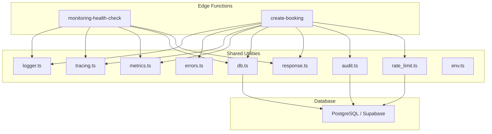
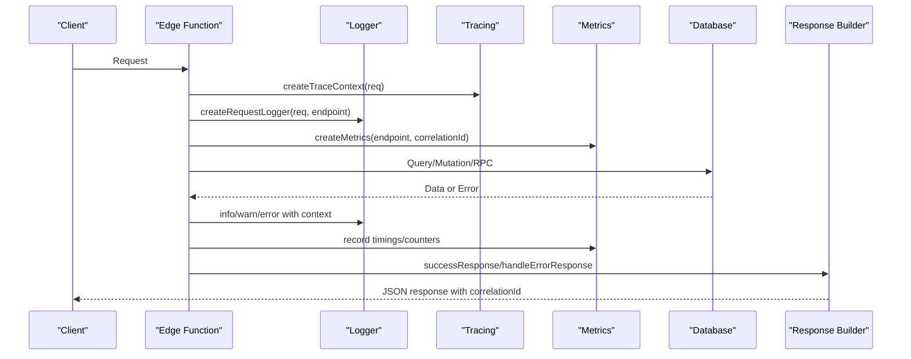
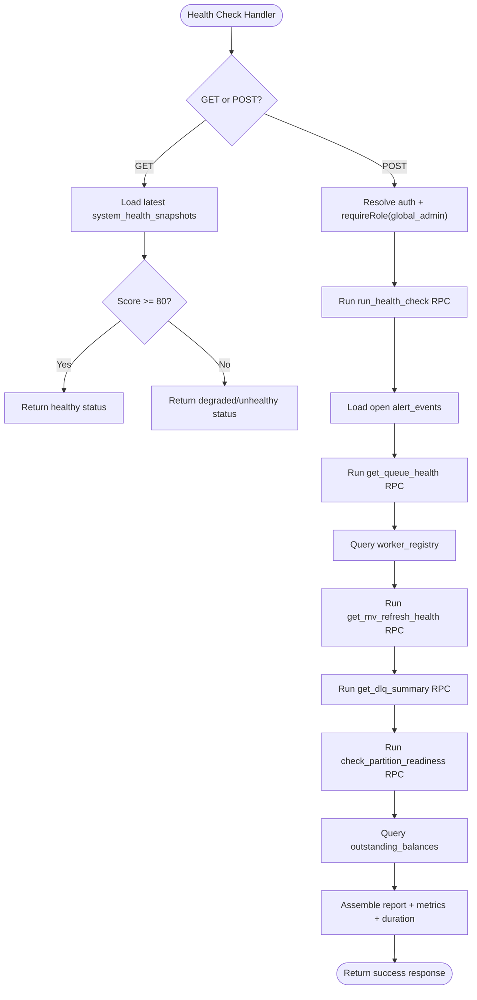
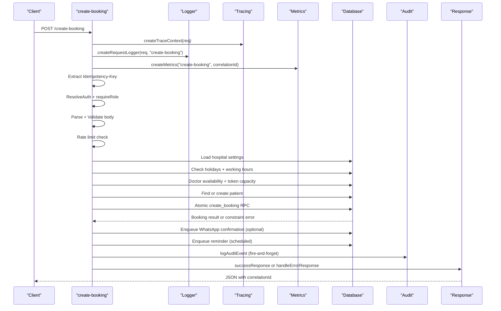
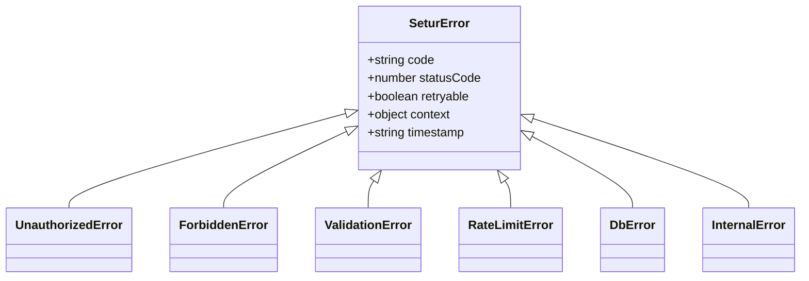
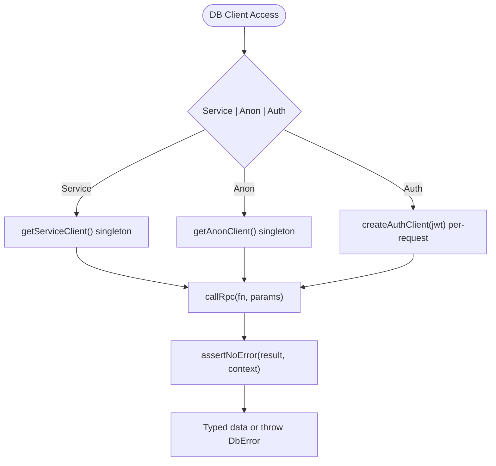
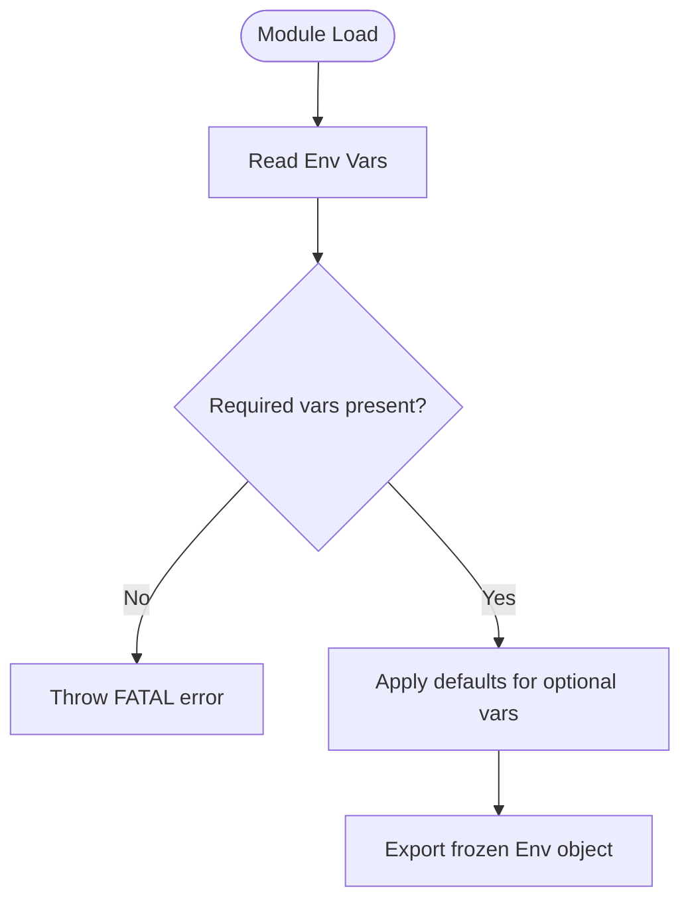
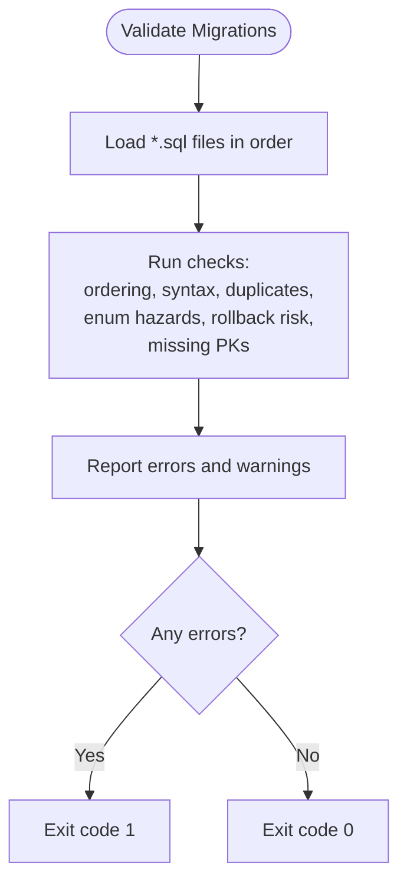
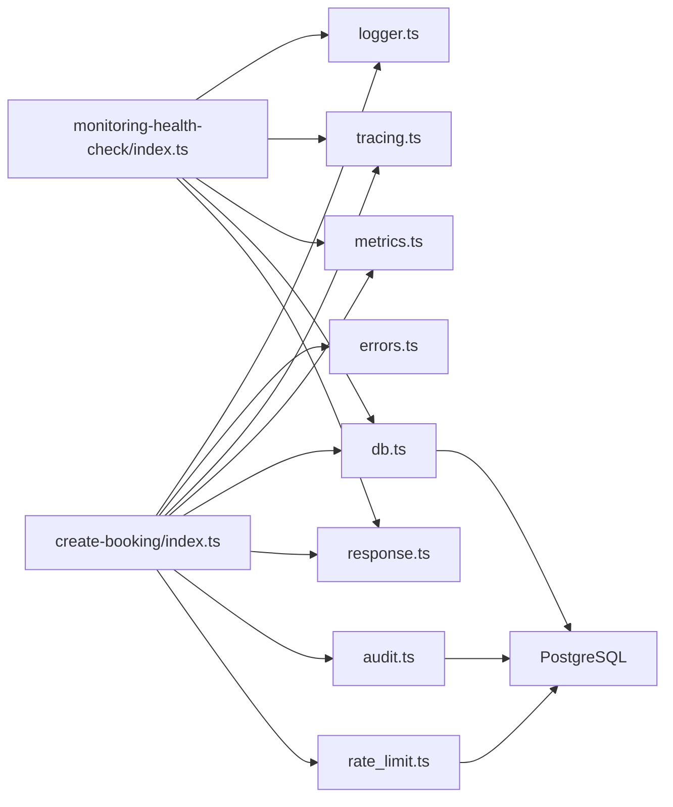

# Troubleshooting

<cite>
**Referenced Files in This Document**
- [logger.ts](file://supabase/functions/_shared/logger.ts)
- [errors.ts](file://supabase/functions/_shared/errors.ts)
- [tracing.ts](file://supabase/functions/_shared/tracing.ts)
- [metrics.ts](file://supabase/functions/_shared/metrics.ts)
- [db.ts](file://supabase/functions/_shared/db.ts)
- [env.ts](file://supabase/functions/_shared/env.ts)
- [response.ts](file://supabase/functions/_shared/response.ts)
- [audit.ts](file://supabase/functions/_shared/audit.ts)
- [rate_limit.ts](file://supabase/functions/_shared/rate_limit.ts)
- [monitoring-health-check/index.ts](file://supabase/functions/monitoring-health-check/index.ts)
- [create-booking/index.ts](file://supabase/functions/create-booking/index.ts)
- [validate_migrations.ts](file://scripts/validate_migrations.ts)
- [config.toml](file://supabase/config.toml)
</cite>

## Table of Contents

1. [Introduction](#introduction)
2. [Project Structure](#project-structure)
3. [Core Components](#core-components)
4. [Architecture Overview](#architecture-overview)
5. [Detailed Component Analysis](#detailed-component-analysis)
6. [Dependency Analysis](#dependency-analysis)
7. [Performance Considerations](#performance-considerations)
8. [Troubleshooting Guide](#troubleshooting-guide)
9. [Conclusion](#conclusion)
10. [Appendices](#appendices)

## Introduction

This document provides comprehensive troubleshooting guidance for the Setura
Hospital OS. It focuses on diagnosing and resolving common operational issues
such as database connectivity problems, edge function errors, external service
integration failures, authentication and authorization issues, data consistency
problems, performance bottlenecks, and recovery procedures for failed
deployments or outages. It also documents debugging techniques using structured
logs, correlation IDs, metrics, and health checks, along with diagnostic
commands to validate migrations and configurations.

## Project Structure

The system is implemented as Supabase Edge Functions (Deno) with shared
utilities for logging, tracing, metrics, error handling, environment validation,
and database client management. A monitoring health check endpoint aggregates
system status from multiple subsystems. Migrations are validated by a static
analysis script. Configuration is managed via environment variables and Supabase
configuration.

**Diagram sources**

- [monitoring-health-check/index.ts:22-231](file://supabase/functions/monitoring-health-check/index.ts#L22-L231)
- [create-booking/index.ts:67-666](file://supabase/functions/create-booking/index.ts#L67-L666)
- [logger.ts:1-190](file://supabase/functions/_shared/logger.ts#L1-L190)
- [errors.ts:1-323](file://supabase/functions/_shared/errors.ts#L1-L323)
- [tracing.ts:1-50](file://supabase/functions/_shared/tracing.ts#L1-L50)
- [metrics.ts:1-119](file://supabase/functions/_shared/metrics.ts#L1-L119)
- [db.ts:1-169](file://supabase/functions/_shared/db.ts#L1-L169)
- [response.ts:1-206](file://supabase/functions/_shared/response.ts#L1-L206)
- [audit.ts:1-75](file://supabase/functions/_shared/audit.ts#L1-L75)
- [rate_limit.ts:1-124](file://supabase/functions/_shared/rate_limit.ts#L1-L124)

**Section sources**

- [monitoring-health-check/index.ts:22-231](file://supabase/functions/monitoring-health-check/index.ts#L22-L231)
- [create-booking/index.ts:67-666](file://supabase/functions/create-booking/index.ts#L67-L666)
- [config.toml:1-409](file://supabase/config.toml#L1-L409)

## Core Components

- Structured Logging: JSON log lines with correlation IDs, request context, and
  timing helpers. Errors are serialized safely without crashing requests.
- Error Hierarchy: Centralized typed errors with codes, HTTP status codes, retry
  flags, and context metadata.
- Tracing: Correlation ID propagation across services; span tracking per
  invocation.
- Metrics: Timing, counters, and gauges emitted as structured logs for
  observability platforms.
- Database Clients: Service-role, anon, and per-request auth clients with typed
  RPC helpers and assertion utilities.
- Environment Validation: Required and optional environment variables validated
  at module load time to fail fast.
- Response Builders: Standardized success/error responses including CORS headers
  and correlation IDs.
- Audit Logging: Fire-and-forget audit event writes that never fail core
  operations.
- Rate Limiting: Distributed sliding window rate limiting backed by database
  tables.

**Section sources**

- [logger.ts:1-190](file://supabase/functions/_shared/logger.ts#L1-L190)
- [errors.ts:1-323](file://supabase/functions/_shared/errors.ts#L1-L323)
- [tracing.ts:1-50](file://supabase/functions/_shared/tracing.ts#L1-L50)
- [metrics.ts:1-119](file://supabase/functions/_shared/metrics.ts#L1-L119)
- [db.ts:1-169](file://supabase/functions/_shared/db.ts#L1-L169)
- [env.ts:1-279](file://supabase/functions/_shared/env.ts#L1-L279)
- [response.ts:1-206](file://supabase/functions/_shared/response.ts#L1-L206)
- [audit.ts:1-75](file://supabase/functions/_shared/audit.ts#L1-L75)
- [rate_limit.ts:1-124](file://supabase/functions/_shared/rate_limit.ts#L1-L124)

## Architecture Overview

The architecture centers around Edge Functions that handle requests, enforce
authentication and authorization, perform business logic, interact with the
database, and emit structured logs and metrics. The monitoring health check
endpoint aggregates system health from multiple sources.

**Diagram sources**

- [monitoring-health-check/index.ts:22-231](file://supabase/functions/monitoring-health-check/index.ts#L22-L231)
- [create-booking/index.ts:67-666](file://supabase/functions/create-booking/index.ts#L67-L666)
- [logger.ts:1-190](file://supabase/functions/_shared/logger.ts#L1-L190)
- [tracing.ts:1-50](file://supabase/functions/_shared/tracing.ts#L1-L50)
- [metrics.ts:1-119](file://supabase/functions/_shared/metrics.ts#L1-L119)
- [db.ts:1-169](file://supabase/functions/_shared/db.ts#L1-L169)
- [response.ts:1-206](file://supabase/functions/_shared/response.ts#L1-L206)

## Detailed Component Analysis

### Health Check Endpoint

The monitoring health check endpoint provides a lightweight GET for uptime
checks and a POST requiring global admin role to run a full health report. It
queries snapshots, open alerts, queue health, worker registry, materialized view
refresh health, dead letter queue summary, partition readiness, and outstanding
balances.

**Diagram sources**

- [monitoring-health-check/index.ts:22-231](file://supabase/functions/monitoring-health-check/index.ts#L22-L231)

**Section sources**

- [monitoring-health-check/index.ts:22-231](file://supabase/functions/monitoring-health-check/index.ts#L22-L231)

### Booking Creation Flow

The booking creation endpoint enforces idempotency, authentication,
authorization, rate limiting, hospital rules, doctor availability, queue
capacity, patient deduplication, atomic booking creation, WhatsApp
notifications, reminders, audit logging, and idempotency completion.

**Diagram sources**

- [create-booking/index.ts:67-666](file://supabase/functions/create-booking/index.ts#L67-L666)
- [logger.ts:1-190](file://supabase/functions/_shared/logger.ts#L1-L190)
- [tracing.ts:1-50](file://supabase/functions/_shared/tracing.ts#L1-L50)
- [metrics.ts:1-119](file://supabase/functions/_shared/metrics.ts#L1-L119)
- [db.ts:1-169](file://supabase/functions/_shared/db.ts#L1-L169)
- [audit.ts:1-75](file://supabase/functions/_shared/audit.ts#L1-L75)
- [response.ts:1-206](file://supabase/functions/_shared/response.ts#L1-L206)

**Section sources**

- [create-booking/index.ts:67-666](file://supabase/functions/create-booking/index.ts#L67-L666)

### Error Handling and Responses

Errors are centralized with typed classes carrying machine-readable codes, HTTP
status codes, retry flags, and context. Responses are standardized with
correlation IDs and timestamps. Non-retryable internal errors map to 500;
retryable errors like rate limits include Retry-After headers.

**Diagram sources**

- [errors.ts:1-323](file://supabase/functions/_shared/errors.ts#L1-L323)

**Section sources**

- [errors.ts:1-323](file://supabase/functions/_shared/errors.ts#L1-L323)
- [response.ts:1-206](file://supabase/functions/_shared/response.ts#L1-L206)

### Database Client Management

Three clients serve different purposes: service-role (bypasses RLS), anon
(subject to RLS), and per-request auth (impersonates caller). Typed RPC helpers
wrap errors into domain-specific errors. Assertion helpers ensure no unexpected
nulls or errors propagate silently.

**Diagram sources**

- [db.ts:1-169](file://supabase/functions/_shared/db.ts#L1-L169)

**Section sources**

- [db.ts:1-169](file://supabase/functions/_shared/db.ts#L1-L169)

### Environment Validation

Environment variables are validated at module load time. Missing required
variables cause fatal errors during cold start, preventing runtime failures
later. Optional variables provide defaults or feature toggles.

**Diagram sources**

- [env.ts:1-279](file://supabase/functions/_shared/env.ts#L1-L279)

**Section sources**

- [env.ts:1-279](file://supabase/functions/_shared/env.ts#L1-L279)

### Migration Validation Script

The migration validation script performs static analysis of SQL migrations
without a database connection. It checks ordering, syntax artifacts, duplicate
objects, enum hazards, rollback risks, and missing constraints. It reports
errors and warnings and exits non-zero if errors are found.

**Diagram sources**

- [validate_migrations.ts:1-503](file://scripts/validate_migrations.ts#L1-L503)

**Section sources**

- [validate_migrations.ts:1-503](file://scripts/validate_migrations.ts#L1-L503)

## Dependency Analysis

Key dependencies between components:

- Edge functions depend on shared utilities for logging, tracing, metrics, error
  handling, environment validation, database access, response building, audit
  logging, and rate limiting.
- Database interactions rely on typed clients and RPC helpers.
- Monitoring health check aggregates multiple subsystems via RPCs and table
  queries.
- Migration validation operates independently of runtime, scanning SQL files
  statically.

**Diagram sources**

- [create-booking/index.ts:67-666](file://supabase/functions/create-booking/index.ts#L67-L666)
- [monitoring-health-check/index.ts:22-231](file://supabase/functions/monitoring-health-check/index.ts#L22-L231)
- [logger.ts:1-190](file://supabase/functions/_shared/logger.ts#L1-L190)
- [errors.ts:1-323](file://supabase/functions/_shared/errors.ts#L1-L323)
- [tracing.ts:1-50](file://supabase/functions/_shared/tracing.ts#L1-L50)
- [metrics.ts:1-119](file://supabase/functions/_shared/metrics.ts#L1-L119)
- [db.ts:1-169](file://supabase/functions/_shared/db.ts#L1-L169)
- [response.ts:1-206](file://supabase/functions/_shared/response.ts#L1-L206)
- [audit.ts:1-75](file://supabase/functions/_shared/audit.ts#L1-L75)
- [rate_limit.ts:1-124](file://supabase/functions/_shared/rate_limit.ts#L1-L124)

**Section sources**

- [create-booking/index.ts:67-666](file://supabase/functions/create-booking/index.ts#L67-L666)
- [monitoring-health-check/index.ts:22-231](file://supabase/functions/monitoring-health-check/index.ts#L22-L231)

## Performance Considerations

- Use timers in handlers to measure durations for critical paths (auth
  resolution, parsing, DB calls, booking creation).
- Emit metrics for request totals and specific operations to identify hotspots.
- Prefer service-role clients for background workers and internal mutations; use
  per-request auth clients for user-facing mutations to enforce RLS efficiently.
- Avoid excessive logging in production; tune LOG_LEVEL appropriately.
- Monitor queue depths, worker statuses, and DLQ counts via the health check
  endpoint to detect backlogs early.
- Ensure migrations are idempotent and safe to re-run to avoid downtime during
  rollbacks or retries.

[No sources needed since this section provides general guidance]

## Troubleshooting Guide

### Database Connection Problems

Symptoms:

- Requests fail with DB_ERROR or RPC failures.
- Health check returns unhealthy due to DB unavailability.

Diagnosis:

- Verify environment variables SUPABASE_URL, SUPABASE_ANON_KEY,
  SUPABASE_SERVICE_ROLE_KEY are set correctly.
- Check for network restrictions or SSL enforcement in config.
- Inspect logs for DB_ERROR messages and associated dbCode details.
- Use the health check GET endpoint to quickly assess DB snapshot availability.

Resolution steps:

- Correct environment variables and redeploy.
- If using local development, verify ports and pooler settings in config.
- For transient DB errors, implement retry logic where appropriate (retryable
  errors indicated by error context).

**Section sources**

- [env.ts:82-90](file://supabase/functions/_shared/env.ts#L82-L90)
- [db.ts:34-56](file://supabase/functions/_shared/db.ts#L34-L56)
- [db.ts:87-106](file://supabase/functions/_shared/db.ts#L87-L106)
- [db.ts:115-136](file://supabase/functions/_shared/db.ts#L115-L136)
- [monitoring-health-check/index.ts:34-97](file://supabase/functions/monitoring-health-check/index.ts#L34-L97)
- [config.toml:27-49](file://supabase/config.toml#L27-L49)

### Edge Function Errors

Symptoms:

- Unexpected 500 responses or handler crashes.
- Missing correlation IDs in logs.

Diagnosis:

- Ensure every handler creates a trace context and request-scoped logger.
- Wrap outermost catch blocks with handleErrorResponse to normalize errors.
- Check for unhandled exceptions in async flows.

Resolution steps:

- Add proper try/catch blocks and call handleErrorResponse with correlationId.
- Enable ENABLE_TRACING and ENABLE_METRICS to capture detailed diagnostics.
- Review logs for error serialization and stack traces in non-production
  environments.

**Section sources**

- [tracing.ts:17-26](file://supabase/functions/_shared/tracing.ts#L17-L26)
- [logger.ts:178-189](file://supabase/functions/_shared/logger.ts#L178-L189)
- [response.ts:196-206](file://supabase/functions/_shared/response.ts#L196-L206)
- [env.ts:197-205](file://supabase/functions/_shared/env.ts#L197-L205)

### External Service Integration Failures

Symptoms:

- WhatsApp send failures or rate-limited responses.
- Payment provider errors.

Diagnosis:

- Inspect logs for WHATSAPP_SEND_FAILED or payment-related errors.
- Check rate limiting and blocked numbers.
- Validate external service credentials and API versions.

Resolution steps:

- Implement retries for retryable external errors.
- Enqueue jobs asynchronously and monitor DLQ for unresolved items.
- Adjust rate limit windows and max attempts based on observed traffic.

**Section sources**

- [errors.ts:58-60](file://supabase/functions/_shared/errors.ts#L58-L60)
- [rate_limit.ts:39-58](file://supabase/functions/_shared/rate_limit.ts#L39-L58)
- [create-booking/index.ts:520-548](file://supabase/functions/create-booking/index.ts#L520-L548)

### Authentication Failures and Permission Issues

Symptoms:

- 401 UNAUTHORIZED or 403 FORBIDDEN responses.
- Role insufficient errors.

Diagnosis:

- Verify JWT presence and validity.
- Check required roles for endpoints (e.g., global_admin for health check POST).
- Confirm hospital membership and access controls.

Resolution steps:

- Ensure clients send valid Authorization headers.
- Update roles and permissions in the database.
- Log auth resolution steps with correlation IDs for traceability.

**Section sources**

- [errors.ts:108-150](file://supabase/functions/_shared/errors.ts#L108-L150)
- [monitoring-health-check/index.ts:103-107](file://supabase/functions/monitoring-health-check/index.ts#L103-L107)
- [create-booking/index.ts:96-119](file://supabase/functions/create-booking/index.ts#L96-L119)

### Data Consistency Problems

Symptoms:

- Duplicate bookings despite idempotency keys.
- Race conditions in patient creation.

Diagnosis:

- Check unique constraints on idempotency_key and normalized_phone.
- Inspect logs for constraint violation codes (e.g., 23505).
- Review atomic operations and retry logic.

Resolution steps:

- Ensure idempotency keys are unique per request.
- Handle constraint violations gracefully by returning existing resources.
- Use atomic RPCs for critical state transitions.

**Section sources**

- [create-booking/index.ts:142-153](file://supabase/functions/create-booking/index.ts#L142-L153)
- [create-booking/index.ts:448-493](file://supabase/functions/create-booking/index.ts#L448-L493)

### Performance Troubleshooting

Symptoms:

- Slow queries or high latency.
- Memory leaks or resource exhaustion.

Diagnosis:

- Use timers and metrics to identify slow paths.
- Monitor queue depths and worker statuses via health check.
- Check for excessive logging or large payloads.

Resolution steps:

- Optimize database queries and indexes.
- Reduce logging verbosity in production.
- Scale workers and adjust concurrency limits.

**Section sources**

- [metrics.ts:47-74](file://supabase/functions/_shared/metrics.ts#L47-L74)
- [monitoring-health-check/index.ts:139-166](file://supabase/functions/monitoring-health-check/index.ts#L139-L166)

### Recovery Procedures

Failed Deployments:

- Roll back to previous version using deployment platform controls.
- Validate migrations before applying to production.

Corrupted Data:

- Restore from backups and replay transactions if necessary.
- Use audit logs to reconstruct state changes.

Service Outages:

- Monitor health check endpoint for system status.
- Investigate DLQ and worker registry for stuck jobs.

**Section sources**

- [validate_migrations.ts:478-503](file://scripts/validate_migrations.ts#L478-L503)
- [monitoring-health-check/index.ts:128-197](file://supabase/functions/monitoring-health-check/index.ts#L128-L197)

### Diagnostic Tools and Commands

- Health Check:
  - GET /monitoring-health-check for quick status.
  - POST /monitoring-health-check for full report (requires global_admin).
- Migration Validation:
  - Run migration validation script to check SQL files statically.
- Configuration Checks:
  - Verify environment variables and Supabase configuration.

**Section sources**

- [monitoring-health-check/index.ts:34-231](file://supabase/functions/monitoring-health-check/index.ts#L34-L231)
- [validate_migrations.ts:478-503](file://scripts/validate_migrations.ts#L478-L503)
- [config.toml:1-409](file://supabase/config.toml#L1-L409)

### Escalation Procedures

For complex issues:

- Collect correlation IDs from logs and responses.
- Gather metrics snapshots and health check reports.
- Review audit logs for critical actions.
- Engage specialized support with detailed diagnostics and reproduction steps.

[No sources needed since this section summarizes without analyzing specific
files]

## Conclusion

The Setura Hospital OS provides robust mechanisms for debugging and
troubleshooting through structured logging, correlation IDs, metrics, and a
comprehensive health check endpoint. By leveraging these tools and following the
diagnostic steps outlined above, operators can effectively resolve common issues
related to database connectivity, edge function errors, external service
integrations, authentication and authorization, data consistency, and
performance bottlenecks. Proper configuration, migration validation, and
monitoring are essential for maintaining system reliability and performance.

[No sources needed since this section summarizes without analyzing specific
files]

## Appendices

### Common Error Codes and Meanings

- UNAUTHORIZED: Authentication required.
- FORBIDDEN: Access denied.
- VALIDATION_ERROR: Input validation failure.
- RATE_LIMIT_EXCEEDED: Too many requests.
- DB_ERROR: Database operation failed.
- INTERNAL_ERROR: Unexpected server error.

**Section sources**

- [errors.ts:13-64](file://supabase/functions/_shared/errors.ts#L13-L64)

### Key Environment Variables

- SUPABASE_URL, SUPABASE_ANON_KEY, SUPABASE_SERVICE_ROLE_KEY: Database
  connectivity.
- LOG_LEVEL: Logging verbosity.
- ENABLE_TRACING, ENABLE_METRICS: Observability toggles.
- ALLOWED_ORIGINS: CORS configuration.

**Section sources**

- [env.ts:82-279](file://supabase/functions/_shared/env.ts#L82-L279)
